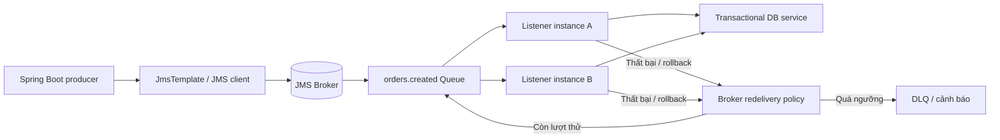
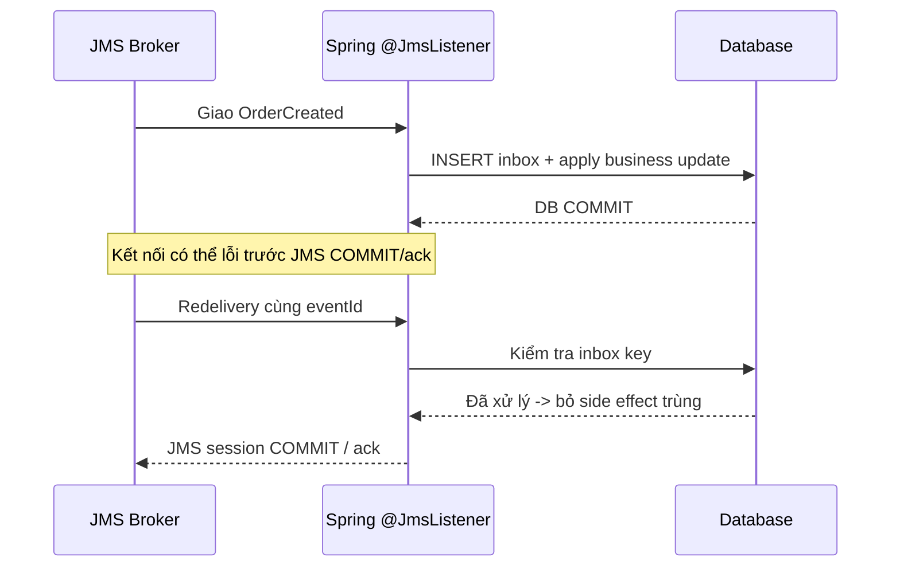

# Cấu hình spring.activemq.*, spring.artemis.* và lựa chọn broker

> **Chương:** JMS  
> **Phạm vi:** Trong module **SPRING_BOOT_INTEGRATION**, Spring Boot có thể trao đổi thông điệp với hệ thống ngoài qua HTTP client, cơ sở dữ liệu, cache, broker thông điệp và các adapter Spring Integration. Bài này tập trung vào **cấu hình kết nối JMS**, phân biệt **ActiveMQ Classic** với **ActiveMQ Artemis**, lựa chọn broker và kiểm soát hợp đồng dữ liệu, giao dịch, lỗi, xử lý trùng lặp, kiểm thử và quan sát.

## 1. Trước hết, JMS không phải tên một broker

**JMS** (*Java Message Service*, trong các phiên bản Jakarta gọi là Jakarta Messaging) là một **API/đặc tả cho ứng dụng Java** gửi và nhận message. JMS xác định những khái niệm như `ConnectionFactory`, `Destination`, `Queue`, `Topic`, `Message` và `Session`. Nó **không** tự cài đặt một message broker.

Một kiến trúc dùng Spring Boot thường có bốn tầng:

| Tầng | Ví dụ | Trách nhiệm |
| --- | --- | --- |
| **Ứng dụng** | `@JmsListener`, `JmsTemplate`, service nghiệp vụ | Tạo/nhận thông điệp và quyết định kết quả xử lý |
| **Spring JMS / Boot** | Listener container, message converter, auto-configuration | Kết nối API của ứng dụng với JMS provider; cấu hình bean, listener và transaction |
| **JMS client library** | ActiveMQ Classic client, Artemis Jakarta client | Kết nối TCP/TLS, xác thực và giao tiếp với broker tương ứng |
| **Broker server** | ActiveMQ Classic, ActiveMQ Artemis hoặc JMS provider khác | Lưu/định tuyến message, delivery, redelivery, queue/topic, bảo mật và HA |

**ActiveMQ Classic và ActiveMQ Artemis là hai sản phẩm broker khác nhau.** Chúng không chỉ là hai tên cho cùng một server hoặc hai giá trị URL có thể hoán đổi. Dù đều có thể cung cấp JMS API cho ứng dụng Java, chúng có kiến trúc, client driver, cách cấu hình broker, vận hành và các tính năng protocol khác nhau.

Trong Spring Boot, hai nhóm thuộc tính cũng phản ánh sự khác biệt ấy:

- `spring.activemq.*`: cấu hình client kết nối **ActiveMQ Classic** theo auto-configuration tương ứng.
- `spring.artemis.*`: cấu hình client kết nối **ActiveMQ Artemis** theo auto-configuration tương ứng.
- `spring.jms.*`: các thuộc tính **chung** cho tầng Spring JMS, ví dụ listener, template, cache và phương thức nhận/gửi.

Không cấu hình đồng thời cả hai họ driver trong cùng một ứng dụng chỉ vì chưa quyết định broker. Chọn đúng broker, starter/client, connection factory và hạ tầng đích trước khi tối ưu listener.

## 2. JMS Queue, Topic và các cam kết thực tế

| Khái niệm | Ý nghĩa | Lưu ý khi tích hợp |
| --- | --- | --- |
| **Queue (point-to-point)** | Một message được phân phối cho một consumer trong nhóm các consumer cạnh tranh, theo chính sách broker | Thường dùng cho **work queue**; nếu consumer chết/chưa ack, message có thể được giao lại |
| **Topic (publish-subscribe)** | Một thông điệp được phát đến các subscription tương ứng | Cần phân biệt subscription thường, durable và shared subscription khi consumer offline |
| **Persistent delivery** | Broker được yêu cầu xử lý message theo delivery mode bền vững | Phụ thuộc cấu hình broker, lưu trữ, HA và chính sách xác nhận; không đồng nghĩa “không bao giờ mất” |
| **Acknowledgment / commit** | Cho biết message đã được listener/container tiếp nhận hoặc transaction JMS đã commit | **Không** tự chứng minh mọi side effect của cơ sở dữ liệu/HTTP ngoài đã hoàn tất |
| **Redelivery** | Message có thể được broker gửi lại khi session rollback, kết nối đứt hoặc consumer thất bại | Consumer phải chịu được duplicate |
| **Dead-letter queue (DLQ)** | Nơi broker hoặc ứng dụng chuyển message không thể xử lý sau chính sách retry | Cần cấu hình theo broker; thêm JMS starter không tự áp policy DLQ theo nghiệp vụ |

**Queue không đảm bảo thứ tự tuyệt đối trong mọi hoàn cảnh**: nhiều consumer, ưu tiên message, redelivery hoặc retry có thể làm thứ tự quan sát khác thứ tự producer gửi. Nếu xử lý một order phải theo thứ tự, thiết kế partition/group/key, consumer concurrency và business version phù hợp với broker được chọn.



## 3. Chọn ActiveMQ Classic, Artemis hay một JMS provider khác?

### 3.1. Tiêu chí lựa chọn

| Câu hỏi | ActiveMQ Classic | ActiveMQ Artemis | Cần quyết định |
| --- | --- | --- | --- |
| **Broker hiện có** | Phù hợp nếu tổ chức đang vận hành Classic và có kinh nghiệm/bộ công cụ tương ứng | Phù hợp nếu nền tảng đã sử dụng Artemis hoặc đang lựa chọn mới | Ưu tiên tương thích với hạ tầng đang tồn tại; không đổi broker chỉ để đổi prefix property |
| **JMS client** | Cần client Classic đúng phiên bản và tương thích Jakarta/Spring Boot | Cần client Artemis phù hợp Jakarta/Spring Boot | Kiểm tra namespace `jakarta.jms` và compatibility matrix |
| **Protocol và bridge** | Có các khả năng protocol và connector riêng của Classic | Có các khả năng protocol và connector riêng của Artemis | Kiểm tra thực tế yêu cầu STOMP/AMQP/OpenWire/JMS và cách kết nối |
| **Hiệu năng, HA và lưu trữ** | Phụ thuộc topology, storage, tuning và version | Phụ thuộc topology, storage, tuning và version | Benchmark workload thực với message size, durable mode, consumer concurrency và failover |
| **Chi phí di chuyển** | Có thể ít thay đổi nếu đang dùng Classic | Có thể cần migration queue/address, client URL, security, failover và policy | Đánh giá migration, vận hành và khả năng rollback |
| **Độc lập nhà cung cấp** | API JMS che giấu một phần khác biệt | API JMS che giấu một phần khác biệt | Broker-specific headers, DLQ, failover, admin API vẫn khác nhau |

Không có quy tắc “JMS luôn cần Artemis” hoặc “Classic luôn chậm hơn”. Với hệ thống mới, hãy cân nhắc trạng thái hỗ trợ/bảo trì và yêu cầu vận hành của **đúng phiên bản đang triển khai**, kết hợp kiểm thử thực tế. Với hệ thống đang chạy Classic ổn định, việc nâng cấp hoặc chuyển sang Artemis là **một dự án migration** chứ không chỉ sửa `spring.activemq.*` thành `spring.artemis.*`.

### 3.2. Không nhầm JMS với Kafka, RabbitMQ và HTTP

- **JMS** là API Java; **ActiveMQ Classic/Artemis** là broker có thể được dùng với JMS.
- **Kafka** tổ chức dữ liệu theo topic/partition/offset và không trở thành JMS broker chỉ vì cả hai dùng message.
- **RabbitMQ** thường tích hợp qua Spring AMQP, với exchange, queue và routing key; đó không phải cùng API với JMS.
- **HTTP** là request-response; cần contract rõ ràng khi chuyển tác vụ từ HTTP đồng bộ sang JMS bất đồng bộ.

Nếu yêu cầu là xử lý lệnh Java enterprise qua JMS và hạ tầng đã có broker hỗ trợ, dùng Spring JMS hợp lý. Nếu cần log sự kiện lưu dài hạn để nhiều consumer replay theo offset, phải đánh giá broker/event platform theo nhu cầu, không mặc định JMS queue thỏa mãn hoàn toàn.

## 4. Phiên bản Spring Boot và namespace Jakarta JMS

Với **Spring Boot 3.x / Spring Framework 6**, ứng dụng dùng các kiểu **`jakarta.jms.*`** thay cho `javax.jms.*` của các dòng Java EE cũ. Đây là thay đổi quan trọng khi chọn ActiveMQ Classic client, Artemis Jakarta client, converter hoặc library bổ sung.

Ví dụ import được dùng ở các đoạn code bên dưới:

```java
import jakarta.jms.JMSException;
import jakarta.jms.TextMessage;
import org.springframework.jms.annotation.JmsListener;
import org.springframework.jms.core.JmsTemplate;
```

Một driver hoặc starter biên dịch với `javax.jms.ConnectionFactory` sẽ không tự trở thành `jakarta.jms.ConnectionFactory` chỉ vì ứng dụng đang chạy Boot 3. Trước khi nâng cấp, xem dependency tree và hướng dẫn tương thích **đúng bản Boot, Spring Framework và JMS client**.

Các ví dụ trong bài theo **phong cách Spring Boot 3.x**, và giả định phiên bản đang dùng còn cung cấp starter/auto-configuration tương ứng. Tên artifact, mặc định và tính năng nhúng có thể thay đổi qua từng dòng Boot; hãy đối chiếu tài liệu phiên bản ứng dụng trước khi áp dụng nguyên xi.

## 5. Dependency: hai lựa chọn thay thế, không phải hai starter phải cài cùng lúc

### 5.1. Khi dùng ActiveMQ Classic

```xml
<!-- Chọn khi broker đích là ActiveMQ Classic và
     release Spring Boot đang dùng hỗ trợ starter này. -->
<dependency>
    <groupId>org.springframework.boot</groupId>
    <artifactId>spring-boot-starter-activemq</artifactId>
</dependency>
```

Starter có vai trò đưa Spring JMS và client tương ứng lên classpath. Chỉ có dependency chưa bảo đảm broker chạy được hoặc connection đã được xác thực.

### 5.2. Khi dùng ActiveMQ Artemis

```xml
<!-- Chọn thay cho starter ActiveMQ Classic nếu broker là Artemis. -->
<dependency>
    <groupId>org.springframework.boot</groupId>
    <artifactId>spring-boot-starter-artemis</artifactId>
</dependency>
```

Đối với cả hai lựa chọn, Spring Boot có thể tạo `ConnectionFactory`, `JmsTemplate` và listener container factory khi đủ điều kiện. Khi ứng dụng tự cung cấp bean `ConnectionFactory`, nhiều auto-configuration sẽ **back off**. Không suy luận bean nào thực sự tồn tại chỉ từ tên starter: kiểm tra report auto-configuration và context test.

## 6. Cấu hình `spring.activemq.*` cho ActiveMQ Classic

Ví dụ `application.yml` khi kết nối đến Classic broker bên ngoài:

```yaml
spring:
  activemq:
    broker-url: ${ACTIVEMQ_BROKER_URL:tcp://localhost:61616}
    user: ${ACTIVEMQ_USER:integration_app}
    password: ${ACTIVEMQ_PASSWORD}

  jms:
    pub-sub-domain: false
    listener:
      session-transacted: true
      concurrency: 2
      max-concurrency: 8

integration:
  jms:
    orders-queue: orders.created
```

Các property quan trọng:

| Property | Vai trò | Điểm cần lưu ý |
| --- | --- | --- |
| `spring.activemq.broker-url` | URL kết nối Classic broker, ví dụ `tcp://...` | URL, transport và failover syntax phải đúng theo ActiveMQ Classic client |
| `spring.activemq.user` | Tài khoản JMS | Giới hạn quyền theo destination, không dùng superuser của broker |
| `spring.activemq.password` | Secret của tài khoản | Lấy từ môi trường/secret manager, không commit literal |
| `spring.activemq.in-memory` | Tùy chọn liên quan broker nhúng khi phiên bản/client/điều kiện hỗ trợ | Không dùng để thay cho broker durable production |
| `spring.activemq.pool.*` | Các tùy chọn connection pooling của client khi có thư viện pool tương thích | Không tự bật pool nếu thiếu dependency hoặc không có nhu cầu |

**Không dùng `spring.artemis.broker-url` để cấu hình Classic**, dù cả hai broker đều có thể dùng một port dạng TCP. Địa chỉ IP:port giống nhau không có nghĩa protocol client và server tương thích.

### 6.1. Broker nhúng có phù hợp không?

Với một số phiên bản và dependency tương ứng, Classic có thể hỗ trợ broker nhúng/in-memory để học hoặc thử nghiệm. Đừng mặc định mọi bản Boot 3.x đều tự chạy broker nhúng khi thiếu URL. Trong production nên sử dụng broker được quản lý riêng và có cấu hình persistence, recovery, HA, giám sát và quyền truy cập phù hợp.

**Khi test**, một broker container đúng phiên bản hoặc hạ tầng broker tạm thời thường giúp phát hiện lỗi protocol, routing và redelivery tốt hơn một mock `JmsTemplate`.

## 7. Cấu hình `spring.artemis.*` cho ActiveMQ Artemis

Với Artemis broker chạy bên ngoài, cấu hình rõ `mode: native`:

```yaml
spring:
  artemis:
    mode: native
    broker-url: ${ARTEMIS_BROKER_URL:tcp://localhost:61616}
    user: ${ARTEMIS_USER:integration_app}
    password: ${ARTEMIS_PASSWORD}

  jms:
    pub-sub-domain: false
    listener:
      session-transacted: true
      concurrency: 2
      max-concurrency: 8

integration:
  jms:
    orders-queue: orders.created
```

| Property | Vai trò | Lưu ý |
| --- | --- | --- |
| `spring.artemis.mode` | Chọn `native` (broker ngoài) hoặc `embedded` khi hạ tầng hỗ trợ | Không dùng embedded cho cấu hình HA production |
| `spring.artemis.broker-url` | Địa chỉ broker Artemis trong chế độ native | Kiểm tra cổng, protocol, cluster/failover, TLS |
| `spring.artemis.user` / `password` | Credentials kết nối | Phân quyền truy cập address/queue, quản lý secret |
| `spring.artemis.embedded.*` | Cấu hình broker nhúng trong môi trường hỗ trợ, như queue/topic khởi tạo | Chỉ có tác dụng khi có module server tương ứng và chế độ embedded |
| `spring.artemis.pool.*` | Thuộc tính pooling khi chọn cơ chế pool tương thích | Xác minh client/pool dependency và lifecycle |

Artemis có các khái niệm **address, queue và routing type** ở tầng broker. Spring JMS làm việc với `Queue`/`Topic`, nhưng việc một destination tự được tạo, được đặt tên thế nào và chuyển thành address/queue nào phụ thuộc broker security và cấu hình auto-create. Trong production nên quản lý topology bằng cấu hình hạ tầng/migration của broker, không phụ thuộc hoàn toàn vào auto-create ngầm định.

### 7.1. Chế độ embedded

Ví dụ cấu hình **chỉ để minh họa** một môi trường nhúng:

```yaml
spring:
  artemis:
    mode: embedded
    embedded:
      queues: orders.created,orders.dead
      persistent: false
```

Chế độ này cần dependency server Artemis phù hợp với Jakarta JMS và release Boot đang dùng, ví dụ module Artemis Jakarta server được phiên bản đó hỗ trợ. Không chỉ đổi `mode` là bảo đảm nhúng chạy. Các bài test về broker restart, persistent delivery, failover và bảo mật **không nên chỉ dựa trên broker nhúng không lưu bền vững**.

## 8. `spring.jms.*`: cấu hình chung cho listener và template

Các thuộc tính `spring.jms.*` phục vụ abstraction Spring JMS, phần lớn không phụ thuộc chọn Classic hay Artemis.

| Property | Ý nghĩa | Gợi ý |
| --- | --- | --- |
| `spring.jms.pub-sub-domain` | Chọn mặc định dạng topic (`true`) hoặc queue (`false`) cho các thành phần dùng setting này | Ví dụ worker dùng queue nên đặt `false` |
| `spring.jms.listener.auto-startup` | Tự khởi động listener khi ứng dụng sẵn sàng | Có thể tắt tạm cho maintenance có kiểm soát |
| `spring.jms.listener.concurrency` | Số consumer đồng thời ban đầu/tối thiểu theo container | Đo throughput và tác động tới thứ tự/DB |
| `spring.jms.listener.max-concurrency` | Giới hạn worker listener đồng thời | Tính cả tổng số instance và khả năng broker/downstream |
| `spring.jms.listener.session-transacted` | Yêu cầu listener container sử dụng JMS session transaction theo điều kiện hỗ trợ | Dùng có chủ đích khi muốn exception dẫn đến rollback/redelivery |
| `spring.jms.listener.acknowledge-mode` | Chế độ acknowledgment khi không dùng session transaction | Khác `session-transacted`; hiểu semantics của container |
| `spring.jms.template.default-destination` | Destination gửi mặc định khi gọi `JmsTemplate` không chỉ rõ đích | Hữu ích cho producer chỉ dùng một queue |
| `spring.jms.cache.*` | Cấu hình caching của kết nối/session JMS | Caching khác pooling; không bật trùng cơ chế vô tội vạ |

**Một cấu hình listener không thay toàn bộ policy của broker.** Broker quyết định nhiều khía cạnh redelivery delay, max delivery attempts, DLQ, persistence và expiry. Ví dụ `session-transacted: true` làm exception có thể rollback JMS session; sau rollback, broker quyết định việc giao lại ngay, chờ bao lâu hoặc đưa DLQ theo cấu hình.

Không chọn `CLIENT_ACKNOWLEDGE`, `AUTO_ACKNOWLEDGE` hoặc session transaction theo tên gọi đơn thuần. **Spring listener container** ảnh hưởng thời điểm ack, cách xử lý exception và behavior khi shutdown; cần kiểm thử với provider thực.

## 9. Ví dụ Spring Boot: producer và consumer với TextMessage JSON

Giả sử contract sự kiện là:

```json
{
  "eventId": "evt-7421",
  "sourceSystem": "checkout",
  "orderId": "ORD-0042",
  "amountMinor": 125000,
  "currency": "VND"
}
```

Chọn JSON trong `TextMessage` giúp dễ debug; có thể dùng converter JMS/Jackson để gửi object trực tiếp, nhưng cần thống nhất type mapping và trusted type trước khi áp dụng giữa nhiều dịch vụ. **Không gửi Java serialized `ObjectMessage` từ nguồn không tin cậy** nếu không có chính sách an toàn deserialization rõ ràng.

### 9.1. DTO chia sẻ theo hợp đồng

```java
package com.example.integration.jms;

public record OrderCreated(
        String eventId,
        String sourceSystem,
        String orderId,
        long amountMinor,
        String currency
) {}
```

Trong hệ thống thực, DTO cần validation: `eventId` không rỗng, `sourceSystem` là nguồn được phép, `amountMinor >= 0`, currency thuộc danh sách hợp lệ và schema version rõ ràng. Một JSON parse thành công chưa chứng minh hợp đồng nghiệp vụ được thỏa mãn.

### 9.2. Producer dùng JmsTemplate

```java
package com.example.integration.jms;

import com.fasterxml.jackson.core.JsonProcessingException;
import com.fasterxml.jackson.databind.ObjectMapper;
import org.springframework.beans.factory.annotation.Value;
import org.springframework.jms.core.JmsTemplate;
import org.springframework.stereotype.Service;
import jakarta.jms.TextMessage;

@Service
public class OrderEventPublisher {
    private final JmsTemplate jmsTemplate;
    private final ObjectMapper objectMapper;
    private final String queue;

    public OrderEventPublisher(
            JmsTemplate jmsTemplate,
            ObjectMapper objectMapper,
            @Value("${integration.jms.orders-queue}") String queue) {
        this.jmsTemplate = jmsTemplate;
        this.objectMapper = objectMapper;
        this.queue = queue;
    }

    public void send(OrderCreated event, String correlationId)
            throws JsonProcessingException {
        String json = objectMapper.writeValueAsString(event);

        jmsTemplate.send(queue, session -> {
            TextMessage message = session.createTextMessage(json);
            message.setStringProperty("eventType", "order.created");
            message.setIntProperty("schemaVersion", 1);
            message.setJMSCorrelationID(correlationId);
            return message;
        });
    }
}
```

Ở đây, `JmsTemplate.send(...)` sử dụng `ConnectionFactory` đã được Boot cấu hình cho broker chọn trước đó. Gửi thành công ở phía client **không tự xác nhận rằng một transaction DB riêng đã commit**, và cũng không nói consumer đã hoàn tất xử lý nghiệp vụ.

Nếu producer vừa cập nhật database vừa phát JMS, không nên mặc định `@Transactional` với `JpaTransactionManager` có thể commit cả hai tài nguyên. Phần về outbox và ranh giới transaction ở mục 11 sẽ giải quyết trường hợp này.

### 9.3. Consumer dùng @JmsListener

```java
package com.example.integration.jms;

import com.fasterxml.jackson.core.JsonProcessingException;
import com.fasterxml.jackson.databind.ObjectMapper;
import jakarta.jms.JMSException;
import jakarta.jms.TextMessage;
import org.springframework.jms.annotation.EnableJms;
import org.springframework.jms.annotation.JmsListener;
import org.springframework.stereotype.Component;

@Component
public class OrderEventListener {
    private final ObjectMapper mapper;
    private final OrderProjectionService orderService;

    public OrderEventListener(
            ObjectMapper mapper,
            OrderProjectionService orderService) {
        this.mapper = mapper;
        this.orderService = orderService;
    }

    @JmsListener(destination = "${integration.jms.orders-queue}")
    public void receive(TextMessage message)
            throws JMSException, JsonProcessingException {
        OrderCreated event =
                mapper.readValue(message.getText(), OrderCreated.class);

        // Validation và idempotency được thực hiện trong service.
        orderService.applyOnce(event);
    }
}
```

Khi cần cấu hình annotation-based listener theo cách tường minh, đặt `@EnableJms` trên một `@Configuration` trong ứng dụng. Với cấu hình auto-configuration của Boot, cần xác minh listener container factory thực tế được chọn và các setting `spring.jms.listener.*` đã được áp dụng. Không gọi `receive()` trực tiếp trong unit test rồi kết luận broker ack/rollback hoạt động.

Để phân biệt kiểu message, consumer có thể nhận `jakarta.jms.Message` và kiểm tra kiểu `TextMessage` trước khi giải mã; ví dụ trên giả định destination chỉ chứa TextMessage JSON theo contract. Nếu broker nhận message khác kiểu, lỗi chuyển đổi/dispatch phải được xử lý theo chính sách DLQ, tránh retry vô hạn một payload không thể giải mã.

## 10. Acknowledgment và JMS transaction: khi nào message được giao lại?

**Điểm dễ sai nhất của tích hợp JMS là coi “listener chạy một lần” như một guarantee exactly-once.** Khi listener xử lý thành công, broker cần biết có thể đánh dấu message là consumed. Nếu listener hoặc kết nối thất bại trước điểm xác nhận phù hợp, message có thể được giao lại.



### 10.1. JMS session transaction

Khi listener container dùng **transacted JMS session**, việc listener hoàn tất bình thường thường cho phép commit session; khi exception không được nuốt, container có thể rollback session để broker redeliver theo policy. Cần kiểm thử điều này với Spring Boot version, listener container và JMS provider đang dùng.

**Không biến `session-transacted: true` thành distributed transaction**: nó quản lý acknowledgement/send trong JMS session, không tự rollback transaction JDBC/JPA trong database. Nếu DB đã commit, còn JMS session rollback do mất kết nối, redelivery vẫn xảy ra. Vì thế consumer phải idempotent.

### 10.2. Acknowledge mode không transacted

Nếu session không transacted, `AUTO_ACKNOWLEDGE`, `CLIENT_ACKNOWLEDGE` hoặc một chế độ khác có hành vi riêng. Spring `DefaultMessageListenerContainer` và `SimpleMessageListenerContainer` có các chi tiết lifecycle khác nhau; không suy ra mọi lỗi listener ở auto-ack sẽ buộc broker giao lại message. Muốn đảm bảo lỗi xử lý dẫn đến redelivery trong kịch bản của mình, hãy dùng transaction/ack policy có chủ đích và kiểm thử bằng broker thật.

### 10.3. DLQ và poison message

Payload JSON không thể giải mã, event type lạ hoặc schema breaking thường không thể sửa bằng retry trong vài giây. Nếu không phân loại, một *poison message* có thể bị giao lại mãi:

- **Transient:** broker chập chờn, database timeout, HTTP 503 → retry có giới hạn, backoff.
- **Permanent:** JSON/schema sai, thiếu trường bắt buộc, không được phép → gửi DLQ/quarantine theo quy định, báo nguồn phát sửa.
- **Unknown outcome:** side effect đã thực hiện nhưng response/ack mất → tra cứu kết quả bằng business/idempotency key trước khi retry.

ActiveMQ Classic và Artemis có **cấu hình DLQ/redelivery khác nhau** ở tầng broker. Các property `spring.activemq.*` và `spring.artemis.*` để kết nối **không đủ để định nghĩa chính sách poison message**. Thiết kế queue DLQ, quyền đọc, retention, alert và replay theo hạ tầng vận hành.

## 11. Ghi database từ JMS listener: transaction và idempotency

Giả sử consumer phải lưu order projection vào PostgreSQL. Ta bảo vệ side effect bằng bảng **inbox** và ràng buộc duy nhất ở database.

### 11.1. SQL schema

```sql
CREATE TABLE processed_events (
    consumer_name VARCHAR(80) NOT NULL,
    source_system VARCHAR(80) NOT NULL,
    event_id VARCHAR(160) NOT NULL,
    processed_at TIMESTAMPTZ NOT NULL DEFAULT CURRENT_TIMESTAMP,
    PRIMARY KEY (consumer_name, source_system, event_id)
);

CREATE TABLE order_projection (
    source_system VARCHAR(80) NOT NULL,
    external_order_id VARCHAR(120) NOT NULL,
    amount_minor BIGINT NOT NULL CHECK (amount_minor >= 0),
    currency VARCHAR(3) NOT NULL,
    PRIMARY KEY (source_system, external_order_id)
);
```

Inbox scope có `consumer_name` vì cùng sự kiện có thể được nhiều consumer nghiệp vụ khác nhau xử lý độc lập. `source_system + event_id` phải ổn định khi cùng event được redeliver. Khóa business của `order_projection` bảo vệ thêm trường hợp producer vô tình phát **hai event ID khác nhau** cho cùng order.

### 11.2. Transaction ngắn trong Spring JDBC

```java
package com.example.integration.jms;

import org.springframework.jdbc.core.JdbcTemplate;
import org.springframework.stereotype.Service;
import org.springframework.transaction.annotation.Transactional;

@Service
public class OrderProjectionService {
    private final JdbcTemplate jdbc;

    public OrderProjectionService(JdbcTemplate jdbc) {
        this.jdbc = jdbc;
    }

    @Transactional
    public void applyOnce(OrderCreated event) {
        if (event.eventId() == null || event.eventId().isBlank()
                || event.sourceSystem() == null
                || event.sourceSystem().isBlank()
                || event.orderId() == null || event.orderId().isBlank()
                || event.amountMinor() < 0) {
            throw new IllegalArgumentException(
                    "Invalid OrderCreated contract"
            );
        }

        int claimed = jdbc.update("""
            INSERT INTO processed_events (
                consumer_name, source_system, event_id
            ) VALUES ('order-projection', ?, ?)
            ON CONFLICT DO NOTHING
            """,
            event.sourceSystem(), event.eventId()
        );

        if (claimed == 0) {
            return; // Redelivery cùng event, DB đã commit từ trước.
        }

        jdbc.update("""
            INSERT INTO order_projection (
                source_system, external_order_id,
                amount_minor, currency
            ) VALUES (?, ?, ?, ?)
            ON CONFLICT (source_system, external_order_id)
            DO NOTHING
            """,
            event.sourceSystem(), event.orderId(),
            event.amountMinor(), event.currency()
        );
    }
}
```

Đây là ví dụ **create event**. Trong hệ thống thật, nếu `external_order_id` đã tồn tại nhưng amount/currency khác, không nên bỏ qua âm thầm. Cần đối chiếu fingerprint/version hoặc báo conflict và đưa message vào quy trình điều tra. Ví dụ tập trung vào nguyên tắc **cùng transaction DB cho inbox và business update**.

Nếu bước ghi projection lỗi, transaction DB rollback cả bản ghi inbox; exception phải được đưa ra khỏi listener để JMS session có thể rollback/redeliver theo cấu hình. Nếu DB commit thành công nhưng JMS commit/ack thất bại, broker có thể giao lại; lần sau `claimed == 0` và side effect không xảy ra lần nữa.

**Không bắt exception rồi chỉ log** bên trong listener nếu bạn vẫn muốn container thực hiện rollback/redelivery. Khi bắt để phân loại, phải có đường xử lý bền vững và acknowledgment policy tương ứng.

### 11.3. Producer: DB rồi JMS không tự atomic

Một service xử lý “ghi order trong DB rồi gửi JMS” có rủi ro crash giữa hai thao tác:

```text
TX SQL: INSERT order -> COMMIT
Process crash trước jmsTemplate.send(...)
Kết quả: order đã có, message chưa được phát
```

Mẫu **transactional outbox**:

1. Trong **một transaction SQL**, lưu business state và bản ghi outbox cùng event ID/payload chuẩn hóa.
2. Sau commit, worker đọc outbox, gửi JMS đến broker.
3. Nếu publisher crash sau khi broker nhận nhưng trước khi cập nhật outbox, message có thể được gửi lại **với cùng event ID**.
4. Consumer có inbox/idempotency để xử lý các bản sao, và publisher có trạng thái retry/DLQ riêng.

Không giả định `@Transactional` dùng `JpaTransactionManager` tự bao trùm cả connection JMS. Nếu thực sự yêu cầu XA/distributed transaction, cần transaction manager, XA-capable resource, cấu hình và kiểm thử chuyên biệt; đây là đánh đổi phức tạp và không mặc nhiên là lựa chọn tốt hơn outbox.

## 12. Message contract, headers và chuyển đổi payload

JMS có các header/metadata tiêu chuẩn như message ID, correlation ID, reply-to, delivery mode, timestamp, expiration, priority và các application property. Không nên trộn lẫn:

| Trường | Đến từ đâu? | Dùng thế nào? |
| --- | --- | --- |
| `JMSMessageID` | Thường do provider cấp cho một JMS message | Truy vết delivery; **không** bảo đảm ổn định nếu producer tạo message mới khi retry |
| `JMSCorrelationID` | Producer/flow đặt theo hợp đồng | Nối request-reply/log/trace của một hành trình |
| `JMSReplyTo` | Producer đặt khi cần reply | Xác định destination cho request-reply, nhưng vẫn phải định nghĩa timeout và correlation |
| `JMSRedelivered` | Broker/provider chỉ báo message đã được giao lại | Hỗ trợ quan sát, **không đủ** làm cơ chế chống trùng |
| `JMSXDeliveryCount` | Thuộc tính delivery count nếu provider hỗ trợ | Có thể hỗ trợ cảnh báo/chính sách; không dựa vào property không được provider bảo đảm |
| `eventId` / `sourceSystem` trong payload | Hợp đồng nghiệp vụ | Dùng dedup bền vững với scope đã thống nhất |
| `schemaVersion` / `eventType` | Property hoặc envelope theo contract | Chọn serializer/validator, bảo vệ consumer khi schema tiến hóa |

**Khi chuyển giữa JMS và HTTP/Kafka/Spring Integration**, giữ correlation ID và business event ID qua các adapter. JMS MessageID của một lần gửi không nhất thiết thay thế event ID khi chuyển đổi hoặc publish lại.

### 12.1. TextMessage, BytesMessage và ObjectMessage

- **`TextMessage`:** thuận tiện cho JSON/XML, dễ quan sát nhưng vẫn cần schema validation.
- **`BytesMessage`:** phù hợp payload binary có codec/schema thỏa thuận, ví dụ Protobuf; phải kiểm soát kích thước, schema ID và serializer.
- **`ObjectMessage`:** phụ thuộc Java serialization và type/class compatibility; **không nên nhận ObjectMessage không tin cậy** nếu không có allowlist và kiểm soát deserialization rõ ràng.

Không coi object JSON có tên trường mới là chắc chắn tương thích: consumer có thể không chấp nhận unknown fields hoặc enum mới. Với dữ liệu nhạy cảm, không đưa toàn bộ payload vào log/DLQ không được bảo vệ.

## 13. Connection caching, pooling và concurrency

Spring Boot có thể dùng cơ chế cache của Spring JMS, chẳng hạn `CachingConnectionFactory`, để tái sử dụng connection/session theo cấu hình `spring.jms.cache.*`. Một lựa chọn khác là **JMS connection/session pool** của thư viện tương thích được kết nối qua properties `spring.activemq.pool.*` hoặc `spring.artemis.pool.*`.

**Cache khác pool:**

- **Caching** tái sử dụng connection và một số session/producer/consumer, giảm chi phí tạo đi tạo lại.
- **Pooling** giới hạn và quản lý tài nguyên được mượn/trả giữa các caller, có thể có max connections/sessions và thời gian chờ.
- **Listener concurrency** quyết định số listener consumer hoạt động song song, không phải chính là số physical connection.

Chỉ bật pool nếu dependency và cấu hình tương thích với broker driver; đừng xem một property `pool.enabled` như cam kết pool tự xuất hiện. Tài nguyên tối đa phải tính **trên tất cả replica** khi scale hoặc rolling deployment.

Một ví dụ cấu hình cache Spring JMS:

```yaml
spring:
  jms:
    cache:
      enabled: true
      session-cache-size: 5
```

Không mặc định “cache session-size 5” nghĩa mọi listener chỉ có tối đa 5 consumer. Listener container có thể quản lý connection/session riêng; đo connection count, consumer count, queue depth và tác động của concurrency khi load test.

### 13.1. Timeout và điều tiết tải

- Đặt timeout cho phần gọi HTTP/DB ở downstream; listener không nên giữ transaction JMS lâu khi chờ kết nối ngoài không kiểm soát.
- Nếu queue backlog tăng, tăng consumer concurrency có thể làm DB hoặc partner quá tải. Dùng giới hạn concurrency và backpressure ở cấp ứng dụng (pool, semaphore, bulkhead, rate limit).
- Retry sau thất bại cần backoff/jitter hoặc redelivery delay phù hợp. Retry ngay hàng nghìn message khi DB down có thể tạo thác lỗi.
- Kiểm tra expiration/TTL của message: thông điệp đã hết hạn có thể không được giao hoặc bị chuyển expiry address theo policy broker; TTL không phải hạn lưu kết quả idempotency của ứng dụng.

## 14. Bảo mật và triển khai broker production

Một cấu hình `tcp://localhost:61616` chỉ phù hợp local/dev. Với production:

1. **TLS:** chọn connector/URI TLS tương ứng với provider; xác minh chứng chỉ và hostname, không mặc định TCP plain text là an toàn.
2. **Authentication và authorization:** user chỉ được gửi/nhận những queue/topic cần thiết, không dùng tài khoản admin chung.
3. **Topology:** khai báo queue/address, durable subscription, DLQ, expiry queue và security bằng hạ tầng broker có version/ownership.
4. **HA/failover:** cấu hình theo broker/client version, thử mất node, restart, DNS thay đổi và redelivery sau reconnect.
5. **Message size và storage:** giới hạn payload; với file lớn nên dùng object storage và gửi metadata/reference, không nhét file vô hạn vào queue.
6. **Secret:** lấy từ biến môi trường/secret manager; không ghi password hoặc payload nhạy cảm vào log/debug output.
7. **Upgrade:** kiểm tra Jakarta JMS client, protocol compatibility, broker persistence và policy trước khi nâng Spring Boot/driver/broker.

Chỉ đổi URL hoặc thêm failover syntax không tạo ra HA nếu broker không được cấu hình replication/persistence và nếu consumer không xử lý trùng.

## 15. Quan sát lỗi và trạng thái thông điệp

| Tín hiệu quan sát | Câu hỏi trả lời |
| --- | --- |
| Queue depth và age của message lâu nhất | Consumer có theo kịp producer không? |
| Enqueue/dequeue/ack rate | Luồng có đang tiến triển không? |
| Consumer count và unacknowledged/in-flight | Có consumer bị kẹt, chờ DB hoặc chờ HTTP không? |
| Redelivery rate và delivery count | Có lỗi tạm thời, poison message hay ack thất bại không? |
| DLQ depth và tốc độ tăng | Có thay đổi schema hoặc sự cố kéo dài cần điều tra không? |
| Connection/reconnect/auth failures | Vấn đề network, TLS, credentials hay failover? |
| Listener exception và thời gian xử lý | Lỗi trong business handler, converter, transaction hay downstream? |
| Inbox duplicate rate | Broker đang giao lại nhiều message hay producer publish trùng? |
| Outbox backlog | DB đã ghi ý định nhưng JMS publisher chưa gửi được? |

Có thể dùng Spring Boot Actuator, Micrometer và metric/exporter của **broker riêng**. Nhiều metric broker không tự xuất hiện chỉ vì ứng dụng đã thêm `spring-boot-starter-actuator`. Không gắn `eventId`, `orderId` hoặc JMS MessageID làm metric tag do cardinality cao; dùng operation, queue, error category và status có tập giá trị giới hạn.

Khi nhận message không hợp lệ, lưu mã lỗi, source, schema version, thời điểm, số lần thử và một tham chiếu payload bảo mật thay vì log toàn bộ nội dung. Mọi DLQ cần quy trình xác minh trước khi replay; không replay thẳng mà bỏ qua idempotency/inbox.

## 16. Kiểm thử cấu hình Classic, Artemis và độ tin cậy

### 16.1. Lớp kiểm thử

| Nhóm test | Điều cần kiểm tra |
| --- | --- |
| **Auto-configuration** | Khi dùng một starter, đúng `ConnectionFactory`/`JmsTemplate` được tạo; property prefix đúng |
| **Connection** | Sai URL/TLS/password tạo lỗi rõ và không khiến listener retry vô hạn |
| **Queue routing** | Producer gửi đúng destination; một consumer hợp lệ nhận message đúng contract |
| **Topic subscription** | Mỗi subscription mong đợi nhận được message; durable/offline semantics đúng cấu hình |
| **Message conversion** | JSON/TextMessage, schema version, property type, unknown field và lỗi malformed |
| **Listener transaction** | Exception được propagate; broker rollback/redelivery đúng policy; không ack sớm |
| **Inbox** | Redelivery cùng `eventId` không ghi projection trùng |
| **Crash sau DB commit trước JMS ack** | Redelivery xảy ra mà không lặp side effect |
| **Outbox** | DB commit nhưng publisher chưa gửi vẫn có job để retry; publish trùng không làm consumer sai |
| **Poison message và DLQ** | Quá ngưỡng retry được chuyển tới DLQ, có metric và khả năng điều tra |
| **Failover/restart** | Queue message và trạng thái consumer đúng khi broker restart/mất node |
| **Concurrency/backlog** | Nhiều listener không vi phạm ordering/business key; DB và HTTP không bị quá tải |

**Không dùng mock `JmsTemplate` để kết luận về ack, redelivery hay độ bền message.** Với integration test, dùng broker thực trong môi trường test (container ActiveMQ Classic hoặc Artemis theo dự án đang chọn). Testcontainers có thể hỗ trợ vòng đời broker và cấu hình `spring.activemq.broker-url`/`spring.artemis.broker-url` động. Đợi một sự kiện bằng latch/queue có deadline thay vì `Thread.sleep()` kéo dài.

### 16.2. Hai kịch bản cần thực hành

**Kịch bản A — database rollback:**

1. Producer phát `OrderCreated(eventId=evt-1)` tới `orders.created`.
2. Trong listener, cố tình làm lệnh SQL thứ hai lỗi sau khi insert inbox.
3. Xác nhận transaction DB rollback cả inbox và projection.
4. Xác nhận JMS session rollback/adapter cho broker redeliver sau khi có lỗi.
5. Sửa nguyên nhân rồi xử lý redelivery thành công đúng một lần.

**Kịch bản B — message đã xử lý nhưng ack mất:**

1. Consumer nhận `evt-2`, commit DB thành công.
2. Giả lập ngắt kết nối trước khi broker ghi nhận ack/session commit.
3. Broker giao lại cùng event ID.
4. Inbox nhận diện duplicate; service không ghi side effect lần nữa.
5. Listener kết thúc bình thường để broker có thể ack message sau redelivery.

Hai bài test trên minh họa vì sao **JMS transaction và DB transaction độc lập** vẫn có thể đạt *at-least-once delivery + idempotent processing* mà không cần hứa hẹn “exactly once” xuyên toàn hệ thống.

## 17. Những nhầm lẫn cần tránh

1. **“JMS là ActiveMQ.”** Sai: JMS là API; Classic và Artemis là các broker/provider khác nhau.
2. **“Classic và Artemis dùng chung property.”** Sai: `spring.activemq.*` khác `spring.artemis.*`.
3. **“Chỉ thay `broker-url` là chuyển từ Classic sang Artemis.”** Sai: cần thay client, kiểm tra protocol, destination topology, bảo mật và migration.
4. **“Spring Boot 3 chấp nhận mọi javax.jms client cũ.”** Sai: cần Jakarta-compatible client/API theo phiên bản.
5. **“Listener gọi xong là message không bao giờ đến lại.”** Sai: crash/mất ack có thể gây redelivery.
6. **“JMS session transaction bao trùm PostgreSQL.”** Sai: chỉ có cùng transaction khi đã thiết kế XA/distributed transaction chuyên biệt.
7. **“Có `spring.jms.listener.session-transacted=true` là có exactly-once.”** Sai: vẫn cần inbox/idempotency ở nghiệp vụ.
8. **“Bật pool nghĩa là throughput luôn cao hơn.”** Sai: còn phụ thuộc broker, DB/HTTP downstream, session transaction, payload và concurrency.
9. **“Auto-config starter đồng nghĩa queue, DLQ và HA được tạo an toàn.”** Sai: những phần này cần cấu hình broker theo môi trường.
10. **“JMSMessageID luôn là idempotency key tốt nhất.”** Sai: producer có thể tạo message mới mang JMSMessageID mới cho cùng ý định nghiệp vụ.
11. **“Chỉ dùng JMSTextMessage nên không cần schema.”** Sai: JSON có thể thiếu trường hoặc thay đổi ngữ nghĩa, cần validation/versioning.

## 18. Checklist chọn broker và triển khai

1. **Xác nhận loại broker** đang chạy thực sự: ActiveMQ Classic, Artemis hoặc provider khác.
2. **Chọn đúng starter/client** và compatibility với Spring Boot, Jakarta JMS, Java, broker.
3. **Cấu hình đúng prefix:** `spring.activemq.*` hay `spring.artemis.*`, dùng `spring.jms.*` cho listener/template chung.
4. **Quy định queue/topic và topology:** delivery mode, ack, subscription, concurrency, ordering, DLQ và retention.
5. **Chốt contract:** payload schema, version, event ID, source, correlation ID, timeout, retry.
6. **Chọn transaction boundary:** JMS session transaction, DB transaction riêng, outbox/inbox cho side effect xuyên hệ thống.
7. **Thiết kế lỗi:** transient/permanent/unknown, broker redelivery, DLQ và quy trình replay có kiểm soát.
8. **Giới hạn tài nguyên:** connection/session cache/pool, số listener, kích thước message, downstream thread/DB pool.
9. **Bảo mật:** TLS, tài khoản với quyền tối thiểu, secret, access control và audit.
10. **Kiểm thử:** broker thật, startup/config, duplicate, crash sau commit, failover, rollback và quan sát.

### Câu hỏi tự kiểm tra

1. JMS là giao diện lập trình hay là một broker? ActiveMQ Classic và Artemis khác nhau ở đâu?
2. `spring.activemq.broker-url` và `spring.artemis.broker-url` dùng cho những client/broker nào?
3. `spring.jms.listener.session-transacted` giải quyết điều gì, và tại sao không đủ cho exactly-once?
4. Vì sao cùng `eventId` có thể xuất hiện nhiều lần dù producer chỉ gửi một lần có chủ đích?
5. Nếu listener commit PostgreSQL xong rồi JMS session rollback, bảng inbox ngăn sai lệch thế nào?
6. Những trường JMS header nào có ích để trace và những trường nào không đủ để dedup?
7. Nếu producer vừa ghi DB vừa `jmsTemplate.send()`, tại sao vẫn có thể mất event?
8. Khi consumer nhận JSON sai schema và broker retry vô hạn, nên sửa chính sách nào?
9. Điều gì cần kiểm thử trước khi nâng Classic lên Artemis hoặc đổi Spring Boot phiên bản lớn?
10. Broker queue depth tăng nhưng consumer count cũng tăng, những bottleneck nào ngoài JMS cần kiểm tra?

**Ghi nhớ:** `spring.activemq.*` cấu hình ActiveMQ Classic; `spring.artemis.*` cấu hình Artemis; `spring.jms.*` cấu hình tầng Spring JMS chung. Lựa chọn broker phải dựa trên hạ tầng, compatibility, HA, topology và vận hành thực tế. Với Spring Boot, JMS giúp tách producer–consumer nhưng **không tạo một transaction chung với SQL hoặc HTTP**; độ tin cậy đến từ ack/redelivery đúng chính sách, outbox/inbox, idempotency bền vững, DLQ, kiểm thử broker thật và quan sát đầy đủ.
