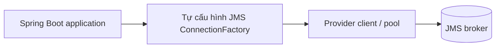
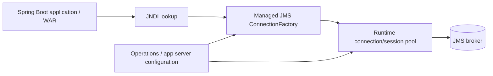
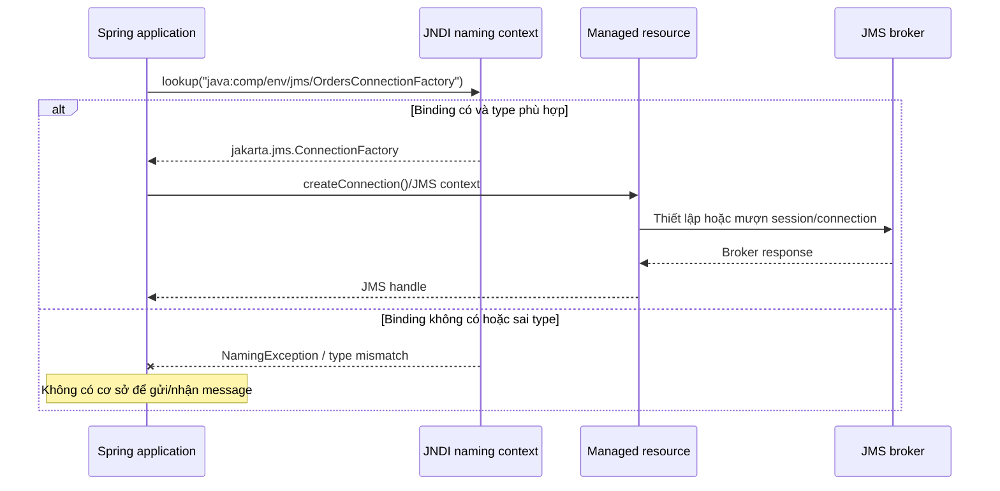
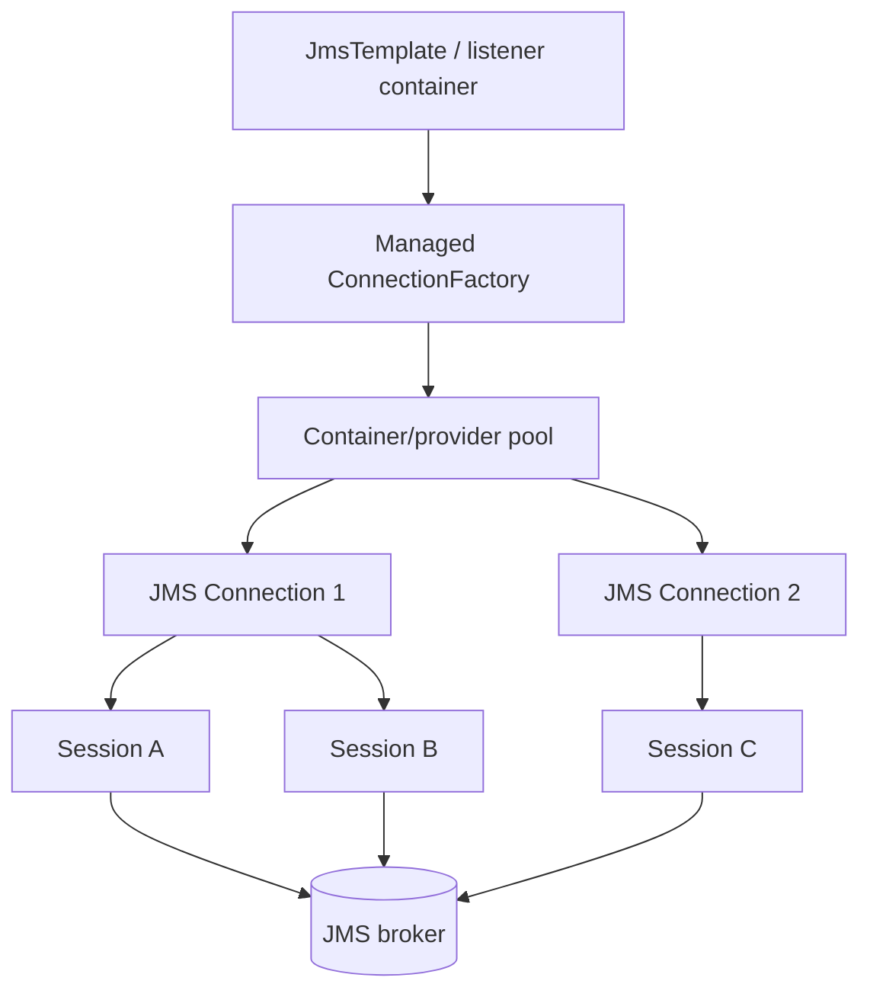
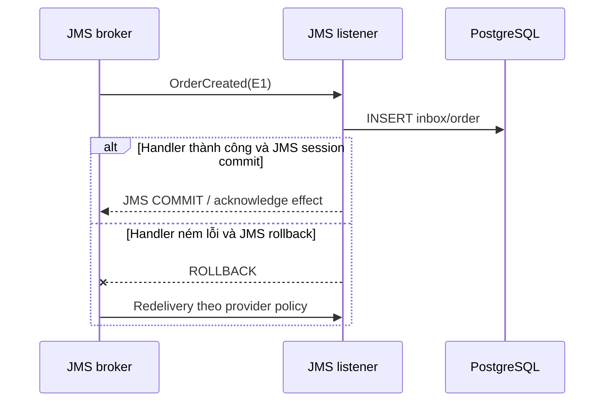
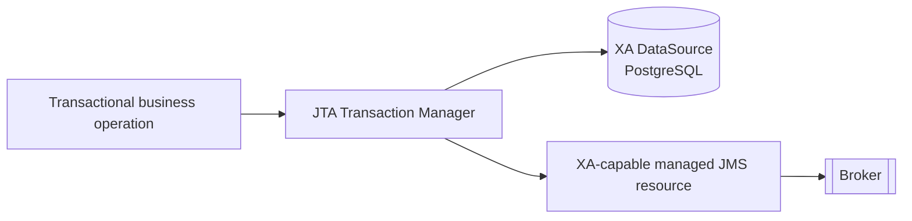
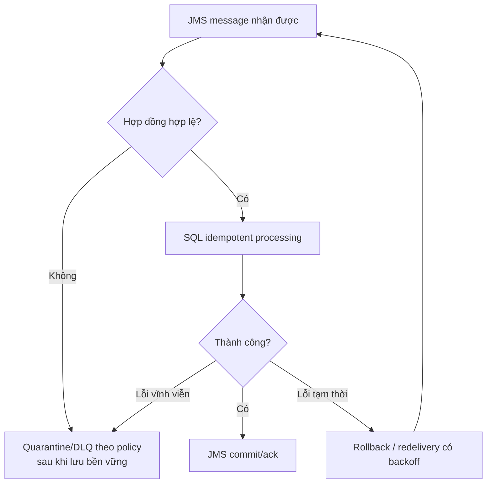
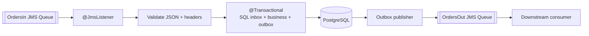
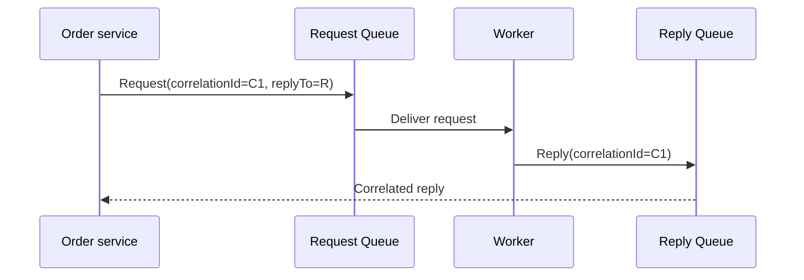
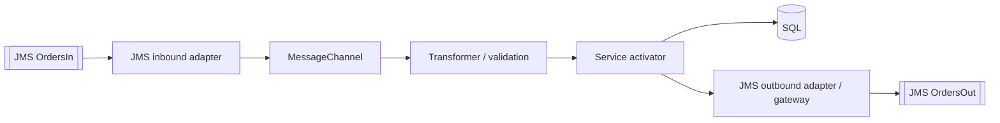

# JNDI ConnectionFactory và tài nguyên do môi trường quản lý

Trong một ứng dụng Spring Boot chạy độc lập, lập trình viên thường khai báo địa chỉ message broker, username, password và tạo `ConnectionFactory` ngay trong ứng dụng. Nhưng ở nhiều môi trường doanh nghiệp, các thông tin ấy **không thuộc quyền quản lý của application**: application server hoặc runtime tích hợp đã tạo sẵn một JMS `ConnectionFactory`, định cấu hình broker, TLS, pool, transaction và chính sách truy cập. Ứng dụng chỉ cần **tra cứu tài nguyên bằng JNDI**.

Ví dụ một hệ thống nhận sự kiện `OrderCreated` từ hàng đợi JMS rồi ghi đơn hàng vào SQL. Khi chuyển từ môi trường phát triển sang application server, nhóm vận hành cung cấp JNDI name `java:comp/env/jms/OrdersConnectionFactory` thay vì URL broker. Nếu Spring Boot cố tự tạo connection factory thứ hai, ứng dụng có thể kết nối sai broker, bỏ qua pool do runtime quản lý, không tham gia transaction như mong đợi hoặc không khởi động được vì xung đột thư viện `javax.jms`/`jakarta.jms`.

Bài học thuộc chương **JMS** của module **SPRING_BOOT_INTEGRATION**. Trọng tâm là cách Spring Boot kết nối các hệ thống qua HTTP client, SQL, cache, broker thông điệp và adapter của Spring Integration, cùng quản lý **cấu hình, hợp đồng dữ liệu, giao dịch, lỗi, xử lý trùng lặp, kiểm thử và quan sát**. Vì vậy, chúng ta không dừng ở một lệnh JNDI lookup: cần hiểu **ai sở hữu tài nguyên, ai quản lý vòng đời, việc gửi/nhận message có transaction nào, và điều gì xảy ra khi broker hoặc runtime gặp lỗi**.

> **Phạm vi ví dụ:** Java 17+, Spring Boot 3.x/Spring Framework 6.x, Spring JMS và **Jakarta Messaging/Jakarta JMS** (`jakarta.jms.*`). Tên JNDI, transaction manager, cơ chế pool và cách đóng gói tùy application server/broker (ví dụ WildFly, WebLogic, WebSphere Liberty hoặc một môi trường Jakarta EE tương đương). Không dùng nguyên mẫu này để kết luận mọi application server có cùng một JNDI namespace. Với Spring Boot 4.x/Jakarta Messaging hoặc thế hệ provider khác, hãy kiểm tra tài liệu đúng phiên bản.

## 1. Mục tiêu học tập

Sau bài này, bạn có thể:

1. Giải thích **JMS ConnectionFactory**, **JNDI**, **administered object** và **resource reference** khác nhau ở điểm nào.
2. Phân biệt kết nối JMS do ứng dụng tự tạo với `ConnectionFactory` do runtime/application server quản lý.
3. Tra cứu `jakarta.jms.ConnectionFactory` qua JNDI trong Spring Boot bằng cấu hình hoặc Java bean.
4. Dùng tài nguyên JNDI cùng `JmsTemplate`, `@JmsListener` và `DefaultJmsListenerContainerFactory`.
5. Hiểu vòng đời connection/session/pool và tránh xếp chồng caching/pooling không được kiểm chứng.
6. Phân biệt **JMS session transaction**, **JDBC transaction** và **JTA/XA distributed transaction**.
7. Thiết kế error handling, redelivery, DLQ, idempotency và acknowledgment đúng ranh giới.
8. Kiểm thử trên broker cục bộ và môi trường JNDI thật, gồm startup, TLS/auth, failover và quyền truy cập.
9. Vận hành với metric, health checks, kiểm soát quyền và cơ chế khôi phục.

## 2. Những khái niệm nền tảng

### 2.1. JMS là một API, không phải tên một broker

**Jakarta Messaging (JMS)** định nghĩa API Java cho gửi/nhận message:

- `ConnectionFactory`: tạo connection/`JMSContext` theo API provider.
- `Connection`: kết nối logic giữa ứng dụng và messaging provider.
- `Session`: ngữ cảnh tạo, gửi, nhận, acknowledge và quản lý transaction cục bộ.
- `MessageProducer` / `MessageConsumer`: gửi/nhận message.
- `Queue` / `Topic`: destination theo mô hình point-to-point hoặc publish/subscribe.
- `Message`, `TextMessage`, `BytesMessage`...: các dạng message.

JMS **không phải broker**. Artemis, IBM MQ và những provider tương thích có thể cung cấp các implementation khác nhau của API JMS. Một đoạn Spring JMS code có thể khá độc lập với provider, nhưng cách cấu hình queue, credentials, redelivery và transaction vẫn có phần **vendor/runtime specific**.

### 2.2. JNDI dùng để làm gì?

**Java Naming and Directory Interface (JNDI)** cung cấp cơ chế tra cứu một object qua **tên trong naming context**. Thay vì viết:

```java
ConnectionFactory cf = new VendorSpecificConnectionFactory(
        "tcp://broker.internal:61616");
```

ứng dụng có thể tra cứu:

```java
ConnectionFactory cf =
        (ConnectionFactory) new InitialContext()
                .lookup("java:comp/env/jms/OrdersConnectionFactory");
```

Ở đây:

- `ConnectionFactory` là interface của `jakarta.jms`.
- `InitialContext` và `NamingException` thuộc `javax.naming` của Java SE; việc Java Naming vẫn có package `javax.naming` **không** có nghĩa dự án được dùng `javax.jms`.
- Tên `java:comp/env/jms/OrdersConnectionFactory` là **tên ví dụ được application server bind/alias**; nó chỉ tồn tại khi runtime đã cấu hình binding.
- JNDI **không tự động tạo broker** và không bảo đảm object được tìm thấy hỗ trợ mọi tính năng hoặc tham gia XA.

### 2.3. Administered objects là gì?

Trong môi trường Jakarta EE, nhóm quản trị có thể khai báo một **JMS administered ConnectionFactory** và **Destination** rồi bind vào JNDI namespace để ứng dụng dùng.

| Tài nguyên | Người quản lý thường gặp | Ứng dụng làm gì? |
| --- | --- | --- |
| JMS `ConnectionFactory` | Application server/runtime/broker admin | Lookup và dùng qua Spring JMS |
| JMS `Queue` / `Topic` | Broker admin/application server | Lookup destination hoặc dùng tên theo contract |
| Pool JMS connection/session | Runtime/provider | Mượn/trả tài nguyên theo hợp đồng |
| TLS/credentials | Secret manager/application server | Không tự hardcode nếu runtime đã inject |
| JTA transaction coordinator | Application server/transaction platform | Tham gia khi được cấu hình đúng |
| SQL `DataSource` | Runtime hoặc Spring Boot | Dùng qua JDBC/JPA với transaction manager tương ứng |

**Tên JNDI là hợp đồng triển khai**, không phải tên tuyệt đối chung cho mọi nhà cung cấp. Thư mục `java:comp/env` thường chứa resource references trong component environment; một server khác có thể cung cấp `java:/JmsXA`, `java:jboss/...`, `jms/OrdersCF` hoặc cách mapping tương đương.

## 3. Hai mô hình cấp phát ConnectionFactory

### 3.1. Ứng dụng tự tạo connection factory

Trong mô hình Spring Boot chạy độc lập (fat JAR/container image), ứng dụng có thể dùng Spring Boot auto-configuration hoặc vendor client:



Ứng dụng/deployment thường chịu trách nhiệm:

- Broker URL, auth và TLS.
- Tạo `ConnectionFactory` và/hoặc pool phù hợp.
- Cấu hình session, retry, destination, thread và listener lifecycle.
- Điều chỉnh theo từng environment bằng property/secret.

Đây là lựa chọn hợp lý khi service được triển khai độc lập trên Kubernetes hoặc VM và không có naming service/JNDI resource do server cung cấp.

### 3.2. Runtime quản lý connection factory

Trong ứng dụng được triển khai lên application server hoặc runtime JMS có quản trị tập trung:



Ứng dụng cần:

1. Biết **JNDI name** được cung cấp.
2. Tra cứu đúng **type** `jakarta.jms.ConnectionFactory`.
3. Dùng object đó trong Spring JMS, không tự tạo một client/pool thứ hai nếu không có yêu cầu.
4. Tôn trọng giao dịch, session và chính sách quyền của môi trường.

**Điểm quan trọng:** Đưa object vào JNDI không có nghĩa runtime tự quản lý mọi hoạt động của nó. Một **self-created vendor factory** cũng có thể được bind trong một naming context test; mức quản lý/pooling/JTA phụ thuộc **cách tài nguyên được provision**, không phải chỉ việc gọi `lookup`.

### 3.3. So sánh nhanh

| Tiêu chí | Tự cấu hình | JNDI managed resource |
| --- | --- | --- |
| Ai chọn broker endpoint? | Ứng dụng/deployment | Runtime/operations |
| Ai cung cấp `ConnectionFactory`? | Spring Boot/vendor configuration | JNDI binding của môi trường |
| Pooling | Ứng dụng phải cấu hình phù hợp | Có thể đã được runtime quản lý |
| Credential | Application secret/config | Có thể nằm hoàn toàn trong runtime |
| Transaction/XA | Phải tích hợp rõ ràng | Có thể được runtime cung cấp, **không tự động** |
| Unit test | Dễ inject mock/in-memory broker | Dễ mock abstraction, nhưng phải test JNDI thật ở môi trường thích hợp |
| Tính di động | Phụ thuộc vendor client config | Phụ thuộc JNDI name và server resource mapping |
| Runtime độc lập | Thường thuận tiện | Cần naming provider hoặc custom setup |

## 4. Luồng tra cứu JNDI và thời điểm phát sinh lỗi

### 4.1. Lookup flow



Có hai điểm lỗi khác nhau:

- **Lookup failure**: tên không tồn tại, naming context chưa sẵn, thiếu quyền hoặc object sai type.
- **Broker connection failure**: JNDI lookup thành công nhưng khi dùng factory mới phát hiện broker down, auth/TLS sai hoặc pool cạn.

Đừng gộp mọi exception thành “JNDI không hoạt động”. Có trường hợp application startup thành công vì lookup lazy hoặc resource object tồn tại, nhưng listener fail khi thực sự mở connection.

### 4.2. Tên và namespace

Ví dụ các tên có thể gặp trong tài liệu/môi trường:

```text
java:comp/env/jms/OrdersConnectionFactory
java:/JmsXA
jms/OrdersConnectionFactory
java:global/jms/OrdersCF
```

**Không** coi bốn tên trên là alias tự động của cùng một object. Mỗi application server có naming namespace và quy ước riêng. Nhóm vận hành nên cung cấp cả:

- JNDI name **ứng dụng thực sự tra cứu**.
- JNDI name **server đã bind**, nếu dùng mapping/resource reference.
- Loại object, ví dụ `jakarta.jms.ConnectionFactory`.
- Destination names/bindings tương ứng.
- Transaction mode, pool limits, security identity và tài liệu failover.

### 4.3. Resource reference và JNDI mapping

Một cấu hình ở server có thể ánh xạ tên dùng trong app `java:comp/env/jms/OrdersConnectionFactory` tới resource server-managed của broker. Việc ánh xạ này nằm trong application server deployment descriptors hoặc console/config tương ứng; không thể dùng một property Spring Boot để tự tạo resource trên server.

Nếu WAR được deploy sang server khác, **tên reference bên trong app có thể giữ nguyên** nhưng phải tạo mapping đúng ở server đích. Đây là một lợi ích của quản lý tài nguyên theo môi trường.

## 5. Tương thích Jakarta JMS và ClassLoader

### 5.1. javax.jms khác jakarta.jms

Spring Boot 3.x/Spring Framework 6.x sử dụng namespace **`jakarta.jms.*`** cho JMS API hiện đại. Một provider client hoặc server cũ có thể chỉ có `javax.jms.*`.

Ví dụ hai interface khác nhau về type:

```java
jakarta.jms.ConnectionFactory    // Dùng với Spring Framework 6.x
javax.jms.ConnectionFactory      // Thế hệ Java EE/JMS cũ
```

Cho dù cả hai đều được gọi “ConnectionFactory”, JVM **không coi chúng là một interface**. JNDI trả một object implement `javax.jms.ConnectionFactory` không thể cast thành `jakarta.jms.ConnectionFactory`. Kết quả có thể là `ClassCastException` hoặc linkage/classloading error.

**Đây là vấn đề tương thích nền tảng**, không sửa được chỉ bằng cách rename import Java trong mã ứng dụng.

### 5.2. Dependency Maven cho môi trường server-managed

Ví dụ đoạn dependencies của ứng dụng Spring Boot 3.x đóng gói WAR (cần parent/BOM phù hợp):

```xml
<dependencies>
    <dependency>
        <groupId>org.springframework</groupId>
        <artifactId>spring-jms</artifactId>
    </dependency>

    <dependency>
        <groupId>jakarta.jms</groupId>
        <artifactId>jakarta.jms-api</artifactId>
        <scope>provided</scope>
    </dependency>

    <dependency>
        <groupId>org.springframework.boot</groupId>
        <artifactId>spring-boot-starter-jdbc</artifactId>
    </dependency>
</dependencies>
```

`provided` ở đây chỉ là **ví dụ khi runtime thực sự cung cấp Jakarta JMS API tương thích**. Nếu ứng dụng chạy độc lập, scope và dependencies phải đổi để có API/implementation cần thiết ở runtime. Không tự thêm cả Jakarta và legacy javax JMS clients vào classpath để “dự phòng”.

Khi deploy lên application server, cần xem chính sách classloader và thư viện server cung cấp:

- Runtime có hỗ trợ đúng Jakarta EE/JMS version không?
- `ConnectionFactory` được bind có implement đúng `jakarta.jms` không?
- App có vô tình bundle API/provider trùng với server module không?
- Vendor client được quản lý bởi server hay được đóng gói trong application?

Không phải mọi bản Spring Boot mới đều tương thích với mọi application server cũ; kiểm tra support matrix và deployment model trước khi chọn JNDI.

## 6. Cấu hình Spring Boot với spring.jms.jndi-name

Với dòng Spring Boot có hỗ trợ auto-configuration JNDI JMS, property `spring.jms.jndi-name` cho phép tra cứu `ConnectionFactory` theo tên do môi trường cấp.

Ví dụ `application-managed.yml`:

```yaml
spring:
  jms:
    jndi-name: ${ORDERS_JMS_CF_JNDI:java:comp/env/jms/OrdersConnectionFactory}
    cache:
      enabled: false

integration:
  jms:
    inbound-destination: ${ORDERS_JMS_INBOUND:java:comp/env/jms/OrdersIn}
    outbound-destination: ${ORDERS_JMS_OUTBOUND:java:comp/env/jms/OrdersOut}
```

Ý nghĩa:

- `spring.jms.jndi-name` là **tên lookup**; Spring Boot không tạo binding hay resource nếu server chưa provision.
- `spring.jms.cache.enabled: false` là lựa chọn **có chủ đích trong ví dụ container-managed** để tránh tự động thêm một tầng cache Spring lên factory đã có pool/transaction lifecycle của server. Nó **không phải quy tắc bắt buộc** cho mọi provider; hiệu năng, listener/session usage và hỗ trợ của app server cần được kiểm thử.
- Các destination ở đây là **tên JNDI**; nếu dùng `JmsTemplate`/listener theo tên, cần cấu hình cách resolve name thành `Destination` tương ứng.
- URI mặc định chỉ là một **ví dụ deployment contract**, không phải một resource JNDI tự xuất hiện khi dùng Spring Boot.

Nếu ứng dụng đã khai báo một `ConnectionFactory` bean khác, điều kiện auto-configuration có thể chọn bean đó thay vì JNDI. Hãy đọc runtime bean graph/log khi nghi ngờ có hai factory.

### 6.1. Vì sao cấu hình chỉ dùng spring.jms.jndi-name chưa chắc đủ?

Ứng dụng độc lập chạy bằng:

```bash
java -jar orders-app.jar
```

thường **không tự có naming context** `java:comp/env` như một Jakarta EE application server. Khi đó lookup có thể thất bại ngay cả khi property đúng cú pháp.

Cần một trong các mô hình:

1. Deploy vào runtime có binding JNDI tương ứng.
2. Cung cấp naming provider/context một cách được hỗ trợ và an toàn cho môi trường độc lập.
3. Nếu không có JNDI thực sự, **tự cấu hình vendor ConnectionFactory** thay vì ép mô hình managed resource.

Không đưa mock JNDI provider của test vào production để che việc deployment chưa provision resource.

## 7. Lookup thủ công với JndiTemplate

### 7.1. Khi nào cần bean tường minh?

Dùng Java configuration khi:

- Có nhiều JMS providers hoặc nhiều connection factories.
- Cần đặt tên `@Qualifier` cụ thể.
- Muốn kiểm soát lỗi lookup/fail-fast theo môi trường.
- Ứng dụng có cấu hình container khác với auto-configuration của Spring Boot.
- Cần thêm `DestinationResolver` hoặc transaction/listener factory theo cùng resource.

Ví dụ:

**`ManagedJmsResourceConfiguration.java`**

```java
package com.example.integration.jms;

import jakarta.jms.ConnectionFactory;
import javax.naming.NamingException;

import org.springframework.beans.factory.annotation.Value;
import org.springframework.context.annotation.Bean;
import org.springframework.context.annotation.Configuration;
import org.springframework.jndi.JndiTemplate;

@Configuration
public class ManagedJmsResourceConfiguration {

    @Bean("ordersConnectionFactory")
    ConnectionFactory ordersConnectionFactory(
            @Value("${integration.jms.connection-factory-jndi}") String name)
            throws NamingException {

        return new JndiTemplate().lookup(name, ConnectionFactory.class);
    }
}
```

Cấu hình tương ứng:

```yaml
integration:
  jms:
    connection-factory-jndi: ${ORDERS_JMS_CF_JNDI}
```

**Quan trọng:** Chọn **một** mô hình quản lý bean: để Spring Boot auto-lookup qua `spring.jms.jndi-name` hoặc tự khai báo bean như trên. Tránh vô tình tạo hai factory hoặc dùng bean sai do nhiều primary/qualifier. Khi có nhiều providers, đặt tên rõ và inject đúng bằng `@Qualifier`.

### 7.2. JndiObjectFactoryBean và lookup lazy

Spring còn cung cấp `JndiObjectFactoryBean` cho JNDI object lookup/proxy trong một số cấu hình. Nó hữu ích nếu muốn property lookup hoặc lazy lookup nhưng có trade-off:

- Tra cứu ngay lúc startup giúp fail-fast nếu resource chưa provision.
- Lookup lazy có thể khiến ứng dụng startup thành công nhưng thất bại ở request/consumer đầu.
- Caching object lookup khác caching physical JMS connection/session.
- Nếu server rebinding hoặc failover làm object thay đổi, cần hiểu proxy/cache lifecycle theo runtime.

Không cho rằng chỉ cần bật lazy lookup là có automatic failover. Đây là hai lớp vấn đề khác nhau.

### 7.3. Tên JNDI do môi trường cấp, không lấy từ request

`JndiTemplate.lookup(...)` phải nhận tên đã được quản lý trong cấu hình triển khai. **Không lấy JNDI name trực tiếp từ HTTP parameter, event payload hay message header** để lookup tùy ý, vì có rủi ro truy cập resource ngoài phạm vi, mở rộng quyền và bề mặt tấn công.

Nếu cần nhiều tenants/partners, tạo danh sách binding được cho phép và có mapping server-side theo quyền; không để user kiểm soát toàn bộ JNDI namespace.

## 8. Destination do môi trường quản lý

### 8.1. Tên queue vật lý khác tên JNDI

Ví dụ:

```text
JNDI name:       java:comp/env/jms/OrdersIn
Physical queue:  ORDERS.IN
Broker address:  orders.in
```

Đây có thể là **ba khái niệm khác nhau** tùy JMS provider. `JmsTemplate` nhận một `String destinationName` nhưng cách giải nghĩa string phụ thuộc **DestinationResolver**:

- `DynamicDestinationResolver` có thể yêu cầu provider tạo destination handle theo **physical name**.
- `JndiDestinationResolver` tra cứu một `jakarta.jms.Destination` trong naming context.
- Một số server yêu cầu queue/topic được provision trước và không cho phép tạo dynamic destinations.

Không giả định `convertAndSend("java:comp/env/jms/OrdersIn", ...)` sẽ tự lookup JNDI nếu chưa cấu hình destination resolver phù hợp.

### 8.2. JndiDestinationResolver

Ví dụ Spring configuration:

```java
package com.example.integration.jms;

import org.springframework.context.annotation.Bean;
import org.springframework.context.annotation.Configuration;
import org.springframework.jms.support.destination.DestinationResolver;
import org.springframework.jms.support.destination.JndiDestinationResolver;

@Configuration
public class ManagedJmsDestinationConfiguration {

    @Bean
    DestinationResolver managedJmsDestinationResolver() {
        JndiDestinationResolver resolver = new JndiDestinationResolver();
        resolver.setCache(true);

        // Chỉ chấp nhận destination đã được provision trong JNDI.
        resolver.setFallbackToDynamicDestination(false);

        return resolver;
    }
}
```

Với `fallbackToDynamicDestination(false)`, lookup sai tên được báo lỗi thay vì âm thầm chuyển sang destination động có tên giống JNDI string.

Caching của `JndiDestinationResolver` chỉ cache **Destination object lookup**, không phải pool JMS connections. Khi server thực hiện rebinding/migration, cần xác định policy invalidation theo khả năng của server/provider.

## 9. Sử dụng JmsTemplate với managed ConnectionFactory

`JmsTemplate` đóng gói nhiều thao tác JMS như mở/đóng connection/session theo contract Spring JMS và chuyển message.

Ví dụ bean cấu hình tường minh:

```java
package com.example.integration.jms;

import jakarta.jms.ConnectionFactory;

import org.springframework.beans.factory.annotation.Qualifier;
import org.springframework.context.annotation.Bean;
import org.springframework.context.annotation.Configuration;
import org.springframework.jms.core.JmsTemplate;
import org.springframework.jms.support.destination.DestinationResolver;

@Configuration
public class JmsClientConfiguration {

    @Bean
    JmsTemplate ordersJmsTemplate(
            @Qualifier("ordersConnectionFactory") ConnectionFactory factory,
            DestinationResolver managedJmsDestinationResolver) {

        JmsTemplate template = new JmsTemplate(factory);
        template.setDestinationResolver(managedJmsDestinationResolver);

        return template;
    }
}
```

Một publisher:

```java
package com.example.integration.jms;

import org.springframework.jms.core.JmsTemplate;
import org.springframework.stereotype.Component;

@Component
public class OrderEventPublisher {

    private final JmsTemplate jmsTemplate;

    public OrderEventPublisher(JmsTemplate jmsTemplate) {
        this.jmsTemplate = jmsTemplate;
    }

    public void publish(String orderCreatedJson) {
        jmsTemplate.convertAndSend(
                "java:comp/env/jms/OrdersOut",
                orderCreatedJson);
    }
}
```

Ví dụ này gửi **String**; converter mặc định có thể tạo JMS `TextMessage` phù hợp. Nó chưa bảo đảm payload tuân thủ JSON Schema hoặc message đã được nghiệp vụ phía nhận xử lý thành công.

### 9.1. Không serialize Java object tùy tiện

Tránh dựa vào Java native serialization/`ObjectMessage` làm hợp đồng tích hợp giữa các ứng dụng không cùng vòng đời class/version:

- Có rủi ro classpath, compatibility và deserialization security.
- Phụ thuộc chặt vào cấu trúc Java class.
- Đối tác không phải Java khó tiếp nhận.

Ưu tiên hợp đồng dữ liệu được quản lý như **JSON/Avro/Protobuf** với schema version, content type, event ID và validation rõ. Nếu dùng Jackson converter, quản lý `type-id` và trusted types cẩn thận, không cho payload chỉ định class tùy ý từ namespace không tin cậy.

### 9.2. Message metadata

Trong JMS, message có thể chứa:

| Thuộc tính | Công dụng | Lưu ý |
| --- | --- | --- |
| `JMSMessageID` | Định danh message do provider gắn | Không thay business event ID trong mọi ngữ cảnh |
| `JMSCorrelationID` | Liên kết request/reply hoặc trace | Không mặc định là idempotency key |
| `JMSReplyTo` | Destination gửi response | Cần quyền và chính sách timeout |
| `JMSRedelivered` | Gợi ý message từng được redeliver | Phụ thuộc provider/semantics |
| `JMSExpiration` | Thời điểm message hết hạn | Message bị expire chưa chắc consumer từng thấy |
| `JMSPriority` | Ưu tiên theo provider | Không phải SLA tuyệt đối |
| Custom properties | `eventType`, `schemaVersion`, `tenantId`... | Contract phải rõ kiểu và phân quyền |

Khi retry logic nghiệp vụ phát lại cùng event nhưng tạo JMS message mới, **`JMSMessageID` có thể khác**. Vì vậy phải có `eventId` hoặc operation ID ổn định trong payload/header theo hợp đồng nghiệp vụ.

## 10. @JmsListener và listener container

### 10.1. Listener không làm JNDI lookup ở từng message

Spring JMS có `@JmsListener` để nhận message, thông qua message listener container giữ các consumer/session phù hợp.

Ví dụ:

```java
package com.example.integration.jms;

import org.springframework.jms.annotation.JmsListener;
import org.springframework.stereotype.Component;

@Component
public class OrderInboundListener {

    private final OrderEventHandler handler;

    public OrderInboundListener(OrderEventHandler handler) {
        this.handler = handler;
    }

    @JmsListener(
        destination = "${integration.jms.inbound-destination}",
        containerFactory = "managedJmsListenerFactory"
    )
    public void onMessage(String json) {
        handler.handle(json);
    }
}
```

`OrderEventHandler` là một service ứng dụng do dự án triển khai. Trong thực tế, nó cần parse JSON, validate contract, ghi SQL/idempotent inbox và quyết định khi nào được coi là xử lý thành công.

### 10.2. Listener factory dùng cùng resource

Ví dụ cấu hình cho **JMS local transaction**:

```java
package com.example.integration.jms;

import jakarta.jms.ConnectionFactory;

import org.springframework.beans.factory.annotation.Qualifier;
import org.springframework.context.annotation.Bean;
import org.springframework.context.annotation.Configuration;
import org.springframework.jms.config.DefaultJmsListenerContainerFactory;
import org.springframework.jms.support.destination.DestinationResolver;

@Configuration
public class ManagedJmsListenerConfiguration {

    @Bean("managedJmsListenerFactory")
    DefaultJmsListenerContainerFactory managedJmsListenerFactory(
            @Qualifier("ordersConnectionFactory") ConnectionFactory factory,
            DestinationResolver managedJmsDestinationResolver) {

        var listenerFactory = new DefaultJmsListenerContainerFactory();

        listenerFactory.setConnectionFactory(factory);
        listenerFactory.setDestinationResolver(
                managedJmsDestinationResolver);

        // Transaction cục bộ của JMS session.
        listenerFactory.setSessionTransacted(true);

        // Concurrency thực tế còn bị giới hạn bởi runtime/provider.
        listenerFactory.setConcurrency("2-5");

        return listenerFactory;
    }
}
```

Đây là ví dụ cho **JMS session transaction local**, **không khẳng định JMS và SQL cùng một transaction XA**. Nếu runtime quản lý JTA/XA, listener factory cần cấu hình transaction manager tương ứng và xác minh resource enlistment; không copy nguyên `setSessionTransacted(true)` rồi suy luận đã có distributed transaction.

### 10.3. Concurrency và tài nguyên container

`setConcurrency("2-5")` đặt khoảng số consumer theo cấu hình listener container, nhưng khả năng thực tế phụ thuộc broker, connection factory, session limits và tài nguyên của application server.

Nếu server quản lý pool với tối đa 3 sessions mà listener cố chạy 5 consumers, ứng dụng có thể gặp chờ pool/exception hoặc không đạt throughput dự kiến. Điều chỉnh đồng thời:

- Số listener consumers.
- Số JMS connections/sessions do runtime cho phép.
- DB connection pool mà listener sử dụng.
- Thời gian xử lý mỗi message.
- Tỷ lệ redelivery/retry.
- Sức chịu tải của downstream HTTP và SQL.

Đừng tăng concurrency khi bottleneck là SQL lock contention hoặc một downstream API đang báo 429.

## 11. Connection, Session và vòng đời pool

### 11.1. JMS connection không đồng nghĩa một session

Một provider có thể cho nhiều JMS sessions trên một connection hoặc dùng các connection riêng theo cơ chế pooled factory. Session thường không được dùng đồng thời tùy ý từ nhiều thread theo contract JMS.



Sơ đồ là **khái niệm**; không phải provider nào cũng cho nhiều session hoặc connection theo cùng cách. Đọc tài liệu server về giới hạn session, recovery và reconnect.

### 11.2. Ai đóng tài nguyên?

Khi dùng `JmsTemplate` hoặc listener container, Spring quản lý việc sử dụng JMS resources theo abstraction tương ứng. Nhưng với **managed ConnectionFactory**, phương thức `close()` ở mức handle có thể trả tài nguyên về runtime pool, không nhất thiết đóng physical connection.

Nguyên tắc:

- Không giữ connection/session dài hạn trong business singleton theo cách tùy tiện.
- Không cache `Session` như một object dùng chung qua nhiều thread.
- Đóng/tái sử dụng resource theo contract của Spring JMS và provider.
- Khi container đang shutdown, cho listener dừng và trả resources trước khi app server undeploy resource.
- Không dùng `ConnectionFactory` như object để tự gọi `close()` trừ khi implementation/ownership contract yêu cầu; bản thân `ConnectionFactory` là factory.

### 11.3. Có nên thêm CachingConnectionFactory?

Spring cung cấp `CachingConnectionFactory` có thể reuse JMS Connection/Session/Producer. Một runtime managed JMS factory **có thể đã pooling**. Việc bọc thêm cache không phải lúc nào cũng tốt:

- Có thể thay đổi cách session được trả vào pool của server.
- Có thể gây giữ resource lâu hơn mong muốn.
- Có thể ảnh hưởng transaction enlistment hoặc state cleanup nếu cấu hình sai.
- Có thể che sự kiện rotate credential/failover hoặc giữ handle stale.
- Có thể tạo nhiều lớp metric khiến khó biết pool nào nghẽn.

Vì vậy ví dụ managed ở phần trước tắt cache tự động của Boot. Tuy nhiên, **không khẳng định cache luôn sai**: một số provider có tài liệu khuyến nghị cache, còn listener container có cơ chế riêng. Hãy kiểm thử với đúng app server/JMS provider trước khi thay đổi.

### 11.4. Failover và stale JMS connection

JNDI lookup thành công không đảm bảo connection tồn tại vĩnh viễn. Broker restart, failover, idle timeout, credential rotation hoặc network partition có thể làm JMS session chết.

Lúc đó:

1. Listener/container hoặc provider nhận exception.
2. Resource có thể bị invalidated/evicted khỏi pool.
3. Container/provider khôi phục connection/session theo chính sách.
4. Message chưa được commit/ack có thể được redeliver.
5. Business handler phải chấp nhận duplicate một cách an toàn.

Không biến lỗi network thành silent success hoặc acknowledge message khi chưa chắc state SQL đã được commit.

## 12. Transaction: JMS local khác JDBC và JTA/XA

Đây là phần quan trọng nhất khi một luồng JMS còn ghi SQL và gọi HTTP.

### 12.1. JMS local transaction

Với `sessionTransacted = true`, một listener có thể sử dụng **JMS Session transaction** để quyết định commit/rollback việc nhận message theo provider.

Ví dụ:



Nhưng nếu SQL dùng một **JDBC transaction riêng**, hai transaction này không tự nguyên tử:

- SQL có thể commit rồi JMS commit thất bại → message được phát lại.
- JMS có thể commit khi SQL chưa commit do cấu hình sai → mất xử lý.
- Nếu broker outage sau SQL commit, duplicate là một khả năng bình thường.

**`sessionTransacted=true` không đồng nghĩa transaction bao phủ mọi database call trong handler.**

### 12.2. @Transactional trên SQL service không kéo broker vào cùng transaction

Ví dụ:

```java
@Service
public class OrderEventHandler {

    private final OrderInboxService inbox;

    public OrderEventHandler(OrderInboxService inbox) {
        this.inbox = inbox;
    }

    public void handle(String json) {
        inbox.processIdempotently(json);
    }
}

@Service
public class OrderInboxService {

    @Transactional
    public void processIdempotently(String json) {
        // Validate payload, INSERT inbox, cập nhật order, INSERT outbox...
    }
}
```

`@Transactional` (với JDBC/JPA transaction manager) có thể đảm bảo **những thao tác SQL cùng datasource** commit/rollback nhất quán. Nó không tự rollback message broker, Redis cache hay HTTP API.

Ngay cả khi SQL transaction đã commit, listener có thể crash trước khi JMS acknowledgment; broker sẽ phát lại message. Thiết kế **idempotent consumer** vẫn bắt buộc trong nhiều hệ thống.

### 12.3. JTA/XA là gì?

Khi application server cung cấp **JTA transaction manager** và cả SQL/JMS resources có khả năng **XA**, chúng có thể tham gia một giao dịch phân tán với cơ chế phối hợp hai pha commit.



Điều kiện không thể bỏ qua:

1. Transaction manager thực sự là **JTA manager** phù hợp.
2. SQL datasource thực sự được enlist vào JTA/XA.
3. JMS resource thực sự có khả năng XA và được enlist theo cách server hỗ trợ.
4. Cấu hình recovery log, transaction timeout, in-doubt recovery và heuristic outcomes.
5. Không dùng local-only connection factory rồi cho rằng JNDI name có chữ `XA` tự đảm bảo điều 3.

**Một object được lookup từ JNDI không tự nhiên thành XA.** Cấu hình transaction phải được xác minh trên runtime thật.

### 12.4. Khi nào không dùng XA?

XA có chi phí vận hành: transaction coordinator, recovery log, in-doubt transactions, giới hạn tài nguyên và khả năng failure phức tạp. Với nhiều kiến trúc microservice, **SQL outbox + idempotent consumer** thường là phương án phù hợp hơn để phối hợp SQL với broker và external HTTP.

Chọn XA khi:

- Hạ tầng/runtime và các resource hỗ trợ rõ ràng.
- Yêu cầu atomicity giữa những resource có thể phân phối transaction.
- Nhóm vận hành đủ khả năng quản lý recovery/in-doubt.
- Đã có integration/fault tests và quan sát phù hợp.

Không dùng XA để cố bao phủ HTTP API bên ngoài không tham gia distributed transaction; nó **không giải quyết unknown outcome của một HTTP POST**.

### 12.5. Bảng phân biệt

| Mô hình | Bao phủ tài nguyên nào? | Điểm cần nhớ |
| --- | --- | --- |
| Local JDBC `@Transactional` | Thường một datasource/transaction manager | Không tự ack JMS |
| Local JMS transacted session | Message receive/send trong session JMS | Không tự commit/rollback SQL |
| JTA/XA | Những resource được enlist đúng vào global transaction | Cần runtime/coordinator và recovery |
| Outbox + inbox | SQL state + intent phát message trong transaction, consumer dedup | At-least-once và effectively-once side effects |
| Saga/compensation | Nhiều bước hệ thống độc lập | Bù nghiệp vụ, không rollback ACID toàn cục |

## 13. Acknowledgment, redelivery và DLQ

### 13.1. JMS acknowledgment modes

Ở JMS, acknowledgment là việc provider đánh dấu message đã được tiêu thụ theo cơ chế session.

Một số mode:

| Mode | Ý nghĩa chung | Lưu ý Spring listener |
| --- | --- | --- |
| `AUTO_ACKNOWLEDGE` | Provider/container thực hiện ack tự động theo quy tắc API/container | Thời điểm ack khác nhau theo listener container; **không mặc định có redelivery khi listener ném lỗi** |
| `CLIENT_ACKNOWLEDGE` | Client/consumer chủ động acknowledge theo API | Có thể ack nhiều message trong session tùy semantics; cần hiểu container |
| `DUPS_OK_ACKNOWLEDGE` | Cho phép ack lazy và duplicate theo contract | Không phù hợp khi đòi đảm bảo chặt |
| Transacted session | Commit/rollback session quy định việc xử lý message | Thường hữu ích cho listener muốn rollback/redelivery |

Trong Spring `DefaultMessageListenerContainer`, cách xử lý `AUTO_ACKNOWLEDGE` có thể dẫn đến **ack trước khi chạy listener**; do đó exception trong listener không nhất thiết làm broker redeliver. Đây là lý do cần **chọn listener factory và transaction/ack policy có chủ đích**, không dựa vào mặc định mà chưa test.

### 13.2. SessionTransacted không bảo đảm vô hạn retry đúng cách

Khi listener ném exception trong transacted JMS session, session rollback có thể dẫn đến redelivery. Số lần, delay, DLQ và backoff **phụ thuộc provider/broker cấu hình**.

Một message lỗi schema vĩnh viễn có thể lặp vô hạn nếu không có policy giới hạn:



Cần tách:

- **Transient error:** broker/SQL/HTTP tạm thời không sẵn, có thể retry nếu an toàn.
- **Permanent contract error:** payload không hợp lệ, enum lạ, thiếu business ID; nên quarantine/DLQ.
- **Business rejection có chủ đích:** có thể commit trạng thái từ chối thay vì retry mãi.
- **Unknown outcome:** SQL/HTTP có thể đã commit; phải kiểm tra trước khi lặp.

### 13.3. JMSRedelivered chỉ là tín hiệu

`JMSRedelivered` cho biết message có thể đã được giao trước đó. Nhưng:

- Không dùng flag này làm điều kiện duy nhất để xử lý duplicate.
- Một business event có thể được publish lại dưới một JMS message mới, không giống redelivery của cùng message.
- Message producer có thể gửi cùng payload với `JMSMessageID` mới.
- Đơn vị idempotency phải là **business event ID/operation ID ổn định**.

### 13.4. DLQ không tự cứu dữ liệu

Broker có thể chuyển poison message tới dead-letter queue sau ngưỡng redelivery. Nhưng để thật sự phục hồi, cần:

1. Giữ raw payload, metadata nguồn và loại lỗi có giới hạn.
2. Có quyền/trạng thái workflow replay sau khi sửa code hoặc dữ liệu.
3. Không xử lý lại message đã commit SQL mà bỏ qua idempotency.
4. Không log secret hoặc thông tin nhạy cảm ra DLQ dashboard.
5. Đo tuổi message lâu nhất, số lần retry và lượng DLQ.

## 14. Idempotency với SQL inbox

### 14.1. Vì sao JNDI không giải quyết duplicate?

JNDI chỉ trả resource. Pool và JMS session transaction có thể giúp gửi/nhận an toàn ở cấp messaging provider, nhưng hệ thống vẫn gặp:

```text
Consumer nhận OrderCreated(eventId=E-100)
  -> ghi SQL thành công
  -> connection JMS hỏng trước khi ack/commit
  -> broker redeliver E-100
  -> consumer chạy lại
```

Nếu consumer chỉ dựa vào `JMSMessageID` hoặc “message này đã đến một lần”, hai lượt xử lý có thể tạo hai order hoặc gọi cùng API đối tác hai lần.

### 14.2. Mô hình inbox bảng SQL

```sql
CREATE TABLE jms_inbox (
    source_system VARCHAR(64) NOT NULL,
    event_id      VARCHAR(128) NOT NULL,
    payload_hash  CHAR(64) NOT NULL,
    processed_at  TIMESTAMPTZ NOT NULL DEFAULT CURRENT_TIMESTAMP,
    PRIMARY KEY (source_system, event_id)
);
```

Trong một transaction SQL, consumer có thể:

1. Validate `eventId`, source/tenant, schema version và payload.
2. Kiểm tra/insert khóa (`source_system`, `event_id`) một cách **atomic**.
3. Nếu mới: cập nhật business state và ghi outbox.
4. Nếu trùng: xác minh payload hash/identity policy, không phát side effect lần hai.
5. Commit SQL.
6. Sau đó JMS transaction/ack theo cơ chế listener.

Ví dụ SQL PostgreSQL:

```sql
INSERT INTO jms_inbox (source_system, event_id, payload_hash)
VALUES (:sourceSystem, :eventId, :payloadHash)
ON CONFLICT (source_system, event_id) DO NOTHING;
```

Kiểm tra số dòng insert để phân biệt event mới/trùng. Tuy nhiên, nếu cùng event ID nhưng nội dung khác, **không được âm thầm coi là trùng hợp lệ**; đó có thể là contract violation hoặc security issue.

### 14.3. Lỗi giữa hai transaction

Nếu SQL commit nhưng JMS ack thất bại, event được phát lại. Inbox ngăn xử lý nghiệp vụ lặp. Nếu SQL rollback nhưng JMS được ack nhầm, mất xử lý có thể xảy ra. Vì vậy code và listener factory phải xác định **thứ tự commit/ack** và policy retry rõ.

**Không gọi remote HTTP có side effect trực tiếp trong transaction SQL rồi giả định JMS rollback hoàn tác được cuộc gọi đó.** Với HTTP reservation/payment, phải có operation ID và reconciliation/outbox/saga theo contract.

## 15. Một flow JMS → SQL → outbox

### 15.1. Thiết kế tổng thể



Cách phân tầng:

- **JMS listener**: nhận message, quản lý exception và chấp hành listener container policy.
- **Application service**: validate business ID, state transition, transaction và idempotency.
- **JDBC/JPA layer**: dùng datasource đúng transaction manager.
- **Outbox publisher**: phát sự kiện sau khi transaction SQL commit, với retry/đối soát.
- **Remote HTTP adapter**: dùng idempotency key khi có external side effect.

### 15.2. Không gửi JMS trực tiếp giữa transaction SQL nếu thiếu đảm bảo

Anti-pattern:

```java
@Transactional
public void createOrder(String orderId) {
    orderRepository.insert(orderId);
    jmsTemplate.convertAndSend(
            "java:comp/env/jms/OrdersOut",
            "{\"orderId\":\"" + orderId + "\"}");
}
```

Nếu JMS send thành công rồi SQL rollback, message có thể mô tả một order không tồn tại. Ngược lại, SQL commit rồi JMS send thất bại cũng có thể khiến downstream không nhận event.

Nếu thực sự dùng JTA/XA được cấu hình đúng, kết quả khác; nhưng annotation `@Transactional` ở trên **không đủ để kết luận hai tài nguyên có transaction chung**.

### 15.3. Outbox giúp giảm mất sự kiện

```sql
CREATE TABLE order_outbox (
    event_id      VARCHAR(128) PRIMARY KEY,
    aggregate_id  VARCHAR(64) NOT NULL,
    event_type    VARCHAR(64) NOT NULL,
    payload_json  TEXT NOT NULL,
    published_at  TIMESTAMPTZ
);
```

Ghi đơn và outbox **cùng transaction SQL**. Worker chọn event chưa publish, gửi qua `JmsTemplate` rồi đánh dấu `published_at`.

Có một khoảng lỗi còn lại:

```text
1. JMS broker đã nhận event.
2. Worker chết trước khi đánh dấu published_at.
3. Sau restart, worker gửi lại cùng eventId.
```

Do đó, outbox là **at-least-once intent delivery** theo thiết kế phổ biến, không mặc định end-to-end exactly-once. Consumer cần inbox/idempotency.

## 16. Giao dịch JNDI managed với XA: kiểm tra thay vì suy đoán

### 16.1. JNDI name có chữ XA chưa đủ

Một server có thể có hai connection factories:

```text
java:/JmsConnectionFactory
java:/JmsXA
```

Tên gợi ý vai trò nhưng **không phải bằng chứng** application đã dùng XA transaction. Cần kiểm tra runtime/provider docs và transaction manager thực tế.

Với JTA:

- `jakarta.transaction.TransactionManager` hoặc abstraction phù hợp có thể do server cung cấp.
- Spring dùng `JtaTransactionManager` hoặc tích hợp được container hỗ trợ.
- JMS resource và SQL datasource phải được enlist như XA participants.
- Application không tự commit/rollback từng local resource trái với transaction coordinator.
- Recovery cần được vận hành và kiểm thử.

### 16.2. Ví dụ cấu hình listener khi server đã có JTA

Đoạn dưới là **mẫu khái niệm**, chỉ áp dụng khi server đã cấp `JtaTransactionManager` và XA-enabled JMS resource đúng:

```java
@Bean("jtaManagedJmsListenerFactory")
DefaultJmsListenerContainerFactory jtaManagedJmsListenerFactory(
        ConnectionFactory jmsConnectionFactory,
        JtaTransactionManager jtaTransactionManager) {

    var factory = new DefaultJmsListenerContainerFactory();
    factory.setConnectionFactory(jmsConnectionFactory);

    // Container nhận transaction manager để phối hợp theo policy.
    factory.setTransactionManager(jtaTransactionManager);

    return factory;
}
```

Các import tương ứng:

```java
import jakarta.jms.ConnectionFactory;
import org.springframework.jms.config.DefaultJmsListenerContainerFactory;
import org.springframework.transaction.jta.JtaTransactionManager;
```

Không dùng đồng thời hai factory `managedJmsListenerFactory` và `jtaManagedJmsListenerFactory` cho cùng listener mà không quyết định rõ cấu hình nào thực thi. Với JTA/XA, các thuộc tính acknowledgment, session transaction và connection caching cần theo **khuyến nghị của server/provider**, không mượn cơ học từ ví dụ local JMS transaction.

### 16.3. Kiểm thử lỗi commit

Một integration test về XA không chỉ kiểm tra “gửi/nhận thành công”. Cần fault injection:

- Broker down trước prepare.
- Database down trước prepare/commit.
- Coordinator restart giữa 2-phase commit.
- Transaction timeout.
- Recovery log còn in-doubt transactions.
- Trường hợp một resource báo heuristic decision.

**Không hứa XA loại bỏ mọi rủi ro vận hành.** Nó chuyển một phần vấn đề atomicity sang transaction coordinator và cơ chế recovery cần được cấu hình/quản lý.

## 17. Request/reply JMS, correlation và timeout

JMS không chỉ để publish event. Spring có thể dùng JMS request/reply khi cần phản hồi từ service khác, ví dụ qua `JmsTemplate.sendAndReceive(...)` hoặc outbound gateway của Spring Integration.

### 17.1. Một request/reply có nhiều timeout



Những yếu tố cần có:

- `JMSCorrelationID` thống nhất giữa request/reply.
- Reply destination có quyền truy cập phù hợp.
- Receive timeout / business deadline.
- Chính sách cleanup khi timeout.
- Idempotency nếu caller gửi lại request sau timeout.
- Phân biệt “chưa nhận reply” với “worker chưa làm việc”.

### 17.2. Timeout không nói operation thất bại

Nếu `receiveTimeout` hết hạn, caller chưa nhận reply, nhưng worker có thể đã hoàn thành side effect. Retry request với ID mới có nguy cơ tạo hai reservation/payment. Giữ operation ID ổn định và cung cấp khả năng tra cứu trạng thái.

Không nhầm `receiveTimeout` của `JmsTemplate` với thời gian chờ lấy connection từ pool, thời gian tạo physical broker connection hoặc TTL/expiration của message.

## 18. Tài nguyên do môi trường quản lý trong Spring Integration

Spring Integration JMS cung cấp inbound/outbound adapters và gateways, dùng Spring JMS abstractions và cùng `ConnectionFactory` đã cấu hình.

Một integration flow có thể:



Điều cần kiểm tra khi dùng managed resources:

- Adapter đang inject **đúng `ConnectionFactory` JNDI bean** không?
- Adapter/DSL dùng `JmsTemplate` có cùng `DestinationResolver` không?
- Channel là `DirectChannel` hay async `ExecutorChannel`? Transaction context theo thread có được áp dụng như dự kiến không?
- Lỗi sẽ ném ngược tới listener container hay vào `errorChannel`?
- Ai quyết định ack/rollback khi downstream handler lỗi?
- Nếu flow có broker JMS và SQL, có JTA/XA hay chỉ hai local transactions?

**Rủi ro phổ biến:** Một flow dùng async channel làm JMS listener trả về thành công **trước khi** handler phía sau ghi SQL. Khi đó message có thể được ack sớm nếu không có cơ chế transaction/đảm bảo bàn giao bền vững thích hợp. Đừng giả định một transaction hoặc thread-bound resource tự đi qua hàng đợi nội bộ.

## 19. Kiểm thử trong môi trường khác nhau

### 19.1. Unit test không cần JNDI

Business service nên phụ thuộc vào abstraction được inject, không gọi `new InitialContext()` ở mọi phương thức. Khi unit test:

- Mock `OrderEventHandler` để kiểm tra routing.
- Mock publisher hoặc `JmsTemplate` để kiểm tra method argument.
- Kiểm tra JSON schema, eventId, tenant, timestamp và mapping độc lập broker.
- Không giả lập “XA success” chỉ bằng một mock transaction manager.

### 19.2. Integration test với broker cục bộ

Với Spring Boot chạy độc lập trong test, có thể dựng **Apache ActiveMQ Artemis** hoặc broker JMS tương thích bằng Testcontainers/embedded test runtime phù hợp. Khai báo một `ConnectionFactory` test trực tiếp để tránh phụ thuộc application server chỉ nhằm kiểm thử business flow.

Ví dụ interface gateway nội bộ:

```java
public interface EventBus {
    void publishOrderCreated(String json);
}
```

Production adapter dùng `JmsTemplate`/JNDI; test có thể dùng broker test, không cần phải giả tạo server JNDI cho mọi case.

Test nên xác minh:

1. Produce `TextMessage` với JSON đúng.
2. Listener nhận payload và ghi SQL.
3. Gửi lại cùng eventId không tạo side effect trùng.
4. Lỗi SQL khiến JMS redelivery theo chính sách listener.
5. Poison message vào DLQ/quarantine sau ngưỡng được cấu hình.
6. Broker restart và application recovery.
7. Timeout khi reply chậm, reconciliation theo operation ID.

### 19.3. Test JNDI contract trong application server thật

Có những thứ **không thể xác nhận** chỉ bằng Testcontainers broker:

- Binding `java:comp/env/jms/...` thật có tồn tại không?
- Server có cung cấp object `jakarta.jms.ConnectionFactory` đúng type không?
- Classloader có conflict với API/driver bundled không?
- Pool do server quản lý có giới hạn như tài liệu không?
- Managed JTA/XA có thực sự enlist resource không?
- TLS/credential/authorization theo environment đã hoạt động chưa?
- Failover/undeploy có trả connection/session sạch không?

Vì vậy cần một **deployment integration test** hoặc smoke test trên runtime gần production với tài nguyên JNDI được provision đúng.

### 19.4. Một smoke test JNDI tối thiểu

Có thể viết một Spring component chỉ chạy trong profile/test riêng:

```java
package com.example.integration.jms;

import jakarta.jms.ConnectionFactory;
import javax.naming.NamingException;

import org.springframework.jndi.JndiTemplate;

public final class JndiSmokeCheck {

    public static ConnectionFactory lookup(String jndiName)
            throws NamingException {

        return new JndiTemplate()
                .lookup(jndiName, ConnectionFactory.class);
    }
}
```

Test kiểm tra lookup đúng type, sau đó gọi một operation JMS **không làm thay đổi dữ liệu production** trong môi trường test đã cấp quyền (ví dụ gửi/nhận ở queue riêng). Lookup thành công chỉ chứng minh naming binding và type, **chưa chứng minh broker/network/transaction hoạt động**.

Không tạo test “gửi vào production queue để thử” nếu chưa có môi trường và contract riêng cho test messages.

## 20. Vận hành, health checks và observability

### 20.1. Tín hiệu quan trọng

| Tín hiệu | Giúp phân biệt |
| --- | --- |
| JNDI lookup success/failure | Naming binding/resource configuration |
| Connection/session pool active/idle/wait | Pool exhaustion và resource leak |
| Broker connect/auth/TLS errors | Network, security identity, credentials |
| Listener startup và container state | Có subscriber thực sự không? |
| Queue depth / oldest message age | Backlog, consumer có theo kịp không? |
| Consumer throughput và processing latency | Nút nghẽn ở SQL/HTTP hoặc listener |
| JMS redelivery count và DLQ size | Lỗi, poison message, duplicate |
| SQL inbox duplicate/conflict count | Idempotency có đang bảo vệ hệ thống không? |
| JTA in-doubt/recovery count | Sự cố distributed transaction |
| Outbox oldest unpublished age | SQL đã commit nhưng chưa publish |
| Correlation/event/trace IDs | Theo dõi luồng xuyên HTTP → SQL → JMS |

Không mặc định Spring Boot Actuator/Micrometer tự có mọi metric vendor JMS pool. Với managed resource, một phần metric nằm ở **application server, broker hoặc JTA coordinator**, không ở Spring application.

### 20.2. Liveness và readiness

- **Liveness**: process sống và có khả năng phục hồi. Không nên luôn restart toàn ứng dụng chỉ vì broker tạm thời ngắt kết nối.
- **Readiness**: service có đáp ứng chức năng cần JMS không? Có thể tách inbound receive, outbound send, HTTP read-only và SQL write theo năng lực.
- **Deep health**: kiểm tra broker, queue, resource binding, quyền và capacity có thể tốn tài nguyên, không nên chạy quá dày trên mọi pod.

Một app có thể **lookup JNDI thành công nhưng JMS broker đang down**. Readiness cần nhìn vào tình huống thực tế thay vì chỉ kiểm tra object non-null.

### 20.3. Logging có cấu trúc

Ví dụ:

```text
operation=jms-consume-order
provider=managed-jms
destination=OrdersIn
eventType=OrderCreated
schemaVersion=2
eventId=evt-2034
deliveryAttempt=3
processingState=ROLLED_BACK
errorCategory=SQL_TIMEOUT
correlationId=trace-91a7
```

Không log:

- JMS username/password, credential trong JNDI provider properties.
- Full raw message nếu có PII/payment data.
- JNDI environment secrets hoặc toàn bộ object `ConnectionFactory` serialization.
- Message body tùy ý trong metric labels.

Metric tags nên dùng tập giá trị nhỏ như operation, destination alias và error category; `eventId` nên ở log/traces có quyền truy cập phù hợp.

## 21. Bảo mật và phân quyền JNDI/JMS

### 21.1. Quyền tối thiểu

Tài khoản hoặc managed identity của application cần đúng quyền:

- Lookup JNDI binding của connection factory/destination được phép.
- Kết nối broker với TLS/auth theo chính sách.
- Send tới queue outbound hoặc consume từ queue inbound đã cấp quyền.
- Không có quyền admin/purge/delete queue nếu không cần.
- Không có quyền truy cập JNDI resource của ứng dụng/tenant khác.

Không để người dùng HTTP tự chỉ định arbitrary destination/JNDI name. Nếu cần route theo tenant, dùng whitelist + map quyền do server quản lý, và luôn validate tenant từ security context.

### 21.2. Remote JNDI và classloading

Một naming provider từ xa có thể yêu cầu nhiều factory/provider properties và có bề mặt tấn công riêng. Tránh cấu hình lookup tới JNDI endpoint không tin cậy hoặc nhập provider URL từ request người dùng. Với môi trường container-managed, ưu tiên context/binding nội bộ do runtime cung cấp.

Ngoài ra cần:

- Patch application server, JMS provider và các client libraries theo advisories.
- Không bundle các JNDI provider legacy dễ xung đột.
- Kiểm tra certificate/hostname khi runtime kết nối broker.
- Phân tách test/production JNDI bindings và broker credentials.
- Kiểm tra rotation và ứng xử của pooled JMS sessions sau đổi secret.

## 22. Chẩn đoán lỗi thường gặp

| Triệu chứng | Nguyên nhân khả dĩ | Kiểm tra trước |
| --- | --- | --- |
| `NameNotFoundException` | Chưa bind resource hoặc sai JNDI name | Namespace/server config, deployment mapping |
| `NoInitialContextException` | Không có JNDI provider/context | Runtime thật sự có JNDI hay app đang chạy fat JAR? |
| `ClassCastException` khi lookup | Object sai type, javax/jakarta mismatch | JMS API namespace, classloader, server version |
| Không có `ConnectionFactory` bean | Auto-config bị override/thiếu dependency | Bean graph, conditional config, profile |
| Lookup pass nhưng listener không start | Broker/auth/TLS/destination lỗi | Listener logs, broker health, provider pool |
| `InvalidDestinationException` | Destination chưa provision hoặc resolver sai | JNDI destination name vs physical name |
| Pool/session exhausted | Listener concurrency lớn hoặc resource không được trả | Server pool metrics, listener count, processing latency |
| Consumer nhận message hai lần | Redelivery/crash sau SQL commit trước JMS ack | Inbox, eventId, ack policy |
| Không redeliver khi listener ném lỗi | `AUTO_ACKNOWLEDGE` hoặc config listener | Container acknowledgment/transaction mode |
| Lặp poison message không dừng | Sai contract + retry không giới hạn | DLQ, backoff, schema validation |
| SQL rollback nhưng JMS đã gửi | Hai transaction độc lập | Transaction manager, outbox hoặc XA |
| JTA enabled nhưng chỉ một resource enlist | Resource không XA hoặc bean sai | Server enlistment/recovery logs |
| Sau failover listener treo | Stale sessions, provider reconnect policy | Broker failover config, pool health |
| Test local pass, WAR production fail | JNDI/classloader/provider khác nhau | Deployment smoke test và support matrix |

### 22.1. Quy trình kiểm tra một lỗi JNDI

1. Xác minh application đang chạy ở **đúng runtime** và profile.
2. Xác minh tên JNDI ứng dụng lookup chính xác, bao gồm prefix và resource mapping.
3. Xác minh server đã provision binding và quyền lookup.
4. Xác minh object thực sự implement **`jakarta.jms.ConnectionFactory`**.
5. Xác minh không có hai bean ConnectionFactory khiến application inject sai.
6. Xác minh destination resolver dùng JNDI hay physical names đúng contract.
7. Thử mở connection/send/receive tại queue test phù hợp.
8. Kiểm tra transaction manager, XA enlistment và listener ack policy.
9. Chạy fault test với broker restart/redelivery và SQL duplicate.
10. Ghi lại cấu hình được duyệt để rollout/rollback và vận hành.

Không bắt `NamingException` rồi fallback sang một broker URL production khác một cách âm thầm: rất dễ gửi sự kiện sang sai hệ thống.

## 23. Checklist trước khi triển khai

- [ ] Spring Boot/Spring JMS/Jakarta JMS versions tương thích với application server.
- [ ] JNDI `ConnectionFactory` đã provision, đúng namespace và type.
- [ ] Không dùng nhầm `javax.jms` trong Spring Boot 3.x.
- [ ] Có một chiến lược bean ConnectionFactory rõ: Boot JNDI auto-config **hoặc** bean lookup tường minh.
- [ ] Tên queue/topic JNDI và physical destination được phân biệt.
- [ ] `DestinationResolver` có policy fallback đúng, không tạo queue ngoài ý muốn.
- [ ] Concurrency listener phù hợp session pool và database capacity.
- [ ] Không xếp chồng caching/pooling trái khuyến nghị của runtime.
- [ ] TLS/auth và resource references dùng quyền tối thiểu, secrets không nằm trong source.
- [ ] JMS local transaction, SQL local transaction và JTA/XA được mô tả riêng.
- [ ] Ack/redelivery/DLQ được kiểm thử với lỗi thực.
- [ ] Có idempotency key, SQL inbox/outbox và policy xử lý duplicate.
- [ ] Không gửi JMS/HTTP có side effect trong SQL transaction nếu chưa có bảo đảm phù hợp.
- [ ] Có contract JSON/event schema và validation trước business processing.
- [ ] Có integration test broker và deployment smoke test JNDI trên runtime thật.
- [ ] Có runbook broker failover, pool exhaustion, credential rotation, DLQ replay.
- [ ] Có metric queue age, listener state, redelivery, duplicate, outbox lag và JTA recovery nếu dùng XA.

## 24. Câu hỏi tự kiểm tra

1. `ConnectionFactory` của JMS và một JNDI name có phải cùng loại khái niệm không? Vì sao?
2. `JndiTemplate.lookup(...)` thành công có chứng minh JMS broker đang sẵn sàng gửi/nhận không?
3. Vì sao ứng dụng chạy fat JAR thường không có `java:comp/env` JNDI context giống application server?
4. `jakarta.jms.ConnectionFactory` có cast được từ `javax.jms.ConnectionFactory` không?
5. Trong mô hình managed resource, ai chịu trách nhiệm cấu hình broker URL, pool và quyền truy cập?
6. `spring.jms.jndi-name` có tự tạo queue hoặc connection factory ở application server không?
7. Vì sao nên kiểm tra `spring.jms.cache.enabled` khi runtime đã pooling JMS sessions?
8. Khi nào cần `JndiDestinationResolver` và vì sao nên cân nhắc `fallbackToDynamicDestination(false)`?
9. `@JmsListener` dùng `sessionTransacted=true` có tự bảo đảm transaction SQL cùng commit với JMS không?
10. Khi nào JTA/XA có thể giúp phối hợp SQL và JMS? Điều kiện enlistment là gì?
11. Tại sao `JMSRedelivered` và `JMSMessageID` không thay thế business `eventId`?
12. Nếu broker redeliver sau khi SQL đã commit nhưng trước acknowledgment, consumer nên làm gì?
13. Một listener sử dụng `AUTO_ACKNOWLEDGE` có chắc redeliver khi code ném exception không?
14. Vì sao application không nên nhận arbitrary JNDI names từ HTTP request?
15. Những test nào phải chạy trên application server thật, không thể chỉ mock `ConnectionFactory`?
16. Một Spring Integration async channel có thể làm thay đổi điểm ack/commit thế nào?
17. Nếu đã có XA, có được coi một HTTP POST ngoài hệ thống là thành phần rollback được không?
18. Khi `NameNotFoundException` xuất hiện, có nên tự chuyển sang broker khác không? Vì sao?
19. Những metric nào phân biệt JNDI lookup lỗi, broker down, pool exhausted và SQL business failure?
20. Vì sao kết luận “JMS exactly-once” không đồng nghĩa end-to-end business side effects exactly-once?

### Bài tập thực hành

Thiết kế ứng dụng Spring Boot nhận `OrderCreated` từ JMS queue của một application server, cập nhật PostgreSQL và phát `OrderAccepted`:

1. Xác định cặp JNDI bindings cho `ConnectionFactory`, `OrdersIn` và `OrdersOut`.
2. Cấu hình Boot `spring.jms.jndi-name` **hoặc** bean `JndiTemplate.lookup(...)`, chứng minh app chỉ dùng một factory.
3. Cấu hình `JndiDestinationResolver` và không fallback sang dynamic destination nếu sai tên.
4. Tạo `JmsTemplate` và `@JmsListener` với listener factory rõ transaction/ack mode.
5. Thiết kế JSON contract có `eventId`, `orderId`, `tenantId`, `schemaVersion` và `occurredAt`.
6. Tạo bảng SQL inbox/outbox, lưu order + inbox + outbox cùng local SQL transaction.
7. Mô phỏng crash sau SQL commit nhưng trước JMS ack: event được nhận lại và không sinh duplicate order.
8. Mô phỏng poison message schema sai: message được quarantine/DLQ theo policy, không retry vô hạn.
9. Mô phỏng broker restart, credential rotation và pool session limit nhỏ hơn số listeners.
10. Kiểm thử trên broker test độc lập; sau đó deploy lên runtime có JNDI thật để xác minh binding/type/pool/JTA.
11. Nếu thử nghiệm XA, xác minh cả SQL và JMS được enlist, có recovery log và test sự cố commit.
12. Đo queue age, redelivery, DLQ, listener concurrency, SQL duplicate count và outbox lag.

**Tiêu chí hoàn thành:** Ứng dụng không hardcode broker endpoint khi triển khai managed mode, lookup đúng Jakarta JMS factory/destinations, xử lý lỗi và redelivery có kiểm soát, không làm lặp side effect SQL, và có bằng chứng transaction/resource thực sự hoạt động đúng trên môi trường deployment.

## 25. Ghi nhớ

- **JMS ConnectionFactory** là object dùng tạo kết nối JMS; **JNDI** là cơ chế tìm object theo tên; hai khái niệm khác nhau.
- **Managed resources** do runtime/application server cung cấp có thể bao gồm ConnectionFactory, destination, pool, credentials và JTA transaction coordinator.
- Trong Spring Boot 3.x, **`jakarta.jms`** khác với legacy **`javax.jms`**; phải kiểm tra compatibility của application server và classloader.
- **`spring.jms.jndi-name` hoặc `JndiTemplate.lookup`** giúp ứng dụng nhận ConnectionFactory do môi trường quản lý. Lookup thành công không chứng minh broker đã kết nối được.
- **`JndiDestinationResolver`** cần thiết khi các tên destination dùng trong code là JNDI bindings; không nhầm với physical queue names.
- **Pool của server và cache của Spring** có thể chồng nhau; cần quản lý session lifecycle, concurrency và failover rõ ràng.
- **JMS local transaction, JDBC transaction và JTA/XA khác nhau**; chỉ những resources được enlist đúng mới thuộc global transaction.
- **Redelivery, DLQ, event ID và SQL inbox/outbox** quan trọng hơn việc giả định message chỉ được xử lý một lần.
- Với **SPRING_BOOT_INTEGRATION**, JNDI JMS phải được kiểm thử cùng SQL, HTTP và Spring Integration flows, vì kết nối đúng mới là bước đầu; toàn luồng vẫn cần hợp đồng dữ liệu, khả năng phục hồi và observability.

### Tài liệu tham khảo

1. [Spring Boot — JMS](https://docs.spring.io/spring-boot/reference/messaging/jms.html)
2. [Spring Framework — JMS](https://docs.spring.io/spring-framework/reference/integration/jms.html)
3. [Spring Framework — JNDI](https://docs.spring.io/spring-framework/reference/integration/ejb.html)
4. [Spring Integration — JMS Support](https://docs.spring.io/spring-integration/reference/jms.html)
5. [Jakarta Messaging Specification](https://jakarta.ee/specifications/messaging/)
6. [Spring Framework — Transaction Management](https://docs.spring.io/spring-framework/reference/data-access/transaction.html)
7. [Spring Framework — JndiTemplate API](https://docs.spring.io/spring-framework/docs/6.2.0/javadoc-api/org/springframework/jndi/JndiTemplate.html)

**Kết luận:** Trong môi trường doanh nghiệp, JMS `ConnectionFactory` không nhất thiết được tạo bởi Spring Boot. Application server có thể cấp tài nguyên qua JNDI và chịu trách nhiệm endpoint, security, pool hoặc JTA. Ứng dụng phải tra cứu **đúng object, đúng namespace và đúng classloader**, cấu hình Spring JMS adapter/listener phù hợp, hiểu rõ ranh giới transaction và xử lý redelivery bằng idempotency. Khi có kiểm thử trên runtime thật và quan sát queue/pool/SQL đầy đủ, luồng tích hợp mới an toàn trước những thay đổi môi trường và lỗi phân tán.
