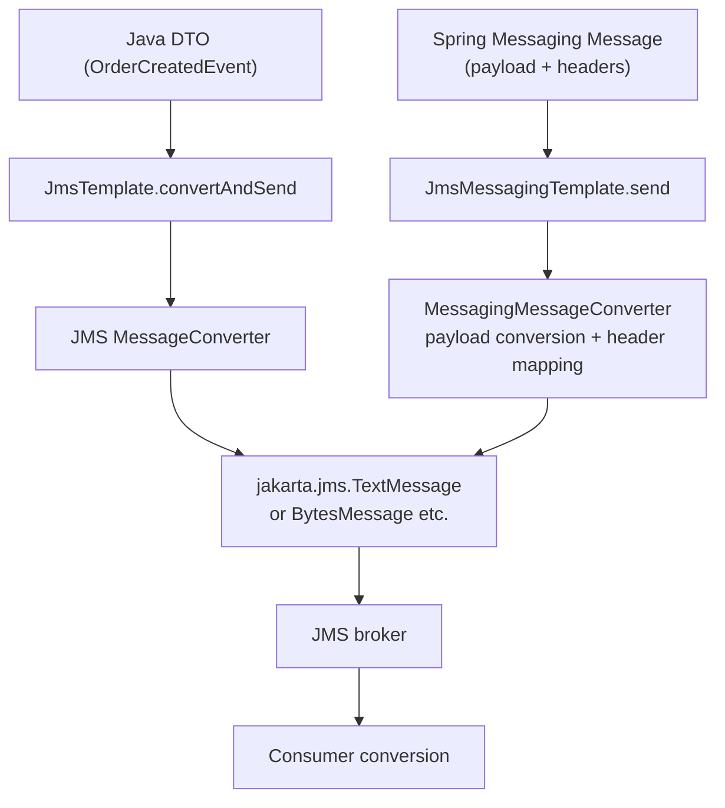
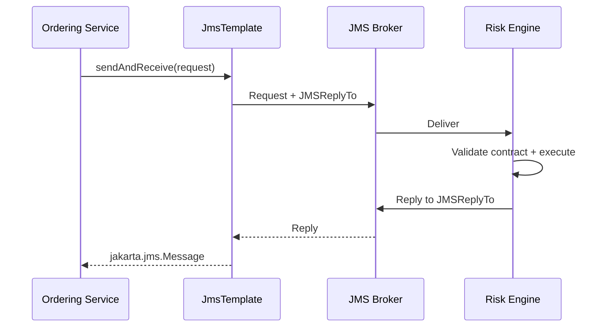
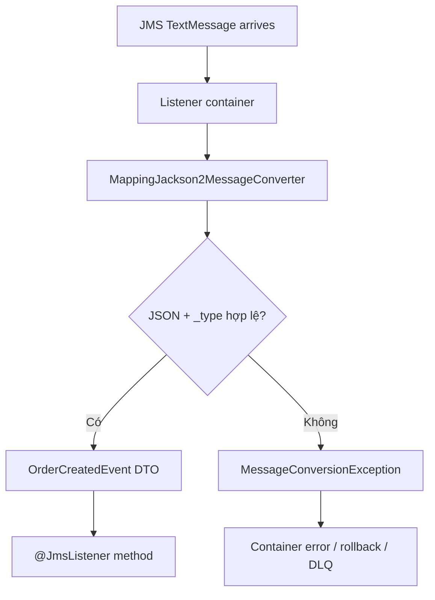
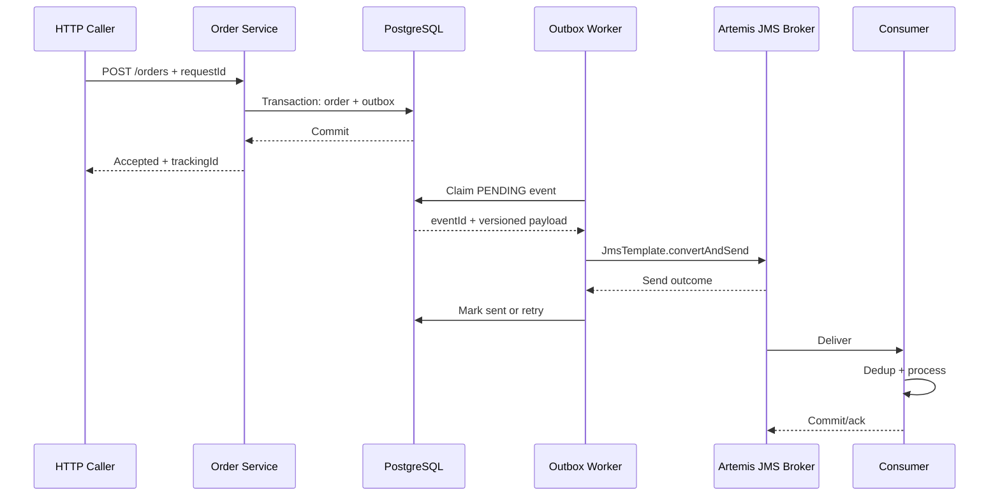
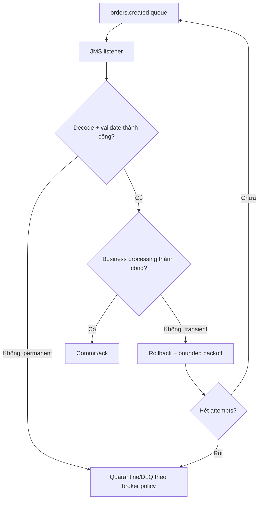
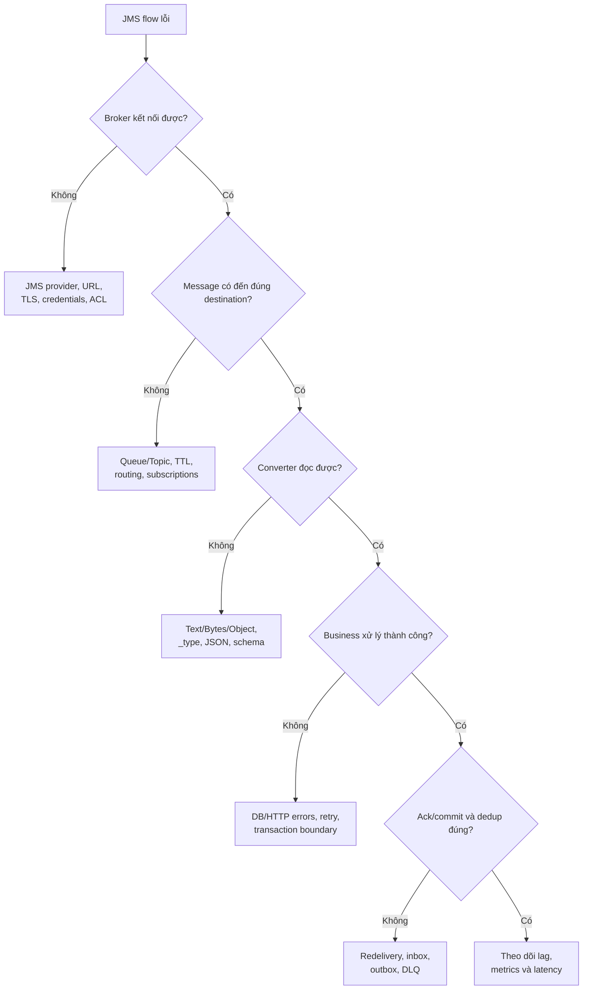

# JmsTemplate, JmsMessagingTemplate và chuyển đổi thông điệp

## 1. Vai trò của JMS trong Spring Boot Integration

Trong module **SPRING_BOOT_INTEGRATION**, một ứng dụng Spring Boot có thể nhận yêu cầu HTTP, ghi trạng thái vào cơ sở dữ liệu, sử dụng cache và gửi sự kiện tới một hệ thống khác qua broker. **Jakarta Messaging (JMS)** cung cấp API chuẩn cho nhắn tin bất đồng bộ giữa ứng dụng Java và message broker hỗ trợ JMS, chẳng hạn **Apache ActiveMQ Artemis**.

Ví dụ, sau khi lưu đơn hàng, hệ thống cần thông báo cho dịch vụ cấp vận đơn:

```text
HTTP POST /orders
   |
   v
Order Service -> PostgreSQL (order + outbox)
                         |
                         v
                   Outbox Worker
                         |
                   JmsTemplate / JmsMessagingTemplate
                         |
                    JMS Broker
                         |
                   @JmsListener
                         |
                  Shipping Service
                         |
                  HTTP Carrier API
```

Bài toán không chỉ là “gọi `convertAndSend()`”. Producer và consumer phải thống nhất cách biểu diễn dữ liệu, tên destination, header, schema version, kiểu Java/JSON, giới hạn kích thước, lỗi chuyển đổi, thời điểm ack và cách nhận lại thông điệp khi có sự cố.

**Ba khái niệm cốt lõi**:

1. `JmsTemplate`: API Spring JMS hướng tới thao tác gửi/nhận với `jakarta.jms.Message` hoặc đối tượng được chuyển đổi.
2. `JmsMessagingTemplate`: adapter dùng mô hình `org.springframework.messaging.Message<?>` có `payload` và `headers`, nằm phía trên JMS.
3. `MessageConverter`: quy tắc chuyển đổi giữa dữ liệu ứng dụng và JMS message. Có converter cho payload và converter/mapper cho Spring Messaging headers; không nên nhập nhằng hai tầng.

### Mục tiêu

Sau bài học, bạn có thể:

- Cấu hình Spring Boot làm JMS client tới broker ngoài tiến trình.
- Phân biệt gửi native JMS `Message`, gửi POJO bằng `JmsTemplate` và gửi Spring Messaging `Message<?>`.
- Hiểu `SimpleMessageConverter`, `MappingJackson2MessageConverter`, `MessageType.TEXT` và type-id mapping.
- Sử dụng header/correlation ID, destination và queue/topic đúng ngữ nghĩa.
- Thiết kế định dạng message có version và chống những lỗi deserialize nguy hiểm.
- Xử lý lỗi converter, transaction, redelivery, DLQ, idempotency và kiểm thử bằng broker thật.
- Quyết định khi nào chọn `JmsTemplate`, `JmsMessagingTemplate` hoặc một Spring Integration JMS adapter.

> Ví dụ dựa trên Java 17+, Spring Boot 3.x, Spring Framework 6.x, Jakarta Messaging 3.x và ActiveMQ Artemis. Đây là bài về **JMS chuẩn** trong bối cảnh tích hợp; không xem cú pháp cấu hình hoặc tính năng cụ thể của một broker là khả dụng trên mọi JMS provider. Các phiên bản Spring Boot mới có thể thay đổi auto-configuration và dependency BOM.

## 2. JMS là một API, không phải tên của một message broker

**JMS/Jakarta Messaging** là hợp đồng Java cho gửi/nhận message. Broker thực tế cung cấp connection factory, destinations, persistence và delivery behavior. Vì vậy:

- **JMS API** mô tả `ConnectionFactory`, `Session`, `Message`, `Destination`, `Queue`, `Topic`, `MessageProducer` và `MessageConsumer`.
- **Spring JMS** cung cấp `JmsTemplate`, `JmsMessagingTemplate`, `@JmsListener`, listener container và cơ chế message conversion.
- **Broker** như Artemis/IBM MQ xử lý address/queue, durable storage, authorization, routing, redelivery, expiry và DLQ theo cấu hình cụ thể.
- **Ứng dụng** tự chịu trách nhiệm cho event schema, business identity, idempotency, transaction ngoài JMS và khả năng phục hồi nghiệp vụ.

Spring JMS **không biến JMS thành HTTP, Kafka hay RabbitMQ AMQP**. Các công nghệ này có mô hình protocol và failure behavior khác nhau. ActiveMQ Artemis có thể hỗ trợ nhiều protocol, nhưng client dùng JMS API vẫn phải hiểu queue/topic và đặc điểm broker đó.

## 3. Queue và Topic: hai miền destination cần phân biệt

| Tiêu chí | Queue (point-to-point) | Topic (publish/subscribe) |
| --- | --- | --- |
| Mục đích | Giao công việc để các consumers cạnh tranh xử lý | Phát bản tin tới nhiều subscriptions |
| Khi có nhiều consumers cùng queue | Thường mỗi message được giao cho một consumer trong nhóm cạnh tranh | Mỗi subscription đủ điều kiện có thể nhận một bản sao logic |
| Subscriber offline | Message có thể đợi theo retention/persistence/broker policy | Phụ thuộc loại subscription, durable/shared và broker policy |
| Cách dùng thường gặp | Lệnh tạo shipment, xử lý tác vụ | Notification/fan-out sự kiện nghiệp vụ |
| Điều cần quyết định | Redelivery, DLQ, concurrency, ordering | Subscription identity, durability, fan-out, expiry |

JMS không bảo đảm toàn hệ thống **exactly-once business effect**. Broker có thể redeliver khi consumer chết trước ack/commit, và consumer phải chống tác động lặp.

`JmsTemplate` thường làm việc với queue theo cấu hình mặc định. Nếu dùng topic, phải đặt đúng **publish-subscribe domain**, destination và listener factory; **không** chỉ đổi tên queue thành “topic”.

## 4. Jakarta Messaging và khác biệt javax.jms / jakarta.jms

Đây là điểm quan trọng khi ứng dụng nâng cấp lên Spring Boot 3:

| Thế hệ | Imports phổ biến | Ý nghĩa |
| --- | --- | --- |
| Spring Boot 2 / Spring Framework 5 | `javax.jms.*` | API JMS cũ |
| Spring Boot 3 / Spring Framework 6 | `jakarta.jms.*` | Jakarta Messaging mới |

Ví dụ import đúng cho Spring Boot 3:

```java
import jakarta.jms.ConnectionFactory;
import jakarta.jms.Message;
import jakarta.jms.Session;
import jakarta.jms.TextMessage;
```

Một `javax.jms.ConnectionFactory` của client thư viện cũ **không phải** `jakarta.jms.ConnectionFactory` do Spring Boot 3 mong đợi. Nếu trộn hai dòng API, có thể gặp lỗi class/method, bean không khớp hoặc exception khi runtime.

Đừng cố “khắc phục” bằng cách thêm cả `javax.jms-api` và `jakarta.jms-api` vào classpath mà không kiểm tra provider compatibility. Hãy chọn đúng **driver/provider client phiên bản Jakarta-compatible** và các starters phù hợp Spring Boot BOM.

## 5. Dependencies: Spring JMS và broker client

Ví dụ Maven khi dùng ActiveMQ Artemis với Spring Boot:

```xml
<dependencies>
    <dependency>
        <groupId>org.springframework.boot</groupId>
        <artifactId>spring-boot-starter-artemis</artifactId>
    </dependency>
</dependencies>
```

Gradle tương đương:

```groovy
dependencies {
    implementation 'org.springframework.boot:spring-boot-starter-artemis'
}
```

Starter hỗ trợ cấu hình client Artemis và hạ tầng Spring JMS thích hợp. Khi dùng một JMS provider khác, chọn **JMS client dependency tương thích Jakarta Messaging** và cấu hình `ConnectionFactory` do provider cung cấp; không ép provider khác chạy qua Artemis starter.

Có thể dùng trực tiếp `org.springframework:spring-jms` khi tự cấu hình infrastructure. Song, chỉ thêm thư viện Spring JMS **không tự khởi chạy một broker**, không khai báo destinations và không bảo đảm broker credentials đúng.

### JMS không phải Kafka starter

`spring-boot-starter-artemis` và Spring JMS không thay thế `spring-kafka`. Nếu một hệ thống đang dùng Kafka, hãy chọn API client và semantics của Kafka, thay vì đổi tên `JmsTemplate` thành Kafka producer.

## 6. Cấu hình Spring Boot kết nối Artemis bên ngoài

Ví dụ `application.yml` cho môi trường dev/staging:

```yaml
spring:
  artemis:
    mode: native
    broker-url: ${ARTEMIS_BROKER_URL:tcp://localhost:61616}
    user: ${ARTEMIS_USERNAME}
    password: ${ARTEMIS_PASSWORD}
  jms:
    template:
      default-destination: orders.created
      receive-timeout: 2s
```

Giải thích:

- `spring.artemis.mode=native` chọn kết nối tới broker ngoài JVM trong cấu hình Artemis tương ứng.
- `broker-url` dùng endpoint do broker cung cấp; `tcp://localhost:61616` chỉ phù hợp khi app thật sự chạy trên cùng host/network namespace.
- Credentials phải đến từ secrets/config runtime; không commit mật khẩu thực vào repository.
- `spring.jms.template.default-destination` giúp một số thao tác không chỉ định destination tường minh. Với integration nhiều workflows, **ưu tiên truyền destination rõ** khi gửi business events.
- `receive-timeout` giới hạn thời gian chờ của receive đồng bộ; nó **không** thay thế connect timeout, producer send timeout, broker expiry hay workflow deadline.

Khi ứng dụng chạy bên trong Docker container, `localhost` trỏ tới **container ứng dụng**, không tự trỏ đến broker container. Dùng service DNS/hostname đúng topology. Với broker yêu cầu TLS/mTLS, cấu hình connector/trust/cert phù hợp theo provider và môi trường.

### Bean nào thường được Spring Boot cung cấp?

Tùy dependencies/conditions, Spring Boot có thể cấu hình:

- `jakarta.jms.ConnectionFactory` tới JMS provider.
- `JmsTemplate` cho producer/receive.
- `JmsMessagingTemplate` cho mô hình Spring Messaging.
- `DefaultJmsListenerContainerFactory` để phục vụ `@JmsListener`.
- Tích hợp `MessageConverter` khi có bean converter phù hợp.

Nếu bạn tự tạo `ConnectionFactory`, nhiều `JmsTemplate` hoặc listener factories, một phần auto-configuration có thể **back off** theo điều kiện. Không khẳng định một property Boot áp dụng cho **mọi bean custom**. Kiểm tra runtime bean definitions và conditions khi cần.

## 7. JmsTemplate là gì và làm việc ở tầng nào?

`org.springframework.jms.core.JmsTemplate` là thành phần cốt lõi của Spring JMS, giúp ẩn phần lớn boilerplate mở connection/session, tạo producer/consumer, xử lý exception và giải phóng resources.

Nó cung cấp những nhóm thao tác:

| Nhóm | API tiêu biểu | Dữ liệu thao tác |
| --- | --- | --- |
| Gửi native JMS | `send(..., MessageCreator)` | `jakarta.jms.Message` |
| Gửi POJO/primitive | `convertAndSend(..., Object)` | Đối tượng Java được `MessageConverter` mã hóa |
| Nhận native JMS | `receive(...)` | JMS `Message` |
| Nhận đối tượng | `receiveAndConvert(...)` | Java object sau conversion |
| Điều chỉnh outgoing message | `convertAndSend(..., MessagePostProcessor)` | Cho phép chỉnh JMS headers/properties |
| Request/reply | `sendAndReceive(...)` | JMS request và reply, thường blocking |
| QoS/broker behavior | TTL, priority, persistent delivery | Tùy chuẩn JMS/provider hỗ trợ |

**Đừng nhầm `JmsTemplate` với một durable queue**. Đây là client-side template. Một lần gọi `convertAndSend()` hoàn tất không đồng nghĩa consumer đã xử lý business transaction thành công.

## 8. Gửi một TextMessage với native JMS API

Khi cần toàn quyền về JMS headers/properties hoặc tích hợp với hệ thống legacy có message format cố định, dùng `JmsTemplate.send`:

```java
import jakarta.jms.TextMessage;
import org.springframework.jms.core.JmsTemplate;
import org.springframework.stereotype.Component;

@Component
public class LegacyOrderPublisher {

    private final JmsTemplate template;

    public LegacyOrderPublisher(JmsTemplate template) {
        this.template = template;
    }

    public void publishJson(
            String eventId,
            String payloadJson) {

        template.send("orders.created", session -> {
            TextMessage msg =
                session.createTextMessage(payloadJson);

            msg.setJMSCorrelationID(eventId);
            msg.setStringProperty("eventType", "order.created");
            msg.setIntProperty("schemaVersion", 1);
            msg.setStringProperty(
                "contentType", "application/json"
            );
            return msg;
        });
    }
}
```

Những điểm cần chú ý:

1. Callback nhận `jakarta.jms.Session` do `JmsTemplate` quản lý, rồi trả `jakarta.jms.Message`.
2. `TextMessage` chứa text. Đây là JSON **theo hợp đồng ứng dụng**, JMS không tự hiểu nội dung đó.
3. `JMSCorrelationID` là header JMS chuẩn, hữu ích cho request/reply hoặc tracing; **không thay thế business event ID**.
4. `eventType`, `schemaVersion` và `contentType` ở ví dụ là custom message properties; producer/consumer phải thống nhất tên, kiểu.
5. `JMSMessageID` thường được provider cấp theo quy tắc gửi; không dùng nó làm khóa business idempotency dài hạn khi message có thể được tạo lại.
6. Nếu broker unavailable hoặc authentication lỗi, `send` có thể ném `JmsException` của Spring; cần error classification và retry policy.

Khi dùng queue tên `orders.created`, destination phải được broker/provider resolve đúng. Một số broker cho auto-create queue, một số yêu cầu provision từ trước. **JMS API không buộc mọi provider tự động tạo destination với cùng naming policy**.

## 9. convertAndSend: thuận tiện nhưng phụ thuộc MessageConverter

Nếu payload là đối tượng đơn giản:

```java
template.convertAndSend(
    "ops.notifications",
    "Order ORD-501 has been created"
);
```

Với converter đơn giản mặc định, một `String` thường được chuyển thành `TextMessage`. Nhưng đoạn sau **không nên mặc nhiên coi là JSON**:

```java
OrderCreatedEvent event =
    new OrderCreatedEvent(
        "evt-1001", "ORD-501", "C-501", 125000L
    );

template.convertAndSend("orders.created", event);
```

Vì sao? `convertAndSend` gọi converter đã cấu hình. Nếu `SimpleMessageConverter` được dùng và DTO implement `Serializable`, nó có thể chọn **ObjectMessage** (Java serialization), không phải JSON. Nếu DTO không chuyển đổi được, ứng dụng có thể gặp `MessageConversionException`.

**Kết luận:** `convertAndSend` không nói định dạng wire bằng tên method. Định dạng phụ thuộc **MessageConverter**. Muốn JSON text có schema rõ, hãy cấu hình một converter JSON và thử producer/consumer với broker thực.

## 10. Nhận message bằng JmsTemplate: tránh chặn thread vô thời hạn

JMS receive đồng bộ có thể chờ message:

```java
import jakarta.jms.Message;
import org.springframework.jms.core.JmsTemplate;

public Message receiveNative(JmsTemplate template) {
    return template.receive("ops.notifications");
}
```

Hoặc nhận và convert:

```java
public Object receiveConverted(JmsTemplate template) {
    return template.receiveAndConvert("ops.notifications");
}
```

Đây là **blocking receive**, không phải một Reactive `Mono`/`Flux` publisher. Phải đặt receive timeout phù hợp, vì một số API mặc định có thể chờ không giới hạn.

Khi timeout, `receive` có thể trả `null` nếu không có message; phải phân biệt:

- **Không nhận message trước deadline** → `null`, không chứng minh broker mất message.
- **Receive native thành công** → JMS Message có headers/properties.
- **Conversion lỗi** → exception, không phải “queue rỗng”.
- **Broker/network lỗi** → exception/connection failure; cần khôi phục, không tự đánh dấu nghiệp vụ đã hoàn tất.

Trong server production nhận message liên tục, **`@JmsListener` + listener container** thường phù hợp hơn vòng lặp `while(true) receive` tự tạo. Receive đồng bộ hữu ích cho một số test, legacy adapters hoặc yêu cầu truy vấn cụ thể, nhưng phải kiểm soát shutdown và concurrency.

## 11. JmsMessagingTemplate: dùng Spring Messaging Message<?>

`org.springframework.jms.core.JmsMessagingTemplate` cung cấp API dựa trên abstraction `org.springframework.messaging.Message<T>`, gồm **payload + headers**, bên cạnh các overload hỗ trợ chuyển đổi object.

Ví dụ gửi Spring Messaging message:

```java
import org.springframework.jms.core.JmsMessagingTemplate;
import org.springframework.jms.support.JmsHeaders;
import org.springframework.messaging.Message;
import org.springframework.messaging.support.MessageBuilder;
import org.springframework.stereotype.Component;

@Component
public class OrderMessagingPublisher {

    private final JmsMessagingTemplate messaging;

    public OrderMessagingPublisher(
            JmsMessagingTemplate messaging) {
        this.messaging = messaging;
    }

    public void publish(OrderCreatedEvent event) {
        Message<OrderCreatedEvent> message =
            MessageBuilder.withPayload(event)
                .setHeader(
                    JmsHeaders.CORRELATION_ID,
                    event.eventId()
                )
                .setHeader("sourceSystem", "checkout")
                .setHeader("schemaVersion", 1)
                .build();

        messaging.send("orders.created", message);
    }
}
```

Đoạn code giả định `OrderCreatedEvent` là DTO đã định nghĩa và **payload converter** có thể serialize DTO thành format đã thống nhất. `JmsMessagingTemplate` không tự tạo một chuẩn JSON cho mọi class.

Khác với native `jakarta.jms.Message`, đối tượng ở đây là `org.springframework.messaging.Message<OrderCreatedEvent>`. Khi gửi, Spring phải chuyển cả payload và những headers thích hợp sang cấu trúc JMS message.

### Có thể dùng convertAndSend

```java
messaging.convertAndSend(
    "orders.created",
    event,
    java.util.Map.of("sourceSystem", "checkout")
);
```

Với convenience API, payload và headers vẫn đi qua conversion/mapping. Chỉ định loại message converter và header policy rõ nếu service giao tiếp với hệ thống không dùng Spring.

### Khi nên dùng API nào?

| Nhu cầu | Ưu tiên |
| --- | --- |
| Legacy hệ thống đòi native TextMessage/BytesMessage | `JmsTemplate.send` |
| Gửi DTO thuần với JSON converter rõ | `JmsTemplate.convertAndSend` |
| Tận dụng Spring Messaging payload/header abstraction | `JmsMessagingTemplate.send` |
| Một Spring Integration flow có MessageChannels, routers, transformers | JMS outbound/inbound adapters của Spring Integration |
| Consumer chạy liên tục | `@JmsListener`, thay vì poll vô hạn trên request thread |

## 12. Hai tầng chuyển đổi: payload converter và MessagingMessageConverter

Đây là điểm dễ gây nhầm nhất khi so sánh hai template:



**Tầng thứ nhất: Spring JMS `MessageConverter`**

Interface tiêu biểu:

```java
package org.springframework.jms.support.converter;

public interface MessageConverter {
    jakarta.jms.Message toMessage(
        Object object, jakarta.jms.Session session
    ) throws jakarta.jms.JMSException,
             org.springframework.jms.support.converter.MessageConversionException;

    Object fromMessage(jakarta.jms.Message message)
        throws jakarta.jms.JMSException,
               org.springframework.jms.support.converter.MessageConversionException;
}
```

Đây là **chữ ký minh họa để hiểu API**, không phải đoạn cần tự khai báo trong source. Converter mã hóa **payload object ↔ JMS Message**.

**Tầng thứ hai: `MessagingMessageConverter`**

Trong cơ chế Spring Messaging, một converter/adapter có trách nhiệm ánh xạ `Message<?>` sang JMS Message, bao gồm:

- Lấy `payload` rồi giao tới JMS payload converter phù hợp.
- Ánh xạ một số `headers` thành JMS standard headers/properties thông qua header mapper.
- Lấy JMS message được nhận rồi tạo Spring Messaging `Message<?>`.

Không phải mọi header Java object đều được phép thành JMS property. JMS properties có các kiểu scalar được hỗ trợ; một header `List<OrderItem>` hay `HttpHeaders` phức tạp không nên được gửi thẳng dưới dạng một JMS property mà không có quy tắc encoding.

**Cách kiểm tra:** trong integration test, kiểm tra *JMS message thật* ở phía nhận (subtype, content, custom properties và correlation ID), không chỉ assert lời gọi `messaging.send(...)` bằng Mockito.

## 13. SimpleMessageConverter chuyển được những kiểu gì?

Spring JMS `SimpleMessageConverter` giúp chuyển một số loại dữ liệu quen thuộc:

| Java object đầu vào | JMS message thường tạo | Khi nhận lại |
| --- | --- | --- |
| `String` | `TextMessage` | `String` |
| `byte[]` | `BytesMessage` | `byte[]` |
| `Map` | `MapMessage` | `Map` |
| `Serializable` object | `ObjectMessage` | Java object đã deserialize |

Hành vi chi tiết còn phụ thuộc converter/provider và dữ liệu cụ thể.

### Những hạn chế quan trọng

1. `MapMessage` không phải JSON object; nó là **JMS message type riêng** với type/value rules của JMS.
2. `ObjectMessage` dựa vào Java serialization; class producer/consumer phải tương thích. Deserialize dữ liệu Java object từ nguồn không đáng tin có rủi ro bảo mật.
3. Một DTO record không nhất thiết `implements Serializable`. Nếu không, converter mặc định có thể không chuyển được.
4. Đổi package/class/version có thể làm `ObjectMessage` cũ không deserialize được.
5. Đối tác không dùng Java sẽ khó hiểu `ObjectMessage` dù broker có hỗ trợ giao thức JMS.

Với event xuyên dịch vụ và cross-language, **JSON TextMessage** hoặc một định dạng schema-based được hai bên thống nhất thường dễ versioning và kiểm thử hơn Java serialization. Nhưng định dạng phải được thiết kế; không chỉ gọi `convertAndSend` rồi coi là JSON.

## 14. MappingJackson2MessageConverter: chuyển DTO thành JSON TextMessage

Spring JMS có `MappingJackson2MessageConverter` để sử dụng Jackson serialize/deserialize payload JSON. Ví dụ cấu hình:

```java
import java.util.Map;

import com.fasterxml.jackson.databind.ObjectMapper;
import org.springframework.context.annotation.Bean;
import org.springframework.context.annotation.Configuration;
import org.springframework.jms.support.converter.MappingJackson2MessageConverter;
import org.springframework.jms.support.converter.MessageConverter;
import org.springframework.jms.support.converter.MessageType;

@Configuration(proxyBeanMethods = false)
public class JmsConversionConfiguration {

    @Bean
    MessageConverter jmsMessageConverter(
            ObjectMapper objectMapper) {

        MappingJackson2MessageConverter converter =
            new MappingJackson2MessageConverter();

        converter.setObjectMapper(objectMapper);
        converter.setTargetType(MessageType.TEXT);
        converter.setTypeIdPropertyName("_type");
        converter.setTypeIdMappings(
            Map.of("order-created-v1", OrderCreatedEvent.class)
        );
        return converter;
    }
}
```

**Ý nghĩa**:

- `setObjectMapper` tái sử dụng Jackson configuration của ứng dụng (Java Time, naming policy, giới hạn parser...). Cần bảo đảm config phù hợp với *wire contract*; global mapper thay đổi có thể ảnh hưởng messages.
- `setTargetType(MessageType.TEXT)` hướng converter tạo `TextMessage` chứa JSON text.
- `setTypeIdPropertyName("_type")` xác định JMS property chứa type alias khi cần deserialize.
- `setTypeIdMappings(...)` ánh xạ alias ổn định như `order-created-v1` sang Java class đã cho phép.
- Consumer muốn `receiveAndConvert()` hoặc listener chuyển về DTO tương ứng phải có **cùng type-id convention và allowlist**.
- Một hệ thống legacy chỉ gửi JSON text nhưng **không có `_type`** có thể không được converter trên deserialize tự động; phải thiết kế decoder/adapter riêng theo message contract.

### JSON wire ví dụ

DTO:

```java
public record OrderCreatedEvent(
    String eventId,
    String orderId,
    String customerId,
    Long totalAmount
) {}
```

Payload được biểu diễn thành JSON (ví dụ minh họa, chi tiết Jackson có thể phụ thuộc config):

Ví dụ dùng `Long` thay cho `long` để trường thiếu có thể được biểu diễn là `null` và bị kiểm tra rõ ở bước validation. Jackson chuyển đổi được DTO **không đồng nghĩa** dữ liệu đã hợp lệ; listener/service cần kiểm tra required fields, số tiền không âm và schemaVersion trước khi ghi dữ liệu.

```json
{
  "eventId": "evt-1001",
  "orderId": "ORD-501",
  "customerId": "C-501",
  "totalAmount": 125000
}
```

JMS Message còn có **property** `_type=order-created-v1` để consumer biết Java DTO cần map. Type property **không mặc nhiên nằm bên trong JSON payload**. Một consumer dùng ngôn ngữ khác có thể chỉ cần schema version và event type, không cần biết tên Java class.

### Kiểm tra converter có được áp dụng thật không

Khai báo `MessageConverter` bean có thể được Boot tích hợp với những template/listener factory auto-configured **nếu điều kiện hỗ trợ**. Nhưng nếu service đã khai báo template/factory thủ công hoặc có nhiều converters, bạn phải kiểm tra wiring cụ thể. Test tốt nhất là gửi DTO vào test queue, đọc native message và xác minh nó là `TextMessage` với JSON và `_type` dự kiến.

## 15. Đừng trộn type alias với tên class nội bộ

Một thiết kế kém an toàn dùng type property là tên Java class do người gửi tự chọn:

```text
_type = com.example.internal.admin.RemoveEverythingCommand
```

Nếu consumer cho phép deserialize tùy ý theo tên class, nó có thể mở ra rủi ro deserialization và thực thi hành vi ngoài dự kiến. Dù Jackson đã có cơ chế bảo vệ, **không** dùng type metadata từ broker như một class loader tự do.

Nên:

1. Dùng **alias allowlist** như `order-created-v1`, `shipment-requested-v2`.
2. Có mapping rõ alias → DTO class.
3. Kiểm tra event type/schema version trong payload hoặc envelope theo hợp đồng.
4. Không coi JMS property `_type` là bằng chứng producer đã được xác thực.
5. Giới hạn payload bytes, JSON nesting, string size, số phần tử và số headers.
6. Không deserialize `ObjectMessage` từ nguồn không đáng tin chỉ vì broker connection thành công.
7. Khi nhận alias chưa hỗ trợ, chuyển thành **contract error/quarantine**, không retry vô hạn cùng dữ liệu đó.

**Type alias là một metadata kỹ thuật; nó không thay thế schema registry, event contract hoặc versioning.**

## 16. Chuyển đổi nhị phân: BytesMessage và bản hợp đồng khác JSON

Không phải mọi tích hợp dùng JSON. Legacy system có thể gửi bytes chứa protobuf, Avro, XML hoặc dạng binary độc quyền.

Với bytes thô:

```java
byte[] payloadBytes = encodeWithSchema(event);

jmsTemplate.convertAndSend(
    "orders.binary",
    payloadBytes
);
```

`encodeWithSchema` là phương thức do ứng dụng định nghĩa, không có sẵn trong Spring JMS. Với converter đơn giản, `byte[]` thường thành `BytesMessage`. Nhưng nếu ứng dụng đã bật `MappingJackson2MessageConverter` làm converter chung, behavior có thể khác: phải chọn converter/gateway thích hợp cho **từng destination/format**.

Để gửi bytes có framing chắc chắn, có thể tạo native `BytesMessage`:

```java
jmsTemplate.send("orders.binary", session -> {
    var message = session.createBytesMessage();
    message.writeBytes(payloadBytes);
    message.setStringProperty(
        "contentType", "application/x-protobuf"
    );
    message.setIntProperty("schemaVersion", 2);
    return message;
});
```

Bên nhận cần biết:

- Content type và serialization schema cụ thể.
- Có nén/mã hóa hay không, theo header hợp đồng.
- Message tối đa bao nhiêu bytes, bản giải nén có lớn hơn limit không.
- Tính tương thích khi bổ sung/xóa field.
- Không dùng `new String(bytes)` với charset mặc định để giải mã binary.

**JMS chỉ vận chuyển message; định dạng bytes là trách nhiệm của ứng dụng và producer/consumer contract.**

## 17. JMS headers và properties: những trường thường cần biết

Một JMS message có headers chuẩn và application properties:

| Header/property | Vai trò | Ghi nhớ |
| --- | --- | --- |
| `JMSMessageID` | ID provider cấp cho message đã gửi | Không phải business ID bền qua mọi lần publish |
| `JMSCorrelationID` | Liên kết request/reply hoặc trace | Nên thống nhất ý nghĩa; có thể chứa app-level ID |
| `JMSReplyTo` | Destination nhận reply | Request/reply thường dùng temporary queue hoặc destination cố định |
| `JMSType` | Kiểu logic JMS message theo provider/contract | Không tự thay thế JSON schema version |
| `JMSDeliveryMode` | Persistent/nonpersistent theo JMS | Không bảo đảm DB và broker commit atomically |
| `JMSPriority` | Mức ưu tiên gửi | Broker không cam kết global strict ordering theo mọi tình huống |
| `JMSExpiration` | Thời điểm expiry theo TTL | Message hết hạn có thể không còn xử lý được |
| `JMSRedelivered` | Dấu hiệu provider đã giao lại | Không đủ làm idempotency key |
| `JMSXDeliveryCount` | Delivery count khi provider hỗ trợ | Cách expose/tăng có khác biệt provider |
| `eventId` (custom) | ID sự kiện nghiệp vụ | Dùng cho deduplication |
| `schemaVersion` (custom) | Version payload | Cần kiểm tra cùng JSON và consumer |

Header JMS có quy tắc đặt tên/kiểu riêng; không phải arbitrary Map của Spring Messaging đều có thể sao chép nguyên dạng thành JMS properties.

Nếu ứng dụng cần metadata có cấu trúc lớn (ví dụ JSON nested), hãy đưa vào envelope/payload có schema hoặc serialize theo hợp đồng, thay vì nhồi Java objects tùy ý vào custom headers.

## 18. Mapping Spring Messaging headers sang JMS

Khi gọi `JmsMessagingTemplate.send`, payload và header được chuyển sang JMS bởi converter/header mapper.

Ví dụ Spring Message:

```java
import org.springframework.jms.support.JmsHeaders;
import org.springframework.messaging.Message;
import org.springframework.messaging.support.MessageBuilder;

Message<OrderCreatedEvent> springMessage =
    MessageBuilder.withPayload(event)
        .setHeader(JmsHeaders.CORRELATION_ID, event.eventId())
        .setHeader("sourceSystem", "checkout")
        .setHeader("schemaVersion", 1)
        .build();
```

Phân biệt:

- `JmsHeaders.CORRELATION_ID` là khóa header Spring Messaging dành cho tương ứng `JMSCorrelationID`.
- `sourceSystem` và `schemaVersion` là metadata ứng dụng, phải hợp JMS message properties nếu được map.
- `MessageHeaders.ID` và `MessageHeaders.TIMESTAMP` của Spring Messaging **không phải** `JMSMessageID`/JMS timestamp có ngữ nghĩa y hệt.
- Header `replyTo` trong một framework khác không mặc nhiên tương đương `JMSReplyTo` nếu không đúng mapper.
- Một incoming JMS header có thể bị provider đặt sau send; không thể kiểm soát tất cả header chuẩn từ Spring Message.

Đối với hệ thống liên thông khác ngôn ngữ/provider, viết một bảng **wire-level header contract** và test bằng native JMS client ở phía nhận. Đừng chỉ assert Spring Message headers trước khi chuyển đổi.

## 19. MessagePostProcessor: điều chỉnh JMS metadata khi gửi POJO

`JmsTemplate.convertAndSend` có overload cho `MessagePostProcessor`, giúp thêm JMS headers/properties sau khi converter tạo message:

```java
import org.springframework.jms.core.JmsTemplate;
import org.springframework.stereotype.Component;

@Component
public class OrderJsonPublisher {

    private final JmsTemplate template;

    public OrderJsonPublisher(JmsTemplate template) {
        this.template = template;
    }

    public void publish(OrderCreatedEvent event) {
        template.convertAndSend(
            "orders.created",
            event,
            jmsMessage -> {
                jmsMessage.setJMSCorrelationID(
                    event.eventId()
                );
                jmsMessage.setStringProperty(
                    "eventId", event.eventId()
                );
                jmsMessage.setIntProperty(
                    "schemaVersion", 1
                );
                return jmsMessage;
            }
        );
    }
}
```

**Chỉ hoạt động nếu converter hiện tại mã hóa được `OrderCreatedEvent`**. Với JSON converter ở mục 14, đây là một cách gửi JSON `TextMessage` kèm metadata ổn định.

Không đặt `schemaVersion` vào header là 1 nhưng payload là schema 2. Khi có sự khác biệt, consumer phải chọn cách xử lý rõ (reject/quarantine), không tùy tiện tin nguồn nào cũng đúng.

**Đừng thực hiện network call hoặc database write trong MessagePostProcessor**: callback phục vụ cấu hình outgoing JMS Message, không phải workflow transaction logic. Giữ nó ngắn, xác định và không có side effects ngoài việc bổ sung message properties.

## 20. So sánh API gửi theo cùng một thông điệp

Giả sử `event` là `OrderCreatedEvent` và cả producer/consumer đã cấu hình JSON converter:

| API | Ví dụ | Kết quả kỳ vọng |
| --- | --- | --- |
| Native JMS | `template.send(queue, session -> session.createTextMessage(json))` | `TextMessage` do code tự tạo |
| Converted Java object | `template.convertAndSend(queue, event)` | JMS Message theo converter (JSON nếu đã cấu hình) |
| Converted + headers | `template.convertAndSend(queue, event, postProcessor)` | JMS Message + native properties |
| Spring Messaging Message | `messaging.send(queue, MessageBuilder.withPayload(event)...build())` | Payload + Spring headers qua messaging converter |
| Convenience Messaging | `messaging.convertAndSend(queue, event, headers)` | Payload + map headers qua messaging converter |

**Cùng DTO không bảo đảm cùng bytes/message type** khi hai gateways dùng converter khác nhau. Ứng dụng có nhiều `JmsTemplate`, manual `JmsMessagingTemplate` hoặc custom listener container factories cần test **đường dây converter hoàn chỉnh**.

Để vận hành dễ, mỗi destination nên có một bản hợp đồng định dạng rõ: `contentType`, `messageType`, `schemaVersion`, required headers, type alias và charset.

## 21. Đưa message vào queue hay topic: template và listener phải nhất quán

Một `JmsTemplate` thường hoạt động ở **queue domain** nếu không cấu hình lại. Khi làm việc với `Topic`, có thể tạo template riêng và bật publish/subscribe domain:

```java
import jakarta.jms.ConnectionFactory;
import org.springframework.beans.factory.annotation.Qualifier;
import org.springframework.context.annotation.Bean;
import org.springframework.context.annotation.Configuration;
import org.springframework.jms.core.JmsTemplate;
import org.springframework.jms.support.converter.MessageConverter;

@Configuration(proxyBeanMethods = false)
class JmsDestinationsConfiguration {

    @Bean("topicJmsTemplate")
    JmsTemplate topicJmsTemplate(
            ConnectionFactory factory,
            MessageConverter converter) {

        JmsTemplate template = new JmsTemplate(factory);
        template.setPubSubDomain(true);
        template.setMessageConverter(converter);
        return template;
    }
}
```

Dùng `@Qualifier("topicJmsTemplate")` ở nơi publish sự kiện lên topic, và cấu hình listener factory tương ứng với topic. Mỗi JMS provider có thể có cách map tên destination với address/queue nội bộ khác nhau; kiểm tra trên broker thật thay vì suy từ chuỗi `orders.events`.

Với topic, **subscription durability** và identity quyết định liệu consumer offline có nhận lại message khi kết nối lại hay không. Một subscriber non-durable có thể bỏ lỡ message được phát trong lúc nó không tồn tại; một durable subscription cần cấu hình và quản lý lifecycle thích hợp. Đừng mô tả “topic luôn lưu lại tất cả messages” nếu chưa chỉ rõ subscription/broker policy.

Nếu Spring Boot chỉ có một `JmsTemplate` bean, property publish-subscribe có thể được cấu hình theo framework/version. Nhưng một template custom không mặc nhiên nhận setting của template do Boot auto-configure.

## 22. TTL, priority và persistent delivery: QoS chứ không phải bảo đảm nghiệp vụ

JMS hỗ trợ một số tham số Quality of Service (QoS) khi gửi:

```java
import java.time.Duration;
import org.springframework.jms.core.JmsTemplate;

void configureShortLivedNotifications(JmsTemplate template) {
    template.setExplicitQosEnabled(true);
    template.setDeliveryPersistent(true);
    template.setTimeToLive(
        Duration.ofMinutes(5).toMillis()
    );
    template.setPriority(4);
}
```

Cấu hình trên minh họa **một template chuyên dụng**; không nên áp chính sách thông báo ngắn hạn cho tất cả business events. Các phương thức có ý nghĩa:

- `setExplicitQosEnabled(true)` yêu cầu Spring áp QoS bạn đã cấu hình khi gửi.
- **Persistent delivery** yêu cầu JMS provider xử lý theo quy định persistent mode; durability thực phụ thuộc broker storage, availability và confirm/transaction settings.
- **TTL** là tuổi thọ message từ khi gửi. Một event hết TTL có thể bị expire trước khi consumer chạy, kể cả khi producer không nhận exception.
- **Priority** không phải bảo đảm global strict ordering giữa nhiều producers/consumers, đặc biệt khi có retry, partition/routing hoặc concurrent processing.

Với command thanh toán, cấp vận đơn hoặc đồng bộ tồn kho bắt buộc, đặt TTL 5 phút có thể khiến nghiệp vụ chưa hoàn tất bị mất khỏi queue. Khi cần deadline, phải thiết kế **business expiration và trạng thái đối soát** riêng, không chỉ dựa vào broker expiry.

## 23. Request/reply qua JmsTemplate: khi nào phù hợp?

Một số hệ thống legacy dùng **JMS request/reply** thay vì HTTP:



Một ví dụ:

```java
import jakarta.jms.Message;
import jakarta.jms.TextMessage;
import org.springframework.jms.core.JmsTemplate;

public Message validateRisk(
        JmsTemplate template,
        String requestId,
        String requestJson) {

    return template.sendAndReceive(
        "risk.validation.requests",
        session -> {
            TextMessage message =
                session.createTextMessage(requestJson);
            message.setJMSCorrelationID(requestId);
            return message;
        }
    );
}
```

`sendAndReceive` hỗ trợ request/reply dựa trên JMS, có thể sử dụng reply destination tạm và chờ phản hồi. **Không nên dựa vào nó như một workflow dài hạn**; method thường **blocking** và có thể trả `null` nếu hết thời gian chờ. Hãy cấu hình `receiveTimeout`/deadline đúng, và hiểu behavior cụ thể theo Spring/JMS provider.

Rủi ro:

1. Broker hoặc service reply chậm làm thread request bị chiếm lâu.
2. Timeout **không chứng minh** risk engine chưa xử lý request.
3. Reply có thể tới sau khi temporary reply consumer không còn chờ.
4. Nếu request tạo side effect, retry với ID mới có thể tạo tác động lặp.
5. `JMSCorrelationID` của reply phải được consumer kiểm soát nhất quán theo hợp đồng; không giả định provider tự giải quyết mọi business correlation.
6. Request/reply trong cùng một JMS transaction chưa commit có thể chờ mãi vì request chưa visible với consumer; tránh ghép transaction semantics mà không test.

Với tác vụ mất nhiều phút hoặc cần recovery sau crash, chọn **command queue + correlation ID + durable reply/outcome store**, thay vì giữ một HTTP request và JMS temporary queue mở liên tục.

## 24. @JmsListener: nơi chuyển đổi dữ liệu ở phía consumer

Một consumer Spring thường dùng `@JmsListener`:

```java
import org.springframework.jms.annotation.JmsListener;
import org.springframework.stereotype.Component;

@Component
public class OrderEventListener {

    private final OrderEventProcessor processor;

    public OrderEventListener(OrderEventProcessor processor) {
        this.processor = processor;
    }

    @JmsListener(
        destination = "orders.created",
        containerFactory = "orderJmsListenerFactory"
    )
    public void onOrderCreated(OrderCreatedEvent event) {
        processor.process(event);
    }
}
```

`OrderEventProcessor` là service nghiệp vụ do dự án định nghĩa. Method này giả định listener container được cấu hình `MessageConverter` đọc được `OrderCreatedEvent` từ incoming JMS message.

Ví dụ listener container factory:

```java
import jakarta.jms.ConnectionFactory;

import org.springframework.context.annotation.Bean;
import org.springframework.context.annotation.Configuration;
import org.springframework.jms.annotation.EnableJms;
import org.springframework.jms.config.DefaultJmsListenerContainerFactory;
import org.springframework.jms.support.converter.MessageConverter;

@Configuration(proxyBeanMethods = false)
@EnableJms
class OrderJmsConsumerConfiguration {

    @Bean("orderJmsListenerFactory")
    DefaultJmsListenerContainerFactory orderJmsListenerFactory(
            ConnectionFactory connectionFactory,
            MessageConverter converter) {

        DefaultJmsListenerContainerFactory factory =
            new DefaultJmsListenerContainerFactory();

        factory.setConnectionFactory(connectionFactory);
        factory.setMessageConverter(converter);
        factory.setConcurrency("2-6");
        factory.setSessionTransacted(true);
        return factory;
    }
}
```

Giải thích:

- `@EnableJms` kích hoạt infrastructure xử lý các `@JmsListener`. Spring Boot có thể auto-configure phần này tùy điều kiện; khai báo rõ khi tự cấu hình.
- `factory.setMessageConverter` bảo đảm listener sử dụng cùng contract payload converter với producer.
- `setConcurrency("2-6")` cấu hình giới hạn concurrent consumers phù hợp với listener container/provider; không mặc định chỉ có một message chạy tại mọi thời điểm.
- `setSessionTransacted(true)` dùng **JMS local session transaction** cho nhận/xử lý/ack theo listener container. Không có nghĩa PostgreSQL transaction tự tham gia.
- Khi processing error làm transaction rollback, broker có thể redeliver; cần DLQ và idempotency.

Một `@JmsListener` trả `void` không có nghĩa là incoming message đã được xử lý thành công sau khi business side effects ở các hệ thống khác hoàn tất. Ack/commit phụ thuộc **listener container transaction và exception handling**.

## 25. Converter lỗi trước khi method listener được gọi

Giả sử producer gửi `TextMessage` chứa JSON hợp lệ nhưng thiếu type-id `_type`, trong khi listener dùng `MappingJackson2MessageConverter` bắt buộc phải đọc type-id.

Điều có thể xảy ra:



**Method `onOrderCreated` chưa chạy** nếu converter fail trước bước invoke. Vì vậy `try/catch` bên trong method không bắt được mọi message conversion errors. Cần kiểm thử:

- Listener container error handling và transaction/requeue policy.
- Conversion fail có được phân loại **permanent** hay **transient**?
- Broker đưa poison message vào dead-letter address/queue sau bao nhiêu deliveries?
- Có còn xử lý được message hợp lệ phía sau?
- Có log error code/metadata an toàn mà không in raw payload không?
- Khi DLQ/quarantine unavailable, business message có bị mất ngoài ý định không?

**Không retry nóng một JSON sai schema hàng nghìn lần**; lỗi không tự thay đổi theo số lần giao lại. Với schema mới chưa hỗ trợ, quarantine có thể được replay sau khi consumer được nâng cấp, nhưng phải có owner và quy trình được kiểm soát.

## 26. Dùng MessageConverter tùy biến khi wire contract của đối tác đặc thù

Đối tác legacy có thể gửi JSON text nhưng không sử dụng Spring `_type`, hoặc cần envelope chứa `eventType`/`schemaVersion` để lựa chọn DTO. Khi đó có các hướng:

1. **Native `TextMessage` + ObjectMapper** trong adapter xử lý, tự kiểm tra version và decode theo allowlist.
2. **Custom `MessageConverter`** triển khai `toMessage`/`fromMessage`, thống nhất một wire contract có khả năng versioning.
3. **Spring Integration transformer**: nhận raw `Message<byte[]>`/`Message<String>`, kiểm tra schema, map thành domain command rồi route.
4. Nhiều `JmsTemplate`/listener factories theo destination, mỗi đường có converter riêng nếu đang duy trì nhiều định dạng.

Ví dụ nguyên tắc custom converter:

```java
import jakarta.jms.JMSException;
import jakarta.jms.Message;
import jakarta.jms.Session;
import jakarta.jms.TextMessage;

import org.springframework.jms.support.converter.MessageConversionException;
import org.springframework.jms.support.converter.MessageConverter;

public class ContractAwareJmsConverter
        implements MessageConverter {

    private final OrderEventCodec codec;

    public ContractAwareJmsConverter(OrderEventCodec codec) {
        this.codec = codec;
    }

    @Override
    public Message toMessage(Object value, Session session)
            throws JMSException, MessageConversionException {
        if (!(value instanceof OrderCreatedEvent event)) {
            throw new MessageConversionException(
                "Unsupported event type"
            );
        }
        TextMessage msg = session.createTextMessage(
            codec.encode(event)
        );
        msg.setStringProperty("eventType", "order.created");
        msg.setIntProperty("schemaVersion", 1);
        return msg;
    }

    @Override
    public Object fromMessage(Message message)
            throws JMSException, MessageConversionException {
        if (!(message instanceof TextMessage text)) {
            throw new MessageConversionException(
                "Expected TextMessage"
            );
        }
        int version = text.getIntProperty("schemaVersion");
        if (version != 1) {
            throw new MessageConversionException(
                "Unsupported schema version"
            );
        }
        return codec.decode(text.getText());
    }
}
```

`OrderEventCodec` là abstraction do dự án tự định nghĩa. Implementation thật phải sử dụng JSON parser có limits, validate required fields, kiểm soát type aliases và bảo đảm `codec.decode` chuyển parsing exceptions thành `MessageConversionException` có thông điệp an toàn. Không log raw text trong exception.

**Không dùng custom converter chỉ để né versioning.** Mục tiêu là quy định rõ một bộ hợp đồng; DTO phía Java có thể thay đổi mà wire event vẫn ổn định.

## 27. Xử lý header khi consumer cần nguồn gốc và correlation ID

Một consumer có thể đọc native JMS Message trực tiếp:

```java
import jakarta.jms.Message;
import jakarta.jms.TextMessage;

public void inspect(Message incoming) throws Exception {
    String correlationId = incoming.getJMSCorrelationID();
    String sourceSystem =
        incoming.getStringProperty("sourceSystem");
    int schemaVersion =
        incoming.getIntProperty("schemaVersion");

    // Validate metadata according to contract before processing.
}
```

Khi dùng `@JmsListener`, có thể nhận `@Header` hoặc một Spring Messaging `Message<?>` nếu listener adapter/header mapper hỗ trợ:

```java
import org.springframework.jms.annotation.JmsListener;
import org.springframework.jms.support.JmsHeaders;
import org.springframework.messaging.handler.annotation.Header;
import org.springframework.stereotype.Component;

@Component
class CorrelatedOrderListener {

    @JmsListener(
        destination = "orders.correlated",
        containerFactory = "orderJmsListenerFactory"
    )
    void accept(
        OrderCreatedEvent event,
        @Header(JmsHeaders.CORRELATION_ID)
        String correlationId) {

        // Correlation is observability metadata,
        // not proof of sender identity.
    }
}
```

Tuy nhiên, nếu JMSCorrelationID không có, một non-null `@Header` có thể dẫn tới lỗi argument resolution trước khi method chạy. Hợp đồng phải xác định header là bắt buộc hay optional, có default hay xử lý lỗi ra sao.

**Không tin `sourceSystem` header tự khai như một identity đã xác thực.** Broker ACL, connection identity, tenant isolation và có thể chữ ký payload là cơ chế xác thực thực sự.

### Message selectors

JMS consumer có thể dùng **message selector** để lọc theo properties:

```java
@JmsListener(
    destination = "orders.events",
    selector = "schemaVersion = 1",
    containerFactory = "orderJmsListenerFactory"
)
public void onV1(OrderCreatedEvent event) {
    // Process only version-1 messages matching selector.
}
```

Ở đây `schemaVersion` phải là JMS property **integer**. Selector không đọc trường `schemaVersion` bên trong JSON body; producer phải gửi metadata đúng. Selector không nên là giải pháp duy nhất cho schema compatibility: message version khác có thể bị bỏ nằm trong queue hoặc cần consumer khác xử lý.

## 28. JMS exception và contract error là hai nhóm khác nhau

| Nhóm | Ví dụ | Xử lý gợi ý |
| --- | --- | --- |
| Broker/network | TCP disconnect, connection refused, auth/tls fail | Kiểm tra provider cause; retry có giới hạn khi tạm thời |
| Destination/config | Queue không tồn tại, permission denied, address sai | Sửa cấu hình/provisioning, không retry nóng vô tận |
| Conversion | JSON invalid, thiếu `_type`, sai Java type | Non-retryable; quarantine/DLQ nếu cần |
| Header contract | Thiếu `eventId`, schemaVersion sai kiểu | Reject có mã lỗi, không tự tạo ID mới |
| Business validation | Duplicate event, trạng thái không hợp lệ | Idempotent outcome hoặc domain rejection |
| Downstream dependency | PostgreSQL unavailable, HTTP 503 | Bounded retry/backoff + durable state |
| Ambiguous outcome | Timeout sau send/commit | Reconciliation và stable event ID |
| Resource limit | Message quá lớn, queue quota, memory pressure | Admission control, giới hạn kích thước, tránh retry storm |

Spring `JmsTemplate` thường chuyển một số `jakarta.jms.JMSException` thành exception thuộc hierarchy `org.springframework.jms.JmsException`, để code client không phải khai báo checked exception. **Không có nghĩa mọi lỗi trong listener/service đều là JmsException**: lỗi converter có thể là `MessageConversionException`, lỗi domain/SQL/HTTP là nhóm khác.

Khi retry phải biết lỗi xảy ra **trước hay sau broker chấp nhận message**. Một `JmsException` không tự chứng minh chắc chắn message đã hoặc chưa được lưu. Cần idempotency và theo dõi publish outcome theo provider/transaction.

## 29. Local JMS transaction, @Transactional và ranh giới PostgreSQL

JMS có local session transaction; Spring có `JmsTransactionManager` để quản lý resource JMS phù hợp khi cấu hình. Nhưng:

**Một transaction JMS không tự làm thao tác PostgreSQL và JMS commit nguyên tử.**

Ví dụ mô hình cần cân nhắc:

```java
@Transactional
public void createOrder(OrderCommand command) {
    orderRepository.save(command.toEntity());
    jmsTemplate.convertAndSend(
        "orders.created",
        command.toEvent()
    );
}
```

Đây chỉ là ví dụ mô tả; `OrderCommand`, `orderRepository` và `toEvent()` là code giả định của ứng dụng. Nếu `@Transactional` sử dụng JDBC/JPA transaction manager, `jmsTemplate.convertAndSend()` không mặc nhiên được commit cùng một distributed transaction.

Các failure windows:

1. SQL commit thành công, broker send thất bại → đơn hàng đã có nhưng event không tới consumer.
2. Broker nhận message, SQL rollback sau đó → consumer nhìn thấy event của đơn hàng không tồn tại.
3. Producer mất kết nối ngay lúc send/commit → outcome có thể chưa rõ.
4. Consumer xử lý business rồi chết trước JMS transaction commit/ack → broker có thể redeliver.
5. Một `@JmsListener` transacted nhận message, sau đó gọi HTTP remote tạo side effect → rollback JMS session **không hoàn tác** HTTP call.

Nếu dự án có nhiều transaction managers, phải định danh transaction manager khi dùng `@Transactional` để tránh dùng nhầm JDBC/JMS manager. XA/JTA có thể cung cấp coordination trong một số deployment được thiết kế riêng, nhưng kéo theo chi phí, phạm vi hỗ trợ và failure recovery phức tạp; **không phải mặc định của Spring Boot**.

## 30. Transactional outbox: gửi JMS một cách có thể phục hồi

Đối với một lệnh quan trọng, thay vì gửi JMS trực tiếp trong SQL transaction, hãy dùng **transactional outbox**:



Ví dụ bảng:

```sql
CREATE TABLE integration_outbox (
    event_id VARCHAR(120) PRIMARY KEY,
    destination VARCHAR(120) NOT NULL,
    event_type VARCHAR(80) NOT NULL,
    schema_version INTEGER NOT NULL,
    payload_json TEXT NOT NULL,
    status VARCHAR(24) NOT NULL DEFAULT 'PENDING',
    attempt_count INTEGER NOT NULL DEFAULT 0,
    next_attempt_at TIMESTAMPTZ,
    created_at TIMESTAMPTZ NOT NULL DEFAULT CURRENT_TIMESTAMP
);

CREATE INDEX idx_integration_outbox_due
    ON integration_outbox(status, next_attempt_at, created_at);
```

Worker:

1. Claim batch có giới hạn với concurrency/lease/lock phù hợp DBMS.
2. Gửi JMS message với **eventId, schemaVersion và payload bytes ổn định**.
3. Chỉ đánh dấu `SENT` sau khi có kết quả gửi/commit theo policy tương ứng.
4. Khi không chắc broker đã nhận, giữ trạng thái có thể retry; không tạo `eventId` mới cho cùng sự kiện.
5. Nếu publish lặp, consumer idempotent theo business key.
6. Quarantine khi payload không thể serialize theo schema hoặc destination không đúng policy, không retry nóng vô hạn.
7. Giám sát backlog, tuổi outbox, rejected events và lần thử cuối.

**Outbox không bảo đảm exactly-once delivery.** Nó cung cấp một durable intent trong DB và giúp đạt **at-least-once delivery + idempotent business effect** khi producer/consumer được thiết kế đúng.

## 31. Consumer idempotency: redelivery không được nhân đôi tác động

JMS broker có thể giao lại message sau rollback, connection loss hoặc consumer crash. `JMSRedelivered` không phải khóa business duy nhất: một producer có thể publish lại một message mới có `JMSMessageID` khác nhưng cùng `eventId`.

Một bảng inbox trong PostgreSQL:

```sql
CREATE TABLE processed_message (
    source_system VARCHAR(80) NOT NULL,
    event_id VARCHAR(120) NOT NULL,
    processed_at TIMESTAMPTZ NOT NULL DEFAULT CURRENT_TIMESTAMP,
    PRIMARY KEY (source_system, event_id)
);
```

Consumer lý tưởng cần:

- Validate `eventId` không thiếu/null/blank và `sourceSystem` đáng tin.
- Dùng **unique constraint** để chống hai workers cùng xử lý.
- Ghi business state và dấu đã xử lý **trong cùng database transaction** nếu cùng một DB.
- Không chỉ làm `existsByEventId()` rồi `save()` không có khóa; có race condition.
- Khi phát hiện duplicate, trả kết quả idempotent thay vì publish/charge hai lần.
- Khi JMS ack/commit xảy ra sau DB commit, vẫn chấp nhận trường hợp app crash dẫn tới redelivery.
- Với HTTP side effect, yêu cầu idempotency key ổn định ở phía đối tác hoặc reconciliation.

Một message có eventId trùng nhưng payload khác phải được điều tra; không âm thầm coi là duplicate bình thường nếu contract cấm reuse ID.

## 32. Redelivery, retry và DLQ: ai quyết định?

**JMS specification** mô tả delivery/ack/transactions; nhưng nhiều chi tiết **redelivery delay, maximum attempts, dead-letter address/queue, expiry address** là tính năng và cấu hình provider như ActiveMQ Artemis.



Các quyết định cần đưa ra:

| Failure | Chính sách |
| --- | --- |
| Missing/invalid `_type` | Poison message: đẩy DLQ/quarantine, không requeue nóng |
| JSON sai cú pháp | Permanent contract failure |
| Không đủ JMS property/unsupported version | Không retry nóng; lưu để replay sau khi nâng consumer nếu phù hợp |
| DB unavailable | Retry có giới hạn và backoff, bảo toàn message |
| HTTP 429/503 ở downstream | Retry theo quota/deadline, giữ business idempotency |
| Business duplicate | Hoàn tất idempotent, không làm DLQ chỉ vì message lặp |
| Schema migration đang triển khai | Quarantine/park theo version, có kế hoạch replay |
| Broker outage | Producer giữ outbox PENDING, không giả định đã gửi |

**Điểm khác với RabbitMQ:** tên policy, ý nghĩa nack/reject và DLQ không tự hoán đổi giữa các broker. Với Artemis, kiểm tra address settings (dead-letter address, expiry address, max delivery attempts/redelivery delay) và bindings thực tế. `@JmsListener` không tự tạo mọi topology đó.

Nếu dùng `sessionTransacted=true`, listener ném lỗi thường dẫn tới rollback của JMS session và broker quyết định redelivery theo policy. Nhưng nếu code nuốt exception, transaction có thể commit/ack dù business logic chưa hoàn tất. Không biến mọi lỗi thành “log rồi return”.

## 33. Message size, encoding và deserialization security

Một message có thể đủ nhỏ về bytes nhưng chứa JSON lồng sâu, mảng cực lớn, chuỗi nhiều MB hoặc dữ liệu nén phình to. Hãy đặt giới hạn ở **nhiều lớp**:

| Tầng | Giới hạn gợi ý |
| --- | --- |
| Broker address/queue | Max message size, quota/storage, producer admission |
| Consumer inbound | Bytes trước khi deserialize và hợp đồng tối đa |
| Jackson parser | Max nesting depth, string/number token limits |
| DTO/Bean Validation | Required fields, array count, field sizes |
| Worker concurrency | Max concurrent listeners, downstream rate limit |
| Quarantine | Quota, retention, metadata/ref thay cho lưu raw payload vô hạn |

Java `ObjectMessage` có thêm rủi ro khi deserialize class không tin cậy; nếu broker cho phép messages từ nhiều hệ thống, ưu tiên JSON TextMessage với type allowlist hoặc một wire format được kiểm soát. Cần phân quyền producers/consumers và dùng TLS/ACL ở broker, không chỉ tin `sourceSystem` property.

Khi nhận `BytesMessage`, đừng giả định nó là UTF-8 JSON. Content type, charset và schema phải theo contract. Nếu adapter tự kiểm tra raw bytes, nhớ rằng JMS client có thể đã buffer message trong memory; application-level size check không thay thế broker/network limits.

## 34. Kiểm thử converter: xác minh JMS wire format thật

Mock `JmsTemplate` bằng Mockito chỉ chứng minh method `convertAndSend` được gọi; nó không chứng minh payload được biến thành **TextMessage JSON**, `_type` đúng, hay header map đúng. Một integration test cần broker cô lập.

Ví dụ `@SpringBootTest` với test broker đã cấu hình và **queue riêng không có listener khác cạnh tranh**:

```java
import static org.assertj.core.api.Assertions.assertThat;

import java.util.UUID;

import jakarta.jms.Message;
import jakarta.jms.TextMessage;
import org.junit.jupiter.api.Test;
import org.springframework.beans.factory.annotation.Autowired;
import org.springframework.boot.test.context.SpringBootTest;
import org.springframework.jms.core.JmsTemplate;

@SpringBootTest
class JmsWireContractIT {

    @Autowired
    JmsTemplate template;

    @Test
    void jsonConverterProducesTextMessageWithAlias()
            throws Exception {

        String queue = "test.orders." + UUID.randomUUID();
        OrderCreatedEvent event = new OrderCreatedEvent(
            "evt-1", "ORD-1", "C-1", 125000L
        );

        template.convertAndSend(queue, event);
        Message received = template.receive(queue);

        assertThat(received).isInstanceOf(TextMessage.class);
        TextMessage text = (TextMessage) received;
        String decodedId =
            new com.fasterxml.jackson.databind.ObjectMapper()
                .readTree(text.getText())
                .path("eventId")
                .asText();
        assertThat(decodedId).isEqualTo("evt-1");
        assertThat(text.getStringProperty("_type"))
            .isEqualTo("order-created-v1");
    }
}
```

Lưu ý để test chạy có ý nghĩa:

1. `MessageConverter` bean phải là JSON converter đã cấu hình ở mục 14.
2. Broker phải được provision và reachable; một số broker yêu cầu tạo destination trước, không auto-create mọi tên ngẫu nhiên.
3. `receiveTimeout` hữu hạn để test không treo vô thời hạn khi cấu hình sai.
4. Test queue không bị listener/service khác tiêu thụ trước assertion.
5. Chuỗi JSON assertion nên kiểm tra nội dung/field bằng JSON parser thay vì phụ thuộc whitespace/field order của serializer.
6. Test cần đóng broker/container và dọn test destination theo policy môi trường.
7. Với production-like security, cần kiểm tra cả ACL/TLS/credentials nhưng không đưa secrets vào test logs.

Đoạn trên là minh họa về wire-level verification; với dự án thật, nên parse `text.getText()` bằng `ObjectMapper.readTree` rồi assert các fields, không buộc JSON formatting y hệt nhau.

### Kiểm tra chiều nhận

Một ca test khác:

```java
template.convertAndSend(queue, event);
Object decoded = template.receiveAndConvert(queue);

assertThat(decoded)
    .isInstanceOf(OrderCreatedEvent.class);
assertThat(((OrderCreatedEvent) decoded).eventId())
    .isEqualTo("evt-1");
```

Trong đoạn này `queue` và `event` là biến từ test đã tạo phía trên. Test này chứng minh converter **round-trip**; vẫn cần **cross-version/cross-language tests** nếu production consumer không dùng cùng Java DTO converter.

## 35. Test bằng broker cô lập: cần kiểm chứng gì ngoài JSON?

Có thể dùng **Testcontainers** với Apache ActiveMQ Artemis hoặc một broker test instance do CI quản lý, nhưng image/client version phải tương thích Jakarta Messaging và Spring Boot BOM. Khi dùng container, cổng host thường được map động; cấu hình Spring Boot bằng connection details hoặc test properties tương ứng. Không hardcode `localhost:61616` trong CI khi chạy nhiều tests song song.

Ma trận tối thiểu:

| Ca | Cách kiểm tra |
| --- | --- |
| Native TextMessage → consumer | Payload, properties và correlation ID được đọc đúng |
| JmsTemplate.convertAndSend DTO | Broker nhận TextMessage JSON với type alias đúng |
| JmsMessagingTemplate.send Spring Message | Header mapping đúng wire contract |
| Converter thiếu `_type` | Bị reject/quarantine, không gọi listener business |
| Schema version chưa hỗ trợ | Không retry nóng, có metadata để replay |
| `receiveTimeout` | Không có message → nhận `null` trong deadline |
| Producer gửi rồi broker down | Outbox còn PENDING, không đánh dấu thành công giả |
| Listener ném lỗi DB tạm thời | JMS transaction rollback và redelivery có giới hạn |
| Consumer chết sau DB commit trước ack | Event được giao lại và dedup thành công |
| Poison message + message hợp lệ tiếp theo | Poison được cô lập, luồng hợp lệ tiếp tục |
| TTL hết hạn | Broker expiry behavior đúng policy |
| Topic subscriber offline | Durable/non-durable semantics được kiểm chứng |
| Request/reply timeout | Caller kết thúc đúng deadline, không tạo duplicate command |
| Security deny | Không thể gửi/nhận destination ngoài ACL |

**Đừng gọi một bài test gửi/nhận thành công là “đã kiểm tra exactly-once”.** Cần gây lỗi ở ranh giới DB commit/JMS ack hoặc broker reconnect và assert business state không bị nhân đôi.

## 36. Metrics, logging và tracing theo từng bước gửi/nhận

Với JMS, cần quan sát cả client-side và broker-side:

| Tín hiệu | Ý nghĩa |
| --- | --- |
| Producer sends/success/failure | Ứng dụng có gửi message hoặc gặp exception? |
| Send latency | Broker/network đang chậm hay connection pool bão hòa? |
| Queue depth và oldest message age | Backlog có vượt SLA không? |
| Consumer concurrency | Số listener đang xử lý đồng thời |
| Conversion errors | Lỗi type alias/schema/bytes/JSON |
| Redelivery count | Có message lỗi hoặc downstream thất bại lặp? |
| DLQ/quarantine size | Lỗi không thể xử lý đang được cô lập |
| Inbox duplicate count | Consumer ngăn business effect trùng bao nhiêu lần |
| Outbox pending/age/retry count | Có ý định gửi bị kẹt sau DB commit? |
| Correlation/event ID | Truy vết theo công việc, không đưa vào metric label có cardinality cao |

Spring Boot Actuator/Micrometer có thể cung cấp instrumentation khi dependencies và observability configuration phù hợp. Nhưng **không phải mọi provider/template tự sinh cùng tên metrics**. Kiểm tra runtime và bổ sung business metrics tại producer/consumer boundaries.

**Bảo vệ dữ liệu trong log:** không log toàn bộ `TextMessage.getText()`, `ObjectMessage` hoặc JMS properties chứa PII/token. Chỉ log thông tin đã lọc: logical destination, schemaVersion, event type, error category, trace/correlation ID (sau sanitization). Không đưa `eventId` hoặc full destination per customer vào time-series tags.

## 37. Chẩn đoán lỗi theo triệu chứng

| Triệu chứng | Khả năng | Kiểm tra đầu tiên |
| --- | --- | --- |
| `No qualifying bean of type JmsTemplate` | Thiếu starter/ConnectionFactory, auto-config back off | Dependencies, conditions, custom beans |
| `No qualifying bean of type JmsMessagingTemplate` | Spring Messaging/auto-config không đáp ứng | Starter, bean definitions, classpath |
| `javax.jms.ConnectionFactory` không inject vào Boot 3 | Client/provider dùng API cũ | Chọn Jakarta-compatible provider artifact |
| `Connection refused` / auth failure | Broker chưa sẵn sàng, sai URL/user | DNS, port, credentials, TLS/ACL |
| Producer gửi nhưng consumer không thấy | Sai queue/topic, destination/routing, TTL expiry | Domain, bindings, broker console/metrics |
| `convertAndSend` tạo ObjectMessage | Converter mặc định không phải JSON | MessageConverter bean, wire message subtype |
| Consumer không map được DTO | Thiếu `_type`/alias sai/type mismatch | Type-id mapping, listener factory |
| `MessageConversionException` trước listener | Error ở converter | Error handler, DLQ, schema |
| JMS property không có ở consumer | Header mapper không map hoặc tên/kiểu sai | Native JMS properties, message selector |
| Request/reply chờ lâu | Reply destination/timeouts/consumer | JMSReplyTo, receive timeout, transaction state |
| Cùng event xử lý hai lần | JMS redelivery/re-publish | Business eventId, inbox, DB unique key |
| Queue không giảm, DLQ tăng | Poison schema hoặc DB lỗi | Classification và broker redelivery policy |
| Message biến mất sau 5 phút | TTL/expiry | Explicit QoS, broker expiry settings |
| Topic consumer offline bỏ lỡ event | Non-durable subscription | Subscription durability/identity |
| Sự kiện đã commit DB nhưng JMS chưa gửi | Thiếu outbox hoặc worker kẹt | SQL outbox backlog, producer errors |
| Template gửi được nhưng JSON handler không chạy | Listener factory khác converter | Bean wiring, qualifier, type alias |

### Sơ đồ quyết định



## 38. Các anti-pattern cần tránh

1. **`convertAndSend` đồng nghĩa JSON:** default converter có thể tạo `ObjectMessage`/`MapMessage`.
2. **Dùng `ObjectMessage` cho event không tin cậy:** Java deserialization rủi ro và phụ thuộc classpath.
3. **Dùng tên Java class làm type alias tùy ý:** làm lộ internal model và có nguy cơ deserialize ngoài allowlist.
4. **Để converter producer và consumer khác cấu hình:** lỗi type-id, JSON format hoặc header mapping.
5. **Gắn arbitrary complex objects vào JMS properties:** có thể không chuyển được sang property types hợp lệ.
6. **Coi JMSMessageID là business eventId:** producer retry tạo JMSMessageID mới, dedup thất bại.
7. **Bỏ qua `JMSCorrelationID` và reply deadline:** request/reply có thể khó theo dõi, chờ vô hạn.
8. **Gọi `receive()` vô hạn trong HTTP request thread:** dễ làm cạn server threads.
9. **Chuyển queue thành topic chỉ bằng đổi tên:** listener domain/subscription chưa phù hợp.
10. **Tin topic offline luôn được lưu message:** non-durable subscribers có thể bỏ lỡ.
11. **Nuốt exception trong transacted listener:** broker ack/commit dù business thất bại.
12. **Retry JSON hỏng vô hạn:** poison message loop, queue backlog phình lớn.
13. **Không cấu hình broker DLQ:** rollback/retry không giới hạn hoặc message mất theo policy.
14. **Gửi JMS trong JDBC transaction và nghĩ là atomic:** không có distributed commit mặc định.
15. **Không ghi outbox trước khi trả 202:** crash gây mất sự kiện đã hứa xử lý.
16. **Không có unique constraint trên eventId:** redelivery nhân đôi tác động nghiệp vụ.
17. **Dùng TTL ngắn cho sự kiện không được mất:** broker có thể expire trước khi worker chạy.
18. **Không test wire-level JMS Message:** mock service không phát hiện schema/header/format sai.
19. **Log raw payload/JMS properties nhạy cảm:** lộ PII và credentials.
20. **Không quan sát queue depth/age, conversion errors, DLQ và outbox lag:** sự cố kéo dài mà không có cảnh báo.

## 39. Tình huống tổng hợp: gửi sự kiện đơn hàng sang dịch vụ giao vận

Một dự án Spring Boot nhận `POST /orders`, ghi PostgreSQL và gửi JMS `orders.created` để hệ thống cấp vận đơn xử lý.

Ban đầu đội phát triển:

- Dùng `JmsTemplate.convertAndSend(queue, orderDto)` mà không cấu hình converter JSON.
- Producer gửi `ObjectMessage` vì DTO có `Serializable`.
- Consumer ở dịch vụ mới chỉ nhận JSON `TextMessage` và lỗi conversion.
- Nhóm sửa bằng cách thêm `MappingJackson2MessageConverter` nhưng chưa đồng bộ `_type`.
- Broker redeliver cùng poison message liên tục, trong khi một số workers giữ DB transaction lâu.
- Producer được gọi trực tiếp trong `@Transactional` của PostgreSQL; broker down khiến order đã commit không có event.
- Khi consumer crash sau tạo shipment nhưng trước JMS ack, một số shipment bị tạo hai lần.

### Hướng thiết kế lại

**Bước 1 — Chốt wire contract.** Quy định `TextMessage` JSON, `contentType=application/json`, `_type=order-created-v1`, `schemaVersion=1`, `eventId` ổn định, max payload size và required fields.

**Bước 2 — Chọn API producer.** Dùng `JmsTemplate.convertAndSend` với JSON `MessageConverter` và `MessagePostProcessor` để bổ sung metadata; hoặc dùng `JmsMessagingTemplate` nếu flow đã có Spring Messaging headers. Tránh áp cùng một converter cho những destinations có format khác mà chưa test.

**Bước 3 — Đồng bộ consumer.** Dùng `@JmsListener` với listener factory có `MessageConverter` tương ứng. Khi message thiếu `_type` hoặc schema sai, gửi đến DLQ/quarantine thay vì retry nóng.

**Bước 4 — Phục hồi producer.** Trong PostgreSQL transaction ghi **order + outbox event**, không gửi JMS như một phần được giả định atomic. Worker publish khi broker hồi phục; có retry/backoff và metrics.

**Bước 5 — Chống trùng.** Consumer dùng `eventId` và unique constraint/inbox. HTTP request cấp vận đơn dùng idempotency key ổn định ở đối tác, vì JMS transaction rollback không thể đảo ngược HTTP side effect.

**Bước 6 — Điều tiết tải.** Giới hạn JMS consumer concurrency và outbound HTTP quota. Broker queue có thể backlog, nhưng worker không được lấy vô hạn messages vào memory hoặc retry thành storm.

**Bước 7 — Kiểm thử.** Dùng broker test thật để assert native TextMessage, headers, type alias, missing-type DLQ, redelivery và duplicate effect. Dùng PostgreSQL container để test outbox commit và unique constraints.

**Bước 8 — Quan sát.** Đo JMS send errors, converter failures, queue oldest age, DLQ size, outbox pending/age và duplicate count; correlation ID xuyên HTTP → database → JMS → consumer.

Kết quả mong muốn: một event có thể được gửi lại nhiều lần vì network hoặc worker crash, nhưng **mỗi tác động nghiệp vụ được thực hiện idempotently**, message hỏng không làm tắc toàn bộ queue và business intent vẫn còn sau ứng dụng restart.

## 40. Checklist triển khai JMS message conversion

- [ ] Xác định broker/provider tương thích Jakarta Messaging và Spring Boot version.
- [ ] Không trộn `javax.jms` và `jakarta.jms` clients.
- [ ] ConnectionFactory, broker URL, TLS, credentials, ACL và destination provisioning rõ ràng.
- [ ] Chọn queue hay topic theo delivery model; với topic quyết định durable subscription.
- [ ] Chọn `JmsTemplate` cho native/converted payload hoặc `JmsMessagingTemplate` cho Spring Messaging semantics.
- [ ] Xác định rõ outgoing message type: TextMessage, BytesMessage, MapMessage hoặc ObjectMessage; tránh ObjectMessage với untrusted data.
- [ ] Có converter JSON/schema-based và type-id alias allowlist khi consumer cần map DTO.
- [ ] Producer/consumer thống nhất `_type`, schemaVersion, contentType, charset, required fields và tương thích phiên bản.
- [ ] JMS headers/properties được kiểm thử sau chuyển đổi; correlation ID khác business eventId.
- [ ] `@JmsListener` và listener factory thật sự dùng converter mong muốn; không chỉ cấu hình template producer.
- [ ] Lỗi conversion trước method được xử lý có kiểm soát; poison message vào DLQ/quarantine.
- [ ] Không retry vô hạn lỗi cố định; lỗi transient có backoff, attempt bounds và deadline.
- [ ] Session/transaction semantics được xác minh; không coi JMS và PostgreSQL commit atomically.
- [ ] Dùng outbox/inbox/unique constraints, stable event ID và consumer idempotency.
- [ ] Có timeout cho synchronous `receive`/request-reply; TTL và persistent delivery theo business SLA.
- [ ] Có giới hạn payload/parser, listener concurrency và downstream rate limits.
- [ ] Có tests với broker thật cho TextMessage/headers/type ID/converter/ack/redelivery/DLQ.
- [ ] Có test cố ý crash giữa DB commit và JMS ack để xác nhận không tạo business effect trùng.
- [ ] Theo dõi send latency/errors, queue depth/age, retries, DLQ, outbox lag và duplicate count.
- [ ] Log chỉ metadata an toàn, không raw JMS payload/credentials/PII.
- [ ] Khi nâng Spring/Jackson/JMS provider, kiểm tra wire compatibility và migration plan.

**Ghi nhớ:** `JmsTemplate` làm việc gần **Jakarta JMS Message** và là nền tảng cho gửi/nhận; `JmsMessagingTemplate` bổ sung **Spring Messaging payload/header abstraction**; còn `MessageConverter` quyết định định dạng dữ liệu truyền đi. Không template nào tự bảo đảm JSON, cross-system transaction hay exactly-once business processing. Một luồng JMS tốt trong **SPRING_BOOT_INTEGRATION** cần **wire contract rõ, kiểm soát conversion, durable intent, idempotency, DLQ và kiểm thử broker thật**.

## Tài liệu tham khảo

- [Spring Framework Reference – JMS (Jakarta Messaging)](https://docs.spring.io/spring-framework/reference/integration/jms.html): `JmsTemplate`, `JmsMessagingTemplate`, converters, listener containers, transaction và messaging.
- [Spring Framework Javadoc – JmsTemplate](https://docs.spring.io/spring-framework/docs/current/javadoc-api/org/springframework/jms/core/JmsTemplate.html): send, receive, convertAndSend, QoS và request/reply APIs.
- [Spring Framework Javadoc – JmsMessagingTemplate](https://docs.spring.io/spring-framework/docs/current/javadoc-api/org/springframework/jms/core/JmsMessagingTemplate.html): Spring Messaging abstraction qua JMS.
- [Spring Framework Javadoc – MappingJackson2MessageConverter](https://docs.spring.io/spring-framework/docs/current/javadoc-api/org/springframework/jms/support/converter/MappingJackson2MessageConverter.html): JSON TextMessage, type aliases và mapping.
- [Spring Boot Reference – JMS](https://docs.spring.io/spring-boot/reference/messaging/jms.html): Artemis integration, `ConnectionFactory`, `JmsTemplate` và listener auto-configuration.
- [Jakarta Messaging Specification](https://jakarta.ee/specifications/messaging/): tiêu chuẩn JMS/Jakarta Messaging, messages, sessions, destinations và ack.
- [Apache ActiveMQ Artemis Documentation](https://activemq.apache.org/components/artemis/documentation/): broker addresses, queues, redelivery, dead-letter address, expiry và security.
- [Spring Integration Reference – JMS Support](https://docs.spring.io/spring-integration/reference/jms.html): inbound/outbound JMS adapters, message channels và gateway patterns.
- [Testcontainers for Java](https://java.testcontainers.org/): chạy message broker cô lập trong integration tests.

Các tài liệu có thể hiển thị API/behavior mới hơn phiên bản đang triển khai. Trước khi dùng trực tiếp mã hoặc cấu hình, hãy đối chiếu Spring Boot BOM, Spring JMS, Jackson và phiên bản JMS provider; đặc biệt xác minh kiểu JMS message, converter wiring và chính sách broker bằng integration tests thực tế.
