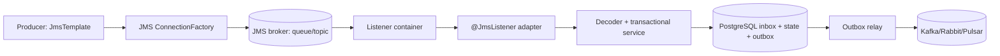
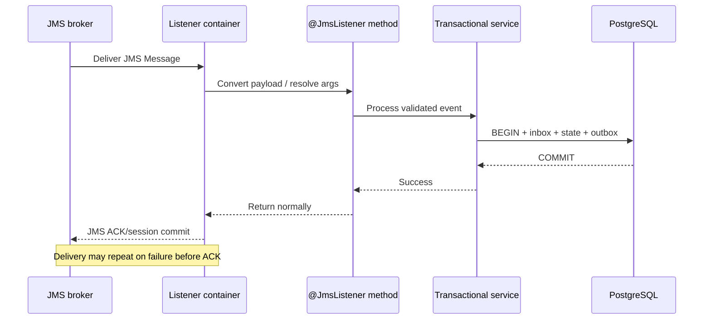
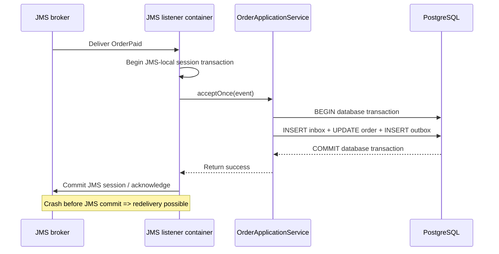
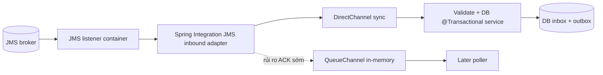
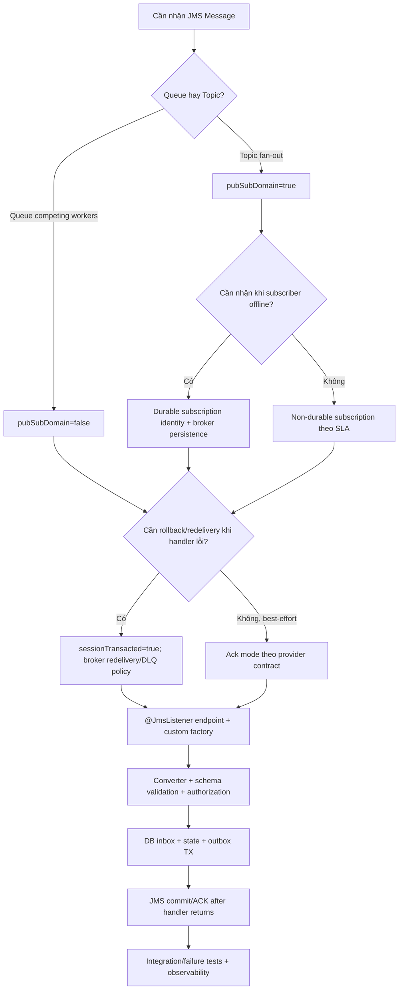

# @JmsListener và cấu hình listener container factory

> **Chương:** JMS  
> **Module:** `SPRING_BOOT_INTEGRATION` — tổ chức tích hợp hệ thống trong Spring Boot qua HTTP client, cơ sở dữ liệu, cache, broker thông điệp và adapter Spring Integration. Trọng tâm là quản lý cấu hình, hợp đồng dữ liệu, giao dịch, lỗi, chống xử lý trùng lặp, kiểm thử và quan sát những luồng tích hợp thực tế.
>
> **Phạm vi ví dụ:** Java 17+, Spring Boot 3.x, Spring Framework 6.x, Spring JMS và Jakarta Messaging (`jakarta.jms.*`). Broker minh họa là Apache ActiveMQ Artemis qua JMS; các chi tiết port, TLS, redelivery, DLQ và message groups phải đối chiếu với broker/client version đang triển khai. Những interface nghiệp vụ như `OrderPaidDecoder`, `OrderApplicationService` và `InboxRepository` được ứng dụng tự định nghĩa. Bài không coi một listener “không ném exception” là bằng chứng đã giao message chính xác một lần.

## 1. Bài toán: broker đã giao OrderPaid nhưng hệ thống xử lý thế nào?

Order Service nhận một message từ JMS queue `order.paid.v1`. Consumer phải xác nhận hợp đồng dữ liệu, kiểm tra tenant, cập nhật bảng đơn hàng PostgreSQL và ghi outbox để phát sự kiện sang Kafka/RabbitMQ. Có thể dùng `@JmsListener`:

```java
@JmsListener(destination = "order.paid.v1")
public void onMessage(String body) {
    orderService.process(body);
}
```

Đoạn mã trông đơn giản, nhưng câu hỏi vận hành khó hơn:

- Ai tạo thread và kết nối tới broker?
- Nếu pod chạy 4 bản và mỗi bản đặt `concurrency=5`, số consumer là bao nhiêu?
- Nếu message có nội dung sai, có bị redelivery vô hạn không?
- Nếu DB đã commit nhưng JMS acknowledgment bị mất, liệu nghiệp vụ sẽ chạy hai lần?
- Nếu handler bắt exception và trả về bình thường, message sẽ được ACK/commit ra sao?
- Queue và topic có cần cùng `listener container factory` không?
- Một `@Transactional` của PostgreSQL có khiến broker nhận cùng giao dịch không?
- Khi broker mất kết nối, ai reconnect, backoff và ghi metrics?
- Có thể dừng/khởi động một listener riêng trong quá trình vận hành không?

**`@JmsListener` mô tả endpoint nhận message; `listener container factory` tạo container quản lý kết nối, session, thread, acknowledgment, transaction, recovery và cách dispatch.** Chỉ cấu hình annotation mà bỏ qua container sẽ dễ dẫn đến lỗi dữ liệu hoặc quá tải.

### Mục tiêu học tập

Sau bài này, bạn có thể:

1. Phân biệt JMS API, provider/broker, Spring `JmsTemplate`, listener endpoint, `ConnectionFactory` và listener container.
2. Cấu hình `@EnableJms`, `@JmsListener` và bean `DefaultJmsListenerContainerFactory`.
3. Dùng `DefaultJmsListenerContainerFactoryConfigurer` để giữ cấu hình do Spring Boot cấp trước khi tùy chỉnh.
4. Chọn queue hay topic, subscription thông thường, durable/shared subscription và consumer concurrency phù hợp.
5. Thiết kế `MessageConverter`, versioned JSON contract, metadata, tenant validation và correlation.
6. Phân biệt `AUTO_ACKNOWLEDGE`, `CLIENT_ACKNOWLEDGE`, `DUPS_OK_ACKNOWLEDGE` và JMS-local session transaction.
7. Phân loại lỗi tạm thời, poison messages, redelivery policy và DLQ; không nuốt exception.
8. Ghi PostgreSQL inbox/outbox với unique key, đảm bảo consumer idempotent khi broker redeliver.
9. Kiểm thử listener, broker restart, rolling deploy, lỗi DB, lỗi TLS/auth và quan sát throughput/lag.
10. Xác định ranh giới với Spring Integration channels, Redis và downstream broker.

## 2. JMS, Jakarta Messaging và Spring JMS nằm ở đâu?

JMS (*Java Message Service*, hiện thuộc Jakarta Messaging) là hợp đồng Java cho gửi/nhận message; implementation do broker/provider cung cấp.



Những thành phần cần phân biệt:

| Thành phần | Vai trò | Không tự làm |
|---|---|---|
| `jakarta.jms.ConnectionFactory` | Tạo kết nối/sessions theo JMS provider | Không quyết định business transaction DB |
| Broker/provider | Lưu, định tuyến, ACK/redelivery theo cấu hình | Không xác thực schema JSON của ứng dụng |
| `JmsTemplate` | Abstraction gửi/nhận JMS đồng bộ trong Spring | Không là broker bền vững |
| `@JmsListener` | Đánh dấu method/endpoint nhận message | Không tự thiết lập resource limits, retry policy đầy đủ |
| Listener container | Vòng đời kết nối/session/consumer, nhận rồi invoke handler | Không tự tạo exactly-once business effect |
| Listener container factory | Tạo container từ cấu hình cho mỗi endpoint | Không tự migrate database/inbox |
| `JmsListenerEndpointRegistry` | Quản lý lifecycle các listener endpoints | Không thay consumer group của broker |
| `MessageConverter` | Chuyển JMS Message ↔ Java object | Không tự bảo đảm authorization/contract evolution |
| Application service | Kiểm tra hợp đồng, transaction, idempotency | Không tự ACK JMS nếu chỉ thao tác DB |
| Outbox relay | Publish intent đã commit sang hệ ngoài | Không chuyển JMS/DB thành distributed transaction |

JMS `Message` có thể là `TextMessage`, `BytesMessage`, `MapMessage` hoặc loại khác. Với Spring Boot 3+, sử dụng namespace **`jakarta.jms`**, không import `javax.jms` từ code legacy rồi trộn trong cùng application.

### 2.1. Queue và topic khác Spring Integration channel

- JMS **Queue** là mô hình competing consumers: mỗi message được phân phối để một consumer xử lý theo contract broker, nhưng có thể được redeliver.
- JMS **Topic** là publish–subscribe: các subscription nhận message theo chính sách subscriber/durable/shared.
- Spring Integration `DirectChannel`, `QueueChannel`, `PublishSubscribeChannel` là **channel trong ứng dụng**. Một channel trong JVM không biến thành broker JMS bền vững chỉ vì cùng tên `queue`.

## 3. @JmsListener hoạt động từ startup đến khi gọi handler

Thứ tự khái quát:

1. Spring tạo các bean cấu hình và `ConnectionFactory`.
2. Cơ chế annotation-driven JMS tìm các method có `@JmsListener`.
3. Mỗi endpoint gắn với một listener container factory.
4. Factory tạo và cấu hình container; container đăng ký trong `JmsListenerEndpointRegistry`.
5. Container khởi động theo lifecycle policy, tạo/kết nối JMS consumers.
6. Khi có message, container lấy JMS Message và gọi adapter để chuyển thành arguments của listener method.
7. Listener thực thi logic, trả về hoặc ném exception.
8. Container/provider áp dụng ACK/commit/rollback và redelivery policy đã cấu hình.



Sơ đồ mô tả **JMS-local transaction/ack sau khi handler thành công**, không phải mọi chế độ acknowledgment. Khi handler được Spring quản lý, các bước conversion/validation/error handling có thể ném exception **trước khi method body được gọi**; cần tính chúng vào retry/DLQ policy.

### 3.1. Annotation không phải một vòng lặp while(true)

`@JmsListener` không cần tự tạo thread hoặc gọi `Consumer.receive()` liên tục. Container chịu trách nhiệm nhận message và invoke handler, tái kết nối nếu cấu hình phù hợp. Tránh tự tạo một vòng lặp thủ công trong method listener gây block container thread hoặc phá lifecycle.

## 4. Spring Boot dependencies cho JMS listener

Với ActiveMQ Artemis làm JMS provider, một cấu hình Gradle thông dụng:

```gradle
dependencies {
    implementation("org.springframework.boot:spring-boot-starter-artemis")
    implementation("org.springframework.boot:spring-boot-starter-validation")
    implementation("org.springframework.boot:spring-boot-starter-jdbc")
    runtimeOnly("org.postgresql:postgresql")

    testImplementation("org.springframework.boot:spring-boot-starter-test")
    testImplementation("org.testcontainers:junit-jupiter")
}
```

Spring Boot BOM nên quản lý Spring JMS, provider client và Jakarta Messaging API tương thích. Nếu dùng ActiveMQ Classic/IBM MQ/nhà cung cấp JMS khác, dependency, connection properties, TLS và hành vi provider sẽ **khác**. Không đồng thời thả nhiều JMS provider jars khác phiên bản mà chưa hiểu auto-configuration và type conflict.

### 4.1. Ví dụ application.yml với Artemis external broker

```yaml
spring:
  artemis:
    mode: native
    broker-url: ${ARTEMIS_BROKER_URL:tcp://localhost:61616}
    user: ${ARTEMIS_USERNAME}
    password: ${ARTEMIS_PASSWORD}

app:
  jms:
    order-paid-queue: order.paid.v1
    order-events-topic: order.events.v1
```

Đây là ví dụ development/staging; `localhost` không phải hostname đúng của broker khi app chạy trong Kubernetes pod riêng. Production cần endpoint/DNS/TLS/secret tương ứng. Không commit credentials thật. `app.jms.*` là **custom application properties**, không phải namespace Spring Boot tự provision queue/topic.

### 4.2. Việc có bean không chứng minh broker đã reachable

Boot có thể tạo `ConnectionFactory` và listener container tại startup, nhưng broker connection lỗi có thể chỉ xuất hiện khi container bắt đầu hoặc khi reconnect. Cần giám sát **listener readiness, last successful receive, connection failures và business progress**, không chỉ kiểm tra ứng dụng đã khởi động.

## 5. Bật annotation listener với @EnableJms

Trong ứng dụng cấu hình tường minh:

```java
import org.springframework.context.annotation.Configuration;
import org.springframework.jms.annotation.EnableJms;

@Configuration(proxyBeanMethods = false)
@EnableJms
public class JmsListenerConfiguration {
}
```

`@EnableJms` kích hoạt khả năng xử lý `@JmsListener` theo Spring JMS. Trong một số tổ hợp Spring Boot auto-configuration, cơ chế annotation-driven được cấu hình sẵn; khai báo tường minh giúp thấy rõ dependency nhưng không cần thêm nhiều bộ registrar/annotation trùng nhau.

### 5.1. Bean mặc định tên jmsListenerContainerFactory

Theo convention của annotation-driven Spring JMS, nếu `@JmsListener` không chỉ định `containerFactory`, framework tìm factory mặc định có tên `jmsListenerContainerFactory` (trừ khi đã cấu hình registrar riêng).

Ví dụ:

```java
@JmsListener(destination = "order.paid.v1")
public void onMessage(String payload) { /* ... */ }
```

Đừng giả định một custom factory tên `ordersListenerContainerFactory` sẽ được chọn chỉ vì bean đó tồn tại. Đặt `containerFactory = "ordersListenerContainerFactory"` trong annotation hoặc cấu hình default factory có chủ đích.

### 5.2. Tại sao chọn factory theo loại consumer?

Một ứng dụng có thể cần:

- Queue xử lý thanh toán: transaction + concurrency vừa phải.
- Topic audit: durable/shared subscription và throughput khác.
- Queue email: concurrency thấp theo provider quota.
- Queue truy vấn legacy: timeout và error policy đặc biệt.

**Mỗi kiểu workload có thể dùng một factory riêng**, tránh thay đổi `sessionTransacted`/`concurrency` global ảnh hưởng mọi listener.

## 6. @JmsListener đơn giản nhất: nhận String payload

Ví dụ Spring Boot service nhận JSON text:

```java
import org.springframework.jms.annotation.JmsListener;
import org.springframework.stereotype.Component;

@Component
public class OrderPaidJmsListener {

    private final OrderPaidDecoder decoder;
    private final OrderApplicationService service;

    public OrderPaidJmsListener(
            OrderPaidDecoder decoder,
            OrderApplicationService service) {
        this.decoder = decoder;
        this.service = service;
    }

    @JmsListener(
        id = "orderPaidListener",
        destination = "${app.jms.order-paid-queue}",
        containerFactory = "ordersListenerContainerFactory"
    )
    public void onOrderPaid(String json) {
        OrderPaidEvent event = decoder.decodeAndValidate(json);
        service.acceptOnce(event);
    }
}
```

`OrderPaidDecoder`, `OrderPaidEvent` và `OrderApplicationService` là các thành phần của ứng dụng; decoder phải kiểm tra JSON syntax, schema version, required fields, giới hạn kích thước và tenant/source identity trước khi phát side effect.

- Nếu service hoàn tất, method return bình thường và container xử lý ACK/commit theo factory.
- Nếu decoder hoặc service ném exception, **không swallow**; container cần nhìn thấy thất bại để rollback/redeliver theo policy.
- Không tự `subscribe()`, `acknowledge()` hoặc tạo consumer thứ hai trong method này khi đã dùng container listener.
- `id` phục vụ vận hành/registry; nó **không phải event ID** để chống trùng.

### 6.1. Bean @Component và proxy transaction

Listener là Spring bean. Khi handler gọi `service.acceptOnce(event)` qua một bean service riêng, `@Transactional` trên public service method có thể được Spring transaction proxy áp dụng. Nếu listener tự gọi `this.acceptTransactional(...)` trong cùng bean, transaction advice có thể bị bỏ qua do self-invocation.

## 7. Tham số @JmsListener: destination, id, selector, subscription

Các thuộc tính annotation thường dùng:

| Thuộc tính | Tác dụng | Ghi chú |
|---|---|---|
| `destination` | Tên queue/topic cần consume | Phụ thuộc destination resolver/broker |
| `id` | ID endpoint trong registry | Phải unique trong context |
| `containerFactory` | Tên Spring bean factory dùng tạo container | Rất quan trọng khi có nhiều factory |
| `concurrency` | Override concurrency cho endpoint | Không bảo đảm global ordering |
| `selector` | JMS message selector expression | Dựa trên headers/properties, không parse JSON body |
| `subscription` | Tên topic subscription khi cần | Quan trọng với durable/shared topic consumers |

Ví dụ chọn message theo JMS property:

```java
@JmsListener(
    id = "priorityOrdersListener",
    destination = "order.commands",
    containerFactory = "ordersListenerContainerFactory",
    selector = "eventType = 'ORDER_PAID' AND priority >= 5",
    concurrency = "2-4"
)
public void onPriorityOrder(String json) {
    // Decode + validate + process trong service.
}
```

**Selector kiểm tra JMS properties/headers được provider hỗ trợ**, không phải các field JSON trong `TextMessage`. Producer phải đặt property kiểu tương ứng (`eventType` là String, `priority` là numeric). Các tên/cú pháp selector thuộc JMS SQL-like selector grammar; kiểm tra khác biệt provider và mapping.

### 7.1. Annotation có thể sử dụng placeholders

`destination = "${app.jms.order-paid-queue}"` được resolve từ Spring Environment khi annotation endpoint được cấu hình. Nhưng placeholder sai hoặc thiếu không tự tạo queue. Đừng dùng tên destination từ dữ liệu người dùng bên ngoài mà chưa validate/authorize, tránh đọc nhầm queue/topic.

## 8. DefaultJmsListenerContainerFactory: nơi cấu hình listener container

Spring cung cấp `DefaultJmsListenerContainerFactory` để tạo `DefaultMessageListenerContainer`, một container có khả năng quản lý consumer, thread, recovery, transaction/session behavior.

Ví dụ factory riêng:

```java
import jakarta.jms.ConnectionFactory;
import org.slf4j.Logger;
import org.slf4j.LoggerFactory;
import org.springframework.boot.autoconfigure.jms.DefaultJmsListenerContainerFactoryConfigurer;
import org.springframework.context.annotation.Bean;
import org.springframework.context.annotation.Configuration;
import org.springframework.jms.config.DefaultJmsListenerContainerFactory;

@Configuration(proxyBeanMethods = false)
public class OrderJmsContainerConfiguration {

    private static final Logger log =
        LoggerFactory.getLogger(OrderJmsContainerConfiguration.class);

    @Bean("ordersListenerContainerFactory")
    DefaultJmsListenerContainerFactory ordersListenerContainerFactory(
            ConnectionFactory connectionFactory,
            DefaultJmsListenerContainerFactoryConfigurer configurer) {

        var factory = new DefaultJmsListenerContainerFactory();

        // Áp trước các setting của Spring Boot (converter, ack, tx... nếu có).
        configurer.configure(factory, connectionFactory);

        // Sau đó override đúng policy của queue xử lý nghiệp vụ.
        factory.setPubSubDomain(false);
        factory.setSessionTransacted(true);
        factory.setConcurrency("2-6");
        factory.setRecoveryInterval(5000L);

        factory.setErrorHandler(error ->
            log.error("JMS listener container reported failure: {}",
                error.getClass().getSimpleName()));

        return factory;
    }
}
```

Đây là **một cấu hình mẫu**, không phải cấu hình tối ưu mặc định cho mọi broker. `setRecoveryInterval(5000L)` minh họa khoảng chờ reconnect sau lỗi theo API Spring JMS version tương thích, không phải business retry interval cho từng message. `ErrorHandler` dùng cho log/observability; **nó không tự commit, rollback, move message tới DLQ hoặc xác nhận đã recover thành công**.

### 8.1. Tại sao dùng DefaultJmsListenerContainerFactoryConfigurer?

Nếu bạn tự khởi tạo factory rồi cấu hình vài thuộc tính, có thể vô tình bỏ qua những lựa chọn mà Spring Boot đã cấu hình (custom converter, destination resolver, transaction manager, error handler, session settings hoặc properties liên quan ở phiên bản đó).

`configurer.configure(factory, connectionFactory)` giúp áp dụng phần config do Boot cung cấp; các override **sau đó** phải được review rõ:

1. Factory của order processing cần JMS-local transaction không?
2. Có custom message converter và resolver nào đã được Boot cấu hình không?
3. Có global transaction manager sẽ bị override/ngắt liên kết không?
4. Error handler thuộc container hay consumer/business layer?
5. Concurrency có vượt DB pool/broker license/connection limits không?

### 8.2. Nếu không dùng Boot configurer

Bạn có thể tạo factory bằng constructor và `setConnectionFactory(...)` trực tiếp; khi đó phải tự wire các behavior cần thiết. Điều này có thể hợp lý ở multi-provider JMS, nhưng phải có integration tests chứng minh đúng conversion, TLS/auth, ack và transaction.

## 9. DefaultMessageListenerContainer và SimpleMessageListenerContainer

Spring JMS có nhiều listener container implementation. Hai loại thường gặp:

| Container | Thế mạnh | Giới hạn/cần xem |
|---|---|---|
| `DefaultMessageListenerContainer` (DMLC) | Recovery, cấu hình consumer concurrency/dynamic scaling, transaction integration | Nhiều tunables; cần benchmark và hiểu cache/session policy |
| `SimpleMessageListenerContainer` | Thiết kế đơn giản dựa trên asynchronous JMS consumer callbacks | Không có cùng tính năng lifecycle/dynamic scaling/transaction behavior như DMLC |
| `@JmsListener` | Annotation endpoint, **không là container type** | Cần factory quyết định implementation |

Không chuyển từ Default sang Simple chỉ vì tên “Simple” rồi giữ nguyên giả định về recovery/transaction. DMLC là lựa chọn phổ biến cho production consumption cần kiểm soát transaction và reconnect.

### 9.1. Không có một “thread cho mỗi JMS message”

Container thường có các consumer sessions và task executors/polling loops được quản lý. Concurrency là số consumer thực thi song song trong một instance, không tạo một thread vô hạn cho mỗi message. Các worker thread có thể bị giữ bởi JDBC, HTTP sync, Redis sync, xử lý template hoặc long-running task; cần giới hạn toàn tuyến.

## 10. Factory mặc định và factory theo workload

Một thiết kế:

```java
@Bean("auditListenerContainerFactory")
DefaultJmsListenerContainerFactory auditListenerContainerFactory(
        ConnectionFactory connectionFactory,
        DefaultJmsListenerContainerFactoryConfigurer configurer) {

    var factory = new DefaultJmsListenerContainerFactory();
    configurer.configure(factory, connectionFactory);

    factory.setPubSubDomain(true);
    factory.setSessionTransacted(true);
    factory.setConcurrency("1");
    return factory;
}
```

Factory này chỉ nói đây là **topic consumer** và đặt concurrency một consumer. Nó chưa định nghĩa durable/subscription identity. Nếu audit không được phép mất event khi offline, cần **durable subscription** và kiểm tra broker giữ backlog/retention.

Một listener gọi:

```java
@JmsListener(
    id = "auditOrderEvents",
    destination = "order.events.v1",
    containerFactory = "auditListenerContainerFactory"
)
public void audit(String json) {
    // Validate contract and persist audit independently.
}
```

Nếu nhiều pod cùng chạy topic **non-durable** consumer, mỗi pod thường nhận một bản sự kiện cho subscription của nó; điều này có thể nhân đôi audit nếu hệ thống tưởng các pod là một competing queue group. Phải thiết kế subscription topology theo mục tiêu.

## 11. Concurrency: 2-6 nghĩa là gì?

Với factory `setConcurrency("2-6")`, DMLC có thể duy trì tối thiểu khoảng hai consumer và mở rộng tới tối đa sáu consumer theo behavior/cấu hình/provider được hỗ trợ. `@JmsListener(concurrency="2-4")` có thể override cấu hình này cho endpoint cụ thể.

Điểm cần nhớ:

- **Per container/per JVM**, không phải toàn cluster.
- Một pod có ba listener containers, mỗi container có max 6: tổng consumer khác chỉ một listener.
- Nếu triển khai 4 replicas, max consumers queue có thể đạt `4 × 6 = 24` cho một endpoint.
- 24 consumer cùng chạy SQL có thể vượt `Hikari maximumPoolSize` hoặc database capacity.
- Broker prefetch/credit, consumer priority, selectors và routing ảnh hưởng phân phối thực tế.
- Consumer count không bảo đảm throughput tăng tuyến tính: database locks, transaction duration hoặc downstream HTTP có thể là bottleneck.

### 11.1. Ordering thay đổi khi tăng consumer

`JMS queue` có thể giữ một thứ tự enqueue tại broker, nhưng nhiều consumers + redelivery/retry làm **thứ tự hoàn tất nghiệp vụ** không chắc giữ nguyên. Nếu cùng `orderId` phải tuần tự:

1. Dùng application-level aggregate version/optimistic lock/state-machine.
2. Cân nhắc JMS message grouping (`JMSXGroupID`) nếu broker hỗ trợ đầy đủ và đã kiểm thử.
3. Chọn concurrency/partitioning theo key hợp lý.
4. Không suy “message được gửi trước” đồng nghĩa “transaction commit trước”.

### 11.2. Concurrency và backpressure

Nếu receiver xử lý 1000 messages/giây mà DB chỉ commit 200/giây, tăng từ 4 lên 20 consumers có thể làm latency/lock wait tăng. Cần xem consumer utilization, broker queue depth/oldest age, DB pool pending và error rate; dùng rate limiting/bulkhead hoặc giảm concurrency khi backlog đến từ downstream.

## 12. Queue vs Topic: pubSubDomain và destination mapping

`factory.setPubSubDomain(false)` thường chọn queue semantics; `true` chọn topic semantics. Tuy nhiên broker có thể có quy tắc address/queue routing riêng (ví dụ Artemis anycast/multicast), nên cần cấu hình broker-side address, destination provisioning và policy tương ứng.

| Trường hợp | Lựa chọn | Lưu ý |
|---|---|---|
| Một `OrderPaid` được xử lý bởi một worker trong nhóm | Queue | Competing consumers, redelivery có thể xảy ra |
| Audit và Billing cần mỗi bên nhận sự kiện riêng | Topic, subscriptions riêng | Mỗi trách nhiệm có tiến độ riêng |
| Consumer offline nhưng phải nhận event sau đó | Durable topic subscription | Định danh subscription và broker persistence |
| Nhiều pods chia một subscription topic | Shared subscription khi provider/JMS version hỗ trợ | Cần kiểm tra ordering và shared durable semantics |
| Dashboard live-only không yêu cầu replay | Non-durable topic consumer có thể đủ | Có thể mất message khi offline |

### 12.1. Không nhầm topic fan-out với queue balancing

Nếu Billing và Audit cùng đọc **một JMS queue**, mỗi event chỉ được phát cho một worker trong cạnh tranh, chứ không đảm bảo cả Billing lẫn Audit chạy. Với topic, hai **subscription riêng** sẽ nhận event theo policy; trong một shared subscription, nhiều consumer có thể chia việc thay vì mỗi consumer đều nhận.

## 13. Durable topic subscription và shared subscriptions

JMS có các khái niệm durable và shared subscription với khả năng phụ thuộc phiên bản provider.

- **Non-durable topic consumer**: không cam kết broker giữ message cho subscriber offline.
- **Durable subscription**: broker giữ message thích hợp cho subscription khi client tạm offline, tùy persistence/retention và policy.
- **Shared durable subscription**: nhiều consumers có thể chia traffic trong cùng subscription nếu provider hỗ trợ, thường có giới hạn sequencing.
- `clientId`/`subscription`: một số mô hình durable subscription dựa trên danh tính client và subscription name. Shared subscription có quy tắc danh tính khác nhau theo provider.

Ví dụ cấu hình minh họa cho một **durable topic consumer đơn lẻ**:

```java
@Bean("durableAuditContainerFactory")
DefaultJmsListenerContainerFactory durableAuditContainerFactory(
        ConnectionFactory connectionFactory,
        DefaultJmsListenerContainerFactoryConfigurer configurer) {

    var factory = new DefaultJmsListenerContainerFactory();
    configurer.configure(factory, connectionFactory);
    factory.setPubSubDomain(true);
    factory.setSubscriptionDurable(true);
    factory.setClientId("audit-service-instance-A");
    factory.setConcurrency("1");
    factory.setSessionTransacted(true);
    return factory;
}
```

```java
@JmsListener(
    id = "auditDurableSubscription",
    destination = "order.events.v1",
    subscription = "audit-events-v1",
    containerFactory = "durableAuditContainerFactory"
)
public void onOrderEvent(String json) {
    // ...
}
```

**Cảnh báo production:** `clientId` thường phải unique theo provider trong các non-shared durable connections. **Không dùng literal cố định `audit-service-instance-A` ở tất cả replicas**, nếu không có thể lỗi client ID conflict hoặc duplicate subscription topology. Với shared durable, cần factory/provider support `setSubscriptionShared(true)` và mô hình identity phù hợp; kiểm thử rollout nhiều pods và reconnect.

### 13.1. Durable không phải vô hạn

Durable topic subscription có thể bị ảnh hưởng bởi broker retention, storage quota, message expiry, dead-letter policy và cleanup. Không coi durable là bảo đảm giữ vô hạn hoặc business exactly-once. Theo dõi subscription backlog và oldest pending age.

## 14. JMS MessageConverter: từ TextMessage tới DTO

Spring JMS có thể nhận `String` từ `TextMessage` qua converter đơn giản, nhưng với object DTO thì cần hợp đồng serialization rõ. `SimpleMessageConverter` có thể xử lý các kiểu JMS/JDK phổ biến, **không tự hiểu mọi JSON record trong string**.

Định nghĩa hợp đồng:

```java
import java.time.Instant;

public record OrderPaidEvent(
    String eventId,
    String tenantId,
    String orderId,
    long aggregateVersion,
    String schemaVersion,
    Instant occurredAt
) {}
```

Một lựa chọn Spring JMS converter cho JSON text:

```java
import java.util.Map;
import org.springframework.context.annotation.Bean;
import org.springframework.context.annotation.Configuration;
import org.springframework.jms.support.converter.MappingJackson2MessageConverter;
import org.springframework.jms.support.converter.MessageType;

@Configuration(proxyBeanMethods = false)
class OrderJmsConverterConfiguration {

    @Bean
    MappingJackson2MessageConverter orderJmsMessageConverter() {
        var converter = new MappingJackson2MessageConverter();
        converter.setTargetType(MessageType.TEXT);
        converter.setTypeIdPropertyName("_type");
        converter.setTypeIdMappings(
            Map.of("order-paid-v1", OrderPaidEvent.class));
        return converter;
    }
}
```

**Điểm version cần kiểm tra:** Constructor/JSON mapper integration và kiểu mapping API của `MappingJackson2MessageConverter` phụ thuộc Spring Framework/Spring Boot release. Nếu cần cấu hình `ObjectMapper` riêng (Java Time, naming, unknown fields), hãy khai báo tường minh theo API tương thích và viết test round-trip. Đừng bật Jackson polymorphic default typing cho untrusted payload chỉ để chuyển object tùy ý.

### 14.1. Vì sao dùng _type mapping?

Converter thường cần biết JSON sẽ được giải mã sang Java class nào. Nếu producer tự gửi fully qualified Java class name trong JMS type header, consumer bị ghép chặt vào package/class/version và có thể tăng bề mặt tấn công khi mapping quá động.

Dùng type ID được **allowlist** (`order-paid-v1`) và schema version rõ, không dùng arbitrary class name do upstream tự chọn. Type ID chỉ hỗ trợ converter chọn class, **không thay xác thực payload/tenant/source**.

### 14.2. Kiểu dữ liệu cần tránh

Không dùng Java native serialized `ObjectMessage` làm giao thức liên dịch vụ không tin cậy; Java serialization thường tạo phụ thuộc classpath, khó evolution và có rủi ro security. JSON/Avro/Protobuf có schema/contract quản trị thường phù hợp hơn cho trao đổi giữa services.

## 15. Gắn MessageConverter vào đúng listener factory

Factory có thể nhận converter trực tiếp:

```java
@Bean("typedOrdersListenerFactory")
DefaultJmsListenerContainerFactory typedOrdersListenerFactory(
        ConnectionFactory connectionFactory,
        DefaultJmsListenerContainerFactoryConfigurer configurer,
        MappingJackson2MessageConverter orderJmsMessageConverter) {

    var factory = new DefaultJmsListenerContainerFactory();
    configurer.configure(factory, connectionFactory);
    factory.setSessionTransacted(true);
    factory.setPubSubDomain(false);
    factory.setMessageConverter(orderJmsMessageConverter);
    return factory;
}
```

Listener:

```java
@JmsListener(
    destination = "${app.jms.order-paid-queue}",
    containerFactory = "typedOrdersListenerFactory"
)
public void onOrderPaid(OrderPaidEvent event) {
    orderApplicationService.acceptOnce(event);
}
```

Một producer dùng cùng converter có thể đặt type ID JMS property như `_type=order-paid-v1`. Nếu producer không đặt type ID, conversion sang DTO có thể lỗi **trước khi vào method**; phải test contract producer↔consumer thực tế.

### 15.1. Factory và JmsTemplate cần serializer tương thích

Gắn converter cho listener factory **không tự gắn** converter tương ứng cho `JmsTemplate` của producer trong mọi trường hợp. Nếu producer cùng Spring Boot app, khai báo/wire converter phù hợp cho JmsTemplate, hoặc gửi JSON text và set JMS properties thủ công theo contract. Nếu các service dùng converter/version khác nhau, test cross-version payload.

```java
import org.springframework.jms.core.JmsTemplate;
import org.springframework.stereotype.Service;

@Service
class OrderPaidPublisher {
    private final JmsTemplate jms;

    OrderPaidPublisher(JmsTemplate jms) {
        this.jms = jms;
    }

    void publish(String json, String eventId, String tenantId) {
        jms.convertAndSend("order.paid.v1", json, msg -> {
            msg.setStringProperty("eventId", eventId);
            msg.setStringProperty("tenantId", tenantId);
            msg.setStringProperty("schemaVersion", "1");
            msg.setStringProperty("eventType", "ORDER_PAID");
            return msg;
        });
    }
}
```

Đây là ví dụ **producer gửi JSON string**; vì thế listener String có thể đọc nó mà không cần typed JSON converter. Nếu sử dụng `typedOrdersListenerFactory`, cần thêm property type ID được converter dùng hoặc gửi object bằng converter tương thích. **Hai flow là hai lựa chọn minh họa**, không copy chồng lên cùng queue rồi kỳ vọng mọi message đều chuyển được.

## 16. JMS headers, properties và business event ID

JMS message có các headers chuẩn và các application properties. Một số metadata quan trọng:

| Trường | Tác dụng | Không nên dùng thay |
|---|---|---|
| `JMSMessageID` | ID transport do provider thường gán | Business idempotency key tuyệt đối |
| `JMSCorrelationID` | Gắn kết request/reply/workflow | Định danh duy nhất của mọi business event |
| `JMSDestination` | Destination của message | Tenant authorization |
| `JMSReplyTo` | Đích phản hồi tùy flow | ACK/commit logic |
| `JMSTimestamp` | Thời điểm provider gán theo policy | Business event occurredAt |
| `JMSExpiration` | Hạn message theo TTL | Hạn xử lý nghiệp vụ nếu không kiểm soát |
| `JMSRedelivered` | Cờ chỉ báo giao lại từ provider | Bằng chứng chính xác số attempts |
| `JMSXDeliveryCount` | Số lần giao theo provider khi hỗ trợ | Chỉ số tuyệt đối ổn định qua mọi topology |
| `eventId` | Property ứng dụng, nếu được đặt | Cần validate và unique constraint ở DB |
| `schemaVersion` | Contract evolution | Không tự đảm bảo backward compatibility |

### 16.1. Đọc raw JMS metadata khi thật sự cần

```java
import jakarta.jms.JMSException;
import jakarta.jms.TextMessage;
import org.springframework.jms.annotation.JmsListener;

@JmsListener(
    destination = "order.paid.v1",
    containerFactory = "ordersListenerContainerFactory"
)
public void onRawTextMessage(TextMessage message) throws JMSException {
    String body = message.getText();
    String transportId = message.getJMSMessageID();
    String correlationId = message.getJMSCorrelationID();
    boolean redelivered = message.getJMSRedelivered();
    String eventId = message.getStringProperty("eventId");

    // Decoder + service nghiệp vụ do ứng dụng triển khai.
    // Không dùng transportId làm khóa chống trùng duy nhất.
}
```

Đây là **phương án listener raw message** thay thế listener String/DTO trên cùng queue. Không đăng ký cả hai vào một queue nếu cần mỗi event chỉ có một loại handler; chúng sẽ trở thành competing consumers.

### 16.2. JMSXDeliveryCount có tính tương thích provider

`JMSXDeliveryCount` là một JMS-defined property thường được provider hỗ trợ để báo delivery count. Tuy nhiên semantics qua failover, move-to-DLQ, bridge hoặc replay có thể thay đổi; không dựa vào nó làm business idempotency key. Log attempts với correlation an toàn và để broker redelivery/DLQ policy làm chủ giới hạn cố gắng giao.

## 17. Validation và bảo mật ở listener boundary

Dù broker có TLS/SASL/user ACL, message vẫn phải được xem là **đầu vào của tích hợp hệ thống**. Consumer cần kiểm tra:

1. Payload size và kiểu JMS Message được chấp nhận.
2. Content encoding/JSON syntax, duplicate keys và cấu trúc.
3. `schemaVersion` và event type nằm trong allowlist.
4. Required fields: eventId, tenantId, aggregateVersion, occurredAt.
5. Quyền source principal/queue đối với tenant/resource, nếu hợp đồng yêu cầu.
6. Business rules và event ordering.
7. Một event không được phép “đổi tenant” chỉ nhờ property JSON của upstream.

Ví dụ Bean Validation cho DTO:

```java
import jakarta.validation.constraints.NotBlank;
import jakarta.validation.constraints.PositiveOrZero;

public record OrderPaidV1(
    @NotBlank String eventId,
    @NotBlank String tenantId,
    @NotBlank String orderId,
    @PositiveOrZero long aggregateVersion
) {}
```

`@Valid`/Bean Validation chỉ được chạy nếu adapter/method validation infrastructure được cấu hình phù hợp; **đừng giả định DTO có annotation thì mọi listener tự động validate**. Một decoder/application service có thể dùng `jakarta.validation.Validator` tường minh:

```java
var violations = validator.validate(event);
if (!violations.isEmpty()) {
    throw new InvalidMessageException("OrderPaid schema invalid");
}
```

`validator` là bean đã inject, `InvalidMessageException` là exception ứng dụng. Với poison payload, cần **quarantine/DLQ có giới hạn**, không redeliver vô hạn rồi làm nghẽn queue.

### 17.1. Không dùng JMS selector thay schema validation

Selector như `eventType = 'ORDER_PAID'` chỉ route dựa trên property. Người gửi có thể đặt property này mà payload body lại là event khác hoặc JSON sai. Application contract validator vẫn là tuyến phòng thủ bắt buộc.

## 18. Acknowledgment: container nhận rồi xác nhận khi nào?

JMS có nhiều cách xác nhận receipt với broker. Phải phân biệt **JMS ACK** với **database commit** và **downstream business completion**.

| Cơ chế | Ý nghĩa khái quát | Rủi ro |
|---|---|---|
| `Session.AUTO_ACKNOWLEDGE` | Provider/container tự ACK theo JMS delivery semantics | Khi callback lỗi, độ tin cậy redelivery còn tùy container/provider; không nên dựa vào để bảo vệ DB side effect |
| `Session.CLIENT_ACKNOWLEDGE` | Client gọi `acknowledge()` theo session semantics | ACK có thể bao phủ nhiều message đã giao trên cùng session, không mặc định per-message |
| `Session.DUPS_OK_ACKNOWLEDGE` | Cho phép ACK trễ/lỏng theo provider | Duplicates có thể nhiều hơn, không phù hợp khi phải kiểm soát chặt |
| `sessionTransacted=true` | Dùng JMS-local transaction; success commit, failure rollback | **Không tự chung transaction với PostgreSQL** |
| External JTA/XA | Điều phối nhiều transactional resources khi được cấu hình đúng | Phức tạp, overhead, driver/provider support; không mặc nhiên có |

### 18.1. Tại sao nhiều workload chọn JMS-local transaction?

Với broker queue và một application service ghi DB có idempotency, một chiến lược thực dụng:

- Container dùng `sessionTransacted=true`.
- Application service `@Transactional` ghi inbox + state + outbox.
- Service DB commit thành công rồi listener return.
- Container JMS session commit/ACK.
- Nếu consumer crash sau DB commit nhưng trước JMS commit, broker có thể redeliver; DB inbox unique key khiến lần sau no-op.

Cách này **at-least-once delivery + idempotent business processing**, không phải exactly-once transport hay một atomic transaction JMS+DB.

### 18.2. Đừng tự ACK trên raw Message khi session transacted

Nếu đang dùng JMS-local transacted session, outcome do `commit/rollback` quyết định; gọi `message.acknowledge()` thủ công không phải cách thay transaction semantics. Tránh trộn nhiều cơ chế ACK trong cùng listener mà chưa xác minh contract của container.

## 19. JMS-local transaction không phải database transaction

Khi `factory.setSessionTransacted(true)`, JMS provider/container phối hợp `Session.commit()` hoặc `Session.rollback()` cho **JMS session**. Nếu listener gọi một Spring service có `@Transactional` trên PostgreSQL, đó thường là **một transaction khác**, được DB transaction manager quản lý.



Đây là thứ tự **thường gặp** trong một listener đồng bộ gọi service transactional riêng. Nếu service ném exception:

- Spring DB transaction thường rollback theo quy tắc `@Transactional`.
- Exception đi ra khỏi listener.
- JMS container rollback session để broker có cơ hội giao lại.
- Broker quyết định delay, số lần retry, DLQ, expiration theo policy.

Nếu DB đã commit nhưng container không commit JMS session do crash/network failure, message **có thể được giao lại**. Đây không phải bug của JDBC hay JMS; nó là vấn đề ranh giới hai hệ thống.

### 19.1. Tại sao @Transactional không tự trở thành XA?

`@Transactional` chọn một `PlatformTransactionManager`/`ReactiveTransactionManager` theo cấu hình và loại method. Nếu đó là `JpaTransactionManager` hoặc `DataSourceTransactionManager`, nó chỉ quản lý transaction của resource phù hợp, không mặc nhiên enlist JMS session.

Muốn atomic commit JMS+DB qua **JTA/XA**, phải có transaction manager/connection factory/datasource hỗ trợ XA và broker/DB participate đúng. Điều này phức tạp hơn và cần đánh giá recovery/heuristic outcomes. Trong nhiều hệ thống, **DB inbox/outbox + at-least-once JMS** dễ vận hành hơn.

### 19.2. Không giữ DB transaction qua HTTP/Redis/broker I/O dài

Nếu listener mở DB transaction rồi gọi Payment API/Redis/Kafka trước commit, nó có thể giữ JDBC connection, locks và tăng nguy cơ partial side effects. Hãy:

1. Xác minh message và business invariant.
2. Trong **DB transaction**, ghi inbox/state/outbox.
3. Commit DB.
4. Để outbox relay thực hiện downstream I/O sau commit.
5. Return thành công cho JMS container ACK/commit.

## 20. Xây inbox/outbox trong PostgreSQL cho JMS consumer

Một business effect cần tránh nhân đôi có thể dựa trên unique constraint. Ví dụ schema:

```sql
CREATE TABLE order_jms_inbox (
    consumer_name VARCHAR(100) NOT NULL,
    event_id VARCHAR(120) NOT NULL,
    tenant_id VARCHAR(80) NOT NULL,
    order_id VARCHAR(100) NOT NULL,
    received_at TIMESTAMPTZ NOT NULL DEFAULT CURRENT_TIMESTAMP,
    PRIMARY KEY (consumer_name, event_id)
);

CREATE TABLE order_state (
    tenant_id VARCHAR(80) NOT NULL,
    order_id VARCHAR(100) NOT NULL,
    status VARCHAR(40) NOT NULL,
    aggregate_version BIGINT NOT NULL,
    PRIMARY KEY (tenant_id, order_id)
);

CREATE TABLE order_outbox (
    id BIGINT GENERATED ALWAYS AS IDENTITY PRIMARY KEY,
    event_id VARCHAR(120) NOT NULL UNIQUE,
    event_type VARCHAR(80) NOT NULL,
    tenant_id VARCHAR(80) NOT NULL,
    aggregate_id VARCHAR(100) NOT NULL,
    payload_json JSONB NOT NULL,
    state VARCHAR(24) NOT NULL DEFAULT 'PENDING',
    created_at TIMESTAMPTZ NOT NULL DEFAULT CURRENT_TIMESTAMP
);

CREATE INDEX idx_order_outbox_pending
    ON order_outbox (state, id);
```

**Khóa idempotency** ở bảng inbox là `(consumer_name, event_id)`, dùng **eventId nghiệp vụ ổn định**. Không dùng `JMSMessageID` làm khóa duy nhất nếu event có thể bị republish với transport ID mới.

### 20.1. Ghi inbox bằng ON CONFLICT DO NOTHING

```java
import org.springframework.jdbc.core.JdbcTemplate;
import org.springframework.stereotype.Repository;

@Repository
class JdbcOrderInboxRepository {
    private final JdbcTemplate jdbc;

    JdbcOrderInboxRepository(JdbcTemplate jdbc) {
        this.jdbc = jdbc;
    }

    boolean tryInsert(String consumer, OrderPaidEvent event) {
        int inserted = jdbc.update(
            """
            INSERT INTO order_jms_inbox(
                consumer_name, event_id, tenant_id, order_id)
            VALUES (?, ?, ?, ?)
            ON CONFLICT (consumer_name, event_id) DO NOTHING
            """,
            consumer,
            event.eventId(),
            event.tenantId(),
            event.orderId()
        );
        return inserted == 1;
    }
}
```

Một unique constraint xử lý race giữa hai pod tốt hơn kiểm tra `SELECT exists` rồi insert không atomic. Nếu eventId được tái sử dụng bởi payload khác, cần lưu/check payload hash hoặc các trường immutable để phát hiện **ID collision/conflict**, không âm thầm coi hai nội dung khác nhau là duplicate hợp lệ.

### 20.2. Một transaction ứng dụng

```java
import org.springframework.stereotype.Service;
import org.springframework.transaction.annotation.Transactional;

@Service
public class OrderApplicationService {

    private final JdbcOrderInboxRepository inbox;
    private final OrderStateRepository orders;
    private final OrderOutboxRepository outbox;

    public OrderApplicationService(
            JdbcOrderInboxRepository inbox,
            OrderStateRepository orders,
            OrderOutboxRepository outbox) {
        this.inbox = inbox;
        this.orders = orders;
        this.outbox = outbox;
    }

    @Transactional
    public void acceptOnce(OrderPaidEvent event) {
        String consumerName = "order-paid-projection-v1";

        if (!inbox.tryInsert(consumerName, event)) {
            return; // Đã xử lý thành công trước đó; có thể JMS ACK.
        }

        // Kiểm tra version/state transition dưới DB transaction.
        orders.applyPaidEventIfAllowed(event);

        // Lưu intent publish, không gọi Kafka/HTTP ngay trong transaction.
        outbox.insertDerivedEventOnce(event);
    }
}
```

`OrderStateRepository` và `OrderOutboxRepository` là adapter ứng dụng tự triển khai; phải sử dụng **cùng datasource/transaction manager** với inbox. Nếu `applyPaidEventIfAllowed` phát hiện event sai thứ tự hoặc trái trạng thái, phải **ném exception hoặc chuyển vào luồng quarantine đúng contract**, không commit inbox rồi đánh dấu đã xử lý khi nghiệp vụ chưa được áp dụng.

### 20.3. Vì sao đặt inbox trước business effect?

Khi một listener được gọi lại, insert inbox sẽ thất bại vì unique constraint, từ đó tránh thay đổi state/outbox hai lần. Nhưng điều kiện quan trọng là **inbox, business state và outbox cùng transaction**: nếu business SQL thất bại, insert inbox cũng rollback, cho phép redelivery xử lý lại.

## 21. Crash windows và mô hình kết quả

Một timeline cần được test:

| Thời điểm crash | DB có commit? | JMS đã ACK/commit? | Kết quả khi khôi phục |
|---|---|---|---|
| Trước xử lý | Chưa | Chưa | Broker có thể redeliver |
| Sau INSERT inbox nhưng trước DB commit | Chưa | Chưa | DB rollback; redelivery xử lý lại |
| Sau DB commit nhưng trước JMS commit | **Có** | Chưa/không chắc | Redelivery; inbox unique key no-op |
| Sau JMS commit | Có | Có | Không cần redelivery theo delivery đó |
| Sau outbox publish nhưng trước mark PUBLISHED | Có | JMS đã ACK | Outbox relay có thể publish lại; downstream dedup |
| Broker network timeout khi commit | Không chắc trạng thái broker | Outcome không chắc | Quan sát JMS redelivery, DB inbox và broker state |

### 21.1. “Exactly once” cần chỉ rõ tầng nào

Bạn có thể đạt **business effect idempotent** đối với một event ID trong database nếu unique constraint và transaction đúng. Điều đó không chứng minh:

- JMS transport chỉ deliver đúng một lần.
- Kafka downstream chỉ nhận đúng một record.
- Email/HTTP side effect chỉ xảy ra một lần.
- Event có đúng thứ tự và nội dung hợp lệ.
- Một event replay với eventId khác không gây tác động lặp.

Nói chính xác: **at-least-once delivery, idempotent consumer, durable outbox**, với consistency theo business contract.

## 22. Exception propagation: không nuốt lỗi trong @JmsListener

Một anti-pattern:

```java
@JmsListener(destination = "order.paid.v1")
public void wrong(String body) {
    try {
        orderApplicationService.acceptOnce(decoder.decodeAndValidate(body));
    } catch (Exception ex) {
        log.error("Failed", ex);
    }
    // Container thấy handler return bình thường.
}
```

Nếu container ở chế độ ACK/transaction coi return là success, message có thể bị ACK/commit dù DB transaction không thành công. Log lỗi **không thay retry/recovery**.

Cách phù hợp với JMS-local transaction:

```java
@JmsListener(
    destination = "${app.jms.order-paid-queue}",
    containerFactory = "ordersListenerContainerFactory"
)
public void correct(String body) {
    OrderPaidEvent event = decoder.decodeAndValidate(body);
    orderApplicationService.acceptOnce(event);
    // Nếu bất kỳ bước nào thất bại, exception lan ra container.
}
```

Hai đoạn là **hai lựa chọn minh họa**; không đăng ký cả hai vào cùng queue trong một ứng dụng. Production cần lựa chọn chính sách cho lỗi permanent trước khi để broker redeliver.

### 22.1. Exception bị bắt ở tầng khác thì sao?

Một `@Transactional` service có thể bắt exception SQL, log, rồi return bình thường. Khi đó Spring transaction proxy có thể commit (hoặc fail nếu transaction đã bị đánh dấu rollback-only). Đừng coi log exception là đủ; service phải:

- Ném ra exception với category rõ.
- Hoặc persist một trạng thái quarantine/invalid event có thể audit trong transaction riêng, rồi trả success **sau khi trạng thái này đã bền vững**.
- Hoặc đánh dấu rollback-only có chủ đích nếu không thể hoàn tất nghiệp vụ.

## 23. Redelivery: broker làm gì khi JMS rollback?

Trong transacted JMS session, một handler thất bại dẫn đến rollback; broker có thể giao lại message theo redelivery policy, có thể cho cùng consumer hoặc consumer khác.

Các yếu tố tùy provider:

- Redelivery delay ban đầu.
- Backoff multiplier/jitter nếu hỗ trợ.
- Maximum delivery attempts.
- DLQ address/queue, routing type và retention.
- Message expiry/TTL.
- Poison message detection và transaction rollback behavior.
- Consumer prefetch/credit, in-flight distribution.
- HA/failover, broker persistence.

### 23.1. Một exception không nhất thiết redeliver tức thì

Nếu broker có redelivery delay 10 giây, listener không thấy message ngay. Nếu broker đã chuyển message tới DLQ sau số attempts tối đa, source queue có thể hết backlog dù business vẫn failed. Đọc broker metrics/DLQ, không chỉ xem log listener.

### 23.2. Không áp một cú pháp config cho mọi broker

Artemis có các address-settings như `redelivery-delay`, `max-delivery-attempts` và `dead-letter-address`; ActiveMQ Classic/IBM MQ và provider khác có cách cấu hình riêng. Spring JMS factory chủ yếu quản lý **container client**, không tự provision đầy đủ broker DLQ policy.

## 24. Poison message: contract sai không nên retry vô hạn

Một message có JSON sai:

```json
{
  "eventId": "evt-1001",
  "eventType": "ORDER_PAID",
  "aggregateVersion": -7,
  "tenantId": ""
}
```

Nếu decoder ném `InvalidMessageException`, việc rollback và redelivery ngay vô hạn sẽ khiến queue bị nghẽn. Có hai mẫu phổ biến:

1. **Broker-managed DLQ:** handler ném exception, JMS rollback; broker áp maximum attempts rồi chuyển message vào DLQ bền vững.
2. **Application quarantine:** ghi record lỗi với event ID, source destination, reason code và payload được lưu an toàn theo policy, commit DB; sau đó return success để JMS ACK. Nếu crash sau quarantine commit nhưng trước JMS ACK, redelivery được dedup nhờ unique key.

Không làm mẫu thứ hai bằng cách chỉ ghi log rồi return; log không phải durable quarantine và khó replay/audit.

### 24.1. Tránh loop giữa DLQ và source queue

Khi replay DLQ, phải giữ stable event ID và bổ sung audit/replay attempt; nếu payload vẫn sai, nó sẽ trở lại DLQ. Cần operator approval/quarantine workflow, max replay, schema migration và cách xác định đã sửa nguyên nhân trước khi requeue.

### 24.2. Quarantine payload phải bảo vệ PII

Không log full JSON lỗi nếu có email, địa chỉ, access token hoặc payment data. Lưu payload theo encryption/retention và hạn chế quyền, ghi reason code, event ID và correlation ID có thể quan sát an toàn.

## 25. Retry: ai là owner của số lần thử?

Một luồng có thể retry ở nhiều tầng:

```text
JMS broker redelivery: 5 attempts
  × Spring Retry advice: 3 attempts
    × JDBC transaction retry: 3 attempts
      = tối đa 45 lời gọi xử lý cho một message
```

Nếu không có budget tổng, một DB outage ngắn có thể gây retry storm và tạo contention. Chọn **một tầng chịu trách nhiệm chính** theo loại lỗi:

| Lỗi | Tầng retry phù hợp |
|---|---|
| Broker connection mất | Listener container reconnect/backoff |
| Database tạm mất | Broker redelivery theo backoff, hoặc bounded local retry được tính budget |
| HTTP đối tác timeout | Không retry mù nếu side effect không idempotent |
| JSON/schema invalid | DLQ/quarantine, không retry payload không đổi mãi |
| ACL/TLS/credentials sai | Fail/config alert, không retry dồn dập |
| Duplicate eventId đã commit | No-op success và ACK |
| Outbox publish fail | Outbox relay retry riêng, không giữ JMS source unacked vô hạn |

### 25.1. Local retry khi lỗi có thể thoáng qua

Nếu dùng retry advice ở listener, phải hiểu nó thực thi **bên trong invocation** hay làm listener throw ra để broker redeliver. Một RetryTemplate chỉ thử lại vài lần trong cùng JMS delivery, còn broker redelivery xảy ra khi container rollback. Cả hai có thể cộng dồn.

Không viết `@Retryable` lên handler rồi bỏ DLQ/idempotency; decorator không tạo durable retry state hoặc bảo đảm exactly-once.

### 25.2. Timeout outcome không rõ

Một SQL INSERT hoặc HTTP POST có thể đã commit ở downstream nhưng response mất. Retry cần business key, unique constraint và reconciliation; `SocketTimeoutException` **không chứng minh thao tác đầu chưa thành công**.

## 26. JMS acknowledgment mode: quyết định dựa trên contract

Một cấu hình explicit cho queue có xử lý nghiệp vụ DB:

```java
var factory = new DefaultJmsListenerContainerFactory();
configurer.configure(factory, connectionFactory);
factory.setSessionTransacted(true);
factory.setConcurrency("2-6");
```

Vì JMS session đã transacted, không cần đặt `Session.CLIENT_ACKNOWLEDGE` rồi tự `message.acknowledge()` trong handler. Nếu muốn dùng `AUTO_ACKNOWLEDGE` hoặc `CLIENT_ACKNOWLEDGE`, phải kiểm thử container/provider để biết mốc ACK thực và khả năng recover sau exception.

### 26.1. CLIENT_ACKNOWLEDGE không mặc định ack từng message

Theo JMS session semantics, `Message.acknowledge()` trong CLIENT_ACKNOWLEDGE có thể xác nhận **tất cả message đã tiêu thụ bởi session** tới thời điểm đó, không chỉ một event theo ý định caller. Trong hệ có concurrency, session scopes và container abstraction, manual ACK càng cần được kiểm thử sát provider. Không sử dụng nó để mô phỏng Kafka offset commit tùy ý.

### 26.2. AUTO_ACKNOWLEDGE không phải “sẽ retry mọi exception”

Một số listener container/Spring JMS implementation có khác biệt với provider về thời điểm ACK của synchronous vs asynchronous consumption. Không chỉ nhìn tên `AUTO_ACKNOWLEDGE` để suy rằng mọi exception của method sẽ tạo rollback/redelivery. Với nghiệp vụ yêu cầu reliability, chọn và test transacted session hoặc JTA theo chính sách rõ.

## 27. JMS selectors, schema version và nhiều consumer versions

Khi nâng version từ `OrderPaidV1` sang `OrderPaidV2`:

- Producer có thể đặt JMS property `schemaVersion`.
- Listener selector có thể chọn message theo type/version nếu broker hỗ trợ.
- Consumer phải parse và validate payload theo version được chấp nhận.
- Không để cùng queue bị chia cạnh tranh ngẫu nhiên giữa V1-only và V2-only consumers khi producer gửi hỗn hợp mà không có routing phù hợp.
- Rolling deploy có thể có cả consumer V1 và V2 chạy song song trong vài phút.

Ví dụ selector:

```java
@JmsListener(
    destination = "order.paid.v1",
    selector = "eventType = 'ORDER_PAID' AND schemaVersion = '1'",
    containerFactory = "ordersListenerContainerFactory"
)
void onV1(String json) {
    // Decode đúng contract V1.
}
```

**Selector không bảo đảm broker tự chuyển message giữa version queues.** Nếu message V2 nằm trong cùng queue nhưng không consumer nào match, nó có thể vẫn tồn tại trong queue hoặc bị xử lý theo provider topology. Thiết kế migration bằng compatibility window, routing rõ và test rolling upgrade.

### 27.1. Đừng đặt version chỉ trong Java class

Một JMS payload JSON cần hợp đồng dữ liệu **độc lập** package/class của producer. Version có thể nằm trong body, JMS property và registry/schema metadata. Nếu metadata giữa body và property mâu thuẫn, consumer phải reject/quarantine hoặc áp policy đã định, không tin một nguồn tùy ý.

## 28. Request/reply với @SendTo và JMSCorrelationID

JMS có `JMSReplyTo` và `JMSCorrelationID` cho pattern request/reply. Spring JMS hỗ trợ method listener trả reply, có thể dùng `@SendTo`.

```java
import org.springframework.jms.annotation.JmsListener;
import org.springframework.messaging.handler.annotation.SendTo;

@JmsListener(
    destination = "order.query.requests",
    containerFactory = "ordersListenerContainerFactory"
)
@SendTo("order.query.replies")
public String handleQuery(String requestJson) {
    // Ví dụ đồng bộ: decode + gọi query service + serialize response.
    return queryService.handle(requestJson);
}
```

Đây là pattern minh họa; để chạy, cần `queryService`, reply destination và converter đúng kiểu. Cách framework sử dụng `JMSReplyTo` vs `@SendTo` và correlation propagation phải được kiểm thử theo version và client request/reply policy.

### 28.1. Khi request/reply không phù hợp

Nếu việc xử lý kéo dài hàng phút hoặc side effect phải bền vững, một HTTP request chờ JMS reply có thể gây timeout và mất connection. Cân nhắc:

- Ghi command/job bền vững rồi trả HTTP `202` với job ID.
- Dùng correlation ID tra trạng thái.
- Có reply TTL/timeouts và cleanup cho temporary destinations.
- Không coi `JMSCorrelationID` là unique business event ID.
- Khi reply bị mất sau business commit, client retry phải idempotent.

## 29. JmsListenerEndpointRegistry: quản lý lifecycle theo endpoint ID

Spring tạo listener containers cho endpoints đăng ký qua `@JmsListener`. Có thể truy cập registry:

```java
import org.springframework.jms.config.JmsListenerEndpointRegistry;
import org.springframework.jms.listener.MessageListenerContainer;
import org.springframework.stereotype.Service;

@Service
public class JmsListenerControlService {

    private final JmsListenerEndpointRegistry registry;

    public JmsListenerControlService(
            JmsListenerEndpointRegistry registry) {
        this.registry = registry;
    }

    public boolean isRunning(String endpointId) {
        MessageListenerContainer container =
            registry.getListenerContainer(endpointId);
        return container != null && container.isRunning();
    }

    public void stop(String endpointId) {
        MessageListenerContainer container =
            registry.getListenerContainer(endpointId);
        if (container == null) {
            throw new IllegalArgumentException(
                "Unknown JMS listener endpoint");
        }
        container.stop();
    }
}
```

`endpointId` ở đây là annotation `id = "orderPaidListener"`, **không phải destination name**. Việc mở API quản trị `stop/start` cần authentication/authorization và audit; không cho người dùng tùy ý dừng consumer.

### 29.1. Dừng container không xóa message queue

Nếu broker giữ message bền vững, khi listener dừng, queue thường tiếp tục tích backlog; nhưng message expiry, storage quota và DLQ policy vẫn có thể tác động. Cần phân biệt **container stopped** với **broker unavailable** và **queue empty**.

### 29.2. Graceful shutdown và in-flight work

Khi rolling deploy, cần xác định shutdown timeout/in-flight listener handling, transaction rollback khi task bị ngắt và redelivery sau pod restart. Một “đã stop nhận message mới” không chắc đồng nghĩa mọi transaction đang chạy đã commit/ACK. Test kill pod ở các thời điểm quan trọng.

## 30. Executor, Session caching và tài nguyên hệ thống

Listener container dùng JMS sessions/consumers và executor/thread management. Những tham số cần biết:

- Concurrency min/max.
- Receive timeout/polling strategy.
- JMS provider prefetch/consumer window/credit.
- Session/consumer caching policy của DMLC.
- ConnectionFactory caching/recovery/pooled connections.
- Database Hikari pool size.
- Outbound HTTP/Redis thread/pool limits.
- Message size và heap pressure.
- Broker max sessions/connections/consumer quota.

### 30.1. Tránh cấu hình cache kép mà không hiểu provider

Spring Boot hoặc thư viện JMS provider có thể cung cấp `CachingConnectionFactory`/connection pooling; DMLC có caching riêng. Kết hợp nhiều lớp caching/pooling không được review có thể gây stale consumer/session sau broker failover, hoặc giữ resources lâu hơn mong đợi.

Không thay toàn bộ cache level theo một snippet rồi tuyên bố đã tối ưu. Đo connection/session count, reconnect behavior, message throughput và broker consumer state.

### 30.2. Consumer prefetch và fairness

Một consumer có thể fetch/prefetch nhiều message trước khi xử lý xong. Với handler chậm, broker có thể phân phối lệch, tăng in-flight memory và làm thứ tự/hot-key phức tạp. Prefetch/consumer window là setting **provider-specific**, không phải một property chung của `@JmsListener`.

## 31. Spring Boot configuration mặc định và override có kiểm soát

Spring Boot cung cấp một số properties `spring.jms.listener.*` tùy version, như concurrency, auto startup hoặc acknowledge mode. Khi dùng custom factory với `DefaultJmsListenerContainerFactoryConfigurer`, chúng có thể được áp trước khi bạn override.

Ví dụ minh họa:

```yaml
spring:
  jms:
    listener:
      auto-startup: true
      concurrency: 2
      max-concurrency: 6
```

**Ghi chú version:** Tên/cách bind properties và factory defaults cần đối chiếu Spring Boot release thực tế. `sessionTransacted` trong ví dụ bài được đặt **tường minh ở factory** thay vì suy từ một Boot YAML property không kiểm chứng.

### 31.1. Chọn một nơi làm nguồn cấu hình

Không đặt `concurrency=10` trong annotation, `setConcurrency("2-6")` trong factory và YAML max-concurrency 3 rồi không biết giá trị nào đang chạy. Hãy chọn contract vận hành:

- Global defaults ở Boot properties.
- Factory override theo workload.
- Annotation override chỉ khi một endpoint có lý do riêng.
- Log/metrics actual concurrent consumers ở runtime.

## 32. Spring Integration JMS inbound adapter: đừng phá ACK boundary

Spring Integration có JMS inbound adapter/gateway/`Jms.messageDrivenChannelAdapter(...)` và các EIP channel. Khi sử dụng với listener container:



Nếu adapter gửi message vào `QueueChannel` lưu RAM rồi return thành công cho JMS container, **broker có thể ACK/commit trước khi poller thực sự xử lý nghiệp vụ**. Pod crash làm message mất khỏi queue RAM dù JMS source đã coi như thành công.

Muốn bảo đảm đúng:

1. Cho đường synchronous handler thực hiện DB inbox commit trước khi return/ACK.
2. Hoặc persist message vào durable inbox/job store trước khi ACK broker.
3. Hoặc thiết kế transaction/ACK coordination phù hợp, được kiểm thử qua crash/recovery.
4. Không coi `errorChannel` nội bộ như broker DLQ bền vững.

### 32.1. DirectChannel không giải quyết mọi side effect

Một handler sync có thể gọi DB commit rồi HTTP partner timeout; JMS rollback/redelivery có thể lặp HTTP call. Inbox/outbox + downstream idempotency vẫn cần thiết. DirectChannel chỉ giúp giữ ranh giới gọi đồng bộ rõ hơn, không tạo distributed transaction.

## 33. Cấu hình TLS, authentication và authorization tới JMS broker

Lỗi kết nối thường theo chuỗi:

```text
DNS -> TCP / port -> TLS handshake -> authentication ->
broker destination ACL -> JMS consume -> business processing
```

Các vấn đề:

| Triệu chứng | Tầng nghi ngờ |
|---|---|
| `UnknownHostException` | DNS hoặc hostname sai |
| `Connection refused`/connect timeout | Port, route, firewall, broker listener |
| `SSLHandshakeException` | CA, SNI, hostname, certificate, TLS protocol, mTLS |
| JMS security/auth exception | Username/password/token/certificate principal |
| `AuthorizationException`/destination denied | Queue/topic permission |
| Listener container reconnect liên tục | Broker restart, network, credentials, configuration |
| Listener running nhưng không có message | Queue/topic name, selector, routing type, publisher, prefetch |
| Broker queue depth tăng | Consumer stopped, slow handler, DB bottleneck, DLQ/retry |

### 33.1. TLS provider-specific

Với Artemis, broker/client TLS acceptor, truststore/keystore, URI transport options và credential mechanism phụ thuộc provider/version. Không suy rằng `spring.artemis.broker-url=tcp://...` đã bảo mật TLS. Chỉ rõ chế độ TLS, certificate verification, secret rotation và test từ pod thực tế theo hướng dẫn Artemis/nhà cung cấp.

**Không** tắt hostname verification, dùng trust-all hoặc mở toàn bộ firewall để chữa tạm. Nếu cert đổi CA, cập nhật trust material có kiểm soát và kiểm tra connection factory thực sự dùng nó.

### 33.2. Quyền read khác quyền send

Một principal có thể gửi vào queue nhưng không được consume, hoặc được consume nhưng không được tạo durable subscription/topic. Kiểm tra **principal + resource + action** cụ thể; không cấp admin role chỉ vì container không start.

## 34. Observability: phân biệt received, processed, committed và ACK

Một listener khỏe không chỉ là “container running”.

| Mốc | Thông số nên đo | Câu hỏi |
|---|---|---|
| Connection | Connected/reconnects, TLS/auth errors | Broker reachable và identity đúng? |
| Consumer startup | Listener container running, active consumers | Endpoint đã subscribe đúng queue/topic? |
| Broker queue | Depth, oldest message age, in-flight, DLQ depth | Có backlog/hot message? |
| Receive | Messages delivered, redelivery count | Broker có giao lại nhiều? |
| Validation | Schema invalid, version unknown, tenant rejected | Source gửi đúng contract? |
| DB inbox | Inserted vs duplicate count | Idempotency đang hoạt động? |
| Business TX | Commits/rollbacks, p95 duration, DB lock/pool wait | Handler có đang áp dụng state đúng? |
| JMS commit | Ack/rollback failures | Broker đánh dấu hoàn tất được không? |
| Outbox | Pending count, oldest age, publish retries | Downstream có lag? |
| End-to-end | Event creation → business effect latency | SLA thực tế được đáp ứng? |

### 34.1. Correlation và log masking

Nên ghi `eventId`, `correlationId`, `tenantId` đã được authorize, `schemaVersion`, consumer/destination, redelivery flag, attempt/category và trace ID theo chính sách. Không log full payload chứa PII/secrets; không dùng eventId/orderId làm **Micrometer metric tags** có cardinality cao.

### 34.2. @JmsListener ErrorHandler chỉ là một tín hiệu

`factory.setErrorHandler(...)` có thể nhận lỗi container/handler theo policy, nhưng việc ghi log ở error handler **không** bảo đảm message đã chuyển DLQ hoặc transaction rollback đúng. Metrics phải quan sát **broker state** (queue depth, DLQ) và database state, không chỉ exception count.

## 35. Testing: từ unit handler tới broker integration

### 35.1. Unit test không cần JMS broker

Bạn có thể test `OrderPaidDecoder` và `OrderApplicationService` độc lập với transport:

- JSON/schema invalid bị từ chối.
- EventId trống hoặc tenant trái quyền bị reject.
- Duplicate eventId no-op, outbox không tăng.
- Event version cũ/đến lệch thứ tự được xử lý theo policy.
- Lỗi DB rollback cả inbox/state/outbox.
- DTO version upgrade/backward compatibility.

Ví dụ unit test Jakarta Bean Validation cho `OrderPaidV1` ở mục 17 (không cần khởi động JMS broker):

```java
import static org.assertj.core.api.Assertions.assertThat;
import jakarta.validation.Validation;
import org.junit.jupiter.api.Test;

class OrderPaidValidationTest {
    @Test
    void rejectsBlankEventIdAndNegativeVersion() {
        var event = new OrderPaidV1("", "shop-a", "1042", -7);
        try (var factory = Validation.buildDefaultValidatorFactory()) {
            var violations = factory.getValidator().validate(event);
            assertThat(violations).hasSize(2);
            assertThat(violations)
                .extracting(v -> v.getPropertyPath().toString())
                .contains("eventId", "aggregateVersion");
        }
    }
}
```

Test này chứng minh các annotation validation của DTO được thực thi khi gọi `Validator` **tường minh**. Nó không thay các test `OrderPaidDecoder.decodeAndValidate(...)` để xác minh JSON/schemaVersion, và không chứng minh container/JMS session transaction đúng.

### 35.2. Integration test phải dùng broker thật hoặc broker fixture tương thích

Dùng Testcontainers/Artemis test broker theo phiên bản đã pin, PostgreSQL test DB và cấu hình listener factory thật. Các assertions nên gồm:

1. Gửi `TextMessage` hợp đồng V1 vào `order.paid.v1`.
2. Đợi consumer xử lý bằng polling có deadline, không `Thread.sleep` cố định.
3. Assert inbox có đúng một unique key, order state hợp lệ, outbox một record.
4. Gửi lại **cùng eventId** trong JMS message mới; assert không tạo business effect/outbox thêm.
5. Force DB rollback ở giữa processing; assert JMS message được redeliver theo broker policy.
6. Force poison JSON; assert chuyển DLQ/quarantine sau max attempts.
7. Crash pod giữa DB commit và JMS commit; assert duplicate delivery là no-op.
8. Test failover/reconnect, listener pause/stop/start và backlog.
9. Test ACL/TLS/auth sai: container không được xem là healthy chỉ vì app khởi động.
10. Với topic, test durable subscription khi offline và shared subscription khi scale nhiều pods.

### 35.3. Tránh test bị false-positive

Nếu test chỉ assert `jmsTemplate.convertAndSend(...)` không ném exception, chưa chứng minh listener đã nhận/DB commit. Nếu test chỉ query inbox count = 1 ngay sau message đầu, cũng chưa chứng minh **message thứ hai đã được deliver và dedup**; cần chứng cứ consumer xử lý duplicate attempt, queue drain/ACK hoặc probe/metrics thích hợp.

## 36. Test integration bằng SpringBootTest với producer thật

Đoạn khung sau yêu cầu môi trường test đã cung cấp JMS broker, queue và PostgreSQL cô lập; có thể kết hợp Testcontainers, nhưng image/tag, auth, TLS và provisioning queue phải được cấu hình theo broker version:

```java
import static org.assertj.core.api.Assertions.assertThat;

import java.time.Duration;
import org.junit.jupiter.api.Test;
import org.springframework.beans.factory.annotation.Autowired;
import org.springframework.boot.test.context.SpringBootTest;
import org.springframework.jdbc.core.JdbcTemplate;
import org.springframework.jms.core.JmsTemplate;
import static org.awaitility.Awaitility.await;

@SpringBootTest
class OrderPaidJmsIntegrationTest {

    @Autowired JmsTemplate jms;
    @Autowired JdbcTemplate jdbc;

    @Test
    void acceptsBusinessEventAndDeduplicatesRedelivery() {
        String eventId = "test-order-paid-1042";

        String json = """
            {
              "eventId": "test-order-paid-1042",
              "tenantId": "shop-test",
              "orderId": "1042",
              "aggregateVersion": 3,
              "schemaVersion": "1",
              "occurredAt": "2026-11-21T10:00:00Z"
            }
            """;

        jms.convertAndSend("order.paid.v1", json, message -> {
            message.setStringProperty("eventId", eventId);
            message.setStringProperty("schemaVersion", "1");
            return message;
        });

        await().atMost(Duration.ofSeconds(10)).untilAsserted(() ->
            assertThat(jdbc.queryForObject(
                """
                SELECT COUNT(*) FROM order_jms_inbox
                WHERE consumer_name = ? AND event_id = ?
                """,
                Long.class,
                "order-paid-projection-v1",
                eventId
            )).isEqualTo(1L));

        // Gửi lại cùng business event ID với JMS transport ID khác.
        jms.convertAndSend("order.paid.v1", json, message -> {
            message.setStringProperty("eventId", eventId);
            return message;
        });

        // Trong test hoàn chỉnh, đợi/đo xác nhận cả hai deliveries được xử lý
        // (ví dụ test probe/counter riêng); sau đó assert business effect/outbox = 1.
        // Một lần COUNT=1 ngay ở đây sẽ KHÔNG chứng minh attempt thứ hai đã kết thúc.
    }
}
```

**Các tiền điều kiện của test:** DB seed order state phù hợp; test broker provider đã được cấu hình để JmsTemplate và listener dùng đúng endpoint; Spring Boot test có `Awaitility` trên classpath; ứng dụng có DTO decoder thực; test dùng eventId unique khi chạy song song. Code là **minh họa integration setup**, không phải một test có thể tự chạy khi thiếu broker/DB fixture.

### 36.1. Đừng đặt @Transactional lên test method để kiểm tra async consumer

Một `@Transactional` test method mở transaction trên test thread; listener chạy trên thread khác, có thể **không nhìn thấy test seed data chưa commit**. Dùng fixture seed commit trước khi gửi message và cleanup sau khi worker hoàn tất. Đảm bảo Testcontainers DB isolation và không để test khác dùng cùng eventId.

### 36.2. Kiểm tra redelivery phải bao gồm lỗi container/converter

Một conversion failure xảy ra trước khi method body được gọi. Test listener handler ném exception sau DB transaction cũng chưa bao quát hết các lỗi raw JMS Message, type ID thiếu, converter parse fail, destination denied hoặc TLS. Có test riêng cho mỗi stage.

## 37. Troubleshooting nhanh cho @JmsListener và factory

| Triệu chứng | Khả năng | Cách xác minh |
|---|---|---|
| Không thấy listener hoạt động | `@EnableJms`/scan/registry/configuration chưa áp | Kiểm tra endpoint registry và lifecycle |
| `No bean named ...ContainerFactory` | Sai tên bean trong `containerFactory` | Kiểm tra @Bean name và annotation |
| `No message listener container configured` | Factory/registrar wiring không hợp lệ | Đối chiếu Spring JMS infrastructure |
| Connection refused/timeout | Host/port/NetworkPolicy/broker down | Test từ pod đúng network |
| SSLHandshakeException | CA/hostname/mTLS/TLS version | Truststore, certificate, broker listener |
| Authentication rejected | Username/password/token/cert identity | Rotate/review secrets, principal |
| Destination denied | Broker ACL thiếu | Role/permission theo queue/topic |
| Queue depth tăng, consumer = 0 | Container stopped, credentials, mismatch destination | Registry/broker metrics |
| Listener chạy nhưng không nhận message | Sai queue/topic, selector, routing | Inspect destination, publisher headers |
| DTO converter báo thiếu `_type` | Producer không gửi type ID hoặc mapping sai | Test cross-version converter |
| `MessageConversionException` | Payload/schema/JSON sai | Quarantine/DLQ, không retry vô hạn |
| Message bị xử lý lặp | DB commit trước JMS commit rồi crash | Inbox unique constraint/eventId |
| Exception handler log lỗi nhưng JMS đã ACK | Handler nuốt lỗi/ack policy sai | Xem return vs rollback và broker state |
| Message kẹt đầu queue | Poison + redelivery liên tục | Max attempts, DLQ/quarantine |
| 24 consumers làm DB chậm | Cụm replicas × concurrency quá cao | Hikari/locks/throughput/load |
| Topic mỗi pod nhận một bản | Non-shared subscription topology | Durable/shared client identity |
| Durable subscription conflict | `clientId` trùng giữa replicas | Chọn shared durable hoặc unique clientId đúng |
| Redelivery không xảy ra | AUTO_ACK/exception swallowed hoặc policy | Test JMS-local TX, broker redelivery |
| Kafka/Redis side effect chạy hai lần | JMS redelivery sau partial effect | DB inbox/outbox, downstream dedup |
| Container không reconnect sau broker restart | Connection factory/cache/recovery policy | DMLC logs, recovery interval, failover tests |
| Test PASS nhưng production fail | Mock converter/transaction khác, chưa test broker | Testcontainers/real provider integration |

Không “sửa” sự cố bằng cách tắt TLS verification, nới ACL toàn broker, tăng consumer vô hạn hoặc catch exception rồi trả success. Những hành động này có thể chỉ che lỗi vận hành và làm hỏng dữ liệu.

## 38. Quy trình chọn factory cho một listener



Với topic, thêm bước đánh giá shared durable vs non-shared identity khi scale. Với queue xử lý nghiệp vụ quan trọng, ưu tiên xác nhận **DB transaction và JMS rollback** trước khi tăng concurrency.

## 39. Checklist review trước production

1. **Dependency:** Spring Boot, Spring JMS và JMS provider cùng Jakarta Messaging version tương thích?
2. **Endpoint:** `@JmsListener` được scan và có unique `id`, đúng destination/selector?
3. **Factory:** `containerFactory` trỏ đúng bean và default factory name không bị hiểu nhầm?
4. **Configurer:** custom factory đã giữ Boot settings cần thiết trước khi override?
5. **Queue/topic:** `pubSubDomain` và broker address routing đúng contract?
6. **Durable:** nếu topic cần offline delivery, subscription name/client ID/shared policy đã test?
7. **Session:** `sessionTransacted` hoặc ACK mode được chọn tường minh, không dựa vào default mơ hồ?
8. **DB:** inbox/state/outbox commit cùng transaction và unique event ID thực sự enforced?
9. **JMS ACK:** chỉ diễn ra sau bước business persistence bền vững theo contract?
10. **Converter:** JSON/schema version/type ID allowlist, DTO migration/round-trip tests?
11. **Authorization:** source/tenant/resource validation và broker ACL đúng least privilege?
12. **Error:** permanent vs transient vs unknown outcome có classification?
13. **Redelivery:** provider backoff/max attempts/DLQ/quarantine và replay owner rõ?
14. **Idempotency:** duplicate JMS delivery/republish không nhân đôi business effect?
15. **Concurrency:** min/max consumers × replicas tính với DB pool và broker quotas?
16. **Ordering:** aggregate version/JMSXGroupID/lock policy không dựa vào queue FIFO chung chung?
17. **Recovery:** broker restart, pod kill, rollouts và stale sessions đã test?
18. **Downstream:** Redis/Kafka/HTTP/email side effects đi qua outbox/reconciliation khi cần?
19. **Metrics:** queue depth, oldest age, redelivery, DLQ, DB commits, outbox pending và latency?
20. **Security:** TLS/CA/hostname, credentials, secret rotation và payload masking được bảo vệ?
21. **Testing:** unit, broker integration, crash windows, poison, ACL, converter, durable subscription?
22. **Operations:** registry stop/start quyền hạn rõ, drain/replay/quarantine runbook có chủ sở hữu?

## 40. Tự kiểm tra kiến thức

**Câu 1:** `@JmsListener` có tự quyết định số consumer và transaction không?  
**Trả lời:** Không hoàn toàn. Listener container factory và annotation overrides quyết định concurrency, session/ACK policy; broker vẫn quản lý routing/redelivery.

**Câu 2:** Nếu custom bean tên `ordersListenerContainerFactory`, một `@JmsListener` không khai báo `containerFactory` có tự dùng nó không?  
**Trả lời:** Không mặc nhiên. Convention tìm `jmsListenerContainerFactory` hoặc factory được registrar chỉ định.

**Câu 3:** `sessionTransacted=true` có làm PostgreSQL update và JMS ACK atomic không?  
**Trả lời:** Không. Đó là JMS-local transaction; DB cần transaction riêng hoặc XA nếu muốn coordination đặc biệt.

**Câu 4:** Vì sao message có thể được giao lại sau khi DB đã commit?  
**Trả lời:** Crash/network failure xảy ra giữa DB commit và JMS commit/ACK, broker chưa biết consumer hoàn tất.

**Câu 5:** Làm sao hạn chế side effect lặp khi JMS redeliver?  
**Trả lời:** Dùng stable eventId, DB inbox unique key và business/outbox cùng transaction; duplicate no-op rồi ACK.

**Câu 6:** `@JmsListener(concurrency="2-6")` có nghĩa toàn cluster chỉ tối đa 6 consumer không?  
**Trả lời:** Không, là cấu hình của endpoint/container trong từng app instance; tổng cluster còn nhân số replicas.

**Câu 7:** Hai @JmsListener khác trách nhiệm cùng nhận một queue thì cả hai có nhận mọi event không?  
**Trả lời:** Không, đó là competing consumers. Muốn fan-out, dùng topic với subscriptions riêng hoặc routing broker phù hợp.

**Câu 8:** Dùng topic durable ở nhiều pods và cùng clientId cố định có luôn đúng không?  
**Trả lời:** Không. Non-shared durable có yêu cầu identity/active connection riêng; shared durable cần provider support và cấu hình chính xác.

**Câu 9:** Vì sao catch exception rồi log trong listener có thể mất message?  
**Trả lời:** Container thấy method return bình thường và có thể ACK/commit dù business failed.

**Câu 10:** `JMSMessageID` có đủ để dedup nghiệp vụ xuyên republish/bridge không?  
**Trả lời:** Không. EventId nghiệp vụ phải ổn định; JMSMessageID là transport metadata và có thể thay khi republish.

**Câu 11:** JMS selector `schemaVersion = '1'` có tự validate JSON version không?  
**Trả lời:** Không. Selector chỉ dựa JMS properties, không chứng minh body đúng schema hoặc tenant.

**Câu 12:** DTO JSON vào listener cần MessageConverter nhưng producer không gửi `_type` thì sao?  
**Trả lời:** Conversion có thể lỗi trước method body; cần contract producer/consumer/type ID mapping hoặc nhận String rồi decode.

**Câu 13:** `ErrorHandler` của factory có tự move poison message sang DLQ không?  
**Trả lời:** Không. DLQ/redelivery policy thuộc broker hoặc application quarantine flow được cấu hình thực sự.

**Câu 14:** `CLIENT_ACKNOWLEDGE` có luôn ACK một JMS message duy nhất không?  
**Trả lời:** Không. JMS semantics có thể xác nhận các message đã tiêu thụ cùng session, nên phải hiểu scope và provider.

**Câu 15:** Tại sao một unit test gọi method listener trực tiếp chưa đủ?  
**Trả lời:** Nó không kiểm tra broker connection, converter, container thread, session rollback, redelivery/DLQ hoặc ACK boundary.

**Câu 16:** Sau khi broker reconnect, application running là đủ chứng minh không mất backlog chưa?  
**Trả lời:** Chưa. Cần broker queue/subscription depth, redelivery, DB inbox/outbox và business progress.

**Câu 17:** Khi nào nên dùng Spring Integration JMS inbound adapter thay vì @JmsListener trực tiếp?  
**Trả lời:** Khi cần EIP flow/routing/transformer/gateway có quản lý rõ; vẫn phải kiểm tra ACK boundary và durability.

**Câu 18:** Có nên để @JmsListener gọi HTTP partner với timeout không idempotent trước DB commit?  
**Trả lời:** Không nên. Nên lưu intent outbox trong DB rồi thực thi downstream với idempotency/reconciliation.

**Câu 19:** Vì sao tăng concurrency có thể làm throughput xấu đi?  
**Trả lời:** Nó có thể làm DB pool, locks, broker prefetch hoặc downstream quota quá tải, tăng retry và latency.

**Câu 20:** Khi nào có thể báo “consumer xử lý thành công”?  
**Trả lời:** Khi business state/inbox/outbox đã commit đúng contract; JMS ACK là bước hoàn tất transport riêng và downstream effects có trạng thái riêng.

### Tài liệu tham khảo theo phiên bản

- [Spring Framework — JMS Annotation-driven Support](https://docs.spring.io/spring-framework/reference/integration/jms/annotated.html).
- [Spring Framework — JMS Listener Containers](https://docs.spring.io/spring-framework/reference/integration/jms/receiving.html).
- [Spring Framework — JMS Message Conversion](https://docs.spring.io/spring-framework/reference/integration/jms/sending.html).
- [Spring Boot — JMS](https://docs.spring.io/spring-boot/reference/messaging/jms.html).
- [Spring JMS — DefaultJmsListenerContainerFactory API](https://docs.spring.io/spring-framework/docs/current/javadoc-api/org/springframework/jms/config/DefaultJmsListenerContainerFactory.html).
- [Spring JMS — JmsListenerEndpointRegistry API](https://docs.spring.io/spring-framework/docs/current/javadoc-api/org/springframework/jms/config/JmsListenerEndpointRegistry.html).
- [Jakarta Messaging Specification](https://jakarta.ee/specifications/messaging/).
- [Apache ActiveMQ Artemis Documentation](https://activemq.apache.org/components/artemis/documentation/).
- [Spring Integration Reference — JMS Support](https://docs.spring.io/spring-integration/reference/jms.html).
- [Spring Framework — Transaction Management](https://docs.spring.io/spring-framework/reference/data-access/transaction.html).

Đối chiếu API, broker persistence, redelivery settings, TLS và annotation property theo **đúng release** Spring Boot/Spring Framework/JMS provider của dự án. Các ví dụ sử dụng application ports/interfaces để minh họa architecture và chỉ hoàn chỉnh khi được wiring/test trong ứng dụng thật.

---

Trong chương **JMS** của `SPRING_BOOT_INTEGRATION`, hãy nhớ: **`@JmsListener` chỉ định điểm nhận message, còn listener container factory quyết định cách tạo consumer, concurrency, session transaction, converter, recovery và error handling**. Với xử lý nghiệp vụ qua PostgreSQL, Redis và broker khác, JMS ACK không tự là database commit hay exactly-once. Thiết kế đúng là **ACK sau durable business persistence**, dùng **inbox/outbox và idempotency**, để broker redeliver/DLQ theo chính sách rõ, theo dõi mọi trạng thái bằng integration tests và observability.
