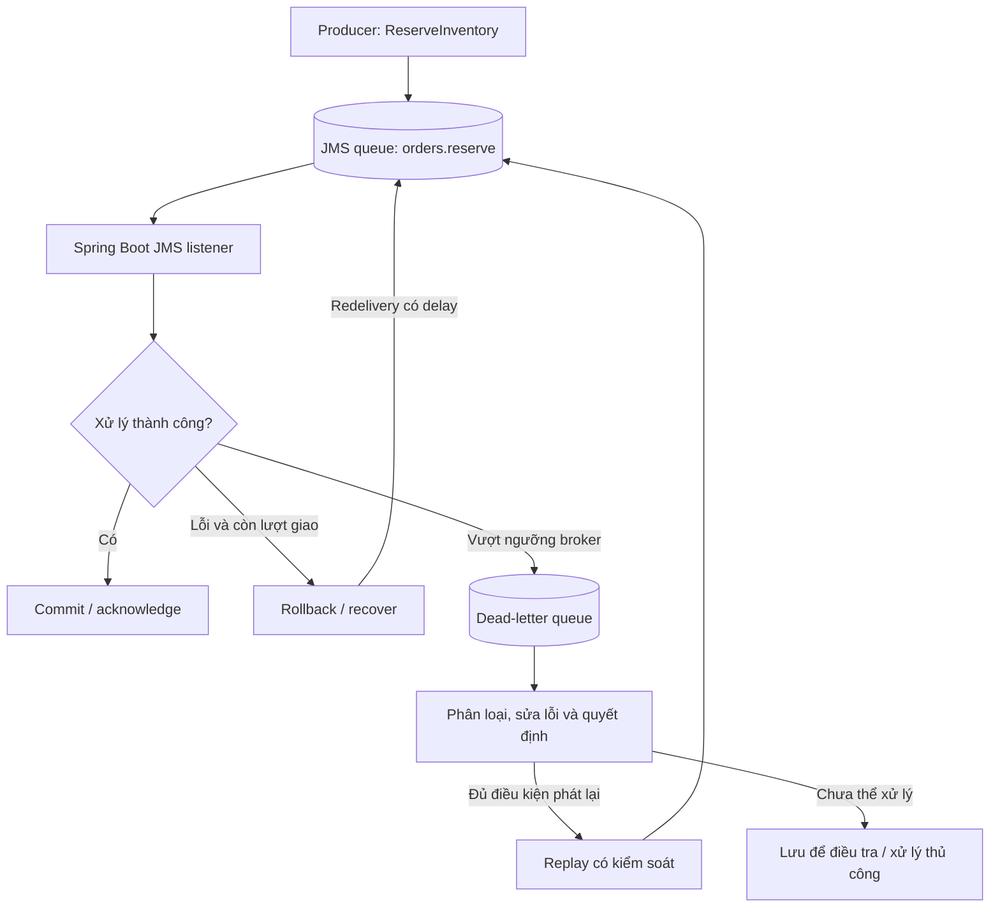

# Dead-letter queue và thông điệp không thể xử lý

> **Chương:** JMS  
> **Module:** `SPRING_BOOT_INTEGRATION` — tổ chức tích hợp hệ thống trong Spring Boot qua HTTP client, cơ sở dữ liệu, cache, broker thông điệp và các adapter Spring Integration. Trọng tâm của bài là cách xử lý lỗi, giao dịch, xử lý trùng lặp, kiểm thử và quan sát khi một thông điệp JMS không thể được consumer xử lý thành công.

Trong hệ thống nhận thông điệp bất đồng bộ, không phải message nào cũng xử lý thành công ở lần đầu. Database có thể tạm ngừng, HTTP API bên ngoài trả lỗi, dữ liệu được gửi sai hợp đồng hoặc một phiên bản consumer mới xuất hiện bug. Nếu consumer cứ nhận lại cùng một message lỗi, hàng đợi có thể bị nghẽn và các message hợp lệ phía sau bị ảnh hưởng.

**Dead-letter queue (DLQ)** là nơi giữ lại những thông điệp mà quy trình nhận/xử lý không thể hoàn tất sau các điều kiện hoặc số lần giao lại được cấu hình. Thay vì liên tục lặp một thông điệp có vấn đề, hệ thống chuyển nó sang một luồng điều tra và phục hồi. DLQ **không tự sửa dữ liệu**, không chứng minh tác dụng phụ nghiệp vụ chưa xảy ra và không thay thế thiết kế idempotency.

## 1. Kết quả cần đạt

Sau bài học, bạn cần:

1. Phân biệt lỗi tạm thời, lỗi vĩnh viễn và kết quả xử lý chưa xác định; quyết định khi nào retry, khi nào cách ly.
2. Hiểu quan hệ giữa JMS acknowledgment, transaction, redelivery, giới hạn số lần giao và DLQ.
3. Cấu hình một ví dụ DLQ ở **ActiveMQ Artemis**, đồng thời hiểu vì sao tên đích, chính sách retry và metadata là chi tiết phụ thuộc broker.
4. Viết listener Spring JMS để exception làm transaction JMS rollback, tạo điều kiện cho broker giao lại message.
5. Xử lý trùng lặp qua transaction database và event ID nghiệp vụ ổn định khi message bị giao lại.
6. Kiểm thử, đo đạc, điều tra và phát lại thông điệp từ DLQ một cách có kiểm soát.

## 2. DLQ nằm ở đâu trong luồng JMS?

Ví dụ: `Order Service` gửi lệnh `ReserveInventory` đến queue `orders.reserve`. Một Spring Boot consumer dùng `@JmsListener` nhận lệnh, ghi trạng thái vào database và có thể gọi HTTP tới hệ thống kho. Nếu kho không phản hồi, consumer cần có chính sách lỗi rõ ràng.



**Thuật ngữ quan trọng:**

- **Delivery:** một lần broker giao message cho consumer. Một message có thể được giao nhiều lần.
- **Acknowledgment (ack):** cơ chế thông báo đã nhận/xử lý theo chế độ JMS đang sử dụng; khi dùng transacted session, commit session xác nhận các message được tiêu thụ trong transaction đó.
- **Rollback / recover:** trả message về trạng thái có thể được giao lại, tùy cơ chế transaction/acknowledgment và broker.
- **Redelivery:** broker gửi lại message sau khi lần trước chưa được xác nhận thành công.
- **Poison message:** message liên tục khiến consumer thất bại, ví dụ payload sai định dạng, sai phiên bản hoặc kích hoạt lỗi không thể phục hồi bằng retry.
- **DLQ / quarantine queue:** nơi tách message có vấn đề ra khỏi luồng xử lý thông thường để điều tra, khắc phục và quyết định bước tiếp theo.

**Điểm giới hạn của tiêu chuẩn:** JMS quy định API gửi/nhận, acknowledgment, transaction và một số metadata; nó không chuẩn hóa một API DLQ chung cho mọi broker. Tên DLQ, cơ chế chuyển vào DLQ, chính sách thử lại và giao diện replay cần xem tài liệu **JMS provider** đang vận hành. Trong bài dùng ActiveMQ Artemis làm ví dụ; không mặc định cấu hình đó áp dụng cho IBM MQ, ActiveMQ Classic hoặc provider khác.

## 3. Phân loại lỗi trước khi thiết lập retry

Chính sách “mọi exception đều retry 10 lần” vừa tốn tài nguyên vừa làm chậm xử lý thông điệp hợp lệ. Cần phân loại lỗi theo khả năng thay đổi kết quả khi thử lại **cùng một message**.

| Nhóm | Ví dụ | Cách xử lý nên cân nhắc | Lưu ý |
|---|---|---|---|
| Tạm thời (transient) | Database timeout, HTTP `503`, cạn connection trong thời gian ngắn | Rollback để broker redeliver có delay, số lần hữu hạn; theo dõi lỗi | Retry phải an toàn với tác dụng phụ đã xảy ra. |
| Vĩnh viễn do dữ liệu | JSON hỏng, thiếu trường bắt buộc, ID không hợp lệ | Cách ly sớm hoặc để broker chuyển DLQ sau ngưỡng thấp | Retry không tự sửa payload. |
| Vĩnh viễn do hợp đồng/quyền | Schema không tương thích, quyền truy cập cấu hình sai | Đưa vào DLQ/cách ly; sửa producer, consumer hoặc cấu hình rồi replay | Không “chữa” bằng retry liên tục. |
| Lỗi nghiệp vụ cần đánh giá | Không đủ tồn kho, đơn đã hủy, bản ghi liên quan chưa sẵn sàng | Quyết định theo hợp đồng: từ chối dứt điểm, chờ bù dữ liệu hoặc xử lý thủ công | Không phải mọi trường hợp không đủ tồn kho là lỗi kỹ thuật. |
| Không rõ đã thành công hay chưa | HTTP ghi dữ liệu timeout sau khi server có thể đã xử lý; DB commit xong nhưng JMS ack lỗi | Kiểm tra trạng thái bằng business ID, idempotency key; đối soát trước retry | Retry mù quáng có thể tạo thao tác trùng. |
| Bug ứng dụng | `NullPointerException` do logic, mapper lỗi với một field mới | Cách ly message, ghi lỗi và deploy bản sửa trước khi replay | Nhiều message có thể cùng kích hoạt lỗi. |

Nguyên tắc xử lý là **quyết định lỗi theo ngữ nghĩa nghiệp vụ**, không chỉ dựa vào class của exception. Ví dụ, HTTP `404` từ API đối tác có thể là “không tồn tại vĩnh viễn”, nhưng cũng có thể là sự kiện đến trước khi thực thể được đồng bộ. Dùng contract và trạng thái nghiệp vụ để quyết định.

### 3.1. Những câu hỏi khi message thất bại

Trước khi retry, cần trả lời:

1. **Có thay đổi gì nếu thử lại?** Mạng/DB sẽ hồi phục hay payload vẫn sai?
2. **Tác dụng phụ có thể đã xảy ra?** Trước lỗi, consumer đã ghi DB, gửi HTTP hoặc phát message khác chưa?
3. **Có định danh ổn định để phát hiện trùng?** Ví dụ `eventId`, `commandId` hay idempotency key được producer giữ nguyên khi gửi lại.
4. **Cần giữ thứ tự hay deadline nghiệp vụ?** Retry một message trong nhiều giờ có thể làm trạng thái đến muộn hơn các sự kiện mới.
5. **Khi hết lượt retry, ai chịu trách nhiệm?** Đội vận hành, hệ thống đối soát tự động hay người phê duyệt replay?

## 4. Acknowledgment và transaction quyết định có redelivery hay không

Trong Spring JMS, hành vi lỗi phụ thuộc cấu hình listener container và JMS provider. Không thể kết luận “method throw exception thì chắc chắn message vào DLQ” nếu chưa biết chế độ ack, transaction và broker policy.

| Cơ chế tiêu thụ | Khi xử lý thất bại | Điều cần nhớ |
|---|---|---|
| JMS transacted session | Rollback transaction JMS cho phép redelivery | Phù hợp cho luồng yêu cầu xử lý/xác nhận có kiểm soát; cần cấu hình broker để giới hạn lần giao. |
| `CLIENT_ACKNOWLEDGE` | App phải tự ack hoặc recovery theo cơ chế session | `acknowledge()` có phạm vi session, không đồng nghĩa xác nhận chỉ một message trong mọi tình huống. |
| `AUTO_ACKNOWLEDGE` | Thời điểm ack và hành vi khi listener exception phụ thuộc cách container/provider vận hành | Không dùng exception làm bảo đảm redelivery nếu chưa kiểm tra behavior thực tế. |
| `DUPS_OK_ACKNOWLEDGE` | Có thể ack trì hoãn và giao trùng | Consumer phải chịu được redelivery; không phù hợp nếu cần chính sách xác nhận nghiêm ngặt. |

Để ví dụ có hành vi rõ ràng, bài này chọn **local JMS session transaction**: listener kết thúc thành công thì container commit; exception thoát ra thì container rollback. Broker sẽ quản lý lần giao lại và có thể chuyển DLQ sau ngưỡng. Hai bên vẫn cần cấu hình và test trên provider thực tế.

**Quan trọng:** local JMS transaction chỉ điều phối tài nguyên JMS nằm trong transaction đó. Nếu listener đồng thời ghi database bằng một transaction Spring JDBC/JPA riêng, chúng **không tự trở thành một transaction phân tán duy nhất**. DB có thể commit nhưng JMS rollback vì consumer chết hoặc ack/commit lỗi; message sẽ được giao lại. Đây là lý do thiết kế idempotency ở phía DB vẫn bắt buộc.

## 5. Cấu hình Spring Boot consumer cho redelivery

Ví dụ dùng Spring Boot với Spring JMS, JMS provider tương thích Jakarta Messaging (Jakarta JMS) và ActiveMQ Artemis. Với Spring Boot 3+/Spring Framework 6+, import JMS thuộc namespace `jakarta.jms.*`. Đối với phiên bản Spring cũ, namespace có thể là `javax.jms.*`; không trộn hai hệ API trong cùng ứng dụng.

### 5.1. Định nghĩa listener container dùng transacted session

```java
import jakarta.jms.ConnectionFactory;
import org.springframework.context.annotation.Bean;
import org.springframework.context.annotation.Configuration;
import org.springframework.jms.annotation.EnableJms;
import org.springframework.jms.config.DefaultJmsListenerContainerFactory;

@Configuration(proxyBeanMethods = false)
@EnableJms
class JmsConsumerConfiguration {

    @Bean
    DefaultJmsListenerContainerFactory reliableJmsListenerFactory(
            ConnectionFactory connectionFactory) {
        var factory = new DefaultJmsListenerContainerFactory();
        factory.setConnectionFactory(connectionFactory);

        // Một JMS local transaction cho mỗi lần nhận/xử lý.
        factory.setSessionTransacted(true);
        factory.setConcurrency("1-4");
        return factory;
    }
}
```

`setSessionTransacted(true)` là phần quyết định semantics commit/rollback ở ví dụ. Thông số concurrency `1-4` chỉ minh họa, cần đo theo thời gian xử lý, số connection có thể cấp và các ràng buộc về thứ tự. Với queue có thứ tự nghiệp vụ chặt, xử lý đồng thời cần cơ chế phân nhóm, phiên bản trạng thái hoặc serial hóa theo khóa nghiệp vụ.

### 5.2. Listener để lỗi thực sự đi ra ngoài

```java
import jakarta.jms.JMSException;
import jakarta.jms.TextMessage;
import org.springframework.jms.annotation.JmsListener;
import org.springframework.stereotype.Component;

@Component
class ReserveInventoryListener {
    private final InventoryCommandProcessor processor;

    ReserveInventoryListener(InventoryCommandProcessor processor) {
        this.processor = processor;
    }

    @JmsListener(
        destination = "orders.reserve",
        containerFactory = "reliableJmsListenerFactory")
    public void onMessage(TextMessage message) throws JMSException {
        String eventId = message.getStringProperty("eventId");
        if (eventId == null || eventId.isBlank()) {
            throw new IllegalArgumentException("Missing eventId");
        }

        String payload = message.getText();
        processor.process(eventId, payload);
    }
}
```

`InventoryCommandProcessor` là lớp nghiệp vụ do ứng dụng cài đặt: validate dữ liệu, áp dụng quy tắc và ghi trạng thái. Khi nó throw exception, listener không che giấu lỗi. Với container transacted, transaction JMS bị rollback và broker có thể giao lại message theo policy. Khi phương thức kết thúc bình thường, container commit transaction JMS, nghĩa là message được coi là đã xử lý ở mức JMS.

**Không dùng cách này để “xử lý lỗi”:**

```java
// Nguy hiểm nếu session JMS được commit sau khi method trở về.
@JmsListener(destination = "orders.reserve")
public void onMessage(String payload) {
    try {
        process(payload);
    } catch (Exception ex) {
        log.error("Failed", ex); // Chỉ log rồi return.
    }
}
```

Nếu listener nuốt exception và trở về bình thường, container có thể xác nhận message dù nghiệp vụ thất bại, khiến thông điệp biến mất khỏi luồng xử lý mà không vào DLQ. Hãy để exception đi ra ngoài **hoặc** triển khai một luồng cách ly có commit được bảo đảm và test transaction của nó.

Không nên dùng `ErrorHandler` hoặc logging callback của container như cơ chế quyết định duy nhất cho rollback/commit. Chúng hữu ích cho quan sát, còn redelivery phụ thuộc transaction/ack và provider.

### 5.3. Producer phải có định danh nghiệp vụ ổn định

```java
import org.springframework.jms.core.JmsTemplate;
import org.springframework.stereotype.Service;

@Service
class ReserveInventoryPublisher {
    private final JmsTemplate jmsTemplate;

    ReserveInventoryPublisher(JmsTemplate jmsTemplate) {
        this.jmsTemplate = jmsTemplate;
    }

    void publish(String eventId, String correlationId, String jsonPayload) {
        jmsTemplate.convertAndSend("orders.reserve", jsonPayload, message -> {
            message.setStringProperty("eventId", eventId);
            message.setStringProperty("schemaVersion", "1");
            message.setJMSCorrelationID(correlationId);
            return message;
        });
    }
}
```

`eventId` nên được tạo khi phát sinh sự kiện/lệnh và **giữ nguyên qua mọi lần retry hoặc replay**. `JMSMessageID` thường do provider gán và có thể thay đổi khi tạo lại message; không dùng nó làm khóa duy nhất để chống lặp thao tác nghiệp vụ. `JMSCorrelationID` hỗ trợ liên kết log/trace của nhiều bước; không nhất thiết trùng `eventId`.

Việc producer gửi thành công một message chưa bảo đảm consumer đã xử lý nghiệp vụ. Nếu publish JMS phụ thuộc commit của database đơn hàng, hãy xem xét outbox hoặc cơ chế phối hợp nhất quán phù hợp; một transaction JPA thông thường không bao phủ việc publish JMS.

## 6. Cấu hình Dead-letter queue trên ActiveMQ Artemis

JMS listener xử lý rollback; **broker** quyết định message được giao lại bao nhiêu lần và đi đâu khi vượt giới hạn. Dưới đây là đoạn cấu hình *minh họa* cho `broker.xml` của Artemis, không phải nội dung của file cấu hình đầy đủ. Cấu trúc và tên đích phải khớp topology đang triển khai.

```xml
<addresses>
    <address name="orders.reserve">
        <anycast>
            <queue name="orders.reserve"/>
        </anycast>
    </address>
    <address name="DLQ.orders.reserve">
        <anycast>
            <queue name="DLQ.orders.reserve"/>
        </anycast>
    </address>
</addresses>

<address-settings>
    <address-setting match="orders.reserve">
        <dead-letter-address>DLQ.orders.reserve</dead-letter-address>
        <max-delivery-attempts>5</max-delivery-attempts>
        <redelivery-delay>1000</redelivery-delay>
        <redelivery-multiplier>2.0</redelivery-multiplier>
        <max-redelivery-delay>30000</max-redelivery-delay>
    </address-setting>
</address-settings>
```

Đọc các tham số theo **chính sách broker**:

| Artemis setting | Ý nghĩa |
|---|---|
| `dead-letter-address` | Địa chỉ đích để đưa message không thể hoàn tất sau giới hạn delivery, ở đây là `DLQ.orders.reserve`. |
| `max-delivery-attempts` | Số lượt giao tối đa trước khi broker có thể đưa message vào DLQ. `5` thường được hiểu gồm cả lần giao đầu. |
| `redelivery-delay` | Khoảng trì hoãn cơ bản trước lần giao lại, tính bằng mili giây. |
| `redelivery-multiplier` | Hệ số tăng thời gian chờ giữa các lần giao, nếu provider và cấu hình hỗ trợ. |
| `max-redelivery-delay` | Giới hạn trên cho độ trễ redelivery. |

Trong môi trường thực tế, cần kiểm tra quy tắc `address-setting match`, topology address/queue, routing type, quyền truy cập, persistence và cách broker HA/cluster áp dụng cấu hình. Nếu queue hoặc địa chỉ DLQ chưa tồn tại và auto-create bị tắt, message có thể không được định tuyến theo kỳ vọng. Không chỉ cấu hình tên DLQ rồi coi như đã có khả năng khôi phục.

Một số provider gọi cơ chế tương tự bằng thuật ngữ `backout queue`, `poison-message policy` hoặc thiết lập riêng trên destination/subscription. Cấu hình Artemis ở trên **không phải YAML Spring Boot** và không thể sao chép nguyên văn vào `application.yml` của ứng dụng.

### 6.1. Phân biệt DLQ với expiry queue

Message có **TTL** và bị hết hạn là trường hợp khác message được giao nhiều lần nhưng xử lý thất bại. Trong Artemis, message hết hạn có thể được chuyển qua `expiry-address` nếu được cấu hình; không mặc định nó đi vào cùng DLQ. Hai sự kiện cần metric, policy lưu trữ và quy trình điều tra riêng:

- **Dead-letter:** không thể hoàn tất sau số lượt giao hoặc theo cơ chế chuyển message lỗi.
- **Expiry:** thông điệp quá thời gian sống; thao tác nghiệp vụ có thể đã không còn giá trị.

Nếu cấu hình thời gian lưu trong DLQ quá ngắn, message có thể bị xóa trước khi được điều tra. Nếu lưu vô hạn mà không có quota và cảnh báo, DLQ có thể tiêu tốn disk. Cần chính sách retention, backup và xử lý dữ liệu nhạy cảm phù hợp.

## 7. Trạng thái JMS và metadata cần bảo toàn

Khi message được giao lại hoặc chuyển DLQ, nên lưu đủ dữ liệu để người điều tra có thể **tái dựng nguyên nhân** và quyết định có replay được hay không.

| Trường / dấu vết | Dùng để làm gì | Lưu ý |
|---|---|---|
| `eventId` hoặc `commandId` do ứng dụng gán | Chống trùng nghiệp vụ và kiểm tra đã xử lý chưa | Giữ ổn định qua redelivery/replay. |
| `JMSMessageID` | Truy dấu lần publish ở broker | Có thể đổi khi tạo message mới cho replay. |
| `JMSCorrelationID` | Liên kết yêu cầu và các bước bất đồng bộ | Không xem là idempotency key trừ khi contract quy định vậy. |
| `JMSRedelivered` | Dấu hiệu provider đang giao lại message | Không suy ra số lượt chính xác chỉ từ boolean. |
| `JMSXDeliveryCount` | Theo dõi số lượt giao nếu provider hỗ trợ/cung cấp như kỳ vọng | Kiểm tra semantics, giá trị trong test broker thực; không dùng làm business ID. |
| `schemaVersion`, `eventType`, timestamp nghiệp vụ | Chọn parser phù hợp, đánh giá tính hợp lệ sau replay | Version cần có chính sách tương thích. |
| Source destination, lỗi gần nhất, thời điểm vào DLQ | Giải thích đường đi và mức ưu tiên xử lý | Có thể là metadata riêng của broker hoặc dữ liệu do hệ thống quan sát lưu lại. |

Tên property hệ thống lưu địa chỉ/queue gốc khi message vào DLQ tùy broker, không có tên chuẩn JMS dùng được ở mọi nơi. Artemis có metadata nội bộ hỗ trợ xác định nguồn gốc; công cụ replay cần sử dụng đúng thông tin của phiên bản broker đang chạy, đồng thời kiểm chứng destination đích thay vì suy đoán từ tên DLQ.

Đừng đưa stack trace dài hoặc payload chứa thông tin nhạy cảm vào message property chỉ để phục vụ DLQ. Nên lưu lỗi gọn và ID liên kết, còn diagnostic chi tiết được giữ trong hệ thống log/tracing có kiểm soát truy cập và thời hạn lưu phù hợp.

## 8. Redelivery, DB transaction và xử lý trùng lặp

Đây là tình huống dễ bỏ sót nhất khi JMS consumer tích hợp database:

```mermaid
sequenceDiagram
    participant B as JMS broker
    participant L as Spring JMS listener
    participant DB as Orders DB
    B->>L: Deliver eventId=E1
    L->>DB: BEGIN; ghi nghiệp vụ; COMMIT
    DB-->>L: Commit thành công
    Note over L: Consumer lỗi trước khi JMS commit
    L--xB: JMS session rollback / kết nối mất
    B->>L: Redeliver eventId=E1
    L->>DB: Kiểm tra dấu xử lý E1
    DB-->>L: E1 đã xử lý
    L-->>B: JMS commit, bỏ qua tác dụng phụ trùng
```

Transaction DB và transaction JMS có thể commit ở hai thời điểm khác nhau. Vì thế cần consumer idempotent ngay cả khi có DLQ và retry hữu hạn.

### 8.1. Ghi dấu event đã xử lý trong cùng DB transaction

Ví dụ với PostgreSQL:

```sql
CREATE TABLE processed_messages (
    consumer_name VARCHAR(100) NOT NULL,
    event_id UUID NOT NULL,
    processed_at TIMESTAMPTZ NOT NULL DEFAULT NOW(),
    PRIMARY KEY (consumer_name, event_id)
);
```

Trong transaction database của consumer:

```sql
INSERT INTO processed_messages (consumer_name, event_id)
VALUES (:consumer_name, :event_id)
ON CONFLICT DO NOTHING;
```

Nếu số dòng thêm bằng **1**, consumer thực hiện cập nhật trạng thái nghiệp vụ **trong cùng transaction DB** rồi commit. Nếu bằng **0**, event đó đã được xử lý bởi consumer tương ứng, có thể bỏ qua cập nhật nghiệp vụ cục bộ và kết thúc listener để commit JMS session. Nếu bước nghiệp vụ thất bại, transaction DB rollback cả marker, cho phép lần redelivery xử lý lại.

Unique constraint trong DB bảo vệ cạnh tranh khi hai lần giao có thể được xử lý đồng thời. Mẫu “SELECT trước rồi INSERT sau” không có ràng buộc/khóa phù hợp sẽ có race condition.

**Giới hạn:** marker DB không tự bảo vệ lời gọi HTTP tới hệ thống kho hoặc message đã phát sang broker khác. Khi có tác dụng phụ ngoài DB, cần bên nhận hỗ trợ idempotency key, thiết kế outbox hoặc trạng thái request có thể đối soát. Một broker JMS với DLQ không tự bảo đảm exactly-once cho toàn hệ thống.

### 8.2. Retry đúng ranh giới

Có hai cách retry phổ biến:

- **Broker redelivery:** listener throw, JMS transaction rollback; broker áp dụng delay, đếm lần giao và cuối cùng chuyển DLQ. Đây là lựa chọn chính cho ví dụ.
- **Retry trong ứng dụng:** gọi lại một thao tác ngay trong cùng delivery, có thể phù hợp cho sự cố cực ngắn và hoạt động idempotent. Tuy nhiên có nguy cơ giữ JMS session/thread quá lâu, che khuất số lần thử thật và nhân tải vào dependency.

Không cấu hình đồng thời retry nhiều tầng mà bỏ qua **tổng số lần gọi thực tế**. Ví dụ: broker giao tối đa 5 lần và mỗi delivery chạy 4 HTTP retry thì hệ thống có thể gửi tối đa 20 lời gọi downstream cho một event, chưa kể replay về sau.

## 9. Khi muốn đưa lỗi vĩnh viễn vào DLQ ngay

Thông điệp sai định dạng có thể không cần chờ đủ 5 lần redelivery. Có hai hướng, mỗi hướng cần kiểm chứng trên broker:

1. **Chính sách broker:** dùng khả năng dead-letter/quarantine/redelivery riêng của provider để giảm số lần giao đối với queue hoặc loại lỗi phù hợp. Cấu hình cụ thể là đặc thù từng broker.
2. **Application parking:** listener phân loại lỗi vĩnh viễn, gửi một bản sao cùng metadata nghiệp vụ vào queue cách ly rồi xác nhận message gốc **theo một giao dịch bảo đảm được hai bước đó**. Không được coi “`jmsTemplate.convertAndSend(...)` thành công rồi return” là atomic nếu thao tác gửi và việc nhận gốc diễn ra ở hai session/transaction độc lập.

Với lựa chọn application parking, nếu cơ chế broker hỗ trợ **một JMS transacted Session** cho cả nhận và gửi trong cùng tài nguyên, có thể gửi message quarantine bằng chính session đó rồi commit: nếu commit thất bại thì cả việc nhận và việc gửi thuộc transaction được rollback theo semantics provider. Nếu dùng các tài nguyên khác nhau hoặc gửi sang dịch vụ ngoài, cần outbox/đối soát hay cơ chế giao dịch phù hợp. Hãy thiết kế chống việc message bị chuyển đi hai lần nếu sự cố xảy ra giữa các bước.

Đồng thời, quy định chính xác **lỗi nào được coi là vĩnh viễn**. Chẳng hạn JSON hoàn toàn hỏng thường nên cách ly; lỗi kiểm tra tồn kho do database kho chưa đồng bộ có thể cần redelivery có delay. Phân loại sai có thể khiến message đáng lẽ phục hồi được bị đưa vào DLQ quá sớm.

## 10. Quy trình điều tra DLQ

DLQ là một **hàng đợi công việc cần xử lý**, không phải kho lưu trữ để quên. Một quy trình vận hành nên có:

1. **Phát hiện:** alert khi lượng message DLQ tăng bất thường, tuổi message cao, hoặc redelivery/consumer failure tăng đột biến.
2. **Phân nhóm:** theo event type, schema version, loại exception, source destination, deployment version và time window. Xác định một lỗi phát sinh hàng loạt hay từng message riêng lẻ.
3. **Xác minh tác dụng phụ:** kiểm tra business ID, database, HTTP downstream, outbox và log để biết đã có bước nào commit thành công chưa.
4. **Khắc phục nguyên nhân:** sửa schema/producer/consumer, tăng khả năng phục vụ dịch vụ phụ thuộc, sửa cấu hình quyền hoặc bổ sung dữ liệu thiếu; không xóa message chỉ để metric về 0.
5. **Quyết định:** replay, xử lý thủ công, giữ để điều tra hoặc loại bỏ có ghi nhận theo chính sách retention và yêu cầu nghiệp vụ.
6. **Theo dõi kết quả:** sau replay, xác nhận message đạt trạng thái nghiệp vụ mong muốn, không tạo trùng và không quay về DLQ một cách lặp đi lặp lại.

Phân quyền việc xem payload và replay: DLQ có thể chứa dữ liệu nghiệp vụ nhạy cảm. Hệ thống cần audit người thực hiện, thời điểm, lý do, số message và kết quả.

### 10.1. Những metric nên quan sát

| Metric / tín hiệu | Ý nghĩa vận hành |
|---|---|
| Queue depth của nguồn và DLQ | Đang nghẽn xử lý thông thường hay backlog xử lý lỗi? |
| Rate chuyển vào DLQ theo phút | Có lỗi mới xuất hiện sau thay đổi phiên bản/cấu hình không? |
| Age của message cũ nhất trong DLQ | Có message nằm chờ điều tra quá lâu không? |
| Count/lý do redelivery, retry, rollback | Lỗi tạm thời có đang tạo retry storm không? |
| Success/duplicate/failed sau replay | Việc khôi phục có thật sự hoàn tất? |
| Consumer throughput và thời gian xử lý p95/p99 | Consumer có bị kẹt bởi tác vụ chậm hay dependency lỗi không? |
| DB pool, HTTP timeout, broker disk/memory | Tài nguyên nào gây ra triệu chứng kéo dài? |

Có thể dùng Spring Boot Actuator, Micrometer, tracing/log có cấu trúc và công cụ quản trị/metric của broker; tên metric cụ thể phụ thuộc phiên bản integration và exporter. Gắn `eventId`, `correlationId` và destination vào log có cấu trúc nếu chính sách bảo mật cho phép; tránh log payload thô.

## 11. Replay an toàn sau khi đã sửa nguyên nhân

Phát lại toàn bộ DLQ ngay khi broker hồi phục có thể tạo tải cao và tái phát lỗi. Replay chỉ nên bắt đầu khi biết lý do thất bại, kết quả mong muốn và cơ chế chống trùng. Một quy trình an toàn:

| Bước | Cần làm | Vì sao |
|---|---|---|
| Chọn mẫu | Chọn event type, khoảng thời gian, lỗi đã sửa và một số message đại diện | Không đẩy dữ liệu chưa hiểu trở lại production. |
| Kiểm tra trạng thái | Đối chiếu event ID và business ID; xem tác dụng phụ đã hoàn tất chưa | Tránh xử lý lại giao dịch đã thành công. |
| Bảo toàn định danh | Giữ `eventId`, schema version và correlation context cần thiết; gắn thêm metadata về replay nếu phù hợp | Cho phép consumer deduplicate và truy vết. |
| Chọn destination | Khôi phục đúng queue nghiệp vụ ban đầu, theo metadata đáng tin cậy | Tránh phân phối sai loại message. |
| Kiểm soát tải | Replay theo batch nhỏ, giới hạn tốc độ/concurrency và có điểm dừng | Tránh bão retry, lock DB và nghẽn downstream. |
| Theo dõi | Xác nhận trạng thái nghiệp vụ, nguồn queue, DLQ và metric lỗi sau từng batch | Ngừng ngay nếu lỗi quay lại hoặc dữ liệu sai. |
| Audit | Lưu người/lệnh thực hiện, reason, số lượng, số thành công/thất bại | Đủ thông tin để đối soát và điều tra. |

**Lưu ý về tính nguyên tử:** khi công cụ replay **tiêu thụ** message từ DLQ và **phát** message tới queue đích, nên dùng API quản trị chuyển message của broker có semantics rõ ràng hoặc một giao dịch JMS có thể bao phủ việc nhận và gửi trong cùng session/provider. Nếu nhận và gửi không atomic, sự cố ở giữa có thể làm mất hoặc nhân đôi message; phải thiết kế fallback và deduplication.

Một số công cụ broker có chức năng “retry/resent messages” nhưng có thể thay đổi header, delivery count, TTL, message ID hoặc thứ tự. Cần thử trên môi trường giống production trước khi tự động replay. Với nghiệp vụ có yêu cầu thứ tự cao, message cũ đưa lại sau message mới có thể làm trạng thái quay lùi; dùng version/sequence hoặc đối soát trạng thái hiện tại trước khi áp dụng.

### 11.1. Vì sao sửa bug trước rồi replay vẫn có rủi ro?

Giả sử `ReserveInventory(eventId=E42, orderId=O100)` gọi API giữ hàng. API kho đã nhận và giữ thành công, nhưng phản hồi timeout khiến JMS listener rollback nhiều lần và cuối cùng message nằm trong DLQ. Sau khi sửa timeout, replay message **không có idempotency key** có thể giữ hàng lần hai. Trước replay, phải hỏi hệ thống kho bằng `orderId`/`eventId` hoặc gọi API với idempotency key ổn định theo hợp đồng kho.

Đối với lệnh thanh toán, hoàn tiền hoặc tạo đơn vận chuyển, mức độ kiểm soát còn phải nghiêm ngặt hơn: có thể yêu cầu phê duyệt và đối soát giao dịch trước khi phát lại.

## 12. Kiểm thử bằng broker thật

Test thuần unit có thể kiểm tra phân loại exception, nhưng không chứng minh được số lượt redelivery, rollback JMS, thời điểm ack hay chuyển DLQ. Các hành vi này cần **integration test với đúng JMS provider và cấu hình tương đương môi trường vận hành**; có thể sử dụng Testcontainers/Artemis container hoặc broker thử nghiệm do hệ thống cấp.

| Kịch bản | Cách kích hoạt | Kỳ vọng cần xác minh |
|---|---|---|
| Xử lý thành công | Gửi payload hợp lệ | Listener hoàn tất; message rời queue, không xuất hiện DLQ. |
| Lỗi tạm thời rồi hồi phục | Processor throw 2 lần, lần 3 thành công | Có redelivery, thời gian trì hoãn hợp lý, một kết quả nghiệp vụ cuối cùng. |
| Poison message | Gửi payload không parse được hoặc thiếu `eventId` | Listener rollback; đến ngưỡng thì broker chuyển DLQ; dữ liệu và metadata quan trọng còn đủ. |
| Consumer restart | Dừng consumer sau DB commit nhưng trước JMS commit (fault injection) | Có thể redeliver; marker idempotency ngăn ghi trùng. |
| Broker reconnect | Mất connection giữa lúc xử lý | Message không bị coi là thành công giả; phục hồi theo semantics provider. |
| Connection pool/HTTP lỗi | Downstream trả timeout/`503` | Retry không vô hạn; backlog và metric lỗi quan sát được. |
| Expiry | Gửi message với TTL ngắn và giữ không tiêu thụ | Expiry được xử lý theo `expiry-address`/policy riêng; không nhầm với dead-letter do lỗi xử lý. |
| Replay sau sửa lỗi | Chuyển một message được phê duyệt từ DLQ về queue gốc | Kết quả đúng, không duplicate, provenance/replay được ghi nhận. |
| Replay sai điều kiện | Cố đưa lại message chưa được sửa | Cơ chế giới hạn hoặc quy trình giám sát phát hiện lỗi quay lại và dừng batch. |

Đặc biệt kiểm tra **message conversion trước khi listener method chạy**: một payload khiến converter không tạo được tham số Java vẫn có thể đi qua cơ chế lỗi của listener container. Hãy chứng minh container rollback và broker xử lý theo policy trong trường hợp này; đừng chỉ test exception phát sinh bên trong method.

Khi kiểm thử redelivery, không chỉ đếm bao nhiêu lần handler được gọi. Cần xác minh thứ tự sự kiện: nhận → lỗi → rollback → redelivery → chuyển DLQ hoặc commit thành công. Với broker có metadata đếm lần giao, quan sát trực tiếp count để phát hiện cấu hình không khớp dự tính.

## 13. Sai lầm thường gặp

**“Đặt tên queue là DLQ thì JMS tự chuyển message vào.”** Tên không đủ; broker cần có routing, địa chỉ, policy về lần giao và cấu hình giữ message phù hợp.

**“Throw exception là chắc chắn sẽ retry.”** Hành vi phụ thuộc container, acknowledgment, transaction và JMS provider. Với listener quan trọng, cấu hình transacted session tường minh và xác minh trên broker.

**“Log rồi return là đã xử lý lỗi.”** Nếu message được ack sau khi listener return, tác vụ lỗi sẽ bị coi là hoàn tất và không còn cơ hội redelivery.

**“Message đã nằm DLQ nên chưa từng cập nhật DB.”** Một phần tác dụng phụ có thể đã commit trước khi JMS transaction thất bại. Cần kiểm tra trạng thái thực tế trước replay.

**“Tăng max-delivery-attempts sẽ sửa được poison message.”** Payload sai/bug cố định thường không hết nhờ retry. Nó chỉ làm mất thêm thời gian và tài nguyên.

**“Replay luôn tạo lại chính message cũ.”** Công cụ replay có thể tạo message mới với `JMSMessageID` mới, metadata khác hoặc delivery count mới. Bảo toàn business/event ID và kiểm tra semantics của công cụ.

**“DLQ là bảo đảm exactly-once.”** DLQ cung cấp nơi cách ly và phục hồi; idempotency, transaction boundaries, hợp đồng dữ liệu và đối soát mới giúp kiểm soát tác dụng phụ trùng hoặc chưa rõ kết quả.

## 14. Bài thực hành tổng hợp

Triển khai luồng `orders.reserve` trong ứng dụng Spring Boot với JMS và một database:

1. Tạo producer gửi `ReserveInventory` có `eventId` cố định, `orderId`, `schemaVersion` và `correlationId`.
2. Tạo Spring JMS listener dùng `DefaultJmsListenerContainerFactory` với `sessionTransacted=true`. Listener gọi service nghiệp vụ và để exception thoát ra khi chưa hoàn tất.
3. Trên Artemis, cấu hình queue nguồn, queue DLQ, giới hạn năm lượt giao và redelivery delay. Kiểm tra thực tế cách broker đếm lần giao.
4. Tạo bảng `processed_messages` có khóa duy nhất theo consumer + `eventId`; cập nhật nghiệp vụ và marker trong cùng transaction DB.
5. Gửi lần lượt message hợp lệ, message JSON hỏng và message gặp lỗi DB tạm thời. Quan sát queue nguồn, DLQ, số lượt giao và trạng thái database.
6. Thử trường hợp DB đã commit nhưng JMS chưa commit bằng fault injection. Xác minh redelivery không nhân đôi cập nhật.
7. Sửa nguyên nhân của một message trong DLQ, replay một batch nhỏ, kiểm tra lại trạng thái nghiệp vụ, số message và log audit.
8. Thiết lập dashboard/alert cho DLQ depth, age, broker redelivery, consumer error rate và pending workload.

**Điều kiện nghiệm thu:** Message hợp lệ xử lý thành công; lỗi tạm thời có thể phục hồi trong số lượt hữu hạn; message không thể xử lý vào DLQ với đủ định danh để điều tra; consumer an toàn khi nhận trùng; có quy trình replay không tạo tác dụng phụ trùng và có chỉ số vận hành chứng minh các trạng thái.

## 15. Câu hỏi tự đánh giá

**1. Message sai JSON nên thử lại bao nhiêu lần?**  
Phụ thuộc policy và khả năng lỗi có thể tự biến mất. Với JSON sai rõ ràng, retry nhiều lần không có ích; nên cách ly sớm hoặc đặt giới hạn delivery thấp và sửa nguồn tạo dữ liệu.

**2. Khác biệt giữa rollback JMS và rollback JPA là gì?**  
Rollback JMS làm message có thể được giao lại theo broker; rollback JPA đảo ngược các thay đổi trong transaction DB tương ứng. Hai transaction cục bộ không tự liên kết thành một commit nguyên tử.

**3. Vì sao không deduplicate bằng `JMSMessageID`?**  
Vì replay hoặc publish lại có thể tạo JMS message mới với ID mới trong khi thao tác nghiệp vụ vẫn là cùng một sự kiện. Dùng định danh nghiệp vụ ổn định như `eventId`/`commandId`.

**4. DLQ khác expiry queue ở đâu?**  
DLQ xử lý message không hoàn thành sau redelivery/chính sách lỗi; expiry queue xử lý message hết TTL. Chúng có nguyên nhân, cách vận hành và quyết định replay khác nhau.

**5. Khi nào replay một message đã vào DLQ là an toàn?**  
Khi nguyên nhân đã được khắc phục, trạng thái nghiệp vụ được đối chiếu, consumer/downstream hỗ trợ idempotency và quy trình replay có giới hạn, kiểm tra kết quả và audit.

DLQ hữu ích nhất khi được coi là **một phần của quy trình phục hồi có chủ sở hữu**, từ broker policy và transaction, đến kiểm thử lỗi, idempotency, quan sát và đối soát. Với JMS trong Spring Boot, mục tiêu không phải chuyển được thật nhiều message vào DLQ, mà là giữ cho luồng nghiệp vụ tiếp tục phục vụ message hợp lệ và có đường xử lý rõ ràng cho những message đang thất bại.
