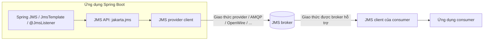
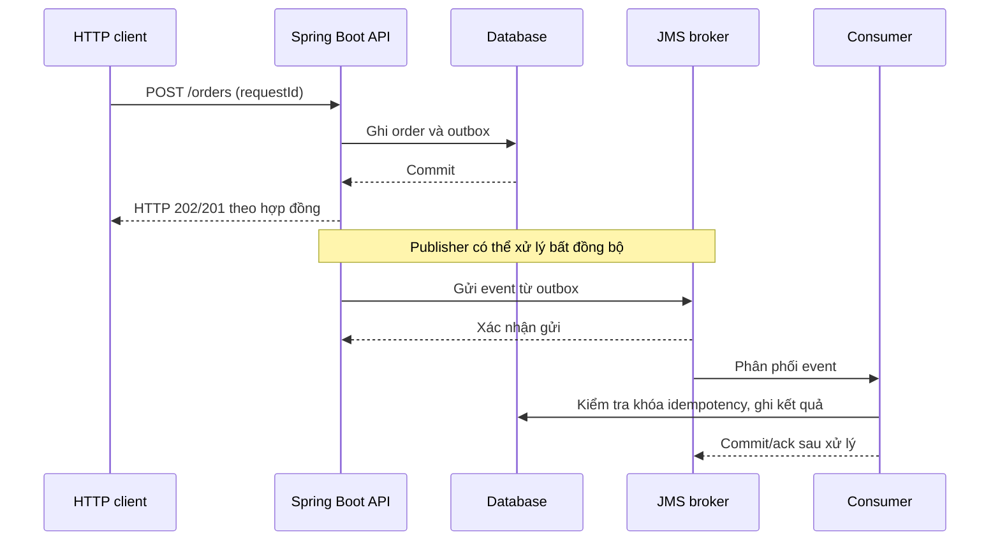

# Tương thích client Jakarta, phiên bản broker và thư viện nền

Trong một ứng dụng Spring Boot tích hợp hệ thống qua JMS, việc biên dịch thành công và có thể tạo `ConnectionFactory` mới chỉ là điều kiện ban đầu. Khi triển khai, ứng dụng còn phải dùng đúng bộ API `jakarta.jms`, đúng thư viện JMS provider, giao tiếp được với phiên bản broker bằng giao thức được hỗ trợ, và duy trì hợp đồng dữ liệu cũng như hành vi giao dịch, xác nhận, retry và xử lý trùng lặp.

Bài học này giải thích cách đánh giá **tương thích client Jakarta, phiên bản broker và thư viện nền** đối với Spring Boot, từ quản lý dependency đến kiểm thử kết nối thật. Trọng tâm là những luồng tích hợp thực tế như HTTP → JMS → consumer → cơ sở dữ liệu, nơi một thay đổi nhỏ ở client hoặc broker có thể gây lỗi sau khi đã triển khai.

## 1. Mục tiêu học tập và bài toán thực tế

Sau khi học, bạn có thể:

- Phân biệt **JMS API**, **JMS provider/client**, **giao thức truyền thông của broker** và **hợp đồng message**.
- Nhận diện khác biệt giữa không gian tên `javax.jms` và `jakarta.jms` khi nâng cấp Spring Boot.
- Xây dựng ma trận tương thích cho phiên bản Spring Boot, Spring Framework, driver JMS, broker và Java runtime.
- Sử dụng BOM và dependency tree để phát hiện thư viện cũ, dependency trùng, classpath bị xung đột.
- Thiết lập kết nối JMS trong ứng dụng Spring Boot qua client hỗ trợ Jakarta Messaging.
- Kiểm thử bằng broker thực tế: kết nối, send/receive, chuyển đổi payload, acknowledgment, transaction, redelivery và dead-letter queue (DLQ).
- Lập kế hoạch nâng cấp client/broker an toàn cho hệ thống đang xử lý message.

**Tình huống xuyên suốt:** một dịch vụ Spring Boot nhận đơn hàng từ HTTP, ghi trạng thái vào cơ sở dữ liệu và phát event `order.placed` qua JMS. Một consumer độc lập nhận event rồi gọi dịch vụ thanh toán. Dù producer và consumer dùng Spring Boot khác phiên bản, các bên phải trao đổi cùng định dạng message, cùng kiểu destination và giao thức JMS client tương thích với broker.

## 2. Bốn lớp tương thích phải kiểm tra riêng

Sơ đồ sau cho thấy vị trí của các thành phần:



| Lớp | Nội dung kiểm tra | Ví dụ lỗi thường gặp |
|---|---|---|
| **API Java** | `jakarta.jms` hay `javax.jms`; giao diện `ConnectionFactory`, `Message` và `JMSContext` | Biên dịch lỗi hoặc `ClassCastException` khi provider triển khai sai namespace |
| **Thư viện provider** | Artifact, phiên bản, Java hỗ trợ, dependency transitively kéo vào, cách cấu hình client | `NoSuchMethodError`, `AbstractMethodError`, thiếu class, nhiều bản driver |
| **Giao thức và broker** | Broker có hiểu protocol/version, TLS, xác thực, destination, topology của client không | Handshake bị từ chối, timeout, connection dropped hoặc broker từ chối quyền |
| **Hợp đồng message** | JSON/schema/version, headers, correlation ID, selector, queue/topic, TTL và redelivery | Kết nối được nhưng consumer không đọc được payload hoặc mất thông điệp |

JMS là **API lập trình Java**, không phải một giao thức mạng chung mà mọi JMS provider đều có thể dùng thay nhau. Hai client đều hỗ trợ `jakarta.jms.ConnectionFactory` vẫn có thể sử dụng các wire protocol hoàn toàn khác. Muốn đổi provider, cần xác minh broker hỗ trợ protocol của client đó.

Ngược lại, một producer dùng `javax.jms` và một consumer dùng `jakarta.jms` **có thể trao đổi message qua cùng broker** nếu từng bên có JMS client tương thích với broker và dùng hợp đồng message độc lập với class Java nội bộ. Namespace Java không được truyền nguyên trạng trên mạng; payload và đặc tính message mới là nơi cần thống nhất.

## 3. Hiểu đúng chuyển đổi `javax.jms` sang `jakarta.jms`

### 3.1. Khác biệt ở cấp mã nguồn và nhị phân

Các ứng dụng dùng Spring Boot 2.x/Spring Framework 5 thường sử dụng JMS API thuộc namespace `javax.jms`. Từ Spring Boot 3.x/Spring Framework 6, Spring JMS chuyển sang namespace `jakarta.jms` để phù hợp hệ sinh thái Jakarta EE.

Đây là thay đổi **tên package và kiểu Java**, không chỉ là sửa import cho đẹp. Hai giao diện sau là hai kiểu khác nhau:

```java
// Dòng ứng dụng cũ (Spring Boot 2.x):
import javax.jms.ConnectionFactory;
import javax.jms.Message;

// Dòng ứng dụng mới (Spring Boot 3.x):
import jakarta.jms.ConnectionFactory;
import jakarta.jms.Message;
```

Một factory implement `javax.jms.ConnectionFactory` không thể tự động đáp ứng injection point yêu cầu `jakarta.jms.ConnectionFactory`. Việc thêm `jakarta.jms-api` vào classpath không biến một thư viện provider chỉ hỗ trợ `javax.jms` thành provider Jakarta.

Ngoài mã Java trực tiếp, phải rà soát:

- Spring JMS và các thư viện integration/adapter gọi `JmsTemplate`, `DefaultMessageListenerContainer` hoặc `@JmsListener`.
- Các bean cấu hình `ConnectionFactory`, `MessageConverter`, `DestinationResolver`, transaction manager và pooling wrapper.
- Bất kỳ thư viện bên thứ ba nào có method signature dùng `javax.jms.Message`/`Session`.
- Bộ serializer/transformer hoặc handler đọc các header JMS và chuyển đổi message body.
- Custom listener, exception handler hoặc interceptor tham chiếu exception thuộc package cũ.

### 3.2. Jakarta Messaging 3.x và phiên bản broker không phải cùng một thứ

Các phiên bản Jakarta Messaging 3.x sử dụng `jakarta.jms`; các bản JMS API cũ thường sử dụng `javax.jms`. Dù nhà cung cấp có ghi “Jakarta Messaging 3.0/3.1”, điều đó trước hết mô tả **mức API/client** được hỗ trợ. Nó không đồng nghĩa broker phải mang con số 3.x hoặc thay đổi wire protocol theo cùng cách.

Ví dụ, một client Jakarta mới có thể kết nối broker được phát hành sớm hơn **nếu** nhà cung cấp công bố hoặc kiểm thử được sự tương thích giao thức. Không suy luận “broker cũ nên không thể dùng Jakarta” hoặc “cùng version number nên chắc chắn tương thích”.

### 3.3. Ma trận chuyển đổi namespace

| Ứng dụng | Provider client được lựa chọn | Đánh giá |
|---|---|---|
| Spring Boot 2.x dùng Spring JMS `javax` | Client chỉ hỗ trợ `javax.jms` với phiên bản tương thích | Hướng phù hợp cho ứng dụng cũ |
| Spring Boot 3.x dùng Spring JMS `jakarta` | Client hỗ trợ `jakarta.jms` và đúng bộ thư viện đi kèm | Hướng phù hợp cho ứng dụng mới |
| Spring Boot 3.x | Client cũ chỉ implement `javax.jms.ConnectionFactory` | **Không tương thích ở cấp API Java** |
| Spring Boot 2.x | Client chỉ implement `jakarta.jms.ConnectionFactory` | **Không tương thích ở cấp API Java** |
| Producer cũ `javax` và consumer mới `jakarta` | Mỗi bên dùng provider client riêng phù hợp với broker | Có thể cùng hoạt động nếu protocol và message contract tương thích |
| Spring Boot phiên bản mới hơn | Bộ client và Spring JMS do BOM, nhà cung cấp và dự án xác nhận | Phải kiểm tra hướng dẫn tương thích của phiên bản cụ thể |

Không nên áp dụng phép đổi namespace hàng loạt cho toàn bộ hệ thống mà bỏ qua phiên bản của Spring Integration, các adapter phụ thuộc và provider. Với các ứng dụng dùng Spring Boot 4.x hoặc major mới hơn, cần đối chiếu BOM và tài liệu chính thức của chính phiên bản đó; không mặc định cấu hình của Boot 3.x giữ nguyên 100%.

## 4. Phân biệt các loại broker và lựa chọn JMS client

JMS không buộc mọi sản phẩm broker hỗ trợ chung một giao thức. Một số ví dụ thường gặp:

| Hệ sinh thái | Điều cần biết khi chọn client | Rủi ro nếu đánh đồng |
|---|---|---|
| **Apache ActiveMQ Artemis** | Có các biến thể client/API, nhiều protocol ở phía broker; chọn artifact hỗ trợ `jakarta.jms` và phiên bản broker được vendor công bố | Dùng nhầm client legacy chỉ hỗ trợ `javax` hoặc dùng protocol không bật trên listener |
| **ActiveMQ Classic** | Có lịch sử client `javax` và các dòng Jakarta riêng; kiểm tra chính xác artifact, major version và OpenWire compatibility | Chuyển từ Classic sang Artemis hoặc nâng client như thể chúng là cùng một provider |
| **IBM MQ** | Chọn bộ IBM MQ client/Jakarta dành cho phiên bản Spring và Java đang dùng, cùng MQ server channel/TLS phù hợp | Dùng thư viện MQ đã cũ, khác namespace hoặc thiếu native/provider dependency |
| **Client JMS qua AMQP 1.0**, chẳng hạn Qpid JMS | Client phải hỗ trợ JMS API được ứng dụng dùng; broker phải bật AMQP 1.0 và hỗ trợ các chức năng dự kiến | Cho rằng bất kỳ broker “có JMS” đều chấp nhận kết nối AMQP 1.0 |
| **Dịch vụ broker tương thích JMS do bên thứ ba cung cấp** | Đọc bảng tính năng và hạn chế của provider: transaction, selectors, durability, redelivery, DLQ | Kết nối thành công nhưng tính năng cần dùng không được hỗ trợ đầy đủ |

**Lưu ý khi chọn artifact Artemis:** theo dòng phiên bản, hệ sinh thái Artemis có các artifact kiểu `artemis-jms-client` và `artemis-jakarta-client`. Tên artifact, cấp API và dependency cụ thể cần kiểm tra theo version đang sử dụng; chỉ tên “JMS client” là chưa đủ để biết namespace. Tương tự với ActiveMQ Classic, không tự hoán đổi `activemq-client` và các biến thể Jakarta khi chưa kiểm tra ma trận phiên bản.

Broker có thể hỗ trợ nhiều giao thức ở các acceptor/listener khác nhau, nhưng việc hỗ trợ một protocol ở mức transport không bảo đảm mọi thuộc tính JMS có semantics hoàn toàn giống nhau. Các điểm cần xác nhận gồm queue/topic, durable subscription, selector, priority, expiry, transaction, redelivery và DLQ.

## 5. Quản lý dependency theo BOM, tránh xung đột

Bộ thư viện liên quan tới một Spring Boot JMS integration thường gồm:

- Spring Boot và Spring Framework: autoconfiguration, `spring-jms`, lifecycle, quản lý transaction.
- JMS API `jakarta.jms-api`: khai báo interface và exception.
- **JMS provider client**: triển khai ConnectionFactory, mã hóa/giải mã protocol, quản lý connection/session.
- JSON serializer, `MessageConverter`, validation hoặc thư viện chung hợp đồng dữ liệu.
- Pooling nếu dùng: `CachingConnectionFactory`, provider pool hoặc JCA connection management, tùy kiến trúc.

Với dự án Gradle dùng Spring Boot 3.x và lựa chọn ActiveMQ Artemis, cách khai báo thông dụng là:

```groovy
dependencies {
    implementation 'org.springframework.boot:spring-boot-starter-artemis'
    implementation 'org.springframework.boot:spring-boot-starter-json'

    testImplementation 'org.springframework.boot:spring-boot-starter-test'
}
```

Đây là ví dụ theo hệ sinh thái **Spring Boot 3.x**; phiên bản thực tế của starter và tập artifact do BOM của dự án quản lý. Với dự án đã có `spring-boot-starter-web`, các thư viện JSON phù hợp thường đã được kéo vào transitively nên có thể không cần khai báo thêm starter JSON. Khi dùng nhà cung cấp broker khác, hãy thay đúng starter/client tương ứng, không giữ lại Artemis chỉ vì ví dụ.

**Không tự bổ sung đồng thời** `javax.jms-api`, `jakarta.jms-api` và nhiều biến thể client với hy vọng hệ thống tự chọn đúng. Classpath có thể chứa cả hai namespace hợp lệ, nhưng Spring chỉ có thể inject factory đúng kiểu mà nó yêu cầu; các provider khác nhau cũng có nguy cơ xung đột class hoặc auto-configuration.

### 5.1. Cách đọc dependency tree

Một số lệnh Gradle có thể dùng khi điều tra (không cần chạy trong mỗi test):

```bash
./gradlew dependencies --configuration runtimeClasspath

./gradlew dependencyInsight --dependency jakarta.jms-api --configuration runtimeClasspath
./gradlew dependencyInsight --dependency javax.jms-api --configuration runtimeClasspath
./gradlew dependencyInsight --dependency artemis --configuration runtimeClasspath
./gradlew dependencyInsight --dependency spring-jms --configuration runtimeClasspath
```

Với Maven, có thể dùng:

```bash
mvn dependency:tree
mvn dependency:tree -Dincludes=jakarta.jms:jakarta.jms-api
```

Cần đọc **runtime classpath**, không chỉ compile classpath. Một dependency được kéo vào lúc chạy có thể gây `NoSuchMethodError` dù IDE vẫn compile.

Đối chiếu các thông tin:

1. Phiên bản Spring Boot và BOM nào quyết định `spring-jms`?
2. Trên runtime classpath có mấy JMS provider client và biến thể `javax`/`jakarta`?
3. Client thực sự hỗ trợ Java runtime, phiên bản broker và protocol mà ứng dụng dùng không?
4. Driver, commons, Netty, logging và JSON libraries có bị ép về phiên bản không phù hợp không?
5. Một dependency cũ của adapter/framework có kéo thêm `javax.jms-api` hoặc provider client cũ không?

Nếu cần override BOM vì thông báo lỗi bảo mật hoặc yêu cầu vendor, chỉ nâng artifact được kiểm chứng tương thích; kiểm tra dependency tree sau override và chạy lại integration test. Đừng loại bỏ transitively một thư viện chỉ vì tên của nó giống thư viện không dùng tới: một số provider yêu cầu các module đi kèm để vận hành.

## 6. Ví dụ Spring Boot 3.x kết nối ActiveMQ Artemis bằng Jakarta JMS

Ví dụ sau dùng một broker Artemis đã được cấu hình sẵn để nhận kết nối JMS. Mọi Java import JMS thuộc `jakarta.jms`.

### 6.1. Cấu hình kết nối

```yaml
spring:
  artemis:
    mode: native
    broker-url: tcp://localhost:61616

app:
  messaging:
    orders-queue: orders.events
```

Trong môi trường production, URI broker, tên người dùng và mật khẩu cần đưa qua cấu hình ngoài hoặc secret manager, không hardcode vào source. Cấu hình `native` kết nối broker chạy bên ngoài ứng dụng. Cổng, protocol, acceptor, tên queue/topic, quyền producer/consumer phải khớp cấu hình của chính broker.

### 6.2. Định nghĩa message contract và JSON converter

Để producer/consumer dễ tiến hóa độc lập, dùng JSON và mã loại message có phiên bản thay vì Java serialization mặc định.

```java
package example.jms;

import java.time.Instant;

public record OrderPlaced(
        String eventId,
        String orderId,
        Instant occurredAt
) {}
```

Cấu hình converter và listener container:

```java
package example.jms;

import com.fasterxml.jackson.databind.ObjectMapper;
import jakarta.jms.ConnectionFactory;
import java.util.Map;
import org.springframework.context.annotation.Bean;
import org.springframework.context.annotation.Configuration;
import org.springframework.jms.annotation.EnableJms;
import org.springframework.jms.config.DefaultJmsListenerContainerFactory;
import org.springframework.jms.support.converter.MappingJackson2MessageConverter;
import org.springframework.jms.support.converter.MessageConverter;
import org.springframework.jms.support.converter.MessageType;

@Configuration
@EnableJms
class MessagingConfiguration {

    @Bean
    MessageConverter jmsMessageConverter(ObjectMapper mapper) {
        MappingJackson2MessageConverter converter =
                new MappingJackson2MessageConverter();
        converter.setObjectMapper(mapper);
        converter.setTargetType(MessageType.TEXT);
        converter.setTypeIdPropertyName("_type");
        converter.setTypeIdMappings(Map.of(
                "order.placed.v1", OrderPlaced.class
        ));
        return converter;
    }

    @Bean
    DefaultJmsListenerContainerFactory jmsListenerContainerFactory(
            ConnectionFactory connectionFactory,
            MessageConverter jmsMessageConverter) {

        DefaultJmsListenerContainerFactory factory =
                new DefaultJmsListenerContainerFactory();
        factory.setConnectionFactory(connectionFactory);
        factory.setMessageConverter(jmsMessageConverter);
        factory.setSessionTransacted(true);
        factory.setConcurrency("1-3");
        return factory;
    }
}
```

`@EnableJms` bật nhận diện `@JmsListener`. `setSessionTransacted(true)` yêu cầu xử lý message trong transaction của JMS session, để lỗi tại listener có thể dẫn tới rollback và redelivery theo cấu hình broker. **Điều này không tự tạo giao dịch phân tán** giữa JMS và MongoDB, PostgreSQL hay HTTP.

Lưu ý: `MappingJackson2MessageConverter` trong ví dụ là API tương ứng với thế hệ Jackson/Spring Framework của Spring Boot 3.x. Khi nâng sang thế hệ Spring Boot/Spring Framework khác, cần đối chiếu bộ JSON converter và dependency mà phiên bản đó hỗ trợ.

### 6.3. Gửi và nhận message

```java
package example.jms;

import java.time.Instant;
import java.util.UUID;
import org.springframework.jms.core.JmsTemplate;
import org.springframework.jms.annotation.JmsListener;
import org.springframework.stereotype.Component;

@Component
class OrderEventPublisher {

    private final JmsTemplate jmsTemplate;

    OrderEventPublisher(JmsTemplate jmsTemplate) {
        this.jmsTemplate = jmsTemplate;
    }

    void publish(String orderId) {
        OrderPlaced event = new OrderPlaced(
                UUID.randomUUID().toString(),
                orderId,
                Instant.now()
        );
        jmsTemplate.convertAndSend("orders.events", event, message -> {
            message.setJMSCorrelationID(event.eventId());
            message.setStringProperty("eventType", "order.placed");
            message.setIntProperty("schemaVersion", 1);
            return message;
        });
    }
}

@Component
class OrderEventConsumer {

    @JmsListener(
            destination = "orders.events",
            containerFactory = "jmsListenerContainerFactory"
    )
    void consume(OrderPlaced event) {
        // Kiểm tra idempotency bằng event.eventId() trước side effect.
        // Chỉ trả về bình thường sau khi xử lý thành công.
    }
}
```

Khi Spring Boot auto-configure `JmsTemplate` và sử dụng bean `MessageConverter` được khai báo, publisher gửi message body dạng JSON text, kèm property `_type=order.placed.v1` để consumer ánh xạ lại `OrderPlaced`. Đây là **cấu hình được hai ứng dụng thỏa thuận**, không phải quy ước bắt buộc của JMS. Nếu consumer là một nền tảng khác không dùng Spring/Jackson, cần công bố JSON schema, ý nghĩa headers và quy tắc version để nó đọc trực tiếp được.

Hai lưu ý dễ bị bỏ qua:

- `@JmsListener` tiêu thụ từ destination với semantics do broker xác định. Nếu hai consumer cùng đọc **queue**, mỗi message thường được phân phối cho một consumer; với **topic**, subscriptions mới quyết định ai nhận. Không chọn queue/topic chỉ bằng tên string.
- `JMSCorrelationID` giúp nối các bước của một luồng; nó không tự chống duplicate. Idempotency phải dựa trên một khóa ổn định và ràng buộc ở nơi lưu trạng thái của consumer.

## 7. Kiểm thử tương thích: test bằng broker thật

Việc ứng dụng start mà không lỗi chưa xác nhận cả bốn lớp tương thích. Hãy chạy kiểm thử tích hợp với **đúng loại broker và phiên bản mục tiêu**, bằng Testcontainers hoặc môi trường thử nghiệm do CI quản lý.

### 7.1. Smoke test tối thiểu

Một smoke test cần thực hiện đủ các bước:

1. Khởi tạo broker cùng image/version định dùng và chờ acceptor sẵn sàng.
2. Boot ứng dụng với URI và credentials thật do môi trường test cấp.
3. Tạo bean `jakarta.jms.ConnectionFactory` của provider và mở kết nối.
4. Gửi một JSON TextMessage có `eventId`, `schemaVersion`, `JMSCorrelationID`.
5. Nhận message bằng listener và assert payload/headers/đúng destination.
6. Xác minh timeout và giải phóng kết nối khi broker dừng hoặc test kết thúc.

Có thể dùng `JmsTemplate.receiveSelected` hoặc consumer riêng để kiểm tra request/reply, nhưng không nên để test chờ vô hạn; cấu hình receive timeout và giới hạn thời gian của assertion.

### 7.2. Ma trận kiểm thử theo thay đổi

| Thay đổi dự kiến | Ca kiểm thử bắt buộc | Điều cần quan sát |
|---|---|---|
| Nâng Spring Boot/Spring JMS | Boot context với factory `jakarta.jms`, JSON converter, listener | Không còn lỗi injection, classloader, method signature |
| Đổi artifact provider JMS | Connect/send/receive cùng broker hiện tại | Handshake, protocol, selector, message mapping |
| Nâng phiên bản broker | Producer và consumer cũ/mới kết nối tới broker sau nâng cấp | Compatibility của protocol, destination, TLS, auth và transaction |
| Đổi queue ↔ topic | Nhiều consumer nhận message theo semantics mong muốn | Message có bị chia tải hay broadcast ngoài ý muốn |
| Thay payload hoặc converter | Consumer cũ xử lý schema mới theo chính sách version | Loại message, field tùy chọn, độ chính xác số và thời gian |
| Chuyển sang transaction listener | Khi xử lý lỗi, message được rollback/redeliver | Delivery count, retry policy, DLQ |
| Bật connection pooling/caching | Chạy nhiều producer/consumer song song và khởi động lại | Session, listener recovery, stale connection |
| Bật TLS/authz | Kết nối bằng chứng chỉ/quyền production-like | Handshake, truststore, quyền send/consume |

Không nên chỉ test `JmsTemplate.convertAndSend()` với mock. Mock cho biết code gọi API; broker thật mới xác minh được wire protocol, destination, transaction và quy tắc redelivery.

## 8. Những chức năng JMS dễ khác nhau theo provider/broker

### 8.1. Queue, topic và durable subscription

JMS mô tả khái niệm queue, topic, consumer và subscription, nhưng cách broker ánh xạ destination có thể khác nhau. Khi đổi từ ActiveMQ Classic sang Artemis, hoặc qua một provider sử dụng AMQP, phải xác minh:

- Destination được tạo tự động hay phải provision trước?
- Địa chỉ và routing type được map sang queue/topic như thế nào?
- Durable subscription có yêu cầu client ID và subscription name không?
- Shared subscription có được hỗ trợ và giới hạn gì?
- Selector có lọc theo header/property đúng trên broker không?

Một producer send thành công chưa chứng minh consumer đã subscribe đúng. Trong một số broker, message có thể nằm ở địa chỉ khác dự kiến hoặc không được giữ cho subscriber chưa đăng ký.

### 8.2. Ack, transaction, redelivery và DLQ

JMS listener có nhiều chiến lược xác nhận và transaction. Với Spring JMS, `DefaultMessageListenerContainer` có thể dùng transaction tại JMS session hoặc phối hợp transaction manager tùy cấu hình. Cần kiểm tra **kết quả thực tế của từng provider**, đặc biệt:

- Listener ném exception thì message có bị gửi lại không?
- Số lần redelivery, khoảng trì hoãn và backoff do bên nào quyết định?
- Khi vượt giới hạn, message vào DLQ nào và được kèm thông tin gì?
- Nếu consumer commit database thành công rồi lỗi trước JMS ack, side effect có bị lặp lại không?
- Nếu session bị mất kết nối lúc commit, producer/consumer xác định kết quả cuối bằng cách nào?

**At-least-once delivery** là mô hình an toàn để thiết kế phần lớn luồng xử lý có redelivery: consumer phải có cơ chế chống trùng ở ranh giới ghi nghiệp vụ. Không nên suy luận rằng `sessionTransacted=true` đảm bảo xử lý chính xác một lần xuyên broker và database.

### 8.3. Message headers và wire-level portability

Phân biệt các trường JMS với message properties của ứng dụng:

| Thành phần | Vai trò | Kiểm tra khi tích hợp |
|---|---|---|
| `JMSMessageID` | ID do provider cấp cho message | Không dùng thay thế ID sự kiện nghiệp vụ ổn định |
| `JMSCorrelationID` | Liên kết message với request hoặc bước xử lý khác | Quy ước về kiểu và độ dài correlation ID |
| `JMSReplyTo` | Destination nhận phản hồi trong request/reply | Broker có route đúng reply queue/topic, quyền sử dụng |
| `JMSDeliveryMode` | Persistent hoặc non-persistent theo khả năng provider | Mức độ bền thực tế trước restart/failover |
| `JMSExpiration` và TTL | Hạn xử lý message | Chính sách expiry, delay và dead-letter của broker |
| `JMSType` và custom properties | Phân loại, selector, schema version | Tên property, kiểu dữ liệu, converter và case sensitivity |
| `JMSXDeliveryCount` | Số lần delivery khi provider hỗ trợ báo thông tin này | Đừng giả định mọi broker có cùng cách đánh số/hiển thị |

Không đưa Java serialized object qua ranh giới nhiều phiên bản ứng dụng trừ khi có yêu cầu đặc biệt và kiểm soát nghiêm ngặt. `ObjectMessage` phụ thuộc class Java và cơ chế deserialize, gây khó khăn về schema compatibility và tăng nguy cơ bảo mật khi dữ liệu từ nguồn không đáng tin. JSON/Avro/Protobuf với hợp đồng version rõ thường phù hợp hơn cho tích hợp liên dịch vụ.

## 9. Tính nhất quán trong luồng HTTP, database và broker

Một luồng tích hợp phổ biến:



Ngay cả khi Spring Boot và broker hoàn toàn tương thích ở cấp API, sự cố vẫn xảy ra giữa hai giao dịch:

- Database commit thành công, publish JMS thất bại → có order nhưng chưa có event.
- Broker nhận event, ứng dụng chết trước khi đánh dấu outbox đã gửi → event có thể được publish lại.
- Consumer ghi dữ liệu rồi mất kết nối trước ack → message có thể được giao lại.
- Client mới deserialize thành công nhưng hiểu `schemaVersion` sai → xử lý nghiệp vụ không đúng.

Một giải pháp thường dùng là **transactional outbox** để ghi trạng thái nghiệp vụ và bản ghi cần phát trong cùng transaction database, kết hợp consumer idempotent. JMS local transaction không tự bao trùm database, HTTP hoặc cache. Nếu cần distributed transaction thực sự, phải có đánh giá riêng về XA/JTA, hỗ trợ provider, recovery và chi phí vận hành; không kích hoạt như một tùy chọn mặc định chỉ để giải quyết retry.

## 10. Dấu hiệu xung đột phiên bản và cách xử lý

| Triệu chứng | Nguyên nhân đáng kiểm tra | Hướng khắc phục |
|---|---|---|
| `ClassNotFoundException: javax.jms.*` | Thư viện cũ vẫn gọi JMS namespace cũ | Tìm dependency sở hữu class và chọn biến thể hỗ trợ Jakarta hoặc nâng thư viện |
| `ClassNotFoundException: jakarta.jms.*` | Thiếu API Jakarta JMS trên runtime classpath | Đưa đúng starter/provider client vào BOM; xác minh packaging |
| `ClassCastException` giữa hai `ConnectionFactory` | Provider implement `javax.jms`, Spring yêu cầu `jakarta.jms` | Chọn đúng client Jakarta, không ép cast |
| `NoSuchMethodError` hoặc `AbstractMethodError` | Lệch phiên bản API/provider hoặc class bị ghi đè bởi jar khác | Xem dependencyInsight, loại dependency xung đột có chủ đích |
| Ứng dụng start nhưng không kết nối | Sai URL, acceptor/protocol, TLS, credentials hoặc Java compatibility | Kiểm tra URI và broker log; xác minh protocol thực tế |
| Gửi thành công, consumer không nhận | Queue/topic khác, routing type, selector, durable subscription, ACL | Truy vết destination thật và kiểm tra cấu hình consumer |
| `MessageConversionException` | JSON schema, type header, converter hoặc Java type không khớp | Chuẩn hóa message contract, test backward/forward compatibility |
| Message bị xử lý lặp | Redelivery, ack sau side effect, timeout kết nối hoặc publish lại từ outbox | Idempotency ở consumer, kiểm tra transaction/ack và DLQ |
| Test xanh nhưng production thất bại | Test dùng embedded/mock, broker khác version/topology hoặc chỉ kiểm tra send | Integration test cùng broker/version/TLS/auth và chức năng liên quan |

Khi xử lý lỗi, bắt đầu bằng **stack trace đầy đủ + dependency tree + log handshake của broker**. Đừng vội thêm API jar mới vì thông báo “thiếu class”: có thể bạn đang làm rõ hơn xung đột giữa hai dòng `javax` và `jakarta` mà chưa thay đúng provider.

## 11. Kế hoạch nâng cấp client hoặc broker an toàn

### Bước 1: Chốt baseline

Lưu lại các thông tin đang chạy:

- Java runtime, Spring Boot, Spring Framework/Spring JMS.
- Artifact và phiên bản **JMS API**, provider client, pooling adapter và serialization.
- Tên broker, phiên bản broker, giao thức, cấu hình acceptor/TLS/auth.
- Danh sách destination, subscription, DLQ, TTL, selector và redelivery policy.
- Hợp đồng message, schema version, consumer group và tỉ lệ message lỗi/trùng.

### Bước 2: Lập ma trận kết hợp cần thử

Có thể kiểm thử các tổ hợp:

| Consumer cũ | Producer mới | Broker | Mục tiêu |
|---|---|---|---|
| `javax.jms` client phiên bản hiện hành | `jakarta.jms` client phiên bản mục tiêu | Broker hiện tại | Xác minh rollout từng ứng dụng không gián đoạn |
| Consumer hiện tại | Producer mới | Broker phiên bản mới | Xác minh broker upgrade trước hoặc sau app |
| Consumer mới | Producer hiện tại | Broker mục tiêu | Xác minh backward compatibility của payload |
| Producer và consumer mới | Cấu hình TLS/ACL mục tiêu | Broker mục tiêu | Kiểm thử thông số production-like |

Không phải mọi tổ hợp đều được nhà cung cấp hỗ trợ; loại khỏi kế hoạch nâng cấp những tổ hợp không có đường tương thích rõ ràng, thay vì chỉ dựa vào việc một lần kết nối thành công.

### Bước 3: Kiểm chứng bằng kiểm thử tích hợp và canary

Dùng broker thật với các bài test: send/receive, durable subscription, selector, JSON schema, transaction rollback, redelivery, DLQ, failover/reconnect và compatibility khi một phía chưa nâng cấp. Trong môi trường thực, triển khai canary theo traffic nhỏ; quan sát thời gian gửi/nhận, connection errors, độ sâu queue, DLQ và số message duplicate.

Nếu phải rollback, cần biết liệu broker mới có lưu định dạng hoặc trạng thái không thể được client cũ xử lý không. Vạch rõ thứ tự upgrade/rollback cho **broker, provider client, producer và consumer** trước khi thực hiện.

### Bước 4: Quản lý cấu hình và vận hành

- Cố định phiên bản và quy tắc cập nhật BOM; theo dõi advisories của Spring và vendor.
- Đưa URL, credentials, client ID, destination và TLS ra externalized configuration; secret không nằm trong source.
- Theo dõi health kết nối tới broker, số session/consumer, queue depth, DLQ, throughput, latency, redelivery.
- Có alert cho backlog tăng lâu, message quá hạn, consumer mất kết nối, tỷ lệ retry bất thường.
- Khi thay đổi converter hoặc schema, hỗ trợ giai đoạn chuyển tiếp bằng versioned message contract.
- Không log token, mật khẩu, raw payload nhạy cảm hoặc thông tin kết nối có credentials.

## 12. Checklist đánh giá tương thích trước khi phát hành

- [ ] Ứng dụng dùng `jakarta.jms` hoặc `javax.jms` đúng với phiên bản Spring Boot/Spring JMS.
- [ ] Provider client hiện diện trên runtime classpath, có artifact và phiên bản được xác nhận phù hợp.
- [ ] Không còn xung đột jar giữa JMS API, provider, pooling adapter và Spring dependencies.
- [ ] Phiên bản Java runtime đáp ứng yêu cầu của Spring Boot và provider client.
- [ ] Broker hỗ trợ **đúng wire protocol**, security settings, destination và phiên bản client.
- [ ] Có integration test chạy trên broker thật đúng dòng/version liên quan.
- [ ] Producer và consumer thống nhất message format, schema version, headers và idempotency key.
- [ ] Đã kiểm thử queue/topic, selector, durable subscription và request/reply nếu ứng dụng sử dụng.
- [ ] Đã kiểm thử ack, transaction, redelivery, DLQ và timeout/reconnect.
- [ ] Luồng HTTP–database–JMS có chiến lược nhất quán dữ liệu khi một hệ thống lỗi.
- [ ] Đã kiểm thử tổ hợp client cũ/mới và lên kế hoạch rollback khi nâng cấp.
- [ ] Có logging/metrics đủ để xác định lỗi do API, dependency, broker hay message contract.

**Điểm cốt lõi:** “Hỗ trợ Jakarta JMS” chỉ giải quyết một lớp tương thích. Với Spring Boot integration, cần kiểm chứng đồng thời **API Java, provider client, wire protocol/broker và hợp đồng xử lý message**. Một hệ thống chạy ổn định phải tiếp tục xử lý đúng khi message bị giao lại, mạng gián đoạn, schema thay đổi hoặc producer và consumer được nâng cấp ở những thời điểm khác nhau.

