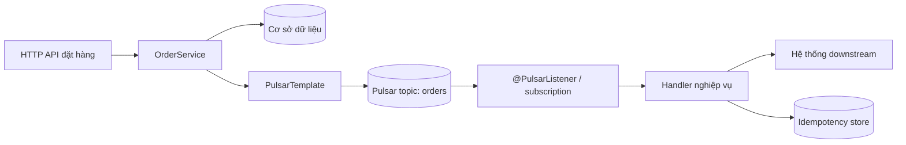
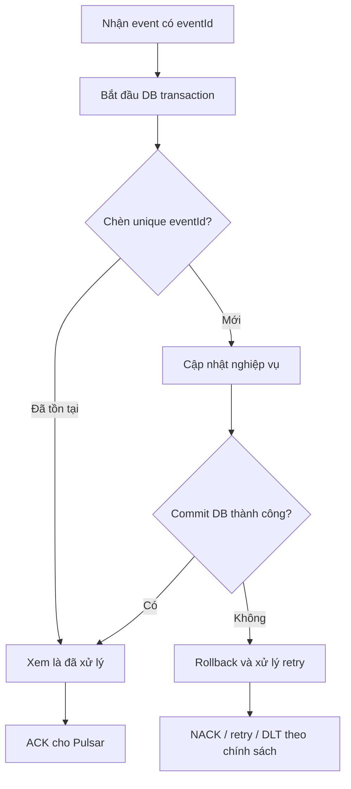

# Tích hợp Spring for Apache Pulsar bằng starter phù hợp phiên bản Boot

> **Chương:** Apache Pulsar  
> **Module:** SPRING_BOOT_INTEGRATION — tích hợp hệ thống trong Spring Boot qua HTTP client, cơ sở dữ liệu, cache, broker thông điệp và adapter; chú trọng cấu hình, hợp đồng dữ liệu, giao dịch, lỗi, xử lý trùng lặp, kiểm thử và quan sát.

## 1. Mục tiêu và bối cảnh

Apache Pulsar là nền tảng truyền thông điệp và luồng sự kiện theo mô hình publish/subscribe. Một dịch vụ Spring Boot có thể phát sự kiện `OrderCreated` vào topic và một hoặc nhiều ứng dụng khác đăng ký *subscription* để xử lý bất đồng bộ. **Spring for Apache Pulsar** cung cấp lớp tích hợp với Spring: `PulsarTemplate`, `@PulsarListener`, factory, schema support, transaction support và khả năng tùy chỉnh client/consumer/producer. **Spring Boot** cung cấp starter và auto-configuration để giảm mã cấu hình khởi tạo.

Sau bài này, bạn có thể:

- Chọn dependency và phiên bản Spring for Apache Pulsar tương ứng dòng Spring Boot đang dùng.
- Phân biệt starter imperative, starter reactive và Apache Pulsar Java client.
- Cấu hình kết nối broker/admin, gửi và nhận thông điệp bằng `PulsarTemplate` và `@PulsarListener`.
- Hiểu điều kiện khởi tạo bean, schema, subscription, acknowledgment, redelivery, dead-letter, giao dịch và bảo đảm không xử lý trùng.
- Xây dựng chiến lược kiểm thử và quan sát một luồng tích hợp thật.

Luồng cơ bản:



Sơ đồ chỉ minh họa các thành phần: **ghi DB và publish lên Pulsar không tự trở thành một giao dịch nguyên tử**. Với yêu cầu tin cậy cao, cân nhắc transactional outbox hoặc một cơ chế nhất quán được thiết kế riêng.

## 2. Chọn starter theo phiên bản Spring Boot

Điểm quan trọng nhất là **chọn dòng phiên bản phù hợp**, không tự thêm một phiên bản Spring Pulsar mới nhất vào một Boot cũ. Tài liệu Spring Pulsar công bố ma trận sau (tham chiếu dòng được hỗ trợ, không phải yêu cầu khóa tất cả bản patch):

| Spring Boot | Spring for Apache Pulsar | Pulsar Java client trong ma trận tương thích | Java |
| --- | --- | --- | --- |
| 3.2.x | 1.0.x | 3.0.x hoặc 3.1.x | 17+ |
| 3.3.x | 1.1.x | 3.2.x | 17+ |
| 3.4.x / 3.5.x | 1.2.x | 3.3.x; hỗ trợ 4.0.x theo ghi chú chính thức | 17+ |
| 4.0.x | 2.0.x | 3.3.x, 4.0.x hoặc 4.1.x | 17+ |

Nguồn ma trận: [Spring Pulsar — Version Compatibility](https://docs.spring.io/spring-pulsar/reference/appendix/version-compatibility.html). **Không tự suy ra** bảng này áp dụng nguyên vẹn cho các dòng Boot mới hơn; kiểm tra BOM và tài liệu đúng phiên bản khi nâng cấp. Tương thích Java client cũng không có nghĩa mọi bản broker cũ đều được kiểm thử hỗ trợ: cần kiểm tra riêng khả năng tương thích giữa client, broker và tính năng cần dùng.

### 2.1. Lựa chọn dependency

| Chế độ | Artifact nên khai báo trong ứng dụng Boot | API sử dụng |
| --- | --- | --- |
| Imperative / đồng bộ | `org.springframework.boot:spring-boot-starter-pulsar` | `PulsarTemplate<T>`, `@PulsarListener` |
| Reactive | `org.springframework.boot:spring-boot-starter-pulsar-reactive` | `ReactivePulsarTemplate<T>`, `@ReactivePulsarListener` |
| Dùng trực tiếp Java client | `org.apache.pulsar:pulsar-client` | `PulsarClient`, `Producer`, `Consumer` |

Đối với phần lớn ứng dụng Spring Boot dùng listener thông thường, bắt đầu bằng starter **imperative**. Chỉ chọn reactive khi toàn bộ cách xử lý, mô hình tải và pipeline thực sự phù hợp reactive. Nếu dùng Java client trực tiếp, ứng dụng phải quản lý thêm những chi tiết mà starter thường cung cấp (factory, cấu hình, vòng đời và listener).

Ví dụ Gradle cho **Spring Boot 3.5.x**, với plugin Boot và BOM/dependency management đã cấu hình ở build:

```groovy
dependencies {
    implementation 'org.springframework.boot:spring-boot-starter-pulsar'
    testImplementation 'org.springframework.boot:spring-boot-starter-test'
}
```

Tương đương Maven:

```xml
<dependency>
    <groupId>org.springframework.boot</groupId>
    <artifactId>spring-boot-starter-pulsar</artifactId>
</dependency>
```

Nếu chủ động xây dựng luồng reactive thì thay dependency bằng `spring-boot-starter-pulsar-reactive`; không cần thêm cả hai chỉ vì ứng dụng đã có Spring WebFlux.

**Cách quản lý phiên bản đúng:**

1. Xác định phiên bản Spring Boot thực tế trong build.
2. Để BOM của **chính phiên bản Boot đó** quản lý `spring-pulsar` và Pulsar client.
3. Không gắn phiên bản riêng cho `spring-boot-starter-pulsar` trừ khi có nguyên nhân rõ ràng và đã xác minh tương thích.
4. Chỉ override `spring-pulsar.version` hoặc `pulsar.version` khi có yêu cầu được hỗ trợ, kiểm chứng dependency tree và chạy lại integration tests. Cách override được hướng dẫn tại [Spring Pulsar — Override Spring Boot Dependencies](https://docs.spring.io/spring-pulsar/reference/appendix/override-boot-dependencies.html).

Ví dụ **không nên** tự chọn `spring-pulsar:2.0.x` cho Boot 3.2 chỉ vì là bản mới hơn: chúng thuộc các dòng tương thích khác nhau.

## 3. Auto-configuration khởi tạo những gì?

Khi `org.springframework.pulsar:spring-pulsar` có trên classpath, Spring Boot có thể tự cấu hình các thành phần imperative:

| Thành phần | Vai trò | Cần kiểm tra khi không có bean |
| --- | --- | --- |
| `PulsarClient` | Client kết nối broker bằng giao thức Pulsar | Starter/classpath, service URL, TLS/auth |
| `PulsarTemplate<T>` | Gửi bản tin; dựa trên producer factory | Starter, auto-configuration, bean tùy chỉnh |
| `PulsarProducerFactory` | Tạo và cache producer | Thông số producer và producer cache |
| `PulsarListenerContainerFactory` cùng consumer factory | Tạo consumer cho `@PulsarListener` | Điều kiện classpath, consumer/listener config, subscription |
| `PulsarAdministration` | Thao tác quản trị topic qua HTTP admin endpoint | Admin URL, quyền truy cập admin |

Khi dependency reactive hiện diện, Boot có thể tự cấu hình `ReactivePulsarClient`, `ReactivePulsarTemplate` và các thành phần listener reactive tương ứng. Reactive client sử dụng cấu hình broker nền tảng từ Pulsar client.

Spring Boot tạo những bean này dựa trên **classpath, properties, loại bean hiện có và điều kiện auto-configuration**. Nếu người dùng đã định nghĩa bean tùy chỉnh, cấu hình mặc định có thể *back off*. Nên kiểm tra *Conditions Evaluation Report* nếu thiếu bean, thay vì giả định rằng thêm starter luôn tạo được mọi đối tượng.

**Có bean không đồng nghĩa kết nối đã sẵn sàng:** broker có thể không truy cập được, broker trả lỗi xác thực, topic chưa tồn tại hoặc listener không đăng ký được subscription. Một số sự cố chỉ xuất hiện khi khởi tạo producer/consumer hoặc khi xử lý bản tin.

## 4. Kết nối broker và địa chỉ quản trị

### 4.1. Hai URL có giao thức khác nhau

```yaml
# application.yml — cấu hình ví dụ cho Spring Boot 3.5.x
spring:
  pulsar:
    client:
      service-url: ${PULSAR_BROKER_URL:pulsar://localhost:6650}
    admin:
      service-url: ${PULSAR_ADMIN_URL:http://localhost:8080}
```

- `spring.pulsar.client.service-url` dùng giao thức **Pulsar binary**, ví dụ `pulsar://broker:6650`; khi bật TLS có thể dùng `pulsar+ssl://...` nếu broker được cấu hình tương ứng.
- `spring.pulsar.admin.service-url` dùng **HTTP/HTTPS** để gọi API quản trị, thường cổng 8080 trong môi trường standalone.
- `localhost` có nghĩa là máy/không gian mạng của **tiến trình ứng dụng**. Khi ứng dụng chạy trong container, đó thường là chính container, không phải broker ở máy host. Sử dụng hostname/DNS có thể định tuyến được giữa các service.
- Phần admin có thể không cần dùng trực tiếp trong mọi ứng dụng, nhưng cần cấu hình đúng khi sử dụng auto-create topic hoặc các tác vụ quản trị.

Đừng nhầm `http://localhost:8080` với broker URL và đừng đưa `pulsar://...` vào property admin.

### 4.2. Xác thực, TLS và secrets

Trong môi trường sản xuất, broker có thể yêu cầu authentication plugin như token hoặc OAuth2. Spring Boot hỗ trợ `spring.pulsar.client.authentication.plugin-class-name` và map tham số `spring.pulsar.client.authentication.param.*`. Tham số cụ thể phụ thuộc plugin đang dùng, vì vậy phải đối chiếu tài liệu xác thực của cụm Pulsar.

Ví dụ cấu hình OAuth2 theo tài liệu Spring Boot:

```yaml
spring:
  pulsar:
    client:
      authentication:
        plugin-class-name: org.apache.pulsar.client.impl.auth.oauth2.AuthenticationOAuth2
        param:
          issuerUrl: ${PULSAR_ISSUER_URL}
          privateKey: ${PULSAR_PRIVATE_KEY_URI}
          audience: ${PULSAR_AUDIENCE}
```

Với map `authentication.param.*`, key phải **đúng chữ hoa/chữ thường do plugin yêu cầu**, ví dụ `issuerUrl` và `privateKey`. Phần map này không có cùng cơ chế relaxed binding như property Spring Boot thông thường; đổi thành `issuer-url` có thể làm plugin không nhận được tham số. Nếu HTTP admin cũng cần xác thực, cấu hình riêng dưới `spring.pulsar.admin.authentication`.

Không lưu token, private key hoặc mật khẩu thật trong repository. TLS yêu cầu cấu hình cả broker, trust/certificate và client phù hợp; riêng việc đổi scheme không tự làm kết nối an toàn nếu phần còn lại chưa đúng.

### 4.3. Định danh topic

Một tên topic Pulsar đầy đủ có dạng:

```text
persistent://public/default/orders-created
```

Trong đó `persistent` mô tả loại topic, `public` là tenant, `default` là namespace và `orders-created` là local name. Topic ngắn như `orders-created` dùng được trong một số trường hợp, nhưng chủ đích tenant/namespace dễ bị phụ thuộc vào cấu hình mặc định.

Ở môi trường kiểm soát nghiêm ngặt, chuẩn bị tenant, namespace, topic, phân vùng và quyền truy cập bằng công cụ provisioning/Infrastructure as Code. Không dựa vô điều kiện vào tự tạo topic trên broker. Với `PulsarTopic` bean, Spring Boot có cơ chế tạo topic lúc khởi động khi admin service và quyền truy cập phù hợp; việc đó là **quản trị hạ tầng**, khác với gửi một message.

## 5. Gửi và nhận message bằng starter imperative

Ví dụ nhất quán dưới đây giả định ứng dụng **Spring Boot 3.5.x**, Java 17+, dùng `spring-boot-starter-pulsar` và broker có sẵn. Để tập trung vào kết nối, payload ban đầu là `String`.

### 5.1. Producer: `PulsarTemplate`

```java
import org.springframework.pulsar.core.PulsarTemplate;
import org.springframework.stereotype.Service;

@Service
public class OrderEventPublisher {
    private static final String TOPIC =
            "persistent://public/default/orders-created";

    private final PulsarTemplate<String> template;

    public OrderEventPublisher(PulsarTemplate<String> template) {
        this.template = template;
    }

    public void publish(String orderId) {
        template.send(TOPIC, orderId);
    }
}
```

`PulsarTemplate.send(topic, payload)` là lời gọi **đồng bộ**: kết quả gửi thành công nghĩa là broker đã tiếp nhận/lưu message theo cơ chế gửi được cấu hình; **không có nghĩa consumer đã xử lý nghiệp vụ thành công**. API `sendAsync` cho phép gửi bất đồng bộ bằng `CompletableFuture` và phải xử lý kết quả thất bại trong callback hoặc ở pipeline gọi nó.

Trong phần lớn hệ thống, event nên chứa `eventId`, `occurredAt`, `orderId`, phiên bản schema và thuộc tính phù hợp để truy vết. Sử dụng `String` trong ví dụ này chỉ giúp thấy rõ việc cấu hình và đăng ký bean.

### 5.2. Consumer: `@PulsarListener`

```java
import org.apache.pulsar.client.api.SubscriptionType;
import org.springframework.pulsar.annotation.PulsarListener;
import org.springframework.stereotype.Component;

@Component
public class OrderEventListener {

    @PulsarListener(
            topics = "persistent://public/default/orders-created",
            subscriptionName = "shipping-service",
            subscriptionType = SubscriptionType.Shared)
    public void onMessage(String orderId) {
        // Thay bằng logic idempotent, có timeout và xử lý lỗi rõ ràng.
        System.out.println("Received order " + orderId);
    }
}
```

`subscriptionName` định danh tiến độ đọc theo một nhóm consumer; hai subscription khác nhau có thể nhận cùng sự kiện để phục vụ nghiệp vụ khác nhau. Chọn `Shared` khi muốn các consumer cùng subscription chia tải; nếu nghiệp vụ cần thứ tự theo key, cần xem xét `Key_Shared` và yêu cầu cấu hình khóa, batching.

**Hành vi ack phụ thuộc mode của listener container.** Trong chế độ mặc định của Spring for Apache Pulsar, container nhận message và ack sau khi xử lý thành công theo batch; khi xử lý thất bại, có thể xảy ra negative ack/redelivery. Không được coi gọi xong phương thức listener là transaction commit của các hệ thống bên ngoài.

### 5.3. Cấu hình mặc định, một subscription cho một mục đích

| Thành phần | Quy ước triển khai gợi ý | Lý do |
| --- | --- | --- |
| Topic | `persistent://tenant/namespace/domain.event.v1` | Tránh phụ thuộc namespace mặc định; tách loại sự kiện |
| Subscription | `shipping-service`, `analytics-service` | Mỗi ứng dụng có cursor xử lý độc lập |
| Payload | Event có ID và version | Hỗ trợ chống trùng lặp và thay đổi schema |
| Producer | Dùng template và topic cấu hình rõ ràng | Dễ kiểm soát đường đi |
| Consumer | Listener nhận payload, gọi service nghiệp vụ | Tách kết nối broker khỏi logic |
| Retry/ack | Chọn chiến lược có giới hạn | Tránh vòng lặp vô tận hoặc xử lý trùng |

Nếu publish từ một HTTP request hoặc một transaction database, cần xác định **thời điểm công bố**. Không tự giả định thao tác ghi SQL và thao tác gửi Pulsar thành công hoặc rollback cùng nhau.

## 6. Hợp đồng dữ liệu, schema và thay đổi phiên bản

Khi producer và consumer là hai dịch vụ độc lập, nội dung message là **hợp đồng dữ liệu**. Thỏa thuận này cần rõ:

| Trường | Ý nghĩa | Ví dụ |
| --- | --- | --- |
| `eventId` | ID duy nhất của một sự kiện logic để chống xử lý trùng | UUID |
| `eventType` | Loại sự kiện | `OrderCreated` |
| `schemaVersion` | Phiên bản cấu trúc payload | `1` |
| `orderId` | ID nghiệp vụ và ứng viên cho message key | `ord-1001` |
| `occurredAt` | Thời điểm sự kiện được tạo | ISO-8601 UTC |
| `trace/correlationId` | Liên kết các bước giữa nhiều hệ thống | ID từ request gốc |

Ví dụ payload JSON để trao đổi giữa các service:

```json
{
  "eventId": "6dcb82b7-4803-4d5d-92aa-07c782c739fd",
  "eventType": "OrderCreated",
  "schemaVersion": 1,
  "orderId": "ord-1001",
  "occurredAt": "2026-11-21T08:00:00Z"
}
```

Với Spring for Apache Pulsar, có thể dùng `Schema.STRING` cho chuỗi, còn dữ liệu phức tạp có các cơ chế schema như JSON, Avro hoặc Protobuf. Framework có cơ chế suy luận schema cho kiểu phổ biến và hỗ trợ khai báo schema tường minh cho DTO.

Ví dụ chỉ định schema qua `application.yml` (phải thay `com.example.events.OrderCreatedEvent` bằng tên class đầy đủ thực tế):

```yaml
spring:
  pulsar:
    defaults:
      type-mappings:
        - message-type: com.example.events.OrderCreatedEvent
          schema-info:
            schema-type: JSON
```

Đây là cách cấu hình mapping được Spring for Apache Pulsar hỗ trợ; một lựa chọn khác là `@PulsarMessage(schemaType = SchemaType.JSON)` ở kiểu dữ liệu. Khi thay đổi event contract, cần kiểm tra tương thích ngược, khả năng xử lý dữ liệu cũ trên topic và quy tắc schema của cluster, thay vì chỉ sửa một record Java.

**Phân biệt ba thứ dễ nhầm:**

- **Message key:** hỗ trợ chọn partition/định tuyến và xử lý theo key với những loại subscription thích hợp; không mặc nhiên là `eventId`.
- **Event ID:** cho phép nhận diện cùng một sự kiện logic dù message được redeliver hoặc được publish lại.
- **Pulsar MessageId:** định danh vị trí message trong broker; không phải khóa nghiệp vụ để chống trùng giữa các lần phát cùng một event logic.

Khi chuyển schema từ JSON sang Avro hoặc khi đổi cấu trúc trường, kiểm thử cả producer mới/consumer cũ và producer cũ/consumer mới theo quy tắc tương thích đã công bố; chọn thời điểm triển khai và rollback phù hợp.

## 7. Subscription, ack, retry và xử lý trùng lặp

### 7.1. Chọn subscription type theo yêu cầu

| Loại | Đặc điểm chính | Trường hợp sử dụng | Điểm cần chú ý |
| --- | --- | --- | --- |
| `Exclusive` | Một consumer hoạt động trên một subscription/topic | Xử lý tuần tự đơn giản | Không mở rộng bằng nhiều consumer cùng subscription theo cách chia tải |
| `Failover` | Có consumer dự phòng, một consumer chủ động cho từng partition tương ứng | Cần tính liên tục và quan tâm thứ tự | Chuyển consumer có thể tạo redelivery; vẫn phải idempotent |
| `Shared` | Nhiều consumer cùng nhận message phân phối từ subscription | Chia tải theo hàng đợi công việc | Không bảo đảm thứ tự toàn cục |
| `Key_Shared` | Phân phối theo key và duy trì đặc tính thứ tự theo key trong điều kiện phù hợp | Xử lý theo order/customer ID | Cần gán key ổn định; cấu hình batching và ordering phù hợp |

Không có một subscription type tốt nhất cho mọi use case. Nếu cần xử lý cùng một `orderId` đúng thứ tự, hãy thiết kế message key, subscription type, partition và concurrency như một bộ, rồi kiểm chứng thực tế. Nếu chỉ cần throughput cho các tác vụ độc lập, `Shared` thường dễ bắt đầu hơn.

### 7.2. Ack là xác nhận tiến độ consumer, không phải giao dịch nghiệp vụ

Spring for Apache Pulsar hỗ trợ các chế độ acknowledgment như `BATCH`, `RECORD`, `MANUAL`. Với bản ghi đơn trong chế độ mặc định, container có thể xử lý từng message rồi ack theo batch. Với `MANUAL`, ứng dụng tự chịu trách nhiệm ack/nack; quên ack có thể khiến tồn đọng message hoặc redelivery theo cấu hình.

Ví dụ listener tự xác nhận theo kết quả xử lý:

```java
import org.springframework.pulsar.annotation.PulsarListener;
import org.springframework.pulsar.listener.AckMode;
import org.springframework.pulsar.listener.Acknowledgement;
import org.springframework.stereotype.Component;

@Component
public class ManualOrderListener {
    private final OrderProcessingService service;

    public ManualOrderListener(OrderProcessingService service) {
        this.service = service;
    }

    @PulsarListener(
            topics = "persistent://public/default/orders-created",
            subscriptionName = "manual-order-consumer",
            ackMode = AckMode.MANUAL)
    public void handle(String orderId, Acknowledgement acknowledgement) {
        try {
            // Service phải commit thay đổi nghiệp vụ/khóa chống trùng trước ack.
            service.processIdempotently(orderId);
            acknowledgement.acknowledge();
        } catch (RuntimeException ex) {
            // Chính sách redelivery/nack phải có giới hạn và backoff phù hợp.
            acknowledgement.nack();
        }
    }
}

interface OrderProcessingService {
    void processIdempotently(String orderId);
}
```

Đây là mô hình cơ bản để thấy điểm kiểm soát ack. `OrderProcessingService` là hợp đồng ứng dụng **phải có implementation thật** với transaction và kiểm soát trùng lặp; riêng `orderId` chỉ dùng được như khóa chống trùng nếu mỗi đơn thực sự chỉ tạo một sự kiện loại đó. Trong hệ thống nhiều sự kiện trên cùng đơn, sử dụng `eventId` trong payload. Trong hệ thống thật, không được nuốt lỗi mà không có logging/metric; nên phân biệt lỗi tạm thời với lỗi dữ liệu vĩnh viễn và để handler có chính sách retry hoặc dead-letter rõ ràng.

**Các tình huống tạo redelivery** có thể gồm consumer chết trước khi ack, negative acknowledgment, timeout ack nếu đã bật, hoặc gián đoạn kết nối. Vì thế, dù publisher gửi một lần, consumer vẫn phải chuẩn bị cho việc nhận lại.

### 7.3. Idempotent consumer

Một cách xử lý chống trùng thực tế là lưu `eventId` vào bảng xử lý, với **unique constraint**:

```sql
CREATE TABLE processed_event (
    consumer_name VARCHAR(100) NOT NULL,
    event_id VARCHAR(100) NOT NULL,
    processed_at TIMESTAMP NOT NULL,
    PRIMARY KEY (consumer_name, event_id)
);
```

Luồng nên tiến hành trong **cùng transaction cơ sở dữ liệu**: chèn khóa xử lý duy nhất, cập nhật dữ liệu nghiệp vụ, commit; sau đó ack Pulsar. Nếu khóa đã tồn tại, xử lý như sự kiện đã hoàn thành và ack theo chính sách.

Điều quan trọng: không commit bản ghi “đã xử lý” **trước** thay đổi nghiệp vụ nếu hai hành động thuộc hai transaction khác nhau; nếu crash giữa hai bước sẽ bỏ mất công việc. Nếu commit DB đã thành công nhưng ack thất bại, broker phát lại và unique key giúp consumer bỏ qua thao tác bị trùng.



Đối với side effect bên ngoài DB (gọi HTTP, gửi email, phát event khác), một unique key trong DB **chưa đủ** để bảo đảm exactly-once end-to-end. Cần thiết kế idempotency key ở hệ thống nhận, hoặc outbox/inbox tùy bối cảnh.

### 7.4. Retry, negative ack và dead-letter

- **Ack timeout:** khi đã bật và đến hạn mà chưa ack, message có thể được phát lại; đặt timeout đủ lớn cho thời gian xử lý dự kiến, tránh tạo các lần chạy chồng nhau không mong muốn.
- **Negative ack:** báo consumer chưa xử lý được; broker có thể redeliver theo độ trễ và backoff được cấu hình.
- **Dead-letter topic (DLT/DLQ):** giữ message thất bại sau số lần thử có giới hạn để điều tra/replay. Tài liệu Pulsar mô tả native dead-letter policy dành cho subscription `Shared`; với loại khác, Spring for Apache Pulsar có cơ chế xử lý lỗi ở tầng framework cần cấu hình riêng.
- **Lỗi dữ liệu vĩnh viễn:** ví dụ schema không hợp lệ hoặc thiếu trường bắt buộc không nên retry vô hạn; ghi thông tin an toàn và chuyển luồng xử lý phù hợp.

Ví dụ cấu hình một dead-letter policy tại listener (minh họa cách gắn policy; cần chọn giá trị theo mức độ tải và khả năng xử lý):

```java
import org.apache.pulsar.client.api.DeadLetterPolicy;
import org.apache.pulsar.client.api.SubscriptionType;
import org.springframework.context.annotation.Bean;
import org.springframework.context.annotation.Configuration;
import org.springframework.pulsar.annotation.PulsarListener;

@Configuration
class OrderDeadLetterConfiguration {
    @Bean
    DeadLetterPolicy orderDeadLetterPolicy() {
        return DeadLetterPolicy.builder()
                .maxRedeliverCount(5)
                .deadLetterTopic("persistent://public/default/orders-dlt")
                .build();
    }
}

// Đặt trong một Spring-managed @Component/@Service:
// @PulsarListener(
//     topics = "persistent://public/default/orders-created",
//     subscriptionName = "shipping-with-dlt",
//     subscriptionType = SubscriptionType.Shared,
//     deadLetterPolicy = "orderDeadLetterPolicy",
//     properties = {"ackTimeoutMillis=60000"})
// void consume(String message) { ... }
```

Với topic partitioned, đặt rõ tên dead-letter topic giúp tránh tên DLT mặc định khác nhau cho từng partition. Cơ chế retry/ack timeout, số lần redelivery và dead-letter cũng có thể tương tác với nhau; cần kiểm tra bằng integration test với broker tương thích.

## 8. Giao dịch Pulsar và ranh giới với cơ sở dữ liệu

Spring for Apache Pulsar hỗ trợ transaction trong trường hợp dùng `PulsarTemplate` và `@PulsarListener`. Với Spring Boot 3.5.x, cấu hình:

```yaml
spring:
  pulsar:
    transaction:
      enabled: true
```

Khi điều kiện phù hợp và cluster đã hỗ trợ/bật giao dịch Pulsar, Boot có thể cấu hình `PulsarTransactionManager`, tích hợp transactional template và listener. Trường hợp **consume → transform → produce** trong Pulsar có thể đưa thao tác ack input và publish output vào giao dịch Pulsar theo cấu hình. Cần xác nhận rõ chế độ transactional listener và thao tác publish của code thực tế.

**Phạm vi transaction:** transaction Pulsar không tự gộp thành transaction ACID với PostgreSQL, MySQL hay một HTTP API. Ví dụ:

| Diễn biến | Nguy cơ |
| --- | --- |
| Lưu đơn vào SQL rồi tiến trình chết trước khi publish `OrderCreated` | DB có đơn, broker không có sự kiện |
| Publish sự kiện thành công nhưng DB rollback | Consumer nhận sự kiện cho đơn không tồn tại |
| Consumer commit SQL nhưng chết trước ack | Broker phát lại; dữ liệu có thể bị xử lý trùng |

Với **producer** yêu cầu nhất quán DB → Pulsar, transactional outbox là lựa chọn phổ biến: trong một transaction SQL ghi dữ liệu nghiệp vụ và bản ghi outbox, sau đó một publisher độc lập phát message và đánh dấu trạng thái, chấp nhận khả năng phát lại, dùng `eventId` để chống trùng. Với **consumer**, kết hợp DB transaction và idempotent inbox/processed-event.

Theo tài liệu Boot 3.5.x, transaction chưa hỗ trợ qua những biến thể **reactive** tương ứng; khi cần mô hình này phải kiểm tra lại tài liệu của phiên bản đang dùng thay vì mặc định behavior giống imperative.

## 9. Khi nào cần starter reactive?

Chế độ reactive có các API khác biệt:

```groovy
dependencies {
    implementation 'org.springframework.boot:spring-boot-starter-pulsar-reactive'
}
```

Ví dụ:

```java
import reactor.core.publisher.Mono;
import org.springframework.pulsar.reactive.core.ReactivePulsarTemplate;
import org.springframework.stereotype.Service;

@Service
public class ReactiveOrderPublisher {
    private final ReactivePulsarTemplate<String> template;

    public ReactiveOrderPublisher(ReactivePulsarTemplate<String> template) {
        this.template = template;
    }

    public Mono<Void> publish(String orderId) {
        return template.send("persistent://public/default/orders-created", orderId)
                .then();
    }
}
```

Trong pipeline reactive, **trả về publisher cho tầng gọi** để nó quyết định subscription và xử lý lỗi. Nếu gọi `subscribe()` bên trong service rồi bỏ qua kết quả, rất dễ mất tín hiệu thất bại và kiểm soát vòng đời. Không dùng Reactive starter chỉ vì “bất đồng bộ là nhanh hơn”: còn phải tính đến backpressure, scheduler, tài nguyên broker, consumer concurrency và nhu cầu giao dịch.

## 10. Kiểm thử tích hợp theo từng lớp

Không cần chạy broker cho mọi phép kiểm tra. Chọn test theo điều muốn chứng minh:

| Lớp kiểm thử | Cách làm | Xác minh |
| --- | --- | --- |
| Unit | Mock application service, publisher interface | Payload, topic, event ID, logic xử lý lỗi |
| Spring context | Context/slice phù hợp, mock external dependency | Starter và auto-configuration tạo bean như mong đợi |
| Integration | Pulsar broker thực trong Testcontainers hoặc môi trường test tách biệt | Publish, subscribe, schema, ack, redelivery, DLT |
| End-to-end | HTTP → SQL/outbox → Pulsar → consumer → downstream | Giao dịch, trùng lặp, timeout, metrics và recovery |

Với **Boot 3.5.x**, Spring Boot Testcontainers có hỗ trợ service connection cho `PulsarContainer`. Phần phụ thuộc test có thể bổ sung:

```groovy
dependencies {
    testImplementation 'org.springframework.boot:spring-boot-starter-test'
    testImplementation 'org.springframework.boot:spring-boot-testcontainers'
    testImplementation 'org.testcontainers:junit-jupiter'
    testImplementation 'org.testcontainers:pulsar'
}
```

Ví dụ phần khai báo container (đặt trong test class; tag image phải chọn theo ma trận client/broker được kiểm chứng):

```java
import org.junit.jupiter.api.Test;
import org.testcontainers.containers.PulsarContainer;
import org.testcontainers.junit.jupiter.Container;
import org.testcontainers.junit.jupiter.Testcontainers;
import org.testcontainers.utility.DockerImageName;
import org.springframework.boot.test.context.SpringBootTest;
import org.springframework.boot.testcontainers.service.connection.ServiceConnection;

@Testcontainers
@SpringBootTest
class OrderPulsarIntegrationTest {

    @Container
    @ServiceConnection
    static final PulsarContainer pulsar =
            new PulsarContainer(
                    DockerImageName.parse("apachepulsar/pulsar:3.3.2"));

    @Test
    void contextStartsWithPulsarServiceConnection() {
        // Bổ sung gửi event, đợi listener nhận và assert side effect.
    }
}
```

**Ý nghĩa giới hạn:** test ví dụ kiểm tra khả năng khởi tạo context cùng broker container; phần kiểm tra publish/consume được đánh dấu chỗ cần hiện thực. Muốn chứng minh message đã được xử lý, phải gửi event thật, chờ kết quả với timeout và assert vào trạng thái quan sát được. Không dùng `Thread.sleep` cố định để thay thế đồng bộ hóa bằng điều kiện.

Ít nhất cần kiểm tra các nhánh:

1. Một event hợp lệ được ghi nhận đúng một lần về mặt **side effect**, kể cả khi gửi lại cùng `eventId`.
2. Lỗi mạng hoặc consumer crash trước ack dẫn đến recovery/redelivery theo kỳ vọng.
3. Event vi phạm schema được xử lý bằng policy có giới hạn; DLT chứa dữ liệu cần để điều tra an toàn.
4. Khi broker tạm mất kết nối, ứng dụng có timeout/retry phù hợp và không báo thành công giả.
5. Với transaction/outbox, thử crash giữa hai bước để xác nhận không mất event nghiệp vụ.

Nếu test container chạy bên trong CI, cần bảo đảm Docker runtime, port mapping và container image có sẵn. Đừng dùng cùng tenant/namespace/topic với production.

## 11. Quan sát và chẩn đoán sự cố

### 11.1. Theo dõi từ producer tới consumer

Các chỉ số cần quan tâm:

- **Producer:** số lần gửi, tốc độ gửi, latency, lỗi publish, kích thước message và timeout.
- **Broker/topic:** throughput, backlog, quota, tài nguyên, tình trạng partition và topic.
- **Subscription:** backlog, unacked message, tốc độ redelivery, số consumer đang kết nối.
- **Application:** số event xử lý thành công/thất bại, số duplicate bị bỏ qua, số event vào DLT, thời gian từ publish đến hoàn tất nghiệp vụ.
- **Trace/log:** event ID, message key, topic, subscription, correlation ID, kết quả xử lý; lọc bỏ payload nhạy cảm và secret.

Micrometer/Actuator hữu ích cho monitoring ứng dụng, nhưng không nên khẳng định mọi số liệu broker tự động hiện diện chỉ nhờ thêm starter: các metric cụ thể còn tùy registry, instrumentation, cấu hình và bản Pulsar client/broker. Kết hợp số liệu ứng dụng với công cụ quản trị/monitoring broker để chẩn đoán tổng thể.

### 11.2. Bảng xử lý sự cố phổ biến

| Triệu chứng | Khả năng | Hướng kiểm tra |
| --- | --- | --- |
| Không tìm thấy `PulsarTemplate` | Sai starter, classpath, phiên bản hoặc auto-configuration bị override | Dependency tree, Conditions Evaluation Report, `--debug` |
| Client cố kết nối `localhost:6650` trong container | Dùng URL mặc định không đúng network | `spring.pulsar.client.service-url` và DNS container |
| Producer gửi lỗi nhưng admin UI vẫn xem được | Broker binary URL khác admin HTTP URL, quyền hoặc TLS khác nhau | Kiểm tra riêng cổng 6650/8080 và thông tin auth |
| Producer thành công nhưng listener không chạy | Sai topic/tenant/namespace, subscription, quyền, broker config | Topic name, subscriptionName, listener logs |
| Listener nhận lặp lại | Redelivery sau crash/nack/ack timeout; retry ở producer | eventId, ack mode, unique key và backoff |
| Backlog tăng | Consumer chậm, lỗi liên tiếp, phân phối key lệch, quá tải downstream | Lag/backlog, processing latency, concurrency |
| Poison message gây retry mãi | Thiếu giới hạn retry/DLT hoặc schema validation | Dead-letter policy, error handler, event contract |
| Cấu hình OAuth2 không có tác dụng | Sai key camelCase trong `authentication.param.*` | Đối chiếu chính xác tham số plugin |
| Sau nâng cấp xuất hiện `NoSuchMethodError` hoặc lỗi API | Trộn version Boot/Spring Pulsar/Pulsar client | Đối chiếu ma trận và BOM |

Trong môi trường phát triển, có thể dùng:

```bash
java -jar app.jar --debug
```

*Conditions Evaluation Report* giúp biết auto-configuration nào match hoặc bị loại. Không dùng báo cáo khởi tạo thay cho phép thử gửi/nhận thật, vì lỗi mạng và contract thường xảy ra sau khi bean được tạo.

## 12. Bài tập thực hành và câu hỏi tự kiểm tra

**Bài tập:** triển khai một ứng dụng nhận HTTP `POST /orders`, ghi đơn vào database và phát `OrderCreated` vào Pulsar. Một consumer tên `shipping-service` nhận sự kiện, ghi nhận vào bảng `processed_event` và mô phỏng gọi đối tác vận chuyển. Dùng Testcontainers để chứng minh một event phát hai lần không làm phát sinh hai tác vụ giao hàng.

Trình tự gợi ý:

1. Xác định phiên bản Boot và starter, để BOM quản lý thư viện, cấu hình broker/admin URL.
2. Tạo topic trong môi trường test bằng provisioning hoặc chính sách quản trị có kiểm soát.
3. Tạo event contract có `eventId`, `schemaVersion`, `orderId`; chọn message key.
4. Viết producer và listener; quyết định subscription, ack/retry, DLT và idempotency.
5. Kiểm chứng crash/retry, backlog và log/metric; nếu ghi DB và publish cùng một nghiệp vụ, đánh giá outbox.

Câu hỏi tự kiểm tra:

1. Vì sao Spring Boot 3.2.x không nên tùy ý ghép với Spring for Apache Pulsar 2.0.x?
2. Khác nhau giữa `spring-boot-starter-pulsar` và `spring-boot-starter-pulsar-reactive` là gì? Tại sao không nên gọi `subscribe()` rồi bỏ qua kết quả?
3. `spring.pulsar.client.service-url` và `spring.pulsar.admin.service-url` khác nhau ra sao?
4. `PulsarTemplate.send(...)` thành công chứng minh điều gì và chưa chứng minh điều gì?
5. Vì sao consumer cần `eventId`, unique constraint và transaction DB dù đã có Pulsar MessageId?
6. Khi nào chọn `Shared` và khi nào cần `Key_Shared`? Những yếu tố nào có thể ảnh hưởng thứ tự?
7. Nếu consumer ghi DB xong nhưng crash trước ack, xử lý như thế nào để không tạo side effect hai lần?
8. Pulsar transaction có tự thay thế transactional outbox cho trường hợp ghi PostgreSQL rồi publish Pulsar không?

**Ghi nhớ:** chọn starter theo **dòng Boot và BOM**; cấu hình tách biệt **broker protocol và admin HTTP**; dùng `PulsarTemplate`/`@PulsarListener` để trao đổi thông điệp; và coi **schema, ack, redelivery, idempotency, transaction boundary, kiểm thử và quan sát** là một phần của hợp đồng tích hợp.

### Tài liệu tham khảo

- [Spring for Apache Pulsar — Compatibility matrix](https://docs.spring.io/spring-pulsar/reference/appendix/version-compatibility.html).
- [Spring Boot 3.5 — Apache Pulsar Support](https://docs.spring.io/spring-boot/3.5/reference/messaging/pulsar.html).
- [Spring Boot 3.5 — Testcontainers and Service Connections](https://docs.spring.io/spring-boot/3.5/reference/testing/testcontainers.html).
- [Spring for Apache Pulsar — Message Production](https://docs.spring.io/spring-pulsar/reference/reference/pulsar/message-production.html).
- [Spring for Apache Pulsar — Message Consumption](https://docs.spring.io/spring-pulsar/reference/reference/pulsar/message-consumption.html).
- [Spring for Apache Pulsar — Transactions](https://docs.spring.io/spring-pulsar/reference/reference/pulsar/transactions.html).
- [Spring for Apache Pulsar — Override Boot Dependencies](https://docs.spring.io/spring-pulsar/reference/appendix/override-boot-dependencies.html).
