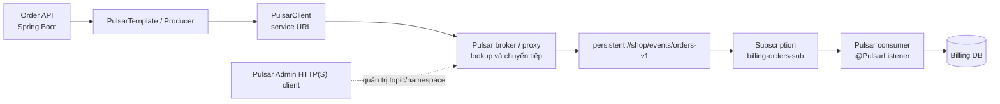
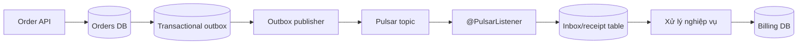

# Cấu hình service URL, client và các thuộc tính `spring.pulsar.*`

## 1. Bài toán tích hợp với Apache Pulsar

Giả sử một ứng dụng Spring Boot nhận đơn hàng qua REST API, lưu thay đổi vào cơ sở dữ liệu và công bố sự kiện để các dịch vụ thanh toán, vận chuyển và phân tích xử lý độc lập. Hệ thống sử dụng **Apache Pulsar** làm broker thông điệp; ứng dụng cần biết **kết nối tới đâu**, **dùng client nào**, **chọn topic/subscription ra sao**, và **hành xử thế nào khi lỗi mạng hoặc broker không sẵn sàng**.

Với module **SPRING_BOOT_INTEGRATION**, việc cấu hình Pulsar không chỉ là chỉ định một địa chỉ broker. Cấu hình liên quan trực tiếp tới hợp đồng dữ liệu, giới hạn thời gian chờ, transaction, sự kiện trùng lặp, quyền truy cập, kiểm thử và quan sát các luồng tích hợp thực tế.

Sau bài này, bạn có thể:

1. Phân biệt **Pulsar service URL** với **Pulsar Admin HTTP URL**, hiểu cách client khám phá broker.
2. Thêm starter phù hợp và sử dụng `PulsarClient`, `PulsarTemplate`, `@PulsarListener` được Spring Boot tự cấu hình.
3. Tổ chức `application.yml`, profile, biến môi trường và các nhóm `spring.pulsar.client.*`, `admin.*`, `producer.*`, `consumer.*`, `listener.*`, `defaults.*`.
4. Dùng `PulsarClientBuilderCustomizer` khi property mặc định chưa đáp ứng yêu cầu, đặc biệt với TLS.
5. Phân biệt lỗi kết nối/xác thực với lỗi xử lý message, thiết kế retry, idempotency và kiểm thử với broker thật.

> **Phạm vi phiên bản:** ví dụ dựa trên Java 17+ và dòng **Spring Boot 3.5.x**, tích hợp **Spring for Apache Pulsar** được Spring Boot quản lý phiên bản. Một số thuộc tính, package hoặc API có thể khác ở Spring Boot 3.2–3.4 hay 4.x. Khi nâng cấp, đối chiếu tài liệu đúng phiên bản, dependency BOM và phiên bản broker Pulsar đang chạy.

## 2. Nhìn rõ các thành phần trên đường kết nối

Pulsar sử dụng khái niệm **tenant → namespace → topic**. Một topic có thể persistent hoặc non-persistent, có thể được partition thành nhiều partition và có một hoặc nhiều subscription phục vụ consumer.



Các lớp trách nhiệm:

| Thành phần | Vai trò | Đường kết nối |
| --- | --- | --- |
| `PulsarClient` | Client giao thức Pulsar, tạo producer/consumer/reader, thực hiện lookup | `pulsar://...` hoặc `pulsar+ssl://...` |
| `PulsarTemplate` | API Spring thuận tiện để gửi message; dùng producer factory và producer cache | Sử dụng `PulsarClient` |
| `@PulsarListener` | Khai báo listener nhận message; container và consumer factory quản lý vòng đời consumer | Sử dụng `PulsarClient` |
| `PulsarAdministration` / Admin client | Thao tác quản trị như tạo topic, khi được cấp quyền | `http://...` hoặc `https://...` |
| Topic | Địa chỉ logic nơi producer ghi và consumer đọc | `persistent://tenant/namespace/topic` |
| Subscription | Trạng thái đọc/ack của một nhóm consumer | Gắn với topic và tên subscription |

Điểm dễ nhầm: **service URL không phải URL REST API**. Client Pulsar kết nối bằng giao thức Pulsar tới broker hoặc proxy; admin URL kết nối tới endpoint HTTP(S) quản trị. Thay đổi admin URL **không tự sửa** service URL của producer/consumer.

## 3. Chọn dependency và để Spring Boot quản lý phiên bản

Ứng dụng gửi và nhận message theo kiểu imperative dùng starter:

```xml
<!-- Maven; dự án sử dụng Spring Boot parent/BOM -->
<dependency>
    <groupId>org.springframework.boot</groupId>
    <artifactId>spring-boot-starter-pulsar</artifactId>
</dependency>
```

Khi dùng Gradle:

```groovy
dependencies {
    implementation 'org.springframework.boot:spring-boot-starter-pulsar'
}
```

Starter mang các thành phần cần thiết của Spring for Apache Pulsar và các dependency liên quan. Khi `spring-pulsar` có trên classpath và auto-configuration được kích hoạt, Spring Boot tạo các bean phù hợp như `PulsarClient`, `PulsarTemplate`, producer factory, listener factory và các phần hỗ trợ khác.

Với ứng dụng thực sự sử dụng mô hình reactive, starter riêng là:

```xml
<dependency>
    <groupId>org.springframework.boot</groupId>
    <artifactId>spring-boot-starter-pulsar-reactive</artifactId>
</dependency>
```

Reactive hỗ trợ `ReactivePulsarClient`, `ReactivePulsarTemplate` và `@ReactivePulsarListener` khi đã có các điều kiện auto-configuration tương ứng. Không nên thêm reactive starter chỉ vì muốn tăng số consumer; imperative listener cũng có thể được cấu hình concurrency.

**Nguyên tắc phiên bản:** dùng phiên bản Spring Boot BOM/parent đã chọn để đồng bộ Spring Pulsar và Pulsar Java client. Nếu buộc override client vì tính năng hay lỗ hổng bảo mật, cần kiểm tra tương thích Spring Pulsar, Java runtime và broker. Không khẳng định client và broker cùng version là điều kiện cần, cũng không mặc định mọi tính năng mới chạy được trên broker cũ.

## 4. Hai endpoint bắt buộc phải phân biệt

### 4.1. `spring.pulsar.client.service-url`

Đây là endpoint của Pulsar **binary protocol**, dùng cho producer, consumer và reader. Spring Boot 3.5 mặc định:

```yaml
spring:
  pulsar:
    client:
      service-url: pulsar://localhost:6650
```

Định dạng:

```text
pulsar://<host>:<port>
pulsar+ssl://<host>:<tls-port>
```

Ví dụ điển hình (port phụ thuộc cấu hình cluster):

| Môi trường | Service URL | Ý nghĩa |
| --- | --- | --- |
| Local standalone | `pulsar://localhost:6650` | Pulsar protocol không có TLS |
| Cluster nội bộ | `pulsar://pulsar-broker.internal.example:6650` | Kết nối broker/proxy qua mạng nội bộ, không TLS |
| Cluster bảo vệ bằng TLS | `pulsar+ssl://pulsar.internal.example:6651` | Pulsar protocol chạy trên TLS |

`pulsar+ssl` **không tự bảo đảm** CA trust và hostname verification đã cấu hình đúng. Cần kiểm tra certificate, hostname, phương thức xác thực và API client theo đúng phiên bản.

### 4.2. `spring.pulsar.admin.service-url`

Đây là endpoint **HTTP(S)** để thực hiện những thao tác quản trị, ví dụ truy vấn metadata hoặc tạo topic khi ứng dụng có quyền. Mặc định:

```yaml
spring:
  pulsar:
    admin:
      service-url: http://localhost:8080
```

Khi quản trị qua TLS:

```yaml
spring:
  pulsar:
    admin:
      service-url: https://pulsar-admin.internal.example:8443
```

Hai địa chỉ có thể trỏ về **cùng cluster** nhưng qua hai giao thức/cổng khác nhau. Phải cấu hình **cả hai** nếu ứng dụng sử dụng PulsarAdministration mà cluster không nằm ở các mặc định local.

### 4.3. Boot tự cấu hình client nhưng không tạo broker

Spring Boot không tự dựng một cluster Pulsar khi có starter. Một ứng dụng có thể tạo bean client thành công rồi chỉ lỗi khi gửi message hoặc khi listener tìm topic; vì vậy “application context start thành công” **không đủ** để kết luận producer/consumer kết nối được tới broker.

Ngoài địa chỉ bootstrap ban đầu, Pulsar client có thể thực hiện lookup và nhận địa chỉ broker sở hữu topic. Nếu những địa chỉ broker được quảng bá không phân giải được từ mạng của ứng dụng, client có thể kết nối tới entrypoint nhưng vẫn lỗi khi publish/subscribe. Kiểm tra proxy, DNS, advertised address/listeners và định tuyến network trong môi trường chạy thật.

## 5. Ví dụ cấu hình cơ bản và theo môi trường

### 5.1. Local development

```yaml
# src/main/resources/application-local.yml
spring:
  pulsar:
    client:
      service-url: pulsar://localhost:6650
      connection-timeout: 10s
      operation-timeout: 30s
    admin:
      service-url: http://localhost:8080

integration:
  pulsar:
    order-topic: persistent://public/default/orders-v1
    billing-subscription: billing-orders-sub
```

Thư mục `integration.pulsar.*` là **cấu hình tự định nghĩa của ứng dụng**, khác với `spring.pulsar.*` được Spring Boot bind vào các thành phần Pulsar. Chọn tên topic và subscription theo ngữ nghĩa nghiệp vụ, không để service phải đoán topic từ dữ liệu message.

Với ví dụ này, chạy local Pulsar broker riêng ở cổng phù hợp. Không dùng hostname `localhost` khi Spring Boot chạy trong một container khác broker: bên trong container, `localhost` là chính container đó.

### 5.2. Cấu hình cho staging/production

```yaml
# application.yml: endpoint lấy từ môi trường triển khai
spring:
  pulsar:
    client:
      service-url: ${PULSAR_SERVICE_URL}
      connection-timeout: 10s
      operation-timeout: 30s
    admin:
      service-url: ${PULSAR_ADMIN_URL}

integration:
  pulsar:
    order-topic: ${ORDER_EVENTS_TOPIC}
    billing-subscription: ${BILLING_SUBSCRIPTION:billing-orders-sub}
```

Biến môi trường ví dụ:

```text
PULSAR_SERVICE_URL=pulsar+ssl://pulsar.example.internal:6651
PULSAR_ADMIN_URL=https://pulsar-admin.example.internal:8443
ORDER_EVENTS_TOPIC=persistent://shop/events/orders-v1
BILLING_SUBSCRIPTION=billing-orders-sub
```

Các địa chỉ trong ví dụ là giả định; cần thay bằng endpoint hợp lệ của cluster. Cấu hình trên **chưa đủ cho production có TLS và authentication**. Phần bảo mật phải thêm trust material/client auth như mục 11, tuyệt đối không tắt kiểm tra chứng thư.

Không commit username, token, private key hay password thật trong `application.yml`. Dùng secret manager, Kubernetes Secret, runtime mount với quyền tối thiểu hoặc cơ chế bảo vệ tương đương.

### 5.3. Dùng profile một cách có chủ đích

| Profile | Service URL | Chính sách |
| --- | --- | --- |
| `local` | `pulsar://localhost:6650` hoặc broker test | Khai báo topic thử nghiệm, dữ liệu giả lập |
| `test` | Endpoint broker do test framework cung cấp | Không lệ thuộc cluster thật; test lỗi và ack |
| `staging` | Cluster kiểm thử có TLS/auth | Kiểm thử cấu hình sát production |
| `prod` | Cluster production có ACL và quan sát | Không tự tạo topic nhờ quyền quản trị rộng trừ khi được thiết kế có chủ đích |

Luôn kiểm tra active profile và giá trị property cuối cùng khi deploy. Một biến môi trường còn sót từ local có thể khiến service cố kết nối `localhost` hoặc chọn nhầm topic.

## 6. Bảng các nhóm thuộc tính `spring.pulsar.*`

Không phải tất cả Pulsar Java client options đều có property trong Spring Boot. **Chỉ một tập con** được ánh xạ qua `PulsarProperties`; các cấu hình bổ sung nên dùng customizer đúng loại client/factory. Bảng dưới tập trung vào thuộc tính có trong Spring Boot 3.5.

| Nhóm | Thuộc tính tiêu biểu | Trách nhiệm |
| --- | --- | --- |
| `spring.pulsar.client.*` | `service-url`, `connection-timeout`, `lookup-timeout`, `operation-timeout`, `threads.io`, `threads.listener` | Kết nối chung và tài nguyên client |
| `spring.pulsar.client.authentication.*` | `plugin-class-name`, `param.*` | Phương thức xác thực với broker |
| `spring.pulsar.client.failover.*` | `backup-clusters`, `delay`, `check-interval`, `switch-back-delay` | Failover cluster nếu phiên bản/cluster hỗ trợ |
| `spring.pulsar.admin.*` | `service-url`, `connection-timeout`, `read-timeout`, `request-timeout`, `authentication.*` | Kết nối HTTP(S) quản trị Pulsar |
| `spring.pulsar.producer.*` | `topic-name`, `send-timeout`, `batching-enabled`, `compression-type`, `message-routing-mode` | Hành vi producer |
| `spring.pulsar.producer.cache.*` | `enabled`, `maximum-size`, `expire-after-access` | Cache producer do factory tạo |
| `spring.pulsar.consumer.*` | `topics`, `subscription.*`, `retry-enable`, `dead-letter-policy.*` | Hành vi consumer và subscription |
| `spring.pulsar.listener.*` | `concurrency`, `schema-type`, `observation-enabled` | Listener container |
| `spring.pulsar.defaults.*` | `topic.tenant`, `topic.namespace`, `type-mappings` | Mặc định tên topic và schema theo type |
| `spring.pulsar.template.*` | `observations-enabled` | Quan sát hoạt động `PulsarTemplate` |
| `spring.pulsar.transaction.*` | `enabled` | Hỗ trợ Pulsar transaction trong cấu hình tương thích |

### 6.1. Những giá trị mặc định dễ ảnh hưởng hệ thống

Theo metadata của Spring Boot 3.5:

| Thuộc tính | Mặc định đáng chú ý | Tác động |
| --- | --- | --- |
| `spring.pulsar.client.service-url` | `pulsar://localhost:6650` | Có thể trỏ nhầm local ở container |
| `spring.pulsar.admin.service-url` | `http://localhost:8080` | Admin client cần URL riêng |
| `spring.pulsar.client.connection-timeout` | `10s` | Giới hạn thiết lập kết nối broker |
| `spring.pulsar.client.operation-timeout` | `30s` | Giới hạn một số thao tác client |
| `spring.pulsar.producer.send-timeout` | `30s` | Giới hạn thời gian chờ broker xác nhận gửi |
| `spring.pulsar.producer.batching-enabled` | `true` | Có batching, tác động throughput và latency |
| `spring.pulsar.producer.cache.enabled` | `true` | Producer được tái sử dụng qua factory |
| `spring.pulsar.producer.cache.maximum-size` | `1000` | Cần kiểm tra nếu topic/schema/key quá nhiều |
| `spring.pulsar.consumer.subscription.type` | `exclusive` | Nhiều consumer cùng subscription có thể xung đột khi dùng Exclusive |
| `spring.pulsar.consumer.subscription.initial-position` | `latest` | Subscription mới thường bắt đầu từ thông điệp mới |
| `spring.pulsar.consumer.subscription.mode` | `durable` | Cursor của subscription có thể tồn tại ngoài vòng đời client |
| `spring.pulsar.consumer.retry-enable` | `false` | Không suy ra retry topic mặc nhiên hoạt động |
| `spring.pulsar.listener.observation-enabled` | `false` | Không giả định tracing/metrics listener đã được bật |
| `spring.pulsar.transaction.enabled` | `false` | Không mặc định có transaction Pulsar |

Cần phân biệt `connection-timeout`, `lookup-timeout`, `operation-timeout` và `send-timeout`: chúng đo **những giai đoạn khác nhau**. Không đặt tất cả bằng cùng một giá trị chỉ vì “timeout nên là 5 giây”. Xác định ngân sách độ trễ, khả năng mạng, hành vi retry và tải thực trước khi chỉnh.

## 7. Tên topic, tenant và namespace

Tên Pulsar đầy đủ thường có dạng:

```text
persistent://<tenant>/<namespace>/<topic>
non-persistent://<tenant>/<namespace>/<topic>
```

Ví dụ:

```text
persistent://shop/events/orders-v1
persistent://shop/events/payment-results-v1
persistent://platform/audit/http-call-events
```

Với Spring Boot 3.5, các mặc định:

```yaml
spring:
  pulsar:
    defaults:
      topic:
        enabled: true
        tenant: public
        namespace: default
```

cho phép framework hiểu các tên topic không đầy đủ khi tính năng mặc định được bật. Tuy nhiên, trong production đa tenant, **nên ưu tiên tên topic đầy đủ** để tránh publish nhầm vào `public/default` chỉ vì thiếu cấu hình.

Không nhầm **tenant của Pulsar** với tenant nghiệp vụ bên trong một message. Tenant Pulsar/namespace hỗ trợ quản lý tài nguyên, ACL và retention, nhưng phân quyền đọc từng bản ghi nghiệp vụ vẫn cần được thiết kế trong service.

### 7.1. Tạo topic bằng Admin API

Pulsar có thể cho tự động tạo topic ở một số môi trường, tùy policy broker. Spring for Apache Pulsar hỗ trợ bean `PulsarTopic` để tạo topic khi ứng dụng khởi động, nếu admin client được cấu hình và đủ quyền.

Production thường cần thống nhất cách quản lý tenant, namespace, partitions, retention, TTL, backlog quota và permission từ quy trình hạ tầng. Để hàng chục replica ứng dụng cùng cố tạo topic khi startup có thể làm quyền vận hành khó kiểm soát. Hãy chỉ dùng cơ chế tạo topic tại startup nếu chính sách cluster cho phép và đã kiểm chứng hành vi idempotent.

### 7.2. Partitioned topic và routing

Nếu topic partitioned, producer cần quyết định partition dựa trên message key hoặc routing policy; không thể coi một topic nhiều partition là một hàng đợi duy nhất có thứ tự toàn cục.

- **Key ổn định** giúp các message của cùng một thực thể được định tuyến nhất quán theo cấu hình hash/routing.
- **Thứ tự** phụ thuộc partition, subscription type và khả năng xử lý đồng thời; không hứa global ordering khi có nhiều partition/consumer.
- **Thay đổi số partition** có thể ảnh hưởng tuyến phân phối message mới; cần kiểm tra ứng dụng có đòi thứ tự theo aggregate hay không.

Các thuộc tính như `spring.pulsar.producer.message-routing-mode` và `hashing-scheme` nên được điều chỉnh khi đã hiểu các giả định về partition và key; không dùng để khắc phục sai thứ tự ở tầng nghiệp vụ một cách tùy tiện.

## 8. Ví dụ gửi và nhận sự kiện với cấu hình ngoài mã nguồn

Một ví dụ tối thiểu có thể chạy khi đã có cluster/topic cùng quyền publish/consume.

### 8.1. Cấu hình ứng dụng

```yaml
# application.yml: ví dụ cho broker local đã tồn tại
spring:
  pulsar:
    client:
      service-url: ${PULSAR_SERVICE_URL:pulsar://localhost:6650}
    admin:
      service-url: ${PULSAR_ADMIN_URL:http://localhost:8080}
    producer:
      send-timeout: 15s
    consumer:
      subscription:
        type: shared
        initial-position: earliest

integration:
  pulsar:
    order-topic: persistent://public/default/orders-v1
    billing-subscription: billing-orders-sub
```

`initial-position: earliest` chỉ quyết định điểm bắt đầu của **subscription mới** theo cơ chế Pulsar, không khiến mọi lần restart tự phát lại toàn bộ topic khi một durable subscription đã có cursor. `type: shared` cho phép nhiều consumer cùng subscription phân phối message; phần xử lý vẫn phải idempotent và không mặc định giữ thứ tự toàn cục.

### 8.2. Producer adapter

```java
package example.integration.pulsar;

import org.springframework.beans.factory.annotation.Value;
import org.springframework.pulsar.core.PulsarTemplate;
import org.springframework.stereotype.Component;

@Component
public class OrderEventPublisher {

    private final PulsarTemplate<String> template;
    private final String topic;

    public OrderEventPublisher(
            PulsarTemplate<String> template,
            @Value("${integration.pulsar.order-topic}") String topic) {
        this.template = template;
        this.topic = topic;
    }

    public void publish(String jsonPayload) {
        template.send(topic, jsonPayload);
    }
}
```

`PulsarTemplate` do Boot cấu hình dựa trên `PulsarClient` và producer factory. Việc định nghĩa một adapter có phương thức `publish` giúp service nghiệp vụ không cần trực tiếp xử lý topic naming và Pulsar SDK. Trong ví dụ, payload là chuỗi JSON do tầng nghiệp vụ đã tạo theo hợp đồng.

Lời gọi gửi đồng bộ có thể chờ broker xác nhận và ném lỗi nếu không gửi được. Vì thế nếu dùng trong request HTTP, cần đưa thời gian gửi vào ngân sách độ trễ và có chiến lược xử lý lỗi rõ. Ở production, cân nhắc thêm message key, event ID, schema version và outbox để tránh trạng thái database đã commit nhưng publish chưa thành công.

### 8.3. Consumer adapter

```java
package example.integration.pulsar;

import org.springframework.pulsar.annotation.PulsarListener;
import org.springframework.stereotype.Component;

@Component
public class BillingOrderEventListener {

    private final BillingOrderService billingOrderService;

    public BillingOrderEventListener(BillingOrderService billingOrderService) {
        this.billingOrderService = billingOrderService;
    }

    @PulsarListener(
            topics = "${integration.pulsar.order-topic}",
            subscriptionName = "${integration.pulsar.billing-subscription}")
    public void onOrderCreated(String jsonPayload) {
        billingOrderService.handleOrderEvent(jsonPayload);
    }
}
```

Trong đoạn code trên, `BillingOrderService` là **interface/service nghiệp vụ do ứng dụng cung cấp**, ví dụ:

```java
package example.integration.pulsar;

public interface BillingOrderService {
    void handleOrderEvent(String jsonPayload);
}
```

Ví dụ minh họa cách tách message adapter khỏi nghiệp vụ; để chạy end-to-end, ứng dụng cần cài đặt interface này và có broker/topic thực. Phần service phải tự kiểm tra hợp đồng JSON, bảo đảm idempotency, transaction và phân loại lỗi nghiệp vụ.

**Ack/nack:** `@PulsarListener` và listener container có cơ chế acknowledgment theo chế độ cấu hình. Đừng giả định mọi exception tự tạo một lần retry duy nhất rồi tự đưa vào DLQ. Hãy đọc đúng semantics ack/nack, retry/DLQ và negative acknowledgment của phiên bản Spring Pulsar đang dùng, sau đó kiểm chứng bằng integration test.

## 9. Cấu hình `PulsarClient` và mở rộng bằng customizer

Spring Boot tự đăng ký một `PulsarClient` khi starter và điều kiện auto-configuration phù hợp. Nếu muốn quan sát hoặc sử dụng API Pulsar trực tiếp:

```java
package example.integration.pulsar;

import org.apache.pulsar.client.api.PulsarClient;
import org.springframework.stereotype.Component;

@Component
public class ClientHolder {
    private final PulsarClient client;

    public ClientHolder(PulsarClient client) {
        this.client = client;
    }

    public PulsarClient client() {
        return client;
    }
}
```

Tuy nhiên, phần lớn nghiệp vụ **không cần trực tiếp tạo** `PulsarClient.builder().serviceUrl(...).build()`. Nếu tự tạo client thứ hai, bạn phải tự quản lý auth/TLS, retry, connection resources và đóng client; hơn nữa việc này có thể bỏ qua cấu hình/observability do Boot chuẩn bị.

### 9.1. Ba mức tùy biến

| Mức | Phương án | Phạm vi áp dụng |
| --- | --- | --- |
| Cấu hình Boot | `spring.pulsar.client.*`, `producer.*`, `consumer.*` | Các thành phần auto-configured tương ứng |
| Builder customizer | `PulsarClientBuilderCustomizer` | Client toàn cục do factory tạo |
| Producer/consumer customizer | `ProducerBuilderCustomizer`, `ConsumerBuilderCustomizer` | Producer/consumer của factory, hoặc scope riêng nếu annotation/template hỗ trợ |

Chọn `PulsarClientBuilderCustomizer` khi cần tinh chỉnh **kết nối ở tầng client** mà `PulsarProperties` không expose trực tiếp. Nếu chỉ thay batching của producer, không cần thay toàn bộ `PulsarClient`. Tương tự, subscriber riêng có thể cấu hình bằng listener annotation hoặc consumer customizer mà không làm thay đổi tất cả subscriber.

### 9.2. Ví dụ client customizer để chỉ định trust CA

Khi cluster dùng TLS với private CA, ngoài `pulsar+ssl://` còn cần trust material:

```java
package example.integration.pulsar;

import org.springframework.context.annotation.Bean;
import org.springframework.context.annotation.Configuration;
import org.springframework.pulsar.core.PulsarClientBuilderCustomizer;

@Configuration(proxyBeanMethods = false)
public class PulsarTlsConfiguration {

    @Bean
    PulsarClientBuilderCustomizer pulsarTlsCustomizer() {
        return builder -> builder
                .tlsTrustCertsFilePath(
                        "/etc/order-service/tls/pulsar-root-ca.pem")
                .enableTlsHostnameVerification(true)
                .allowTlsInsecureConnection(false);
    }
}
```

Đây là ví dụ theo API của Pulsar Java Client và Spring Pulsar tương thích trong dòng Boot 3.5. Cần xác minh đường dẫn file đã được mount, certificate còn hạn và endpoint thực sự được cấu hình thành `pulsar+ssl://...`. Nếu môi trường dùng JKS/PKCS12 hoặc mTLS, cấu hình khác và cần đối chiếu driver/Pulsar client.

**Không thay bằng `allowTlsInsecureConnection(true)` hoặc tắt hostname verification** chỉ để sửa lỗi TLS. Điều đó làm giảm khả năng xác minh danh tính broker. Với Pulsar proxy/cluster, cả các hostname broker được client truy cập cũng phải khớp certificate và cấu hình TLS.

### 9.3. Administration cần cấu hình riêng

`PulsarClientBuilderCustomizer` cấu hình **Pulsar binary client**, không mặc nhiên áp dụng tất cả thiết lập sang Admin HTTP client. Khi quản trị qua HTTPS có CA riêng, cần đánh giá `PulsarAdminBuilderCustomizer` cùng các phương thức TLS/keystore phù hợp API phiên bản đang dùng. Authentication của admin cũng có nhóm `spring.pulsar.admin.authentication.*` riêng.

## 10. Producer: topic, timeout, batching và cache

Ví dụ tập trung vào cân bằng độ trễ và throughput:

```yaml
spring:
  pulsar:
    producer:
      send-timeout: 15s
      batching-enabled: true
      cache:
        enabled: true
        maximum-size: 500
        expire-after-access: 2m
```

Giải thích:

- `send-timeout`: thời gian tối đa Pulsar producer chờ acknowledgment từ broker cho một message theo ngữ nghĩa client; timeout **không luôn chứng minh message chưa được ghi**.
- `batching-enabled`: gom nhiều message để giảm overhead và tăng throughput. Batch có thể tăng độ trễ chờ gửi và thay đổi tải bộ nhớ.
- `producer.cache.enabled`: Spring Pulsar producer factory giữ lại producer để tránh khởi tạo nhiều lần. Cache quá lớn có thể giữ tài nguyên của những topic hiếm dùng; quá nhỏ có thể tạo/đóng producer liên tục.
- `producer.topic-name`: đặt topic mặc định cho producer nếu ứng dụng có một topic chủ đạo; khi gửi nhiều topic theo nghiệp vụ, nên truyền topic rõ ràng ở adapter.

`PulsarTemplate<String>.send(topic, payload)` đủ cho ví dụ cơ bản. Ở production, dữ liệu nên kèm **event ID, aggregate ID, event version, schema version và correlation ID** ở payload/properties phù hợp. Hãy kiểm tra tính tương thích schema giữa producer và consumer, thay vì chỉ dựa vào việc message được broker chấp nhận.

### 10.1. Timeout và duplicate publish

Tình huống:

```text
1. Producer gửi OrderCreated(eventId=E1).
2. Broker ghi nhận E1 nhưng phản hồi ACK bị trễ hoặc mất.
3. Producer báo send timeout.
4. Ứng dụng gửi lại E1.
5. Consumer có thể thấy hai lần giao E1.
```

Mặc dù Pulsar có cơ chế deduplication theo cấu hình broker/producer và transaction với phạm vi phù hợp, ứng dụng không nên coi **mọi lần retry đều exactly-once ở tầng nghiệp vụ**. Với sự kiện gắn đơn hàng, consumer phải xác định idempotency key và ranh giới transaction đủ mạnh.

### 10.2. Batching và backpressure

Khi tăng throughput bằng batching hoặc async publish, còn phải kiểm soát lượng message đang chờ xác nhận. Nếu producer được gọi nhanh hơn broker xử lý, bộ đệm có thể đầy, timeout tăng và app có nguy cơ hết tài nguyên.

Các giải pháp tùy workload: giới hạn đồng thời/in-flight, backpressure từ luồng nguồn, queue có giới hạn, timeout phù hợp, retry có backoff/jitter và quan sát send latency. Không tự tăng mọi timeout hoặc cache limit để “chữa” tắc nghẽn.

## 11. Consumer: subscription và điểm bắt đầu đọc

### 11.1. Các subscription type

| Loại | Đặc tính khái quát | Khi nào cân nhắc |
| --- | --- | --- |
| `Exclusive` | Một consumer độc quyền trên một subscription | Xử lý đơn hoặc yêu cầu đơn giản, không scale nhiều consumer đồng thời |
| `Failover` | Một consumer active, các consumer khác standby theo cơ chế Pulsar | Tính sẵn sàng khi muốn một consumer active cho phạm vi tương ứng |
| `Shared` | Phân phối message giữa nhiều consumer cùng subscription | Scale xử lý độc lập, không cần thứ tự toàn cục |
| `Key_Shared` | Phân phối theo key để hỗ trợ tính liên kết thứ tự của cùng key theo điều kiện Pulsar | Xử lý theo aggregate/customer ID với điều kiện key và batching phù hợp |

Trong Spring Boot 3.5, property `spring.pulsar.consumer.subscription.type` mặc định là `exclusive`. Nếu bạn chạy nhiều replica listener cùng subscription name mà không đổi subscription type, replica mới có thể không attach được như kỳ vọng.

Ví dụ scale một nhóm consumer độc lập:

```yaml
spring:
  pulsar:
    consumer:
      subscription:
        name: billing-orders-sub
        type: shared
        mode: durable
        initial-position: earliest
```

Nếu annotation `@PulsarListener(subscriptionName = "...")` cũng đặt tên, cần hiểu thứ tự ưu tiên giữa annotation và mặc định factory. Một cấu hình rõ và nhất quán giúp tránh nhiều group vô tình cùng đọc topic với các subscription name khác nhau.

### 11.2. `initial-position` không phải nút “reset offset”

`latest` và `earliest` áp dụng khi **subscription/cursor mới** được tạo. Khi một durable subscription đã tồn tại, broker lưu vị trí đọc/ack của subscription. Đổi property `initial-position` rồi restart listener thông thường **không tự tua** cursor cũ.

Muốn replay có kiểm soát, cần cơ chế quản trị cursor/reset subscription hoặc tạo một subscription mới và hiểu retention/backlog. Thao tác này có thể tạo lượng tải lớn, gửi lại dữ liệu cũ và kích hoạt side effect; cần quy trình idempotent và phân quyền vận hành.

### 11.3. Retry và dead-letter policy

Spring Boot có các property `spring.pulsar.consumer.retry-enable` và `spring.pulsar.consumer.dead-letter-policy.*`. Tuy nhiên, bật một cờ không tự thay thế thiết kế lỗi:

- **Lỗi tạm thời:** database bị timeout, dịch vụ HTTP chậm; retry hữu hạn với delay/backoff, quan sát retry rate.
- **Lỗi dữ liệu:** message sai schema, field bắt buộc thiếu; nhiều lần retry giống nhau thường không giúp ích.
- **Lỗi quyền/TLS:** không thể khắc phục bằng cách gửi lại cùng credential sai.
- **Poison message:** cần cơ chế dead letter/parking lot có khả năng điều tra và replay sau sửa.

Ví dụ minh họa cấu hình, cần kiểm thử hành vi theo phiên bản và policy cụm:

```yaml
spring:
  pulsar:
    consumer:
      retry-enable: true
      dead-letter-policy:
        max-redeliver-count: 5
        dead-letter-topic: persistent://shop/events/orders-dlq
```

Không giả định `max-redeliver-count=5` có nghĩa chính xác năm lần thực thi method trong mọi kiểu ack/subscription. Broker redelivery, retry letter topic, negative acknowledgment, lỗi network và policy container đều ảnh hưởng số lần quan sát được. Phải test trên broker thật và theo dõi message ID/event ID.

## 12. Authentication, TLS và phân quyền

Một cluster production thường không chấp nhận anonymous client. Với Spring Boot, cấu hình authentication thuộc **client** và **admin** là hai nhóm khác nhau:

```yaml
spring:
  pulsar:
    client:
      service-url: pulsar+ssl://pulsar.internal.example:6651
      authentication:
        plugin-class-name: org.apache.pulsar.client.impl.auth.AuthenticationToken
        param:
          token: ${PULSAR_CLIENT_TOKEN}
    admin:
      service-url: https://pulsar-admin.internal.example:8443
      authentication:
        plugin-class-name: org.apache.pulsar.client.impl.auth.AuthenticationToken
        param:
          token: ${PULSAR_ADMIN_TOKEN}
```

Cấu hình minh họa sử dụng token và TLS; **cần thêm CA trust/SSL cho client và admin theo môi trường**. Tên `plugin-class-name` phụ thuộc plugin đã chọn, ví dụ token, OAuth2, Athenz hoặc mTLS. Cần kiểm tra phiên bản Pulsar client có plugin đó trên classpath.

### 12.1. Tên auth parameter có phân biệt chữ hoa/thường

Một chi tiết dễ gây lỗi: key trong `spring.pulsar.client.authentication.param.*` được truyền cho authentication plugin, thường có tên **camelCase chính xác** như `issuerUrl`, `privateKey`, `audience`. Spring Boot không đảm bảo relaxed binding cho **tên map key** này:

```yaml
spring:
  pulsar:
    client:
      authentication:
        plugin-class-name: org.apache.pulsar.client.impl.auth.oauth2.AuthenticationOAuth2
        param:
          issuerUrl: ${OAUTH_ISSUER_URL}
          privateKey: ${OAUTH_CREDENTIAL_FILE_URI}
          audience: ${OAUTH_AUDIENCE}
```

`issuer-url` hoặc `issuerurl` **không tương đương** với `issuerUrl` nếu plugin đòi đúng key đó. Việc biến môi trường chuyển tên map key sang chữ thường cũng có thể làm plugin không nhận cấu hình; hãy giữ tên key camelCase trong YAML rồi **chỉ lấy giá trị** từ biến môi trường.

### 12.2. TLS không tự cấu hình đủ chỉ bằng URL

Các bước xác minh:

1. Broker/proxy thực sự bật TLS tại đúng port.
2. Service URL dùng `pulsar+ssl://`; Admin URL nếu có TLS dùng `https://`.
3. Trust CA/truststore phù hợp với certificate broker và Admin endpoint; SAN khớp hostname client dùng.
4. Nếu mTLS, có client certificate và private key tương ứng, được server chấp nhận.
5. Auth token/role được cấp **publish** vào topic đích và **consume** theo subscription policy; quyền admin chỉ cấp nếu cần.

Spring Boot 3.x không có một tập đầy đủ property TLS cho mọi tình huống Pulsar giống như cấu hình JDBC. Có thể cần `PulsarClientBuilderCustomizer` cho binary client và `PulsarAdminBuilderCustomizer` cho Admin client. Không sao chép nguyên cấu hình TLS của Kafka sang Pulsar: hai client có APIs, schema properties và cơ chế auth khác nhau.

## 13. Timeout, lookup, failover và kết nối nhiều broker

Cấu hình có thể bắt đầu bằng:

```yaml
spring:
  pulsar:
    client:
      service-url: ${PULSAR_SERVICE_URL}
      connection-timeout: 10s
      operation-timeout: 30s
      lookup-timeout: 30s
      threads:
        io: 4
        listener: 4
    producer:
      send-timeout: 15s
```

Các số trên **chỉ là ví dụ**, không có nghĩa phù hợp mọi workload. Khi chỉnh `threads.io`/ `threads.listener`, xét số kết nối, số topic, CPU limit, tải message và độ trễ. Không đặt số luồng lớn hơn một cách tùy tiện để xử lý timeout từ broker.

### 13.1. Phân loại timeout

| Timeout | Giai đoạn | Khi lỗi nên kiểm tra |
| --- | --- | --- |
| `client.connection-timeout` | Thiết lập kết nối broker | DNS, firewall, proxy, TLS, broker load |
| `client.lookup-timeout` | Lookup metadata/topic owner | Broker/metadata service, quyền, topic tồn tại |
| `client.operation-timeout` | Một số thao tác client | Cluster availability, metadata và phản hồi |
| `producer.send-timeout` | Broker xác nhận message được gửi | Backpressure, batching, broker/storage và duplicate risk |
| `admin.connection-timeout/read-timeout/request-timeout` | Các giai đoạn HTTP Admin API | Admin endpoint, TLS/auth, thao tác quản trị nặng |

Một HTTP endpoint có SLA p95 500 ms không nên chặn thread request hàng chục giây chờ gửi event. Có thể cần đưa thao tác publish sang transactional outbox/background publisher và trả phản hồi theo hợp đồng thích hợp.

### 13.2. Cluster failover

Spring Boot 3.5 có các property `spring.pulsar.client.failover.*` dành cho automatic cluster-level failover khi phiên bản Pulsar client và cấu hình cụm hỗ trợ. Ví dụ các trường có thể cấu hình: `backup-clusters`, `check-interval`, `delay`, `switch-back-delay`.

**Không đồng nhất**:

- Client tự kết nối lại broker khác **trong cùng cluster**.
- Chuyển sang **cluster dự phòng** có namespace, topic và dữ liệu phù hợp.
- DR/replication giúp dữ liệu được đồng bộ giữa hai cluster.

Failover liên cluster đòi hỏi chuẩn bị topic, ACL, schema, retention, producer/consumer semantics và chính sách đồng bộ dữ liệu; thêm URL backup đơn thuần không giải quyết sự kiện bị mất hoặc được xử lý hai lần. Phải diễn tập failover và failback với workload thực.

## 14. Giao dịch dữ liệu, idempotency và Spring Integration

Trong kiến trúc tích hợp, message thường tạo tác động ở database hoặc hệ thống ngoài.



### 14.1. Tại sao không chỉ gọi `save()` rồi `send()`?

Giả sử:

```java
orderRepository.save(order);
pulsarTemplate.send("orders-v1", payload);
```

Nếu database commit thành công nhưng Pulsar mất kết nối, dữ liệu đơn hàng đã có mà sự kiện chưa phát. Nếu publish thành công rồi ứng dụng crash trước khi xác nhận trạng thái, retry có thể phát lại event. `@Transactional` của JDBC **không tự tạo một transaction nguyên tử** bao gồm cả database và broker.

Một giải pháp thường dùng là **transactional outbox**: ghi đơn hàng và outbox record trong cùng transaction database, sau đó worker publish outbox với retry và ghi nhận trạng thái. Consumer cần idempotency để xử lý sự kiện lặp.

### 14.2. Pulsar transaction có giới hạn phạm vi

Spring Boot 3.5 có `spring.pulsar.transaction.enabled` (mặc định `false`). Khi bật và broker phù hợp, Spring Pulsar hỗ trợ transaction trong phạm vi Pulsar cho `PulsarTemplate` và `@PulsarListener`, với transaction manager tương ứng.

**Pulsar transaction không tự bao gồm JDBC/JPA transaction**, và trong dòng tài liệu đang xét hỗ trợ transaction không đồng nhất với các biến thể reactive. Đừng dùng thuộc tính này như lời hứa “exactly once end-to-end” cho tiền, đơn hàng hoặc hệ thống đối tác. Hãy xác định chính xác ranh giới commit, ack và rollback cho mỗi luồng.

### 14.3. Liên hệ Spring Integration

Spring Integration tổ chức luồng thông điệp qua channel, transformer, filter, router và service activator. Khi tích hợp Pulsar:

```text
Pulsar consumer / Spring Pulsar listener
    → xác thực hợp đồng event
    → chuyển đổi sang message nội bộ
    → message channel / service activator
    → adapter database / HTTP / cache
    → quyết định ack/retry/DLQ
```

Không được mặc định rằng `MessageChannel` tự điều khiển acknowledgment của Pulsar. Nếu triển khai một gateway/service activator, phải định nghĩa rõ **ai sở hữu lifecycle của message**, khi nào công việc được xem là thành công, exception nào kích hoạt retry và cách khôi phục khi process crash.

## 15. Kiểm thử cấu hình với broker thực

### 15.1. Phân lớp kiểm thử

| Loại test | Kiểm tra | Không thể chứng minh |
| --- | --- | --- |
| Unit test adapter | Logic định tuyến topic, lỗi nghiệp vụ và hợp đồng mapping | TLS/auth, lookup hoặc ack broker |
| Spring context test | Bind property, tạo bean và inject `PulsarTemplate`/listener | Kết nối thành công trong mọi trường hợp |
| Integration test với Pulsar thật | Publish/consume, schema, subscription, ack, redelivery, permissions | Chính sách và routing của cluster production |
| Staging | TLS/certificate, advertised broker address, ACL, throughput, partitions, quota | Mọi lỗi của production khi dữ liệu/tải khác |
| Failure/recovery test | Broker restart, timeout, duplicate, DLQ, replay, outbox recovery | Mọi sự cố liên cluster nếu chưa diễn tập DR |

Nên dùng broker Pulsar cô lập cho CI (ví dụ Testcontainers hoặc môi trường test quản lý), cấp topic/subscription riêng, và **chờ điều kiện có timeout** thay vì `Thread.sleep(...)` cố định để xác nhận message đã được nhận.

### 15.2. Kịch bản cấu hình cần kiểm tra

1. Sai `service-url`: producer gửi lỗi rõ ràng; ứng dụng có metric/alert phù hợp.
2. Admin URL đúng nhưng client service URL sai: thao tác quản trị có thể chạy nhưng publish vẫn lỗi.
3. Client đến được bootstrap broker nhưng lookup trả endpoint không phân giải được: publish/consume thất bại.
4. Token hợp lệ nhưng thiếu quyền consume: listener không attach được subscription.
5. TLS có CA đúng nhưng hostname không khớp: handshake phải bị từ chối.
6. Durable subscription tồn tại: đổi `initial-position` không tự reset cursor.
7. Hai consumer cùng `Exclusive` subscription: kỳ vọng theo semantics Exclusive; `Shared` có thể scale.
8. Publish timeout sau khi broker đã ghi message: consumer không tạo tác động nghiệp vụ hai lần.
9. Message sai schema: có cơ chế retry/DLQ/parking và khả năng replay sau khi sửa.
10. Restart/rebalance: không mất trách nhiệm ack và không gây cập nhật trùng ngoài kiểm soát.

### 15.3. Cấu hình topic/subscription trong test

Ví dụ test profile:

```yaml
spring:
  pulsar:
    client:
      service-url: ${TEST_PULSAR_URL}
    admin:
      service-url: ${TEST_PULSAR_ADMIN_URL}
    consumer:
      subscription:
        type: shared
        initial-position: earliest
integration:
  pulsar:
    order-topic: persistent://public/default/orders-test
    billing-subscription: billing-orders-test
```

Test framework hoặc broker test cung cấp hai URL, không dùng cluster thật. Khi nhiều test chạy song song, cần tên topic/subscription tách biệt hoặc cleanup có kiểm soát; nếu dùng chung durable subscription, test có thể bị nhiễm cursor và dữ liệu từ lần chạy trước.

## 16. Quan sát và xử lý lỗi cấu hình

Đối với luồng tích hợp theo sự kiện, tối thiểu theo dõi:

| Tín hiệu | Mục đích |
| --- | --- |
| Producer send success/error và p95/p99 latency | Phát hiện broker chậm, timeout hoặc backpressure |
| Số kết nối/lookup failures | Nhận diện DNS, proxy, broker metadata hoặc network |
| Consumer backlog/lag theo subscription | Phát hiện xử lý chậm, listener không attach được |
| Message redelivery, retry và DLQ | Phát hiện poison message, lỗi DB, lỗi hợp đồng |
| Schema decode failures | Phát hiện producer/consumer không tương thích |
| Subscription count, partitions, topic storage | Đánh giá tải và quota |
| TLS/auth failures, token expiry | Phát hiện credential/certificate hết hạn |
| Outbox age và inbox dedup | Đo tính đầy đủ của luồng cập nhật nghiệp vụ |

Spring Boot có Actuator/Micrometer và hỗ trợ observation theo phiên bản. Các cờ như `spring.pulsar.listener.observation-enabled` hoặc `spring.pulsar.template.observations-enabled` có thể cần bật để có observation đúng loại; **không giả định** mọi metric đã xuất hiện chỉ vì thêm starter.

Nhãn telemetry nên dùng `topic`, `subscription`, kết quả và loại lỗi với cardinality được kiểm soát. Không đưa nguyên payload, token, credential hay ID khách hàng không giới hạn vào metric labels/log. Dùng trace/correlation ID ở mức phù hợp để lần theo `HTTP → DB → outbox → Pulsar → consumer`.

### Bảng chẩn đoán nhanh

| Triệu chứng | Khả năng nguyên nhân | Kiểm tra đầu tiên |
| --- | --- | --- |
| Client cố gọi `localhost:6650` trong pod/container | Chưa override `spring.pulsar.client.service-url` | Active profile, env và giá trị cấu hình cuối |
| Admin API hoạt động, producer vẫn timeout | Admin URL và service URL khác giao thức; broker lookup/network lỗi | Port binary, broker/proxy address và metadata |
| `AuthenticationException` / `NotAuthorized` | Sai token/plugin hoặc thiếu ACL topic/namespace | Plugin parameters, token expiry và quyền publish/consume |
| TLS handshake/certificate failure | Sai trust CA, SAN/hostname hoặc endpoint đang dùng plaintext | Chain, hostname thực tế, `pulsar+ssl` và admin HTTPS |
| Listener không nhận message cũ | Durable cursor đang ở cuối hoặc `initial-position=latest` khi subscription mới | Subscription name, vị trí cursor và retention |
| Replica thứ hai không attach | `subscription.type=exclusive` | Đổi `Shared`/`Key_Shared` nếu semantics cho phép |
| Consumer nhận lại message | Nack/retry, chưa ack, restart hoặc delivery lại | Event ID, ack policy, retry/DLQ và idempotency |
| Producer tạo quá nhiều tài nguyên | Cache/producer per topic/schema/key tăng | `producer.cache.*`, số topic và pattern gửi |
| Gửi được String nhưng POJO decode lỗi | Schema chưa thống nhất | Schema type, schema compatibility và type mappings |
| Đổi `initial-position` không có tác dụng | Subscription đã tồn tại và có cursor | Kế hoạch replay hoặc subscription mới |

Lỗi “topic not found” không luôn đồng nghĩa chưa tạo topic; có thể do tenant/namespace không đúng, broker không cho auto-create hoặc principal không có quyền. Kiểm tra tên topic đầy đủ và policy cluster trước khi bật tự tạo topic ở production.

## 17. Quy trình triển khai và checklist

Khi chuyển từ local sang staging/production:

1. **Xác định cluster và URL:** ghi rõ binary `pulsar://`/`pulsar+ssl://`, admin `http://`/`https://`, DNS và port.
2. **Chọn starter và version:** để Spring Boot BOM quản lý Spring Pulsar/Pulsar client, kiểm tra tương thích broker.
3. **Quy hoạch topic:** tenant, namespace, fully qualified topic, partitions, schema, retention, backlog, TTL và ACL.
4. **Tách cấu hình môi trường:** `spring.pulsar.*` cho framework, `integration.pulsar.*` cho nghiệp vụ; secret lấy từ hệ thống bảo mật.
5. **Kiểm tra auth/TLS:** plugin, auth parameter case sensitivity, CA/hostname verification và cấu hình Admin độc lập.
6. **Tuning dựa trên đo đạc:** timeout, batching, cache, số luồng, listener concurrency, subscription type.
7. **Hợp đồng event:** ID, key, version, schema evolution, correlation ID, backward compatibility.
8. **Semantics lỗi:** ack/nack, retry, DLQ, idempotency, outbox/inbox và ranh giới transaction.
9. **Test trên broker thật:** cả happy path lẫn sai URL, sai token, sai TLS, replay, broker restart và duplicate.
10. **Quan sát/rollout:** backlog, p95 send latency, timeout, auth errors, outbox age và khả năng phục hồi.

### Tình huống tự luyện

**Tình huống:** một service `billing` chạy ba replica, mỗi replica đều có:

```yaml
spring:
  pulsar:
    client:
      service-url: pulsar://localhost:6650
    consumer:
      subscription:
        name: billing-sub
        type: exclusive
```

Khi deploy Kubernetes, các replica không kết nối broker và chỉ một replica có thể nhận message sau khi sửa URL.

Hãy trả lời:

1. Vì sao `localhost` trên một pod không có nghĩa là broker Pulsar?
2. Cần chuyển `service-url` sang dạng nào nếu broker chỉ chấp nhận TLS?
3. Vì sao `exclusive` không phù hợp khi cả ba replica cùng muốn xử lý message trong một subscription?
4. Chuyển sang `shared` có giữ thứ tự toàn cục không? Nếu cần thứ tự theo order ID, bạn sẽ đánh giá key và subscription nào?
5. Nếu producer báo timeout nhưng thực tế broker đã lưu event, consumer cần thiết kế gì để tránh trừ tiền hai lần?
6. Một Admin URL HTTPS chạy được có chứng minh listener sẽ subscribe thành công không?

## 18. Tài liệu tham khảo

- [Spring Boot 3.5 — Apache Pulsar Support](https://docs.spring.io/spring-boot/3.5/reference/messaging/pulsar.html): auto-configuration, service/admin URL, template, listener, customizers và transaction.
- [Spring Boot 3.5 — Common Application Properties](https://docs.spring.io/spring-boot/3.5/appendix/application-properties/index.html): tên property, ý nghĩa và giá trị mặc định của `spring.pulsar.*`.
- [Spring Pulsar — Pulsar Client](https://docs.spring.io/spring-pulsar/reference/reference/pulsar/pulsar-client.html): TLS, authentication plugin, kết nối client và một số tùy chọn mở rộng.
- [Apache Pulsar Documentation](https://pulsar.apache.org/docs/): topic, subscription type, security, message delivery, broker và cluster operations. Chọn đúng bản tài liệu với cluster đang vận hành.

## Kết luận

Cấu hình Pulsar trong Spring Boot bắt đầu bằng việc xác định **đúng Pulsar service URL** cho producer/consumer và **đúng Admin HTTP(S) URL** cho các tác vụ quản trị. `spring-boot-starter-pulsar` cùng `spring.pulsar.*` giúp quản lý `PulsarClient`, producer, consumer, listener, topic defaults, timeout và authentication; các lựa chọn TLS hoặc tuning sâu có thể cần customizer. Trong hệ thống tích hợp thực tế, cần ghép những cấu hình này với **hợp đồng message, idempotency, transaction/outbox, kiểm thử trên broker và quan sát vận hành** để tránh mất sự kiện, xử lý trùng hoặc gửi nhầm dữ liệu giữa môi trường.
