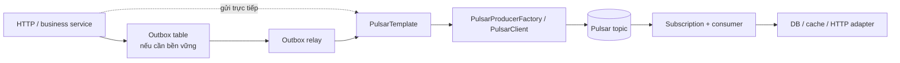
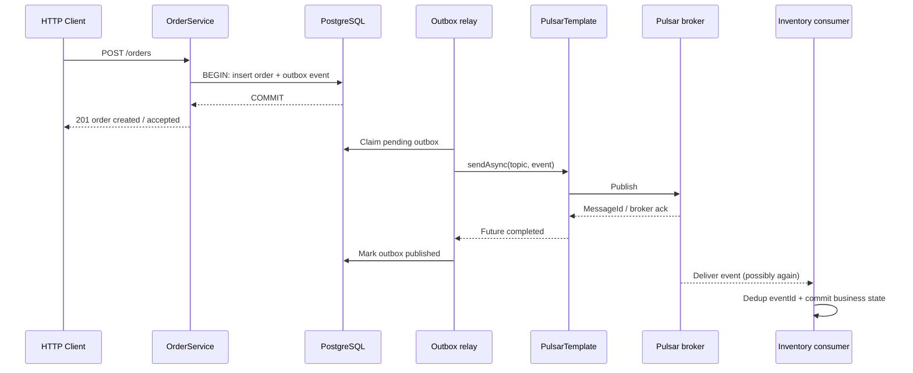
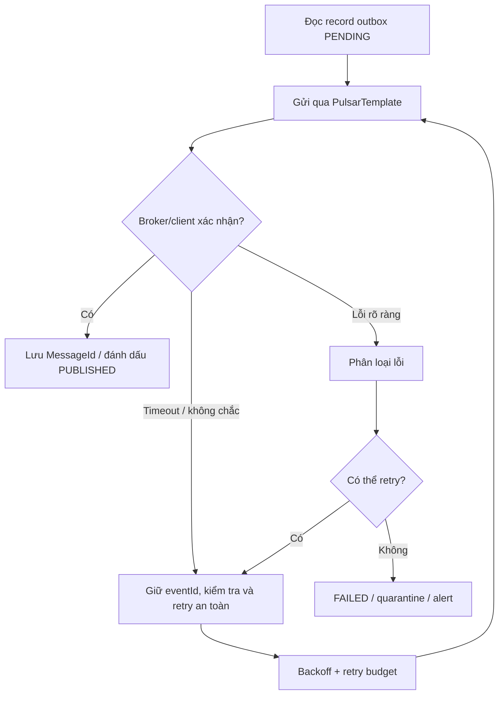

# PulsarTemplate và gửi thông điệp tới topic

> **Chương:** Apache Pulsar  
> **Module:** `SPRING_BOOT_INTEGRATION` — tổ chức tích hợp hệ thống trong Spring Boot qua HTTP client, cơ sở dữ liệu, cache, broker thông điệp và các adapter Spring Integration; chú trọng cấu hình, hợp đồng dữ liệu, giao dịch, xử lý lỗi/trùng lặp, kiểm thử và quan sát luồng tích hợp.
>
> **Phạm vi ví dụ:** API `org.springframework.pulsar.core.PulsarTemplate` của **Spring for Apache Pulsar** được Spring Boot hỗ trợ. Tên artifact, package, auto-configuration và thuộc tính có thể khác ở các nhánh thư viện/phiên bản khác; đối chiếu tài liệu của phiên bản dự án trước khi sao chép mã. Các topic, địa chỉ và payload dưới đây đều là dữ liệu minh họa.

## 1. Bài toán: tạo đơn hàng trong database rồi công bố event

Một dịch vụ quản lý đơn hàng nhận HTTP `POST /orders`. Sau khi lưu thành công đơn hàng, hệ thống cần phát sự kiện `OrderPlaced` để kho, thông báo và báo cáo thực hiện phần việc riêng. Gọi trực tiếp HTTP tới từng hệ thống làm bên tạo đơn phụ thuộc độ trễ và sự cố của các hệ thống đó; gửi sự kiện qua **Apache Pulsar** giúp các bên giao tiếp theo thông điệp.

Trong ứng dụng Spring Boot, `PulsarTemplate<T>` cung cấp API để **producer gửi payload tới topic** mà không phải tự viết vòng đời Pulsar producer và code giao tiếp client ở mỗi service.

Tuy nhiên, một lời gọi gửi thành công chưa trả lời hết các câu hỏi:

- Đơn hàng đã **commit** trước lúc phát `OrderPlaced` chưa?
- Topic đã tồn tại, thuộc **tenant/namespace** và có phân quyền phù hợp chưa?
- Payload dùng **schema** nào; consumer cũ có đọc được sau khi nâng cấp contract không?
- Producer gửi với **message key** nào để giữ thứ tự theo đơn hàng khi cần?
- `sendAsync(...)` thất bại sau khi HTTP response cho người dùng đã trả về thì ai biết và retry?
- Nếu broker đã ghi message nhưng producer không nhận được xác nhận, retry có tạo **hai message** không?
- Khi consumer nhận lặp, hệ thống kho có giữ hàng hai lần không?

Bài này tập trung vào `PulsarTemplate` và **đường gửi message tới topic**, nhưng phải gắn với transaction, idempotency, retry và observability để luồng tích hợp đáng tin cậy.

### Mục tiêu học tập

Sau bài này, bạn có thể:

1. Giải thích vai trò của Pulsar broker, topic, producer, `PulsarTemplate` và `PulsarProducerFactory`.
2. Cấu hình Spring Boot kết nối Pulsar và chọn topic rõ ràng.
3. Phân biệt `send(...)` đồng bộ với `sendAsync(...)` và ý nghĩa `MessageId`.
4. Gửi message dạng String/JSON hoặc payload có `Schema<T>`; bổ sung key và properties.
5. Tổ chức outbox và chống trùng khi gửi message sau một transaction database.
6. Chẩn đoán lỗi publish, đo lường kết quả và kiểm thử qua broker thật.

## 2. Vị trí của PulsarTemplate trong kiến trúc

Apache Pulsar là nền tảng nhắn tin theo mô hình pub/sub, có **tenant**, **namespace**, **topic**, producer, subscription và consumer. Topic có thể là partitioned hoặc non-partitioned; hệ thống broker và tầng lưu trữ phối hợp xử lý việc nhận và phân phối message.

Trong hệ Spring Boot, phân tách các trách nhiệm:

| Thành phần | Trách nhiệm | Không tự bảo đảm |
|---|---|---|
| `OrderService` | Quyết định đơn hàng được tạo khi nào, phát event nào | Không thay broker hoặc schema registry |
| `PulsarTemplate<T>` | API Spring gửi message tới topic, đồng bộ hoặc bất đồng bộ | Không bảo đảm consumer xử lý nghiệp vụ |
| `PulsarProducerFactory` | Tạo/quản lý producer theo cấu hình, thường có cache để tái sử dụng | Không quyết định thời điểm commit đơn hàng |
| `PulsarClient` | Kết nối cluster, giao tiếp với broker, thực hiện send | Không thực hiện transaction PostgreSQL thay ứng dụng |
| **Pulsar broker/topic** | Tiếp nhận, lưu trữ/định tuyến message theo topology và chính sách cluster | Không tự chống trùng side effect của consumer |
| `@PulsarListener` / consumer | Nhận message và gọi logic xử lý | Không tự làm side effect HTTP/DB thành exactly-once |
| **Ứng dụng tích hợp** | Hợp đồng, unique key, outbox/inbox, retry, metrics | Phải thiết kế và kiểm thử |



Một số tên dễ nhầm:

- **PulsarTemplate** là API dành cho code Spring **phía producer**, không phải topic hay queue.
- **Topic** là điểm đến logic mà message được ghi; **subscription** quyết định cách consumer theo dõi/nhận message.
- **MessageId** do Pulsar gán cho message đã publish; **eventId/commandId** là định danh nghiệp vụ do ứng dụng tạo. Hai loại ID giải quyết các nhu cầu khác nhau.

## 3. Topic, tenant, namespace và tên topic

Một tên topic đầy đủ có dạng:

```text
persistent://<tenant>/<namespace>/<topic>
```

Ví dụ:

```text
persistent://public/default/order-events
```

Trong môi trường thử nghiệm, có thể gặp cách viết ngắn `order-events`; Pulsar client và cấu hình có thể phân giải thành tenant/namespace mặc định. Với hệ thống nhiều môi trường hoặc tenant, **khai báo tên đầy đủ** làm hợp đồng đích rõ ràng hơn.

| Phần tên | Mục đích |
|---|---|
| `persistent://` | Topic có cơ chế lưu giữ bền vững theo cấu hình Pulsar |
| `public` | Tenant ví dụ; production thường có tenant riêng với quyền |
| `default` | Namespace ví dụ chứa chính sách liên quan |
| `order-events` | Topic cụ thể producer ghi message |

Pulsar cũng hỗ trợ **non-persistent topic** với tính chất lưu trữ/delivery khác. Đối với event nghiệp vụ cần có khả năng phục hồi sau sự cố, phải lựa chọn topic và chính sách durability phù hợp; không mặc định mọi topic đều cho cùng bảo đảm.

### 3.1. Topic tồn tại và quyền publish

Đối với production, xác định rõ ai **tạo topic**, partition count, quota/retention, authentication và ACL. Không chỉ trông chờ broker tự tạo topic khi producer gửi lần đầu, vì môi trường có thể tắt auto topic creation hoặc yêu cầu triển khai có kiểm soát.

Spring Boot có khả năng tích hợp với Pulsar Admin và khai báo topic qua cấu hình tương ứng, nhưng hoạt động quản trị cần địa chỉ HTTP admin service và quyền riêng. **Client service URL** và **admin service URL** khác giao thức và mục đích: một địa chỉ `pulsar://...` dùng cho messaging client, còn admin thường là `http(s)://...`.

### 3.2. Partitioned topic và message key

Partitioned topic chia dữ liệu sang nhiều partition để mở rộng throughput. Một **key** ổn định như `orderId` hỗ trợ định tuyến các event liên quan tới cùng đơn hàng tới partition phù hợp theo cơ chế routing đã cấu hình, từ đó tạo nền tảng cho thứ tự theo một aggregate. Tuy nhiên:

- Không có một thứ tự toàn cục cho mọi event ở nhiều partition.
- Thứ tự consumer quan sát còn phụ thuộc subscription type, redelivery và concurrency.
- Với `Key_Shared`, cách batching/key-based batching phải tương thích nếu cần bảo toàn thứ tự theo key.
- Key routing không thay việc kiểm tra `aggregateVersion` và idempotency khi event có thể đến trễ hoặc bị phát lại.

## 4. Chuẩn bị dependency và cấu hình Spring Boot

### 4.1. Starter

Với dự án Spring Boot sử dụng hệ `org.springframework.pulsar`, starter thường dùng là:

```gradle
dependencies {
    implementation("org.springframework.boot:spring-boot-starter-pulsar")
    implementation("org.springframework.boot:spring-boot-starter-web")
    implementation("org.springframework.boot:spring-boot-starter-validation")
    implementation("org.springframework.boot:spring-boot-starter-actuator")

    testImplementation("org.springframework.boot:spring-boot-starter-test")
}
```

Ví dụ là **Gradle Groovy DSL** và giả định build đã quản lý phiên bản dependency qua Spring Boot BOM/plugin tương ứng. Không tự ghép ngẫu nhiên Spring Boot/Spring Pulsar/Pulsar Java client khác major version. Một số nhánh mới của hệ Apache Pulsar có **artifact và package khác**; chỉ chọn **một bộ tích hợp tương thích** theo phiên bản đang triển khai.

Nếu luồng có **transactional outbox bằng PostgreSQL**, bổ sung starter JDBC hoặc Spring Data, driver và migration theo thiết kế; `PulsarTemplate` không yêu cầu JPA để gửi message.

### 4.2. application.yml

```yaml
spring:
  pulsar:
    client:
      service-url: ${PULSAR_SERVICE_URL:pulsar://localhost:6650}
    admin:
      service-url: ${PULSAR_ADMIN_URL:http://localhost:8080}

integration:
  pulsar:
    order-topic: persistent://public/default/order-events
```

`spring.pulsar.client.service-url` là property dùng để chỉ địa chỉ dịch vụ messaging Pulsar. `spring.pulsar.admin.service-url` dành cho Pulsar Admin nếu ứng dụng cần tác vụ quản trị; **không phải** endpoint publish message. `integration.pulsar.order-topic` là **property do ứng dụng tự đặt tên**, chỉ có tác dụng nếu code đọc và truyền nó cho template.

Trong môi trường production, cần cấu hình bổ sung TLS, phương thức authentication của client và admin, token/credential từ secret manager, timeout, tenant/namespace và quyền theo nguyên tắc tối thiểu. Với Pulsar, một số map tham số của authentication plugin có tên case-sensitive; kiểm tra tài liệu của plugin, không suy đoán rằng mọi tên con đều tự được relaxed binding.

### 4.3. Auto-configuration và bean tự khai báo

Khi dependency và điều kiện phù hợp, Spring Boot có thể cung cấp:

- `PulsarClient` dùng để kết nối broker;
- `PulsarProducerFactory` tạo/cached producer theo cấu hình;
- `PulsarTemplate` để inject vào service;
- Infrastructure phía consumer khi sử dụng `@PulsarListener`.

Thông số dưới các nhóm như `spring.pulsar.client.*`, `spring.pulsar.producer.*` và `spring.pulsar.producer.cache.*` điều chỉnh hành vi tương ứng theo phiên bản.

Nếu tự khai báo `PulsarTemplate`, `PulsarProducerFactory` hoặc client thay thế, **một phần auto-configuration có thể back off** theo các điều kiện bean. Điều đó có thể làm thay đổi authentication, caching, observability hoặc các property được áp dụng. Với yêu cầu chỉ thay topic hoặc quy tắc gửi, thường nên inject template do Boot cung cấp và tự viết **publisher service** hơn là tạo lại toàn bộ hạ tầng.

## 5. Gửi message đồng bộ với PulsarTemplate.send()

API Spring Pulsar hỗ trợ gửi trực tiếp tới một topic. Ví dụ dễ kiểm thử nhất là gửi `String`:

```java
import org.apache.pulsar.client.api.MessageId;
import org.springframework.beans.factory.annotation.Value;
import org.springframework.pulsar.core.PulsarTemplate;
import org.springframework.stereotype.Service;

@Service
public class SimpleOrderPublisher {
    private final PulsarTemplate<String> pulsarTemplate;
    private final String topic;

    public SimpleOrderPublisher(
            PulsarTemplate<String> pulsarTemplate,
            @Value("${integration.pulsar.order-topic}") String topic) {
        this.pulsarTemplate = pulsarTemplate;
        this.topic = topic;
    }

    public MessageId publishJson(String json) {
        return pulsarTemplate.send(topic, json);
    }
}
```

`send(topic, message)` là lời gọi **blocking** theo hợp đồng API. Khi broker/client xác nhận publish thành công theo cơ chế được cấu hình, method trả về `MessageId` của Pulsar. Nếu gửi thất bại, lỗi sẽ đi theo cơ chế exception của thư viện.

**Không được hiểu `MessageId` là xác nhận consumer đã đọc hoặc cập nhật database**. Nó cũng không phải khóa chống trùng nghiệp vụ, vì phát lại cùng event có thể tạo một Pulsar MessageId khác.

### 5.1. Khi nào nên dùng send()?

- Công cụ điều hành/CLI hoặc bước batch đơn giản cần biết ngay broker đã xác nhận chưa.
- Bước tích hợp ít thông điệp, caller chấp nhận chờ và có timeout phù hợp.
- Test kết nối hoặc producer smoke test.

Nếu gọi `send()` ngay trong HTTP request, thread servlet có thể bị giữ tới khi send hoàn tất hoặc timeout. Khi tải cao, cân nhắc `sendAsync()` hoặc tiếp nhận công việc bền vững rồi publish ở relay. Gửi đồng bộ **không tự giải quyết** việc lưu database commit trước broker.

## 6. Gửi bất đồng bộ với PulsarTemplate.sendAsync()

`sendAsync(topic, payload)` thường trả `CompletableFuture<MessageId>`. Bạn có thể quan sát publish thành công/thất bại mà không block caller chờ phản hồi broker.

```java
import java.util.concurrent.CompletableFuture;
import org.apache.pulsar.client.api.MessageId;
import org.springframework.beans.factory.annotation.Value;
import org.springframework.pulsar.core.PulsarTemplate;
import org.springframework.stereotype.Service;

@Service
public class AsyncOrderPublisher {
    private final PulsarTemplate<String> pulsarTemplate;
    private final String topic;

    public AsyncOrderPublisher(
            PulsarTemplate<String> pulsarTemplate,
            @Value("${integration.pulsar.order-topic}") String topic) {
        this.pulsarTemplate = pulsarTemplate;
        this.topic = topic;
    }

    public CompletableFuture<MessageId> publish(String json) {
        return pulsarTemplate.sendAsync(topic, json);
    }
}
```

Caller xử lý kết quả:

```java
publisher.publish(json).whenComplete((messageId, failure) -> {
    if (failure != null) {
        recordPublishFailure(eventId, failure);
    } else {
        recordPublishAck(eventId, messageId);
    }
});
```

`recordPublishFailure(...)` và `recordPublishAck(...)` là **phương thức minh họa do ứng dụng tự triển khai**. Nếu publish quan trọng, việc ghi nhận trạng thái phải có nơi lưu bền vững và chính sách retry phù hợp; callback in-memory không bảo đảm chạy sau process crash.

### 6.1. Bất đồng bộ không đồng nghĩa “fire-and-forget an toàn”

```java
// Không phù hợp nếu đây là event bắt buộc phải phát:
pulsarTemplate.sendAsync(topic, json);
return ResponseEntity.ok("Đã đồng bộ xong");
```

Đoạn trên bỏ qua future. Publish có thể thất bại sau khi response đã trả về, còn consumer chắc chắn chưa được xác nhận hoàn thành. Cần định nghĩa **mốc thành công** chính xác:

- “Đã tiếp nhận request”: nên dựa trên dữ liệu đã lưu bền vững nếu phải xử lý tiếp sau crash.
- “Broker đã xác nhận publish”: cần chờ/quan sát future hoặc trạng thái relay.
- “Downstream đã xử lý nghiệp vụ”: cần một trạng thái hoặc acknowledgement ở **tầng ứng dụng**, không lấy `MessageId` làm đại diện.

### 6.2. Future timeout và cancellation

`CompletableFuture.orTimeout(...)` có thể làm future hoàn tất ngoại lệ sau thời hạn đã chọn, nhưng **không bảo đảm** hủy publish đã gửi, ngăn broker ghi message hoặc đảo ngược side effect của consumer. Producer timeout/operation timeout thực tế cũng cần được cấu hình theo Pulsar client và môi trường.

Nếu future lỗi do mất phản hồi, producer có thể không biết broker đã ghi message hay chưa. Retry phải giữ **event ID ổn định** và consumer phải xử lý trùng.

### 6.3. Nối bước sau publish

Có thể compose các bước xử lý tương ứng:

```java
CompletableFuture<MessageId> sent = publisher.publish(json);

CompletableFuture<String> status = sent
    .thenApply(id -> "PUBLISHED:" + id)
    .exceptionally(error -> "FAILED:" + error.getClass().getSimpleName());
```

Đây chỉ là ví dụ composition; `exceptionally(...)` biến lỗi thành giá trị bình thường. Với nghiệp vụ quan trọng, không được “nuốt” lỗi rồi đánh dấu `PUBLISHED` nếu chưa có publish acknowledgement. Callback có thể chạy trên thread do thư viện/future quyết định; tránh gọi I/O blocking nặng trong callback mà không có executor riêng.

## 7. Gửi tới topic nào? Explicit topic và default topic

Các API phổ biến:

| Lời gọi | Ý nghĩa |
|---|---|
| `template.send(topic, payload)` | Gửi đồng bộ tới topic cụ thể |
| `template.sendAsync(topic, payload)` | Gửi bất đồng bộ tới topic cụ thể |
| `template.send(payload)` | Gửi đồng bộ tới topic được resolver/default configuration xác định |
| `template.sendAsync(payload)` | Gửi bất đồng bộ tới topic được resolver/default configuration xác định |
| `template.newMessage(payload)...send()` | Fluent API để cấu hình topic, key, properties, schema rồi gửi đồng bộ |
| `template.newMessage(payload)...sendAsync()` | Fluent API, gửi bất đồng bộ |

Các biến thể **không có tham số topic** phụ thuộc cơ chế resolution mặc định của thư viện/cấu hình, có thể dựa vào template settings, mapping message type hoặc các mặc định khác. Với luồng có nhiều topic và nhiều consumer, **chỉ rõ topic** giúp dễ review hơn:

```java
pulsarTemplate.send(
    "persistent://public/default/order-events",
    json
);
```

Trong hệ thống lớn, không nhận topic name bất kỳ từ HTTP parameter rồi truyền thẳng cho template. Người dùng có thể làm producer gửi nhầm tenant/namespace, tạo nhiều producer/topic hoặc làm rò dữ liệu. Dùng **allowlist topic theo loại event** và kiểm tra quyền broker ở tầng bảo mật.

### 7.1. Đặt tên topic theo ngữ nghĩa và version hợp đồng

Một quy tắc có thể là:

```text
persistent://shop/integration/order-events-v1
persistent://shop/integration/inventory-commands-v1
```

Tên trên chỉ minh họa; không bắt buộc mọi tổ chức encode version vào topic. Có thể dùng schema version trong payload/registry, hoặc topic version để tách consumer không tương thích. Cần quyết định dựa trên lifecycle contract và khả năng migration, tránh đổi tên vô ý khiến producer/consumer khác namespace.

## 8. Gửi JSON và schema với PulsarTemplate<T>

Pulsar lưu dữ liệu theo **schema**. Với payload đơn giản như `String`, hệ Spring Pulsar có thể suy ra schema thích hợp. Với payload phức tạp, framework có thể hỗ trợ resolver, mapping theo class và các schema như JSON, Avro, Protobuf tùy phiên bản.

### 8.1. Cách 1: serialize JSON thành String

```java
import com.fasterxml.jackson.core.JsonProcessingException;
import com.fasterxml.jackson.databind.ObjectMapper;
import org.apache.pulsar.client.api.MessageId;
import org.springframework.pulsar.core.PulsarTemplate;
import org.springframework.stereotype.Service;

public record OrderPlacedEvent(
    String eventId,
    String orderId,
    long amountMinor,
    String currency,
    int schemaVersion
) {}

@Service
public class JsonOrderEventPublisher {
    private final ObjectMapper objectMapper;
    private final PulsarTemplate<String> template;

    public JsonOrderEventPublisher(ObjectMapper objectMapper,
                                   PulsarTemplate<String> template) {
        this.objectMapper = objectMapper;
        this.template = template;
    }

    public MessageId publish(OrderPlacedEvent event)
            throws JsonProcessingException {
        String payload = objectMapper.writeValueAsString(event);
        return template.send(
            "persistent://public/default/order-events", payload);
    }
}
```

Điểm mạnh: schema và JSON envelope có thể được ứng dụng kiểm soát tường minh. Nhưng cần lưu ý: topic nhận payload dưới **Pulsar String schema**, **không phải tự động có Pulsar JSON schema cho `OrderPlacedEvent`** chỉ vì chuỗi chứa JSON. Consumer phải decode String rồi parse JSON theo contract tương ứng.

Nếu có yêu cầu schema validation/compatibility do Pulsar broker quản lý, chọn typed schema hoặc giải pháp registry phù hợp, không chỉ dựa vào JSON trong String.

### 8.2. Cách 2: gửi object với Schema.JSON

Ví dụ POJO có constructor không tham số để tránh phụ thuộc đặc tính serialization của record ở các phiên bản client khác nhau:

```java
public class OrderPlacedPayload {
    public String eventId;
    public String orderId;
    public long amountMinor;

    public OrderPlacedPayload() {
    }

    public OrderPlacedPayload(String eventId,
                              String orderId,
                              long amountMinor) {
        this.eventId = eventId;
        this.orderId = orderId;
        this.amountMinor = amountMinor;
    }
}
```

```java
import org.apache.pulsar.client.api.MessageId;
import org.apache.pulsar.client.api.Schema;
import org.springframework.pulsar.core.PulsarTemplate;

public MessageId sendTyped(
        PulsarTemplate<OrderPlacedPayload> template,
        String topic,
        OrderPlacedPayload payload) {

    return template.send(
        topic,
        payload,
        Schema.JSON(OrderPlacedPayload.class)
    );
}
```

`Schema.JSON(...)` là schema của Pulsar client, khác với việc serialize dữ liệu thành String trước khi gửi. **Producer và consumer phải thống nhất schema/compatibility policy** của topic. Một topic đã có schema không tương thích có thể khiến producer không gửi được dù JSON trông hợp lệ.

### 8.3. Chọn schema cần xét cả tiến trình nâng cấp

| Lựa chọn | Phù hợp khi | Cần kiểm tra |
|---|---|---|
| `Schema.STRING` | Event/command được chuẩn hóa thành text theo contract riêng | Không có typed Pulsar schema validation của DTO |
| `Schema.JSON(MyType.class)` | Muốn schema được khai báo từ kiểu dữ liệu | Mapping field, compatibility, serialization của client |
| `Schema.AVRO(MyType.class)` | Contract Avro, có kỷ luật schema evolution | Tương thích field/default, generated types và migration |
| `Schema.PROTOBUF(...)` / tương ứng | Đã chuẩn hóa protobuf | Version, field numbers, codec và thư viện tương ứng |
| `Schema.BYTES` | Dữ liệu nhị phân theo contract bên ngoài | Consumer phải biết tự decode; không tự có schema cụ thể |

Các kiểu schema được hỗ trợ chính xác phụ thuộc Spring Pulsar/Pulsar Client đang dùng. Với nội dung có chứa giá trị tiền tệ, ưu tiên `BigDecimal` hoặc số nguyên đơn vị nhỏ nhất cùng currency thay cho `double`. Với thời gian, truyền định dạng UTC/`Instant` rõ, không dựa vào timezone hệ điều hành.

### 8.4. Đừng nhầm schema registry với contract nghiệp vụ

Schema registry có thể giúp kiểm soát một số loại thay đổi cấu trúc, nhưng **không** thay thế validation như:

- `eventId` phải có và giữ nguyên qua retry;
- `orderId` phải thuộc tenant hợp lệ;
- tổng tiền không âm hoặc phải có đơn vị tiền tệ;
- event chỉ được phát khi trạng thái đơn đã commit;
- type/`schemaVersion` hợp lệ đối với consumer cụ thể.

Các điều kiện đó phải do ứng dụng producer/consumer thực thi.

## 9. Message key và properties qua fluent API

Khi cần gắn metadata, `PulsarTemplate.newMessage(...)` cho phép cấu hình ở mức message mà không phải tự tạo raw Pulsar `Producer`.

```java
import java.util.concurrent.CompletableFuture;
import org.apache.pulsar.client.api.MessageId;
import org.springframework.pulsar.core.PulsarTemplate;

public CompletableFuture<MessageId> publishWithKey(
        PulsarTemplate<String> template,
        String topic,
        String json,
        String orderId,
        String eventId,
        String correlationId) {

    return template.newMessage(json)
        .withTopic(topic)
        .withMessageCustomizer(builder -> builder
            .key(orderId)
            .property("eventId", eventId)
            .property("correlationId", correlationId)
            .property("contentType", "application/json"))
        .sendAsync();
}
```

Ở đây:

- `withTopic(topic)` chỉ rõ topic đích.
- `key(orderId)` gắn key phục vụ routing/nhóm xử lý theo đơn hàng.
- `property("eventId", eventId)` giúp consumer lấy khóa chống trùng theo hợp đồng.
- `correlationId` dùng trace xuyên HTTP → database → Pulsar → consumer.
- `contentType` chỉ là **metadata của ứng dụng**, không tự chuyển `Schema.STRING` thành `Schema.JSON(MyClass.class)`.

Nếu ứng dụng gửi schema typed, fluent API cũng có thể dùng `withSchema(schema)` trước khi send, theo API của phiên bản đang sử dụng.

### 9.1. Metadata nào là ổn định?

`MessageId`, `eventId`, `correlationId`, `key` và `publishTime` không đồng nghĩa:

| Thuộc tính | Được tạo bởi | Dùng cho |
|---|---|---|
| `MessageId` | Pulsar sau publish | Theo dõi vị trí/định danh message ở broker, tra cứu kỹ thuật |
| `eventId` | Producer nghiệp vụ | Dedup và nhận diện sự kiện bất kể publish lại |
| `commandId` | Producer nghiệp vụ | Dedup cùng yêu cầu hành động |
| `correlationId` | Thành phần mở đầu workflow hoặc tracing layer | Ghép các bước liên quan |
| `key/orderId` | Producer theo contract | Routing và liên kết theo aggregate |
| `publishTime` | Thời điểm message được publish | Phân tích độ trễ, không thay `occurredAt` nghiệp vụ |

Nếu cùng `OrderPlaced` được publish lần thứ hai do timeout không chắc kết quả, **giữ cùng `eventId`** nhưng broker có thể gán `MessageId` mới. Consumer phải dedup theo event ID, không coi MessageId mới là một sự kiện kinh doanh mới.

### 9.2. Cẩn trọng với metadata nhạy cảm

Không đưa access token, mật khẩu, số thẻ hoặc thông tin cá nhân không cần thiết vào message properties. Properties có thể được lưu lâu, truyền qua các subscriber hoặc xuất hiện trong log/trace. Dùng ID kỹ thuật và correlation ID có kiểm soát; đảm bảo policy lưu trữ và phân quyền đối với tenant/namespace.

## 10. ProducerBuilderCustomizer và cấu hình producer

`PulsarTemplate` sử dụng `PulsarProducerFactory` để lấy/tạo Pulsar producer phía dưới. Spring Boot hỗ trợ các nhóm property producer và producer cache tùy phiên bản, giúp giảm chi phí tạo producer lặp lại.

### 10.1. Có nên tự khai báo PulsarTemplate?

Thông thường **không cần** nếu chỉ muốn:

- Gửi tới một topic riêng.
- Đặt key, properties hoặc schema cho từng message.
- Điều chỉnh một số producer properties được hỗ trợ.
- Bổ sung log/metric ở service publisher.

Hãy inject template do Boot cấu hình. Tự tạo `PulsarClient`, producer factory hoặc template khi có **lý do cụ thể**, rồi kiểm thử lại các property, authentication, cache và observation đã được cấu hình.

### 10.2. Customizer cho một message/producer

Fluent API có thể nhận customizer của underlying producer:

```java
template.newMessage(json)
    .withTopic(topic)
    .withProducerCustomizer(builder -> builder
        .enableChunking(true)
        .enableBatching(false))
    .send();
```

Đây là **ví dụ API**, không phải khuyến nghị bật chunking. Chunking và batching có yêu cầu tương thích và hệ quả throughput/ordering riêng; không nên đổi vì thấy payload lớn mà chưa đo đạc.

**Cảnh báo:** producer factory có thể cache producer dựa trên cấu hình và customizer. Lambda customizer tạo mới ở mỗi lần gửi có thể làm cache reuse khó dự đoán nếu equality/cache key phụ thuộc identity/closure. Với cấu hình dùng chung, ưu tiên property hoặc **bean customizer dùng lại** theo hướng dẫn phiên bản tương ứng.

### 10.3. Các thông số cần cân nhắc

| Nhóm | Câu hỏi vận hành |
|---|---|
| Batching | Cần throughput cao hay latency thấp? Có ảnh hưởng ordering theo key? |
| Compression | Đã đo băng thông/CPU; consumer cùng schema có đọc được không? |
| Send timeout | Bao lâu thì coi publish không chắc kết quả? |
| Pending messages | Queue bộ nhớ producer có giới hạn; backpressure khi broker chậm thế nào? |
| Producer cache | Có quá nhiều topic/schema/customizer khiến cache phình to không? |
| Routing | Partition/key có đáp ứng thứ tự theo aggregate? |
| Authentication/TLS | Kết nối đúng tenant/namespace, có dùng secret đúng môi trường? |
| Schema | Tương thích với schema đã đăng ký trên topic? |

Không sao chép một YAML producer tuning từ phiên bản khác mà không kiểm tra tên property, đơn vị thời gian và default. Đặc biệt với một luồng có nhiều instance, tổng số producer và pending message có thể cao hơn đáng kể so với từng pod.

## 11. Kết nối database transaction với Pulsar: transactional outbox

Một lỗi phổ biến:

```java
@Transactional
public void createOrder(CreateOrderCommand command) {
    orderRepository.save(toEntity(command));
    pulsarTemplate.send(orderTopic, toJson(command));
}
```

Đoạn code này có vấn đề về **hai ranh giới giao dịch**:

- Nếu Pulsar ghi message thành công nhưng transaction database sau đó rollback, consumer nhìn thấy `OrderPlaced` cho một đơn không tồn tại.
- Nếu database commit rồi ứng dụng chết trước bước publish (ở một cách sắp xếp khác), event có thể mất.
- Dù Pulsar hỗ trợ transaction của broker trong những điều kiện nhất định, **transaction broker không tự động commit/rollback cùng transaction JDBC**.

### 11.1. Mẫu outbox để không mất ý định phát event



Outbox là **bảng/luồng do ứng dụng thiết kế**, không phải tính năng tự phát sinh chỉ nhờ thêm `spring-boot-starter-pulsar`.

Một outbox record có thể lưu:

```json
{
  "eventId": "evt-order-88",
  "eventType": "order.placed.v1",
  "aggregateId": "order-88",
  "topic": "persistent://shop/integration/order-events-v1",
  "payload": {
    "orderId": "order-88",
    "amountMinor": 12550,
    "currency": "USD"
  },
  "correlationId": "checkout-88"
}
```

### 11.2. Bảo đảm nào đạt được?

Trong **một transaction database**, ghi dữ liệu đơn hàng và outbox record. Sau commit, relay đọc các record pending và publish. Điều đó giúp không mất **ý định publish** khi crash ở khoảng giữa database và broker.

Nhưng relay có thể:

1. Publish thành công; broker ghi message.
2. Mất kết nối trước khi nhận `MessageId` hoặc trước khi cập nhật `PUBLISHED`.
3. Khởi động lại và publish **lần nữa**.

Vì vậy, outbox kết hợp **at-least-once delivery + consumer idempotency**, không tự biến cả HTTP–PostgreSQL–Pulsar thành exactly-once.

### 11.3. Transaction của Pulsar khác transaction database

Một số phiên bản Pulsar hỗ trợ **broker transactions** cho những thao tác publish/ack nhất định khi cluster và client cấu hình tương ứng. Không được suy luận transaction của Pulsar chứa cả thao tác `orderRepository.save(...)` qua JDBC. Nếu cần sự nhất quán xuyên hệ thống, dùng outbox, saga/bù trừ, trạng thái công việc hoặc giải pháp phối hợp đã được chứng minh.

## 12. Consumer đọc topic: hiểu giới hạn của producer ack

Dù bài tập trung vào producer, cần xem một consumer tối thiểu để kiểm chứng **đã publish tới đúng topic**:

```java
import org.springframework.pulsar.annotation.PulsarListener;
import org.springframework.stereotype.Component;

@Component
public class InventoryOrderConsumer {

    private final InventoryService inventoryService;

    public InventoryOrderConsumer(InventoryService inventoryService) {
        this.inventoryService = inventoryService;
    }

    @PulsarListener(
        topics = "persistent://public/default/order-events",
        subscriptionName = "inventory-service"
    )
    public void onOrderEvent(String json) {
        inventoryService.applyOnce(json);
    }
}
```

`InventoryService.applyOnce(...)` là **service do ứng dụng tự triển khai**: parse JSON, validate schema, dùng `eventId` để dedup rồi ghi database theo transaction. Topic, subscription, schema và cấu hình nhận phải tương thích với producer.

### 12.1. Subscription và cách chia công việc

Pulsar có các subscription type như:

| Loại | Ý nghĩa khái quát | Gợi ý |
|---|---|---|
| **Exclusive** | Một consumer giữ subscription tại một thời điểm | Khi muốn một consumer đảm nhiệm stream trong topology đó |
| **Failover** | Consumer active/standby cho cùng subscription | Khi cần chuyển vai khi consumer active lỗi |
| **Shared** | Nhiều consumer chia message của cùng subscription | Khi cần scale-out và chấp nhận ràng buộc thứ tự khác |
| **Key_Shared** | Phân phối theo key cho consumer trong subscription | Khi cần phân công theo key và chú ý batching/routing |

Các nhóm chức năng độc lập như kho và thông báo thường cần **subscription name khác nhau** để mỗi hệ thống nhận được event theo hợp đồng riêng; hai instance cùng một subscription có thể chia delivery tùy subscription type.

Một listener trả thành công có thể được container ACK theo cơ chế đã cấu hình; nếu ném lỗi, hành vi retry/redelivery/DLQ phụ thuộc listener/container và chính sách broker. Đừng khẳng định “Pulsar sẽ luôn retry N lần rồi tự đưa vào DLQ” nếu chưa cấu hình cụ thể.

### 12.2. Vì sao consumer cần idempotency?

Một tình huống:

```text
Producer publish event E với eventId=evt-88
Pulsar lưu E
Consumer ghi DB thành công
Consumer chết trước khi broker ghi nhận ACK
Pulsar có thể giao lại E
```

Nếu xử lý `ReserveInventory` không idempotent, tồn kho có thể bị giữ hai lần. Thiết kế consumer nên ghi `(consumerName,eventId)` với unique constraint và cập nhật nghiệp vụ **trong cùng DB transaction**, rồi ACK theo kết quả hoàn tất.

**Không dedup bằng `MessageId` của broker** nếu mục tiêu là chống trùng event nghiệp vụ qua các lần republish; mỗi lần publish có thể nhận MessageId khác.

## 13. Retry và những kết quả publish không chắc chắn

### 13.1. Ba nhóm lỗi

| Nhóm | Ví dụ | Hướng xử lý |
|---|---|---|
| **Lỗi cấu hình/quyền** | Service URL sai, thiếu token, không có quyền produce, topic/tenant không tồn tại | Sửa cấu hình; không retry vô hạn |
| **Lỗi hợp đồng/schema** | Payload sai type, schema không tương thích với topic | Phân loại và cách ly/quarantine, sửa schema hoặc producer |
| **Lỗi tạm thời/không chắc kết quả** | Broker unavailable, timeout, mất response publish | Retry có backoff và giới hạn; giữ eventId, consumer dedup |

Cần phân biệt lỗi synchronous khi chuẩn bị gửi (ví dụ không tạo được producer hoặc serialize sai) với lỗi asynchronous hoàn tất future. Với `sendAsync(...)`, không nên chỉ đặt `try/catch` quanh lời gọi rồi bỏ qua future.

### 13.2. Thứ tự xử lý lỗi khi publish



“Đánh dấu PUBLISHED” cần cập nhật bền vững, có cơ chế claim/lease tránh nhiều relay cùng tranh một record. Nếu nhiều relay hoạt động song song, unique key, khóa hoặc optimistic update là cần thiết. Không dựa vào callback in-memory để chứng minh một record chắc chắn sẽ được retry sau crash.

### 13.3. Dedup broker và idempotency nghiệp vụ khác nhau

Pulsar có các cơ chế **broker-side message deduplication** khi được bật và cấu hình, có thể dựa vào producer identity/sequence theo thiết kế của Pulsar. Nhưng các cơ chế đó **không thay thế** khóa `eventId` ở tầng nghiệp vụ, đặc biệt khi ứng dụng tạo lại producer hoặc relay publish cùng event qua nhiều lần restart.

Một việc có thể được publish thành công hai lần nhưng chỉ nên **áp dụng nghiệp vụ một lần** ở consumer. Thiết kế đồng thời cả hai lớp nếu cần: vận chuyển hiệu quả và kết quả nghiệp vụ đúng.

## 14. Batching, throughput, ordering và backpressure

Khi gửi nhiều message, Pulsar producer có thể hỗ trợ batching, pending queue, compression và partition routing theo cấu hình. Tối ưu throughput phải đi cùng chính sách độ trễ và khả năng phục hồi.

| Hiện tượng | Cần cân nhắc |
|---|---|
| Gửi từng message bằng `send()` trong HTTP request | Thread caller chờ xác nhận; tải cao có thể giữ nhiều servlet thread |
| Gửi nhiều message bằng `sendAsync()` | Cần theo dõi future và giới hạn số lượng đang pending |
| Batching | Giảm overhead, nhưng thay đổi latency và tương tác với key/ordering |
| Producer cache | Tránh tạo producer liên tục; quá nhiều topic/schema/customizer vẫn tiêu tốn tài nguyên |
| Partition routing | Chọn key ổn định theo aggregate; biết giới hạn thứ tự trong subscription |
| Broker/consumer chậm | Cần rate limit, queue cap và cơ chế phản hồi quá tải |
| Topic retention/backlog | Dùng quota, TTL/retention và cảnh báo phù hợp theo chính sách tenant/namespace |

`sendAsync()` **không cho phép gửi vô hạn**. Khi buffer pending bị đầy, client có thể chặn, báo lỗi hoặc từ chối theo cấu hình. Vì thế cần giới hạn số message outstanding và đánh giá cả CPU, bộ nhớ, số connection/producer và quota ở broker.

Nếu một message lớn, không tự bật chunking và tắt batching mà không kiểm tra khả năng hỗ trợ của consumer, giới hạn payload và throughput. Trong nhiều trường hợp phù hợp hơn là lưu file lớn ở object storage rồi gửi **reference và checksum** qua Pulsar, nhưng phải thiết kế vòng đời và quyền truy cập đến object.

## 15. Cấu hình bảo mật cho producer

Pulsar hỗ trợ các hình thức authentication và TLS theo hạ tầng. Trong production:

1. Dùng **service URL đúng giao thức**, thường `pulsar+ssl://...` khi có TLS theo cấu hình cluster.
2. Đưa token/credential qua secret management, không hard-code trong source hoặc JSON payload.
3. Quy định ACL publish cho đúng tenant/namespace/topic; không cấp quyền admin cho mọi producer.
4. Tách quyền của Pulsar Admin API nếu ứng dụng không cần quản lý topic.
5. Bảo vệ dead-letter và dữ liệu retention như dữ liệu nghiệp vụ bình thường.
6. Kiểm soát kích thước payload, schema và danh tính producer; không coi mọi message trong topic là đáng tin tuyệt đối.
7. Không log nguyên token, header chứa PII hoặc payload nhạy cảm.

Nếu dùng Spring Boot property authentication, tham số của plugin có thể yêu cầu **tên key chính xác**; tự đổi camelCase thành kebab-case có thể làm authentication thất bại mà nhìn YAML vẫn có vẻ hợp lệ.

## 16. Quan sát publish: từ HTTP request đến Pulsar và consumer

Một luồng tích hợp chỉ dễ vận hành khi biết message đang ở bước nào. Nên gắn cùng `eventId`, `orderId` và `correlationId` vào log/metadata phù hợp.

```text
HTTP request accepted
    → Database transaction committed
    → Outbox record pending
    → Publish attempted
    → Pulsar MessageId confirmed
    → Consumer delivered
    → Consumer business transaction committed
    → Business result observed
```

Mỗi mốc khác nhau cần trạng thái/metric riêng. Không suy từ `MessageId` rằng email đã được gửi hoặc tồn kho đã được giữ.

| Vị trí | Metric/log đáng đo | Vấn đề phát hiện |
|---|---|---|
| Service nghiệp vụ | `order.created`, `eventId`, transaction failure | Event được tạo đúng thời điểm chưa? |
| Outbox | Pending count, oldest pending age, retry count | Mất publish hay relay kẹt? |
| PulsarTemplate/producer | Send attempt, success, failure, latency, pending queue, producer cache | Broker chậm hoặc cấu hình producer sai? |
| Broker/namespace | Publish rate, backlog/retention, storage, quotas, connections | Broker có quá tải không? |
| Consumer subscription | Unacked/backlog, redelivery, DLQ, processing latency | Consumer có theo kịp và ACK đúng không? |
| End-to-end | Correlation ID, event ID, schema version, business status | Event dừng ở ranh giới nào? |

Spring Boot Actuator/Micrometer và hỗ trợ observation của Spring Pulsar có thể cung cấp một phần chỉ số tùy phiên bản và registry. Không mặc định mọi metric hoặc trace đều tự hiện: phải xác minh instrumentation, propagation headers và exporter trong môi trường chạy thật.

Một event bị publish trùng nên có metric **deduplicated/ignored** ở consumer. Đừng biến duplicate hợp lệ thành cảnh báo lỗi hệ thống mỗi lần; nhưng tỷ lệ duplicate tăng bất thường có thể chỉ ra retry storm.

## 17. Kiểm thử gửi PulsarTemplate

### 17.1. Unit test publisher: contract và callback

Ở unit test, có thể mock `PulsarTemplate<String>` để kiểm tra topic và payload được gửi, tương tác với `CompletableFuture` và đường xử lý lỗi. Không được chỉ verify rằng method `sendAsync` được gọi rồi kết luận broker thực sự nhận message.

Các điều cần assert:

- Topic được chọn đúng từ configuration, không đi theo input topic tùy ý.
- Payload chứa eventId, type/schema version và aggregate ID cần thiết.
- Key của message giữ ổn định giữa các lần retry.
- Future lỗi được xử lý; không đánh dấu `PUBLISHED` khi chưa xác nhận.
- Có logging/metric phù hợp và không lộ token/PII.

### 17.2. Integration test với broker thật

Có thể dùng môi trường Pulsar test hoặc Testcontainers theo phiên bản được dự án hỗ trợ. Ví dụ smoke test với một broker đã chạy và một topic test riêng:

```java
import static org.assertj.core.api.Assertions.assertThat;

import org.apache.pulsar.client.api.MessageId;
import org.junit.jupiter.api.Test;
import org.springframework.beans.factory.annotation.Autowired;
import org.springframework.boot.test.context.SpringBootTest;
import org.springframework.pulsar.core.PulsarTemplate;

@SpringBootTest
class PulsarPublishingIntegrationTest {

    @Autowired
    private PulsarTemplate<String> pulsarTemplate;

    @Test
    void publishesToTopic() {
        MessageId id = pulsarTemplate.send(
            "persistent://public/default/order-events-test",
            "{\"eventId\":\"test-evt-1\",\"type\":\"order.placed.v1\"}"
        );

        assertThat(id).isNotNull();
    }
}
```

Test này **không tự khởi động broker, tạo topic hoặc chứng minh consumer xử lý thành công**. Nó giả định có địa chỉ broker/test namespace và topic đúng cấu hình, quyền publish và cleanup phù hợp. Nếu broker chưa có, cần provision bằng test infrastructure/Pulsar Admin theo hợp đồng.

### 17.3. End-to-end test cần kiểm tra cả consumer

Một test đáng tin hơn phải:

1. Ghi order/outbox trong DB test và commit.
2. Cho relay dùng `PulsarTemplate` publish lên topic test.
3. Có subscription/consumer test nhận message với schema dự kiến.
4. Khẳng định `eventId` được giữ nguyên và business side effect chỉ xảy ra một lần.
5. Khi broker hoặc consumer tạm unavailable, outbox còn record để retry.
6. Giả lập publish thành công nhưng mất ack/callback rồi retry cùng event ID.
7. Khẳng định consumer dedup khi hai Pulsar MessageId khác nhau cùng mang một event ID.

### 17.4. Test matrix theo tình huống lỗi

| Tình huống | Tiêu chí đạt |
|---|---|
| Sai service URL hoặc broker không chạy | Publish thất bại có thông tin; outbox không mất |
| Không có quyền publish | Lỗi authentication/authorization rõ, không retry vô hạn |
| Topic không tồn tại/auto-create tắt | Fail theo policy; triển khai topic riêng trước |
| Schema không tương thích | Producer không âm thầm gửi payload sai contract |
| Gửi async thành công | Future có `MessageId`; trạng thái publish cập nhật |
| Gửi async thất bại | Future lỗi được quan sát; retry/backoff hợp lý |
| Mất ack sau khi broker đã ghi | Retry cùng eventId; consumer không lặp business action |
| Broker lag/pending đầy | Không tăng RAM vô hạn; có backpressure/quota |
| Nhiều event cùng order | Key/ordering và version được kiểm thử |
| Consumer crash sau DB commit trước ACK | Redelivery không làm trùng side effect |
| Thay đổi schema khi rolling deploy | Producer mới và consumer cũ có chính sách tương thích |
| Nâng cấp Spring Boot/Spring Pulsar | Bean template, property, schema và customizer vẫn hoạt động |

## 18. Gỡ lỗi các lỗi thường gặp

| Triệu chứng | Nhóm nguyên nhân cần kiểm tra | Hướng xử lý |
|---|---|---|
| Không inject được `PulsarTemplate` | Thiếu starter, version mismatch, auto-config điều kiện không thỏa, custom bean | Kiểm tra dependency, Condition Evaluation Report và bean thực |
| Kết nối tới `pulsar://localhost:6650` thất bại | Broker không chạy hoặc địa chỉ sai trong container/Kubernetes | Dùng service URL truy cập được từ **nơi ứng dụng chạy** |
| Producer không có quyền | Auth plugin/ACL/TLS sai | Kiểm tra token/tenant/namespace và quyền produce |
| Gửi vào topic khác dự kiến | Dùng default topic resolution hoặc config sai | Chỉ rõ topic, kiểm thử binding property |
| Gửi thành công nhưng listener không nhận | Sai topic/subscription, schema mismatch, broker backlog, ACL/listener chưa chạy | Kiểm tra topology và trạng thái consumer độc lập |
| `MessageId` có nhưng DB downstream chưa đổi | Broker ack không tương đương consumer ack | Theo dõi subscription/consumer và business status |
| Schema exception | Topic có schema khác, class serializer thay đổi | Version contract, kiểm tra schema registry/producer |
| Publish timeout | Network, broker chậm, producer buffer hoặc auth | Phân loại lỗi, timeout/retry có giới hạn; không khẳng định chưa được ghi |
| Memory/producer count tăng | Quá nhiều dynamic topic/customizer, cache reuse kém | Giới hạn topic, sử dụng customizer ổn định, kiểm tra cache |
| Event trùng ở consumer | Retry/redelivery hoặc relay publish lặp | Inbox/unique constraint theo `eventId` |
| Thứ tự xử lý khác thứ tự publish | Partition/subscription/concurrency/redelivery | Key/aggregateVersion và subscription type phù hợp |
| Log thiếu correlation | Metadata không được propagate hoặc instrumentation chưa bật | Gắn headers/properties và kiểm tra trace xuyên broker |

### 18.1. Không sửa sai bằng cách tắt retry

Khi thấy duplicate, tắt retry ở producer có thể làm **mất message** nếu xảy ra lỗi tạm thời. Giải pháp chuẩn là xác định delivery contract (thường at-least-once), giữ ID ổn định, giới hạn retry và làm consumer idempotent. Tương tự, ép mọi send thành synchronous không loại bỏ khoảng hở DB–broker.

### 18.2. Kiểm tra phiên bản thư viện trước khi sao chép code

Ecosystem Pulsar–Spring đã có nhiều đời thư viện và nhánh package. Đoạn mã của bài dùng `org.springframework.pulsar.*` phù hợp với tài liệu Spring Boot/Spring for Apache Pulsar theo nhánh đó. Nếu dependency dự án dùng artifact khác (ví dụ nhánh Apache Pulsar support for Spring), phải kiểm tra import/namespace và migration guide đúng nhánh; không trộn API các đời trong một codebase.

## 19. Checklist thiết kế trước khi publish một event

1. **Sự thật nghiệp vụ:** `OrderPlaced` có chỉ xuất hiện sau khi đơn hàng được commit không?
2. **Lựa chọn Pulsar:** Topic persistent/partitioned nào, tenant/namespace nào, cần subscription nào?
3. **Cấu hình Boot:** `spring.pulsar.client.service-url`, auth/TLS, quyền, topic property đã được bind đúng chưa?
4. **Chọn API:** `send()` để chờ xác nhận hay `sendAsync()` với callback/trạng thái bền vững?
5. **Hợp đồng schema:** Message là String JSON hay typed Pulsar schema? Consumer cũ đọc được sau khi nâng cấp?
6. **Định danh:** `eventId`/`commandId` ổn định qua retry; `MessageId` chỉ để theo dõi broker?
7. **Key và routing:** `orderId` dùng làm key có phù hợp với thứ tự/partition/subscription không?
8. **Outbox:** Nếu DB commit rồi publish, có cần ghi outbox trong cùng transaction?
9. **Retry:** Lỗi được phân loại, có backoff, budget và cơ chế đối soát khi timeout không chắc kết quả?
10. **Consumer:** Có inbox/dedup, transaction và ACK sau khi đạt tiêu chí hoàn tất?
11. **Security:** Có quyền tối thiểu, secret management, không log dữ liệu nhạy cảm?
12. **Quá tải:** Có giới hạn pending, producer cache và quota broker không?
13. **Observability:** Có publish latency, lỗi, outbox age, consumer backlog và correlation/event ID?
14. **Kiểm thử:** Đã test broker thật, schema, mất ACK, duplicate, recovery và rolling upgrade chưa?

## 20. Tự kiểm tra kiến thức

**Câu 1:** `template.send(topic, json)` trả `MessageId`. Có thể trả người dùng rằng kho đã giữ hàng thành công chưa?

**Đáp án:** Không. `MessageId` xác nhận mốc publish phía Pulsar; còn nghiệp vụ kho chỉ được xác nhận khi consumer thực hiện và ghi trạng thái phù hợp.

**Câu 2:** Nếu gọi `sendAsync(...)` mà không giữ future, điều gì có thể xảy ra?

**Đáp án:** Publish thất bại sau khi caller tiếp tục, nhưng ứng dụng không có đường ghi nhận lỗi/retry. Tác vụ quan trọng cần callback/error handling và trạng thái bền vững.

**Câu 3:** String chứa JSON và `Schema.JSON(OrderPlacedPayload.class)` có tương đương không?

**Đáp án:** Không. Chuỗi JSON gửi bằng String schema không tự tạo typed Pulsar JSON schema cho class. Contract schema producer/consumer phải được xác định rõ.

**Câu 4:** Cùng một sự kiện được publish lại có giữ nguyên `MessageId` không?

**Đáp án:** Không được giả định. Có thể nhận MessageId khác; khóa dedup nghiệp vụ phải là `eventId` ổn định.

**Câu 5:** Nếu đã dùng `@Transactional` và `PulsarTemplate` trong cùng method, database và Pulsar có chung một transaction không?

**Đáp án:** Không mặc nhiên. Cần outbox, hoặc một cơ chế phối hợp nhất quán đã được thiết kế và kiểm chứng.

**Câu 6:** Hai consumer cùng subscription name có chắc mỗi consumer nhận toàn bộ event không?

**Đáp án:** Không. Điều đó phụ thuộc subscription type và cơ chế phân phối. Hai hệ thống downstream độc lập thường nên có subscription riêng.

**Câu 7:** Khi broker tạm unavailable, có nên sinh eventId mới mỗi lần retry?

**Đáp án:** Không. Retry cùng một sự kiện nghiệp vụ phải giữ eventId ổn định để consumer chống trùng.

### Tài liệu đối chiếu phiên bản

- [Spring Boot — Apache Pulsar Support](https://docs.spring.io/spring-boot/reference/messaging/pulsar.html).
- [Spring for Apache Pulsar — Message Production](https://docs.spring.io/spring-pulsar/reference/reference/pulsar/message-production.html).
- [Spring for Apache Pulsar — Message Consumption](https://docs.spring.io/spring-pulsar/reference/reference/pulsar/message-consumption.html).

Các tài liệu chính thức có thể hiển thị **phiên bản khác** với dự án học tập; kiểm tra dependency và migration guide trước khi áp dụng annotation, package hoặc property mới.

---

Trong chương **Apache Pulsar** của `SPRING_BOOT_INTEGRATION`, hãy nhớ: `PulsarTemplate` là **cổng gửi message từ ứng dụng Spring Boot tới Pulsar topic**, không phải cơ chế bảo đảm giao dịch toàn hệ thống. `send` và `sendAsync` khác nhau về cách chờ broker xác nhận; cả hai cần hợp đồng schema, topic, key, xử lý lỗi và quan sát rõ ràng. Khi message gắn với dữ liệu đã commit ở database, hãy thiết kế outbox và idempotent consumer để không đánh đồng “đã publish” với “đã hoàn tất nghiệp vụ”.
