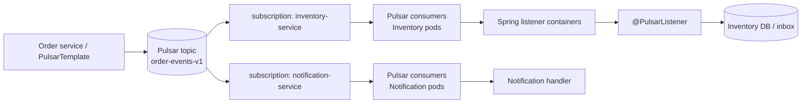
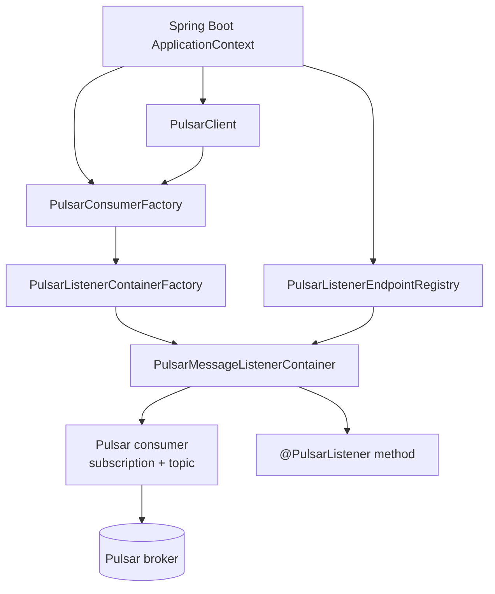
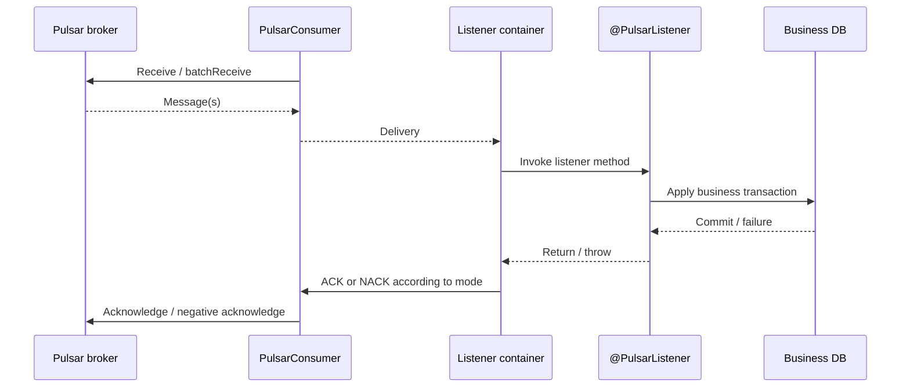
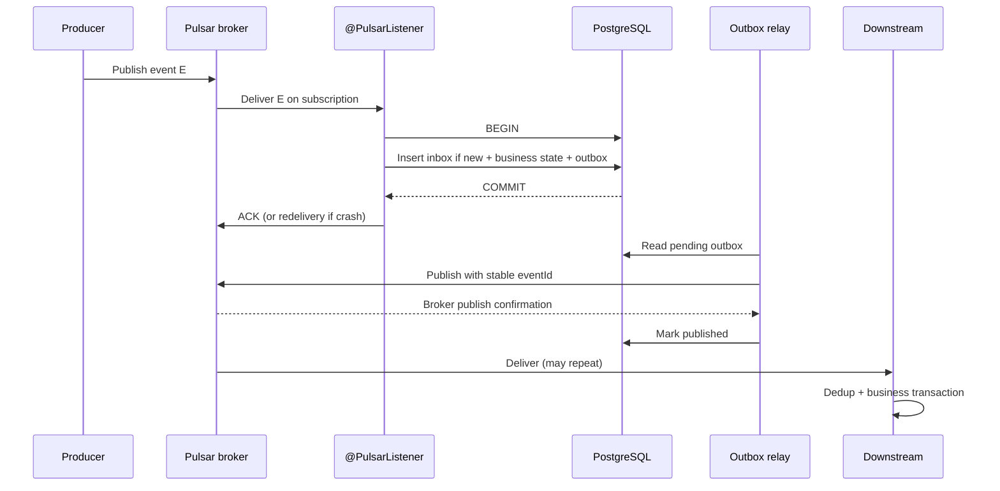

# @PulsarListener, subscription và listener container

> **Chương:** Apache Pulsar  
> **Module:** `SPRING_BOOT_INTEGRATION` — tổ chức tích hợp hệ thống trong Spring Boot qua HTTP client, cơ sở dữ liệu, cache, broker thông điệp và adapter Spring Integration. Trọng tâm là cấu hình, hợp đồng dữ liệu, giao dịch, lỗi, xử lý trùng lặp, kiểm thử và quan sát luồng tích hợp thực tế.
>
> **Phạm vi phiên bản:** Các ví dụ dùng API của **Spring for Apache Pulsar** với package `org.springframework.pulsar.*` và Spring Boot hỗ trợ starter `spring-boot-starter-pulsar`. Một số thế hệ thư viện Apache Pulsar tích hợp Spring có package khác; không trộn API. Cấu hình, loại container, thuộc tính ACK và cơ chế retry cần được đối chiếu với đúng phiên bản Spring Boot/Spring Pulsar/Pulsar Java client triển khai. Các tên topic, subscription, tenant và payload là dữ liệu minh họa.

## 1. Bài toán: cùng một event, nhiều consumer và nguy cơ xử lý lặp

Một hệ thống thương mại điện tử có dịch vụ Order nhận HTTP `POST /orders`, ghi đơn hàng vào PostgreSQL và phát `OrderPlaced` sang Apache Pulsar. Inventory Service cần giữ hàng, Notification Service gửi thông báo và Analytics Service tổng hợp dữ liệu.

Ba service phải **nhận cùng một event theo trách nhiệm riêng**, nhưng các instance của **một** service lại thường chia công việc với nhau. Khi Inventory Service đang xử lý message thì database mất kết nối, nó không được đánh dấu thông điệp hoàn thành. Khi consumer chết sau khi database commit nhưng trước khi gửi ACK, broker có thể giao lại cùng event; giữ hàng lần hai là sai nghiệp vụ.

Spring for Apache Pulsar cung cấp `@PulsarListener` để khai báo một **listener method** nhận message. Phía sau annotation là **listener container** và **Pulsar consumer** được tạo, quản lý và cấu hình theo một **subscription**. Năm câu hỏi cần phân biệt:

1. **Topic nào** chứa message cần đọc?
2. **Subscription nào** đại diện cho tiến độ nhận và cách phân phối message?
3. **Consumer/container nào** nhận từ broker rồi gọi Java method?
4. **Khi nào ACK/NACK**, và xử lý ra sao nếu business transaction thất bại?
5. **Nếu nhận lặp**, database, cache và HTTP downstream có còn đúng không?

Mục tiêu của bài là thiết kế một Pulsar listener có cấu hình rõ, chọn subscription type phù hợp, hiểu vòng đời listener container, kiểm soát ACK và giới hạn retry, rồi kết hợp inbox/outbox, kiểm thử và quan sát.

## 2. Phân biệt topic, subscription, consumer, listener và container

| Khái niệm | Trách nhiệm | Ví dụ |
|---|---|---|
| **Topic** | Nơi producer công bố message; có thể persistent/partitioned. | `persistent://shop/integration/order-events-v1` |
| **Subscription** | Danh tính tiêu thụ với tiến độ/cursor và kiểu phân phối tới consumer. | `inventory-service` |
| **Pulsar consumer** | Client kết nối broker theo một subscription và nhận/ACK message. | Consumer được container tạo |
| **`@PulsarListener`** | Method hoặc listener endpoint ánh xạ message vào Java code. | `onOrderPlaced(...)` |
| **Listener container** | Quản lý consumer, thread, nhận message, gọi listener, ACK/NACK và lifecycle. | `ConcurrentPulsarMessageListenerContainer` |
| **Consumer factory** | Tạo Pulsar consumer dựa trên client và cấu hình. | `PulsarConsumerFactory` |
| **Listener container factory** | Tạo listener container cho endpoint theo cấu hình. | `ConcurrentPulsarListenerContainerFactory` |
| **Endpoint registry** | Theo dõi và quản lý container của listener có ID. | `PulsarListenerEndpointRegistry` |

Hãy ghi nhớ: **topic không phải subscription**; một topic có thể có nhiều subscription độc lập. **Listener container không phải broker**: nó chạy trong ứng dụng Spring Boot, tạo consumer và điều phối lời gọi tới method.

### 2.1. Sơ đồ luồng nhận



Các consumer thuộc cùng subscription có thể **chia delivery hoặc active/standby** tùy subscription type. Các subscription khác nhau có cursor riêng và có thể đọc cùng event cho các mục đích nghiệp vụ độc lập.

### 2.2. MessageId khác eventId

`MessageId` do Pulsar gán để định danh một message tại broker; `eventId` do ứng dụng tạo cho **sự kiện nghiệp vụ**. Nếu producer gửi lại cùng `OrderPlaced` sau timeout, có thể có **hai MessageId khác nhau** cùng mang một event ID. Vì thế inbox/dedup nên dựa vào `(consumerName,eventId)` hoặc business key phù hợp, không dựa đơn thuần vào MessageId.

## 3. Spring Boot khởi tạo @PulsarListener như thế nào?

Spring Boot có thể tự cấu hình hạ tầng Spring Pulsar khi có dependency đúng và điều kiện phù hợp:



Đây là sơ đồ vai trò, không phải thứ tự gọi method nội bộ được bảo đảm cho mọi phiên bản.

- Boot hỗ trợ auto-configure `PulsarClient` và consumer/listener infrastructure.
- `@PulsarListener` được phát hiện và chuyển thành endpoint trong context khi cơ chế `@EnablePulsar` đã bật; với Spring Boot starter tương thích, Boot bật hạ tầng cần thiết tự động.
- `PulsarConsumerFactory` tạo Pulsar consumer dựa trên cấu hình; listener container dùng consumer đó để nhận message.
- `PulsarListenerEndpointRegistry` quản lý các container được đăng ký từ annotation, gồm start/stop/pause/resume theo API hỗ trợ.

Không tự khai báo hàng loạt infrastructure bean nếu chỉ cần đổi topic, subscription hoặc concurrency. Một bean tùy chỉnh có thể khiến một phần auto-configuration **back off** và thay đổi property/authentication/metrics đang được áp dụng. Khi cần tùy chỉnh chuyên biệt, xem **Condition Evaluation Report** và wiring thực tế.

## 4. Dependency và cấu hình Spring Boot tối thiểu

### 4.1. Gradle Groovy DSL

```gradle
dependencies {
    implementation("org.springframework.boot:spring-boot-starter-pulsar")
    implementation("org.springframework.boot:spring-boot-starter-jdbc")
    runtimeOnly("org.postgresql:postgresql")

    testImplementation("org.springframework.boot:spring-boot-starter-test")
}
```

`spring-boot-starter-jdbc`/PostgreSQL chỉ cần khi listener ghi inbox hoặc nghiệp vụ vào database. Nếu consumer chỉ xử lý dữ liệu thuần hoặc đẩy sang adapter khác, starter Pulsar không bắt buộc phải đi kèm JDBC. Sử dụng BOM/dependency management của **cặp Spring Boot–Spring Pulsar tương thích**, không tự ghép client version ngẫu nhiên.

### 4.2. application.yml

```yaml
spring:
  pulsar:
    client:
      service-url: ${PULSAR_SERVICE_URL:pulsar://localhost:6650}
  datasource:
    url: ${DB_JDBC_URL}
    username: ${DB_USERNAME}
    password: ${DB_PASSWORD}

integration:
  pulsar:
    order-topic: persistent://shop/integration/order-events-v1
    inventory-subscription: inventory-service
```

`spring.pulsar.client.service-url` là địa chỉ client kết nối broker, không phải Pulsar Admin HTTP URL. `integration.pulsar.*` là **property do ứng dụng tự định nghĩa** để đặt topic và subscription; nó không tự tạo topic nếu thiếu code hoặc cấu hình listener tham chiếu tới nó.

Trong production, phải cấp tenant/namespace/topic, phân quyền consume, bảo mật TLS/authentication và chính sách retention/subscription trước khi chạy. Không để credential trong source, không lấy `localhost` làm endpoint production và không cho request HTTP tùy ý chọn tên topic hoặc subscription.

## 5. @PulsarListener đầu tiên: một method nhận String

```java
import org.springframework.pulsar.annotation.PulsarListener;
import org.springframework.stereotype.Component;

@Component
public class OrderEventLogListener {

    @PulsarListener(
        id = "inventory-order-listener",
        topics = "${integration.pulsar.order-topic}",
        subscriptionName = "${integration.pulsar.inventory-subscription}"
    )
    public void onOrderPlaced(String json) {
        // Ví dụ chỉ cho thấy method listener; chưa xử lý nghiệp vụ.
        validateEnvelope(json);
    }

    private void validateEnvelope(String json) {
        if (json == null || json.isBlank()) {
            throw new IllegalArgumentException("Empty event");
        }
    }
}
```

Khi container nhận message phù hợp từ topic và subscription, nó gọi method. Giá trị `id` là ID của **listener container/endpoint** dùng khi điều hành qua registry, không phải event ID và cũng không phải tên subscription.

### 5.1. Vì sao phải ghi rõ subscriptionName?

Nếu không khai báo `subscriptionName`, framework có thể tạo tên subscription tự động. Với một consumer cần khôi phục tiến độ bền vững sau restart/rolling deployment, **subscriptionName cố định** giúp giữ đúng danh tính subscriber; tránh vô tình tạo subscription mới mỗi lần deploy khiến replay/backlog ngoài dự kiến.

Nếu application có nhiều listener độc lập cho cùng topic, cần xác định:

- Cùng một subscription: message được phân phối theo subscription type; không phải mỗi listener đều nhận mọi message.
- Subscription khác nhau: mỗi hệ thống có tiến độ nhận riêng, có thể xử lý cùng event.
- Thay tên subscription trên production không giống đổi tên Java method: broker có thể coi là một subscriber mới với cursor khác.

### 5.2. Topic name đầy đủ

Một tên topic persistent thường có dạng:

```text
persistent://<tenant>/<namespace>/<topic>
persistent://shop/integration/order-events-v1
```

Tên rút gọn đôi khi được Pulsar client resolve theo tenant/namespace mặc định, nhưng với môi trường nhiều tenant nên dùng tên đầy đủ để tránh gửi/đọc nhầm. Phân biệt persistent và non-persistent topic khi yêu cầu durability hoặc recovery.

## 6. Nhận payload thuần, Pulsar Message hoặc Spring Message

Một listener có thể nhận các dạng đối số khác nhau:

| Method parameter | Thuận tiện cho | Lưu ý |
|---|---|---|
| `String` / `Integer` / POJO | Chỉ cần payload đã được chuyển đổi | Phải thống nhất schema |
| `org.apache.pulsar.client.api.Message<T>` | Cần key, MessageId, properties, event time, redelivery count | Phân biệt metadata broker và business |
| `org.springframework.messaging.Message<T>` | Muốn dùng Spring Messaging headers | Header mapping tùy framework/serialization |
| `@Header(...)` | Lấy một metadata cụ thể | Dùng tên header đúng hạ tầng |
| `List<T>` khi `batch = true` | Xử lý nhiều record trong một lần gọi | ACK và retry của cả batch cần hiểu rõ |
| `Acknowledgement` ở `MANUAL` | Tự quyết định khi nào ACK/NACK | Phải xử lý cả đường lỗi |

Ví dụ nhận Pulsar message để truy cập metadata:

```java
import org.apache.pulsar.client.api.Message;
import org.springframework.pulsar.annotation.PulsarListener;
import org.springframework.stereotype.Component;

@Component
class OrderMetadataListener {

    @PulsarListener(
        topics = "${integration.pulsar.order-topic}",
        subscriptionName = "inventory-audit"
    )
    void receive(Message<String> message) {
        String payload = message.getValue();
        String eventId = message.getProperty("eventId");
        String key = message.getKey();
        var brokerMessageId = message.getMessageId();

        auditAccepted(eventId, key, brokerMessageId.toString(), payload);
    }

    private void auditAccepted(
            String eventId, String key, String messageId, String payload) {
        // Adapter minh họa, cần tránh log payload/PII trong production.
    }
}
```

Method trên đọc metadata, nhưng các field như `eventId`, `key` và `payload` vẫn phải được **validate**. Nếu eventId chỉ có trong payload mà không có properties, `message.getProperty("eventId")` có thể không có giá trị; contract phải thống nhất giữa producer và consumer.

## 7. JSON schema và conversion của listener

Pulsar có cơ chế schema ở cấp topic/client. Spring Pulsar có thể suy ra schema từ kiểu argument của listener khi được hỗ trợ; với payload phức tạp, schema mặc định thường hướng tới JSON, nhưng **không được mặc định** mọi record/POJO đều tương thích khi nâng phiên bản.

Ví dụ Java POJO thích hợp cho một contract JSON minh họa:

```java
public class OrderPlacedPayload {
    public String eventId;
    public String orderId;
    public String tenantId;
    public int schemaVersion;

    public OrderPlacedPayload() {
    }
}
```

```java
import org.apache.pulsar.common.schema.SchemaType;
import org.springframework.pulsar.annotation.PulsarListener;
import org.springframework.stereotype.Component;

@Component
class TypedOrderListener {

    @PulsarListener(
        topics = "${integration.pulsar.order-topic}",
        subscriptionName = "inventory-typed",
        schemaType = SchemaType.JSON
    )
    void listen(OrderPlacedPayload event) {
        if (event.eventId == null || event.orderId == null) {
            throw new IllegalArgumentException("Missing required event fields");
        }
    }
}
```

Đây là một **listener demo độc lập**; trong ứng dụng thật, không nên tạo thêm subscription `inventory-typed` song song với `inventory-service` chỉ để thử kiểu payload, vì có thể khiến hai luồng xử lý nghiệp vụ cùng một event nếu cả hai listener cùng thực thi side effect.

### 7.1. String chứa JSON không đồng nghĩa Pulsar Schema.JSON

Producer gửi JSON dưới `Schema.STRING` thì listener nhận `String` và ứng dụng tự parse JSON là một hợp đồng khác với producer gửi POJO bằng `Schema.JSON(OrderPlacedPayload.class)`. Phải khớp schema producer/consumer và compatibility policy của topic.

Khi consumer lỗi ở bước decode/schema trước khi method được gọi, cơ chế error handler có thể khác lỗi ném **bên trong** listener. Cần test cả hai đường này bằng message thật, không chỉ unit test method.

### 7.2. Schema evolution

Khi rolling deploy producer mới và consumer cũ:

- Event có `schemaVersion` và policy backward compatibility hay không?
- Field mới optional hay bắt buộc? Consumer cũ xử lý unknown field thế nào?
- Avro/Protobuf/JSON có áp dụng quy tắc compatibility đúng không?
- Một event đã nằm trong backlog nhiều ngày có đọc được sau nâng cấp không?
- Retry/DLQ có giữ nguyên message metadata và version đủ để reprocess không?

Schema registry/serializer không thay cho validation nghiệp vụ: `orderId` và `eventId` vẫn phải đúng tenant, đúng trạng thái và khóa idempotency.

## 8. Subscription type: Exclusive, Failover, Shared và Key_Shared

Pulsar cung cấp bốn loại subscription phổ biến với semantics riêng:

| Subscription type | Cách broker phân phối | Ordering và scale |
|---|---|---|
| **Exclusive** | Chỉ một consumer được gắn với subscription tại một thời điểm. | Đơn giản, không scale-out nhiều consumer cùng subscription. |
| **Failover** | Consumer active/standby; trên partitioned topic có thể phân công active theo partition. | Hữu ích khi muốn failover và thứ tự theo partition; throughput phụ thuộc partition. |
| **Shared** | Nhiều consumer cùng subscription chia message. | Dễ scale, **không bảo đảm ordering** khi xử lý nhiều consumer. |
| **Key_Shared** | Phân phối theo key tới consumer trong subscription. | Hỗ trợ xử lý theo key, nhưng cần cấu hình producer batching/routing tương thích. |

Các từ “đảm bảo thứ tự” ở đây phải hiểu **trong phạm vi và điều kiện của Pulsar**. Không có tổng thứ tự toàn cục cho nhiều partition hoặc nhiều aggregate; redelivery và business retry vẫn có thể làm kết quả nghiệp vụ xuất hiện không theo thứ tự nếu ứng dụng không có version check.

### 8.1. Chọn kiểu theo bài toán

- Một tác vụ đơn giản, chỉ cần một consumer: `Exclusive` có thể phù hợp.
- Cần standby hoặc active consumer theo partition: `Failover`.
- Cần nhiều worker độc lập xử lý command không yêu cầu thứ tự: `Shared`.
- Cần scale nhưng giữ liên kết theo `orderId`/`aggregateId`: `Key_Shared` với message key và batching được thiết kế phù hợp.

**Consumer group của Kafka không phải cùng một đối tượng với Pulsar subscription.** Chúng có một số mục đích tương tự nhưng cơ chế offset, ACK, partition assignment và lịch sử đọc khác nhau.

### 8.2. Ví dụ Shared subscription

```java
import org.apache.pulsar.client.api.SubscriptionType;
import org.springframework.pulsar.annotation.PulsarListener;
import org.springframework.pulsar.listener.AckMode;

@PulsarListener(
    topics = "${integration.pulsar.order-topic}",
    subscriptionName = "inventory-service",
    subscriptionType = SubscriptionType.Shared,
    concurrency = "4",
    ackMode = AckMode.RECORD
)
void process(String json) {
    inventoryService.applyOnce(json);
}
```

Ví dụ giả định method nằm trong Spring bean và `inventoryService` đã được inject. `concurrency = "4"` yêu cầu container tạo nhiều consumer theo khả năng triển khai; không đồng nghĩa mỗi message được xử lý đúng một lần và không loại bỏ unique constraint ở consumer.

### 8.3. Key_Shared phải có key thực sự

Nếu producer không đặt key ổn định, hoặc batching producer không tương thích với Key_Shared, bạn không có bảo đảm xử lý đúng thứ tự theo đơn hàng. Cần test với **partitioned topic, nhiều consumer, cùng orderId nhưng nhiều event** và redelivery; không chỉ kiểm tra nominal path.

## 9. Subscription name, cursor và lần chạy đầu

Subscription là một danh tính bền vững ở broker khi được tạo với chính sách phù hợp. Nó gắn với **cursor/progress** của việc tiêu thụ. Những điểm cần phân biệt:

- **Subscription mới:** vị trí bắt đầu đọc có thể theo `SubscriptionInitialPosition` và cấu hình consumer/broker; phải chủ động quyết định Earliest hay Latest theo yêu cầu.
- **Subscription đã tồn tại:** consumer thường tiếp tục dựa trên cursor/trạng thái subscription hiện có; thay code startup không mặc nhiên reset lịch sử.
- **Thay subscriptionName:** có thể tạo subscriber/cursor mới và đọc lại hoặc bỏ qua lịch sử tùy initial position.
- **Xóa subscription:** có thể làm mất tiến độ và tác động khả năng replay; chỉ làm qua runbook có owner.
- **Retention và backlog:** message đã hết chính sách lưu trữ có thể không thể replay như kỳ vọng.

Với consumer xử lý thanh toán/đơn hàng, **không dựa vào auto-generated subscription name**. Đặt tên ổn định theo trách nhiệm nghiệp vụ, chẳng hạn `inventory-service` hoặc `accounting-projection-v1`. Khi thay đổi contract lớn, migration subscription phải có quyết định rõ về replay, idempotency và cutover.

### 9.1. Hai hệ thống downstream cần hai subscription

Inventory và Notification muốn mỗi bên nhận cùng một event thì dùng hai subscription khác nhau. Hai replica Inventory cùng subscription có thể chia việc theo `Shared`, không phải mỗi replica đều nhận mọi event.

Đổi `subscriptionName` để “chữa consumer không nhận” mà không điều tra backlog/topic/schema có thể tạo **hai luồng xử lý** hoặc làm hệ thống bỏ qua dữ liệu cũ.

## 10. Listener container làm gì phía sau annotation?

`PulsarMessageListenerContainer` là hợp đồng chứa listener và quản lý consumer. Spring Pulsar có các triển khai/biến thể điển hình:

- `DefaultPulsarMessageListenerContainer`: một Pulsar consumer.
- `ConcurrentPulsarMessageListenerContainer`: điều phối nhiều consumer/thành phần nhận theo concurrency.
- `PulsarRecordMessageListener`: xử lý record đơn.
- `PulsarAcknowledgingMessageListener`: xử lý record có `Acknowledgement`.
- `PulsarBatchMessageListener`: xử lý collection record.
- `PulsarBatchAcknowledgingMessageListener`: batch có manual acknowledgement.

Mô hình bên trong có thể nhận một **batch** từ consumer thông qua `batchReceive`, rồi gọi listener từng record khi method nhận `String`/`Message<T>`, hoặc đưa nguyên collection khi `batch = true`. Đây là lý do `AckMode.BATCH` khác với việc bạn tự viết một method `List<T>`.



Không suy rằng container tự kiểm soát **toàn bộ transaction database**: nó quản lý message consumption; transaction database phụ thuộc service và `PlatformTransactionManager` được sử dụng.

### 10.1. Factory và registry khác nhau

`PulsarConsumerFactory` tạo **Pulsar consumer**, `PulsarListenerContainerFactory` tạo **listener container**. `PulsarListenerEndpointRegistry` quản lý các container tạo từ listener endpoints, thường không coi chúng là bean ứng dụng để inject trực tiếp theo type.

Muốn điều hành đúng container, dùng `id` trên annotation rồi tra cứu qua registry, không truy ngẫu nhiên mọi bean `PulsarMessageListenerContainer` từ context.

## 11. Concurrency, partition và số consumer thực

Ví dụ dùng `subscriptionType = SubscriptionType.Shared` và `concurrency = "4"`. Container có thể tạo bốn consumer bên trong một app instance (cộng với những consumer của các pod khác).

Nếu deploy 3 pod và mỗi pod có concurrency 4, tổng client consumer có thể đạt 12 cho cùng subscription. Điều này **không** nghĩa throughput sẽ tăng 12 lần: có giới hạn từ broker, topic partition, DB pool, serialization, network và các khóa nghiệp vụ.

Các điểm quan trọng:

1. `Exclusive` không phù hợp concurrency lớn hơn một consumer cho cùng subscription.
2. `Failover` có thể có consumer standby; với một topic **không partitioned**, tăng concurrency có thể chỉ tạo consumer chờ.
3. `Shared` có khả năng phân phối cho nhiều consumer nhưng không bảo đảm thứ tự.
4. `Key_Shared` cần key và policy batching phù hợp; một “hot key” có thể trở thành nút thắt.
5. Một JVM có nhiều listener methods tạo **nhiều container/subscriptions** theo cấu hình, không gộp tự động chỉ vì cùng topic.
6. Message redelivery có thể làm một phần công việc lặp; concurrency cao **tăng yêu cầu idempotency**.

### 11.1. Không gọi API chậm kéo dài trên consumer thread

Nếu `@PulsarListener` gọi HTTP đối tác mất vài giây và giữ connection DB mở trong cùng transaction, backlog và pool contention có thể tăng. Giải pháp thường tốt hơn là:

- Validate và lưu công việc vào inbox/job table **trong transaction ngắn**.
- ACK khi công việc đã được lưu bền vững theo contract, không phải khi chỉ đưa vào queue trong RAM.
- Worker/relay riêng gọi HTTP với timeout, retry budget và idempotency key.
- Thêm rate limiting/backpressure theo tổng số pod thay vì chỉ đặt concurrency cao.

## 12. ACK, NACK và thời điểm một message được coi là xong

**ACK (acknowledgement)** xác nhận tiến độ tiêu thụ cho broker. **NACK (negative acknowledgement)** thông báo cần redelivery theo cơ chế và delay đã cấu hình. ACK không phải bằng chứng rằng tất cả hệ thống downstream đã cập nhật xong nếu listener mới chỉ tạo một outbox task.

Spring Pulsar có ba **AckMode** phổ biến:

| AckMode | Cách hoạt động cơ bản | Khi dùng |
|---|---|---|
| `BATCH` | Container xử lý các record nhận từ consumer rồi ACK/NACK theo kết quả batch nhận. | Mặc định thường dùng cho record listener khi phù hợp throughput. |
| `RECORD` | ACK/NACK từng record sau lời gọi listener. | Muốn biết kết quả từng record, dễ reasoning về ranh giới commit. |
| `MANUAL` | Ứng dụng tự gọi `Acknowledgement.acknowledge()/nack()`. | Cần kiểm soát riêng chính sách ACK, xử lý từng item hoặc phối hợp commit. |

Trong những nhánh Spring Pulsar có API này, **`BATCH` thường là mặc định** của listener container. Đừng nhầm với `batch = true` trên annotation:

- `ackMode = BATCH`: **chiến lược ACK**.
- `batch = true`: **hình thức gọi method** với một collection.
- `subscriptionType = Shared`: **phân phối message ở broker**.
- `concurrency = "4"`: **số consumer phía container**.

Bốn cấu hình điều chỉnh các lớp khác nhau.

### 12.1. ACK không ngăn mọi duplicate

Giả sử:

```text
Consumer nhận event E
→ PostgreSQL commit thành công
→ Process chết trước khi ACK tới broker
→ Broker giao lại E
```

Trạng thái DB đã commit, nhưng broker chưa ghi nhận ACK. Lần thứ hai phải nhận diện `eventId` đã xử lý và **không thực hiện side effect lần nữa**. Do vậy, ACK chính xác và inbox idempotency bổ sung cho nhau, không thay thế nhau.

## 13. AckMode.RECORD: xử lý theo từng record

Khi muốn framework ACK mỗi message sau khi listener chạy thành công, có thể đặt:

```java
import org.apache.pulsar.client.api.SubscriptionType;
import org.springframework.pulsar.annotation.PulsarListener;
import org.springframework.pulsar.listener.AckMode;
import org.springframework.stereotype.Component;

@Component
public class InventoryRecordListener {

    private final InventoryApplicationService service;

    public InventoryRecordListener(InventoryApplicationService service) {
        this.service = service;
    }

    @PulsarListener(
        id = "inventory-record-listener",
        topics = "${integration.pulsar.order-topic}",
        subscriptionName = "inventory-service",
        subscriptionType = SubscriptionType.Shared,
        ackMode = AckMode.RECORD
    )
    public void receive(String eventJson) {
        service.applyOnce(eventJson);
    }
}
```

Ở đây `InventoryApplicationService.applyOnce` là **service do ứng dụng triển khai**: parse/validate event, kiểm tra `eventId`, ghi inbox cùng thay đổi nghiệp vụ trong một DB transaction. Khi service trả bình thường sau commit, framework có thể ACK; nếu service ném exception, nó sẽ xử lý failure/NACK theo chính sách container.

**Không bắt mọi exception rồi chỉ log và return bình thường**: framework có thể coi method đã thành công và ACK, khiến công việc thất bại bị bỏ qua. Phân loại lỗi domain: duplicate có thể coi thành công; lỗi DB tạm thời phải cho hệ retry; poison message phải có chính sách cách ly/DLQ.

### 13.1. Lưu ý về @Async trong listener

Nếu listener gọi một method `@Async`, nhận `CompletableFuture` rồi **trả về ngay** mà chưa có công việc bền vững, container có thể ACK trước khi worker async hoàn thành. Nếu JVM crash, message không còn được giao lại trong khi side effect chưa thực hiện.

Muốn tách xử lý, phải lưu task/inbox trước ACK hoặc chọn mô hình acknowledgement/asynchronous phù hợp mà bạn đã kiểm chứng trên phiên bản thực tế.

## 14. AckMode.MANUAL và Acknowledgement

Manual ACK cho phép ứng dụng quyết định thời điểm ACK/NACK. Trong **Spring for Apache Pulsar** `org.springframework.pulsar.*`, interface có tên **`Acknowledgement`** (cách viết với `e` ở cuối), khác một số đoạn giải thích dùng từ “Acknowledgment”.

```java
import org.apache.pulsar.client.api.Message;
import org.apache.pulsar.client.api.SubscriptionType;
import org.springframework.pulsar.annotation.PulsarListener;
import org.springframework.pulsar.listener.AckMode;
import org.springframework.pulsar.listener.Acknowledgement;
import org.springframework.stereotype.Component;

@Component
public class InventoryManualAckListener {

    private final InventoryApplicationService service;

    public InventoryManualAckListener(InventoryApplicationService service) {
        this.service = service;
    }

    @PulsarListener(
        id = "inventory-manual-listener",
        topics = "${integration.pulsar.order-topic}",
        subscriptionName = "inventory-manual-service",
        subscriptionType = SubscriptionType.Shared,
        ackMode = AckMode.MANUAL
    )
    public void receive(Message<String> message, Acknowledgement acknowledgment) {
        try {
            service.applyOnce(message.getValue());
            // Chỉ ACK sau khi service hoàn tất transaction bền vững.
            acknowledgment.acknowledge();
        } catch (RuntimeException failure) {
            // Có giới hạn redelivery/DLQ ở consumer configuration.
            acknowledgment.nack();
        }
    }
}
```

**Ví dụ sử dụng một subscription riêng `inventory-manual-service` để dạy manual ACK; không triển khai đồng thời với `inventory-service` cho cùng business side effect trừ khi có mục đích rõ.**

Cách này minh họa ACK/NACK, nhưng production phải phân loại exception trước khi NACK:

- **Transient:** DB timeout, network tạm thời → NACK và retry với backoff/budget.
- **Non-retryable:** schema sai, tenant không hợp lệ → không NACK vô hạn; đưa vào quarantine/DLQ theo policy.
- **Duplicate đã commit:** xử lý idempotent rồi ACK thành công, không tiếp tục gây side effect.

Khi `MANUAL`, framework **không tự ACK thay bạn**. Nếu code rơi vào một nhánh mà không gọi ACK/NACK, message có thể bị treo cho tới khi cơ chế ack timeout/redelivery hoặc lifecycle khác can thiệp. Khi custom code gọi `acknowledge`/`nack` có lỗi, cần logging và policy phù hợp; không dùng catch rỗng.

### 14.1. ACK theo MessageId

API còn hỗ trợ các biến thể như:

```java
acknowledgment.acknowledge(message.getMessageId());
acknowledgment.nack(message.getMessageId());
```

Các lời gọi trên là **hai đường lựa chọn**, không được gọi liên tiếp cho cùng message như ví dụ thực tế. Với batch listener, có thể ACK/NACK theo từng MessageId. MessageId phục vụ thao tác kỹ thuật với broker, không nên làm khóa nghiệp vụ chống trùng.

### 14.2. Khi nào không nên MANUAL?

Manual ACK tăng quyền kiểm soát nhưng cũng tăng số đường lỗi cần quản lý. Nếu logic chỉ là gọi một service đồng bộ, commit DB rồi return/throw, `AckMode.RECORD` thường đơn giản hơn. Chọn manual khi có lý do rõ như partial success trong batch, phối hợp một cơ chế lưu bền vững đặc biệt hoặc cần chủ động NACK.

## 15. batch = true khác ackMode = BATCH

Pulsar consumer có thể nhận nhiều message cùng lượt. Một record listener vẫn được container gọi **từng message**; khi `batch = true`, listener method nhận một collection.

```java
import java.util.List;
import org.apache.pulsar.client.api.SubscriptionType;
import org.apache.pulsar.common.schema.SchemaType;
import org.springframework.pulsar.annotation.PulsarListener;

@PulsarListener(
    topics = "persistent://shop/integration/order-events-v1",
    subscriptionName = "batch-audit-service",
    subscriptionType = SubscriptionType.Shared,
    schemaType = SchemaType.JSON,
    batch = true
)
void receiveBatch(List<OrderPlacedPayload> payloads) {
    for (OrderPlacedPayload event : payloads) {
        auditService.validateAndStore(event);
    }
}
```

Ví dụ giả định method nằm trong Spring bean, `OrderPlacedPayload` có cấu trúc tương thích Pulsar JSON schema, còn `auditService` do ứng dụng định nghĩa.

### 15.1. Auto-ACK với batch listener

Với batch listener và `AckMode.BATCH`, nếu **toàn bộ method** hoàn tất, framework có thể ACK batch nhận; nếu có exception, batch đó có thể bị NACK và giao lại. Đây là một nguồn duplicate điển hình: giả sử 9 item đầu đã commit rồi item thứ 10 lỗi, lần giao lại có thể chạy cả 10 item.

Do đó cần:

- Idempotent writer theo event ID.
- Transaction/chunk boundary được thiết kế rõ.
- Quy tắc xử lý poison item và partial success.
- Giới hạn batch size/fetch size để tránh một item lỗi làm retry lô quá lớn.

Trong nhánh Spring Pulsar được mô tả, `AckMode.RECORD` **không dùng cho `batch = true`**; nếu cần ACK từng message trong một batch, dùng `AckMode.MANUAL` và kiểm tra API hỗ trợ trên phiên bản đó.

### 15.2. Partial ACK trong batch: minh họa

```java
import java.util.List;
import org.apache.pulsar.client.api.Message;
import org.springframework.pulsar.annotation.PulsarListener;
import org.springframework.pulsar.listener.AckMode;
import org.springframework.pulsar.listener.Acknowledgement;

@PulsarListener(
    topics = "persistent://shop/integration/order-events-v1",
    subscriptionName = "inventory-batch-service",
    subscriptionType = org.apache.pulsar.client.api.SubscriptionType.Shared,
    batch = true,
    ackMode = AckMode.MANUAL
)
void receiveBatch(List<Message<String>> messages,
                  Acknowledgement acknowledgement) {
    for (Message<String> message : messages) {
        try {
            inventoryService.applyOnce(message.getValue());
            acknowledgement.acknowledge(message.getMessageId());
        } catch (RuntimeException ex) {
            acknowledgement.nack(message.getMessageId());
        }
    }
}
```

Đây là ví dụ ý tưởng **ACK từng phần** cho một listener container và phiên bản hỗ trợ. Khi production phải xử lý loại lỗi, giới hạn số lần giao lại, tránh `catch` mọi lỗi thành NACK vô hạn và xác minh ngữ nghĩa ACK của batch thật, nhất là khi producer gửi batch với cấu hình khác.

Không được nhầm **consumer receive batch** với **producer batch**: hai tập có thể có ranh giới khác nhau.

## 16. Redelivery: negative ack, ack timeout và retry

Có nhiều cách một message xuất hiện lại:

1. Listener ném exception; container xử lý failure và NACK theo AckMode/error handler.
2. Ứng dụng gọi `Acknowledgement.nack()` chủ động.
3. Consumer không ACK kịp và **acknowledgement timeout** được cấu hình.
4. Consumer/container bị mất kết nối hoặc pod chết trước ACK.
5. Producer publish lại cùng event sau kết quả publish không chắc chắn.

Các cơ chế có **thời điểm, delay và phạm vi khác nhau**. Đừng gọi chung là “framework retry 3 lần” nếu chưa xem Pulsar native consumer settings, Spring Pulsar error handler và policy broker.

### 16.1. Negative acknowledgement redelivery

Pulsar consumer có thể dùng negative-ack redelivery delay hoặc backoff. Ở một số phiên bản Spring Pulsar, có thể tùy chỉnh bằng consumer builder hoặc `properties` trên `@PulsarListener`. Ví dụ minh họa consumer property của Pulsar:

```java
@PulsarListener(
    topics = "persistent://shop/integration/order-events-v1",
    subscriptionName = "inventory-service",
    subscriptionType = SubscriptionType.Shared,
    properties = { "negativeAckRedeliveryDelay=10s" }
)
void receive(String payload) {
    inventoryService.applyOnce(payload);
}
```

Property trong `properties = {...}` là **native Pulsar consumer properties**, không phải `spring.pulsar.consumer.*` key. Tên/đơn vị và giá trị được chấp nhận có thể thay đổi theo Pulsar client version; ví dụ này cần kiểm thử với client thực và không nên coi `10s` là giá trị hợp lệ cho mọi đời. Khi cần chính xác, dùng API customizer/`RedeliveryBackoff` theo phiên bản đã pin và quan sát thời gian redelivery.

### 16.2. Acknowledgement timeout

Nếu bật ACK timeout, message chưa ACK sau thời gian được định có thể được redeliver theo chính sách. ACK timeout quá ngắn trong khi business processing dài sẽ tạo delivery lặp ngay cả khi pod không chết. Không “sửa” bằng cách kéo timeout vô hạn mà bỏ qua worker treo; dùng bounded processing, timeout HTTP/DB và metrics age.

### 16.3. Retry tại ứng dụng khác retry của broker

Nếu service dùng Resilience4j/Spring Retry để thử lại một lỗi DB tạm thời **bên trong listener**, nó có thể thực hiện nhiều lần trước khi method ném exception. Sau đó broker có thể redeliver thêm nhiều lần nữa. Tổng số attempts thực có thể là tích của hai tầng retry, gây retry storm.

Nên chọn owner retry rõ: lỗi ngắn có thể retry cục bộ có giới hạn, còn retry kéo dài/replay giao cho broker/job table/DLQ với backoff và cảnh báo.

## 17. Dead-letter topic và xử lý poison message

Một event lỗi schema hoặc validation cứng không nên bị NACK mãi. Pulsar hỗ trợ **DeadLetterPolicy** trong những subscription mode/phiên bản phù hợp. Ví dụ với `Shared`:

```java
import org.apache.pulsar.client.api.DeadLetterPolicy;
import org.apache.pulsar.client.api.SubscriptionType;
import org.springframework.context.annotation.Bean;
import org.springframework.context.annotation.Configuration;
import org.springframework.pulsar.annotation.PulsarListener;

@Configuration(proxyBeanMethods = false)
class InventoryDeadLetterConfiguration {

    private final InventoryApplicationService inventoryService;

    InventoryDeadLetterConfiguration(
            InventoryApplicationService inventoryService) {
        this.inventoryService = inventoryService;
    }

    @Bean
    DeadLetterPolicy inventoryDeadLetterPolicy() {
        return DeadLetterPolicy.builder()
            .maxRedeliverCount(5)
            .deadLetterTopic(
                "persistent://shop/integration/order-events-inventory-dlq")
            .build();
    }

    @PulsarListener(
        topics = "persistent://shop/integration/order-events-v1",
        subscriptionName = "inventory-dlq-service",
        subscriptionType = SubscriptionType.Shared,
        deadLetterPolicy = "inventoryDeadLetterPolicy"
    )
    void receive(String json) {
        inventoryService.applyOnce(json);
    }
}
```

Đoạn này **minh họa** liên kết bean policy vào annotation; service được inject qua constructor, còn topic/permission cần được provision và kiểm tra trong môi trường thật. Các loại subscription hỗ trợ native DLQ và cơ chế đếm redelivery có thể thay đổi theo version; tài liệu Spring Pulsar 1.2 mô tả cấu hình native DLQ cho Shared. **Không suy ra Exclusive/Failover cũng có cùng behavior** nếu chưa kiểm tra.

### 17.1. DLQ không phải nơi “đã giải quyết”

Một DLQ cần:

- Topic bền vững, retention/ACL và policy lưu thông tin lỗi an toàn.
- Owner được cảnh báo khi có message mới.
- Quy trình phân loại: payload sai, schema đổi, mất quyền, lỗi logic, dependency không khả dụng.
- Công cụ replay với **event ID gốc**, không tạo sự kiện nghiệp vụ mới khi chỉ thử lại.
- Đảm bảo idempotency khi replay; tránh làm side effect hai lần.
- Số lần retry và delay đủ kiểm soát để không nghẽn broker.

Với message không thể decode vào DTO, lỗi có thể xảy ra **trước method listener**. Cần kiểm tra error handler/container/serializer; chỉ đặt `try/catch` trong method không bắt được lỗi deserialize trước khi nó được gọi.

### 17.2. Spring Pulsar error handler khác native DLQ

Spring Pulsar có các cơ chế xử lý lỗi ở tầng framework như `PulsarConsumerErrorHandler` trong những phiên bản hỗ trợ. Đây không phải thứ bắt buộc phải dùng cùng lúc với mọi native DLQ policy. Nếu kết hợp nhiều lớp, phải xác định lớp nào quyết định retry, recover, ACK/NACK và publish tới DLT, tránh gửi message lỗi tới hai nơi hoặc ACK trước khi recover bền vững.

## 18. Inbox và idempotency: consumer có thể nhận một event nhiều lần

Một consumer xử lý `OrderPlaced` cần unique key ở database. Ví dụ PostgreSQL:

```sql
CREATE TABLE processed_message (
    consumer_name VARCHAR(120) NOT NULL,
    event_id VARCHAR(160) NOT NULL,
    processed_at TIMESTAMPTZ NOT NULL DEFAULT CURRENT_TIMESTAMP,
    PRIMARY KEY (consumer_name, event_id)
);

CREATE TABLE inventory_reservation_request (
    command_id VARCHAR(180) PRIMARY KEY,
    order_id VARCHAR(120) NOT NULL,
    status VARCHAR(24) NOT NULL
);
```

Đặt `event_id NOT NULL` trong business key là rất quan trọng: một event không có ID ổn định không thể dedup đáng tin. Cột `command_id` cũng phải ổn định giữa các lần redelivery.

### 18.1. Service ghi inbox cùng business state trong một transaction

```java
import org.springframework.jdbc.core.JdbcTemplate;
import org.springframework.stereotype.Service;
import org.springframework.transaction.annotation.Transactional;

@Service
public class InventoryApplicationService {

    private final JdbcTemplate jdbc;
    private final OrderEventParser parser;

    public InventoryApplicationService(
            JdbcTemplate jdbc, OrderEventParser parser) {
        this.jdbc = jdbc;
        this.parser = parser;
    }

    @Transactional
    public void applyOnce(String json) {
        OrderPlacedEvent event = parser.parseAndValidate(json);

        int inserted = jdbc.update(
            """
            INSERT INTO processed_message (consumer_name, event_id)
            VALUES (?, ?)
            ON CONFLICT (consumer_name, event_id) DO NOTHING
            """,
            "inventory-service",
            event.eventId()
        );

        if (inserted == 0) {
            return; // Duplicate đã được xử lý, ACK bình thường.
        }

        jdbc.update(
            """
            INSERT INTO inventory_reservation_request
                (command_id, order_id, status)
            VALUES (?, ?, 'PENDING')
            ON CONFLICT (command_id) DO NOTHING
            """,
            "reserve-" + event.eventId(),
            event.orderId()
        );
    }
}
```

`OrderEventParser` và `OrderPlacedEvent` là các type do ứng dụng định nghĩa. `parseAndValidate` phải xác minh eventId, orderId, tenant, schema version và contract trước khi ghi. Cả hai bảng cần migration; service và listener thực tế phải dùng cùng database/transaction manager.

Vì `@Transactional` nằm ở method của một Spring service được listener gọi qua Spring proxy, khi method **trả về bình thường**, transaction thường đã commit. Nếu transaction bị rollback do exception, listener không nên ACK như thành công.

### 18.2. Vì sao chỉ kiểm tra SELECT rồi INSERT là sai?

```text
Consumer A: SELECT eventId chưa có
Consumer B: SELECT eventId chưa có
Consumer A: INSERT + cập nhật tồn kho
Consumer B: INSERT + cập nhật tồn kho
```

Nếu không có unique constraint, hai consumer có thể cùng gây side effect. Cần để database phân xử qua `PRIMARY KEY/UNIQUE` và insert/upsert idempotent **trong cùng transaction** với thay đổi nghiệp vụ. Không chỉ dựa vào subscription type hay concurrency để chống trùng.

### 18.3. ACK sau database commit nhưng trước HTTP downstream?

Nếu service ghi yêu cầu `PENDING` vào DB rồi ACK, bạn mới bảo đảm **đã tiếp nhận công việc bền vững**, không bảo đảm kho đã gọi HTTP hay giữ hàng thực tế. Một worker/relay khác cần hoàn tất và cập nhật trạng thái. API/metric phải phân biệt `accepted`, `queued`, `processed`, `failed` và `downstream confirmed`.

## 19. Giao dịch Pulsar và transaction JDBC là hai ranh giới

Một số version Pulsar/Spring Pulsar hỗ trợ **Pulsar transactions** cho publish/ack broker khi cấu hình và cluster cho phép. Spring Boot có property hỗ trợ transaction ở tầng Pulsar như `spring.pulsar.transaction.enabled` trong nhánh tương thích. Nhưng:

- Nó không biến `@Transactional` JDBC thành distributed transaction giữa PostgreSQL và Pulsar.
- Một ACK trong Pulsar không rollback SQL đã commit nếu broker transaction thất bại.
- Một SQL rollback không thu hồi HTTP call hoặc thay đổi cache Redis bên ngoài.
- Nếu listener vừa ghi DB vừa phát message broker, cần xác định kết quả không chắc chắn khi crash.

### 19.1. Mẫu inbox + outbox



Nếu relay publish xong rồi crash trước khi cập nhật `PUBLISHED`, nó có thể publish lại. Vì thế downstream vẫn phải dedup. **Đã ACK input** có thể hoàn toàn đúng nếu yêu cầu tiếp theo đã được lưu an toàn trong DB; nó không chứng minh mọi downstream action hoàn thành.

### 19.2. Chọn một nơi chịu trách nhiệm trạng thái

Đừng để một phần service cập nhật DB, phần callback async đánh dấu ACK và phần scheduler khác tự phát message mà không có ranh giới nhất quán. Chọn owner cho từng trạng thái: listener nhận và commit inbox, relay publish outbox, consumer downstream dedup và commit, operator quan sát retry/DLQ.

## 20. Quản lý listener container: ID, lifecycle, pause/resume

Spring Pulsar quản lý listener container theo vòng đời ứng dụng. Với annotation đặt `id`, có thể tìm container qua registry:

```java
import org.springframework.pulsar.config.PulsarListenerEndpointRegistry;
import org.springframework.pulsar.listener.PulsarMessageListenerContainer;
import org.springframework.stereotype.Service;

@Service
public class PulsarListenerControl {

    private final PulsarListenerEndpointRegistry registry;

    public PulsarListenerControl(PulsarListenerEndpointRegistry registry) {
        this.registry = registry;
    }

    public void pauseInventory() {
        PulsarMessageListenerContainer container =
            registry.getListenerContainer("inventory-order-listener");

        if (container == null) {
            throw new IllegalStateException("Listener container not registered");
        }
        container.pause();
    }

    public void resumeInventory() {
        PulsarMessageListenerContainer container =
            registry.getListenerContainer("inventory-order-listener");

        if (container == null) {
            throw new IllegalStateException("Listener container not registered");
        }
        container.resume();
    }
}
```

Các method `pause/resume` được Spring Pulsar hỗ trợ trong các nhánh liên quan, nhưng signature/lifecycle cụ thể phải được kiểm tra theo phiên bản. **Không công khai control endpoint này ra Internet**. Chỉ operator được phân quyền mới được tạm dừng; cần log audit, trạng thái, lý do và cảnh báo backlog.

### 20.1. Pause không có nghĩa xóa message

Pause làm container tạm dừng luồng nhận/poll theo khả năng hỗ trợ; message còn tại broker theo retention/subscription policy. Khi resume, consumer tiếp tục theo subscription cursor. Trong lúc pause, backlog có thể tăng; cần metric và giới hạn thời gian pause.

`stop()` và `pause()` là hai quyết định vận hành khác nhau. Stop có thể đóng/restart consumer theo lifecycle; pause thường giữ cấu trúc container nhưng tạm ngừng nhận. Phải thử behaviour trong môi trường test khi shutdown, rolling deploy và broker reconnect.

### 20.2. Startup failure policy

Theo các version có `StartupFailurePolicy`, container có thể:

- **Stop:** fail startup nếu listener không thể start (đường mặc định trong một số version).
- **Continue:** log lỗi và để container không chạy, ứng dụng có thể vẫn start.
- **Retry:** cố khởi động lại theo policy có giới hạn rồi để trạng thái không chạy nếu vẫn thất bại.

Không chọn `Continue`/`Retry` chỉ để “pod xanh” khi listener thiết yếu không chạy. Nếu dịch vụ chỉ có chức năng tiêu thụ Pulsar thì readiness nên phản ánh listener đang không hoạt động; nếu còn nhận HTTP vào inbox khi Pulsar down, có thể thiết kế degraded mode khác. Startup policy và readiness probe phải nhất quán.

## 21. Customizer, listener factory và phân tầng cấu hình

Spring Boot hỗ trợ các nhóm property như:

- `spring.pulsar.client.*`: Pulsar client kết nối broker.
- `spring.pulsar.consumer.*`: cấu hình consumer factory/client.
- `spring.pulsar.listener.*`: hành vi listener container.
- `integration.pulsar.*`: property do ứng dụng tự định nghĩa.

Khi cần thay một listener riêng, `@PulsarListener` có các thuộc tính như `subscriptionType`, `ackMode`, `concurrency`, `batch`, `consumerCustomizer`, `containerFactory` và `properties` theo version.

Ví dụ consumer property ở listener:

```java
@PulsarListener(
    id = "inventory-tuned-listener",
    topics = "persistent://shop/integration/order-events-v1",
    subscriptionName = "inventory-tuned",
    subscriptionType = SubscriptionType.Shared,
    properties = { "receiverQueueSize=500" }
)
void receive(String payload) {
    inventoryService.applyOnce(payload);
}
```

`receiverQueueSize` là property của Pulsar consumer; giới hạn này ảnh hưởng đến buffer nhận và memory/performance. Chọn theo workload, không lấy giá trị demo làm default production.

### 21.1. Customizer toàn cục khác customizer cho từng listener

- `ConsumerBuilderCustomizer` toàn cục có thể ảnh hưởng **mọi consumer** do consumer factory tạo.
- `PulsarListenerConsumerBuilderCustomizer` được gắn qua `consumerCustomizer` phù hợp cho listener cụ thể.
- `PulsarContainerFactoryCustomizer<ConcurrentPulsarListenerContainerFactory<?>>` cho phép điều chỉnh container factory Boot auto-configured trong những nhánh Spring Boot hỗ trợ.
- `containerFactory` trên annotation chọn một factory khác theo tên khi một app có nhiều cấu hình riêng.

Không đồng nhất **consumer builder** với **listener container factory**. Việc thay receiver queue size là consumer-level; việc cấu hình startup policy/ACK container nằm ở layer khác.

### 21.2. Tránh API đã deprecated khi nâng cấp

Một số method cũ như `ConcurrentPulsarListenerContainerFactory.setConcurrency(...)` đã được đánh dấu deprecated trong Spring Pulsar 1.2 và không còn trong Spring Pulsar 2.0. Với bài toán concurrency đơn giản, khai báo trực tiếp `@PulsarListener(concurrency = "...")` theo version là cách rõ ràng hơn; với global policy, dùng API customizer/container properties được hỗ trợ.

Không sao chép class/namespace từ thư viện “Apache Pulsar support for Spring” nếu dự án đang dùng “Spring for Apache Pulsar” dưới `org.springframework.pulsar`; những module này có naming/API có thể khác nhau.

## 22. Bảo mật và cô lập tenant/namespace

Consumer có quyền đọc message chứa dữ liệu nghiệp vụ; nó cần chính sách bảo mật nghiêm ngặt:

1. Cấp consume permission cho đúng tenant/namespace/topic, không dùng token admin của cả cluster.
2. Cấu hình TLS và authentication phù hợp hạ tầng; không đưa token vào source, log hoặc message properties.
3. Dùng topic và subscription đã được provision; không chấp nhận topic name từ input không tin cậy.
4. Validate `tenantId` bên trong payload, không chỉ tin tên topic; chống cross-tenant processing.
5. Bảo vệ DLQ và retention: message lỗi có thể chứa dữ liệu nhạy cảm như message gốc.
6. Kiểm soát schema/version trước khi gọi domain code; tránh deserialize dữ liệu lạ rồi dùng trực tiếp.
7. Hạn chế kích thước payload/batch, receiver queue và concurrency để chống OOM/backpressure.
8. Khi một service có nhiều listeners, audit rõ bean nào được cấp quyền subscribe tới topic nào.

Nếu topic có dữ liệu nhiều tenant, unique key `(consumerName,eventId)` có thể chưa đủ nếu event ID chỉ duy nhất **trong một tenant**. Khi đó chọn `(consumerName,tenantId,eventId)` cùng constraint và validate tenant trước khi ghi; đừng “tự động” coi event ID là globally unique nếu contract không bảo đảm.

## 23. Quan sát: subscription backlog, redelivery và xử lý nghiệp vụ

Trong môi trường nhiều service, chỉ metric “listener method được gọi” chưa đủ. Cần đo nhiều ranh giới khác nhau:

| Lớp | Metric/nhật ký cần theo dõi | Phát hiện |
|---|---|---|
| Broker/topic | Publish rate, backlog, retention, storage, quota | Broker quá tải, backlog tăng |
| Subscription | Unacked, redelivery, subscription type, active consumer count | Tiến độ xử lý chậm hoặc consumer rơi |
| Listener container | Running/paused/stopped, startup errors, concurrency | Container không chạy dù pod healthy |
| Message conversion | Schema decode error, unknown version | Producer/consumer contract lệch |
| Business service | Processed, rejected, duplicate, transaction rollback | Side effect lỗi hoặc event trùng |
| Database | Lock wait, pool active, statement duration | Consumer bị DB nghẽn |
| DLQ/quarantine | Count, oldest age, reason category | Poison message chưa được xử lý |
| Outbox/downstream | Oldest pending age, publish failure, downstream result | Sau ACK input còn công việc chưa xong |

Các trường nên đưa vào structured log:

```text
eventId, correlationId, subscriptionName, topic,
consumerName, messageId, schemaVersion,
attempt/redeliveryCount, businessStatus, failureCategory
```

- `eventId` là khóa nghiệp vụ chống trùng; `correlationId` nối nhiều bước.
- `messageId` giúp chẩn đoán ở broker nhưng không dùng thay event ID.
- Đừng log raw payload/PII, password, token hoặc thông tin thẻ.
- Label metric có cardinality cao như event ID/message ID thường không phù hợp; dùng chúng trong log/trace có chính sách lấy mẫu.

Spring Boot Actuator/Micrometer cùng instrumentation Spring Pulsar có thể hỗ trợ một phần metric/observation theo dependency và cấu hình. Không mặc định mọi metric đều tự xuất hiện; kiểm tra registry, exposure, tracing propagation và listener wiring thực.

## 24. Kiểm thử @PulsarListener: từ unit tới broker thật

### 24.1. Unit test logic nghiệp vụ

Tách parse/validate và `InventoryApplicationService.applyOnce` khỏi annotation. Unit test nên kiểm tra:

- Event thiếu `eventId`/`orderId` bị từ chối.
- Cùng event ID chạy lại chỉ ghi business side effect một lần.
- Event ID khác nhau nhưng cùng correlation ID vẫn được xử lý độc lập.
- Lỗi transient ném exception, không bị listener “nuốt”.
- Lỗi domain được chuyển sang quarantine theo chính sách, không retry vô hạn.

Mock listener method có thể xác nhận code gọi service/ACK theo nhánh, nhưng **không chứng minh** broker thật giao message và không chứng minh transaction rollback.

### 24.2. Test listener với broker thật

Dùng Pulsar test infrastructure hoặc Testcontainers tương thích với version đã pin. Một smoke test cần:

1. Có broker/tenant/namespace/topic test riêng.
2. Tạo subscription có tên ổn định cho test, chọn initial position rõ.
3. Dùng producer publish payload đúng schema.
4. Đợi consumer commit row trong PostgreSQL test, **không chỉ kiểm tra method được gọi**.
5. Publish lại cùng `eventId` và xác minh chỉ một business result.
6. Dừng consumer sau commit trước ACK (hoặc giả lập), khởi động lại và xác minh idempotency.
7. Test `Shared` nhiều consumer và `Key_Shared` với key tương thích.
8. Test negative ack/backoff và DLQ sau chính sách số lần redelivery.
9. Test serializer lỗi trước listener method, monitoring và quarantine.
10. Test pause/resume/startup policy; đảm bảo backlog sau resume được xử lý theo contract.

### 24.3. Test manual ACK trong phạm vi phương thức

Ví dụ với Mockito giả định đã có `InventoryApplicationService` và có thể gọi method listener trực tiếp:

```java
import static org.mockito.Mockito.*;

import org.apache.pulsar.client.api.Message;
import org.junit.jupiter.api.Test;
import org.springframework.pulsar.listener.Acknowledgement;

class InventoryManualAckListenerTest {

    @Test
    void acknowledgesAfterSuccessfulServiceCall() {
        InventoryApplicationService service =
            mock(InventoryApplicationService.class);
        InventoryManualAckListener listener =
            new InventoryManualAckListener(service);

        @SuppressWarnings("unchecked")
        Message<String> message = mock(Message.class);
        when(message.getValue()).thenReturn("{\"eventId\":\"evt-100\"}");

        Acknowledgement ack = mock(Acknowledgement.class);

        listener.receive(message, ack);

        verify(service).applyOnce(message.getValue());
        verify(ack).acknowledge();
        verify(ack, never()).nack();
    }

    @Test
    void nacksWhenServiceFails() {
        InventoryApplicationService service =
            mock(InventoryApplicationService.class);
        InventoryManualAckListener listener =
            new InventoryManualAckListener(service);

        @SuppressWarnings("unchecked")
        Message<String> message = mock(Message.class);
        when(message.getValue()).thenReturn("{\"eventId\":\"evt-101\"}");
        doThrow(new IllegalStateException("DB unavailable"))
            .when(service).applyOnce(message.getValue());

        Acknowledgement ack = mock(Acknowledgement.class);

        listener.receive(message, ack);

        verify(ack).nack();
        verify(ack, never()).acknowledge();
    }
}
```

Ví dụ chỉ kiểm tra **rẽ nhánh method**; không có listener container, broker, Spring transaction hoặc DLQ nên không chứng minh end-to-end durability. Cần bổ sung integration test với PostgreSQL/Pulsar thật để xác minh commit trước ACK và redelivery sau crash.

### 24.4. Matrix kiểm thử lỗi và hậu quả

| Kịch bản | Tiêu chí đạt |
|---|---|
| Consumer không có quyền subscribe | Startup/consumer lỗi rõ, readiness đúng |
| Sai topic hoặc subscriptionName | Phát hiện config mismatch, không âm thầm bỏ qua |
| Topic có schema khác | Decode failure được phân loại và quan sát |
| DB commit rồi crash trước ACK | Redelivery nhưng side effect không lặp |
| ACK trước DB commit | Test cho thấy rủi ro; thiết kế phải tránh |
| Batch 10 items lỗi item thứ 10 | Không có side effect lặp nhờ idempotency |
| Broker temporarily unavailable | Listener reconnect/restart theo policy; không mất task đã lưu |
| Poison message | Retry bounded, vào DLQ/quarantine đúng topic |
| Shared concurrency nhiều pod | Không vượt DB pool/rate limit, không duplicate business |
| Key_Shared có ordering yêu cầu | Sự kiện cùng key giữ thứ tự theo hợp đồng; replay version-safe |
| Listener paused | Backlog đo được, resume xử lý lại |
| Outbox publisher mất ACK | Retry eventId ổn định; consumer dedup |

## 25. Troubleshooting những sự cố thường gặp

| Triệu chứng | Nguyên nhân cần kiểm tra | Cách xử lý |
|---|---|---|
| Không gọi `@PulsarListener` | Thiếu starter/auto-config, bean không được scan, sai topic/subscription, container chưa start | Kiểm tra startup logs, registry, bean, service URL, ACL |
| Có topic nhưng không nhận event cũ | Subscription mới bắt đầu ở Latest hoặc backlog đã hết retention | Kiểm tra cursor/initial position, tên subscription |
| Nhiều service không nhận đủ event | Chia cùng subscription nên chúng chia delivery | Tạo subscription riêng cho trách nhiệm độc lập |
| Chỉ một consumer hoạt động dù concurrency lớn | Exclusive/Failover non-partitioned hoặc phân phối bị giới hạn | Chọn subscription type và partitioning đúng |
| Message bị xử lý lặp | Redelivery, producer republish, mất ACK sau commit | Inbox/unique key theo event ID |
| Consumer ACK dù xử lý thất bại | Swallow exception hoặc async job trong RAM rồi return | Ném lỗi/ACK sau durable commit, test đường lỗi |
| Manual listener treo/unacked tăng | Bỏ quên `acknowledge/nack` ở một nhánh | Audit code và timeout, xử lý mọi nhánh |
| Batch listener cứ chạy lại toàn batch | Một record lỗi, auto BATCH NACK cả batch | Idempotent writer, manual partial ACK nếu thích hợp |
| DLQ không có message | Chưa cấu hình đúng mode, policy, quyền hoặc redelivery | Kiểm tra bean policy, consumer mode và broker stats |
| Duplicate với MessageId khác | Producer publish lại cùng event | Dedup theo eventId, không MessageId |
| Key_Shared đảo thứ tự | Producer key không ổn định, batching/routing không tương thích | Kiểm tra key, batch policy, version |
| Container không chạy sau broker outage | Startup failure policy hoặc reconnect config | Xem registry, health/readiness, retry policy |
| Có ACK nhưng cache chưa cập nhật | Listener chỉ tạo task/outbox; downstream async còn backlog | Theo dõi end-to-end status/relay |
| Tăng concurrency nhưng throughput giảm | DB pool/lock, HTTP rate limit, hot key | Profiling, bounded concurrency và partition strategy |
| Bị lỗi class/annotation sau nâng cấp | Trộn Spring Pulsar và Apache Pulsar support hoặc đổi major API | Pin dependency, đọc migration guide, kiểm thử wiring |

Không chữa mọi lỗi bằng cách **đổi subscriptionName**, reset cursor, xóa backlog hoặc tắt retry. Các thao tác đó có thể tạo business replay hoặc mất dữ liệu. Cần lưu lại bằng chứng: topic/subscription, MessageId/eventId, listener container ID, thời gian ACK/NACK, state DB và broker stats.

## 26. Checklist trước khi đưa Pulsar listener vào production

1. **Topic:** tên đầy đủ, tenant/namespace và persistent/partitioned có phù hợp contract?
2. **Subscription:** có tên cố định, type đúng, initial position/replay policy rõ?
3. **Consumer topology:** nhiều service có subscription riêng, nhiều pod cùng vai trò chia delivery đúng?
4. **Container:** method được scan, container factory/registry đúng, lifecycle/readiness rõ?
5. **Concurrency:** phù hợp Exclusive/Failover/Shared/Key_Shared, partition và DB pool?
6. **Schema:** producer/consumer cùng schema type, version, JSON/Avro/Protobuf contract?
7. **Message ID:** có eventId/commandId ổn định; không dùng broker MessageId làm dedup nghiệp vụ?
8. **ACK:** đã chọn BATCH/RECORD/MANUAL và biết chính xác khi nào ACK/NACK?
9. **Exception:** không swallow lỗi, có policy transient vs permanent và retry budget?
10. **Batch:** nếu batch listener, có idempotent writer và chính sách partial failure?
11. **DLQ:** được provision, có quyền, alert và quy trình reprocess có owner?
12. **Transaction:** DB commit trước ACK hoặc đã lưu công việc bền vững trong DB?
13. **Inbox/outbox:** chống trùng inbound và publish retry an toàn?
14. **HTTP/cache:** side effect downstream có timeout, idempotency key và reconciliation?
15. **Security:** auth/TLS/ACL tối thiểu, không log token hoặc payload nhạy cảm?
16. **Observability:** consumer lag/backlog, unacked, redelivery, DLQ, duplicate và processing latency?
17. **Kiểm thử:** broker thật, DB thật, crash-before-ACK, concurrent consumers, poison message và rolling upgrade?
18. **Runbook:** có thao tác pause/resume, restart, replay, đổi subscription mà không mất dữ liệu?

## 27. Tự kiểm tra kiến thức

**Câu 1:** Hai replica của Inventory cùng subscription `inventory-service` có nhận mọi event ở cả hai nơi không?  
**Đáp án:** Không mặc nhiên. Broker phân phối theo subscription type; với `Shared`, chúng thường chia message.

**Câu 2:** Inventory và Notification muốn mỗi hệ thống nhận mọi `OrderPlaced` cần gì?  
**Đáp án:** Subscription độc lập cho mỗi trách nhiệm, với topic/schema cùng hợp đồng.

**Câu 3:** `ackMode=BATCH` có đồng nghĩa `batch=true` không?  
**Đáp án:** Không. Một cái là chế độ ACK; cái kia quyết định listener nhận một record hay collection.

**Câu 4:** Consumer commit PostgreSQL rồi chết trước ACK. Broker có thể redeliver không?  
**Đáp án:** Có. Cần unique constraint/inbox theo eventId để không nhân đôi tác dụng phụ.

**Câu 5:** `AckMode.MANUAL` nhưng method chỉ return, không gọi ACK/NACK. Điều gì có thể xảy ra?  
**Đáp án:** Message chưa được ACK, có thể tồn tại unacked và bị redeliver theo timeout/lifecycle đã cấu hình.

**Câu 6:** `subscriptionType = Shared` có bảo đảm thứ tự event cùng orderId không?  
**Đáp án:** Không. Nếu cần phân phối theo key và ordering, cân nhắc `Key_Shared` với producer key/batching phù hợp và business version check.

**Câu 7:** Đổi subscriptionName để nhận lại message cũ có an toàn không?  
**Đáp án:** Không tự động. Đây là một subscriber/cursor khác; phải xác định initial position, retention và replay/idempotency.

**Câu 8:** Một message vào DLQ có nghĩa người dùng đã được hoàn tiền hay đơn hàng đã được xử lý?  
**Đáp án:** Không. DLQ chỉ lưu thông điệp chưa xử lý thành công; cần runbook/quarantine/replay và xác nhận business result.

**Câu 9:** Có nên gọi API đối tác chậm rồi ACK ngay khi mới đưa tác vụ vào `Executor` trong RAM không?  
**Đáp án:** Không, nếu công việc bắt buộc bền vững. Cần lưu task/outbox vào DB trước ACK hoặc cơ chế acknowledgement có kiểm chứng.

**Câu 10:** `@Transactional` JDBC trên listener có biến Pulsar ACK và HTTP call thành một transaction nguyên tử không?  
**Đáp án:** Không. Đây là các ranh giới khác nhau; cần inbox/outbox, idempotency và reconciliation.

### Tài liệu chính thức để đối chiếu theo phiên bản

- [Spring Boot — Apache Pulsar Support](https://docs.spring.io/spring-boot/reference/messaging/pulsar.html).
- [Spring for Apache Pulsar — Message Consumption](https://docs.spring.io/spring-pulsar/reference/reference/pulsar/message-consumption.html).
- [Spring for Apache Pulsar — Message Consumption, nhánh 1.2.x](https://docs.spring.io/spring-pulsar/docs/1.2.x/reference/reference/pulsar/message-consumption.html).
- [Spring for Apache Pulsar — Transactions](https://docs.spring.io/spring-pulsar/reference/reference/pulsar/transactions.html).
- [Apache Pulsar — Messaging concepts](https://pulsar.apache.org/docs/concepts-messaging/).

Đối chiếu **đúng nhánh phát hành** với build; API customizer, listener container và Spring Boot autoconfigure package có thể khác nhau giữa Spring Pulsar 1.x/2.x và các thế hệ Spring Boot.

---

Trong chương **Apache Pulsar** của `SPRING_BOOT_INTEGRATION`, hãy nhớ: **`@PulsarListener` là phương thức nhận thông điệp; subscription quyết định danh tính, cursor và kiểu phân phối; listener container quản lý consumer, luồng nhận, ACK/NACK và lifecycle**. Để tích hợp HTTP–database–cache–broker an toàn, cần gắn rõ ranh giới commit với ACK, dùng event ID ổn định, inbox/outbox và consumer idempotency, retry có giới hạn, quan sát backlog/DLQ và kiểm thử redelivery thực tế — không xem việc method listener được gọi một lần là bảo đảm nghiệp vụ đã chạy đúng một lần.
