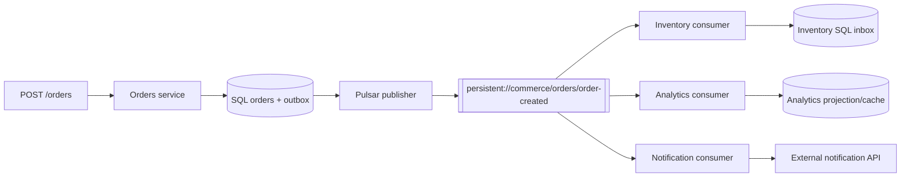
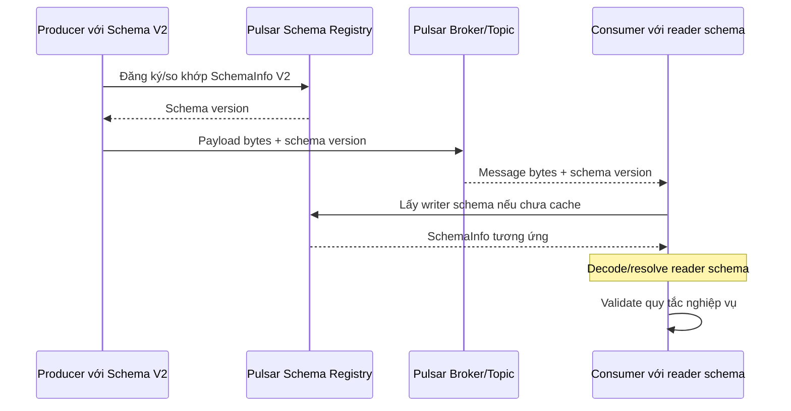
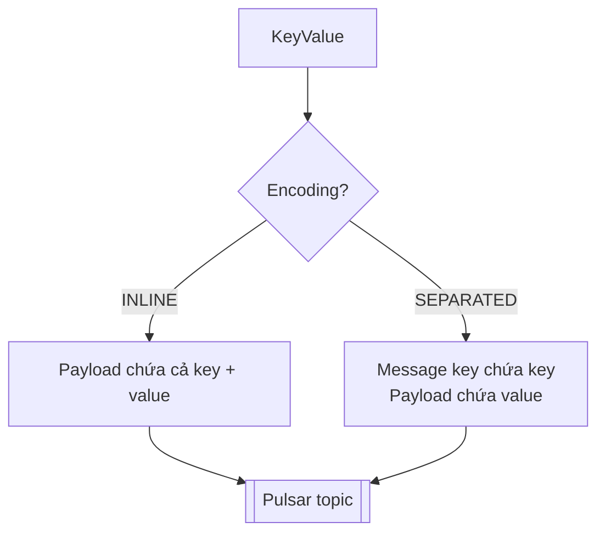
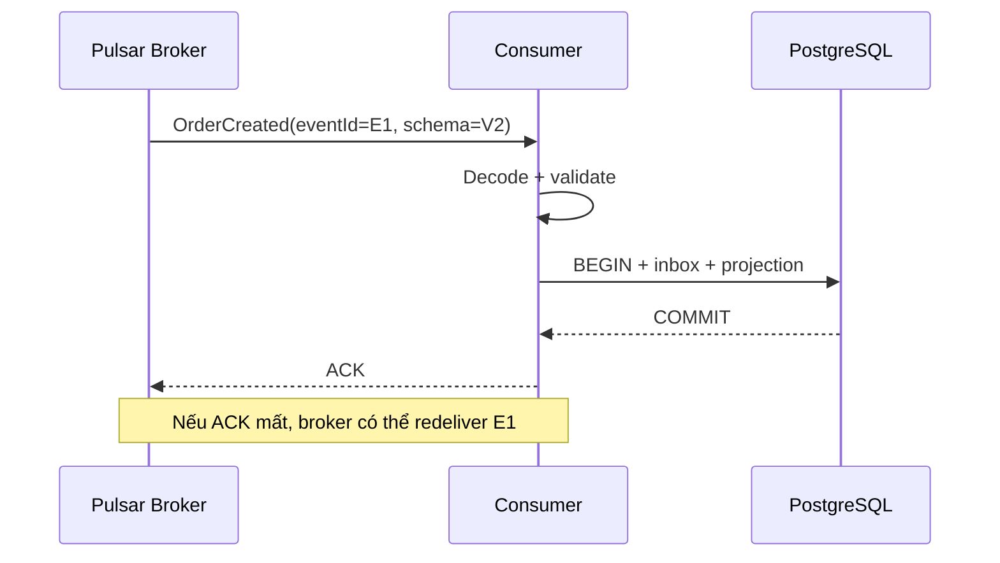

# Schema, kiểu dữ liệu và tính tương thích thông điệp

Trong một hệ thống Spring Boot dùng Apache Pulsar, producer phiên bản mới có thể phát thêm trường `paymentMethod` vào sự kiện `OrderCreated`, trong khi hàng chục consumer cũ vẫn đang chạy. Nếu producer thay đổi cấu trúc tùy tiện, một consumer có thể không giải mã được message; một consumer khác vẫn giải mã thành công nhưng hiểu **sai ý nghĩa nghiệp vụ**. Tình huống còn phức tạp hơn khi subscription còn backlog từ ba tháng trước: consumer mới phải đọc được cả các message do producer cũ ghi trong topic.

**Apache Pulsar Schema** giải quyết một phần quan trọng: xác định kiểu của payload, quản lý schema theo topic, gắn phiên bản schema với message và kiểm tra mức tương thích khi schema thay đổi. Nhưng schema registry **không thay thế** versioned business contract, validation nghiệp vụ, retry có kiểm soát hoặc chống trùng khi broker redeliver.

Bài thuộc chương **Apache Pulsar** trong module **SPRING_BOOT_INTEGRATION**. Module tập trung tổ chức luồng tích hợp qua HTTP client, cơ sở dữ liệu, cache, broker và các adapter Spring Integration; đặc biệt quan tâm cấu hình, hợp đồng dữ liệu, lỗi, xử lý trùng lặp, kiểm thử và quan sát hệ thống. Vì thế, bài học liên kết schema Pulsar với **HTTP DTO → sự kiện → SQL inbox/outbox → consumer projection**, thay vì chỉ giới thiệu một vài phương thức `Schema.JSON(...)`.

> **Phạm vi kỹ thuật:** Ví dụ dùng Java 17+, Spring Boot 3.2+/Spring for Apache Pulsar cùng Apache Pulsar Java client; broker nên được kiểm thử với đúng nhánh/version mà tổ chức triển khai. API, schema checker, policy mặc định và khả năng hỗ trợ `PROTOBUF_NATIVE` có thể thay đổi giữa các nhánh Pulsar (3.x/4.x/5.x). Mọi ví dụ về compatibility phải được xác nhận bằng kiểm thử trên broker thực tế; không suy từ tên chiến lược rằng mọi thay đổi dữ liệu sẽ an toàn.

## 1. Mục tiêu học tập

Sau bài này, bạn có thể:

1. Giải thích vai trò của `Schema<T>`, `SchemaInfo`, **schema registry tích hợp** và **schema version** trong Apache Pulsar.
2. Phân biệt primitive schemas, `BYTES`, `STRING`, `JSON`, `AVRO`, `PROTOBUF`, `PROTOBUF_NATIVE`, `KEY_VALUE` và cơ chế `AUTO_CONSUME`/`AUTO_PRODUCE`.
3. Mô tả chiều **BACKWARD**, **FORWARD**, **FULL** và các biến thể **TRANSITIVE**, cũng như ý nghĩa thật của `ALWAYS_COMPATIBLE` và `ALWAYS_INCOMPATIBLE`.
4. Thiết kế evolution an toàn khi thêm, xóa, đổi tên, đổi kiểu hoặc thay đổi tính bắt buộc của field.
5. Sử dụng producer/consumer typed với Pulsar Java client và `PulsarTemplate`/`@PulsarListener` trong Spring Boot.
6. Phân biệt compatibility ở **schema layer**, **wire format**, **business semantics** và **persistence contract**.
7. Quản lý rollout, replay backlog, DLQ/quarantine, redelivery và idempotent consumer mà không làm hỏng dữ liệu cũ.
8. Kiểm tra schema, policy và version thông qua Pulsar Admin/CLI.
9. Kiểm thử producer v1/v2 với consumer v1/v2 và fault cases trên Pulsar thật.
10. Quan sát các lỗi đăng ký schema, giải mã, payload không hợp lệ và độ trễ xử lý message trong production.

## 2. Bối cảnh: một sự kiện được nhiều hệ thống sử dụng

Giả sử dịch vụ Orders nhận lệnh HTTP, lưu đơn hàng vào SQL và phát sự kiện lên Pulsar topic:



Một `OrderCreated` phiên bản đầu:

```json
{
  "eventId": "evt-001",
  "orderId": "ord-101",
  "tenantId": "tenant-a",
  "amountMinor": 125500,
  "currency": "VND"
}
```

Sau khi triển khai, producer muốn thêm `paymentMethod`, `occurredAt` và `schemaVersion`. Các consumer có thể ở các trạng thái khác nhau:

- Consumer Inventory v1 chỉ biết `eventId`, `orderId` và `amountMinor`.
- Consumer Analytics v2 cần đọc cả dữ liệu đã lưu trong topic theo schema v1.
- Một integration adapter đang replay các message cũ vào SQL projection.
- Một client khác dùng AVRO hoặc một ngôn ngữ không phải Java.
- Một listener gặp lỗi giải mã ở message đầu tiên trong backlog nên không thể tiến lên.

**Bài toán chính:** Producer mới và consumer cũ/mới có thể cùng tồn tại; thậm chí sau khi tất cả ứng dụng nâng version, dữ liệu cũ **vẫn còn trong topic hoặc DLQ**.

## 3. Schema trong Pulsar hoạt động ở lớp nào?

### 3.1. Message payload luôn là bytes trên đường truyền

Broker lưu và vận chuyển payload dưới dạng bytes. Client producer dùng `Schema<T>` để biến Java object thành bytes; client consumer dùng schema để giải mã bytes thành object/generic record phù hợp.



Đây là sơ đồ khái niệm: client có thể cache schema, broker/proxy tham gia protocol khác nhau và không phải mỗi message đều phát sinh lời gọi đến registry.

### 3.2. Schema Registry tích hợp theo topic

Pulsar có **schema registry tích hợp trong nền tảng**; không cần mặc định triển khai một Confluent Schema Registry riêng mới có schema evolution. Registry quản lý schema metadata **theo từng topic**.

Một `SchemaInfo` về mặt khái niệm gồm:

| Thành phần | Ý nghĩa |
| --- | --- |
| `name` | Tên schema |
| `type` | Loại như `JSON`, `AVRO`, `STRING`, `PROTOBUF_NATIVE` |
| `schema` | Byte definition/descriptor phù hợp loại schema |
| `properties` | Key/value metadata bổ sung |
| **schema version** | Định danh version do registry quản lý cho topic |

**Schema theo topic**, còn **policy** có thể được cấu hình ở cluster/namespace/topic theo khả năng version. Một JSON schema của `orders.created` không tự trở thành schema cho topic `payments.authorized` dù hai topic cùng namespace.

### 3.3. Schema version trên message

Khi producer sử dụng một schema được đăng ký, message có thể mang **schema version** giúp consumer xác định writer schema tương ứng. Trong API Java, `Message<T>.getSchemaVersion()` trả thông tin version ở dạng bytes theo contract client.

Điều quan trọng:

- Schema version thuộc **registry của topic**, không phải field `schemaVersion` trong JSON event.
- Một version number ở registry không mang cùng ý nghĩa xuyên nhiều topics hoặc clusters.
- Khi một topic bị quản trị xóa/recreate schema, không nên giả định version ID giữ nguyên.
- Với raw bytes/no-schema, không thể mặc định có writer schema đầy đủ để tự giải mã.
- Client phải còn khả năng truy cập schema cần thiết khi replay dữ liệu cũ.

### 3.4. Broker kiểm tra tương thích khi nào?

Khi client đề nghị đăng ký schema mới và auto-update được phép, broker áp dụng **schema compatibility checker** cho schema type và policy đang hiệu lực trước khi chấp nhận version mới.

Điều này không có nghĩa broker sẽ chạy business validation cho mọi field của mọi message. Mức kiểm tra bytes, đăng ký schema và validation enforcement khác nhau theo schema type, client path và broker setting.

**Đừng đồng nhất “schema được đăng ký” với “mọi payload hợp lệ và mọi consumer đọc được”**.

## 4. Các loại dữ liệu/schema quan trọng

| Loại | Dữ liệu dùng trong ứng dụng | Điểm cần chú ý |
| --- | --- | --- |
| `BYTES`/`NONE` | `byte[]` thô | Không mang cấu trúc field đủ để tự kiểm tra evolution |
| `STRING` | Chuỗi UTF-8 | Tốt cho text, chưa phải một schema JSON có trường |
| `BOOLEAN`, `INT8`, `INT16`, `INT32`, `INT64` | Giá trị scalar | Cần thống nhất width/semantics |
| `FLOAT`, `DOUBLE` | Số dấu phẩy động | Không dùng tùy tiện cho số tiền chính xác |
| `DATE`, `TIME`, `TIMESTAMP` và các temporal types khác | Ngày/giờ theo client API | Khả năng hỗ trợ và timezone semantics theo version |
| `JSON` | Object thành JSON payload | Có metadata/schema definition; **không đồng nghĩa mọi chuẩn JSON Schema Draft** |
| `AVRO` | Record được serialize Avro binary | Writer-reader resolution, field defaults/aliases theo Avro |
| `PROTOBUF` | Protobuf theo đường hỗ trợ type truyền thống | Không mặc định giống `PROTOBUF_NATIVE` |
| `PROTOBUF_NATIVE` | Native Protobuf descriptor/wire format | Kiểm tra checker/compatibility semantics của version |
| `KEY_VALUE` | Pair key và value có schema riêng | `INLINE` và `SEPARATED` thay đổi cách bytes được lưu |
| `AUTO_CONSUME` | Consumer generic giải mã tùy schema message | Phù hợp bridge/inspection, không bỏ business validation |
| `AUTO_PRODUCE_BYTES` | Producer gửi bytes kèm xác nhận schema trong các trường hợp được hỗ trợ | Không phải “gửi bytes tùy ý vào mọi topic typed” |

Tên enum và hỗ trợ cụ thể phải đối chiếu **Pulsar client API của nhánh đang dùng**. Nhóm primitive/time types có thể thay đổi giữa các major releases.

### 4.1. Primitive schemas

Ví dụ native Java client:

```java
Producer<String> producer = client
    .newProducer(Schema.STRING)
    .topic("persistent://public/default/system-status")
    .create();

producer.send("READY");
```

`Schema.STRING` là hợp đồng kiểu chuỗi. Nếu gửi nội dung `{"amount":125500}` dưới dạng string, registry **không kiểm tra** rằng JSON đó có một field `amount` kiểu number; muốn quản lý structured payload cần chọn schema có cấu trúc và validate business contract.

### 4.2. BYTES không thay thế typed schema

`Schema.BYTES` thuận tiện khi payload là file, ảnh, dữ liệu mã hóa theo protocol đã có hoặc bridge từ hệ khác. Nhưng nếu không có định danh protocol/schema ở nơi đáng tin, consumer có thể không biết bytes đại diện cho:

- JSON UTF-8 hay Avro binary?
- Một Protobuf message type nào?
- Phiên bản payload nào?
- Có compression/encryption riêng ngoài Pulsar hay không?

Với topic tích hợp liên hệ nhiều đối tác, **raw bytes phải đi cùng contract và governance riêng**. Đừng dùng `BYTES` chỉ để lách compatibility check khi thay đổi breaking.

## 5. JSON Schema trong Pulsar khác JSON Schema chuẩn độc lập

### 5.1. Schema.JSON(Class) là schema được Pulsar quản lý

Pulsar Java client hỗ trợ:

```java
Schema<OrderCreated> schema = Schema.JSON(OrderCreated.class);
```

Với POJO phù hợp, client tạo một schema definition dựa trên object model. Pulsar lưu metadata tương ứng và serialize payload theo JSON encoding.

Nhưng **Pulsar `Schema.JSON(...)` không tự đồng nghĩa** với việc broker thực thi đầy đủ các keyword của [JSON Schema Draft 2020-12](https://json-schema.org/), chẳng hạn `pattern`, `oneOf`, `format` hoặc điều kiện giữa các trường. Pulsar JSON schema trong các phiên bản phổ biến sử dụng mô hình definition dựa trên Avro record để quản lý schema; muốn kiểm tra business rules cần validation riêng.

### 5.2. Java POJO mẫu

```java
package com.example.integration.pulsar;

public class OrderCreated {
    public String eventId;
    public String orderId;
    public String tenantId;
    public long amountMinor;
    public String currency;

    public OrderCreated() {}

    public OrderCreated(
            String eventId, String orderId, String tenantId,
            long amountMinor, String currency) {
        this.eventId = eventId;
        this.orderId = orderId;
        this.tenantId = tenantId;
        this.amountMinor = amountMinor;
        this.currency = currency;
    }
}
```

Ví dụ dùng fields public và no-args constructor để dễ minh họa reflective schema/serialization. Production nên chọn DTO rõ ràng, kiểm thử support của record/getters/Jackson/Avro với đúng client, tránh mutable object bị sửa sau khi enqueue gửi bất đồng bộ.

## 6. AVRO: writer schema và reader schema

### 6.1. Record Avro v1

Ví dụ định nghĩa Avro schema:

```json
{
  "type": "record",
  "name": "OrderCreated",
  "namespace": "com.example.contract",
  "fields": [
    {"name": "eventId", "type": "string"},
    {"name": "orderId", "type": "string"},
    {"name": "amountMinor", "type": "long"},
    {"name": "currency", "type": "string"}
  ]
}
```

Schema định nghĩa tên field và kiểu. Avro binary không đơn giản là JSON string nén; reader dựa trên writer/reader schemas để resolve field.

### 6.2. v2 thêm field optional/default

```json
{
  "type": "record",
  "name": "OrderCreated",
  "namespace": "com.example.contract",
  "fields": [
    {"name": "eventId", "type": "string"},
    {"name": "orderId", "type": "string"},
    {"name": "amountMinor", "type": "long"},
    {"name": "currency", "type": "string"},
    {
      "name": "paymentMethod",
      "type": ["null", "string"],
      "default": null
    }
  ]
}
```

Khi **reader v2 đọc payload do writer v1 tạo**, không có `paymentMethod` ở writer schema; default `null` giúp Avro reader điền giá trị thay thế theo quy tắc resolution. Khi reader v1 đọc payload writer v2, nó có thể bỏ qua field mới không biết tới trong những trường hợp Avro compatibility cho phép.

**Không chỉ xét `nullable`:** Default có vai trò riêng trong Avro reader schema resolution. Union branch order và default value cần đúng Avro specification.

### 6.3. Đổi kiểu không thể dự đoán bằng mắt

Một số numeric promotions được Avro quy định, nhưng không có quy tắc “mọi số đều đổi được”. Những chuyển đổi cần test cụ thể:

- `int` → `long` có thể tương thích theo chiều resolution nhất định.
- `long` → `int` có nguy cơ overflow/narrowing; không mặc định an toàn.
- `string` → `long` không phải một phép chuyển kiểu tự động đáng tin.
- `float`/`double` đối với số tiền có rủi ro làm mất độ chính xác.
- Đổi record namespace/name hoặc nested type có thể phá resolution.
- Đổi union branches, default, logical type cần đối chiếu checker/serializer.

Khi thay `amount` từ string decimal sang `amountMinor` kiểu long, thường an toàn hơn nếu **thêm field mới**, chuyển writer/reader dần, backfill rồi mới xóa field cũ.

## 7. PROTOBUF và PROTOBUF_NATIVE

### 7.1. Ví dụ Protobuf có field numbers ổn định

```proto
syntax = "proto3";

package commerce.orders;

message OrderCreated {
  string event_id = 1;
  string order_id = 2;
  int64 amount_minor = 3;
  string currency = 4;
}
```

Để thêm trường:

```proto
message OrderCreated {
  string event_id = 1;
  string order_id = 2;
  int64 amount_minor = 3;
  string currency = 4;
  optional string payment_method = 5;
}
```

Trong Protobuf, **field number là một phần quan trọng của wire contract**. Không dùng lại number `3` cho ý nghĩa khác chỉ vì đã đổi field name; các reader cũ có thể diễn giải bytes thành dữ liệu sai.

### 7.2. Những quy tắc Protobuf cần nhớ

- Không tái sử dụng field number đã xóa; khai báo `reserved` numbers/names khi phù hợp.
- Không đổi một field số tiền thành một kiểu wire không tương thích.
- Cẩn trọng khi đổi `int32` ↔ `int64`: protobuf wire-type có thể giống nhưng giá trị, bounds và consumer semantics có thể khác.
- `proto3` có quy tắc presence/default khác với Avro; `optional` và wrapper types ảnh hưởng khả năng phân biệt “không có” với “giá trị mặc định”.
- Di chuyển field vào/ra `oneof` hoặc đổi map/repeated không được coi là an toàn mặc định.
- JSON mapping của protobuf khác trực tiếp wire binary; test cả nếu có gateway JSON.

### 7.3. Không đánh đồng hai schema types

Pulsar có các schema types `PROTOBUF` và `PROTOBUF_NATIVE` trên các version hỗ trợ. Trong đó `PROTOBUF_NATIVE` sử dụng Protobuf descriptor theo cơ chế native. Phạm vi hỗ trợ và checker schema compatibility, đặc biệt **field-level checks của PROTOBUF_NATIVE**, thay đổi theo Pulsar version và cấu hình.

Do đó:

1. Ghi rõ Pulsar broker/client version và schema type đang dùng.
2. Test producer/consumer với generated classes/descriptor thật.
3. Test thay đổi field number/type/presence.
4. Không coi policy `FULL` là một lời hứa rằng broker kiểm tra mọi quy tắc Protobuf theo cùng cách ở mọi phiên bản.
5. Không trộn producer `PROTOBUF` với consumer `PROTOBUF_NATIVE` chỉ vì cùng class Protobuf.

## 8. KEY_VALUE: cấu trúc key và value cùng được quản lý

### 8.1. Hai kiểu encoding

Pulsar `KEY_VALUE` cho phép một schema mô tả cả key và value:

- **`INLINE`:** key và value được mã hóa chung trong payload theo định dạng KeyValue.
- **`SEPARATED`:** key nằm ở metadata/message key, còn value là payload.



Cần thống nhất giữa producer/consumer; không tự đổi encoding trên cùng topic rồi mong consumer cũ đọc được.

### 8.2. Java client ví dụ

```java
import org.apache.pulsar.client.api.Schema;
import org.apache.pulsar.common.schema.KeyValue;
import org.apache.pulsar.common.schema.KeyValueEncodingType;

Schema<KeyValue<String, String>> schema =
        Schema.KeyValue(
                Schema.STRING,
                Schema.STRING,
                KeyValueEncodingType.SEPARATED);

try (Producer<KeyValue<String, String>> producer =
        client.newProducer(schema)
              .topic("persistent://public/default/order-key-value")
              .create()) {

    producer.send(new KeyValue<>(
            "ord-101", "{\"eventId\":\"evt-001\"}"));
}
```

Đây là ví dụ **String value**, nên Pulsar registry không kiểm chứng các JSON fields bên trong chuỗi value. Nếu cần typed value, thay `Schema.STRING` của value bằng `Schema.JSON(OrderCreated.class)` hoặc `Schema.AVRO(...)` theo hợp đồng.

### 8.3. Message key không đồng nghĩa business identity

Key có thể dùng cho routing/partitioning hoặc một subscription `Key_Shared`; nhưng việc cùng `orderId` không chứng minh hai message là một business event.

Cần phân biệt:

- `messageKey = orderId`: group/routing/order per aggregate theo subscription semantics.
- `eventId`: định danh bất biến của một lần thay đổi nghiệp vụ.
- `schemaVersion`: version business contract trong payload nếu tổ chức dùng.
- `registry schema version`: version schema được broker gán.
- `aggregateVersion`: thứ tự trạng thái của order.

Không dùng một trong các giá trị này để tự động thay thế tất cả các giá trị còn lại.

## 9. Tổng quan schema compatibility: bốn hướng chính

### 9.1. BACKWARD

**Reader mới** có thể đọc dữ liệu do **writer cũ** tạo.

```text
Old writer V1 ──> New reader V2
```

Thích hợp khi consumer được nâng cấp trước hoặc phải replay backlog cũ. Với Avro, thêm field optional có default là ví dụ thường gặp, nhưng còn phụ thuộc toàn bộ schema, field types và rules của checker.

### 9.2. FORWARD

**Reader cũ** có thể đọc dữ liệu do **writer mới** tạo.

```text
New writer V2 ──> Old reader V1
```

Hữu ích khi producer có thể triển khai trước consumer, nhưng **không bảo đảm consumer mới sau đó đọc được toàn bộ backlog cũ**. Với structured record, thêm một field mà reader cũ bỏ qua có thể thỏa, còn xóa field cũ đang required thì có thể phá.

### 9.3. FULL

Hợp đồng thỏa **cả BACKWARD và FORWARD** đối với các phiên bản đang được so sánh.

```text
Old writer V1 ──> New reader V2
New writer V2 ──> Old reader V1
```

FULL thuận tiện cho rolling deployment. Nhưng FULL cũng không có nghĩa “mọi thay đổi hợp đồng đều cho phép”: đổi meaning của field giữ nguyên tên/type có thể **qua schema checker nhưng sai business semantics**.

### 9.4. TRANSITIVE

Thông thường các chiến lược không có hậu tố `_TRANSITIVE` so sánh schema mới với **schema gần nhất**. Các chiến lược `_TRANSITIVE` yêu cầu tính tương thích theo chiều tương ứng với **tất cả các schema versions trước đó**.

Ví dụ topic có V1, V2, V3:

```text
BACKWARD:
  V3 reader ← V2 writer

BACKWARD_TRANSITIVE:
  V3 reader ← V2 writer
  V3 reader ← V1 writer
```

Điều này đặc biệt quan trọng khi topic retention dài, replay DLQ, consumer subscription có backlog lâu ngày hoặc blue/green rollback nhiều versions.

## 10. Tám chiến lược schema compatibility phổ biến

| Strategy | Bảo đảm về schema theo hướng | So với version nào? |
| --- | --- | --- |
| `ALWAYS_COMPATIBLE` | **Bỏ qua kiểm tra compatibility**, cho phép nhiều thay đổi | Không phải kiểm chứng an toàn |
| `ALWAYS_INCOMPATIBLE` | Chặn schema evolution/thay đổi schema theo policy | Không cho thay schema |
| `BACKWARD` | Reader mới đọc writer cũ | Bản gần nhất |
| `BACKWARD_TRANSITIVE` | Reader mới đọc mọi writer cũ | Tất cả versions trước |
| `FORWARD` | Reader cũ đọc writer mới | Bản gần nhất |
| `FORWARD_TRANSITIVE` | Mọi reader cũ đọc writer mới | Tất cả versions trước |
| `FULL` | Cả BACKWARD và FORWARD | Bản gần nhất |
| `FULL_TRANSITIVE` | Cả hai hướng với mọi version cũ | Tất cả versions trước |

Hai điều rất quan trọng:

1. **`ALWAYS_COMPATIBLE` không có nghĩa “luôn tương thích”**; trong nhiều phiên bản nó có nghĩa **disable compatibility checking**. Tên này dễ gây hiểu sai.
2. **`ALWAYS_INCOMPATIBLE` không có nghĩa topic không thể tạo schema lần đầu**; nó cấm evolution sau khi đã có schema theo policy.

### 10.1. Policy mặc định phụ thuộc schema type

Tài liệu Apache Pulsar 4.2.x mô tả default compatibility với **AVRO/JSON thường là `FULL`**, còn nhiều schema types khác theo checker mặc định có thể tương đương `ALWAYS_INCOMPATIBLE`. Không copy giá trị này thành giả định vĩnh viễn cho Pulsar 3.x, 5.x hay một cluster đã được operator override.

Luôn **đọc effective policy trên cluster đang dùng**. Có thể có precedence **topic > namespace > cluster**. Thay đổi policy không tự sửa payload đã được publish.

### 10.2. FULL cũng không bằng FULL_TRANSITIVE

Giả sử:

```text
V1: {amountMinor: long}
V2: {amountMinor: long, paymentMethod: optional string}
V3: {amountMinor: long, paymentMethod: optional string, traceId: optional string}
```

Nếu các bước đều được checker chấp nhận dưới FULL, đó là một chứng cứ tốt. Nhưng nếu có một chuỗi thay đổi khác nhau khiến V3 chỉ so được với V2, **không thể suy ra luôn tương thích với V1**. Khi còn dữ liệu V1, `FULL_TRANSITIVE` và cross-version replay tests là bảo vệ rõ ràng hơn.

## 11. Chọn chiến lược theo cách rollout

| Tình huống | Chính sách cân nhắc | Rollout chủ đạo |
| --- | --- | --- |
| Consumer mới phải replay dữ liệu cũ | `BACKWARD_TRANSITIVE` | Nâng reader trước khi phụ thuộc field mới |
| Producer triển khai trước nhưng consumer cũ còn chạy | `FORWARD`/`FORWARD_TRANSITIVE` | Xác minh reader cũ thực sự bỏ qua field mới |
| Mixed-version lâu, rollback thường xuyên | `FULL_TRANSITIVE` | Thay đổi trường có default/optional và test toàn bộ |
| Hợp đồng khóa chặt, không cho tự thay schema | `ALWAYS_INCOMPATIBLE` và registry governance | Version mới qua topic mới hoặc phê duyệt rõ |
| Giai đoạn phát triển thử nghiệm | Có thể nới policy trong namespace dev | Không chuyển policy nới lỏng vô ý sang production |

**Không dùng policy để thay test.** Một thay đổi schema tương thích trên giấy vẫn có thể làm một consumer Java cũ fail vì Jackson/Avro runtime, missing Java class, enum switch không xử lý giá trị lạ hoặc mapper đặt field primitive không nhận null.

## 12. Ví dụ evolution V1 → V2 → V3

### 12.1. V1: hợp đồng tối thiểu

```json
{
  "eventId": "evt-001",
  "orderId": "ord-101",
  "amountMinor": 125500,
  "currency": "VND"
}
```

### 12.2. V2: thêm paymentMethod optional

```json
{
  "eventId": "evt-001",
  "orderId": "ord-101",
  "amountMinor": 125500,
  "currency": "VND",
  "paymentMethod": null
}
```

Trong Avro, schema cần thể hiện optional/default phù hợp. Với Spring JSON POJO, kiểm tra serialization/deserialization và schema definition thực của Pulsar, đừng chỉ nhìn JSON mẫu.

### 12.3. V3: thêm occurredAt theo hợp đồng ổn định

```json
{
  "eventId": "evt-001",
  "orderId": "ord-101",
  "amountMinor": 125500,
  "currency": "VND",
  "paymentMethod": "BANK_TRANSFER",
  "occurredAt": "2026-11-21T10:00:00Z"
}
```

Nếu v3 dùng `occurredAt` mà consumer v2 không biết, có thể được phép trong một số compatibility rules. Nhưng:

- Định nghĩa timezone là UTC hay offset tùy ý?
- Nếu date không hợp lệ, consumer làm gì?
- Nếu producer gửi `occurredAt = null`, schema/client có chấp nhận không?
- Nếu event cũ không có trường này, consumer mới nên lấy fallback nào?
- Có bị nhầm `occurredAt` với `publishedAt` hoặc `processedAt` không?

Đây là **semantic contract**, vượt ngoài schema registry.

### 12.4. V4: đổi amountMinor từ long sang string

```json
{
  "eventId": "evt-001",
  "orderId": "ord-101",
  "amountMinor": "125500",
  "currency": "VND"
}
```

Đây là breaking change theo kiểu dữ liệu so với `long`, có thể bị registry từ chối hoặc gây lỗi consumer. Nếu cần đổi representation, hãy thêm field mới như `amountDecimal`, giữ `amountMinor` trong một giai đoạn và có kế hoạch loại bỏ đúng thời điểm.

## 13. Quy tắc an toàn khi thêm/xóa/đổi field

| Thay đổi | Đánh giá sơ bộ | Việc cần test |
| --- | --- | --- |
| Thêm optional field có default | Thường an toàn hơn trong structured schema | V2 đọc V1, V1 đọc V2 |
| Thêm required field không default | Dễ phá BACKWARD | V2 đọc backlog V1 |
| Xóa field chỉ dùng bởi consumer mới | Có thể phá FORWARD hay nghiệp vụ | Mọi reader còn sống |
| Đổi tên field | Có thể tương đương xóa + thêm | Avro aliases, adapters, consumers |
| Đổi `int` sang `long` | Có thể có promotion một chiều | Giá trị biên, SQL mapping |
| Đổi `long` sang `string` | Thường breaking | Serialization và parser |
| Thay nullability/default | Dễ gây lỗi trên message cũ | null/missing/default |
| Thêm enum value | Có thể phá switch exhaustive của consumer | Unknown enum fallback |
| Đổi nested object/array | Rủi ro cao | Schema checker và payload fixtures |
| Giữ name/type nhưng đổi meaning | Có thể qua registry mà **vẫn sai nghiệp vụ** | Semantic contract tests |
| Đổi encoding `JSON` → `AVRO` | Thường là thay wire format | Topic/version migration |
| Đổi key encoding `INLINE` → `SEPARATED` | Thay wire contract | Producer/consumer cùng version |

**Một quyết định tốt:** Khi thay đổi không rõ tương thích, dùng topic mới theo contract version hoặc giai đoạn dual-publish/migration, thay vì hạ policy về `ALWAYS_COMPATIBLE` để broker cho qua.

## 14. Java client: publish và consume JSON typed

### 14.1. Một producer typed

Với `OrderCreated` POJO có constructor không tham số như phần trước:

```java
package com.example.integration.pulsar;

import org.apache.pulsar.client.api.PulsarClient;
import org.apache.pulsar.client.api.Producer;
import org.apache.pulsar.client.api.Schema;

public class PulsarJsonProducerExample {

    private static final String TOPIC =
            "persistent://public/default/order-created";

    public static void publish() throws Exception {
        try (PulsarClient client = PulsarClient.builder()
                .serviceUrl("pulsar://localhost:6650")
                .build();
             Producer<OrderCreated> producer = client
                     .newProducer(Schema.JSON(OrderCreated.class))
                     .topic(TOPIC)
                     .create()) {

            OrderCreated event = new OrderCreated(
                    "evt-001", "ord-101", "tenant-a", 125500, "VND");

            producer.newMessage()
                    .key(event.orderId)
                    .property("eventType", "OrderCreated")
                    .value(event)
                    .send();
        }
    }
}
```

**Đoạn code minh họa:** Broker local và topic cần có hoặc được auto-create theo policy; production còn cần auth/TLS, send timeout, retry/idempotency và đúng namespace/ACL.

Điểm mấu chốt: `Schema.JSON(OrderCreated.class)` cung cấp schema typed cho producer. Field `eventType` trong message property chỉ là metadata routing, không thay thế schema của payload.

### 14.2. Consumer typed

```java
package com.example.integration.pulsar;

import org.apache.pulsar.client.api.Consumer;
import org.apache.pulsar.client.api.Message;
import org.apache.pulsar.client.api.PulsarClient;
import org.apache.pulsar.client.api.Schema;
import org.apache.pulsar.client.api.SubscriptionType;

public class PulsarJsonConsumerExample {

    private static final String TOPIC =
            "persistent://public/default/order-created";

    public static void consumeOne() throws Exception {
        try (PulsarClient client = PulsarClient.builder()
                .serviceUrl("pulsar://localhost:6650")
                .build();
             Consumer<OrderCreated> consumer = client
                     .newConsumer(Schema.JSON(OrderCreated.class))
                     .topic(TOPIC)
                     .subscriptionName("inventory-projection")
                     .subscriptionType(SubscriptionType.Shared)
                     .subscribe()) {

            Message<OrderCreated> message = consumer.receive();

            // Phải validate contract, xác minh eventId và ghi inbox SQL
            // trước khi acknowledge trong luồng production.
            OrderCreated event = message.getValue();
            System.out.println(event.orderId);

            consumer.acknowledge(message);
        }
    }
}
```

**Cảnh báo:** Ví dụ `acknowledge` ngay sau `println` chỉ dùng để minh họa API. Trong production, cần ack sau khi **đã lưu business state bền vững** theo contract; nếu chỉ in log rồi ack, consumer có thể mất công việc khi SQL chưa commit.

### 14.3. Vì sao kiểu Java chưa đủ?

Dù producer/consumer cùng dùng một class tên `OrderCreated`, chúng có thể được build từ hai commit khác nhau và có:

- Field khác.
- Default khác.
- Serializer/Jackson annotations khác.
- Package/namespace khác.
- Thư viện Pulsar/Avro khác.
- Validation/business logic khác.

Vì vậy **đừng dùng tên class làm version của hợp đồng**. Cần schema definition thực, compatibility policy, contract fixtures và test cross-version.

## 15. Spring Boot và Spring for Apache Pulsar

### 15.1. Dependencies

Với dòng Spring Boot có tích hợp Spring for Apache Pulsar (ví dụ Boot 3.2+), một starter thường dùng:

```groovy
dependencies {
    implementation 'org.springframework.boot:spring-boot-starter-pulsar'
    implementation 'org.springframework.boot:spring-boot-starter-validation'

    implementation 'org.springframework.boot:spring-boot-starter-jdbc'
    runtimeOnly 'org.postgresql:postgresql'

    testImplementation 'org.springframework.boot:spring-boot-starter-test'
    testImplementation 'org.springframework.boot:spring-boot-testcontainers'
    testImplementation 'org.testcontainers:junit-jupiter'
    testImplementation 'org.testcontainers:pulsar'
    testImplementation 'org.testcontainers:postgresql'
}
```

Spring Boot BOM nên quản lý phiên bản tương thích của `spring-pulsar`, Pulsar Java client và Jackson/Avro. Không override ngẫu nhiên một thư viện serialization khi chưa kiểm tra compatibility matrix.

`spring-boot-starter-validation` là lựa chọn khi ứng dụng dùng Jakarta Bean Validation; nó không có nghĩa mọi event sẽ tự được validate ngay sau khi deserialization. Application phải gọi validation hoặc cấu hình listener phù hợp.

### 15.2. Cấu hình endpoint

```yaml
spring:
  pulsar:
    client:
      service-url: ${PULSAR_SERVICE_URL:pulsar://localhost:6650}
    admin:
      service-url: ${PULSAR_ADMIN_URL:http://localhost:8080}
```

Trong môi trường local, port 6650 thường dùng cho Pulsar binary protocol; HTTP admin API dùng port khác, chẳng hạn 8080. Production có thể dùng `pulsar+ssl://` và `https://` với xác thực/certificates theo cluster.

**Không coi endpoint tồn tại là bảo đảm schema đã đúng.** Admin client và messaging client có quyền/port khác nhau; cấu hình service URL nhầm chỗ thường dẫn đến lỗi kết nối ngay từ startup.

### 15.3. Typed event record với Spring

```java
package com.example.integration.contract;

import org.apache.pulsar.common.schema.SchemaType;
import org.springframework.pulsar.annotation.PulsarMessage;

@PulsarMessage(schemaType = SchemaType.JSON)
public record OrderCreatedEvent(
        String eventId,
        String orderId,
        String tenantId,
        long amountMinor,
        String currency,
        String paymentMethod
) {}
```

Spring for Apache Pulsar có thể dùng `@PulsarMessage` để gắn schema mapping theo message type. Với Java record, cần xác minh đúng version framework/serializer hỗ trợ như mong đợi và test schema definition thực trong topic.

Nếu không dùng annotation, có thể cấu hình schema mapping qua `spring.pulsar.defaults.type-mappings` hoặc truyền schema khi publish/subscribe.

### 15.4. Producer với PulsarTemplate

```java
package com.example.integration.messaging;

import com.example.integration.contract.OrderCreatedEvent;
import org.apache.pulsar.client.api.MessageId;
import org.springframework.pulsar.core.PulsarTemplate;
import org.springframework.stereotype.Service;

@Service
public class OrderEventPublisher {

    private static final String TOPIC =
            "persistent://public/default/order-created";

    private final PulsarTemplate<OrderCreatedEvent> template;

    public OrderEventPublisher(
            PulsarTemplate<OrderCreatedEvent> template) {
        this.template = template;
    }

    public MessageId publish(OrderCreatedEvent event) {
        return template.send(TOPIC, event);
    }
}
```

Theo Spring Pulsar, phương thức `send(...)` dạng đồng bộ có thể trả `MessageId` sau khi producer hoàn thành gửi theo contract; `sendAsync(...)` trả `CompletableFuture`. **Không suy từ cả hai rằng SQL transaction đã cùng commit với broker**. Cần outbox nếu nghiệp vụ yêu cầu lưu event bền vững cùng SQL command.

### 15.5. Consumer @PulsarListener

```java
package com.example.integration.messaging;

import com.example.integration.contract.OrderCreatedEvent;

import org.apache.pulsar.common.schema.SchemaType;
import org.springframework.pulsar.annotation.PulsarListener;
import org.springframework.stereotype.Component;

@Component
public class OrderCreatedListener {

    private final OrderProjectionService projection;

    public OrderCreatedListener(OrderProjectionService projection) {
        this.projection = projection;
    }

    @PulsarListener(
        topics = "persistent://public/default/order-created",
        subscriptionName = "inventory-v1",
        schemaType = SchemaType.JSON
    )
    public void onOrderCreated(OrderCreatedEvent event) {
        projection.processIdempotently(event);
    }
}
```

`OrderProjectionService` là service do dự án triển khai. Trong cấu hình listener phù hợp, container có thể auto-ack khi method hoàn thành thành công; nếu handler ném exception thì redelivery/error handling phụ thuộc ack mode, subscription và container policy. **Phải kiểm tra rõ ack mode trong Spring Pulsar version đang dùng**, không giả định mọi exception đều dẫn tới retry.

### 15.6. Những điểm Spring mặc định dễ bị bỏ quên

Trong các phiên bản Spring for Apache Pulsar được tài liệu hóa:

- Kiểu primitive thường được framework suy luận schema tự động.
- Kiểu phức tạp (POJO/record) có thể mặc định được suy luận như JSON.
- Nếu muốn **AVRO, PROTOBUF hoặc KEY_VALUE**, phải chỉ định schema type/mapping phù hợp.
- Producer và consumer phải thống nhất wire type và schema definition thực tế.
- Các loại schema phức tạp mà framework hỗ trợ có thể khác giữa các versions.
- Việc Spring tự suy luận JSON **không có nghĩa** chọn JSON là quyết định đúng cho mọi topic có hợp đồng AVRO trước đó.

Với một topic đã tồn tại và có schema AVRO, **tuyệt đối không** đưa POJO producer mới lên đó bằng mặc định JSON mà chưa kiểm tra schema registry.

## 16. Tùy chỉnh schema mapping trong Spring Pulsar

### 16.1. Type mappings qua properties

Một cách minh họa:

```yaml
spring:
  pulsar:
    defaults:
      type-mappings:
        - message-type: com.example.integration.contract.OrderCreatedEvent
          schema-info:
            schema-type: JSON
```

Đây là cấu hình ở những nhánh Spring Pulsar hỗ trợ `spring.pulsar.defaults.type-mappings`. Nếu class contract đổi package/name, mapping cũ có thể không còn được áp dụng.

### 16.2. SchemaResolverCustomizer khi cần chủ động

```java
@Bean
SchemaResolverCustomizer<DefaultSchemaResolver> schemaMappings() {
    return resolver -> resolver.addCustomSchemaMapping(
            OrderCreatedEvent.class,
            Schema.JSON(OrderCreatedEvent.class));
}
```

Các type Spring/Pulsar và namespace import phải lấy đúng thư viện đang dùng. Ví dụ minh họa vị trí customize, **không phải yêu cầu phải vừa dùng `@PulsarMessage` vừa dùng type mapping vừa customizer**. Nên chọn một nguồn mapping chủ đạo và test resolved schema.

### 16.3. Quy tắc quản trị tốt

- Một event type có một schema source-of-truth trong mỗi topic.
- Không cấu hình cùng một Java type là JSON ở producer nhưng AVRO ở consumer.
- Không đổi serializer toàn cục chỉ để sửa một topic.
- Không lấy topic name từ dữ liệu HTTP không tin cậy.
- Đặt schema tests trong CI để phát hiện thay đổi class/annotations trước deploy.

## 17. AUTO_CONSUME và AUTO_PRODUCE_BYTES

### 17.1. AUTO_CONSUME cho bridge/diagnostic

Java client có thể tiêu thụ dữ liệu theo writer schema đã được registry ghi nhận mà không cần một POJO class cố định:

```java
Consumer<GenericRecord> consumer = client
    .newConsumer(Schema.AUTO_CONSUME())
    .topic("persistent://public/default/order-created")
    .subscriptionName("schema-inspector")
    .subscribe();
```

`GenericRecord` import từ `org.apache.pulsar.client.api.schema.GenericRecord` theo Java API. Cơ chế này hữu ích khi viết bridge, schema inspection hoặc mixed-version migration tool, nhưng **không tự cung cấp business model/validation** cho ứng dụng.

### 17.2. AUTO_PRODUCE_BYTES là trường hợp chuyên biệt

Spring Pulsar có ví dụ:

```java
void sendRawWithValidation(
        PulsarTemplate<byte[]> template,
        byte[] alreadySerializedPayload) {
    template.send(
        "persistent://public/default/order-created",
        alreadySerializedPayload,
        Schema.AUTO_PRODUCE_BYTES());
}
```

Theo tài liệu của những phiên bản hỗ trợ, chế độ này dành cho **JSON/AVRO payload đã serialize** và validation dựa trên schema topic theo cơ chế được hỗ trợ. Không coi đó là một cửa hậu để đưa bất kỳ bytes Protobuf hoặc JSON sai định dạng vào một topic typed.

### 17.3. Rủi ro khi chuyển đổi schema

Một bridge đọc `AUTO_CONSUME` rồi publish `AUTO_PRODUCE_BYTES` cần bảo đảm:

- Không làm mất writer schema/version đang dùng.
- Không nhầm JSON bytes với Avro bytes.
- Không thay đổi UTF-8, logical types, decimal scale hoặc timestamp representation.
- Không mất message key, properties, event ID và correlation metadata.
- Không đọc rồi ack khi đích chưa lưu bền vững.
- Có idempotency và reconciliation cho bridge crash.

Trong nhiều trường hợp, decode → canonical DTO → encode theo schema đích với contract tests rõ ràng an toàn hơn việc copy bytes mà không hiểu semantics.

## 18. Quản lý schema bằng Pulsar Admin CLI

### 18.1. Kiểm tra schema hiện tại

Ví dụ lệnh với Pulsar Admin của cluster đã được cấp quyền:

```bash
pulsar-admin schemas get persistent://public/default/order-created
```

Để xem một version cụ thể:

```bash
pulsar-admin schemas get \
  persistent://public/default/order-created --version 0
```

Không tự coi version `0` là payload schema v1 theo numbering trong event DTO. Đây chỉ là schema version **của registry**; cần xem output thực.

### 18.2. Kiểm tra compatibility policy

```bash
pulsar-admin topicPolicies get-schema-compatibility-strategy \
  persistent://public/default/order-created
```

Và ở namespace:

```bash
pulsar-admin namespaces get-schema-compatibility-strategy public/default
```

Khi xem effective policy, lưu ý **topic policy có thể override namespace/cluster policy**. Nếu command/version có tùy chọn hiển thị effective/applied policy, dùng đúng cú pháp CLI của phiên bản broker.

### 18.3. Đặt topic policy có chủ đích

Theo tài liệu Admin của Pulsar 4.2.x, ví dụ cấu trúc command:

```bash
pulsar-admin topicPolicies set-schema-compatibility-strategy \
  FULL_TRANSITIVE persistent://public/default/order-created
```

Thao tác thay policy cần được review như một **thay đổi hợp đồng triển khai**; không chạy lên production chỉ để “thử”. Cú pháp/options khác nhau theo Pulsar version và CLI packaging; kiểm tra `--help` của đúng bản cluster trước khi tự động hóa CI/CD.

### 18.4. Schema validation enforcement và auto-update khác nhau

Có hai nhóm policy cần phân biệt:

1. **Schema auto-update**: client có được tự đăng ký version mới khi gửi schema tương thích không?
2. **Schema validation enforcement**: broker có yêu cầu client dùng schema và kiểm soát producer không-schema như thế nào?

Ví dụ command ở namespace theo tài liệu Pulsar 4.2.x:

```bash
pulsar-admin namespaces set-is-allow-auto-update-schema \
  --disable public/default

pulsar-admin namespaces set-schema-validation-enforce \
  --enable public/default
```

Nếu disable auto-update, schema mới cần được đăng ký qua quy trình admin riêng. Enforcement giúp giảm nguy cơ producer raw bytes ghi vào topic typed không qua schema, nhưng không thay business validation hoặc bảo vệ khỏi mọi SDK/serializer error.

### 18.5. Không xóa schema history như cách “reset compatibility”

Pulsar Admin có chức năng xóa schema của topic với tác động đến các versions đã đăng ký. Nếu topic còn backlog hoặc consumers cần replay dữ liệu cũ, xóa schema có thể khiến chúng không còn giải mã được writer schemas tương ứng.

Không dùng `schemas delete` trong production để chữa lỗi đăng ký schema mà chưa có backup, phương án migrate topic và phân tích retention/replay. **History schema là một phần của khả năng đọc dữ liệu lịch sử.**

## 19. Registry compatibility không bao phủ business semantics

### 19.1. Cùng kiểu vẫn có thể khác ý nghĩa

Trước thay đổi:

```json
{"amountMinor":125500,"currency":"VND"}
```

Sau thay đổi sai:

```json
{"amountMinor":125500,"currency":"USD"}
```

Cả hai hợp lệ về schema type, nhưng không nhất thiết hợp lệ nghiệp vụ. Tương tự, đổi `amountMinor` từ “đồng” sang “cent” mà giữ type `long` có thể gây tổn thất tài chính dù checker chấp nhận.

### 19.2. Năm lớp compatibility

| Lớp | Ví dụ kiểm tra |
| --- | --- |
| **Wire format** | Bytes là Avro, JSON hay Protobuf? |
| **Structural schema** | Field names/types/default/nullable có resolve được? |
| **Application decoding** | Jackson/Avro/Protobuf client có decode được mọi version? |
| **Business semantics** | Currency, unit, enum, tenant, amount, state transition có đúng? |
| **Downstream persistence** | SQL mapping, index, unique constraints, DTO của HTTP/cache có phù hợp? |

Đạt một lớp không tự chứng minh các lớp còn lại.

### 19.3. Validation nghiệp vụ sau decode

Một cách kiểm tra tự chứa:

```java
static void validate(OrderCreatedEvent event) {
    if (event.eventId() == null || event.eventId().isBlank()) {
        throw new IllegalArgumentException("Thiếu eventId");
    }
    if (event.orderId() == null || event.orderId().isBlank()) {
        throw new IllegalArgumentException("Thiếu orderId");
    }
    if (event.amountMinor() < 0) {
        throw new IllegalArgumentException("Số tiền âm");
    }
    if (!"VND".equals(event.currency())) {
        throw new IllegalArgumentException("Currency không được hỗ trợ");
    }
}
```

Đây là validation rất đơn giản; production phải xử lý tenant authorization, version contract, mandatory fields, time semantics, max payload size và dữ liệu PII. Không log raw payload khi xảy ra lỗi chứa secret.

## 20. Tiền, thời gian, null và enum là các bẫy điển hình

### 20.1. Số tiền

Hợp đồng nên nói rõ:

```text
amountMinor: int64
currency: ISO 4217 uppercase
Semantics: minor unit theo currency, không phải float
```

Nếu sử dụng `double`, một số giá trị không thể được biểu diễn chính xác theo binary floating point. Với tài chính, cân nhắc integer minor units hoặc decimal logical types có scale/precision được mô tả và test.

### 20.2. Thời gian

Các trường có thể khác nhau:

- `occurredAt`: sự kiện xảy ra khi nào.
- `publishedAt`: producer/relay phát khi nào.
- `processedAt`: consumer ghi business state khi nào.
- Pulsar `publishTime`, `eventTime`: metadata theo client/broker.

Không sắp thứ tự nghiệp vụ chỉ theo wall-clock giữa nhiều máy nếu cần strict ordering. Sử dụng `aggregateVersion` hoặc sequence được cập nhật bền vững.

### 20.3. Null, missing và default

Một field kiểu reference trong Java có thể `null`, nhưng schema Avro lại khai báo string required. Vì vậy:

- Thêm optional field và default rõ.
- Test V2 đọc message V1 thiếu field.
- Test explicit null và missing có semantics khác nhau nếu nghiệp vụ phân biệt.
- Tránh dùng primitive Java `long` khi cần biết field thật sự “không được gửi”.
- Không tự coi blank string tương đương null.

### 20.4. Enum

Thêm enum value `REFUNDED` có thể làm consumer cũ dùng exhaustive switch không có default bị lỗi logic. Broker chỉ nhìn enum representation/metadata theo format, không biết mọi branch business. Dùng fallback `UNKNOWN` hoặc quarantine có chủ đích, và contract tests cho unknown values.

## 21. Version trong payload khác schema version của broker

Nên định nghĩa một event envelope ổn định nếu nhiều service tham gia:

```json
{
  "eventId": "evt-001",
  "eventType": "OrderCreated",
  "eventVersion": 2,
  "aggregateId": "ord-101",
  "aggregateVersion": 1,
  "tenantId": "tenant-a",
  "occurredAt": "2026-11-21T10:00:00Z",
  "data": {
    "amountMinor": 125500,
    "currency": "VND"
  }
}
```

Giải thích:

- `eventVersion`: version của **hợp đồng sự kiện** được tổ chức định nghĩa.
- `aggregateVersion`: thứ tự cập nhật của `ord-101`.
- `Pulsar schema version`: version metadata broker gán khi đăng ký schema.
- `eventId`: business identity dùng chống trùng.
- `schemaType`: wire representation/cách decode payload.

Không có quy tắc eventVersion phải bằng registry schema version. Một lần thay đổi `eventVersion` có thể không đòi schema mới nếu chỉ thay semantics; ngược lại một schema field kỹ thuật mới có thể không cần đổi tên business event. Cần quy định rõ khi nào tăng từng version.

## 22. Rolling deployment và replay backlog

### 22.1. Phương án rollout consumer-first

Khi thêm optional field có default để thỏa BACKWARD:

1. Kiểm thử new reader với old writer fixtures.
2. Deploy consumers v2 có khả năng đọc cả old/new.
3. Đợi chứng cứ mọi consumer cần thiết đã nâng version.
4. Register/enable schema v2 theo policy.
5. Deploy producers v2.
6. Theo dõi lỗi decode, redelivery, backlog và trạng thái nghiệp vụ.

Bất kể policy, hãy thử **mixed-version traffic** nếu service rolling deploy và broker subscription có nhiều partitions/consumers.

### 22.2. Producer-first khi có FORWARD guarantee

Một số thay đổi và chính sách cho phép producer mới chạy trước, nhưng phải kiểm tra consumers cũ thật sự chấp nhận payload mới. Nếu consumer cũ bỏ qua field mới song không hiểu giá trị enum ở field cũ, forward compatibility có thể thất bại **ở nghiệp vụ**, dù schema checker pass.

### 22.3. Replay tạo yêu cầu mới

Khi analytics consumer `seek` về đầu topic hoặc phát lại messages từ DLQ:

- Nó có thể gặp schema versions từ trước release hiện tại.
- Nó có thể nhận event đã xử lý trước đó (duplicate).
- Schema cache không phải kho dữ liệu vĩnh viễn nếu registry schema bị xóa.
- Các dependency Java cũ có thể đã không còn ở runtime.
- SQL projection hiện tại có thể có constraints mới không tương thích event cũ.

Replay phải có **fixture test/plan dữ liệu cũ**, không chỉ test message mới nhất.

### 22.4. Không xóa old field cùng release thêm new field

Với đổi tên `orderState` → `state`:

```text
Release A: thêm state nullable, consumer đọc fallback orderState
Release B: producer dual-write cả hai field theo hợp đồng
Release C: backfill và chuyển consumer đọc state
Release D: chỉ sau khi không còn reader cũ, loại orderState
```

Đây là biến thể **expand–migrate–contract** ở lớp event. Nó tương tự SQL schema migration nhưng còn phải xét **topic retention**, DLQ và ứng dụng bên ngoài có lịch nâng cấp chậm.

## 23. Lỗi schema trên producer và consumer

### 23.1. Producer bị từ chối schema

Các trường hợp:

- Schema mới không tương thích policy.
- Client dùng `Schema.JSON` trong khi topic đã đăng ký `AVRO`.
- Auto-update schema bị tắt và schema mới chưa được admin đăng ký.
- Producer không có quyền truy cập topic/registry hoặc authentication/TLS sai.
- Broker/client version không hỗ trợ schema type/definition đang dùng.
- Serialization Java thất bại trước khi gửi.

**Không retry vô hạn** khi lỗi là incompatibility vĩnh viễn. Phải sửa contract, nâng consumers hoặc chuyển sang topic mới.

### 23.2. Consumer decode thất bại

Một message từ v1 có thể gây lỗi khi consumer mới expect required field `paymentMethod` không có default. Lỗi có thể xảy ra **trước khi listener method được gọi**.

Hệ quả: code `try/catch` bên trong `onMessage(OrderCreatedEvent event)` **không chắc bắt được lỗi decode**. Cần cấu hình cơ chế error handler của container/consumer, DLQ/quarantine hoặc xử lý generic/raw payload ở một luồng chuyên biệt để điều tra.

### 23.3. Lỗi nghiệp vụ sau decode

Ví dụ event decode được nhưng `amountMinor=-1`. Đây là **invalid business event**, không nên retry y hệt vô hạn. Nên:

- Ghi nhận lỗi có mã phân loại.
- Chuyển message tới quarantine/DLQ theo chính sách được thiết kế.
- Giữ eventId/topic/schema version/properties phục vụ điều tra.
- Acknowledge hoặc không acknowledge theo đúng policy sau khi dữ liệu quarantine đã được lưu bền vững.
- Có manual replay sau khi sửa lỗi, vẫn kiểm tra idempotency.

### 23.4. Lỗi SQL/HTTP transient

Nếu đã decode và validate nhưng PostgreSQL timeout hoặc HTTP partner 503:

- Retry có backoff và deadline.
- Không để `ackTimeout`/redelivery gây xử lý song song cùng event vô kiểm soát.
- Dùng SQL inbox/idempotent operation ID.
- Không coi decode success là business success.
- Theo dõi số retry và DLQ age.

## 24. Ack, negative ack, DLQ và subscription type

Pulsar hỗ trợ nhiều subscription types, ví dụ `Exclusive`, `Failover`, `Shared` và `Key_Shared`. Cách phân phối/ordering/redelivery khác nhau theo type và cấu hình.

### 24.1. Acknowledge sau khi kết quả bền vững



Với consumer Java native, có thể `acknowledge(message)` sau khi SQL commit. Với `@PulsarListener`, thời điểm ack do container/ack mode quyết định; cần test method throws, deserialize failure và listener crash.

### 24.2. NACK/redelivery có thể tăng trùng lặp

`negativeAcknowledge` hoặc ack timeout có thể khiến broker phát lại message. Không coi `redeliveryCount > 0` là bằng chứng đã ghi SQL; kiểm tra business event ID/inbox.

### 24.3. Dead-letter policy có điều kiện

Trong một số phiên bản, Spring Pulsar hỗ trợ cấu hình dead letter policy qua `@PulsarListener` hoặc consumer factory. Các tính năng retry/DLQ có **ràng buộc theo subscription type và client version**; đừng suy luận có thể áp dụng mọi setting cho `Exclusive`, `Failover` hay `Key_Shared` như `Shared`.

DLQ không chỉ là “thùng rác”. Một quy trình cần:

1. Lưu payload hoặc reference phù hợp cùng writer schema identification.
2. Giữ eventId, tenant/source, topic, subscription và error category.
3. Chặn log raw PII.
4. Cho phép replay có kiểm soát sau khi sửa schema/consumer.
5. Bảo đảm replay không nhân đôi side effects.

## 25. SQL inbox và outbox trong luồng Pulsar

### 25.1. Outbox cho phía producer

Giả sử HTTP API đã tạo order nhưng process chết trước khi publish Pulsar. Không được coi schema registry giải quyết được lỗi này; schema chỉ kiểm soát **cấu trúc thông điệp**.

Thiết kế tin cậy thường là:

```text
SQL @Transactional:
  INSERT orders
  INSERT outbox(eventId, eventType, eventVersion, payload, status)
COMMIT

Outbox relay:
  Read READY events
  Pulsar publish
  Wait producer ACK theo policy
  Mark PUBLISHED
```

Relay có thể phát trùng nếu broker nhận event nhưng process chết trước khi mark `PUBLISHED`. Đây là **at-least-once publishing**; consumer phải idempotent.

### 25.2. Inbox cho phía consumer

Bảng minh họa:

```sql
CREATE TABLE pulsar_inbox (
    source_topic VARCHAR(255) NOT NULL,
    event_id     VARCHAR(128) NOT NULL,
    payload_hash CHAR(64) NOT NULL,
    processed_at TIMESTAMPTZ NOT NULL DEFAULT now(),
    PRIMARY KEY (source_topic, event_id)
);
```

Trong một transaction:

1. Decode payload bằng writer/reader schema phù hợp.
2. Validate eventId, eventType, eventVersion, tenant và payload.
3. Insert inbox key; unique constraint chống trùng.
4. Nếu event mới: cập nhật projection và ghi outbox tiếp theo nếu cần.
5. Nếu trùng: so payload hash/meaning, không làm side effect lần hai.
6. Commit SQL.
7. Ack Pulsar theo policy.

Nếu cùng `eventId` nhưng payload khác, không tự cho là duplicate an toàn; cần quarantine/điều tra contract violation.

### 25.3. Schema version không phải khóa dedup

Một business event `E1` có thể được replay với cùng payload được encode lại dưới schema version khác. Nếu dùng schema version làm dedup key, replay có thể vượt qua hàng rào chống trùng. **Event identity phải do business contract định nghĩa ổn định**, không phải do broker schema registry gán.

## 26. Thứ tự thông điệp và tương thích trạng thái

### 26.1. Event schema hợp lệ nhưng thứ tự sai

```text
E1: OrderCreated, aggregateVersion=1
E2: OrderPaid, aggregateVersion=2
E3: OrderCancelled, aggregateVersion=3
```

Consumer có thể nhận E2 trước E1 trong một số mô hình routing/retry, dù cả hai schemas hoàn toàn tương thích. Nếu consumer áp dụng E1 sau E2 và ghi đè trạng thái, projection bị “đi lùi”.

### 26.2. Các biện pháp

- Message key ổn định theo `orderId` khi chọn partition/subscription type cần per-key ordering.
- `aggregateVersion` tăng trong source-of-truth SQL transaction.
- Consumer lưu latest processed version; chặn stale event và nhận diện missing gaps.
- Retry poison event theo policy không làm chặn toàn bộ tenant vô hạn.
- Dùng DLQ/repair process có xét thứ tự và replay.
- Không nhầm schema version V3 với aggregateVersion=3.

Schema compatibility **không đảm bảo message ordering, dedup hay exactly-once business processing**.

## 27. Kiểm thử schema tương thích nhiều phiên bản

### 27.1. Ma trận tối thiểu

Với producer V1/V2 và consumer V1/V2:

| Writer | Reader | Mục tiêu |
| --- | --- | --- |
| V1 | V1 | Baseline |
| V1 | V2 | **BACKWARD** |
| V2 | V1 | **FORWARD** |
| V2 | V2 | Latest |
| V1 | V3 | Backward transitive với backlog lâu |
| V3 | V1 | Forward transitive/rollback |
| Payload invalid | V2 | Quarantine/DLQ |
| Same eventId twice | V2 | Idempotent consumer |
| Schema accepted, semantic conflict | V2 | Business validation phát hiện lỗi |

Không chỉ kiểm tra `producer.send()` thành công. Test phải xác minh object decoded, default/null semantics, SQL state và acknowledgment.

### 27.2. Contract fixtures

Lưu những fixtures **không chứa dữ liệu nhạy cảm** đại diện cho lịch sử:

```text
contracts/
  order-created/
    v1.schema.json
    v1.payload.json
    v2.schema.json
    v2.payload.json
    v3.schema.json
    v3.payload.json
```

Đây là mô hình cấu trúc tham khảo, không yêu cầu thay đổi repository ngoài tệp bài học. Với Avro/Protobuf, lưu cả schema definition/descriptor và encoded fixtures theo format thực.

**Đừng sửa v1 fixture để trông giống v2.** Mục đích là kiểm thử backward compatibility trên dữ liệu đã tồn tại.

### 27.3. Spring Boot + Pulsar Testcontainers

Ví dụ dependencies đã nêu ở mục 15. Có thể dùng `PulsarContainer`:

```java
package com.example.integration.pulsar;

import org.junit.jupiter.api.Test;
import org.springframework.boot.test.context.SpringBootTest;
import org.springframework.boot.testcontainers.service.connection.ServiceConnection;
import org.testcontainers.containers.PulsarContainer;
import org.testcontainers.junit.jupiter.Container;
import org.testcontainers.junit.jupiter.Testcontainers;
import org.testcontainers.utility.DockerImageName;

@SpringBootTest
@Testcontainers
class PulsarSchemaIT {

    @Container
    @ServiceConnection
    static PulsarContainer pulsar =
            new PulsarContainer(
                    DockerImageName.parse("apachepulsar/pulsar:3.3.1"));

    @Test
    void contextStartsWithPulsar() {
        // Thêm các phép assert publish/consume/schema registry thực tế.
    }
}
```

**Lưu ý:** Image tag trong ví dụ là bản minh họa, **không phải khuyến nghị luôn dùng 3.3.1**. Kiểm tra Testcontainers module và `@ServiceConnection` support của Spring Boot version đang dùng. Cần tạo namespace/topic/test policies thích hợp cho mỗi case. Không dùng test chỉ khởi động context làm bằng chứng schema compatibility.

### 27.4. Kiểm thử broker policy thực

Trong môi trường Pulsar test:

1. Tạo topic `persistent://public/default/order-created-test`.
2. Đặt compatibility strategy, ví dụ `FULL_TRANSITIVE`.
3. Register/publish bằng schema V1.
4. Register schema V2 thêm field optional có default.
5. Kiểm tra V2 được chấp nhận.
6. Thử schema V3 đổi `amountMinor` sang string.
7. Kiểm tra V3 bị từ chối nếu checker không cho phép.
8. Publish V1/V2, consume bằng reader tương ứng.
9. Ghi nhận schema versions và decode results.
10. Nâng/restart producer/consumer, replay backlog và xác minh không mất event.

**Quan trọng:** Một số thao tác admin có thể cần quyền riêng. Các policy/endpoint khác nhau theo broker version, vì vậy test deployment thật phải dùng đúng binary/version của môi trường sản xuất.

### 27.5. Kiểm thử lỗi decode trước listener

Tạo một payload mà consumer typed không giải mã được, xác nhận:

- Error handler/container nhận lỗi.
- Lỗi được phân loại `SCHEMA_DECODE_ERROR` thay vì lỗi SQL.
- Không vô hạn redeliver mà không cảnh báo.
- Dữ liệu cần điều tra được bảo quản theo policy.
- Không ack như đã xử lý business thành công.
- Sau khi sửa consumer/schema, replay xử lý một lần theo `eventId`.

### 27.6. Kiểm thử integration với SQL và HTTP

Một test end-to-end:

```text
Given:
  topic có event schema V1 và V2
  PostgreSQL có bảng inbox unique(eventId)
  consumer V2 đã deploy

When:
  Pulsar deliver V1
  Pulsar deliver V2
  Broker redeliver lại V1
  SQL tạm timeout ở một attempt

Then:
  consumer decode được V1/V2 đúng default
  retry SQL có budget
  mỗi eventId áp dụng business effect một lần
  không ack trước commit
  business projection đúng thứ tự hoặc phát hiện gap
  có metrics/log cho duplicate và timeout
```

Không chạy destructive fault injection trên production. Testcontainers giúp có môi trường cô lập, nhưng vẫn cần kiểm tra auth/TLS/namespace policies trong staging gần production.

## 28. CI/CD schema governance

Một pipeline triển khai event contract đáng tin có thể có các gates:

1. **Lint schema/IDL**: cú pháp Avro/Protobuf/JSON metadata hợp lệ.
2. **Compatibility check**: compare schema mới với phiên bản đang đăng ký theo policy topic.
3. **Cross-version serialization**: producer mới/reader cũ và producer cũ/reader mới.
4. **Business fixtures**: null/default/enum/amount/timezone/tenant.
5. **Consumer integration**: xử lý SQL/outbox/inbox đúng.
6. **Fault tests**: redelivery, DLQ, broker restart, out-of-order.
7. **Security review**: dữ liệu nhạy cảm và ACL.
8. **Release plan**: thứ tự nâng reader/writer, rollback và ngưỡng giám sát.
9. **Schema registration**: tự động có review hoặc admin-managed tùy policy.
10. **Production observe**: schema failures, backlog, consumer lag, error rate.

Đối với topic chung nhiều service, **không cho mỗi team đổi schema độc lập mà không có ownership**. Hợp đồng phải có owner, reviewer và chiến lược deprecation.

## 29. Quan sát lỗi schema trong vận hành

| Metric/tín hiệu | Điều cần theo dõi |
| --- | --- |
| Schema registration failures | Producer mới bị policy từ chối |
| Schema compatibility rejections | Thay đổi contract không được phép |
| Deserialization/reader errors | Message không decode được |
| Producer publish errors | Broker/auth/network hoặc serialization |
| Topic/subscription backlog | Consumer chậm hoặc mắc kẹt ở message cũ |
| Oldest unacked message age | Có poison event chặn xử lý không? |
| Negative ack/redelivery count | Lỗi transient hoặc decoding loop |
| DLQ/quarantine volume/age | Contract hoặc business validation failures |
| Consumer processing latency | Bottleneck SQL/HTTP sau decode |
| Inbox duplicate/conflict count | Delivery/replay và sai event identity |
| Schema versions in use | Bao nhiêu versions đang xuất hiện trong traffic |
| Outbox pending age | SQL đã commit nhưng chưa publish |

Không giả định Spring Boot Actuator tự xuất đầy đủ mọi metric Pulsar broker/registry. Có thể cần kết hợp broker metrics, Pulsar Admin, Spring Micrometer instrumentation, application logs và custom counters.

### 29.1. Log có cấu trúc

```text
operation=pulsar-consume
topic=order-created
subscription=inventory-v1
eventType=OrderCreated
eventId=evt-001
eventVersion=2
schemaType=JSON
schemaVersion=broker-version-opaque
result=QUARANTINED
errorCategory=SCHEMA_DECODE_ERROR
redeliveryCount=3
traceId=trace-482a
```

`schemaVersion` ở đây được ghi dưới dạng **diagnostic đã chuẩn hóa**, không giả định bytes version có thể parse thành một số tuần tự dùng chung. Không đưa raw payload/PII/credential vào logs. Không đặt `eventId` vào metric labels vì cardinality cao; đưa vào logs/traces được kiểm soát.

### 29.2. Alert không chỉ nhìn số lỗi

Một message lỗi schema có thể redeliver mãi và chặn subscription backlog, dù error count/giây thấp. Cần cảnh báo theo:

- Tuổi message chưa ack lớn nhất.
- Backlog tăng liên tục.
- DLQ có message chưa điều tra quá SLA.
- Registration failure sau deploy schema mới.
- Consumer decode error xuất hiện lần đầu theo schema version.
- Business conflict khi cùng eventId nhưng payload khác.

## 30. Bảo mật và multi-tenant

- Phân quyền **produce/consume/admin/schema management** theo Pulsar tenant/namespace/topic và tổ chức.
- Không cho endpoint HTTP tự chỉ định arbitrary topic hoặc schema definition có thể được đăng ký tùy ý.
- Sử dụng TLS, authentication và secret management cho Pulsar binary client và admin API.
- Tách môi trường dev/staging/prod; không cho test tự tạo schema trên production topic.
- Không lưu password/token/payment details chưa cần thiết trong payload hoặc schema properties.
- Không xem schema registry là nơi lưu toàn bộ business authorization rules.
- Nếu dùng nhiều tenants trong cùng topic, validation `tenantId` cần dựa trên identity/authorization context chứ không chỉ tin field do publisher gửi.
- Với topic có retention dài, cân nhắc GDPR/data retention, DLQ retention, schema history và khả năng replay dữ liệu cần xóa theo chính sách.
- Khi bridge từ hệ khác, không tin dữ liệu mang sẵn “schema version” từ header do đối tác tự khai báo nếu không xác minh provenance.

**Một schema hợp lệ vẫn có thể chứa dữ liệu mà ứng dụng không được phép xử lý.** Security boundary phải độc lập với type compatibility.

## 31. Những anti-pattern phổ biến

1. **Dùng `Schema.BYTES` để tránh đăng ký schema.** Consumer mất kiểm soát evolution nếu không có contract ngoài.
2. **Đổi `JSON` thành `AVRO` ngay trên cùng topic.** Đây là thay wire format, không chỉ thêm field.
3. **Đặt `ALWAYS_COMPATIBLE` rồi cho rằng mọi version đọc được nhau.** Tên policy dễ gây hiểu sai.
4. **Chỉ so V2 với V1 khi topic còn dữ liệu V0.** Bỏ qua yêu cầu transitive/backlog.
5. **Thêm field required không default**, khiến reader mới không đọc dữ liệu cũ.
6. **Đổi name/type/meaning của field nhưng không kiểm thử consumer cũ.**
7. **Sử dụng `double` cho amount tiền** và bỏ qua rounding/scale.
8. **Đổi enum values mà không có unknown fallback.**
9. **Đổi Protobuf field numbers** hoặc tái sử dụng numbers đã xóa.
10. **Nhầm `PROTOBUF` và `PROTOBUF_NATIVE`**, giả định checker giống nhau.
11. **Dùng `KEY_VALUE` nhưng đổi encoding từ INLINE sang SEPARATED** không nâng consumer.
12. **Không biết Spring Pulsar mặc định infer JSON cho POJO**, vô tình gửi sai type lên AVRO topic.
13. **Xóa schema version cũ khi topic/DLQ còn messages cũ.**
14. **Coi schema registry là business validation** cho amount, tenant và state.
15. **Ack message ngay sau decode**, trước SQL commit.
16. **Retry lỗi schema incompatibility như lỗi broker outage.**
17. **Không giữ eventId ổn định khi replay**, khiến inbox không chống được trùng.
18. **Không test rolling deployment và replay**, chỉ test latest writer/reader.
19. **Gộp registry version với business eventVersion** rồi dùng làm idempotency key.
20. **Để auto-update schema tùy tiện ở production** khi chưa có review/CI policy.
21. **Không có quyền schema registry/admin trong staging**, nhưng code tự đăng ký schema ở startup và fail khi production.
22. **Ghi raw payload có PII vào DLQ dashboard/logs** thiếu phân quyền.
23. **Chỉ nhìn topic name mà không kiểm tra namespace policies.**
24. **Đo schema registration success nhưng không đo consumer decode/business failures.**

## 32. Checklist trước khi triển khai schema mới

- [ ] Xác định chính xác broker/client/Spring Pulsar versions.
- [ ] Có owner cho topic và schema contract.
- [ ] Thống nhất schema type, serializer và encoding; không tự trộn JSON/AVRO/PROTOBUF.
- [ ] Kiểm tra schema definition thực do client tạo, không chỉ đọc DTO Java.
- [ ] Xác định policy effective ở topic/namespace/cluster.
- [ ] Nếu còn replay lịch sử, xét `_TRANSITIVE` và fixtures cũ.
- [ ] Thêm optional/default có chủ đích; test null/missing/default.
- [ ] Không tái sử dụng Protobuf field numbers.
- [ ] Không đổi unit/currency/timezone/enum semantics mà bỏ qua contract review.
- [ ] Schema version broker và eventVersion được phân biệt.
- [ ] Producer/consumer Java cùng wire format thực tế.
- [ ] `@PulsarListener` có ack mode và error handler phù hợp.
- [ ] Schema decode error được quan sát cả khi listener chưa chạy.
- [ ] Có DLQ/quarantine, retry budget và manual replay.
- [ ] Có eventId/inbox/idempotency cho redelivery.
- [ ] Có outbox nếu SQL commit cần phát event bền vững.
- [ ] Có aggregateVersion/order policy nếu business cần ordering.
- [ ] Có cross-version tests V1/V2/V3, bao gồm negative changes.
- [ ] Test trong Pulsar/Testcontainers cùng phiên bản hoặc môi trường tương đương.
- [ ] Có auth/TLS/ACL cho schema admin và topic.
- [ ] Có metrics schema failures/backlog/DLQ/inbox conflict.
- [ ] Có rollback plan khi producer/consumer không tương thích.
- [ ] Có chính sách retention không xóa schema cũ khi cần replay.

## 33. Câu hỏi tự kiểm tra

1. Apache Pulsar schema khác một DTO Java class ở điểm nào?
2. `SchemaInfo` gồm những thành phần nào?
3. Schema registry quản lý schemas theo topic hay namespace?
4. Vì sao một message có schema version nhưng consumer vẫn có thể hiểu sai business semantics?
5. `Schema.STRING` có validate các JSON fields trong một string payload không?
6. `Schema.JSON(...)` có thực thi mọi JSON Schema Draft keywords không?
7. `Schema.AVRO(...)` khác JSON ở định dạng payload và reader resolution thế nào?
8. `PROTOBUF_NATIVE` khác `PROTOBUF` ra sao và vì sao phải test theo broker version?
9. Vì sao Protobuf field numbers không nên được tái sử dụng?
10. `KEY_VALUE` encoding INLINE và SEPARATED khác gì?
11. BACKWARD compatibility là mới đọc cũ hay cũ đọc mới?
12. FORWARD compatibility có bảo đảm reader mới đọc được backlog cũ không?
13. FULL khác FULL_TRANSITIVE ở điểm nào?
14. `ALWAYS_COMPATIBLE` có phải bảo đảm tất cả schemas đều đọc được nhau không?
15. Vì sao thêm optional field có default thường an toàn hơn required field?
16. Khi đổi `long` thành `string` cho amount, có những lớp contract nào bị ảnh hưởng?
17. Nếu Spring Pulsar infer JSON cho POJO nhưng topic đang AVRO, điều gì có thể xảy ra?
18. `PulsarTemplate.send` thành công có đồng nghĩa SQL và broker commit cùng lúc không?
19. Decode error có chắc đi qua `try/catch` bên trong `@PulsarListener` method không?
20. Khi nào consumer nên ack một message có business validation failure?
21. Vì sao schema registry không giải quyết duplicate/redelivery?
22. Outbox và inbox bổ sung cho Pulsar schema theo cách nào?
23. Vì sao schemaVersion của registry không dùng làm khóa chống trùng business?
24. Một `eventVersion=2` có bắt buộc trùng registry schema version không?
25. Nếu consumer nhận OrderPaid trước OrderCreated, schema compatibility giải quyết được không?
26. Cần giữ những metadata nào khi chuyển message decode lỗi sang DLQ?
27. Schema auto-update và schema validation enforcement khác nhau thế nào?
28. Vì sao xóa schema history có thể làm replay dữ liệu cũ thất bại?
29. Những phép kiểm thử nào cần thực hiện trước rolling deployment?
30. Metric nào phát hiện consumer bị kẹt bởi một poison message cũ?

### Bài tập thực hành

Xây một Spring Boot service nhận `CreateOrder` qua HTTP, ghi PostgreSQL và phát `OrderCreated` qua Apache Pulsar:

1. Tạo topic `persistent://public/default/order-created-lab` trong môi trường Pulsar test.
2. Chọn schema type JSON hoặc AVRO và ghi rõ lý do.
3. Định nghĩa record/POJO v1 có `eventId`, `orderId`, `amountMinor`, `currency`.
4. Tạo producer `PulsarTemplate` hoặc Pulsar Java client typed, phát 10 events v1.
5. Tạo consumer v1 có inbox SQL unique eventId; assert xử lý một lần.
6. Thêm schema v2 với field optional `paymentMethod` và default phù hợp.
7. Bật policy `FULL_TRANSITIVE` (nếu checker và version hỗ trợ) rồi register/publish v2.
8. Viết test v2 reader đọc được v1 backlog và v1 reader đọc được v2.
9. Thử v3 đổi `amountMinor` sang string; kiểm tra registry từ chối hoặc test phát hiện incompatibility.
10. Thử một payload schema-valid nhưng `amountMinor=-1`; phải bị business validation chặn.
11. Dùng negative ack/redelivery và quan sát cùng `eventId` không bị xử lý trùng.
12. Cố tình gây SQL timeout trước ack, xác nhận retry có budget và inbox bảo vệ side effect.
13. Thử schema decode failure **trước** khi listener typed method chạy; kiểm tra error handling/DLQ.
14. Tạo event V1/V2/V3 fixtures và chạy CI compatibility matrix.
15. Đọc schema versions/policies qua Pulsar Admin CLI.
16. Thử chuyển `KEY_VALUE` INLINE/SEPARATED trong test riêng, mô tả vì sao thay encoding cần migration.
17. Tạo một event Protobuf demo, thay field number sai và đánh giá rủi ro.
18. Giám sát schema rejection, consumer backlog, redelivery, DLQ và inbox duplicate count.
19. Ghi kế hoạch rollout producer/consumer và xử lý rollback/replay trong 30 ngày.

**Tiêu chí hoàn thành:** Producer/consumer nhận đúng writer/reader schemas, mọi version được cam kết tương thích đều có test fixtures, field evolution không làm sai business semantics, các lỗi schema được báo rõ thay vì retry vô hạn, redelivery không gây side effect trùng và có thể replay dữ liệu lịch sử.

## 34. Ghi nhớ

- **Schema Pulsar là hợp đồng về bytes và cấu trúc dữ liệu**, được lưu trong schema registry theo topic với version metadata.
- **`JSON`, `AVRO`, `PROTOBUF`, `PROTOBUF_NATIVE`, `KEY_VALUE`** có wire format và quy tắc compatibility khác nhau.
- **BACKWARD = reader mới đọc writer cũ; FORWARD = reader cũ đọc writer mới; FULL = cả hai**.
- **TRANSITIVE kiểm tra với mọi schema versions cũ**, phù hợp topic có backlog/retention và yêu cầu replay.
- **`ALWAYS_COMPATIBLE` không đồng nghĩa mọi thứ tương thích**; nó có thể tắt compatibility check.
- **Optional/default/nullability, field numbers, enum và dữ liệu thời gian/tiền** là những điểm dễ phá hợp đồng.
- **Spring Pulsar có thể suy luận JSON cho POJO**; phải chỉ định rõ schema khác nếu topic dùng AVRO/PROTOBUF/KEY_VALUE.
- **Schema registry không thay business validation**, idempotency, outbox/inbox, transaction SQL, ack, retry hoặc DLQ.
- **Writer/reader cross-version tests, rollout strategy, replay fixtures và observability** mới xác nhận khả năng vận hành.
- Trong **SPRING_BOOT_INTEGRATION**, schema là một phần của kiến trúc tích hợp HTTP → SQL → Pulsar → SQL/cache/HTTP; kiểm tra tính đúng đắn phải bao phủ toàn luồng.

### Tài liệu tham khảo chính thức

1. [Apache Pulsar — Schema overview (4.2.x)](https://pulsar.apache.org/docs/4.2.x/schema-overview/)
2. [Apache Pulsar — Understand schema, types and compatibility (4.2.x)](https://pulsar.apache.org/docs/4.2.x/schema-understand/)
3. [Apache Pulsar — Schema get started (4.2.x)](https://pulsar.apache.org/docs/4.2.x/schema-get-started/)
4. [Apache Pulsar — Manage schemas with Admin (4.2.x)](https://pulsar.apache.org/docs/4.2.x/admin-api-schemas/)
5. [Apache Pulsar — Schema compatibility (5.0.x)](https://pulsar.apache.org/docs/5.0.x/schema-understand/)
6. [Spring Boot — Apache Pulsar Support](https://docs.spring.io/spring-boot/reference/messaging/pulsar.html)
7. [Spring Pulsar — Message production](https://docs.spring.io/spring-pulsar/reference/reference/pulsar/message-production.html)
8. [Spring Pulsar — Message consumption](https://docs.spring.io/spring-pulsar/reference/reference/pulsar/message-consumption.html)
9. [Apache Avro — Specification](https://avro.apache.org/docs/current/specification/)
10. [Protocol Buffers — Language Guide](https://protobuf.dev/programming-guides/proto3/)
11. [Spring Boot — Testcontainers](https://docs.spring.io/spring-boot/reference/testing/testcontainers.html)
12. [Spring Integration — Reference](https://docs.spring.io/spring-integration/reference/)

**Kết luận:** Quản lý schema trong Pulsar không chỉ là gọi `Schema.JSON(...)` hoặc bật một policy ở broker. Cần biết chính xác writer/reader schemas, version metadata, kiểu encoding và chiều compatibility; giữ hợp đồng nghiệp vụ về field, enum, unit và thời gian; triển khai producer/consumer có kế hoạch; và kiểm thử dữ liệu cũ cùng lỗi thực. Khi kết hợp schema governance với SQL outbox/inbox, retry, acknowledgment, DLQ và quan sát đầy đủ, hệ thống tích hợp Spring Boot mới có thể thay đổi định dạng thông điệp mà không đánh mất tính đúng đắn của những sự kiện đã phát.
