# Lựa chọn subscription type và hệ quả đối với thứ tự, phân phối

## 1. Vấn đề thiết kế: hai consumer có thể thay đổi nghĩa của một sự kiện

Trong hệ thống **SPRING_BOOT_INTEGRATION**, ứng dụng Spring Boot thường nhận HTTP request, cập nhật SQL, ghi trạng thái idempotency và phát sự kiện qua broker để các dịch vụ khác tiếp tục xử lý. Khi dùng **Apache Pulsar**, một câu hỏi thiết kế quan trọng không phải chỉ là “gửi message tới topic nào?”, mà còn là: **consumer nào nhận được message, có mấy consumer đồng thời, thứ tự được giữ tới đâu và chuyện gì xảy ra khi consumer chết?**

Ví dụ dịch vụ đặt hàng phát các sự kiện:

```text
orderId=ORD-501, seq=1, type=OrderCreated
orderId=ORD-502, seq=1, type=OrderCreated
orderId=ORD-501, seq=2, type=PaymentConfirmed
orderId=ORD-501, seq=3, type=OrderCancelled
```

Dịch vụ giao vận cần chắc chắn rằng với **cùng đơn hàng**, không xử lý `OrderCancelled` trước khi đã biết `OrderCreated`, nhưng muốn xử lý các đơn hàng **khác nhau song song** để tăng throughput.

Nếu chọn subscription type không phù hợp:

- **Shared** có thể phân phối các message của cùng đơn hàng sang các consumer khác nhau; tốc độ cao nhưng không giữ thứ tự giao nhận theo key.
- **Exclusive** giới hạn số consumer hoạt động và đơn giản hóa đường xử lý, nhưng có thể trở thành nút thắt.
- **Failover** hỗ trợ consumer dự phòng; với partitioned topic cần xét active consumer **theo partition**, không đơn giản “cả hệ thống chỉ một consumer”.
- **Key_Shared** giúp các message có cùng key được phân phối về một consumer theo chính sách key, phù hợp **thứ tự trên từng khóa** nếu producer, batching, rebalancing và code xử lý đều đúng.

**Subscription type quyết định phân phối tại broker, không tự bảo đảm thứ tự business side effects xuyên SQL, HTTP và broker.** Redelivery, retry, nhiều producers và ứng dụng xử lý bất đồng bộ vẫn cần idempotency và kiểm soát trạng thái.

### Mục tiêu

Sau bài này, bạn có thể:

1. Phân biệt **topic, partition, subscription, cursor, consumer**.
2. So sánh chính xác **Exclusive, Failover, Shared, Key_Shared**.
3. Hiểu phạm vi ordering guarantee: một partition, một key, một subscription hay toàn hệ thống.
4. Dùng **message key** và partition routing để đạt thứ tự theo thực thể nghiệp vụ.
5. Hiểu ảnh hưởng của producer batching, redelivery, ack và consumer concurrency.
6. Cấu hình subscription type trong Java Pulsar client và Spring for Apache Pulsar.
7. Lựa chọn mode theo công việc: fan-out, work queue, leader/standby, per-order serialization.
8. Thiết kế xử lý lỗi, DLQ, inbox/outbox và quan sát backlog khi scale.
9. Kiểm thử với nhiều consumers, partitions, restart và lỗi giữa DB commit–ack.
10. Chẩn đoán những hiện tượng thường bị gọi nhầm là “Pulsar làm đảo thứ tự”.

> Bài sử dụng các khái niệm **Apache Pulsar 3.x/4.x** và **Spring for Apache Pulsar** trong hệ sinh thái Spring Boot; tên API, cấu hình và mặc định có thể thay đổi theo release. Các ví dụ Java dùng Pulsar client API để thể hiện rõ semantics; phần Spring dùng convention phổ biến ở Spring Boot 3.x. Không tự suy hành vi của Kafka consumer groups, RabbitMQ queues hay JMS subscriptions sang Pulsar.

## 2. Năm thực thể phải phân biệt

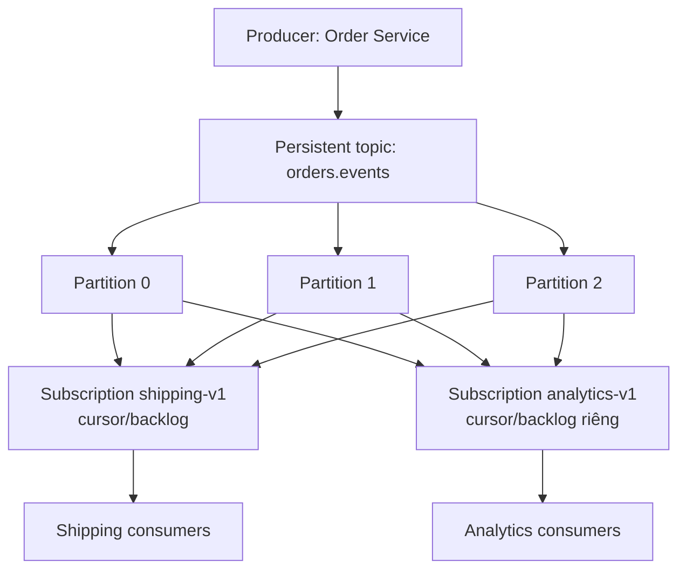

| Thực thể | Ý nghĩa | Không nên nhầm với |
| --- | --- | --- |
| **Producer** | Client publish message lên topic | Consumer hay subscription |
| **Topic** | Log/dòng message logic có tên, có thể có nhiều partitions | Subscription hoặc consumer group |
| **Partition** | Một đơn vị topic được lưu và phân phối độc lập; có trình tự lưu riêng | Thứ tự tổng trên tất cả partitions |
| **Subscription** | Tập trạng thái tiêu thụ của một nhóm xử lý: tên, cursor, backlog, chế độ phân phối | Một consumer Java instance cụ thể |
| **Consumer** | Client nhận/ack từ một subscription trên topic | Một topic mới hay một bản sao dữ liệu độc lập |

Ví dụ hai ứng dụng dùng **cùng topic nhưng khác subscription names**:

- `shipping-v1` tiêu thụ để cấp vận đơn.
- `analytics-v1` tiêu thụ để cập nhật báo cáo.

Mỗi subscription theo dõi tiến độ riêng và có thể nhận cùng message. Ngược lại, ba instances của Shipping Service cùng dùng `shipping-v1` thì phân phối giữa chúng phụ thuộc vào **subscription type**.

Một consumer `acknowledge` trong `shipping-v1` **không đánh dấu đã xử lý** cho `analytics-v1`.

## 3. Subscription type là gì, và chọn ở đâu?

Khi subscribe, consumer khai báo:

- Topic (hoặc tập topics/pattern phù hợp).
- `subscriptionName`: tên logic của nhóm tiêu thụ.
- `subscriptionType`: một trong `Exclusive`, `Failover`, `Shared`, `Key_Shared`.
- Initial position khi subscription **chưa tồn tại**.
- Schema, receiver queue, ack timeout, retry/redelivery, dead-letter policy và những tùy chọn provider.

Ví dụ về contract:

```text
topic: persistent://public/default/orders.events
subscriptionName: shipping-v1
subscriptionType: Key_Shared
message key: orderId
```

Cần xem `subscriptionName` là **danh tính lâu dài của nhóm xử lý**, không phải ID của mỗi pod hoặc instance. Nếu mỗi lần deploy tự tạo subscription mới `shipping-v1-<timestamp>`, broker có thể tạo backlog/cursors mới và mỗi nhóm xử lý lặp dữ liệu.

Trong cùng một subscription, các consumer cần có chế độ nhất quán; không thiết kế việc một instance dùng `Shared`, instance khác dùng `Key_Shared` với cùng tên rồi kỳ vọng broker tự hợp nhất ngữ nghĩa. Thay subscription type của nhóm có dữ liệu tồn đọng là một **migration có kế hoạch**, không phải đổi một enum vô hại.

## 4. Bảng quyết định: Exclusive, Failover, Shared, Key_Shared

| Subscription type | Consumer activity | Phân phối | Ordering scope nên kỳ vọng | Phù hợp |
| --- | --- | --- | --- | --- |
| `Exclusive` | Chỉ một consumer hợp lệ cho subscription không phân mảnh theo cách dùng thông thường | Một consumer nhận dòng của subscription | Có thể giữ thứ tự dispatch của một luồng/partition nếu không có redelivery hay xử lý song song | Đơn giản, xử lý tuần tự, workload nhỏ |
| `Failover` | Có nhiều consumers đăng ký; primary/standby theo topic/partition | Active consumer nhận; chuyển khi failover | Giữ thứ tự dispatch theo partition khi hoạt động bình thường, nhưng có redelivery/chuyển chủ | HA, chủ động/dự phòng |
| `Shared` | Nhiều consumers đồng thời | Phân tán message giữa consumers | **Không bảo đảm ordering** của các message thuộc cùng key | Work queue độc lập, scale-out |
| `Key_Shared` | Nhiều consumers đồng thời | Các keys/hash ranges được gán cho consumers | **Theo key** dưới các điều kiện key/batching/rebalance/redelivery phù hợp | Nhiều thực thể độc lập, mỗi thực thể cần tuần tự |

Cần phân biệt **thứ tự broker dispatch**, **thứ tự consumer nhận**, **thứ tự handler hoàn thành** và **thứ tự transaction/HTTP side effect commit**. Không có loại subscription nào tự nối bốn thứ tự này thành một giao dịch phân tán.

## 5. Exclusive: đơn giản, nhưng dễ thành bottleneck

Một **Exclusive subscription** cho phép một consumer trên một subscription theo mô hình thông thường. Consumer khác cố tạo cùng subscription với `Exclusive` sẽ không thể cùng trở thành consumer hoạt động.

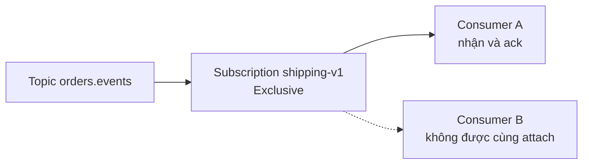

Ưu điểm:

- Đơn giản để debug, ít cạnh tranh dispatch trong cùng subscription.
- Phù hợp workload nhỏ hoặc tác vụ đòi **một consumer điều phối tại một thời điểm**.
- Có thể dễ giữ thứ tự xử lý hơn nếu ứng dụng xử lý đồng bộ, từng message một và topic không partitioned.

Giới hạn:

- Một consumer có thể không đủ throughput hoặc bị chặn bởi API downstream chậm.
- Một consumer chết có thể cần instance khác kết nối lại; Exclusive không thiết lập một cơ chế standby như Failover cho cùng subscription.
- Topic partitioned hoặc nhiều producers không tự sinh **global total order**.
- Listener có thể chuyển message sang thread pool/async pipeline và khiến business completion bị đảo dù broker dispatch tuần tự.
- Một lỗi poison message có thể giữ backlog nếu retry liên tục mà không có DLQ/quarantine.

**Đừng chọn Exclusive chỉ vì nghe có vẻ “exactly once”.** Nó không ngăn broker redelivery hoặc consumer nhận lại sau crash; vẫn cần unique business event ID.

## 6. Failover: active/standby, không phải Shared có thứ tự

Ở **Failover subscription**, nhiều consumers có thể đăng ký cùng tên subscription. Broker chỉ định consumer hoạt động cho topic/partition theo cơ chế failover; các consumer còn lại dự phòng. Khi active consumer mất kết nối, nhiệm vụ chuyển sang consumer khác.

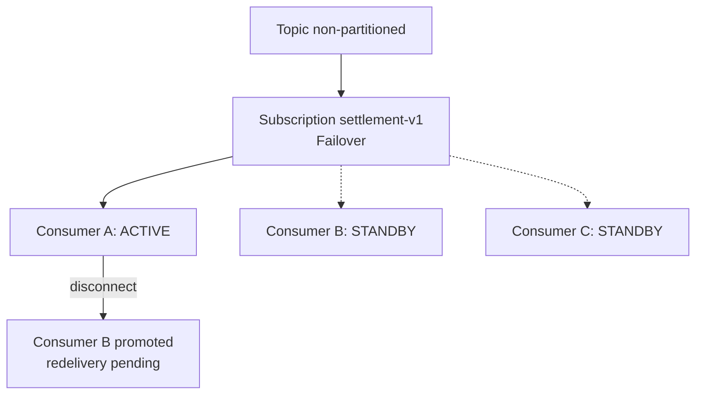

Với **partitioned topic**, nhiều consumer có thể được phân công active cho **những partitions khác nhau**. Không có quy tắc “chỉ một consumer active cho toàn bộ topic” trên mọi topology. Cần xem trạng thái partition và mapping thực tế của broker.

Ưu điểm:

- Dự phòng consumer mà không triển khai polling/scheduler lock tự viết.
- Hữu ích với workload cần một active consumer **trên mỗi partition** và muốn khôi phục tự động.
- Có thể tận dụng partitions để tăng song song trong khi giữ luồng phân phối theo mỗi partition.

Giới hạn:

- Khi failover, message đã gửi nhưng chưa ack có thể được **giao lại**, đôi lúc gây cảm giác đảo thứ tự trong business logs.
- Không đồng nghĩa event processing exactly once.
- Nếu handler gọi HTTP đối tác rồi chết trước ack, consumer mới có thể gọi HTTP lại.
- Ordering across partitions không được bảo đảm.
- Consumer assignment, priority và chuyển chủ có thể phụ thuộc partitioning, tên consumer và cấu hình/phiên bản broker.

Chọn Failover khi cần HA/standby hoặc kiểm soát trình tự theo partition; **không** chọn nếu muốn mọi consumer xử lý chia đều message như Shared.

## 7. Shared: work-queue scale-out, không giữ thứ tự per-key

Với **Shared subscription**, nhiều consumers cùng đăng ký một subscription và broker phân phối các message giữa chúng theo cơ chế điều phối của provider (thường mô tả là chia vòng/đều tải theo dispatch). Không bảo đảm các message cùng orderId tới cùng một consumer.

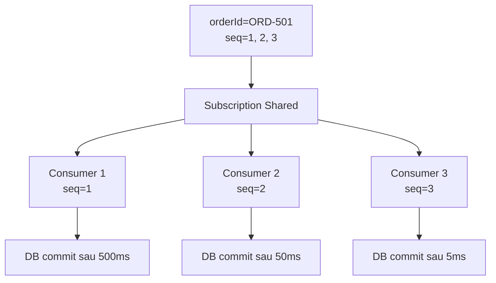

Trong ví dụ, thứ tự hoàn thành có thể là `seq=3`, `seq=2`, `seq=1`. Đây không nhất thiết là lỗi broker: Shared **không cam kết thứ tự theo key**.

Shared phù hợp khi:

- Mỗi message có thể xử lý độc lập với những message khác.
- Các tác vụ như gửi email, tạo thumbnail, indexing đã idempotent và không phụ thuộc thứ tự.
- Cần tăng throughput bằng nhiều consumers/pods.
- Có thể xử lý redelivery, duplicate và retry một cách độc lập.

Shared không phù hợp nếu business invariant yêu cầu “không hủy đơn trước khi tạo đơn” mà không có một **ordering/state guard** bổ sung.

**Ack:** Shared thường dùng **individual acknowledgement**; cumulative ack không được hỗ trợ theo semantics Shared. Nếu muốn “ack tất cả tới offset X”, phải xem loại subscription có cho phép không.

## 8. Key_Shared: phân phối theo khóa, tuần tự hóa từng thực thể

**Key_Shared** là lựa chọn quan trọng khi muốn **song song giữa các keys nhưng giữ tính nhất quán theo key** trong phân phối. Broker chia keys/hash ranges cho consumers trong cùng subscription; messages cùng key được đưa về một consumer tại một thời điểm theo chính sách, với các điều kiện thứ tự tương ứng.

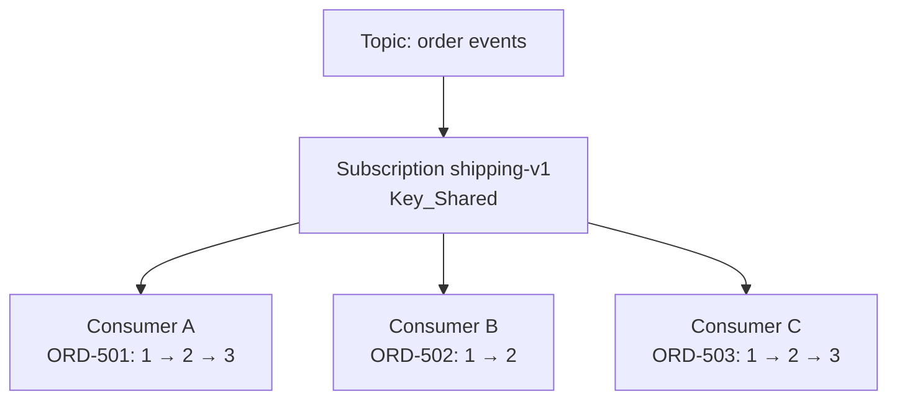

Lợi ích:

- Nhiều đơn hàng được xử lý đồng thời.
- Các message thuộc **một orderId** được nhóm về một consumer, giúp đơn giản hóa per-order state machine.
- Có thể scale số consumers theo số lượng keys và backlog, thay vì ép mọi event qua một consumer.
- Hữu ích với shopping carts, payments, inventory per-SKU, workflow per-entity.

Điều kiện và giới hạn:

1. Producer phải đặt **message key** đúng và ổn định.
2. Key được chọn phải đúng **đơn vị cần tuần tự** trong nghiệp vụ.
3. Producer **batching** phải tương thích Key_Shared; default batching trộn keys có thể phá routing kỳ vọng.
4. Key hashing/range assignment và rebalancing cần được hiểu; khi consumer churn, unacked/in-flight messages ảnh hưởng order.
5. Consumer xử lý bằng thread pool nhiều task cho cùng key vẫn có thể **commit side effects không theo thứ tự**.
6. Redelivery, timeout và lỗi downstream cần có xử lý idempotent/state validation.
7. Key_Shared **không có global ordering giữa những keys khác nhau**.
8. Nếu partition routing của key thay đổi (ví dụ tăng partitions), cần đánh giá thứ tự và migration.

**Cùng consumer không tự động đồng nghĩa cùng một serial worker.** Nếu một `@PulsarListener` nhận message rồi `CompletableFuture.runAsync(...)`, hai events cùng key có thể chạy/commit theo thứ tự khác nhau.

## 9. Khi nào nên đặt key là orderId, sku hay tenantId?

Key là một quyết định **nghiệp vụ**, không chỉ để tăng load balance.

| Luồng sự kiện | Key nên cân nhắc | Lý do | Cảnh báo |
| --- | --- | --- | --- |
| Vòng đời đơn hàng | `orderId` | Giữ diễn tiến của một order | Không trộn orderId và customerId cùng topic nếu cần order |
| Cập nhật tồn kho | `warehouseId + sku` | Serialize theo kho và SKU | Key một SKU toàn hệ thống có thể gây hot key |
| Thanh toán | `paymentId` | Ngăn thứ tự capture/refund sai | Một order có nhiều payment IDs phải có state guard khác |
| Hồ sơ khách hàng | `customerId` | Cập nhật một profile theo thứ tự | Hot customer/tenant gây nghẽn một consumer |
| Device telemetry | `deviceId` | Giữ đọc số đo trên thiết bị | Event time khác broker dispatch time |
| Đồng bộ tenant config | `tenantId` hoặc `tenantId:resourceId` | Bảo vệ invariant theo miền cần serial | Tenant lớn có thể thành một hot key |
| Email gửi độc lập | Không cần key ordering | Shared thường hợp lý | Vẫn cần stable eventId để chống trùng |

**Quy tắc:** lựa chọn key dựa trên **invariant muốn bảo vệ**. Nếu hai events phải có thứ tự tương đối nhưng mang **hai keys khác nhau**, Key_Shared không giúp tạo thứ tự giữa chúng.

Ví dụ `customerId` có thể khiến toàn bộ đơn của một khách phải chờ nhau dù không có dependency. Ngược lại, `orderId` quá hẹp nếu một ràng buộc tồn kho trên cùng SKU đòi serialize tất cả reservations.

## 10. Thứ tự trong Pulsar: nói rõ đang đo cái gì

Một yêu cầu “giữ thứ tự” có thể có ít nhất sáu nghĩa:

1. **Business sequence**: `sequence=1,2,3` do ứng dụng gán.
2. **Producer send order**: thứ tự producer gọi `send`/`sendAsync`.
3. **Broker append order**: thứ tự messages được ghi trong một partition theo broker/storage.
4. **Dispatch order**: broker đưa message tới consumer theo subscription rules.
5. **Handler start/finish order**: thứ tự consumer bắt đầu/kết thúc xử lý.
6. **External side-effect commit order**: thứ tự PostgreSQL commit/HTTP partner hoàn tất.

```text
Business seq:       1 -------- 2 -------- 3
Producer async:     send(1) / send(2) / send(3)
Broker partition:   append(1) append(2) append(3)
Delivery:           1 -> 2 -> 3
Consumer async:     start(1) start(2) start(3)
DB commit:          2 -> 3 -> 1      (possible!)
```

Một guarantee ở tầng dispatch **không tự kéo theo** guarantee ở tầng DB commit. Tương tự, hai producer của cùng key nhưng không có điều phối sequence/ack có thể làm broker quan sát thứ tự khác timeline nghiệp vụ.

Trong thiết kế API, nên viết rõ: “với cùng `orderId`, không áp dụng event có `aggregateVersion=N+1` trước khi state đã đạt N”, thay vì chỉ viết “Pulsar giữ order”.

## 11. Partitioned topic không có thứ tự tổng toàn topic

**Partition** là một đơn vị song song quan trọng. Topic `orders.events` có thể chứa 4 partitions:

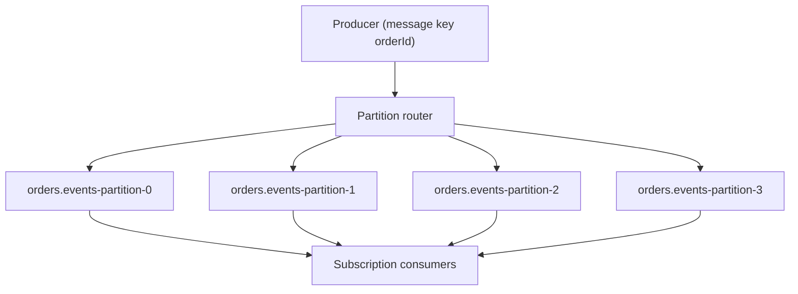

Thường producer routing dựa vào key hash để các messages cùng key tới cùng partition **khi topology/routing config ổn định**. Nhưng:

- Thứ tự append ở partition 0 không tạo quan hệ trước–sau với partition 1.
- Tăng số partitions có thể thay đổi phép ánh xạ key → partition tùy thuật toán routing; một key có thể có messages cũ ở partition trước và mới ở partition khác. Cần migration plan nếu ordering theo key rất quan trọng.
- Nhiều producers gửi cùng key có thể cạnh tranh; không có một “global sequence” chung trừ khi nghiệp vụ cấp version/sequence.
- Failover có thể phân phối **active consumer theo partition**.
- Key_Shared thêm một lớp phân phối theo key/hash range **trong subscription**; nó không tạo thứ tự tổng qua các partitions.

**Nếu cần total ordering thật sự cho mọi sự kiện**, hãy đánh giá giới hạn throughput, một luồng/partition, một producer sequencer và xử lý tuần tự; thường tốt hơn là thiết kế per-aggregate ordering thay vì total global order.

## 12. Producer key và message payload là hai dữ liệu khác nhau

Producer có thể gửi JSON string và đặt key để broker routing:

```java
import org.apache.pulsar.client.api.Producer;
import org.apache.pulsar.client.api.PulsarClient;
import org.apache.pulsar.client.api.Schema;

public final class OrderEventPublisher {

    public static void main(String[] args) throws Exception {
        try (PulsarClient client = PulsarClient.builder()
                .serviceUrl("pulsar://localhost:6650")
                .build();
             Producer<String> producer = client.newProducer(Schema.STRING)
                .topic("persistent://public/default/orders.events")
                .enableBatching(false)
                .create()) {

            String json = """
                {"eventId":"evt-1001",
                 "orderId":"ORD-501",
                 "aggregateVersion":1,
                 "type":"OrderCreated"}
                """;

            producer.newMessage()
                .key("ORD-501")
                .property("eventType", "OrderCreated")
                .property("schemaVersion", "1")
                .value(json)
                .send();
        }
    }
}
```

Điểm cần phân biệt:

- `.key("ORD-501")` là message key của Pulsar, dùng cho routing/Key_Shared semantics.
- `orderId` bên trong JSON là **business contract**, phục vụ validation/idempotency. Hai giá trị phải nhất quán.
- `eventId` là **stable business message identity**; không dùng `MessageId` của broker thay cho nó khi producer có thể publish lại.
- `aggregateVersion` giúp consumer bảo vệ thứ tự business state, độc lập cơ chế dispatch.
- `schemaVersion` trong properties là metadata do producer cung cấp; phải kiểm tra agreement với payload.
- `enableBatching(false)` ở ví dụ làm rõ order/key routing khi học, nhưng giảm hiệu quả throughput. Production có thể dùng **key-based batching** sau khi test.

`Schema.STRING` chỉ nói payload được mã hóa chuỗi; nó **không** khiến broker validate JSON schema. Nếu cần Avro/JSON schema managed, dùng Pulsar Schema và registry/compatibility policy tương ứng, test cụ thể version.

## 13. Không nhầm key, ordering key và MessageId

Một Pulsar message có thể có:

| Trường | Ai cấp? | Dùng cho |
| --- | --- | --- |
| `message.key` | Producer | Routing/Key_Shared/grouping theo khóa |
| `orderingKey` (khi API/provider hỗ trợ) | Producer | Metadata ordering/routing theo semantics cụ thể |
| `MessageId` | Broker/client publish result | Vị trí message trong ledger/partition, ack/seek |
| `eventId` trong payload | Business producer | Idempotency xuyên retry/re-publish |
| `aggregateVersion` | Business state owner | Chặn áp dụng out-of-order state transition |
| `publishTime` | Broker/client metadata | Quan sát thời điểm gửi, không phải sequence nghiệp vụ |
| `eventTime` | Producer | Thời gian sự kiện phát sinh, có thể không theo delivery |

**Quan trọng:** Pulsar có API `orderingKey` ở một số dòng client; không phải mọi hệ thống sử dụng cùng lúc key + ordering key, và tác động đến routing phụ thuộc chính sách client/broker. Để tối giản contract Key_Shared, nên chọn một **message key thống nhất** và kiểm tra đường routing đúng phiên bản thay vì trộn nhiều khóa mà không test.

Không lấy `publishTime` hay `eventTime` làm total order vì đồng hồ producers có thể lệch hoặc hai events có timestamp bằng nhau.

## 14. Batching: lỗi cấu hình phổ biến với Key_Shared

Producer batching giúp giảm overhead bằng cách gom nhiều messages. Nhưng batching mặc định có thể gom messages **khác keys** vào cùng một batch. Trong Key_Shared, việc phân phối batch có thể dựa vào một key/metadata và làm sai kỳ vọng “mỗi key ở đúng consumer”.

Một số phiên bản Java Pulsar client hỗ trợ **key-based batching**:

```java
import org.apache.pulsar.client.api.BatcherBuilder;
import org.apache.pulsar.client.api.Schema;

var producer = client.newProducer(Schema.STRING)
    .topic("persistent://public/default/orders.events")
    .enableBatching(true)
    .batcherBuilder(BatcherBuilder.KEY_BASED)
    .create();
```

`client` ở đây là `PulsarClient` đã tạo và cần được đóng đúng lifecycle. Hãy kiểm tra `BatcherBuilder.KEY_BASED` và các giới hạn batch/linger theo phiên bản Pulsar client đang dùng.

Lựa chọn:

1. **Disable batching** để đơn giản và an toàn khi bắt đầu kiểm thử semantics.
2. **Key-based batching** để gom messages cùng key mà không trộn tùy tiện nhiều keys theo chính sách phiên bản hỗ trợ.
3. Dùng một loại batching khác **chỉ sau khi test** với nhiều keys và consumers trên broker thực.

Không thể chứng minh Key_Shared hoạt động đúng chỉ bằng test một key, một consumer. Phải gửi **nhiều keys xen kẽ** và assert routing/ordering khi batching bật.

## 15. Key_Shared AUTO_SPLIT và STICKY: ý tưởng hash range

Ở lớp Pulsar Java client, **Key_Shared policy** có thể điều khiển phân bổ hash ranges theo cơ chế như:

- **AUTO_SPLIT**: broker quản lý phân chia key hash ranges khi consumers tham gia/rời đi.
- **STICKY**: client/ứng dụng khai báo ranges cố định cho consumer theo policy phù hợp.

Mẫu cấu hình API (cần đối chiếu version):

```java
import org.apache.pulsar.client.api.KeySharedPolicy;
import org.apache.pulsar.client.api.SubscriptionType;

var consumer = client.newConsumer(Schema.STRING)
    .topic("persistent://public/default/orders.events")
    .subscriptionName("shipping-v1")
    .subscriptionType(SubscriptionType.Key_Shared)
    .keySharedPolicy(
        KeySharedPolicy.autoSplitHashRange()
    )
    .subscribe();
```

`client` và `Schema` được định nghĩa như ví dụ producer. Ví dụ này tạo một consumer, không phải code xử lý đầy đủ; phải đóng consumer/client khi kết thúc.

**AUTO_SPLIT** dễ dùng khi số instances thay đổi. Nhưng mỗi lần scale/rebalance có thể có messages đang xử lý, messages unacked và chuyển key ranges; cần kiểm chứng ordering trong failure windows.

**STICKY** cho phép kiểm soát ranges nhưng cần quản lý mapping/overlap/hole và lifecycle consumers. Không tự chọn STICKY chỉ vì nghĩ “tự đặt ranges sẽ nhanh hơn”; vận hành phức tạp hơn.

Hash range policy không thay business idempotency hoặc sequence checking, cũng không tạo thứ tự giữa những partitions.

## 16. Consumer churn và chuyển key range: thứ tự có còn không?

Giả sử:

```text
t0: key ORD-501 -> Consumer A
t1: A receives seq=5 and starts slow HTTP call
t2: Consumer B joins; ownership assignment may change
t3: A crashes before ack or after side effect
t4: Broker redelivers seq=5; seq=6 also pending
t5: Consumer B processes messages
```

Những rủi ro:

- `seq=5` có thể đã tạo side effect nhưng chưa ack.
- Message được redeliver có thể có `redeliveryCount` tăng.
- Nếu application xử lý bất đồng bộ, `seq=6` có thể hoàn tất trước `seq=5`.
- Một cấu hình cho phép **out-of-order delivery** (nếu policy/version hỗ trợ) có thể đánh đổi thứ tự lấy throughput hoặc giảm head-of-line blocking.
- Khi consumer scale down hoặc broker ownership thay đổi, cần xác minh behavior theo version và in-flight state.

**Không nên hứa “không thể có out-of-order” chỉ bằng cách viết `SubscriptionType.Key_Shared`.** Hãy phân biệt contract ở tầng broker và trạng thái ở database, sử dụng `aggregateVersion` hoặc sequence number để **phát hiện và không áp dụng sai**.

Nếu yêu cầu nghiêm ngặt, xử lý tuần tự trên cùng key, không cho phép stage async vượt nhau, giữ unacked processing có kiểm soát, kiểm thử reconnect/rebalance và có chiến lược chờ/buffer/park khi thiếu phiên bản trước.

## 17. Key hot-spot và phân phối không đều

Key_Shared chia tải **theo keys/hash ranges**, không chia từng message của cùng key cho tất cả consumers. Nếu một `tenantId` tạo 70% messages, consumer nhận key đó có thể bị nóng:

```text
Tenant A: 70% traffic ---> one key / one consumer bottleneck
Tenant B: 10% traffic ---> another consumer
Other tenants: 20% ----> remaining consumers
```

Thêm 20 consumers không giúp tăng song song **bên trong một key** nếu business invariant yêu cầu serial processing.

Cách xử lý:

- Định nghĩa lại key theo phạm vi invariant nhỏ hơn nếu có thể: `tenantId:resourceId`, `warehouseId:sku`.
- Tách workload hoặc topic riêng cho hot tenant nếu SLA/quyền truy cập cần.
- Tối ưu xử lý cho một key: DB indexes, request batching nghiệp vụ (khác producer key mixing), giảm remote latency.
- Theo dõi backlog/age và per-key hot spots bằng metrics có cardinality kiểm soát.
- Không gắn raw `orderId`/`tenantId` vào mọi metric label.

**Sharding một key thành nhiều keys để tăng throughput sẽ đánh mất per-key ordering guarantee**. Chỉ làm khi business state machine có thể chịu hoặc đã được thay đổi.

## 18. Ack semantics: individual và cumulative khác nhau

Consumer phải báo broker biết message đã được xử lý theo chính sách.

Hai kiểu ack thường thấy:

- **Individual ack**: xác nhận message cụ thể.
- **Cumulative ack**: xác nhận một message và các message trước đó trong luồng tương ứng, chỉ phù hợp khi subscription/ordering semantics cho phép.

| Subscription | Individual ack | Cumulative ack |
| --- | --- | --- |
| Exclusive | Có | Có thể dùng trong mô hình tuần tự phù hợp |
| Failover | Có | Có thể dùng khi xử lý theo trình tự phù hợp |
| Shared | Có | **Không được hỗ trợ** trong semantics Shared |
| Key_Shared | Có | **Không được hỗ trợ** trong semantics Key_Shared |

Với Shared và Key_Shared, dùng individual ack là lựa chọn thực tế. Cumulative ack có thể vô tình đánh dấu “đã xử lý” các message chưa hoàn tất ở một thiết kế song song nếu được dùng sai, nên broker không cho phép theo semantics các loại đó.

**Ack timing:** đừng ack trước khi transaction DB/side effect quan trọng đã hoàn tất. Ngược lại, nếu DB đã commit mà process chết trước ack, broker sẽ có thể gửi lại message; đây là lý do cần inbox/idempotent effects.

## 19. Negative ack, ack timeout và redelivery làm thay đổi việc quan sát thứ tự

Khi xử lý một message thất bại, consumer có các cơ chế thường dùng:

- `negativeAcknowledge(message)`: thông báo broker/client rằng message cần được giao lại theo policy.
- **Ack timeout**: nếu không ack trong khoảng thời gian được cấu hình, message có thể được redeliver.
- **Consumer disconnect/crash**: những messages chưa ack có thể được giao lại cho consumer mới.
- **Reconsume later/retry topic**: đưa việc xử lý lại về một thời điểm khác nếu cấu hình và API hỗ trợ.
- **Dead-letter topic**: tách message vượt số lần retry hoặc lỗi cố định theo policy.

Các cơ chế này khác nhau; **redelivery không đồng nghĩa message mới được publish**, và một message lỗi không tự biến thành dữ liệu hợp lệ sau 10 lần retry.

Với các subscription cần order, cần suy xét:

```text
Broker dispatch key ORD-501:  seq=10 -> seq=11
Consumer receives seq=10:    DB temporarily unavailable
Consumer negative-acks 10:   schedule redelivery
Consumer receives seq=11:    possible depending on mode/config/in-flight
Business state:              must not apply 11 before 10
```

Một bảo đảm về **dispatch theo key** không phải bảo đảm rằng mọi retry, reconsumeLater, asynchronous callback và side effect đều giữ đúng thứ tự nghiệp vụ. Các trường hợp cụ thể cần kiểm tra với **Pulsar version, subscription policy, ack/redelivery mode và consumer code**.

**Hướng dẫn:** khi cùng key có state machine phụ thuộc thứ tự, chỉ ack sau commit trạng thái hợp lệ; gặp gap `expectedVersion != incomingVersion` phải defer/park/reconcile thay vì áp dụng message đến trước.

## 20. Cấu hình ack timeout và negative-ack delay qua Java client

Một ví dụ consumer Shared xử lý công việc độc lập:

```java
import java.util.concurrent.TimeUnit;

import org.apache.pulsar.client.api.Consumer;
import org.apache.pulsar.client.api.PulsarClient;
import org.apache.pulsar.client.api.Schema;
import org.apache.pulsar.client.api.SubscriptionType;

Consumer<String> worker = client.newConsumer(Schema.STRING)
    .topic("persistent://public/default/email.commands")
    .subscriptionName("email-worker-v1")
    .subscriptionType(SubscriptionType.Shared)
    .ackTimeout(60, TimeUnit.SECONDS)
    .negativeAckRedeliveryDelay(5, TimeUnit.SECONDS)
    .subscribe();
```

`client` là `PulsarClient` được tạo và quản lý ở tầng startup; nhớ đóng `worker` khi shutdown.

Cách hiểu:

- `ackTimeout` áp giới hạn thời gian nhận–ack theo API/implementation; nếu worker cần xử lý quá lâu, có nguy cơ message đang xử lý bị giao lại.
- `negativeAckRedeliveryDelay` tác động tới độ trễ sau negative ack; không phải toàn bộ chính sách exponential backoff mặc định.
- Timeout 60 giây và delay 5 giây chỉ là ví dụ, không phải số tối ưu cho mọi workload.
- Nếu downstream HTTP cần tối đa 90 giây còn ack timeout chỉ 60 giây, phải kỳ vọng có khả năng duplicate concurrent processing.
- Khi dùng Spring listener container, hãy cấu hình timeout/redelivery ở **đúng consumer factory/container** thay vì tạo một bean config không được listener sử dụng.

Đừng gộp ba thời gian thành một: **HTTP timeout**, **Pulsar ack timeout** và **business SLA** có trách nhiệm khác nhau. Consumer vẫn cần có khả năng phục hồi sau khi process chết dù ack timeout bị vô hiệu hóa.

## 21. Consumer loop mẫu: ack sau xử lý, negative ack khi thất bại

Ví dụ Java client tách lỗi cố định khỏi lỗi tạm thời:

```java
import org.apache.pulsar.client.api.Consumer;
import org.apache.pulsar.client.api.Message;
import org.apache.pulsar.client.api.PulsarClient;
import org.apache.pulsar.client.api.Schema;
import org.apache.pulsar.client.api.SubscriptionType;

public final class OrderWorker {

    private final Consumer<String> consumer;
    private final OrderProcessor processor;

    public OrderWorker(PulsarClient client,
                       OrderProcessor processor)
            throws Exception {
        this.consumer = client.newConsumer(Schema.STRING)
            .topic("persistent://public/default/orders.events")
            .subscriptionName("shipping-v1")
            .subscriptionType(SubscriptionType.Key_Shared)
            .subscribe();
        this.processor = processor;
    }

    public void handleOne() throws Exception {
        Message<String> msg = consumer.receive();
        try {
            String key = msg.getKey();
            if (key == null || key.isBlank()) {
                throw new InvalidEventException(
                    "MISSING_ORDER_KEY"
                );
            }

            processor.process(
                key,
                msg.getValue(),
                msg.getProperty("schemaVersion")
            );
            consumer.acknowledge(msg);
        } catch (TransientProcessingException ex) {
            consumer.negativeAcknowledge(msg);
        } catch (InvalidEventException ex) {
            // Do not ack until durable quarantine succeeds.
            // On failure to quarantine, prefer redelivery/alerting.
            quarantineThenAcknowledge(msg, ex);
        }
    }

    private void quarantineThenAcknowledge(
            Message<String> msg, Exception cause)
            throws Exception {
        // Application-specific: durable storage / DLQ confirmation.
        // Implement before enabling this path in production.
        throw new UnsupportedOperationException(
            "Quarantine adapter required"
        );
    }
}
```

Các types `OrderProcessor`, `TransientProcessingException` và `InvalidEventException` do dự án định nghĩa. `quarantineThenAcknowledge` cố ý **không ack** vì ví dụ chưa cung cấp quarantine durable; tránh dạy cách làm mất poison message bằng `catch { ack(); }`.

**Lưu ý vận hành:** code trên minh họa **một lần nhận và xử lý**, không phải complete production listener lifecycle/shutdown. Ở thực tế cần quản lý vòng lặp, interruption, closing consumer/client, error policy, bounded concurrency và cấu trúc timeout. Nếu dùng `@PulsarListener`, container có thể tự quản lý ack theo chế độ đã cấu hình; không duplicate ack từ code không hiểu mode.

## 22. Dead-letter topic và poison message: bảo vệ throughput

Poison message là message **không thể xử lý thành công bằng cách retry y nguyên**, ví dụ:

- JSON không hợp lệ, sai schema version vĩnh viễn.
- Thiếu business event ID/key bắt buộc.
- Không nhận dạng được event type.
- Dữ liệu vi phạm invariant và không có hướng reconcile.
- Payload quá lớn hoặc bị chặn bởi parser limits.
- Chữ ký/tenant authorization sai theo quy trình validation.

Một số Java Pulsar client versions hỗ trợ cấu hình **DeadLetterPolicy**:

```java
import org.apache.pulsar.client.api.DeadLetterPolicy;
import org.apache.pulsar.client.api.Schema;
import org.apache.pulsar.client.api.SubscriptionType;

var consumer = client.newConsumer(Schema.STRING)
    .topic("persistent://public/default/orders.events")
    .subscriptionName("shipping-v1")
    .subscriptionType(SubscriptionType.Shared)
    .deadLetterPolicy(
        DeadLetterPolicy.builder()
            .maxRedeliverCount(5)
            .deadLetterTopic(
                "persistent://public/default/orders.events-dlq"
            )
            .build()
    )
    .subscribe();
```

**Đoạn trên minh họa policy cho Shared** và không có vòng lặp receive/ack. Trong một số phiên bản/tình huống, dead-letter handling có yêu cầu cụ thể về ack timeout, negativeAck/reconsumeLater, retry topic, permissions hoặc topology. Không giả định `maxRedeliverCount` tự động áp đúng cho mọi lỗi, loại subscription hay kiểu redelivery. **Test bằng broker thật** để biết sau bao nhiêu attempts message chuyển DLQ và message gốc được ack/removed như thế nào.

Quy trình DLQ phải có:

1. Owner tiếp nhận sự cố và xác định lỗi do producer hay consumer.
2. Lưu metadata an toàn: eventId, topic, subscription, schema version, key (đã ẩn dữ liệu nhạy cảm), error category.
3. Giới hạn size/retention/quota; không lưu raw payload chứa PII tùy tiện.
4. Công cụ replay có kiểm soát **giữ stable business eventId** và không phát song song vô hạn.
5. Schema evolution và test decoder mới trước khi replay.
6. Cảnh báo DLQ rate/age; không coi “message vào DLQ” là thành công nghiệp vụ.

**Key_Shared và DLQ:** một message cùng key bị đẩy sang DLQ có thể khiến phiên bản sau tiếp tục xử lý trước phiên bản thiếu. Nếu business đòi chuỗi liên tục, hệ thống phải **park/reconcile per key**, không chỉ chuyển lỗi sang DLQ rồi tiến tiếp.

## 23. Retry topic, reconsumeLater và thứ tự business

Thay vì redeliver ngay trong subscription, một số workflows dùng **retry topic** hoặc `reconsumeLater` để xử lý lại sau backoff.

Điều cần hiểu:

- Message được hẹn xử lý lại có thể không nằm ngay trước message tiếp theo trong main topic.
- Retry topic là một đường phân phối bổ sung, có cursor và config riêng.
- Dù message retry giữ `eventId` hoặc properties, consumer nghiệp vụ vẫn phải chống trùng.
- `enableRetry`, `reconsumeLater`, retry topic naming và DLQ integration phụ thuộc phiên bản client/loại subscription; test đường dây thật.
- Với một key đang lỗi, bản sự kiện mới có thể tới trước kết quả retry cũ nếu hệ thống không chặn.

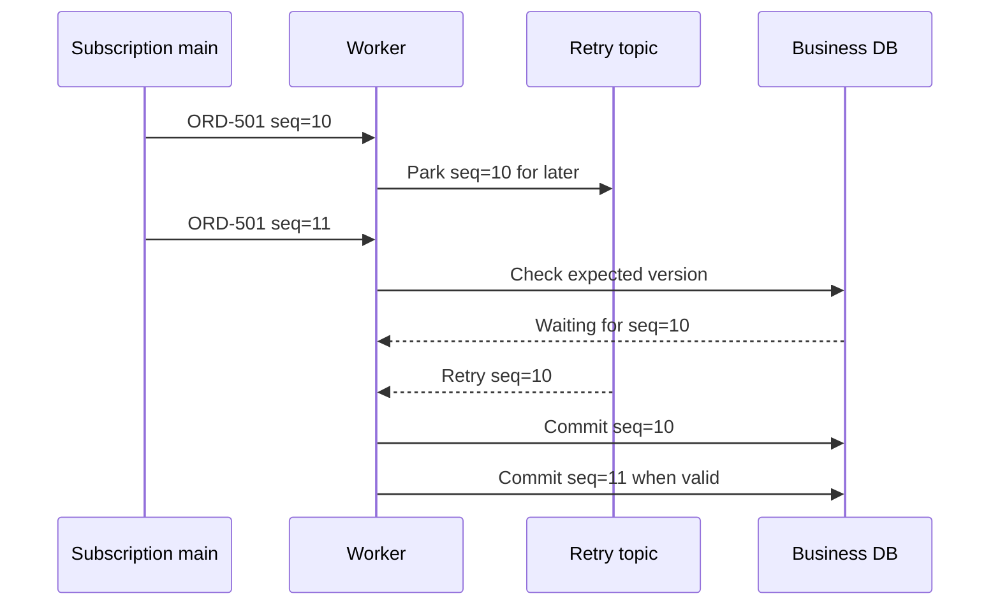

**Nếu tuyệt đối cần per-key sequencing**, tránh thiết kế chỉ dựa vào retry topic mà không có expected-version guard. Có thể giữ message đang lỗi và tạm dừng tiến độ key, hoặc lưu một durable pending-event state để khôi phục; đánh đổi là head-of-line blocking cho key đó, không phải cho mọi key.

## 24. Subscription cursor và durable backlog khác Kafka offset

Pulsar lưu trạng thái tiêu thụ theo **subscription cursor**, hỗ trợ backlog và redelivery theo model broker. Một `MessageId` chứa thông tin vị trí message trong ledger/partition; không nên giả định giống một offset số duy nhất trên toàn topic.

Ví dụ:

```text
Topic orders.events
  Subscription shipping-v1:
    cursor ~ point A / unacked ranges
    backlog: messages shipping has not completed

  Subscription analytics-v1:
    cursor ~ point B
    backlog: independent of shipping
```

Các tác động:

- Hai subscriptions trên cùng topic có **tiến độ khác nhau**.
- Một consumer ack không làm các subscriptions khác ack.
- Backlog lớn có thể giữ dữ liệu cần retention/storage nếu broker policy cho phép.
- Với Shared/Key_Shared và individual acks, không suy toàn bộ backlog thành một offset tuyến tính đơn giản.
- Reset/seek cursor là **thao tác có thể replay hoặc bỏ qua message**; phải có approval, idempotency và đánh giá business effects.
- Nếu xóa subscription rồi tạo lại, initial position có thể khác và tạo duplicates/missed data theo retention; đừng xóa production subscription để “chữa lag” khi chưa biết hậu quả.

**Durable subscription** không có nghĩa dữ liệu tồn tại vô hạn: topic retention, backlog quota, TTL/expiry, storage và admin policies vẫn cần được thiết kế.

## 25. subscriptionInitialPosition: Earliest/Latest chỉ quyết định khi tạo mới

Một consumer có thể chỉ định nơi bắt đầu khi subscription chưa tồn tại:

```java
import org.apache.pulsar.client.api.SubscriptionInitialPosition;
import org.apache.pulsar.client.api.SubscriptionType;

var consumer = client.newConsumer(Schema.STRING)
    .topic("persistent://public/default/orders.events")
    .subscriptionName("analytics-v1")
    .subscriptionType(SubscriptionType.Shared)
    .subscriptionInitialPosition(
        SubscriptionInitialPosition.Earliest
    )
    .subscribe();
```

- **Earliest**: với một subscription mới, bắt đầu tại dữ liệu cũ còn khả dụng theo retention/backlog constraints.
- **Latest**: subscription mới ưu tiên các messages đến sau vị trí tạo theo semantics tương ứng.
- Với subscription **đã tồn tại**, initial position **không tự reset cursor**; broker tiếp tục trạng thái của subscription đó.
- `Earliest` không bảo đảm “đọc lại toàn bộ lịch sử từ ngày đầu hệ thống” nếu retention đã xóa dữ liệu.
- `Latest` với một consumer group xử lý lệnh nghiệp vụ có thể khiến các commands đã phát trước lúc subscribe bị bỏ qua; kiểm tra thời điểm tạo subscription trước khi producer gửi.

**Bẫy rollout:** đổi tên `shipping-v1` thành `shipping-v2` và đặt `Earliest` có thể phát lại lịch sử còn lưu cho một nhóm mới; đặt `Latest` có thể bỏ lỡ lệnh chưa có consumer. Đây là **quyết định migration**, không phải rename biến Java.

## 26. Một topic, nhiều subscriptions: fan-out độc lập với type

Giả sử Orders Service phát `OrderCreated`:

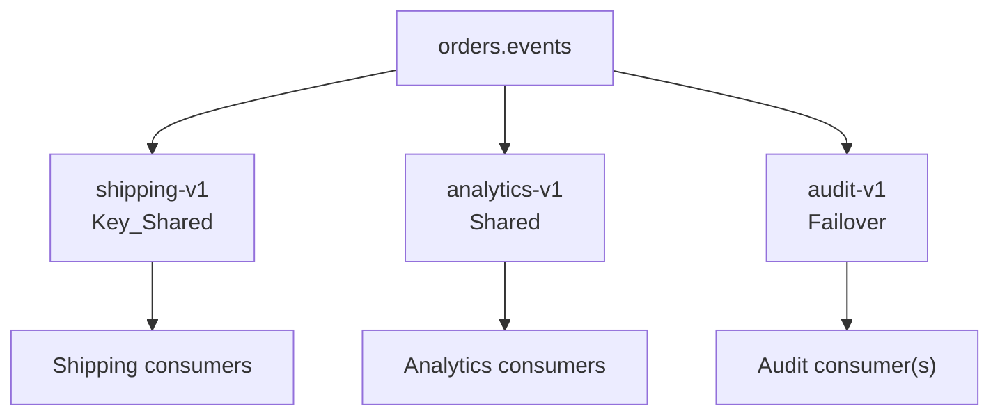

Ở ví dụ này:

- **shipping-v1** cần thứ tự theo orderId.
- **analytics-v1** xử lý metrics độc lập, scale nhiều consumers.
- **audit-v1** muốn một active consumer với standby hoặc active theo partition.

Dùng **khác subscription names** để fan-out cùng event tới mỗi nhóm. Nếu đưa Shipping và Analytics vào **cùng subscription Shared**, hai service sẽ cạnh tranh nhận message; một event chỉ tới một bên thay vì cả hai.

Subscription type là **quy tắc phân phối trong một subscription**; số subscriptions quyết định số nhóm tiêu thụ độc lập. Hai điều này thường bị nhầm khi người dùng mô tả “Pulsar topic gửi một lần cho mọi consumer”.

## 27. Multi-topic subscriptions và ordering: đừng hứa thứ tự xuyên topics

Một Pulsar consumer có thể subscribe nhiều topics hoặc pattern (theo API và permissions). Nhưng:

- Mỗi topic/partition có thứ tự storage/dispatch riêng.
- Trộn messages giữa `orders.created` và `orders.cancelled` không tự có total ordering.
- Cùng `orderId` nhưng gửi sang hai topics khác nhau không được Key_Shared “gom” thành một serial stream end-to-end.
- Pattern subscription có thể phát hiện topic mới động; thời điểm attach và initial cursor cần được test.
- Cross-topic transaction ordering và business sequencing phải được thiết kế riêng, kể cả khi Pulsar hỗ trợ transactions ở phạm vi cụ thể.

Nếu cần đảm bảo state machine cho một order, thường dễ giữ **một stream theo aggregate với message key ổn định** hơn là tách mỗi event type sang một topic rồi cố ghép lại dựa trên arrival timestamp.

Khi bắt buộc nhiều topics, dùng business version/correlation, trạng thái chờ và reconciliation; không chỉ dựa vào wall-clock order.

## 28. Spring Boot: starter và cấu hình kết nối Pulsar

Spring Boot có hỗ trợ **Spring for Apache Pulsar** qua starter ở các phiên bản phù hợp. Ví dụ dependency Maven (đối chiếu BOM Spring Boot của dự án):

```xml
<dependencies>
    <dependency>
        <groupId>org.springframework.boot</groupId>
        <artifactId>spring-boot-starter-pulsar</artifactId>
    </dependency>
</dependencies>
```

Gradle:

```groovy
dependencies {
    implementation 'org.springframework.boot:spring-boot-starter-pulsar'
}
```

Cấu hình local:

```yaml
spring:
  pulsar:
    client:
      service-url: ${PULSAR_SERVICE_URL:pulsar://localhost:6650}
    admin:
      service-url: ${PULSAR_ADMIN_URL:http://localhost:8080}
```

Ý nghĩa:

- `pulsar://localhost:6650` là Pulsar binary protocol endpoint local, **không** phải Kafka bootstrap URL hay HTTP admin endpoint.
- `http://localhost:8080` là ví dụ Pulsar admin HTTP endpoint; quyền admin/tenant/namespace/topic provisioning có thể tách khỏi app.
- Khi app chạy trong Docker/Kubernetes, `localhost` là chính container/pod; dùng service DNS và endpoints đúng topology.
- TLS/authentication/configuration (token, OAuth2/mTLS theo phiên bản/provider) cần được cấp bằng secrets và client config đúng, không hardcode vào YAML/Git.
- Không dùng auto-created `public/default` topic không có permissions/retention policies cho dữ liệu production nhạy cảm.

`spring-boot-starter-pulsar` không tự giải quyết producer batching, key schema, consumer group identity, ack/redelivery/DLQ và transaction correctness. Những điểm này phải được cấu hình/test ở **đúng template/listener/container/client layer**.

## 29. @PulsarListener trong Spring: chọn loại subscription có chủ đích

Trong Spring for Apache Pulsar, listener có thể khai báo topic, subscription name và subscription type bằng `@PulsarListener` theo API phiên bản tương ứng:

```java
import org.apache.pulsar.client.api.SubscriptionType;
import org.springframework.pulsar.annotation.PulsarListener;
import org.springframework.stereotype.Component;

@Component
public class ShippingEventListener {

    private final ShippingEventService service;

    public ShippingEventListener(ShippingEventService service) {
        this.service = service;
    }

    @PulsarListener(
        topics = "persistent://public/default/orders.events",
        subscriptionName = "shipping-v1",
        subscriptionType = SubscriptionType.Key_Shared
    )
    public void onEvent(String jsonPayload) {
        service.processJson(jsonPayload);
    }
}
```

`ShippingEventService` là business service do dự án định nghĩa. Đây là ví dụ **payload String**, vì vậy chưa validate key/eventId/schemaVersion; một ứng dụng thật cần đọc metadata theo API listener đang dùng và kiểm tra key nhất quán với payload.

Chú ý:

1. `subscriptionName` phải ổn định giữa replicas cùng nhóm.
2. `subscriptionType` phải khớp yêu cầu business và broker policy.
3. Consumer factory/listener container có thể đặt **ack mode, concurrency, schema, subscription properties** bổ sung; annotation không thay mọi cấu hình.
4. Với Key_Shared, producer phải đặt **key** và **key-based batching**; listener annotation một mình không đạt per-key ordering.
5. Một `void` method chạy thành công không chứng minh remote HTTP/DB workflow đã commit nếu service fire-and-forget hoặc swallow exception.
6. Khi Spring thực hiện ack tự động, exception handling/transaction behavior phụ thuộc listener container mode; phải test actual redelivery thay vì suy từ tên annotation.
7. Các bản Spring mới có thể đổi cách cấu hình annotation/container; đối chiếu đúng Spring for Apache Pulsar reference.

**Tuyệt đối tránh** gửi việc xử lý từ `onEvent` sang thread pool không được quản lý rồi return ngay: container có thể ack khi method return, trong khi side effect còn chưa xong.

## 30. PulsarTemplate và key-aware publish trong Spring

Spring for Apache Pulsar có `PulsarTemplate<T>` để gửi payload từ Spring components. Ví dụ tổng quát:

```java
import org.springframework.pulsar.core.PulsarTemplate;
import org.springframework.stereotype.Component;

@Component
public class NotificationPublisher {

    private final PulsarTemplate<String> template;

    public NotificationPublisher(
            PulsarTemplate<String> template) {
        this.template = template;
    }

    public void sendNotification(String payload) {
        template.send(
            "persistent://public/default/notifications",
            payload
        );
    }
}
```

Phương thức `send(topic, payload)` tiện cho thông điệp không cần routing key. **Nhưng với Key_Shared, không được dừng ở ví dụ này**: cần sử dụng API hỗ trợ **message key** (ví dụ builder/messenger methods của Spring Pulsar version hoặc trực tiếp Pulsar Java producer `newMessage().key(...)`) và verify key trên consumer.

Đừng nhầm **KafkaTemplate** có key parameter với **PulsarTemplate**; overloads/type names thay đổi theo API. Khi cần các tính năng cụ thể như ordering key, schema, custom properties, event time hoặc key-based batching, hãy kiểm tra Spring Pulsar template builder theo version và dùng một producer config được quản lý tập trung.

Việc đổi `PulsarTemplate` sang native Pulsar client không thay đổi yêu cầu nghiệp vụ: eventId, subscription, partitions, ack và durable retries vẫn phải đúng.

## 31. Listener concurrency: nhiều instances và nhiều threads không giống nhau

Có hai cách mở rộng thường bị trộn:

**Scale broker consumers:** tăng số consumers tham gia cùng subscription. Kết quả phụ thuộc loại subscription:

- Exclusive: không cho nhiều consumers cùng hoạt động theo mô hình thông thường.
- Failover: thêm standby hoặc tăng active assignment theo partitions.
- Shared: broker phân phối thêm message tới nhiều consumers.
- Key_Shared: keys/hash ranges có thể được chia lại, nhưng một hot key vẫn giới hạn throughput.

**Scale application tasks:** một consumer nhận message rồi dispatch việc xử lý vào thread pool, `CompletableFuture` hoặc reactive operators. Điều này có thể tăng throughput xử lý **nhưng không giữ business completion order** nếu các messages cùng key chạy đồng thời.

Ví dụ sai nếu cần tuần tự ORD-501:

```java
@PulsarListener(
    topics = "persistent://public/default/orders.events",
    subscriptionName = "shipping-v1",
    subscriptionType = SubscriptionType.Key_Shared
)
public void onEvent(String json) {
    java.util.concurrent.CompletableFuture.runAsync(
        () -> processRemotely(json)
    );
    // Method returned before remote processing completed!
}
```

Không chỉ có vấn đề ordering; nếu container auto-ack lúc method return, sự kiện có thể bị xác nhận dù remote operation fail sau đó.

**Giải pháp:** đồng bộ theo key ở business boundary, chỉ ack/commit sau side effect bền vững, dùng bounded concurrency theo nhiều keys và test thứ tự **DB commits**, không chỉ arrival.

## 32. Manual ack trong Spring: lựa chọn theo container mode

Spring for Apache Pulsar hỗ trợ các chế độ listener container xử lý acknowledgements tùy phiên bản. Khi một bài toán yêu cầu manual ack:

- Xem đúng API `PulsarAcknowledgement`/`Acknowledgement` hoặc access tới native `Consumer<Message>` mà phiên bản cung cấp, không copy type từ JMS/Kafka.
- Chọn ack mode ở listener factory/container thực sự được Spring dùng.
- Chỉ ack sau khi DB transaction/business effect commit.
- Với lỗi tạm thời, có negative ack hoặc retry/delay có policy rõ.
- Với lỗi cố định, cần DLQ/quarantine trước khi coi message được xử lý xong.
- Không ack cùng message từ hai code paths và không tự retry/negative-ack khi container đã làm điều đó.
- Nếu listener trả future/reactive type, kiểm tra **thời điểm framework coi processing hoàn thành**; không suy từ method return.

Trong bài này, ví dụ native `Consumer<String>` ở mục 21 minh họa rõ ranh giới ack. Vì API manual acknowledgement của Spring Pulsar thay đổi giữa các dòng release, **không chép một method signature chưa xác minh vào production**; đối chiếu Spring Pulsar reference/Javadoc và viết broker-backed integration test.

## 33. Xử lý thứ tự nghiệp vụ bằng aggregateVersion ở database

Giả sử broker dispatch đúng `seq=10`, `seq=11` nhưng consumer failover làm cả hai đến gần nhau. Business database nên có guard:

```sql
CREATE TABLE shipping_projection (
    order_id VARCHAR(100) PRIMARY KEY,
    aggregate_version BIGINT NOT NULL,
    shipping_status VARCHAR(40) NOT NULL
);

CREATE TABLE processed_event (
    source_system VARCHAR(80) NOT NULL,
    event_id VARCHAR(120) NOT NULL,
    processed_at TIMESTAMP WITH TIME ZONE
        NOT NULL DEFAULT CURRENT_TIMESTAMP,
    PRIMARY KEY (source_system, event_id)
);
```

Một optimistic state transition PostgreSQL:

```sql
UPDATE shipping_projection
SET aggregate_version = :incomingVersion,
    shipping_status = :newStatus
WHERE order_id = :orderId
  AND aggregate_version = :incomingVersion - 1;
```

Dùng `:incomingVersion`, `:newStatus`, `:orderId` như **named SQL parameters** qua `NamedParameterJdbcTemplate` hoặc jOOQ tương ứng, không copy thẳng vào JDBC `PreparedStatement` chỉ hiểu `?`.

Kiểm tra **affected rows**:

- 1 row: state transition từ N−1 lên N thành công.
- 0 rows: cần phân biệt **duplicate** (already at N), **gap** (at N−2), **missing aggregate**, **conflict/reordered event**.
- Không tự tăng version nếu payload invalid.
- Một out-of-order event có thể được park/defer và replay sau khi event N−1 được xử lý.
- Vẫn cần unique key `(source_system, event_id)` để chặn double side effects khi cùng phiên bản được gửi nhiều lần.

**Cảnh báo:** SQL trên giả định row aggregate đã tồn tại. Sự kiện tạo aggregate v1 phải được xử lý bằng insert/upsert có concurrency control. Không được diễn giải 0 affected rows luôn là duplicate; việc mất event trước đó là một failure cần xử lý.

## 34. Inbox và transaction: ack sau khi database đã commit

Với một consumer ghi PostgreSQL, pattern thường dùng:

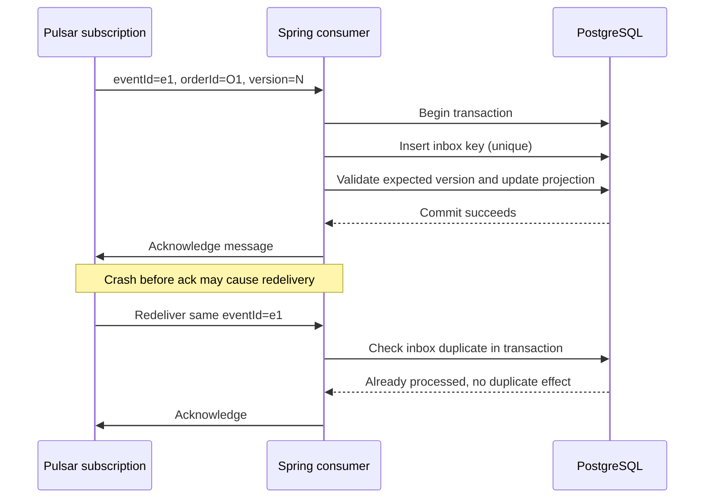

Điểm thiết yếu:

1. **Business data + inbox record** được ghi trong cùng PostgreSQL transaction khi cùng database.
2. Dùng unique constraint, không chỉ `exists()` rồi `save()` ngoài transaction.
3. Không gọi HTTP hoặc broker rồi nghĩ rollback SQL undo remote side effect.
4. DB commit có thể thành công nhưng ack Pulsar thất bại, khiến redelivery bình thường.
5. Nếu ack trước DB commit, consumer chết sau ack có thể làm **mất công việc**.
6. Nếu inbox record được ghi trước nhưng business side effect không nằm cùng transaction, phải dùng trạng thái `PENDING/COMPLETED`, compensation hoặc idempotency ở phía ngoài.
7. Stable eventId của producer khác với broker MessageId.
8. Khi event gap, không ack như thành công nếu chưa có durable pending-event/reconciliation workflow.

**Chọn Key_Shared giúp giảm contention cùng orderId, nhưng transaction/unique keys mới bảo vệ sự đúng đắn sau crash/retry và concurrent claims.**

## 35. Transactional outbox: DB commit và Pulsar publish không atomic mặc định

Một service Spring Boot nhận HTTP POST, tạo order trong PostgreSQL rồi publish Pulsar ngay trong method `@Transactional`:

```java
@Transactional
public void createOrder(CreateOrderCommand command) {
    orderRepository.save(command.toEntity());
    pulsarTemplate.send("orders.events", command.toJson());
}
```

Đây là pseudocode với các types/services do ứng dụng định nghĩa. **`@Transactional` theo JDBC/JPA manager không tự đồng bộ commit với Pulsar**:

- DB rollback sau khi broker đã nhận → consumer thấy event không có order.
- DB commit thành công nhưng broker unavailable → mất event nếu không lưu intent.
- Producer timeout sau broker accept → outcome có thể chưa chắc chắn, retry có thể tạo thêm bản tin.
- Nếu send không có key, Key_Shared ở downstream không bảo đảm nhóm theo orderId.

**Transactional outbox**:

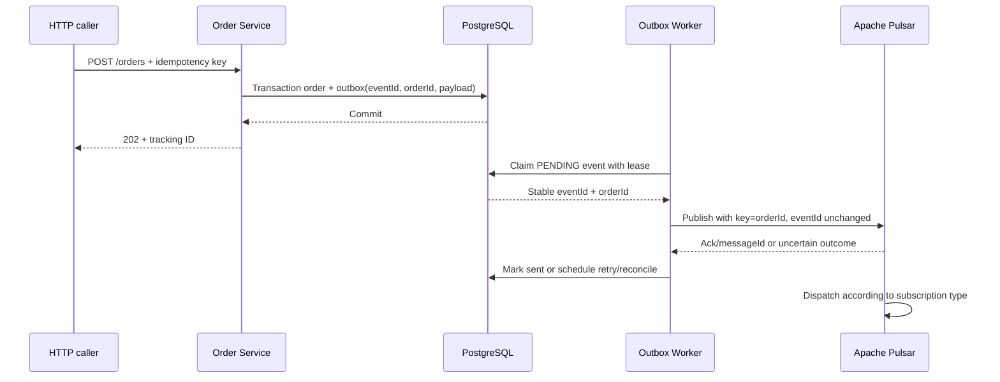

Outbox giữ **intent bền vững** qua application restart. Nhưng nó chủ yếu hướng tới **at-least-once publish**; khi producer gửi lại do unknown outcome, consumer phải dùng inbox/eventId để không nhân đôi side effect.

Pulsar hỗ trợ **transaction-related APIs** ở những phiên bản/cấu hình nhất định, nhưng transaction trong Pulsar **không tự gộp** vào PostgreSQL JDBC transaction. Nếu muốn atomicity xuyên hệ thống cần một cơ chế coordination được thiết kế riêng; đừng nhầm Pulsar transaction với distributed XA transaction mặc định.

## 36. Chọn subscription type theo từng bước

Thay vì chọn enum trước, hãy bắt đầu từ invariant và topology.

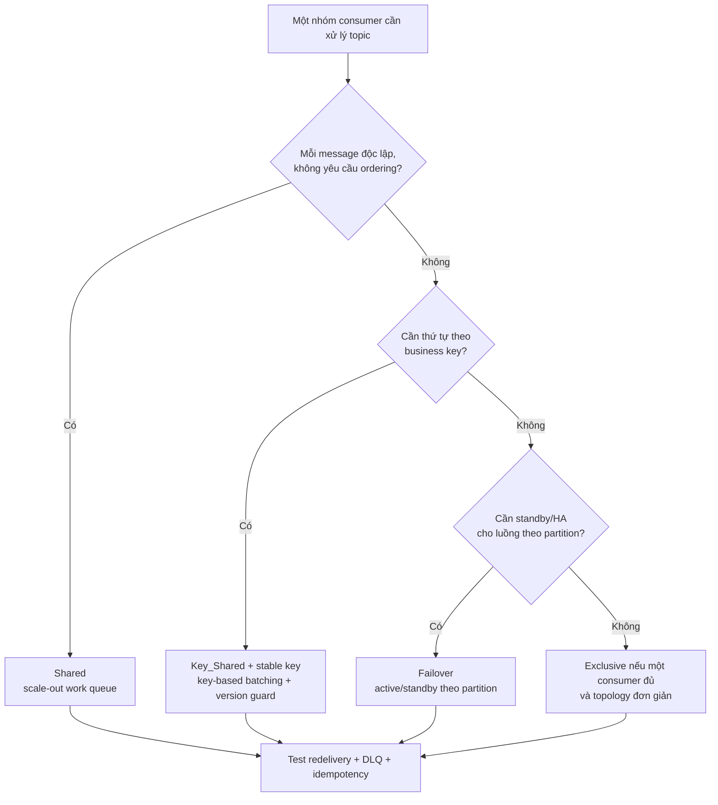

Một số câu hỏi bắt buộc trước khi đưa vào production:

1. **Đơn vị cần giữ thứ tự là gì?** Toàn topic, partition, orderId hay SKU?
2. **Đầu vào có stable key không?** Key có thể null, thay đổi hoặc sinh ngẫu nhiên theo attempt?
3. **Có nhiều producers không?** Ai gán aggregate sequence/version?
4. **Topic có bao nhiêu partitions?** Có kế hoạch tăng partition count không?
5. **Một key có thể chiếm hầu hết traffic không?** Có head-of-line blocking?
6. **Một worker mất kết nối thì ai nhận backlog?** Failover và scale-in được kiểm thử chưa?
7. **Ack sau hành động nào?** Sau DB commit, sau HTTP partner confirmation, hay sau durable intent?
8. **Có retry/DLQ không?** Sự kiện N+1 có được chạy khi N ở DLQ không?
9. **Hệ thống cần fan-out tới mấy nhóm?** Tạo subscriptions khác tên thay vì cùng subscription tranh message.
10. **Có SLAs thời gian và retention không?** Backlog bị expire/quota trước khi xử lý?
11. **Client/framework versions hỗ trợ chính sách nào?** Cần thử chính xác khi bật batching và Key_Shared.
12. **Lỗi trùng/lệch thứ tự được phát hiện ở DB chưa?** Không dừng ở broker configuration.

**Kết luận nhanh:** Shared cho công việc độc lập; Key_Shared cho per-key processing; Failover cho active/standby theo luồng/partition; Exclusive cho một consumer đơn giản. Cả bốn vẫn cần xử lý lỗi và idempotency.

## 37. So sánh với Kafka consumer group và RabbitMQ queue

Pulsar, Kafka và RabbitMQ đều hỗ trợ message-driven integrations nhưng không có cấu hình hoàn toàn tương đương.

| Mục tiêu | Pulsar | Kafka | RabbitMQ AMQP |
| --- | --- | --- | --- |
| Fan-out tới nhiều nhóm độc lập | Nhiều subscription names | Nhiều consumer groups | Nhiều queues/bindings |
| Scale work độc lập | `Shared` | Partitions/consumer group | Competing consumers |
| Thứ tự theo key | `Key_Shared` + routing/constraints | Key → partition + per-partition processing | Cần routing/queue design và consumer serialization |
| Dự phòng một active consumer | `Failover` | Consumer assignment theo partitions; không cùng semantics | Single-active-consumer hoặc consumer priority theo broker |
| Xác nhận xử lý | Ack/cursor theo subscription | Commit offsets theo group | Ack/nack/delivery tags |
| Retry/DLQ | Negative ack, retry topic, DLQ policy | Retry topics/DLT theo ứng dụng/framework | Dead-letter exchange/queue policies |
| Cursor/retention | Subscription cursor/backlog + retention policy | Topic log offsets + retention | Queue lifecycle/TTL/retention theo broker |

**Đừng dùng thuật ngữ “Kafka partition offset” để mô tả Pulsar Shared ack.** Shared/Key_Shared có individual acknowledgement và cursor semantics khác kiểu commit một offset duy nhất.

Tương tự, không dùng RabbitMQ `basicNack(requeue=false)` như thể đó là Pulsar `negativeAcknowledge`. Việc gửi tới DLQ và số lần retry phụ thuộc chính sách cụ thể của broker/framework.

## 38. Ma trận kiểm thử: phải có ít nhất hai consumers và nhiều keys

Một test chỉ chạy một consumer/partition không chứng minh Shared khác Key_Shared. Nên chuẩn bị **topic riêng cho test**, nhiều consumers cùng subscription và các messages có metadata để đối chiếu.

| Test case | Thiết lập | Kỳ vọng/quan sát |
| --- | --- | --- |
| Exclusive, consumer thứ hai | 2 consumers, 1 subscription | Không cùng nhận khi chế độ Exclusive |
| Failover, consumer chính mất kết nối | 2 consumers, non-partitioned topic | Standby nhận tiếp, unacked có thể redeliver |
| Failover partitioned | 4 partitions, 3 consumers | Active assignment theo partitions, không khẳng định global order |
| Shared nhiều workers | 4 consumers, messages xen kẽ key | Phân phối workload, không giả per-key order |
| Key_Shared nhiều keys | 3 consumers, 10 keys, nhiều seq | Cùng key được nhóm theo chính sách, thứ tự dispatch phù hợp |
| Key_Shared + default batching | Producer batching mixed keys | Phát hiện setup có thể phá key routing |
| Key_Shared + key-based batching | Producer `BatcherBuilder.KEY_BASED` | Test routing/ordering expectation |
| Key_Shared scale-in/out | Consumer join/leave trong khi in-flight | Đánh giá rebalance/unacked và business version guard |
| Shared duplicate | Crash sau DB commit trước ack | Event replay nhưng business effect chỉ một lần |
| Missing key | Producer gửi message không key | Consumer/quarantine theo contract, không áp state |
| Hot key | 80% events cùng key | Chỉ một lane bottleneck; có lag/cảnh báo |
| Order version gap | Seq=2 đến trước seq=1 | Không commit state v2 khi v1 thiếu |
| Poison + valid message | JSON invalid rồi hợp lệ | Poison được cô lập, không mất event hợp lệ |
| DLQ + per-key sequence gap | Seq=N vào DLQ, N+1 xuất hiện | N+1 được park hoặc reconcile |
| Reset cursor hoặc subscription rename | Giữ data/backlog thực tế | Đánh giá replay/missed messages |
| Topic partition expansion | Key routing trước/sau tăng partitions | Đánh giá order migrations |
| Broker failover/connection reset | Producer/consumer reconnect | Không double-apply business effect |
| Backlog storage quota | Consumer dừng dài hạn | Alert trước expiry/quota/retention breach |

Các assertions nên đo **cả ba lớp**:

- **Delivery:** consumer nào nhận, key/partition/messageId/redelivery count và sequence.
- **Business state:** phiên bản cuối trong PostgreSQL, số lần HTTP side effect và inbox uniqueness.
- **Reliability:** tổng eventId được xử lý/park/quarantine, không có mất hoặc nhân đôi hiệu ứng.

Không chỉ assert “100 messages được nhận” rồi kết luận thứ tự và idempotency đã đúng.

## 39. Test bằng Pulsar broker thật: cách tổ chức

Có thể dùng **Pulsar standalone trong container cô lập** hoặc Testcontainers module phù hợp phiên bản để chạy integration tests. Spring Boot test context và Pulsar admin/tenant/namespace/topic provisioning phải thống nhất.

Một khung kiểm thử:

```text
Arrange
  1. Start Pulsar broker test instance.
  2. Create persistent partitioned topic test/orders.events (e.g. 4).
  3. Create 3 consumers on subscription shipping-it with Key_Shared.
  4. Create producer with message key=orderId,
     batching disabled or KEY_BASED.
Act
  5. Publish interleaved sequences for 10 orderIds.
  6. Introduce slow processing, negative ack, consumer restart.
Assert
  7. Capture per-key dispatch/processing traces.
  8. Assert database aggregateVersion evolves monotonically.
  9. Assert eventId unique business effect, even on redelivery.
 10. Verify DLQ/parked messages and backlog after failures.
Cleanup
 11. Close consumers/producers/client.
 12. Delete isolated test topic/subscription if policy allows.
```

Không hardcode `pulsar://localhost:6650` trong CI nếu container dùng mapped host port động. Đưa `serviceUrl` và admin endpoint từ test container vào Spring Boot config được kiểm soát; dùng image và client tương thích BOM/version.

**Không dùng topic production cho integration test.** Test có thể reset cursor, tạo subscription, poison/DLQ messages và làm lệch metrics của luồng thật.

### Test đơn vị với fake processor vẫn có ích

Không cần broker cho logic:

- Validate eventId/key/schemaVersion.
- So incoming `aggregateVersion` với current version.
- Quy tắc duplicate/gap/conflict.
- Mapping domain exceptions sang transient/permanent.
- Business idempotency state machine.

Nhưng test đó **không chứng minh** broker phân phối Shared/Key_Shared/Failover đúng. Đường ack/redelivery/batching cần broker-backed integration tests.

## 40. Quan sát trạng thái subscription và ordering bằng metrics

Những tín hiệu nên có ở cả broker, client và business service:

| Metric/tín hiệu | Mục đích | Diễn giải cẩn thận |
| --- | --- | --- |
| Topic incoming publish rate | Producer đang tạo tải bao nhiêu? | Không đồng nghĩa business effect thành công |
| Subscription backlog | Có bao nhiêu message chưa tiêu thụ? | Bao gồm semantics cursor/unacked, không phải luôn một offset |
| Oldest backlog age | SLA xử lý event bị trễ bao lâu? | Cần retention/backlog quota |
| Consumer count/active consumers | Có đủ workers? Failover ai active? | Phụ thuộc subscription type/partitions |
| Dispatch rate | Broker giao messages ở tốc độ nào? | Có thể nhiều hơn business completion do redelivery |
| Ack rate | Có message nào được xác nhận? | Không xác thực DB state nếu ack sớm |
| Redelivery count/rate | Bao nhiêu messages bị gửi lại? | Phân biệt transient, poison và crash |
| Negative ack/ack timeout | Handler hoặc downstream có gặp lỗi/treo? | Cần correlation với SQL/HTTP |
| DLQ/retry backlog age | Có lỗi cố định chưa được xử lý? | Bẫy “DLQ thành công” |
| Per-key lag/hot hash ranges | Key nào có thể nghẽn? | Không dùng raw key làm metric labels |
| Business aggregate version gaps | Có seq thiếu/out-of-order? | Đo tại DB/consumer, broker metric không đủ |
| Inbox duplicate count | Consumer ngăn được bao nhiêu replay? | Không có nghĩa producer không publish lặp |
| SQL transaction latency | DB có giữ ack lâu? | Tăng ack timeout không tự sửa DB |
| Outbox oldest pending age | Intent publish bị kẹt sau SQL commit? | Tách khỏi Pulsar backlog |
| Failed HTTP side effects | Remote dependency đang làm chậm consumer? | Dùng stable idempotency key |

**Cardinality:** không đưa `orderId`, `paymentId`, full message key, eventId hoặc payload chứa PII thành time-series labels. Có thể dùng sampling/logs/traces có quyền truy cập phù hợp; với hot keys, lưu hashed/anonymized key samples theo chính sách bảo mật.

Ở dashboard, tách **broker-side dispatch success** khỏi **business-side success**. Một subscription có backlog 0 nhưng inbox thiếu events có thể báo ack sớm hoặc xử lý lỗi bị nuốt.

## 41. Capacity planning: consumers, partitions và key cardinality

Một hệ thống có 3 triệu events/ngày không nhất thiết cần hàng trăm consumers. Công thức sơ bộ:

```text
averageInputRate = 3_000_000 / 86_400 ~= 34.7 events/second

if averageProcessingTime = 200 ms:
  one serial worker theoretical capacity ~= 5 events/second

capacity needed for steady state:
  >= inputRate * processingTime
  >= 34.7 * 0.2 ~= 6.94 concurrent work slots
```

Đây chỉ là phép tính trung bình để hình dung, **không** phải benchmark hay capacity guarantee: peak traffic, skew, HTTP latency p99, database locks, broker batching, retries và safety headroom có thể khiến nhu cầu cao hơn nhiều.

Điều quan trọng theo subscription:

- Exclusive với consumer thực hiện tuần tự mỗi 200 ms có trần khoảng 5 msg/s, cần tối ưu/đổi mô hình nếu không đủ.
- Failover với partitioned topic có thể dùng nhiều active partitions, nhưng hot partition vẫn nghẽn.
- Shared có thể tăng consumers để chia công việc độc lập, giới hạn bởi broker/DB/downstream quota.
- Key_Shared cần **đủ distinct active keys**; nếu chỉ một key bận, 100 consumers vẫn không giải quyết được ordering bottleneck.
- Tăng partitions có thể giúp phân tải nhưng **không phải thay đổi miễn phí** khi keys cần thứ tự: routing migration, consumer assignment và storage có tác động.

Hãy tính **budget cho SQL connections, HTTP concurrent calls, message prefetch, memory và retry attempts** cùng broker consumer count. Nếu 30 consumers mỗi consumer gọi HTTP 10 requests đồng thời, partner có thể nhận tới 300 in-flight calls; subscription type không tự áp rate limit.

## 42. Đổi subscription type trên hệ thống đang chạy: kế hoạch migration

Giả sử Shipping Service ban đầu dùng Shared, nay muốn Key_Shared vì cần per-order ordering. **Chỉ đổi enum và redeploy cả cluster ngay** có nhiều rủi ro:

- Cùng subscription đang có consumers kiểu Shared hoạt động; consumer mới Key_Shared có thể bị từ chối hoặc làm thay đổi semantics theo broker/version.
- Unacked/backlog cũ có thể đã được phân phối không theo key.
- Producer trước đây không đặt message key hoặc đang dùng default batching.
- Một số messages trong retry topic/DLQ mang key/metadata không thống nhất.
- Cả code cũ và mới có thể ghi cùng projection bằng hai thứ tự.
- Topic partition routing có thể không ổn định sau cấu hình mới.
- Spring listener có thể đã ack khi asynchronous business processing chưa hoàn tất.

Kế hoạch an toàn hơn:

1. **Chốt invariant**: thứ tự theo orderId và cách kiểm tra `aggregateVersion`.
2. **Thêm producer key** và schema validation trước, có test cho mọi event types/producer apps.
3. **Cấu hình key-based batching** hoặc disable batching, test with multiple keys.
4. **Bổ sung inbox + version guard**, để code hiện tại không thể áp trạng thái sai.
5. **Đánh giá backlogs/cursors/retry/DLQ** và chọn chiến lược drain/quiesce hay tạo subscription mới với replay có kiểm soát.
6. **Tách thời điểm ngừng consumers cũ** khỏi lúc consumer mới subscribe; không trộn modes bất kỳ.
7. **Khởi chạy Key_Shared trên test/staging** có scale in/out, crash và throughput gần thực.
8. **Nếu tạo subscription mới**, chọn Earliest/Latest/cursor position có chủ đích, không mặc nhiên dùng tên ngẫu nhiên.
9. **Verify** pending/processed counts, aggregateVersion gaps, duplicate counts và partner side effects.
10. **Có rollback/canary plan**: nếu quay lại Shared phải duy trì database version guard và hiểu messages đã replay/chuyển cursor.

Một số thay đổi cấu hình broker cần admin action; không được xóa production subscription/cursor tự động từ app start chỉ để giải quyết subscription type mismatch.

## 43. Những lỗi phổ biến và cách chẩn đoán

| Triệu chứng | Nguyên nhân khả dĩ | Hướng điều tra |
| --- | --- | --- |
| Consumer thứ hai không subscribe được | Exclusive chỉ cho một consumer | Subscription name/type, active consumers |
| Failover có nhiều active consumers | Topic partitioned, active theo partition | Partition assignment, consumer names |
| Shared xử lý seq=3 trước seq=2 | Không có order guarantee | Subscription type, thread pool, DB commit |
| Key_Shared vẫn đảo key routing | Producer thiếu key/default batching, version-specific rebalance | Key metadata, batcher, hash ranges |
| Cùng key đi qua nhiều partitions | Partition count/routing thay đổi hoặc producer config khác | Producer routing logs, partition metadata |
| Key_Shared throughput không tăng | Một hot key hoặc ít keys hoạt động | Key skew, processing latency |
| Bản tin xử lý hai lần | DB commit trước ack, reconnect/redelivery | Business eventId, inbox unique |
| Message bị replay sau deploy | Tên subscription mới, cursor reset | Initial position, retention, subscription history |
| Message không tới Analytics | Analytics dùng chung subscription Shipping | Subscription name/fan-out design |
| Consumer nhận nhưng không áp state | aggregateVersion gap/conflict | Missing event, reordering, retry topic |
| Lỗi schema lặp vô hạn | Poison + negative ack không có DLQ | SchemaVersion, DLQ/backoff policy |
| Message có trong DLQ nhưng order sai | N bị quarantine, N+1 tiếp tục | Per-key gap policy, reconciliation |
| Backlog tăng sau scale consumers | DB/HTTP bottleneck, hot key, retry storm | Lag age, connection pool, key skew |
| Consumer ack nhưng DB row thiếu | Ack trước transaction commit hoặc xử lý async | Listener ack mode, transaction boundaries |
| Ack timeout tăng redelivery | Processing time > ack timeout | DB locks, HTTP latency, timeout |
| Listener startup fail | Wrong service URL/auth/schema/topic | Pulsar client config, tenant/namespace |
| Mismatch Spring listener type | Annotation/custom listener factory dùng modes khác | Bean wiring, effective subscription type |
| Topic retention dẫn đến mất replay | Backlog quota/TTL/retention policy | Broker policies, subscription cursor |
| Producer retry gây trùng | Unknown publish outcome, eventId mới mỗi attempt | Outbox, stable business ID |
| Mất thứ tự khi tăng partitions | Key routing topology thay đổi | Partition expansion plan, version guard |

### Decision tree

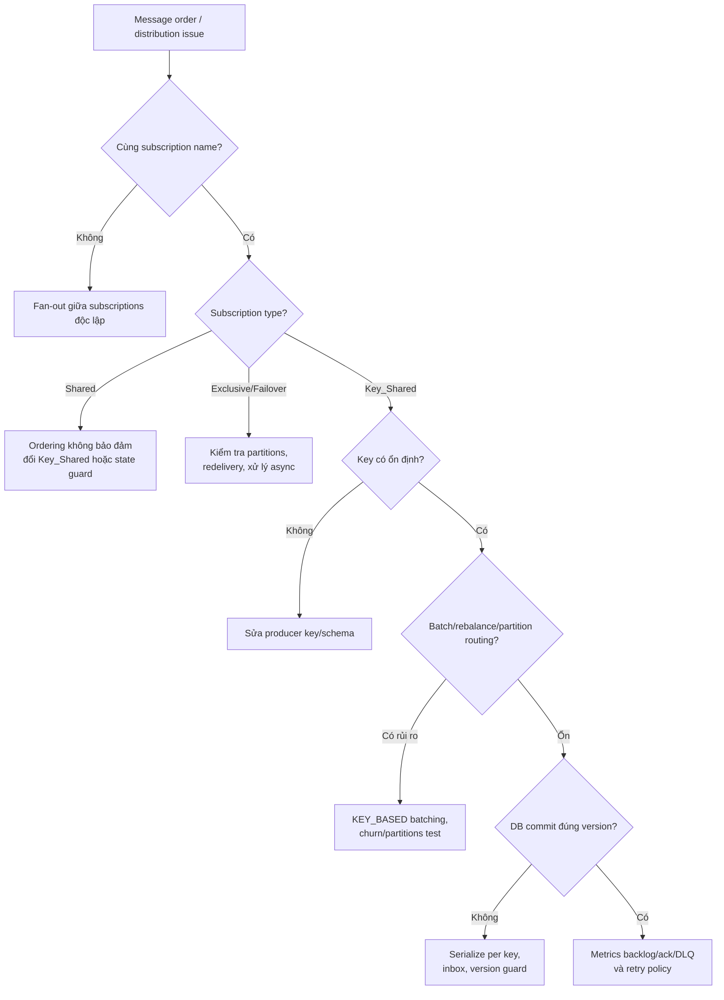

**Không chữa sai tầng:** tăng số consumers Shared không thể tạo ordering guarantee. Chuyển Shared sang Key_Shared không tự sửa consumer async commit sai. Reset cursor hoặc xóa subscription không chữa một producer đang publish thiếu key.

## 44. Case study: xử lý thanh toán theo orderId trong 6 replicas

Một nền tảng thương mại có:

- 6 replicas Spring Boot Shipping/Payment integration service.
- Topic `persistent://commerce/orders/orders.events` với 8 partitions.
- Producer gửi `OrderCreated`, `PaymentConfirmed`, `OrderCancelled`.
- Spring listener dùng Shared để tăng throughput.
- Hai events của `ORD-501` được giao cho hai pods; pod nhận cancel nhanh hơn pod xử lý created.
- Một số `PaymentConfirmed` bị redeliver vì DB timeout.
- Producer bật batching mặc định và chưa đặt key ổn định.
- Team dự định đổi subscription type thành Key_Shared mà không chỉnh các phần khác.

### Phân tích và giải pháp

**Bước 1 — Xác định ordering scope.** Chỉ cần bảo đảm theo **orderId**. Không cần order tổng giữa ORD-501 và ORD-502.

**Bước 2 — Chốt producer contract.** Mọi event của một order dùng `key=orderId`, `eventId` bất biến và `aggregateVersion` tăng từ state owner. Đừng có producer A dùng `customerId` trong khi producer B dùng `orderId`.

**Bước 3 — Sửa batching.** Tắt batching tạm hoặc dùng `BatcherBuilder.KEY_BASED`; kiểm tra với nhiều producers và keys thực tế.

**Bước 4 — Bổ sung database guards.** Bảng inbox có unique key và bảng projection có aggregateVersion. Không commit v3 khi v2 chưa có; có durable pending/reconciliation policy.

**Bước 5 — Giảm side effects trong listener.** Không fire-and-forget HTTP calls. Nếu cần gọi payment partner, dùng stable `Idempotency-Key`, trạng thái `UNKNOWN` và reconciliation khi timeout.

**Bước 6 — Chọn Key_Shared.** Cho các events cùng order được nhóm về một consumer theo subscription policy, scale giữa orders. Giữ tên subscription có kế hoạch, không trộn 2 modes trong lúc rollout.

**Bước 7 — Test failure windows.** Gửi seq=1,2,3 xen kẽ trên 20 orders; crash pod sau DB commit trước ack, scale 3→6→2 consumers, gây network timeout và replay. Assert mỗi business side effect đúng một lần.

**Bước 8 — DLQ/gap.** Nếu seq=2 không thể deserialize, không tự xử lý seq=3 như bình thường; park/reconcile để không bỏ qua state transition.

**Bước 9 — Capacity.** 8 partitions không có nghĩa có 8 hoặc 6 lanes cho mọi order. Nếu một order chiếm 60% workload, đó vẫn là một hot key; tối ưu pipeline hoặc điều chỉnh business invariant.

**Bước 10 — Observability.** Dashboard có topic backlog, oldest age, active consumers, redelivery, DLQ, inbox duplicates, aggregate version gaps và p99 DB/HTTP latency.

**Kết quả kỳ vọng:** các orders khác nhau xử lý song song, cùng order không bị **áp dụng trạng thái sai**, và sau broker/consumer failure vẫn replay an toàn. Đây là kết quả kết hợp **Key_Shared + producer key contract + DB version guard + idempotency**, không phải chỉ nhờ subscription enum.

## 45. Bài tập tự đánh giá

### A. Chọn loại subscription cho gửi email

**Đề:** 12 email notifications độc lập cần được gửi nhanh qua 4 workers. Không có ordering requirement giữa emails; phải retry khi SMTP lỗi.

**Đáp án gợi ý:** `Shared`, với individual ack, bounded retry/backoff, idempotent email identity nếu có nguy cơ resend và DLQ khi lỗi cố định. Không cần Key_Shared chỉ để tăng throughput.

### B. Failover nhưng nhìn thấy 3 consumers đang active

**Đề:** Consumer group `audit-v1` dùng Failover, topic có 8 partitions và 3 consumers. Dashboard cho thấy cả 3 đang xử lý.

**Đáp án gợi ý:** Không nhất thiết sai: active assignments có thể theo partition, nên nhiều consumers cùng hoạt động trên các partitions khác nhau. Kiểm tra partition ownership và semantics broker; không suy một active cho toàn bộ logical topic.

### C. Key_Shared nhưng cùng orderId hoàn tất lệch thứ tự

**Đề:** Listener nhận seq=10 rồi seq=11 nhưng dùng `runAsync` để gọi HTTP. Seq=11 commit DB trước seq=10.

**Đáp án gợi ý:** Key_Shared không tuần tự hóa các tác vụ bất đồng bộ của app. Bảo vệ bằng aggregateVersion/transaction, serialize per key và ack sau completion, không ack khi vừa schedule task.

### D. Topic tăng partitions từ 4 lên 12

**Đề:** Một producer hash `orderId` vào partitions, sau scaling số partitions thay đổi. Team vẫn khẳng định cùng key luôn có thứ tự tuyệt đối.

**Đáp án gợi ý:** Routing key→partition có thể thay đổi tùy thuật toán khi partition count đổi. Phải có migration/fencing/version guard và test placement của old/new messages. Không nâng partitions như một thay đổi vô hại cho ordering.

### E. Poison event giữa chuỗi

**Đề:** `OrderCreated seq=1` thành công, `PaymentConfirmed seq=2` có schema sai vào DLQ, `OrderCancelled seq=3` tới ngay sau.

**Đáp án gợi ý:** Không áp seq=3 nếu state machine yêu cầu đã xử lý seq=2. Quarantine/park chuỗi theo key, cảnh báo và sửa schema/đối soát trước khi tiến tiếp; DLQ message không đồng nghĩa bước nghiệp vụ đã hoàn tất.

### F. New subscription Earliest

**Đề:** Đội Analytics đổi subscription từ `analytics-v1` sang `analytics-v2` và chọn Earliest. Tại sao analytics counters tăng gấp đôi?

**Đáp án gợi ý:** v2 là subscription mới với cursor riêng, có thể replay dữ liệu còn trong retention. Cần quyết định replay scope, idempotent sinks và chiến lược chuyển group; không tự reset history để “chỉ tiếp tục”.

## 46. Anti-pattern cần loại bỏ

1. **Chọn Shared nhưng kỳ vọng per-key ordering.** Shared phân phối công việc, không bảo đảm thứ tự.
2. **Chọn Exclusive để có exactly-once.** Một consumer vẫn có redelivery/duplicate sau crash.
3. **Hiểu Failover luôn có một active consumer toàn topic.** Partitioned topic có active assignments theo partitions.
4. **Chọn Key_Shared nhưng producer không đặt key.** Routing không phản ánh business entity.
5. **Dùng producer default batching cho Key_Shared mà không test.** Batches trộn keys có thể phá kỳ vọng phân phối.
6. **Tưởng một consumer đồng nghĩa serial DB commits.** Async handlers có thể hoàn thành đảo thứ tự.
7. **Không có aggregateVersion/sequence trong payload.** Không phát hiện gaps hoặc state transitions sai.
8. **Dựa vào MessageId làm business eventId.** Retry publish có ID broker khác.
9. **Ack trước khi DB commit.** Crash có thể mất tác vụ dù broker tin đã xử lý.
10. **Nuốt exception rồi return từ listener.** Container có thể auto-ack khi nghiệp vụ thất bại.
11. **Negative-ack JSON hỏng vô hạn.** Poison loop, backlog phình to.
12. **Cho seq=N+1 đi tiếp khi N ở DLQ.** State machine có thể bị bỏ một bước bắt buộc.
13. **Dùng retry topic mà không guard ordering.** Retry có thể đến sau các event mới.
14. **Tăng số consumers để chữa một hot key.** Per-key serialization giới hạn một lane.
15. **Tăng partitions không có migration plan.** Key mapping/order có thể thay đổi.
16. **Tạo subscription name mới theo pod ID.** Tạo nhóm/cursor mới và gây replay/lag không mong muốn.
17. **Dùng chung subscription cho hai nghiệp vụ muốn fan-out.** Chúng cạnh tranh nhận message.
18. **Xóa subscription/reset cursor để chữa backlog.** Có thể mất hoặc replay dữ liệu.
19. **Không có retention/backlog quota policy.** Message có thể expire trước khi xử lý.
20. **Cho mọi consumer tự gọi remote HTTP không có idempotency.** Redelivery nhân đôi side effect.
21. **Nghĩ JDBC @Transactional commit cùng Pulsar publish.** Không có distributed atomicity mặc định.
22. **Dùng object key có PII/raw tenant data làm metric label.** Lộ thông tin và cardinality cao.
23. **Test một consumer và một key rồi kết luận Key_Shared đúng.** Không kiểm tra rebalance/batching.
24. **Không kiểm thử failover/crash sau DB commit trước ack.** Không chứng minh duplicate safety.
25. **Trộn Spring listener ack mode với native ack tùy tiện.** Dễ double-ack hoặc ack sớm.

## 47. Checklist production cho lựa chọn subscription type

- [ ] Chủ đề thật sự cần thứ tự là **per-topic, per-partition hay per-key**?
- [ ] Chọn subscription type từ invariant chứ không phải từ số lượng pods.
- [ ] Fan-out dùng **subscription names riêng** cho các nhóm nghiệp vụ.
- [ ] Tên subscription ổn định qua deploy; initial position được kiểm soát khi tạo mới.
- [ ] Producer đặt stable key và business eventId cho messages cần Key_Shared.
- [ ] Key không bị đổi theo retry, service hoặc format JSON; kiểm tra key/payload consistency.
- [ ] Key-based batching hoặc disable batching được cấu hình cho Key_Shared.
- [ ] Đã kiểm tra hash range policy, key skew, consumer churn và partition expansion.
- [ ] Không khẳng định global order trên partitioned topics hoặc nhiều producers.
- [ ] Handler không fire-and-forget rồi ack khi side effects chưa hoàn tất.
- [ ] Individual ack dùng đúng trên Shared/Key_Shared, không cumulative ack nhầm.
- [ ] Ack timeout/negative ack delay có giới hạn và phù hợp processing SLO.
- [ ] Retry topic, DLQ và redelivery policy được test trên broker đúng phiên bản.
- [ ] Khi seq=N bị lỗi, state machine có chính sách park/reconcile N+1.
- [ ] JSON/schema version, message key, eventId, aggregateVersion được validate.
- [ ] Unique constraint inbox và business state transition được thực thi trong transaction phù hợp.
- [ ] Ack chỉ sau khi business state/durable intent được commit.
- [ ] Outbox bảo toàn event publish intent khi DB commit nhưng Pulsar unavailable.
- [ ] HTTP side effects dùng stable idempotency key và xử lý unknown outcome.
- [ ] Có retention, backlog quotas, topic permissions/TLS và credential management.
- [ ] Có consumer count/active partition ownership, backlog age, ack/redelivery/DLQ metrics.
- [ ] Không đưa raw keys/PII/eventIds vào high-cardinality metric labels.
- [ ] Test nhiều keys, nhiều consumers, nhiều partitions, batching và scale-in/out.
- [ ] Test crash sau DB commit trước ack và retry sau producer unknown outcome.
- [ ] Test đổi subscription type, reset cursor/rename, retention và partition expansion trước khi production áp dụng.
- [ ] Khi nâng version Spring for Apache Pulsar/Pulsar client, kiểm tra listener config, ack semantics và broker compatibility.

**Ghi nhớ:** **Exclusive** đơn giản hóa một consumer; **Failover** cho dự phòng theo topic/partition; **Shared** chia việc độc lập nhưng không giữ thứ tự; **Key_Shared** cho phân phối theo key với các điều kiện về producer keys, batching và rebalancing. Thứ tự **broker dispatch** không thay thế thứ tự **database commit**, nên các luồng **SPRING_BOOT_INTEGRATION** vẫn cần business sequence, unique event ID, inbox/outbox, retry có kiểm soát và kiểm thử lỗi thực.

## Tài liệu tham khảo

- [Apache Pulsar Concepts – Messaging](https://pulsar.apache.org/docs/next/concepts-messaging/): topics, producers, consumers, subscriptions và message keys.
- [Apache Pulsar Concepts – Messaging – Subscription Types](https://pulsar.apache.org/docs/next/concepts-messaging/#subscription-types): Exclusive, Failover, Shared và Key_Shared.
- [Apache Pulsar Concepts – Architecture Overview](https://pulsar.apache.org/docs/next/concepts-architecture-overview/): brokers, partitions, BookKeeper storage và cursors.
- [Apache Pulsar Java Client Documentation](https://pulsar.apache.org/docs/next/client-libraries-java/): ProducerBuilder, ConsumerBuilder, ack/redelivery và schema.
- [Apache Pulsar Concepts – Retention and Expiry](https://pulsar.apache.org/docs/next/concepts-messaging/#message-retention-and-expiry): backlog và retention policies.
- [Apache Pulsar Administration – Manage Topics](https://pulsar.apache.org/docs/next/admin-api-topics/): partitioned topics, subscriptions và reset/seek.
- [Spring for Apache Pulsar Reference](https://docs.spring.io/spring-pulsar/reference/): PulsarTemplate, @PulsarListener, listener containers, properties và transactions.
- [Spring Boot Reference – Apache Pulsar](https://docs.spring.io/spring-boot/reference/messaging/pulsar.html): Spring Boot auto-configuration, client/admin endpoint và listener.
- [Spring Boot Reference – Testcontainers](https://docs.spring.io/spring-boot/reference/testing/testcontainers.html): broker-backed integration test environments.
- [Spring Framework Reference – Transaction Management](https://docs.spring.io/spring-framework/reference/data-access/transaction.html): local database transactions và ranh giới commit.
- [PostgreSQL Documentation](https://www.postgresql.org/docs/): unique constraints, transaction isolation và optimistic version guards.

Các liên kết `next` có thể mô tả phiên bản mới hơn môi trường đang chạy. Khi áp dụng, đối chiếu **Pulsar broker/client version, Spring Boot BOM, Spring for Apache Pulsar version, subscription configuration, batching policy và retention settings**; kiểm thử đủ producer–broker–consumer–database dưới tình huống restart và redelivery trước khi đưa vào production.
