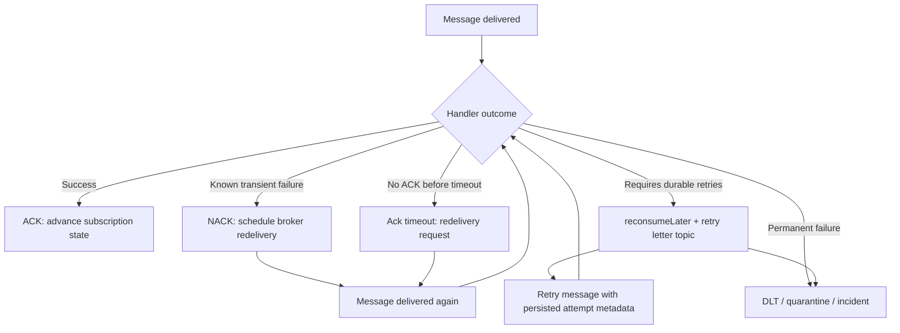
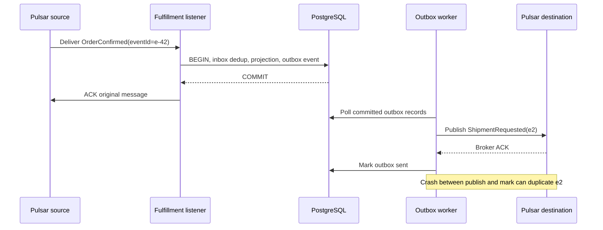
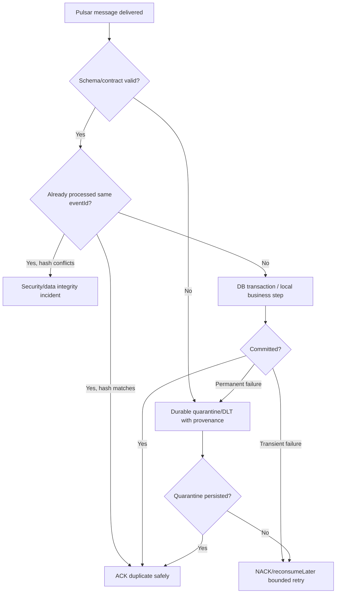
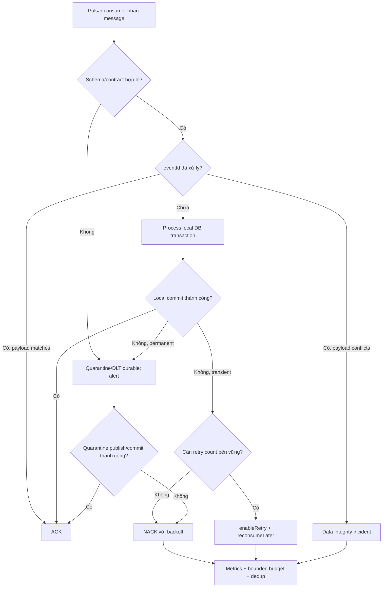

# Acknowledgement, negative acknowledgement và redelivery

> **Chương:** Apache Pulsar  
> **Module:** SPRING_BOOT_INTEGRATION — tổ chức tích hợp hệ thống trong Spring Boot qua HTTP client, cơ sở dữ liệu, cache, broker thông điệp và các adapter Spring Integration. Trọng tâm: cấu hình, hợp đồng dữ liệu, giao dịch, xử lý lỗi/trùng lặp, kiểm thử và quan sát các luồng tích hợp thực tế.

## 1. Khi nào một thông điệp được coi là đã xử lý?

Giả sử service giao hàng đọc sự kiện `OrderConfirmed` từ Apache Pulsar, ghi projection vào PostgreSQL, gọi HTTP partner và phát thêm sự kiện `ShipmentRequested`. Một event có thể được nhận nhiều lần vì consumer crash, network mất hoặc application chủ động yêu cầu phát lại. Nếu nhận event là lập tức ACK, hệ thống có nguy cơ mất nghiệp vụ khi database chưa commit; nếu không bao giờ ACK, backlog tăng và event bị đọc lặp.

```mermaid
sequenceDiagram
    participant P as Producer
    participant B as Pulsar broker + subscription
    participant C as Spring Boot consumer
    participant DB as PostgreSQL
    P->>B: Publish OrderConfirmed(eventId=e-42)
    B-->>C: Deliver messageId=m-101
    C->>DB: BEGIN; insert inbox + update order projection
    DB-->>C: COMMIT successful
    C->>B: ACK m-101
    Note over B,C: ACK báo message đã xử lý theo subscription
    B-->>C: Next message
```

Nếu tiến trình chết **sau DB commit, trước ACK**, Pulsar có thể redeliver `m-101` sau khi consumer reconnect/failover. Consumer phải phát hiện `eventId=e-42` đã xử lý để không gọi HTTP hoặc cập nhật nghiệp vụ hai lần.

**Nguyên tắc:** Pulsar acknowledgment là tín hiệu **trạng thái tiêu thụ theo subscription**, **không phải** lệnh commit PostgreSQL, rollback HTTP partner, hay bảo đảm exactly-once end-to-end.

### 1.1. Kết quả học tập

Sau bài này, người học có thể:

1. Phân biệt `ACK`, `NACK`, `acknowledgeCumulative`, `ackTimeout`, `redeliverUnacknowledgedMessages`, `reconsumeLater` và dead-letter topic.
2. Giải thích vai trò của `MessageId`, subscription cursor, backlog, unacked messages, retention và producer message batching.
3. Chọn ACK mode thích hợp cho subscription `Exclusive`, `Failover`, `Shared` và `Key_Shared`.
4. Cấu hình `Spring for Apache Pulsar` với listener `BATCH`, `RECORD` hoặc `MANUAL`, không ACK quá sớm.
5. Hiểu vì sao NACK làm redeliver nhưng có thể ảnh hưởng ordering/duplicate và vì sao retry count của NACK không hoàn toàn bền vững.
6. Sử dụng retry letter topic + `reconsumeLater` khi cần số lần thử bền vững, cùng chính sách DLT có giám sát.
7. Kết nối ACK sau PostgreSQL transaction, inbox/idempotency, transactional outbox, giới hạn retry và khả năng đối soát.
8. Kiểm thử broker thật, fault injection, consumer crash/restart, duplicate handling và các chỉ số vận hành.

### 1.2. Phạm vi phiên bản và cách dùng ví dụ

Ví dụ nhắm **Java 17+, Spring Boot 3.2–3.5, Spring for Apache Pulsar 1.x** cùng Apache Pulsar client/broker tương thích; đoạn Java client thuần tham chiếu APIs của Apache Pulsar 4.x. Với Spring Boot 4.x/Spring Pulsar 2.x hoặc các bản Pulsar mới hơn, cần kiểm tra BOM và import/API đã thay đổi. **Không tự nâng riêng client Pulsar trái với dependency management của Spring Boot** chỉ để có một cấu hình.

Một số đoạn được đánh dấu **fragment** nhằm minh họa hành vi; các ví dụ đầy đủ hơn đều có giả định schema, dependency và lifecycle được chỉ rõ. Không lấy ví dụ Docker development làm blueprint bảo mật cho production.

## 2. Subscription, MessageId và trạng thái ACK

Pulsar tổ chức thông điệp theo **tenant/namespace/topic**. Consumer kết nối vào một topic (có thể partitioned) với **subscription name**, và broker lưu trạng thái tiêu thụ cho subscription đó.

```text
Topic: persistent://commerce/orders/order-events-v1
    |
    +-- subscription: fulfillment-v1
    |       consumer A / consumer B -> shared workload
    |       its own ack cursor / backlog
    |
    +-- subscription: billing-v1
    |       different application, independent backlog/acks
    |
    +-- subscription: audit-v1
            independent delivery/ack progression
```

Một ACK trong `fulfillment-v1` không làm ACK cho `billing-v1`. Hai ứng dụng muốn **mỗi bên nhận đầy đủ events** cần hai subscription names độc lập; nhiều replicas muốn **chia việc** thì dùng cùng subscription name và loại subscription cho phép nhiều consumers.

### 2.1. MessageId không đồng nghĩa business event ID

| ID | Ví dụ | Dùng để làm gì? |
| --- | --- | --- |
| Pulsar `MessageId` | Ledger/entry/partition/batch index do broker/client cung cấp | ACK, NACK, seek, chẩn đoán và định vị record kỹ thuật |
| Application `eventId` | `order-42-confirmed-v3` | Idempotency/dedup business qua redelivery/republish |
| `aggregateId` | `order-42` | Ordering/grouping theo business entity |
| `schemaVersion` | `1` | Phân tích contract khi consumer evolve |
| `correlationId` | `req-a12` | Trace qua HTTP, DB, broker và downstream |

Không dùng duy nhất `MessageId` làm business dedup key. Cùng event nghiệp vụ có thể được **producer gửi lại thành hai messages khác MessageId**, hoặc DLT/retry letter topic tạo message mới có ID khác.

### 2.2. ACK và lưu trữ dữ liệu là hai chính sách khác nhau

Một consumer ACK thành công làm message được coi là đã xử lý **đối với subscription** đó. Việc bytes còn tồn tại trong topic phụ thuộc retention, compaction, TTL, các subscriptions khác và cách BookKeeper/Pulsar lưu ledger.

- **Backlog:** những messages chưa được xử lý/ACK theo subscription, không đồng nghĩa mọi bytes được lưu.
- **Retention:** chính sách cho phép giữ messages kể cả sau khi được ACK, theo namespace/topic policy.
- **TTL:** có thể expire những messages chưa ACK theo policy quản trị, gây mất cơ hội xử lý nếu quá hạn.
- **Subscription cursor:** trạng thái Pulsar theo dõi để tiếp tục tiêu thụ; không phải Kafka committed offset được lưu theo cùng mô hình.

**ACK không phải lệnh xóa một record ngay lập tức khỏi mọi nơi.** Ngược lại, backlog tồn tại không bảo đảm messages được giữ vĩnh viễn nếu TTL/quota/retention policy can thiệp.

### 2.3. Phân biệt delivery, processing và acknowledgment

```text
MESSAGE PUBLISHED
     ↓
BROKER DELIVERS TO CONSUMER
     ↓
APPLICATION PROCESSES (maybe DB/HTTP)
     ├── Success → ACK
     ├── Transient failure → NACK / retry
     ├── Poison pill → quarantine/DLT policy
     └── Crash before ACK → redelivery possible
```

Một record đã giao tới consumer **chưa chắc được xử lý**, một record đã xử lý DB thành công **chưa chắc broker đã nhận ACK**, và một ACK đã gửi **chưa chắc business side effect đã tồn tại** nếu code ACK trước commit.

## 3. Positive acknowledgment: individual và cumulative

### 3.1. ACK riêng từng message

API Java client thuần:

```java
import org.apache.pulsar.client.api.Consumer;
import org.apache.pulsar.client.api.Message;

void handleOne(Consumer<String> consumer) throws Exception {
    Message<String> msg = consumer.receive();
    processSynchronouslyAndCommit(msg.getValue());
    consumer.acknowledge(msg);
}
```

`processSynchronouslyAndCommit(...)` là helper ứng dụng giả định: nó **phải đợi local transaction commit thành công** trước khi trả về. Nếu helper ném exception, ví dụ cần catch và chọn retry/NACK thay vì để method thoát mà không có recovery policy.

Java client cũng có các thao tác ACK bất đồng bộ (ví dụ `acknowledgeAsync`), thường trả `CompletableFuture`. Gọi ACK async rồi bỏ qua future có thể giấu lỗi kết nối/ack; nếu business/monitoring cần biết ACK đã gửi thành công, phải quan sát future/errors phù hợp.

### 3.2. Cumulative acknowledgment

Với mô hình subscription cho phép ordering đơn tuyến:

```java
// Chỉ dùng trên subscription type hỗ trợ cumulative ack.
consumer.acknowledgeCumulative(message);
```

Cumulative ACK báo rằng **message đang chỉ định và các messages trước nó trong phạm vi tiêu thụ tương ứng** đã xử lý. Đây là tối ưu khi xử lý tuần tự, nhưng rất nguy hiểm nếu message trước chưa commit:

```text
Delivered: m-100, m-101, m-102
Database:
  m-100 -> committed
  m-101 -> failed
  m-102 -> committed

Incorrect: acknowledgeCumulative(m-102)
Result: m-101 may be skipped despite failed business processing
```

**Không dùng cumulative acknowledgment với Shared hoặc Key_Shared subscriptions.** Các modes này có thể giao messages xen kẽ cho nhiều consumers, nên ACK phải theo từng message. Exclusive và Failover có thể hỗ trợ cumulative ACK nhưng vẫn cần tôn trọng thứ tự commit thực tế.

### 3.3. Bảng chọn theo subscription type

| Subscription type | Số consumers cùng subscription | Ordering kỳ vọng | Individual ACK | Cumulative ACK |
| --- | --- | --- | --- | --- |
| `Exclusive` | Một active consumer | Theo luồng message/partition theo semantics mode | Có | Có nếu xử lý tuần tự đúng |
| `Failover` | Một active owner cho topic/partition; standby có thể kết nối | Theo owner, có edge case failover | Có | Có nếu phù hợp |
| `Shared` | Nhiều active consumers chia load | Không đảm bảo ordering | Có | **Không** |
| `Key_Shared` | Nhiều consumers, phân theo key | Theo key trong điều kiện hỗ trợ/config đúng | Có | **Không** |

Lựa chọn type không chỉ ảnh hưởng throughput: nó chi phối re-delivery, ordering, khả năng triển khai DLQ/retry, và cách ACK hợp lệ. Không đổi subscription type cho một subscription đang có consumers mà chưa xem kế hoạch dừng/khởi động và contract nghiệp vụ.

### 3.4. ACK theo từng message khác batching ở producer

Pulsar producers có thể gửi nhiều messages trong một **producer batch**, nhưng consumers có thể nhận theo API record-by-record hoặc batch receive. Việc gọi ACK một message có thể tương tác với **batch index acknowledgment** của broker/client. Nếu batch index ACK chưa được bật hoặc phiên bản chưa hỗ trợ theo thiết lập, redelivery có thể mang lại những records khác trong cùng producer batch.

**Phải phân biệt:**

1. **Producer batching:** đóng gói nhiều messages trong một entry/transport batch.
2. **Consumer batchReceive:** trả về nhóm messages trong một lần gọi.
3. **Spring Pulsar `AckMode.BATCH`:** chính sách container ACK khi xử lý batch receive.
4. **Batch index ACK:** tính năng Pulsar theo dõi mức ACK từng message bên trong producer batch.

Không suy từ `@PulsarListener(batch=false)` rằng producer không batching, hoặc từ `AckMode.RECORD` rằng broker luôn lưu cursor riêng không phụ thuộc batch/index semantics.

### 3.5. ACK sync, async và acknowledgment grouping

Pulsar client có thể tối ưu lưu lượng bằng cơ chế **acknowledgment grouping**, gộp/buffer ACKs trước khi gửi broker tùy client config. Điều này làm tăng hiệu quả nhưng tạo khoảng thời gian giữa business commit và acknowledgment được broker ghi nhận.

Khi process chết trong khoảng đó, redelivery vẫn có thể xảy ra. **Không tuyên bố `consumer.acknowledge(...)` hoặc Spring `Acknowledgement.acknowledge()` là two-phase commit với PostgreSQL.** Cần inbox dedup ngay cả khi ACK logic được đặt sau DB commit.

## 4. Negative acknowledgment: yêu cầu phát lại có chủ đích

Khi xử lý thất bại tạm thời, consumer có thể gọi NACK:

```java
Consumer<String> consumer = client.newConsumer(Schema.STRING)
        .topic("persistent://commerce/orders/order-events-v1")
        .subscriptionName("fulfillment-v1")
        .subscriptionType(SubscriptionType.Shared)
        .negativeAckRedeliveryDelay(2, TimeUnit.SECONDS)
        .subscribe();

Message<String> message = consumer.receive();
try {
    processSynchronouslyAndCommit(message.getValue());
    consumer.acknowledge(message);
} catch (TransientDatabaseException transientError) {
    consumer.negativeAcknowledge(message);
}
```

Đây là **fragment Java client**: `client` là `PulsarClient` đã được tạo/quản lý; `TransientDatabaseException` là exception ứng dụng, và cần imports `Schema`, `SubscriptionType`, `TimeUnit`, `Message`. Cần đóng consumer theo lifecycle của app, không tạo một consumer cho mỗi message.

### 4.1. NACK không phải xóa message hoặc rollback DB

Một NACK báo: **“message chưa được xử lý thành công; hãy giao lại theo cơ chế redelivery.”** Broker/client sắp xếp giao lại sau delay/backoff tương ứng. Nếu trước NACK một HTTP partner đã xử lý side effect, redelivery sẽ có nguy cơ **lặp thao tác** nếu không có idempotency key.

### 4.2. Khi nào nên dùng NACK?

| Loại lỗi | Ví dụ | Phản ứng phù hợp |
| --- | --- | --- |
| **Transient** | PostgreSQL tạm mất kết nối, HTTP 503, token service chậm | NACK với delay/backoff và retry budget |
| **Rate limited** | Partner HTTP 429 có Retry-After | Delay dựa trên hợp đồng; không retry storm |
| **Permanent contract** | JSON invalid, schema version không hỗ trợ | Quarantine/DLT với record gốc/audit; không NACK vô hạn |
| **Business duplicate** | `eventId` đã xử lý và payload hash khớp | ACK sau kiểm chứng duplicate, không gọi side effect lại |
| **Business conflict** | Cùng eventId nhưng payload khác | Audit + manual resolution; không tự ACK “duplicate” |
| **Unknown outcome** | HTTP POST timeout sau khi partner có thể đã commit | Lookup/reconcile bằng stable key trước khi retry |

Một hệ thống tốt phân loại lỗi **trước khi** quyết định ACK/NACK, không `catch(Exception e) { nack(); }` vô hạn cho mọi lỗi, đặc biệt lỗi cấu hình/validation vĩnh viễn.

### 4.3. Redelivery delay không phải total retry budget

`negativeAckRedeliveryDelay(2, SECONDS)` đặt khoảng delay phát lại mặc định, không tự giới hạn số lần retry. Nếu message luôn sai schema, consumer có thể thấy:

```text
receive m-101 -> parse fail -> NACK
2s -> receive m-101 -> parse fail -> NACK
2s -> receive m-101 -> parse fail -> NACK
... forever unless retry/DLT policy resolves it
```

Khi consumer crash, reconnect hoặc broker topology thay đổi, redelivery có thể đến sớm hơn backoff dự kiến. Vì vậy **đừng dùng delay làm bằng chứng giao hàng đúng giờ hoặc giới hạn chính xác tổng số attempts**.

### 4.4. NACK có thể làm lệch thứ tự

Giả sử events của cùng order là:

```text
m-101: OrderCreated(order-42)
m-102: OrderConfirmed(order-42)
m-103: OrderShipped(order-42)
```

Nếu `m-102` NACK trong 10 giây nhưng `m-103` được dispatch/processed trước, read model có thể chuyển `SHIPPED` khi chưa thấy `CONFIRMED`. Pulsar cảnh báo NACK trong modes quan tâm thứ tự (Exclusive, Failover, Key_Shared) có thể gây **out-of-order** trong quá trình redelivery.

Để giữ business consistency:

- Dùng stable `aggregateId`/message key để điều phối.
- Áp version/sequence checks trong consumer.
- Nếu thiếu sequence bắt buộc, pause/quarantine aggregate hoặc đưa vào durable pending state để reconcile.
- Không biến Key_Shared thành một tuyên bố “không bao giờ out-of-order” trong mọi trường hợp NACK/crash.
- Tránh đổi key, router hoặc batching mode vô tội vạ khi cần ordering.

### 4.5. NACK trước ack timeout

Nếu ứng dụng vừa cấu hình `ackTimeout`, vừa chủ động NACK, cần thiết kế để NACK xảy ra **trước ack timeout** khi đó là cơ chế định dùng. Nếu timeout phát redelivery khi record vẫn đang xử lý, có thể có **hai lần xử lý đồng thời** bởi những owners khác theo subscription behavior.

Thường ưu tiên NACK khi đã biết thao tác lỗi, thay vì đặt ackTimeout quá ngắn để tự lặp lại mọi request chậm. Nhưng ACK timeout vẫn có giá trị làm watchdog cho stalled operations khi được sizing đúng.

## 5. Ack timeout: watchdog chứ không phải retry scheduler duy nhất

Apache Pulsar consumer có thể đặt `ackTimeout` để theo dõi messages đã deliver mà chưa ACK. Khi timeout hết, client yêu cầu broker **redeliver unacknowledged messages**.

```java
Consumer<String> consumer = client.newConsumer(Schema.STRING)
        .topic("persistent://commerce/orders/order-events-v1")
        .subscriptionName("fulfillment-v1")
        .subscriptionType(SubscriptionType.Shared)
        .ackTimeout(60, TimeUnit.SECONDS)
        .ackTimeoutTickTime(1, TimeUnit.SECONDS)
        .subscribe();
```

Đây là fragment Java client; phải inject hoặc tạo/close `PulsarClient` và consumer đúng lifecycle. `ackTimeoutTickTime` liên quan độ phân giải kiểm tra timeout, không làm thời hạn chính xác từng millisecond.

### 5.1. Mặc định ackTimeout có thể bị vô hiệu hóa

Trong cấu hình Pulsar client thông thường, ack timeout mặc định **không bật**, nên một message không ACK sẽ không tự redeliver chỉ vì đã vượt một “timeout ngầm 30 giây”; broker vẫn có thể redeliver sau **consumer disconnect/crash/failover**. Nếu application không ACK nhưng vẫn healthy và `ackTimeout` disabled, backlog/unacked state có thể treo lâu.

Với listener MANUAL, hoặc khi có asynchronous processing, phải chọn rõ: có ack timeout watchdog không, processing budget tối đa bao lâu, và điều gì xảy ra nếu client vẫn sống nhưng công việc bị treo.

### 5.2. Timeline xử lý chậm hơn timeout

```text
T0:  consumer C1 receives m-101
T5:  C1 starts partner call, partner stalls
T10: ackTimeout=10s triggers redelivery request
T11: C2 may receive m-101 while C1 is still processing
T15: C1 receives partner response; commits local business state
T17: C2 may also commit unless inbox/idempotency prevents it
```

Đây là **mô phỏng khả năng xảy ra**, không cam kết thời điểm phát lại chính xác hoặc luôn chuyển sang C2. **AckTimeout quá ngắn có thể tạo duplicate processing ngay cả khi C1 chưa crash**.

Nếu processing p99 ~20 giây, đặt ackTimeout=3 giây là lời mời retry storm. Đặt timeout dựa trên processing deadline thực, đồng thời dùng bounded retries/circuit breakers và idempotency.

### 5.3. Ack timeout redelivery backoff

```java
import org.apache.pulsar.client.api.MultiplierRedeliveryBackoff;

Consumer<String> consumer = client.newConsumer(Schema.STRING)
        .topic(topic)
        .subscriptionName(subscription)
        .ackTimeout(10, TimeUnit.SECONDS)
        .ackTimeoutRedeliveryBackoff(
                MultiplierRedeliveryBackoff.builder()
                        .minDelayMs(1_000)
                        .maxDelayMs(60_000)
                        .multiplier(2)
                        .build())
        .subscribe();
```

Delay dự kiến có thể tăng theo số lần redelivery. Trong ví dụ Pulsar, thời gian ở lần phát lại đầu gồm **ack timeout ban đầu + backoff delay**; không được suy đây là một bộ hẹn giờ exactly-once.

### 5.4. ACK timeout và NACK nên phối hợp thế nào?

- Nếu handler bắt được lỗi tạm thời **ngay**, dùng NACK/retry với delay rõ thay vì đợi ackTimeout lớn.
- Nếu handler **không phản hồi**, ackTimeout giúp phát hiện unacked message cần phát lại.
- Nếu một operation luôn dài hơn ackTimeout, nên tách thành **durable task/outbox** và ACK sau khi đã lưu ý định an toàn, không giữ delivery chưa ACK vô hạn.
- Nếu vừa có NACK backoff vừa có ackTimeout backoff, đo thực tế để tránh hai cơ chế điều phối redelivery chồng chéo.
- Không dùng ackTimeout như HTTP response timeout hay SQL transaction timeout; nó quan sát acknowledgment của Pulsar.

### 5.5. AckTimeout có bảo đảm bounded retries không?

Không. Nó kích hoạt redelivery, nhưng **không tự tạo retry budget bền vững**. Bộ đếm redelivery có thể thay đổi khi dispatcher restart, broker failover hoặc consumer reconnect. Nếu cần đảm bảo lỗi được quarantine sau N attempts, dùng **retry letter topic với persisted retry properties** hoặc business retry ledger có durability, thay vì chỉ dựa vào NACK count.

## 6. Backoff: phân biệt các cơ chế phát lại



### 6.1. So sánh tổng hợp

| Cơ chế | Kích hoạt | Delay/backoff | Retry count persistence | Điểm cần nhớ |
| --- | --- | --- | --- | --- |
| `negativeAcknowledge(message)` | Handler biết thất bại | `negativeAckRedeliveryDelay`/`negativeAckRedeliveryBackoff` | Không bền vững trong mọi disconnect/dispatcher restart | Đơn giản cho lỗi transient ngắn, không là retry budget chắc chắn |
| `ackTimeout` | Message chưa ACK sau ngưỡng | `ackTimeoutRedeliveryBackoff` | Không mặc định lưu retry ledger bền vững | Watchdog cho stuck processing, dễ duplicate nếu timeout thấp |
| `redeliverUnacknowledgedMessages(...)` | Ứng dụng chủ động yêu cầu replay unacked | Theo broker/client policy | Không tự tạo durable retry count | Dùng khi recover/can thiệp có chủ đích |
| `enableRetry(true)` + `reconsumeLater(...)` | Application chuyển failed message sang retry letter topic | Delay do code chỉ định | **Retry count được giữ trong message properties** | Phù hợp khi cần finite retries và DLT |
| Application durable retry ledger/outbox | Service lưu trạng thái lỗi trong DB | Business-controlled | Theo DB | Rõ audit/compensation, cần orchestration |

### 6.2. NACK backoff với MultiplierRedeliveryBackoff

```java
Consumer<String> consumer = client.newConsumer(Schema.STRING)
        .topic(topic)
        .subscriptionName("fulfillment-v1")
        .subscriptionType(SubscriptionType.Shared)
        .negativeAckRedeliveryBackoff(
                MultiplierRedeliveryBackoff.builder()
                        .minDelayMs(1_000)
                        .maxDelayMs(60_000)
                        .multiplier(2)
                        .build())
        .subscribe();
```

| Redelivery count | Delay mục tiêu minh họa |
| ---: | ---: |
| 1 | 1 giây |
| 2 | 2 giây |
| 3 | 4 giây |
| 4 | 8 giây |
| 5 | 16 giây |
| 6 | 32 giây |
| 7+ | Chặn ở 60 giây |

Không coi delay là SLA chính xác: scheduling, failover, batching, reconnect và tải thực có thể làm mốc giao khác dự kiến.

### 6.3. Chú ý overload của negativeAcknowledge(MessageId)

Trong Pulsar Java client, `negativeAcknowledge(MessageId)` chỉ nhận message ID và **có thể không áp dụng `negativeAckRedeliveryBackoff` như overload nhận `Message<?>`**, vì client không đủ thông tin redelivery count từ ID.

```java
// Ưu tiên overload nhận Message khi cần native negative-ack backoff:
consumer.negativeAcknowledge(message);

// Overload MessageId không bảo đảm cùng exponential backoff:
consumer.negativeAcknowledge(message.getMessageId());
```

Điều này quan trọng với Spring listener manual ACK, nơi framework `Acknowledgement.nack(messageId)` và cách container xử lý underlying message có thể thay đổi theo phiên bản. Khi cần bảo đảm backoff theo count, **test broker thật** hoặc dùng retry letter topic.

### 6.4. Redelivery count không phải durable event attempt number

`Message.getRedeliveryCount()` và broker/client counters giúp chẩn đoán, nhưng với NACK, số đếm có thể **reset** khi dispatcher đóng do broker restart, topic unload hoặc consumer disconnect. Nếu pipeline đặt `DeadLetterPolicy.maxRedeliverCount=5` chỉ với NACK, message có thể không bao giờ tới DLT khi count reset liên tục.

Với retry letter topic, Pulsar thêm message properties như `RECONSUMETIMES`, `ORIGIN_MESSAGE_ID`, `REAL_TOPIC`, `DELAY_TIME` (theo version), giúp track attempts bền hơn qua restart.

### 6.5. Redelivery sau crash không giống delayed NACK

Nếu consumer xử lý message rồi process chết, unacked messages có thể được giao lại cho consumer khác theo subscription mode, **không nhất thiết đợi đúng delay đã cấu hình cho NACK**. Redeployment/rolling upgrade có thể tạo đợt redelivery đồng loạt; tránh để tất cả consumers retry HTTP partner cùng lúc.

## 7. Retry letter topic và reconsumeLater

Khi muốn **retry có số lần hữu hạn và delay theo nghiệp vụ**, Pulsar cung cấp retry letter topic. Consumer bật `enableRetry(true)` và gọi `reconsumeLater(message, delay)`. Failed message được publish vào topic retry với metadata để track attempts; khi đạt `maxRedeliverCount` thì chuyển DLT.

### 7.1. Ví dụ Java client thuần

```java
import java.util.concurrent.TimeUnit;
import org.apache.pulsar.client.api.Consumer;
import org.apache.pulsar.client.api.DeadLetterPolicy;
import org.apache.pulsar.client.api.Message;
import org.apache.pulsar.client.api.PulsarClient;
import org.apache.pulsar.client.api.Schema;
import org.apache.pulsar.client.api.SubscriptionType;
import org.apache.pulsar.client.api.SubscriptionInitialPosition;

void consumeWithDurableRetry(PulsarClient client) throws Exception {
    String sourceTopic =
            "persistent://commerce/orders/order-events-v1";
    String subscription = "fulfillment-v1";

    try (Consumer<String> consumer =
            client.newConsumer(Schema.STRING)
                    .topic(sourceTopic)
                    .subscriptionName(subscription)
                    .subscriptionType(SubscriptionType.Shared)
                    .subscriptionInitialPosition(
                            SubscriptionInitialPosition.Earliest)
                    .enableRetry(true)
                    .deadLetterPolicy(DeadLetterPolicy.builder()
                            .maxRedeliverCount(5)
                            .retryLetterTopic(
                                    "persistent://commerce/orders/fulfillment-retry-v1")
                            .deadLetterTopic(
                                    "persistent://commerce/orders/fulfillment-dlq-v1")
                            .build())
                    .subscribe()) {

        while (!Thread.currentThread().isInterrupted()) {
            Message<String> msg = consumer.receive();
            try {
                processSynchronouslyAndCommit(msg.getValue());
                consumer.acknowledge(msg);
            } catch (TransientDatabaseException e) {
                consumer.reconsumeLater(msg, 3, TimeUnit.SECONDS);
            }
        }
    }
}
```

Đây là **native Java client fragment**: helpers `processSynchronouslyAndCommit` và `TransientDatabaseException` do ứng dụng định nghĩa. Production cần graceful shutdown/unblock receive, authorization trên source/retry/DLT, idempotency, alert, xử lý trường hợp reconsumeLater publish không thành công.

**Không** gọi `acknowledge(msg)` **ngay sau** `reconsumeLater(msg,...)` trong nhánh lỗi. Cơ chế reconsumeLater quản lý việc chuyển message vào retry path và source acknowledgment theo client semantics. Nếu enqueue retry thất bại, phải giữ message có thể phục hồi, không silently ACK.

### 7.2. Retry letter topic khác delayed delivery chung

Delayed delivery để gửi message vào **thời điểm mong muốn**; retry letter topic là cơ chế **xử lý message thất bại** có metadata nguồn và attempts. Hai tính năng đều dùng delay nhưng mục đích khác:

- Scheduler: giao message sau 2 giờ kể từ lúc publish.
- Retry: phát lại event lỗi sau 30 giây và có DLT cuối cùng.

Không biến retry topic thành nơi lưu mọi timers nghiệp vụ, khiến quota, retention và root-cause analysis khó quản lý.

### 7.3. Metadata của retry message

```text
REAL_TOPIC=persistent://commerce/orders/order-events-v1
ORIGIN_MESSAGE_ID=<original broker message id>
RECONSUMETIMES=3
DELAY_TIME=3000
```

Không dùng `ORIGIN_MESSAGE_ID` làm business dedup thay `eventId`. Khi event được producer publish hai lần, có hai original IDs nhưng vẫn cùng logical operation. Không mặc định `RECONSUMETIMES` hiện diện trong mọi loại redelivery: NACK thường không đi qua retry letter topic.

### 7.4. Retry topic có thể đổi ordering

Chuyển message lỗi sang retry topic giúp source subscription tiếp tục, nhưng business events sau có thể chạy trước message retry. Nếu `OrderConfirmed` retry 30 giây trong khi `OrderShipped` chạy ngay, state có thể sai.

Khi per-aggregate ordering quan trọng:

1. Dùng stable message key/ordering key.
2. Consumer kiểm tra aggregate version/sequence.
3. Nếu thiếu event, lưu deferred state hoặc pause aggregate.
4. Có reconciliation job/alerts khi missing sequence kéo dài.
5. Không xem `Key_Shared + retry topic` là strict ordering guarantee tuyệt đối.

### 7.5. Durable retry vẫn không là exactly-once

Retry letter topic giữ metadata attempts, nhưng có thể có race giữa retry publish/source acknowledgment, failover và side effects. Vẫn cần event ID, inbox dedup, stable HTTP idempotency key, DLT audit/re-drive và đối soát kết quả.

## 8. Dead-letter topic: cách thoát poison-pill loop an toàn

DLT/DLQ chứa messages không xử lý được sau retry budget hoặc bị phân loại là permanent failure. DLT giúp source subscription tiếp tục nhưng **không phải business success**.

### 8.1. DeadLetterPolicy trong native client

```java
DeadLetterPolicy dlt = DeadLetterPolicy.builder()
        .maxRedeliverCount(5)
        .deadLetterTopic(
                "persistent://commerce/orders/fulfillment-dlq-v1")
        .build();
```

Khi policy được gắn vào consumer có subscription hỗ trợ, Pulsar client có thể chuyển message vượt ngưỡng redelivery sang DLT. Nếu chỉ dùng NACK/ack timeout, count có thể reset sau restart; **không bảo đảm `maxRedeliverCount` tuyệt đối**. Muốn bounded attempts bền vững, ưu tiên `enableRetry(true) + reconsumeLater` theo tài liệu.

### 8.2. Hỗ trợ DLT phụ thuộc subscription type và version

Native dead-letter/retry support thay đổi qua versions: một số tài liệu Spring Pulsar 1.x mô tả native DLT cho `Shared`, tài liệu Apache Pulsar 4.2.x có đề cập `Key_Shared`. Vì vậy:

- Ví dụ tiêu chuẩn chọn **Shared** để giảm phụ thuộc phiên bản.
- Với `Key_Shared`, xác minh client/broker version và test DLT thật.
- Không tự áp native DLT cho `Exclusive/Failover` chỉ vì builder có `deadLetterPolicy`.
- DLT/retry có thể phá ordering khi chuyển messages giữa topics.

### 8.3. DLT cần hợp đồng và vận hành

| Thuộc tính | Yêu cầu |
| --- | --- |
| Topic/name | Tường minh theo application/subscription/version |
| Payload | Giữ dữ liệu gốc khi có thể, xử lý schema evolution |
| Provenance | Source topic, message ID, subscription, eventId, retry count |
| Error metadata | Category/error code đã sanitize, không dump secrets |
| Access control | Chỉ service/nhân sự được phép đọc/re-drive |
| Monitoring | DLT publish failures, backlog, oldest age, re-drive rate |
| Replay | Dry-run, idempotency, giới hạn tốc độ và thứ tự nghiệp vụ |
| Retention | Đủ cho xử lý sự cố, tuân thủ quy định dữ liệu |

Tên DLT mặc định có thể được suy từ topic/subscription và **partitioned topic** có thể đưa partition suffix vào tên ở một số versions; đặt tường minh DLT topic theo chính sách team.

### 8.4. Poison pill và deserialization failure

Message schema không hợp lệ có thể ném lỗi **trong deserializer trước khi @PulsarListener chạy**, `try/catch` trong listener không bắt được. Giải pháp:

- Dùng schema/SchemaResolver và compatibility strategy đúng.
- Xử lý lỗi deserialization tại container/native client layer.
- Đọc raw bytes/string ở adapter boundary nếu cần quarantine payload, sau đó validate.
- Không retry vô hạn JSON malformed hay unknown schema version.
- DLT producer phải serialize được raw payload; nếu DLT publish thất bại, không tự ACK source như đã thành công.

### 8.5. DLT không thay manual review

Một event DLT có thể là hóa đơn, hoàn tiền hoặc shipment đang thiếu. SLA cần chỉ định ai xử lý, khi nào đối soát, điều kiện re-drive/compensation và cách tránh duplicate business effect.

## 9. Spring Boot và Spring for Apache Pulsar: cấu hình consumer

### 9.1. Gradle dependencies

```groovy
// Build dùng Spring Boot Gradle plugin/BOM quản lý versions.
dependencies {
    implementation 'org.springframework.boot:spring-boot-starter-pulsar'
    implementation 'org.springframework.boot:spring-boot-starter-jdbc'
    implementation 'org.springframework.boot:spring-boot-starter-json'
    runtimeOnly 'org.postgresql:postgresql'

    testImplementation 'org.springframework.boot:spring-boot-starter-test'
    testImplementation 'org.springframework.boot:spring-boot-testcontainers'
    testImplementation 'org.testcontainers:junit-jupiter'
    testImplementation 'org.testcontainers:pulsar'
    testImplementation 'org.testcontainers:postgresql'
}
```

`spring-boot-starter-pulsar` cung cấp imperative listener/template support tương ứng Spring Pulsar 1.x ở Spring Boot 3.x. Nếu chọn reactive consumer, cân nhắc `spring-boot-starter-pulsar-reactive` và reactive acknowledgement semantics riêng ở mục sau. JDBC chỉ thêm khi consumer ghi PostgreSQL trong ví dụ.

**Không khai báo phiên bản Pulsar Java client trái Spring Boot BOM** mà chưa đánh giá binary compatibility; APIs như error handler, batch listener hay transaction support có thể khác qua Spring Pulsar 1.x/2.x.

### 9.2. Cấu hình application.yml

```yaml
app:
  pulsar:
    orders-topic: ${ORDERS_TOPIC:persistent://commerce/orders/order-events-v1}
    fulfillment-subscription: ${FULFILLMENT_SUBSCRIPTION:fulfillment-v1}

spring:
  pulsar:
    client:
      service-url: ${PULSAR_SERVICE_URL:pulsar://localhost:6650}
    admin:
      service-url: ${PULSAR_ADMIN_URL:http://localhost:8080}
    consumer:
      subscription:
        name: ${FULFILLMENT_SUBSCRIPTION:fulfillment-v1}
        type: shared
        initial-position: earliest
    listener:
      concurrency: ${PULSAR_LISTENER_CONCURRENCY:2}
```

Những properties `spring.pulsar.client.service-url`, `spring.pulsar.consumer.subscription.*` và `spring.pulsar.listener.concurrency` có trong Spring Boot 3.5. Chỉ dùng `initial-position: earliest` cho **subscription mới chưa có cursor**; nó không tự replay toàn bộ messages khi durable subscription đã tồn tại.

`spring.pulsar.client.service-url` thường là protocol broker `pulsar://...:6650`, còn `spring.pulsar.admin.service-url` thường là HTTP management/admin `http://...:8080`; **không hoán đổi** hai cổng. Container/k8s/cloud có advertised addresses, TLS, auth/ACL khác; không hard-code localhost trên mọi môi trường.

### 9.3. Spring-managed consumer và lifecycle

Với Spring Boot starter đúng, framework auto-configure `PulsarClient`, consumer factory, listener container và annotation processing. Một `@PulsarListener` tạo consumer **trong lifecycle của Spring**, không cần tự gọi `client.newConsumer().subscribe()` trong mỗi business method.

```java
import org.springframework.pulsar.annotation.PulsarListener;
import org.springframework.stereotype.Component;

@Component
public class SimpleOrderListener {
    private final OrderEventService service;

    public SimpleOrderListener(OrderEventService service) {
        this.service = service;
    }

    @PulsarListener(
            topics = "${app.pulsar.orders-topic}",
            subscriptionName = "${app.pulsar.fulfillment-subscription}")
    public void onOrder(String json) {
        service.processSynchronously(json);
    }
}
```

`OrderEventService` là một Spring service do ứng dụng định nghĩa. Trường hợp xử lý hoàn tất đồng bộ và ném exception đúng khi lỗi, Spring listener container sẽ đưa ra ACK/NACK theo mode đang chọn. Nếu `processSynchronously` tự kích hoạt một `CompletableFuture` rồi trả về trước khi work kết thúc, framework có thể ACK quá sớm.

### 9.4. Thứ tự ưu tiên giữa annotation và YAML

Trong ví dụ, `topics` và `subscriptionName` được đặt tường minh trên annotation qua placeholders. Cấu hình `spring.pulsar.consumer.subscription.name` là default/factory-level property; annotation có thể override theo listener. Với nhiều `@PulsarListener` trên cùng app, hãy xác nhận **subscription name thực tế của từng listener**; không xem property chung là bảo đảm mọi listener dùng cùng subscription.

Trường hợp chỉ muốn worker instances chia tải, mọi instance dùng cùng `fulfillment-v1` cho cùng topic/type. Nếu billing service cũng dùng `fulfillment-v1` theo Shared, hai services có thể **chia nhau events** thay vì mỗi service nhận toàn bộ; billing cần subscription riêng.

### 9.5. Điều kiện broker, tenant/namespace và TLS

Topic `persistent://commerce/orders/order-events-v1` yêu cầu tenant `commerce` và namespace `orders` tồn tại và app có quyền consume/produce phù hợp. Không giả định Pulsar auto-topic-creation được bật trên production. Test cluster có thể dùng `persistent://public/default/...` để tiện, nhưng cần tạo topic/schema/subscription theo IaC/provisioning cho production.

Với TLS: broker URL thường có dạng `pulsar+ssl://...`, HTTP admin endpoint là `https://...`. Cấu hình auth plugin/truststore/hostname verification phải chính xác. Đừng khắc phục `UNAUTHORIZED` hoặc hostname mismatch bằng việc tắt TLS verification.

## 10. AckMode của Spring Pulsar: BATCH, RECORD, MANUAL

Spring Pulsar imperative listener có ba mode ACK cơ bản. **Đừng áp công thức Spring Kafka ack modes một cách máy móc:** Pulsar có subscription types, batchReceive và cơ chế NACK native riêng.

### 10.1. Bảng hành vi

| Mode | Listener trả về thành công | Listener ném exception | Khi dùng |
| --- | --- | --- | --- |
| `AckMode.BATCH` (mặc định) | Với single-record listener, container thường xử lý batchReceive và ACK các messages thành công sau batch | Failed records được NACK theo container logic; với batch listener lỗi có thể NACK toàn batch | Throughput, công việc ngắn, xử lý đồng bộ |
| `AckMode.RECORD` | Container ACK sau khi xử lý từng record thành công | Container NACK record lỗi | Muốn ACK/NACK per record với single-record listener |
| `AckMode.MANUAL` | Framework không tự ACK | Framework không tự NACK; application phải gọi `Acknowledgement` phù hợp | ACK sau DB commit, custom quarantine, partial batch success |

Với `@PulsarListener(batch=true)`, `RECORD` **không** phải mode hợp lệ cho batch listener trong tài liệu Spring Pulsar 1.x. Chọn `BATCH` (entire receive batch) hoặc `MANUAL` (ACK/NACK từng MessageId).

### 10.2. BATCH trên single-record listener không giống batch=true

```text
Underlying Pulsar Consumer.batchReceive() yields [m1, m2, m3]
@PulsarListener(batch=false, ackMode=BATCH)
    handler(m1) succeeds
    handler(m2) throws
    handler(m3) succeeds

Container can ACK m1,m3 and NACK m2 after processing batch.
```

Điều này khác:

```text
@PulsarListener(batch=true, ackMode=BATCH)
    handler(List<m1,m2,m3>) throws

Container can NACK entire receive batch.
```

Đừng suy rằng `AckMode.BATCH` luôn có nghĩa “cả ba messages cùng ACK hoặc cùng NACK” khi listener method nhận từng record. Behavior phụ thuộc listener/container style, phải kiểm thử thực tế.

### 10.3. RECORD auto ACK/NACK

```java
import org.springframework.pulsar.annotation.PulsarListener;
import org.springframework.pulsar.listener.AckMode;

@PulsarListener(
        topics = "${app.pulsar.orders-topic}",
        subscriptionName = "${app.pulsar.fulfillment-subscription}",
        ackMode = AckMode.RECORD)
public void receive(String payload) {
    orderEventService.processSynchronously(payload);
    // Thành công => container tự ACK record.
    // Exception propagate => container tự NACK record.
}
```

Đây là **fragment method** đặt trong Spring bean có injected `orderEventService`. `processSynchronously` phải hoàn tất DB commit trước khi method return. Nếu bắt lỗi rồi log mà không rethrow, container coi method thành công và ACK.

### 10.4. MANUAL có API Acknowledgement

Đối với Spring Pulsar 1.2.x, tên interface được publish ở package:

```java
import org.springframework.pulsar.listener.Acknowledgement;
```

**Chú ý cách viết:** API interface **`Acknowledgement`** (kết thúc bằng `-gement`) trong Javadoc Spring Pulsar 1.x, dù một số đoạn prose/example trên website viết `Acknowledgment` theo tiếng Anh. Đừng đoán import từ Java `org.apache.pulsar.client.api.Consumer` hoặc từ Spring Kafka.

Các methods:

```java
void acknowledge();
void acknowledge(MessageId messageId);
void acknowledge(List<MessageId> messageIds);
void nack();
void nack(MessageId messageId);
```

Đây là **signature summary**, không phải source code triển khai class. Với single-record listener, `acknowledge()`/`nack()` áp dụng cho message hiện hành. Với batch listener, dùng overload nhận `MessageId` để chỉ định từng record, vì container không thể suy một record hiện hành từ List.

### 10.5. MANUAL listener mẫu tối thiểu

```java
import org.apache.pulsar.client.api.Message;
import org.apache.pulsar.client.api.SubscriptionType;
import org.springframework.pulsar.annotation.PulsarListener;
import org.springframework.pulsar.listener.AckMode;
import org.springframework.pulsar.listener.Acknowledgement;
import org.springframework.stereotype.Component;

@Component
public class FulfillmentListener {
    private final FulfillmentProcessor processor;

    public FulfillmentListener(FulfillmentProcessor processor) {
        this.processor = processor;
    }

    @PulsarListener(
            topics = "${app.pulsar.orders-topic}",
            subscriptionName = "${app.pulsar.fulfillment-subscription}",
            subscriptionType = SubscriptionType.Shared,
            ackMode = AckMode.MANUAL,
            properties = {"negativeAckRedeliveryDelay=2s"})
    public void handle(
            Message<String> message,
            Acknowledgement acknowledgement) {

        try {
            // Spring service đã commit business state khi return.
            processor.process(message.getValue());
            acknowledgement.acknowledge();
        } catch (RuntimeException failure) {
            // Chỉ là transient retry policy tối giản cho bài học.
            acknowledgement.nack();
        }
    }
}
```

**Cảnh báo:** nhánh `catch(RuntimeException) -> nack` chỉ minh họa ACK/NACK **không phải production error classification hoàn chỉnh**; malformed JSON và permanent error sẽ NACK vô hạn nếu không có DLT/quarantine. Phần sau mở rộng thành policy phân loại. Quan trọng nhất là **ACK sau khi processor trả về sau local DB commit**, không ACK ngay khi listener bắt đầu.

### 10.6. Không được tự ACK rồi ném lỗi tiếp

```java
// Anti-pattern:
acknowledgement.acknowledge();
throw new IllegalStateException("Later business step failed");
```

Framework không có phép màu “undo positive ACK” khi application lỗi sau đó. Tương tự, không gọi `acknowledge()` và `nack()` cho cùng message trong các nhánh xử lý bị race. Thiết kế operation outcome thành **một lần chuyển trạng thái có kiểm soát**.

### 10.7. MANUAL không đồng nghĩa broker ACK đã bền vững ngay

Spring wrapper quản lý việc gọi API consumer; underlying client có thể nhóm ACK hoặc gặp disconnect. Sau DB commit mà ACK chưa tới broker, redelivery vẫn có thể xảy ra. Vì vậy:

- `MANUAL` cho phép chọn **đúng thời điểm gọi ACK**.
- Nó không tạo distributed transaction giữa PostgreSQL và Pulsar.
- Không loại bỏ nhu cầu inbox/eventId dedup.
- Khi ACK/NACK thất bại, phải có metrics/error handling và recovery.

## 11. PostgreSQL inbox: ACK chỉ sau transaction commit

Giả sử consumer đọc `OrderConfirmed`, cập nhật read model trong PostgreSQL và ghi marker event đã xử lý. **Cả marker và projection phải commit cùng một local transaction** trước khi ACK Pulsar.

### 11.1. Schema tối thiểu

```sql
CREATE TABLE fulfillment_inbox (
    consumer_name VARCHAR(120) NOT NULL,
    event_id VARCHAR(160) NOT NULL,
    payload_sha256 CHAR(64) NOT NULL,
    processed_at TIMESTAMPTZ NOT NULL DEFAULT CURRENT_TIMESTAMP,
    PRIMARY KEY (consumer_name, event_id)
);

CREATE TABLE fulfillment_projection (
    order_id VARCHAR(160) PRIMARY KEY,
    order_version BIGINT NOT NULL,
    state VARCHAR(64) NOT NULL,
    updated_at TIMESTAMPTZ NOT NULL DEFAULT CURRENT_TIMESTAMP
);
```

`event_id` là logical ID ổn định do producer cấp; không dùng `MessageId` làm primary key. `payload_sha256` giúp phân biệt duplicate **cùng bytes** với duplicate ID nhưng payload khác. Nếu JSON serialization không canonical, cùng event logic có whitespace khác sẽ ra hash khác; production nên canonicalize schema hoặc hash stable business fields thay vì raw JSON tùy ý.

### 11.2. DTO hợp đồng

```java
// OrderConfirmedEvent.java
public record OrderConfirmedEvent(
        String eventId,
        String orderId,
        long aggregateVersion,
        String state) {
}
```

Hợp đồng cần validate `eventId`/`orderId` không rỗng, `aggregateVersion > 0` và state thuộc enum/allowlist; không coi mọi JSON parse thành record là hợp lệ.

### 11.3. Processor đồng bộ với JDBC transaction

```java
import com.fasterxml.jackson.core.JsonProcessingException;
import com.fasterxml.jackson.databind.ObjectMapper;
import java.nio.charset.StandardCharsets;
import java.security.MessageDigest;
import java.security.NoSuchAlgorithmException;
import java.util.HexFormat;
import java.util.Set;
import org.springframework.jdbc.core.JdbcTemplate;
import org.springframework.stereotype.Service;
import org.springframework.transaction.annotation.Transactional;

@Service
public class FulfillmentProcessor {
    private final JdbcTemplate jdbc;
    private final ObjectMapper mapper;

    public FulfillmentProcessor(
            JdbcTemplate jdbc, ObjectMapper mapper) {
        this.jdbc = jdbc;
        this.mapper = mapper;
    }

    @Transactional
    public void process(String json) {
        OrderConfirmedEvent event = parseAndValidate(json);
        String hash = sha256(json);

        int inserted = jdbc.update("""
                INSERT INTO fulfillment_inbox
                    (consumer_name, event_id, payload_sha256)
                VALUES (?, ?, ?)
                ON CONFLICT (consumer_name, event_id) DO NOTHING
                """, "fulfillment-v1", event.eventId(), hash);

        if (inserted == 0) {
            String existing = jdbc.queryForObject("""
                    SELECT payload_sha256
                    FROM fulfillment_inbox
                    WHERE consumer_name = ? AND event_id = ?
                    """, String.class,
                    "fulfillment-v1", event.eventId());
            if (!hash.equals(existing)) {
                throw new ConflictingReplayException(
                        "eventId reused with different payload");
            }
            // Đã xử lý và commit trước đó: ACK lại an toàn.
            return;
        }

        int changed = jdbc.update("""
                INSERT INTO fulfillment_projection
                    (order_id, order_version, state)
                VALUES (?, ?, ?)
                ON CONFLICT (order_id) DO UPDATE
                SET order_version = EXCLUDED.order_version,
                    state = EXCLUDED.state,
                    updated_at = CURRENT_TIMESTAMP
                WHERE fulfillment_projection.order_version
                      < EXCLUDED.order_version
                """, event.orderId(),
                event.aggregateVersion(), event.state());

        // Nếu không update: version cũ/trùng có thể chấp nhận
        // theo domain contract; missing sequence cần chính sách riêng.
    }

    private OrderConfirmedEvent parseAndValidate(String json) {
        try {
            OrderConfirmedEvent event =
                    mapper.readValue(json, OrderConfirmedEvent.class);
            if (event == null || event.eventId() == null
                    || event.eventId().isBlank()
                    || event.orderId() == null
                    || event.orderId().isBlank()
                    || event.aggregateVersion() <= 0
                    || event.state() == null
                    || !Set.of("CONFIRMED", "CANCELLED")
                            .contains(event.state())) {
                throw new InvalidEventException("Invalid event contract");
            }
            return event;
        } catch (JsonProcessingException parseFailure) {
            throw new InvalidEventException(
                    "Unsupported event JSON", parseFailure);
        }
    }

    private String sha256(String json) {
        try {
            byte[] value = MessageDigest.getInstance("SHA-256")
                    .digest(json.getBytes(StandardCharsets.UTF_8));
            return HexFormat.of().formatHex(value);
        } catch (NoSuchAlgorithmException impossibleOnJava17) {
            throw new IllegalStateException(
                    "SHA-256 unavailable", impossibleOnJava17);
        }
    }
}
```

Định nghĩa các exception domain tối thiểu:

```java
public class InvalidEventException extends RuntimeException {
    public InvalidEventException(String message) {
        super(message);
    }
    public InvalidEventException(String message, Throwable cause) {
        super(message, cause);
    }
}

public class ConflictingReplayException extends RuntimeException {
    public ConflictingReplayException(String message) {
        super(message);
    }
}
```

Mỗi public top-level class nên nằm trong source file Java riêng tương ứng; đoạn trên trình bày liên tiếp cho tiện học, **không copy cả hai public classes vào cùng một .java**.

### 11.4. Điều gì được bảo đảm và chưa bảo đảm?

- `@Transactional` JDBC trên public service method được gọi **qua Spring proxy** và return đồng bộ: khi method return bình thường, local DB transaction đã commit (nếu manager/transaction setup đúng).
- Marker và projection nằm trong cùng DB transaction: nếu projection lỗi, marker cũng rollback.
- Khi DB commit xong rồi process chết trước ACK, event redelivery; duplicate marker cùng hash giúp skip business update.
- Một event cũ có version thấp không ghi đè version mới nhờ condition trong UPSERT; **điều này chưa chứng minh không có gaps về aggregateVersion**.
- Không có HTTP/Kafka/RabbitMQ side effects bên trong transaction này; remote effects cần outbox/idempotency/reconciliation.
- Nếu có **nhiều DataSources/managers**, cần chỉ rõ `@Transactional(transactionManager="...")` đúng resource; ví dụ giả định một PostgreSQL datasource.

**Không** để listener gọi `processor.process(json)` rồi gọi thêm một HTTP POST cần atomicity sau đó mới ACK. Remote POST có thể commit rồi response mất, và Pulsar retry sẽ gọi lại trừ khi có stable idempotency key.

## 12. Spring Pulsar redelivery customization và error handler

### 12.1. Cấu hình ackTimeout và NACK delay tại listener

Spring Pulsar cho phép truyền một số **native Pulsar consumer properties** qua `@PulsarListener.properties`:

```java
@PulsarListener(
        topics = "${app.pulsar.orders-topic}",
        subscriptionName = "fulfillment-retry-demo-v1",
        subscriptionType = SubscriptionType.Shared,
        ackMode = AckMode.RECORD,
        properties = {
            "ackTimeoutMillis=60000",
            "negativeAckRedeliveryDelay=2s"
        })
void receiveWithWatchdog(String json) {
    processor.process(json);
}
```

Đây là **fragment trong Spring bean**, processor đã inject; ví dụ bật hai cơ chế để thảo luận, không khuyến nghị copy nguyên nếu không có deadline/budget rõ. Với Spring Pulsar 1.x, các native properties và cú pháp `negativeAckRedeliveryDelay=2s` được minh họa trong tài liệu framework. Hãy kiểm tra giá trị thực đã được bind theo client version.

### 12.2. Backoff bean ở listener

```java
import org.apache.pulsar.client.api.MultiplierRedeliveryBackoff;
import org.apache.pulsar.client.api.RedeliveryBackoff;
import org.springframework.context.annotation.Bean;
import org.springframework.context.annotation.Configuration;

@Configuration(proxyBeanMethods = false)
class PulsarRedeliveryConfig {
    @Bean("fulfillmentNegativeBackoff")
    RedeliveryBackoff fulfillmentNegativeBackoff() {
        return MultiplierRedeliveryBackoff.builder()
                .minDelayMs(1_000)
                .maxDelayMs(30_000)
                .multiplier(2)
                .build();
    }
}
```

Và listener:

```java
@PulsarListener(
        topics = "${app.pulsar.orders-topic}",
        subscriptionName = "fulfillment-v1",
        subscriptionType = SubscriptionType.Shared,
        ackMode = AckMode.RECORD,
        negativeAckRedeliveryBackoff = "fulfillmentNegativeBackoff")
void consumeWithBackoff(String json) {
    processor.process(json);
}
```

**Không đăng ký hai listeners** với cùng topic/subscription trong một ứng dụng trừ khi thật sự muốn thêm consumers chia tải và đã tính idempotency. Các fragments ở mục này là **các phương án cấu hình thay thế**, không phải tất cả methods cùng được bật một lúc.

Backoff bean điều chỉnh thời gian NACK redelivery; nó không tạo finite retry attempts bền vững. Hãy kiểm tra cả trường hợp consumer disconnect giữa các retries.

### 12.3. Native DeadLetterPolicy bean cho Shared listener

```java
import org.apache.pulsar.client.api.DeadLetterPolicy;
import org.springframework.context.annotation.Bean;

@Bean("fulfillmentDeadLetterPolicy")
DeadLetterPolicy fulfillmentDeadLetterPolicy() {
    return DeadLetterPolicy.builder()
            .maxRedeliverCount(5)
            .deadLetterTopic(
                    "persistent://commerce/orders/fulfillment-dlq-v1")
            .build();
}
```

Listener tham chiếu bean:

```java
@PulsarListener(
        topics = "${app.pulsar.orders-topic}",
        subscriptionName = "fulfillment-v1",
        subscriptionType = SubscriptionType.Shared,
        ackMode = AckMode.RECORD,
        deadLetterPolicy = "fulfillmentDeadLetterPolicy",
        properties = {"ackTimeoutMillis=60000"})
void readWithNativeDlt(String json) {
    processor.process(json);
}
```

**Lưu ý:** native DLT count với NACK/ackTimeout có thể reset khi dispatcher/reconnect; nếu cần bảo đảm số lần retry chính xác qua restart, dùng `enableRetry/reconsumeLater` hoặc durable retry ledger. Không hiểu code trên là một cam kết “sau đúng năm lỗi thì DLT bất kể broker failover”.

### 12.4. Spring PulsarConsumerErrorHandler cho logic DLT ngoài native policy

Spring for Apache Pulsar cung cấp `PulsarConsumerErrorHandler`, `DefaultPulsarConsumerErrorHandler` và `PulsarDeadLetterPublishingRecoverer` cho chiến lược error handling ở listener container. Một cấu hình theo tài liệu 1.x:

```java
// Fragment @Configuration — import classes theo Spring Pulsar BOM.
@Bean("fulfillmentErrorHandler")
PulsarConsumerErrorHandler<String> fulfillmentErrorHandler(
        PulsarTemplate<String> template) {
    return new DefaultPulsarConsumerErrorHandler<>(
            new PulsarDeadLetterPublishingRecoverer<>(
                    template,
                    (consumer, message) ->
                            "persistent://commerce/orders/fulfillment-dlt-v1"),
            new org.springframework.util.backoff.FixedBackOff(500, 3));
}
```

`PulsarTemplate` cần schema/producer config tương thích payload DLT. Trong hệ thống partitioned topics có custom routing mode, Spring Pulsar documentation lưu ý có thể cần **template/producer factory riêng** cho DLT để tránh cấu hình routing không hợp lệ.

Listener dùng policy này:

```java
@PulsarListener(
        topics = "${app.pulsar.orders-topic}",
        subscriptionName = "fulfillment-v1",
        pulsarConsumerErrorHandler = "fulfillmentErrorHandler")
void consumeWithSpringErrorHandler(String json) {
    processor.process(json);
    // Để container thấy exception nếu process thất bại.
}
```

**Không tự NACK rồi nuốt lỗi** trong listener nếu muốn Spring error handler xử lý exception. Handler cần **nhận lỗi đã được throw** để điều phối retry/recover. Khi dùng `PulsarConsumerErrorHandler` ở Spring Pulsar 1.x, tài liệu khuyến cáo **không đồng thời cấu hình ack timeout tại listener đó**, vì các policies có thể tương tác không mong muốn. Đừng bật cả native `DeadLetterPolicy`, custom handler và MANUAL NACK mà chưa xác định nguồn sở hữu recovery.

### 12.5. Retry ở Spring container và retry của broker khác nhau

Một `FixedBackOff(500,3)` trong Spring handler có thể khiến **application xử lý lại một message** nhiều lần rồi đưa DLT, trong khi native NACK có thể yêu cầu **broker redelivery**. Hai đường này có:

- Nơi giữ retry state khác nhau.
- Cách đếm attempts khác nhau.
- Backpressure, concurrency và ordering effects khác nhau.
- Cách hồi phục sau app crash/broker unload khác nhau.

Vì vậy thống nhất **một policy owner** cho từng listener. Nêu rõ “đếm handler attempts” hay “broker delivery attempts” khi đặt alert, thay vì gom mọi thứ vào một trường tên `retryCount`.

## 13. Batch listener: xử lý từng message mà không ACK nhầm

### 13.1. Batch=true với BATCH ACK

```java
@PulsarListener(
        topics = "${app.pulsar.orders-topic}",
        subscriptionName = "bulk-fulfillment-v1",
        subscriptionType = SubscriptionType.Shared,
        batch = true,
        ackMode = AckMode.BATCH)
void processBatch(List<String> payloads) {
    for (String payload : payloads) {
        processor.process(payload);
    }
}
```

Nếu record thứ 7 lỗi sau khi 6 records đã **commit DB**, listener có thể throw và container NACK **cả receive batch**. Khi redelivery, sáu events đầu đến lại; inbox dedup phải giúp chúng không bị áp dụng lần hai. Không cho rằng `batch=true` tự tạo **một JDBC transaction** cho cả list: ví dụ processor có `@Transactional` mỗi lần gọi, commit theo từng message.

### 13.2. MANUAL batch để ACK từng MessageId

```java
import java.util.List;
import org.apache.pulsar.client.api.Message;
import org.apache.pulsar.client.api.SubscriptionType;
import org.springframework.pulsar.annotation.PulsarListener;
import org.springframework.pulsar.listener.AckMode;
import org.springframework.pulsar.listener.Acknowledgement;

@PulsarListener(
        topics = "${app.pulsar.orders-topic}",
        subscriptionName = "batch-fulfillment-v1",
        subscriptionType = SubscriptionType.Shared,
        batch = true,
        ackMode = AckMode.MANUAL)
void handleBatch(
        List<Message<String>> messages,
        Acknowledgement acknowledgment) {

    for (Message<String> message : messages) {
        try {
            processor.process(message.getValue());
            acknowledgment.acknowledge(message.getMessageId());
        } catch (TransientDatabaseException retryable) {
            acknowledgment.nack(message.getMessageId());
        }
    }
}
```

Đây là **fragment trong bean có processor inject**. Trường hợp permanent error cần nhánh DLT/quarantine riêng, không mặc định `NACK` mãi. Với `nack(MessageId)`, native negativeAck redelivery backoff theo redelivery count có thể không hoạt động giống overload nhận `Message`; test timing thực hoặc chọn retry letter.

### 13.3. Partial batch success và producer batching

Phải phân biệt **batch nhận ở listener** với **batch gửi ở producer**:

```text
Producer batch entry P:
  [m1, m2, m3, m4]

Consumer batchReceive:
  [m1, m2] or [m1,m2,m3,m4] or other grouping

Spring MANUAL ACK:
  ack(m1), nack(m2), ack(m3), ack(m4)
```

Batch index acknowledgment/compatibility quyết định broker/client có tránh redeliver các messages đã ACK trong một producer batch hay không. Kể cả khi đã bật, nên giữ **idempotent processing** vì crash/reconnect vẫn có thể tạo duplicates.

### 13.4. Không giữ một DB transaction quá lâu cho hàng nghìn records

Nếu mỗi batch có 10.000 messages, mở một PostgreSQL transaction duy nhất cho cả batch có thể:

- Giữ locks/connections quá lâu.
- Tăng transaction log/rollback cost.
- Làm ack timeout dễ kích hoạt khi processing kéo dài.
- Khi record cuối lỗi, rollback nhiều work và gây retry storm.

Có thể xử lý thành **chunks hữu hạn** với inbox, ACK sau từng commit, hoặc dùng một reliable durable staging pipeline. Lựa chọn phụ thuộc ordering và business atomicity; không đẩy partial success sang ACK tích lũy trên Shared/Key_Shared.

### 13.5. Spring error handler với batch

Khi dùng Spring `PulsarConsumerErrorHandler` cho batch và cần xác định record lỗi, một số dòng Spring Pulsar có `PulsarBatchListenerFailedException` để chỉ rõ message thất bại. Kết hợp `MANUAL` ACK các messages đã commit, sau đó throw exception có message tương ứng để handler retry/recover phần còn lại. Không throw `RuntimeException` chung rồi giả định container biết index nào trong batch đã commit.

## 14. Reactive Pulsar: tín hiệu Mono/Flux quyết định ACK

Spring for Apache Pulsar có reactive support tách khỏi imperative `@PulsarListener`. Với Spring Boot 3.x, dependency điển hình:

```groovy
dependencies {
    implementation 'org.springframework.boot:spring-boot-starter-pulsar-reactive'
    implementation 'org.springframework.boot:spring-boot-starter-data-r2dbc'
    runtimeOnly 'org.postgresql:r2dbc-postgresql'
}
```

### 14.1. OneByOne reactive listener

```java
import org.springframework.pulsar.reactive.config.annotation.ReactivePulsarListener;
import org.springframework.stereotype.Component;
import reactor.core.publisher.Mono;

@Component
public class ReactiveOrderConsumer {
    private final ReactiveOrderProcessor processor;

    public ReactiveOrderConsumer(ReactiveOrderProcessor processor) {
        this.processor = processor;
    }

    @ReactivePulsarListener(
            topics = "${app.pulsar.orders-topic}",
            subscriptionName = "fulfillment-reactive-v1")
    Mono<Void> handle(String json) {
        return processor.processInR2dbcTransaction(json);
    }
}
```

Trong **OneByOne reactive listener**, framework xem `Mono.empty()`/complete thành công là tín hiệu ACK và `Mono.error(...)` là tín hiệu NACK/recovery theo chính sách. Method phải **trả publisher thực hiện work**, không tự gọi `subscribe()` rồi return `Mono.empty()`.

### 14.2. R2DBC transaction và reactive ACK

Một service:

```java
Mono<Void> processInR2dbcTransaction(String json) {
    return validateEvent(json)
            .flatMap(event -> insertInboxAndUpdateProjection(event))
            .as(r2dbcTransactionalOperator::transactional)
            .then();
}
```

Đây là fragment, `validateEvent`/`insertInboxAndUpdateProjection` trả các reactive publishers và `r2dbcTransactionalOperator` là bean dùng đúng `R2dbcTransactionManager`. Khi publisher cuối complete sau transaction commit, reactive listener có thể ACK. Nếu phát onError, listener không báo success.

**Không** dùng `onErrorResume(ex -> Mono.empty())` bên trong operation khi bạn muốn lỗi gây rollback và NACK. Khi lỗi đã bị nuốt trước transactional boundary, partial DB writes có thể commit tùy lỗi/manager semantics.

### 14.3. Streaming reactive listener

Với `stream=true`, Spring Pulsar 1.x có thể nhận `Flux<Message<T>>` và yêu cầu trả `Flux<MessageResult<Void>>` biểu diễn ACK/NACK của từng record.

```java
// Fragment: imports theo Spring Pulsar 1.2.x / Pulsar Reactive Client.
import org.apache.pulsar.client.api.Message;
import org.apache.pulsar.reactive.client.api.MessageResult;
import org.springframework.pulsar.reactive.config.annotation.ReactivePulsarListener;
import reactor.core.publisher.Flux;
import reactor.core.publisher.Mono;

@ReactivePulsarListener(
        topics = "${app.pulsar.orders-topic}",
        subscriptionName = "fulfillment-reactive-stream-v1",
        stream = true)
Flux<MessageResult<Void>> consumeStream(
        Flux<Message<String>> messages) {

    return messages.concatMap(message ->
            processor.processInR2dbcTransaction(message.getValue())
                    .thenReturn(MessageResult.acknowledge(
                            message.getMessageId()))
                    .onErrorResume(error -> Mono.just(
                            MessageResult.negativeAcknowledge(
                                    message.getMessageId()))));
}
```

`MessageResult` thuộc **Pulsar reactive client API**; xác minh import/schema/generic signature theo BOM trước khi copy fragment. `concatMap` giữ xử lý tuần tự trong một subscription stream; nếu đổi thành `flatMap` để tăng concurrency, phải bảo vệ ordering/inbox/driver connection. Error branch phát **negative result** thay vì làm toàn stream chết theo cách khó kiểm soát.

### 14.4. Reactive không có nghĩa cùng transaction với broker

Reactor Context của Spring Data R2DBC giữ PostgreSQL transaction state; Pulsar reactive ACK là thao tác broker riêng. Nếu DB commit thành công rồi ACK bị mất, event có thể redeliver. Nếu application ACK trước DB commit, crash có thể mất business effect.

Một reactive `Mono<Void>` trả về complete khi **local business transaction đã commit** là đúng ranh giới cho ACK, nhưng vẫn phải có inbox/dedup và cơ chế xử lý lỗi ACK/consumer reconnect.

### 14.5. Backpressure và unknown outcomes

Một reactive listener không nên phát `Mono.empty()` ngay sau khi enqueue một task trong queue chỉ có trong RAM. Khi JVM chết, queued task mất nhưng event đã ACK. Nếu muốn ACK sau “chấp nhận công việc”, phải persist **durable work item/outbox/inbox** trước.

Đồng thời không dùng `Flux.flatMap(event -> HTTP POST)` với concurrency vô hạn: một consumer có thể tạo nhiều HTTP operations hơn quota đối tác, timeout/NACK hàng loạt. Dùng bounded concurrency, rate limiter, stable idempotency key, và nếu cần thì chunked durable work.

## 15. Subscription type, ordering và redelivery trade-off

### 15.1. Exclusive

Một active consumer trên subscription (với partitioned topic có semantics riêng theo topic) giữ processing flow đơn giản nhất. Tuy nhiên nếu handler NACK hoặc crash, đã xử lý partially rồi redeliver có thể tạo duplicates; cumulative ACK chỉ an toàn khi **mọi message trước đó thật sự hoàn tất**.

### 15.2. Failover

Nhiều consumers có thể đăng ký nhưng broker chọn active owner theo topic/partition. Khi owner chết, unacked messages được giao lại. Trong chuyển quyền, message cũ có thể còn in-flight ở old consumer trong khi new owner xử lý, tạo duplicate/out-of-order edge cases. Không dùng Failover thay DB idempotency.

### 15.3. Shared

Messages được phân phối giữa nhiều consumers; không có global ordering. Phù hợp jobs độc lập, nhưng ACK riêng từng message, có DLQ/retry support phổ biến. Một consumer chết khiến unacked messages có thể được gửi lại consumer khác; cần dedup ổn định.

### 15.4. Key_Shared

Key_Shared điều phối messages theo key/ordering key giữa consumers để giúp giữ per-key order trong điều kiện đúng. Nhưng:

- Producer phải cấp key ổn định cho cùng aggregate.
- Partitioning/batching phải tương thích với Key_Shared ordering requirements.
- NACK, retry topics, failover và concurrent processing có thể làm ordering lệch.
- Cần kiểm tra aggregate version/sequence khi correctness quan trọng.
- Không dùng cumulative ACK.

### 15.5. Một bảng chọn theo nghiệp vụ

| Use case | Mode cân nhắc | ACK/recovery policy |
| --- | --- | --- |
| Audit independent events | Shared | Individual ACK, bounded retry/DLT |
| Order projection theo aggregate ID | Key_Shared (nếu topology phù hợp) | Key stable, event version, individual ACK, reconciliation |
| Một writer cần strict sequential handling | Exclusive | Có thể cumulative ACK sau commit tuần tự |
| Hot standby worker | Failover | ACK sau commit, duplicate protection khi failover |
| HTTP partner dễ 429 | Shared + rate limit hoặc durable work queue | Không retry storm, stable operation key |
| Payments/fulfillment quan trọng | Chọn theo ordering nhưng ưu tiên data correctness | Inbox/outbox, quarantine/reconciliation, ACK sau durable commit |

Chọn type theo **delivery/ordering requirements**, không đơn giản “Shared nhanh nhất” hay “Key_Shared đảm bảo exactly-once”.

## 16. Concurrency, backpressure và backlog khi consumer chậm

### 16.1. ACK/NACK không thay giới hạn công suất

Một subscription Shared có 4 consumers không có nghĩa nó có thể xử lý vô hạn messages. Nếu mỗi message mất 2 giây do HTTP partner:

```text
4 consumers × 0.5 message/s ≈ 2 messages/s
Producer rate = 100 messages/s
Backlog growth ≈ 98 messages/s
```

Đây là mô hình rất đơn giản, bỏ qua batching, concurrent async processing, response variance và partitioned topics. Nếu người vận hành giảm NACK delay còn 100ms khi partner 503, các consumers sẽ **thử lại thường xuyên hơn**, chứ không tăng throughput của partner.

### 16.2. Receiver queue, unacked messages và RAM

Pulsar Java client có các knobs như `receiverQueueSize` và cấu hình pending/unacked liên quan consumer/dispatcher. Một queue quá lớn có thể:

- Giữ nhiều messages đã deliver nhưng application chưa xử lý.
- Tăng heap/GC pressure.
- Làm ack timeout được kích hoạt khi message chờ lâu.
- Tạo một đợt redelivery khi consumer restart.
- Gây khó đo end-to-end latency nếu chỉ nhìn handler time.

Một queue quá nhỏ có thể giảm throughput nếu batching/network latency lớn. Chọn dựa trên payload size, max processing time, consumer count và broker quota; test cả load và failure path.

### 16.3. Cấu hình native receiverQueueSize

```java
Consumer<byte[]> consumer = client.newConsumer(Schema.BYTES)
        .topic(topic)
        .subscriptionName(subscription)
        .subscriptionType(SubscriptionType.Shared)
        .receiverQueueSize(100)
        .subscribe();
```

Đây là fragment; khi dùng Spring Pulsar, nên cấu hình qua consumer factory/customizer hoặc property đã được framework hỗ trợ, không tạo thêm một `Consumer` ngoài Spring listener rồi vô tình nhận events trong **cùng subscription** và chia tải lẫn nhau.

### 16.4. Spring Pulsar listener concurrency

```yaml
spring:
  pulsar:
    listener:
      concurrency: 3
```

Với một listener, concurrency ở Spring Pulsar có thể tạo nhiều consumer resources/threads theo container implementation; hãy đo consumer count thực trên broker. Khi chạy **5 pods × concurrency 3**, không suy rằng total delivery concurrency vẫn chỉ là 3. Với Shared, nhiều consumers có thể nhận messages đồng thời; với Failover/Exclusive, số active owners chịu giới hạn của subscription type/partitioning.

**Đừng dùng tăng concurrency để “sửa” lỗi ordering.** Với Key_Shared, concurrency/scheduler và producer key routing cần đồng bộ với invariant per aggregate; test redelivery và missing sequence.

### 16.5. HTTP/JDBC downstream phải có bulkhead riêng

Giả sử:

```text
3 pods
4 Pulsar consumers per pod
Each handler calls PostgreSQL + HTTP shipping partner
Partner allows 20 requests/second globally
```

Pulsar consumer pool có thể tạo >20 HTTP operations/s nếu xử lý nhanh. Cần **global rate limit** hoặc phân quota per instance, bounded HTTP concurrency, retry budget, circuit breaker và xử lý durable khi partner không sẵn sàng.

Đừng giữ JDBC transaction mở trong suốt HTTP request 10 giây. Phân tách local transaction (inbox + outbox) và external dispatch sau commit để tránh lock/pool contention.

### 16.6. Pause/resume để bảo vệ downstream

Spring Pulsar listener registry/container có hỗ trợ pause/resume theo phiên bản:

```java
// Fragment với PulsarListenerEndpointRegistry được inject.
var container = registry.getListenerContainer("fulfillment-listener");
if (container != null) {
    container.pause();
    // Khi downstream hồi phục và đã kiểm tra state:
    // container.resume();
}
```

Đây là công cụ điều tiết tạm thời; container ID phải trùng `@PulsarListener(id="fulfillment-listener")`. Pause không xóa backlog, không rollback HTTP side effects, không bảo đảm mọi in-flight listener đã dừng. Cần monitoring trạng thái paused và runbook resume; tránh pause vô thời hạn.

### 16.7. Graceful shutdown

Khi pod nhận SIGTERM:

1. Dừng nhận thêm message mới nếu listener framework hỗ trợ stop/pause có kiểm soát.
2. Hoàn tất hoặc rollback các DB transactions đang chạy.
3. ACK những messages đã commit; messages chưa ACK sẽ có thể redeliver.
4. Đóng Pulsar consumer/client theo Spring lifecycle.
5. Bảo đảm shutdown grace phù hợp p99 processing; không hứa mọi callback đều xong nếu pod bị SIGKILL.
6. Sau restart, inbox dedup giải quyết những messages đã commit DB nhưng chưa được broker ACK.

Không cần cố ACK tất cả messages ngay trước shutdown nếu business chưa commit; “giảm backlog đẹp” theo cách này có thể làm mất dữ liệu nghiệp vụ.

## 17. Delivery semantics và giao dịch đa tài nguyên

### 17.1. At-least-once và duplicate processing

Pulsar ACK/NACK/redelivery thường dẫn đến mô hình **at-least-once processing** khi application chỉ ACK sau durable business commit:

```text
Message m-101 delivered
  ↓
PostgreSQL transaction commits
  ↓
App crashes before ACK
  ↓
Pulsar redelivers m-101
  ↓
Inbox marker prevents double business effect
  ↓
ACK redelivery
```

Đây là duplicate **mong đợi** trong recovery, không tự chứng minh broker bị lỗi. Không cố loại bỏ duplicate bằng cách ACK trước DB commit, vì crash khi đó có thể khiến business effect không bao giờ xảy ra.

### 17.2. ACK trước commit gây mất nghiệp vụ

```text
T0: Pulsar delivers m-101
T1: listener calls ACK
T2: broker records ACK
T3: PostgreSQL INSERT fails / process crashes
T4: message no longer eligible for ordinary redelivery
T5: order projection missing
```

Tùy retention và administrative replay, message bytes có thể còn lưu một thời gian; nhưng **automatic subscription processing đã coi record hoàn tất**, nên recovery sẽ không tự bù SQL row. Đây là anti-pattern nghiêm trọng.

### 17.3. DB transaction và broker transaction là hai resources

Pulsar có transaction features phục vụ một số patterns **Pulsar consume/produce/ACK within broker transaction**, và Spring Pulsar có hỗ trợ transaction ở các dòng/framework phù hợp. Nhưng:

- PostgreSQL JDBC transaction không tự nhập vào Pulsar transaction.
- MongoDB transaction không tự rollback Pulsar ACK.
- HTTP partner side effect không rollback nếu một transaction Pulsar abort.
- Spring `@Transactional` chọn đúng manager là điều kiện cần, **không tự tạo XA/distributed transaction**.
- Trong Spring Boot 3.5, reactive Pulsar variants có giới hạn transaction support riêng, không coi reactive Mono là transaction Pulsar.

Chỉ tuyên bố **exactly-once** khi đã mô tả resource boundaries, broker semantics và consumer idempotency rõ; không chỉ dựa trên có `PulsarTransactionManager` hoặc `transactional=true`.

### 17.4. Transactional outbox cho phát sự kiện tiếp

Một workflow đúng hơn:



Nếu worker crash sau broker publish nhưng trước mark-sent, sẽ gửi lại event có thể được broker nhận thêm lần nữa. Consumer downstream dùng stable `eventId` để dedup; không coi outbox là exactly-once publish tuyệt đối.

### 17.5. Inbox/Outbox và retry letter topic giải quyết các bài toán khác nhau

| Thành phần | Mục đích | Không thay thế |
| --- | --- | --- |
| Inbox unique event ID | Tránh áp business effect lặp khi redelivery | Không điều khiển broker retry delay |
| Outbox | Đảm bảo business state và ý định phát event cùng local commit | Không tự bảo đảm consumer đã xử lý |
| Pulsar ACK | Đánh dấu xử lý theo subscription | Không commit JDBC/remote HTTP |
| Pulsar NACK | Yêu cầu redelivery | Không là durable retry ledger |
| Retry letter topic | Giữ failed message và attempt count qua restart | Không tự bảo đảm idempotency |
| DLT | Lưu lỗi vượt retry budget | Không sửa business discrepancy |
| Reconciliation | So trạng thái các systems và khắc phục missing/duplicate | Không thay prevention/alerts |

### 17.6. Độc lập giữa nhiều subscriptions

Billing và fulfillment dùng hai subscriptions riêng trên cùng topic. Fulfillment có thể ACK `OrderConfirmed` trong 100ms còn billing đang chậm 20 phút. Không nên ép fulfillment chờ billing ACK trong local DB transaction; hai services có backlog/SLO khác nhau.

Thay vì tạo subscription với ID pod ngẫu nhiên (khiến mỗi replica nhận toàn bộ topic), xác định subscription name theo **logical consumer role/version**; tái lập đúng khi rolling deployment. Khi thay subscription name trong blue/green, app mới có thể **consume lại historical events** theo initial-position/retention, gây duplicate side effects nếu không cô lập.

### 17.7. HTTP request outcome unknown

Một Pulsar consumer gọi HTTP shipping API, nhận timeout nhưng partner đã commit shipment. NACK event khiến HTTP call được thử lại. Nếu retry với idempotency key mới:

```text
Message e-42
  attempt 1: POST /shipments key=random-A -> server commits, response lost
  attempt 2: POST /shipments key=random-B -> duplicate shipment created
```

Dùng **stable key từ eventId/business command**, lookup/reconcile sau timeout, lưu trạng thái `UNKNOWN_REQUIRES_RECONCILIATION` khi không xác định kết quả. Không coi “NACK nên mọi side effect của attempt trước đã rollback”.

## 18. Schema evolution, permanent failures và quarantine policy

### 18.1. Phân loại lỗi trước ACK/NACK



**Quarantine persisted trước ACK** chỉ an toàn nếu quarantine sink/transaction thật sự đã commit bền vững và có owner để xử lý. Nếu viết DLT thất bại rồi ACK source, đó là lost message. Nếu source consumer tự tạo DLT producer và publish async, phải chờ broker ACK/durability theo contract trước khi ACK source.

### 18.2. Schema validation có nhiều tầng

- Broker/topic schema compatibility: các producer và consumer phải thống nhất evolution policy.
- Deserialization at Pulsar client: lỗi có thể xảy ra trước handler.
- DTO validation: required fields, enum values, schemaVersion.
- Business validation: aggregate version, ownership/authorization, valid transition.
- Data constraints: database unique keys, foreign keys, optimistic versioning.

Một lỗi ở tầng broker/schema không nhất thiết đi qua `catch(RuntimeException)` trong `@PulsarListener`. Phải test riêng **poison pill trước listener** và error handler/container recovery.

### 18.3. DLT/retry payload chứa dữ liệu nhạy cảm

DLT thường sao lưu payload gốc, bao gồm order ID, payment metadata hoặc PII. Không log raw payload hoặc lộ DLT topic cho mọi developer. Quản lý:

- Encryption/TLS at transport, permissions theo tenant/namespace/topic.
- Retention phù hợp sự cố nhưng không quá hạn dữ liệu.
- Redaction/sanitization trong error headers/logs.
- Access-controlled re-drive và audit từng thao tác.
- Correlation ID/broker MessageId để điều tra mà không cần công bố payload.

### 18.4. Không đồng nhất user payload với retry metadata

User có thể tạo custom property trùng tên kỹ thuật hoặc gửi schema cũ thiếu eventId. Không tin `RECONSUMETIMES` hoặc `ORIGIN_MESSAGE_ID` từ một source không đáng tin như bằng chứng đã được platform kiểm soát nếu message được producer bên ngoài tự tạo. Tách **trusted retry topic metadata** do client phát từ **untrusted business properties**, và vẫn enforce business duplicate constraints.

### 18.5. Poison pill không nên làm tắc toàn bộ hệ thống

Một message invalid có thể bị NACK vô hạn, làm backlog tăng và đánh thức không ngừng một consumer. Với Shared, những messages khác có thể vẫn chạy nhưng lỗi vẫn tiêu thụ tài nguyên; với strict ordering, message lỗi có thể giữ một aggregate/partition. Cần finite retry/quarantine, alert, và chiến lược bù trạng thái khi skip một transition.

## 19. Kiểm thử ACK/NACK và redelivery với Pulsar Testcontainers thật

Mock một `Message<String>` rồi gọi listener method chỉ giúp kiểm tra code branches; nó **không chứng minh** Pulsar broker thực sự nhận NACK, phát lại sau delay, ACK hoàn tất subscription hay chuyển retry message/DLT. Cần integration test có **Pulsar broker thật**.

### 19.1. Dependencies

```groovy
dependencies {
    testImplementation 'org.springframework.boot:spring-boot-starter-test'
    testImplementation 'org.testcontainers:junit-jupiter'
    testImplementation 'org.testcontainers:pulsar' // Testcontainers 1.x BOM.
}
```

Ở Testcontainers 2.x, module Maven coordinates có thể là `org.testcontainers:testcontainers-pulsar`; dùng artifact đúng với version Testcontainers BOM đã chốt. Không thêm đồng thời hai versions vào cùng classpath. Docker/Testcontainers phải có quyền pull/start image; không dùng production Pulsar cluster cho retry/seek/DLT tests.

### 19.2. JUnit test native Java client: NACK rồi nhận lại

```java
// PulsarAckRedeliveryIntegrationTest.java
import java.util.UUID;
import java.util.concurrent.TimeUnit;
import org.apache.pulsar.client.api.Consumer;
import org.apache.pulsar.client.api.Message;
import org.apache.pulsar.client.api.Producer;
import org.apache.pulsar.client.api.PulsarClient;
import org.apache.pulsar.client.api.Schema;
import org.apache.pulsar.client.api.SubscriptionInitialPosition;
import org.apache.pulsar.client.api.SubscriptionType;
import org.junit.jupiter.api.Test;
import org.testcontainers.containers.PulsarContainer;
import org.testcontainers.junit.jupiter.Container;
import org.testcontainers.junit.jupiter.Testcontainers;
import org.testcontainers.utility.DockerImageName;

import static org.assertj.core.api.Assertions.assertThat;

@Testcontainers
class PulsarAckRedeliveryIntegrationTest {

    @Container
    static final PulsarContainer pulsar = new PulsarContainer(
            DockerImageName.parse("apachepulsar/pulsar:3.2.0"));

    @Test
    void negativeAckCausesRedeliveryThenPositiveAck()
            throws Exception {

        String topic = "persistent://public/default/ack-test-"
                + UUID.randomUUID();
        String subscription = "ack-test-subscription";

        try (PulsarClient client = PulsarClient.builder()
                    .serviceUrl(pulsar.getPulsarBrokerUrl())
                    .build();
             Consumer<String> consumer = client.newConsumer(
                            Schema.STRING)
                    .topic(topic)
                    .subscriptionName(subscription)
                    .subscriptionType(SubscriptionType.Shared)
                    .subscriptionInitialPosition(
                            SubscriptionInitialPosition.Earliest)
                    .negativeAckRedeliveryDelay(
                            500, TimeUnit.MILLISECONDS)
                    .subscribe();
             Producer<String> producer = client.newProducer(
                            Schema.STRING)
                    .topic(topic)
                    .create()) {

            producer.send("event-42");

            Message<String> first =
                    consumer.receive(10, TimeUnit.SECONDS);
            assertThat(first).isNotNull();
            assertThat(first.getValue()).isEqualTo("event-42");

            consumer.negativeAcknowledge(first);

            Message<String> again =
                    consumer.receive(15, TimeUnit.SECONDS);
            assertThat(again).isNotNull();
            assertThat(again.getValue()).isEqualTo("event-42");

            consumer.acknowledge(again);
        }
    }
}
```

**Điều kiện test:** image `apachepulsar/pulsar:3.2.0` chỉ là một phiên bản development được pin để minh họa; phải chọn bản broker tương thích client của Spring Boot BOM nếu dùng chung với application test. Test giả định Pulsar standalone trong container cho phép tạo topic trong namespace `public/default`. Trên cluster production cần pre-provision topics/ACL.

**Điều được kiểm chứng:** NACK qua Java client khiến một message hợp lệ được giao lại; ACK sau khi nhận lại thành công. Test không tự chứng minh finite retry budget, DLT handling, exactly-once hoặc correctness của Spring listener/JDBC integration.

### 19.3. Một test ACK không tự động redeliver

Với một topic/subscription test cô lập:

1. Publish message `m-A`.
2. Receive m-A rồi ACK.
3. Đợi đủ thời gian qua cửa sổ NACK/redelivery đang cấu hình.
4. Không nên có unacked redelivery của m-A trên cùng subscription.

Tuy nhiên assertion `consumer.receive(2, SECONDS) == null` **không phải chứng minh tuyệt đối đã ghi durable ACK trong mọi failure**; nó chỉ kiểm tra không có delivery trong test window. Có thể dùng broker subscription stats/ack counters, và bắt buộc test crash/restart riêng nếu muốn verify persistence.

### 19.4. Test ACK sau DB commit với hai containers

Mục tiêu integration end-to-end:

```java
// Fragment cho @SpringBootTest với Testcontainers.
@Container
@ServiceConnection
static final PulsarContainer pulsar = new PulsarContainer(
        DockerImageName.parse("apachepulsar/pulsar:3.2.0"));

@Container
@ServiceConnection
static final PostgreSQLContainer<?> postgres =
        new PostgreSQLContainer<>("postgres:16-alpine")
                .withDatabaseName("fulfillment_it")
                .withUsername("it_user")
                .withPassword("it_password");
```

Spring Boot 3.5 có `PulsarConnectionDetails` cho `PulsarContainer` và `JdbcConnectionDetails` cho `PostgreSQLContainer` khi thêm `spring-boot-testcontainers`/drivers phù hợp. Đây là **fragment**, cần imports, test configuration/migrations và listener beans phù hợp. Không hard-code `pulsar://localhost:6650` hay PostgreSQL `localhost:5432` trong test khi container publish host port động.

Các bước test:

1. Khởi broker PostgreSQL containers với names/ports riêng.
2. Chạy migration tạo `fulfillment_inbox` và `fulfillment_projection` trên **database test**.
3. Cấu hình `@PulsarListener(ackMode=MANUAL)` nhận topic/subscription của test.
4. Publish `OrderConfirmedEvent(eventId=e-42, orderId=order-42, version=1)`.
5. Await boundedly cho tới khi PostgreSQL có đúng một inbox marker và một projection row.
6. Simulate crash sau DB commit trước ACK bằng một hook chỉ dùng trong test / fault injection, khởi lại listener.
7. Xác minh record có thể redeliver, nhưng projection/business effect không bị áp hai lần.
8. Kiểm tra ACK và backlog có xu hướng giảm về trạng thái kỳ vọng.

Không dựa vào `Thread.sleep(100)` để suy “DB chắc đã commit”. Dùng Awaitility/StepVerifier/SQL row count với deadline, hook test rõ điểm chặn giữa commit và ACK, và broker stats.

### 19.5. Test poison pill và DLT

Một ca tích hợp:

```text
Source topic messages:
    event-1: valid JSON
    event-2: malformed JSON
    event-3: valid JSON

Expected:
    event-1 → DB commit → ACK
    event-2 → bounded recovery → DLT/quarantine
    event-3 → processed or held according to ordering policy
```

Assertions quan trọng:

- Event-2 không bị retry vô hạn.
- DLT record giữ logical event ID/source provenance nếu deserialize được, hoặc raw bytes nếu contract fail.
- Nếu DLT publish thất bại, source message **không bị silently lost**.
- Nếu source type là Key_Shared và event-3 cùng aggregate, cần đánh giá thứ tự/version, không chỉ tổng count.
- DLT re-drive với cùng `eventId` không tạo duplicate business effect.

### 19.6. Test retry count sau restart

Để chứng minh vì sao `reconsumeLater` hữu ích:

1. Chạy consumer với `enableRetry(true)` và `DeadLetterPolicy.maxRedeliverCount=N`.
2. Publish poison message và cho handler gọi `reconsumeLater(...)` mỗi lần.
3. Khi message đã có `RECONSUMETIMES > 0`, dừng/khởi lại consumer hoặc restart broker trong test fault injection nếu môi trường hỗ trợ.
4. Kiểm tra attempts tiếp tục dựa trên persisted metadata và cuối cùng DLT nhận message.
5. So sánh với NACK-only consumer trong test riêng: counter có thể reset khi dispatcher restart, nhưng không xây test dựa trên việc **bắt buộc** reset ở mọi lần khởi lại (timing phụ thuộc broker).

Đây là test về **durable retry semantics**, không phải một benchmark. Dùng topic/subscription riêng, bounded deadline, cleanup Testcontainers, không để re-drive bắn HTTP production.

### 19.7. Test batch index acknowledgment

Khi producer bật batching:

```text
Producer batch entry:
  e1, e2, e3

Consumer:
  ACK e1
  NACK e2
  ACK e3
```

Kiểm tra broker/client setting về **batch index acknowledgment**. Nếu khi redeliver e2 mà e1/e3 cũng xuất hiện, inbox dedup vẫn phải làm business processing đúng. Test phải chạy với đúng Pulsar broker/client configuration mà team triển khai, không giả định mọi version có cùng behavior.

### 19.8. Kiểm thử hai subscriptions độc lập

Tạo hai subscriptions:

```text
Topic: orders-events-it
  subscription A = fulfillment-it
  subscription B = audit-it
```

Publish một message và xác minh **cả A và B** nhận message, ACK của A không làm B mất message. Ngược lại, tạo hai consumers cùng subscription A ở Shared mode và kiểm tra messages được chia tải, không phải broadcast toàn bộ cho từng consumer. Assertions cần đợi join/ready bằng timeout thay vì đoán assignment tức thì.

## 20. Observability: backlog, unacked, redelivery, retry và DLT

### 20.1. Các tín hiệu quan trọng

| Signal | Câu hỏi | Hành động khi bất thường |
| --- | --- | --- |
| Subscription backlog count/bytes | Còn bao nhiêu messages chưa ACK? | Đo producer rate vs consumer throughput |
| Backlog age / oldest unprocessed | SLA xử lý có bị trễ? | Ưu tiên backlog critical, kiểm tra retention/TTL |
| Unacked messages per consumer | Có messages delivered nhưng chưa ACK quá lâu? | Kiểm tra stuck handler, ack mode/timeout |
| Redelivery rate/count | Retry tăng vì lỗi nào? | Phân loại transient/permanent, broker churn |
| Negative ACK count | Application chủ động retry bao nhiêu? | Rate limit/backoff, đừng tạo retry storm |
| Ack timeout count | Có handler chậm hoặc lost ACK? | Timeout sizing, DB/HTTP latency |
| Retry topic backlog & RECONSUMETIMES | Attempts còn đang chờ bền vững? | Quan sát retry delays/age |
| DLT publish rate/failures | Có poison pills hoặc DLT producer lỗi? | Alert, owner, replay |
| JDBC pool active/pending/deadlocks | Consumer có chậm vì DB không? | Optimize SQL/transaction, pool sizing |
| HTTP 429/503/p95/p99 | Remote partner có quá tải? | Rate limit/bulkhead/circuit breaker |
| Inbox duplicate count/hash conflict | Redelivery hay dữ liệu sai? | Normal duplicates vs data integrity incident |
| Pulsar consumer disconnect/reconnect | Có broker/dispatcher churn? | Network, TLS, admin logs, failover |
| Spring listener running/paused state | App có thực sự đang consume không? | Registry, readiness, config |

Spring Boot Actuator/Observation có thể đo listeners theo version/config, nhưng **không tự xuất mọi business counter** chỉ vì thêm starter Pulsar. Dùng Pulsar broker/exporter metrics, client instrumentation và custom business metrics với low-cardinality labels.

### 20.2. Metrics labels nên và không nên có

```text
Good:
  service=fulfillment
  subscription=fulfillment-v1
  topic=order-events-v1
  outcome=ACK|NACK|DLT|RECONCILE
  errorCategory=TRANSIENT_DB|INVALID_CONTRACT|UNKNOWN_HTTP

Avoid as metric labels:
  eventId=e-....
  orderId=order-....
  messageId=<high-cardinality broker id>
  raw payload, customerId, token, full exception text
```

Khi cần tra cứu event cụ thể, dùng logs/audit store có quyền truy cập và trace/correlation ID đã sanitize. Không ghi nguyên Kafka/Pulsar message properties có thể chứa PII vào metric labels.

### 20.3. Lệnh pulsar-admin để điều tra

```bash
# Dùng admin endpoint đúng môi trường/quyền.
bin/pulsar-admin topics stats \
  persistent://commerce/orders/order-events-v1

bin/pulsar-admin topics subscriptions \
  persistent://commerce/orders/order-events-v1

bin/pulsar-admin topics stats-internal \
  persistent://commerce/orders/order-events-v1
```

Các lệnh trên là **read-only** và yêu cầu authentication/authorization tương ứng. Output fields khác theo Pulsar version, nhưng thường gồm subscription stats, backlog, consumers, unacked/redelivery rates/cursors. Không paste raw admin output chứa private endpoints/consumer metadata vào ticket công khai.

### 20.4. Một dashboard mẫu

```text
Pulsar topic: order-events-v1
  producer publish rate: 800 msg/s
  fulfillment consume rate: 750 msg/s
  backlog growth: ~50 msg/s
  unacked: increasing
  redelivery: 30 msg/s

PostgreSQL:
  Hikari pending: high
  transaction p99: 5s

Shipping HTTP partner:
  429 rate: 12%
  response p99: 9s
```

Ví dụ là **dữ liệu giả định**. Trong tình huống này, tăng concurrency/Pulsar receiver queue có thể đẩy thêm requests vào PostgreSQL/HTTP partner vốn đang quá tải. Cần đo handler stages, giảm retry storm, và cân nhắc durable backlog/outbox.

### 20.5. Subscription cursor và message retention

Backlog=0 không chứng minh business projection đúng nếu listener ACK sớm hoặc DLT đang chứa nhiều records. Kiểm tra thêm:

- Số DB processed events/inbox markers.
- Số outbox items còn pending.
- DLT backlog và tuổi message.
- Có messages expired theo TTL do xử lý chậm không.
- Retention đủ cho replay theo quy trình vận hành không.

Không dùng administrative skip/seek/delete subscription để làm backlog “về 0” nếu chưa hiểu business reconciliation.

## 21. Runbook: ACK/NACK sai, message mắc kẹt hoặc redelivery bùng nổ

### 21.1. Triệu chứng, nguyên nhân và hướng xử lý

| Triệu chứng | Nguyên nhân có thể | Kiểm tra ưu tiên |
| --- | --- | --- |
| Business DB thiếu row dù backlog thấp | ACK trước DB commit, DLT bỏ qua event | Audit eventId vs inbox/outbox, ack mode |
| Cùng event chạy hai lần sau deploy | DB commit rồi mất ACK, consumer reconnect | Inbox dedup và stable business key |
| Duplicate processing đang diễn ra đồng thời | Ack timeout ngắn hơn handler duration | Unacked, p99 processing, timer/config |
| `MANUAL` listener không thấy ACK/NACK | Quên gọi `Acknowledgement` | Branches success/error, exception paths |
| Listener log exception nhưng broker không redeliver | Exception bị catch/nuốt trong auto ACK mode | RECORD/BATCH behavior, handler return |
| Poison pill retry vô hạn | Chỉ NACK, không durable retry budget/quarantine | Schema, DLT, enableRetry/reconsumeLater |
| DLT không nhận record dù maxRedeliverCount đặt | NACK count reset sau dispatcher restart | Broker/consumer reconnect, persisted retry metadata |
| DLT topic bị tạo nhiều tên có partition suffix | Native default name trên partitioned topic | Cấu hình explicit deadLetterTopic |
| DLT publish lỗi | Topic/ACL/schema/producer routing không đúng | Producer futures/permissions/topic stats |
| `Key_Shared` events sai thứ tự | NACK/retry topic, key routing, concurrency | Aggregate sequence, batching mode, redelivery |
| Shared consumers xử lý “thiếu” messages | Cùng subscription đang chia tải | Actual subscription names/types |
| Mỗi pod xử lý **mọi** event | Pod dùng subscription name khác nhau | Config/annotation/env overrides |
| Consumer bị idle dù topic còn backlog | Paused container, wrong subscription, auth | Registry, topic stats, consumer state |
| ACK timeout xảy ra khi DB chậm | DB pool/locks, handler p99 vượt timeout | JDBC metrics, SQL locks, unacked |
| Retry storm làm partner 429 | Delay quá ngắn, không rate limit | Attempts/s, HTTP p95, global quota |
| Batch listener lặp records đã thành công | Batch NACK hoặc index ACK chưa phù hợp | Producer batching, consumer mode, inbox |
| DLT có message nhưng không ai xử lý | Quên alert/re-drive owner | DLT backlog age, incident process |
| Re-drive tạo side effects lần hai | Không idempotent, new operation IDs | EventId/partner idempotency key |
| JSON invalid làm consumer container restart | Deserialization trước listener | Schema/consumer factory error handling |
| Admin shows subscription backlog 0 nhưng job chưa xong | ACK khi mới enqueue RAM task | Durable task/outbox vs fire-and-forget |
| TLS/auth lỗi chỉ ở retry/DLT | Khác topic ACL hoặc producer credentials | Tenant/namespace role permissions |
| Service đang chạy nhưng không nhận event | Wrong topic/subscription initial position | Actual topic, cursor, listener readiness |

### 21.2. Thứ tự chẩn đoán chuẩn

1. **Xác định topic/subscription chính xác** từ Pulsar broker và Spring listener annotation, không đoán theo tên service/pod.
2. **Kiểm tra subscription type**: Exclusive/Failover/Shared/Key_Shared, số consumers, partitions và message keys.
3. **Kiểm tra ACK owner**: AUTO `BATCH/RECORD` hay `MANUAL`, exception có propagate không?
4. **Xem broker metrics**: backlog, unacked, redelivery, consumers, DLT.
5. **Đo processing stages**: deserialize, validate, JDBC commit, HTTP calls, producer publish.
6. **Phân loại lỗi**: transient infrastructure, permanent contract, business duplicate, unknown remote outcome.
7. **Xem cơ chế recovery**: NACK delay, ack timeout, retry letter topic hay Spring error handler?
8. **Kiểm tra retry count persistence**: đã dùng `reconsumeLater` hay chỉ dựa vào redelivery count?
9. **Kiểm tra idempotency**: inbox marker, payload hash, aggregate version, stable HTTP operation key.
10. **Kiểm tra lifecycle**: có rolling deploy, consumer disconnect, topic unload, new subscription name không?
11. **Tạo regression test** trong Testcontainers cho lỗi tái hiện, không đổi production settings khi chưa biết tác động.
12. **Đối soát cuối**: DB/partner/outbox/DLT cùng source message IDs, không chỉ làm backlog giảm.

### 21.3. Không “sửa” bằng skip messages

Những lệnh có tác động như skip/seek/reset cursor, unsubscribe, delete subscription/topic có thể khiến messages không được xử lý hoặc bị replay hàng loạt. Chỉ dùng khi:

- Đã xác minh topic/subscription/partition cần thao tác.
- Có approval/audit và backup/retention plan.
- Biết những business side effects đã commit đến đâu.
- Có idempotency/reconciliation và dry-run phù hợp.
- Đảm bảo consumers được dừng/điều phối đúng lúc để tránh race.

Một dashboard backlog=0 sau khi skip messages **không chứng minh** các orders/payments đã được xử lý.

### 21.4. Quy trình xử lý DLT

```text
DLT alert triggered
    ↓
Classify schema / infra / business conflict
    ↓
Check source eventId, subscription, retry metadata
    ↓
Check DB/outbox/partner side effects already committed
    ↓
Fix bug/credentials/schema or validate data correction
    ↓
Re-drive to approved topic with stable eventId and rate limit
    ↓
Observe inbox dedup, business state and backlog
    ↓
Record incident closure / reconciliation evidence
```

Không xóa DLT record ngay sau khi gửi re-drive nếu chưa xác nhận downstream đạt trạng thái mong muốn. Có thể cần quarantine dài hơn, audit trail và quyền phê duyệt cho critical financial events.

### 21.5. Khi nào tăng ack timeout?

Tăng từ 10s lên 120s có thể giảm duplicate processing nếu handler hợp lệ cần 30s, nhưng không tự làm database/HTTP nhanh hơn. Nếu handler treo vô hạn, tăng timeout chỉ che lỗi và giữ unacked message lâu hơn. Hãy tối ưu handler, chia durable stages, đặt business timeout và theo dõi p99 trước khi đổi.

### 21.6. Khi nào tăng negative ACK delay?

Khi partner 429/503 hoặc DB đang bảo trì, tăng delay/backoff giúp giảm load. Nhưng:

- Retry topic có thể giải phóng source message và làm ordering thay đổi.
- Delay quá dài có thể vi phạm xử lý SLA.
- Nếu cần retry nhiều giờ/ngày, một durable retry ledger/workflow scheduler có thể quản lý tốt hơn.
- Đừng chờ một message NACK vô hạn mà không có alert và DLT.

### 21.7. Khi nào pause consumer?

Pause có thể hữu ích khi downstream outage và backlog còn trong retention/TTL budget. Để pause đúng:

1. Xác định listener/container IDs.
2. Dừng dispatch mới nhưng để in-flight commit/rollback hoàn tất trong phạm vi cho phép.
3. Giám sát backlog, TTL, owner on-call.
4. Resume có kiểm soát/rate limit để tránh thundering herd.
5. Không để liveness probe restart toàn deployment chỉ vì downstream tạm unavailable.

## 22. Cây quyết định chọn ACK/NACK/retry



### 22.1. Quy tắc 1 — ACK sau ranh giới bền vững

ACK khi:

- PostgreSQL/MongoDB local transaction đã commit.
- Hoặc event đã được lưu vào **durable work inbox/quarantine** theo hợp đồng mà operation muốn cam kết.
- Duplicate event được xác minh đã xử lý cùng payload/business identity.

Không ACK khi chỉ mới nhận message, enqueue executor RAM, gọi asynchronous HTTP rồi bỏ future, hoặc gửi một DLT producer future mà chưa biết broker outcome.

### 22.2. Quy tắc 2 — NACK cho lỗi có thể hồi phục

NACK có delay/backoff khi network/DB/HTTP transient, processing idempotent và vẫn trong SLA. Nếu lỗi lặp quá lâu, chuyển sang durable retry/DLT hoặc raise incident. Nếu cần **bảo đảm số attempts**, không chỉ dựa NACK redelivery count.

### 22.3. Quy tắc 3 — quarantine cho lỗi vĩnh viễn

Malformed schema, event version không hỗ trợ hoặc business contradiction cần được **lưu giữ để kiểm tra**, không NACK vô hạn. Nhưng không ACK source cho đến khi durable quarantine thực sự được ghi/ACK.

### 22.4. Quy tắc 4 — phân biệt ordering và throughput

Nếu business cần strict version order, cho một event lỗi đi vào retry topic có thể tạo gap; phải có state machine/aggregate version để phát hiện. Shared mode throughput cao nhưng không giữ global order. Key_Shared hỗ trợ theo key trong điều kiện đúng, không thay idempotency.

### 22.5. Quy tắc 5 — một recovery owner cho mỗi listener

Tránh chồng tất cả:

```text
Spring error handler retries
  +
Listener manually NACKs
  +
Pulsar ackTimeout
  +
Native DeadLetterPolicy
  +
Custom retry DB job
```

nếu chưa có phân tích rõ interaction. Chọn **ai quyết định retries**, ai ACK/DLT, ai giữ retry count, ai kiểm soát rate và ai cung cấp observability. Khi nhiều tầng cùng retry, tổng attempts có thể nhân lên, vượt xa giới hạn dự kiến.

## 23. Bài tập thực hành: resilient Pulsar fulfillment consumer

### 23.1. Bối cảnh

Một ứng dụng Spring Boot tích hợp:

- Pulsar topic `persistent://commerce/orders/order-events-v1`.
- Subscription `fulfillment-v1`, Shared với ba replicas.
- PostgreSQL projection và inbox.
- HTTP shipping partner, quota 50 req/s toàn deployment.
- Pulsar retry topic và DLT.

Producer phát event:

```json
{
  "eventId": "evt-order-42-v3",
  "orderId": "order-42",
  "aggregateVersion": 3,
  "state": "CONFIRMED"
}
```

Nhiệm vụ là đảm bảo **không làm mất nghiệp vụ khi crash**, xử lý duplicates an toàn, có retry budget và không để poison pill chặn hệ thống vô hạn.

### 23.2. Các bước thực hiện

1. Dựng Pulsar Testcontainers và PostgreSQL Testcontainers, pin versions theo Spring Boot BOM.
2. Provision source topic, retry topic, DLT và subscription trong namespace riêng; dùng Testcontainers service connection để cấp broker URL.
3. Viết DTO/schema contract có stable `eventId`/`aggregateVersion` và validation.
4. Tạo PostgreSQL `fulfillment_inbox` với primary key `(consumer_name,event_id)` và `fulfillment_projection` có order version.
5. Viết `FulfillmentProcessor.process(...)` với một JDBC transaction cập nhật inbox/projection, rollback toàn bộ khi lỗi.
6. Viết `@PulsarListener(ackMode=MANUAL)` chỉ ACK sau khi service return sau commit.
7. Gửi event hợp lệ; kiểm tra SQL rows, broker backlog và ACK behavior.
8. Gửi lại event y hệt; xác minh ACK nhưng không update projection/call external partner thêm lần nữa.
9. Gửi cùng `eventId` với payload khác; xác minh conflict alert/quarantine, không silently ACK như duplicate hợp lệ.
10. Mô phỏng DB down; listener NACK transient, kiểm tra redelivery sau delay; không để retries vô hạn mà không có budget.
11. Bật `ackTimeout` quá ngắn trong test cô lập; cho handler xử lý lâu và chứng minh khả năng duplicate delivery trước khi attempt đầu kết thúc.
12. Mô phỏng process crash sau DB commit nhưng trước Pulsar ACK, restart consumer và xác minh inbox dedup.
13. Cấu hình `enableRetry(true) + reconsumeLater(...)` trong native client test với persisted `RECONSUMETIMES`; restart consumer và kiểm tra finite attempts.
14. Gửi poison pill malformed JSON, xác minh DLQ/quarantine lưu source info, không block system mãi.
15. Gửi ba events cùng `orderId` nhưng event giữa NACK; so hành vi Shared vs Key_Shared và version-gap handling.
16. Bật producer batching, thử individual ACK/NACK và quan sát batch index redelivery effects.
17. Dùng Spring batch listener `batch=true, ackMode=MANUAL`, xử lý từng record, ACK thành công/NACK lỗi.
18. Kiểm tra Spring `PulsarConsumerErrorHandler` riêng, không NACK và nuốt lỗi thủ công trong cùng listener.
19. Thử reactive `@ReactivePulsarListener`: `Mono.empty()` => ACK, `Mono.error()` => NACK, DB transaction commit trước completion.
20. Thêm HTTP shipping worker sau PostgreSQL outbox commit, dùng stable idempotency key và global rate limiting.
21. Thêm dashboard backlog/unacked/redelivery/retry/DLT/DB pool/HTTP status.
22. Viết runbook replay DLT, graceful shutdown và rollback khi production incident.

### 23.3. Ma trận nghiệm thu

| Test case | Expected Pulsar outcome | Expected business state |
| --- | --- | --- |
| Event hợp lệ, DB commit | ACK | Một inbox marker và đúng projection |
| Duplicate eventId + same payload | ACK redelivery | Không lặp side effect |
| EventId collision + different payload | Quarantine/alert | Không bỏ qua silently |
| Database unavailable | NACK/retry | Không ACK trước commit |
| Crash sau commit, trước ACK | Redelivery possible | Inbox dedup, projection không lặp |
| Invalid schema | DLT/quarantine | Không poison loop vô hạn |
| NACK delay 2s | Redelivery sau delay gần đúng | Không suy timing tuyệt đối |
| AckTimeout ngắn hơn p99 | Có thể duplicate in-flight | Idempotency chống race |
| Retry letter topic reached max | DLT | Retry count bền qua restart theo policy |
| Batch listener one record fails | Correct partial ACK/NACK | Đã commit records không bị apply hai lần |
| Key_Shared with failed middle event | Có thể out-of-order qua NACK | Version checks/hold/reconcile |
| HTTP partner 503/429 | Bounded retry/slowdown | Không sinh duplicate shipment |
| DLT publisher fails | Source không silently ACK | Durable record còn recoverable |
| Blue/green đổi subscription name | Replay có thể xảy ra | Downstream được sandbox/idempotent |

### 23.4. Tự đánh giá thiết kế

Giả sử 3 pods, mỗi pod có 4 Spring Pulsar consumers. Tất cả dùng `Shared`/`fulfillment-v1`. Một event `OrderConfirmed` được nhận ở pod A, PostgreSQL commit sau 100ms, pod A chết trước ACK. Pod B nhận lại sau failover:

1. Hệ thống có được phép nhận lại cùng `MessageId` không?
2. Vì sao DB inbox phải chứa **eventId do producer cấp** chứ không chỉ broker ID?
3. Pod B nên ACK hay NACK nếu inbox marker đã tồn tại với payload hash đúng?
4. Pod B phải làm gì nếu eventId trùng nhưng payload khác?
5. Nếu pod A đã gọi HTTP shipping trước khi chết, làm sao tránh gọi lại?
6. Nếu broker retry count reset khi unload topic, `maxRedeliverCount=5` có còn được bảo đảm chỉ với NACK không?
7. Khi source topic backlog tăng và DLT cũng tăng, tăng concurrency có giải quyết root cause không?

Một câu trả lời đạt yêu cầu phải phân biệt **subscription delivery**, **DB transaction**, **remote side effect**, **retry budget** và **reconciliation**.

## 24. Checklist production và câu hỏi tự kiểm tra

### 24.1. Checklist: hợp đồng message và subscription

- [ ] Topic/subscription names được định nghĩa tường minh và thống nhất giữa replicas?
- [ ] Billing/audit/fulfillment dùng subscriptions riêng nếu mỗi service cần nhận mọi event?
- [ ] Hiểu `Exclusive`, `Failover`, `Shared`, `Key_Shared` và khả năng ordering của từng mode?
- [ ] Với `Shared/Key_Shared` chỉ dùng individual ACK, không cumulative ACK?
- [ ] Khi dùng Failover/Key_Shared, đã test redelivery và out-of-order khi crash/NACK?
- [ ] Producer gắn `eventId`, `aggregateId`, `aggregateVersion`, `schemaVersion` ổn định?
- [ ] Không dùng MessageId kỹ thuật thay business ID để dedup?
- [ ] Có quy tắc khi cùng eventId được gửi lại với payload hash khác?
- [ ] Có kiểm tra producer batching/batch index acknowledgment theo broker/client version?
- [ ] Có xác định retention/TTL, backlog quota và thời gian có thể replay?
- [ ] Topic partitioning/keys và subscription types được test với topology thực?

### 24.2. Checklist: ACK/NACK và retry policy

- [ ] ACK chỉ diễn ra sau khi business state hoặc durable work item đã commit?
- [ ] Không ACK khi mới submit executor job vào RAM hoặc gọi async HTTP chưa hoàn tất?
- [ ] Nếu dùng Spring Pulsar `BATCH`, hiểu khác biệt single-record listener vs batch listener?
- [ ] Nếu cần ACK/NACK mỗi record, đã chọn `RECORD` hoặc `MANUAL` đúng?
- [ ] Với `MANUAL`, mọi success/failure paths đều quyết định ACK/NACK/quarantine rõ?
- [ ] Không vừa `acknowledge` vừa `nack` cho một record do race/exception path?
- [ ] Không catch exception rồi return success trong auto ACK mode khi business chưa hoàn tất?
- [ ] Lỗi permanent được DLT/quarantine có audit, không NACK vô hạn?
- [ ] Có phân biệt lỗi transient, invalid schema, duplicate và unknown HTTP outcome?
- [ ] `negativeAckRedeliveryDelay`/backoff được sizing theo downstream SLA?
- [ ] Nếu dùng `negativeAcknowledge(MessageId)`, có xác minh backoff behavior trên client thực?
- [ ] `ackTimeout` không thấp hơn thời gian xử lý hợp lệ theo p99/safety margin?
- [ ] Biết ackTimeout mặc định có thể disabled và NACK/crash là các trigger khác nhau?
- [ ] Đã hiểu ackTimeout/nack count không phải finite retry ledger bền vững?
- [ ] Khi cần bounded retries qua restart, dùng retry letter topic/`reconsumeLater` hoặc DB retry ledger?
- [ ] `maxRedeliverCount` được test qua broker restart/dispatcher reconnect theo yêu cầu SLA?
- [ ] DLT topic name explicit, không vô tình tạo per-partition default topics khó vận hành?
- [ ] DLT publisher có schema/ACL/partition routing phù hợp và được kiểm tra ACK?
- [ ] Không ACK source trước khi DLT/quarantine đã lưu bền vững?
- [ ] Re-drive DLT có rate limit/idempotency, dry-run và audit?
- [ ] Không bật cùng lúc manual NACK, native timeout, error handler và retry khác mà thiếu recovery owner?

### 24.3. Checklist: PostgreSQL, HTTP và hệ thống ngoài broker

- [ ] Inbox marker và projection ghi trong cùng PostgreSQL transaction?
- [ ] JDBC `@Transactional` method được gọi qua Spring proxy?
- [ ] Có test bước SQL thứ hai lỗi khiến SQL thứ nhất rollback?
- [ ] Có unique constraint trên eventId+consumer namespace, không chỉ kiểm tra tồn tại bằng SELECT trước INSERT?
- [ ] Có aggregate version/sequence checks khi ordering quan trọng?
- [ ] ACK sau PostgreSQL commit, không phải trước SQL call/async task?
- [ ] Nếu DB commit nhưng ACK mất, redelivery vẫn idempotent?
- [ ] HTTP partner POST dùng stable business idempotency key?
- [ ] HTTP timeout sau remote commit được xem là UNKNOWN và có lookup/reconciliation?
- [ ] Kafka/RabbitMQ/Redis side effects không bị giả định cùng JDBC transaction?
- [ ] Transactional outbox dùng cho reliable downstream publish sau local commit?
- [ ] Outbox worker chịu được broker ACK thành công rồi process crash trước mark-sent?
- [ ] R2DBC reactive listener trả `Mono<Void>` chỉ complete sau DB transaction commit?
- [ ] Không `subscribe()` rời rạc trong reactive listener rồi return `Mono.empty()`?
- [ ] Consumer load/concurrency/receiver queue phù hợp PostgreSQL/HTTP quotas?

### 24.4. Checklist: test và vận hành

- [ ] Có broker Testcontainers test cho native ACK/NACK/redelivery với topic riêng?
- [ ] Có end-to-end test Spring listener với PostgreSQL Testcontainers, không chỉ mock listener?
- [ ] Có fault injection sau DB commit/trước ACK và test restart/replay?
- [ ] Có test ack timeout đang xử lý dở có thể tạo duplicate?
- [ ] Có test malformed schema trước listener và DLT/quarantine?
- [ ] Có test batch index ACK khi producer batching được bật?
- [ ] Có test Shared vs Key_Shared ordering/redelivery?
- [ ] Có test retry count persistence nếu production dựa vào finite retries?
- [ ] Có test DLT publisher failure không làm mất source message?
- [ ] Có dashboard subscription backlog/unacked/redelivery/retry/DLT?
- [ ] Có metric `businessOutcome`, không chỉ broker ACK rate?
- [ ] Có cảnh báo DLT oldest age, retry storm, inbox hash conflict và outbox backlog?
- [ ] Không dùng eventId/messageId/customerId/raw payload làm metric labels?
- [ ] Có lifecycle graceful shutdown và không ACK in-flight chưa commit?
- [ ] Có runbook replay/seek/subscription reset cần phê duyệt, không thao tác production tùy tiện?
- [ ] Có xác minh TLS, authentication và tenant/namespace/topic ACL cho source/retry/DLT?
- [ ] Content contract/version của producer/consumer được theo dõi khi rolling deploy?

### 24.5. Câu hỏi tự kiểm tra

1. ACK trong Pulsar thuộc phạm vi topic chung hay một subscription riêng?
2. Vì sao billing và fulfillment nên dùng hai subscriptions nếu cả hai cần mọi event?
3. `MessageId` khác gì `eventId` do business producer tạo?
4. Individual ACK và cumulative ACK khác nhau thế nào?
5. Vì sao cumulative ACK không dùng với Shared/Key_Shared?
6. Producer batching, consumer batchReceive và `AckMode.BATCH` có giống nhau không?
7. Spring single-record listener dùng `AckMode.BATCH` sẽ xử lý một record lỗi khác batch listener như thế nào?
8. Khi nào chọn `AckMode.RECORD` thay `MANUAL`?
9. Trong Spring Pulsar 1.x, interface manual acknowledgement có tên/import chính xác là gì?
10. Nếu listener MANUAL quên ACK lẫn NACK, chuyện gì có thể xảy ra?
11. NACK có làm rollback PostgreSQL transaction không?
12. NACK có tự giới hạn số lần retry không?
13. Vì sao NACK trên Key_Shared vẫn có nguy cơ out-of-order?
14. `ackTimeout` có mặc định luôn bật không?
15. Điều gì xảy ra nếu ackTimeout=3s nhưng legitimate processing mất 15s?
16. `negativeAckRedeliveryBackoff` có áp giống nhau với `negativeAcknowledge(Message)` và `negativeAcknowledge(MessageId)` không?
17. Tại sao `Message.getRedeliveryCount()` không nên là durable retry budget?
18. `enableRetry(true)` kết hợp `reconsumeLater` giải quyết vấn đề gì?
19. Metadata `RECONSUMETIMES`/`ORIGIN_MESSAGE_ID` có vai trò gì trong retry letter topic?
20. Vì sao chuyển sang retry topic có thể làm business events của cùng order sai thứ tự?
21. `maxRedeliverCount=5` và NACK-only có luôn đưa message vào DLT sau đúng 5 attempts qua restart không?
22. Native DLT hỗ trợ các subscription types nào và vì sao phải kiểm tra version?
23. Khi Spring `PulsarConsumerErrorHandler` được bật, listener nên tự NACK rồi nuốt exception hay rethrow?
24. Khi DLT publish thất bại, ACK source có an toàn không?
25. Vì sao batch listener cần ACK message IDs cụ thể khi muốn partial success?
26. Một Spring listener dùng `CompletableFuture.runAsync(...)` rồi return có thể ACK quá sớm như thế nào?
27. Reactive listener return `Mono.empty()` và `Mono.error()` có ý nghĩa ACK/NACK ra sao?
28. Reactive listener dùng `flatMap` concurrency cao cần bảo vệ downstream điều gì?
29. Vì sao ACK sau database commit vẫn có thể redeliver khi process crash?
30. Vì sao không nên đổi business event ID mỗi lần retry HTTP POST?
31. Khi backlog=0 nhưng DLT tăng, có thể coi nghiệp vụ thành công không?
32. Làm sao dùng Pulsar Testcontainers chứng minh NACK dẫn đến redelivery mà không đọc production topic?
33. Khi một subscriber dùng `initial-position: earliest` trên subscription đã có cursor, có tự đọc lại mọi dữ liệu không?
34. Nếu producer key thay đổi khi cùng aggregate phát nhiều events, Key_Shared còn bảo đảm per-aggregate affinity không?
35. Metrics nào giúp phân biệt consumer chậm vì PostgreSQL, HTTP partner hay poison pill?

**Ghi nhớ:** Pulsar **ACK** xác nhận message đã xử lý theo một subscription; **NACK** yêu cầu redelivery nhưng không tự bảo đảm finite retries hay thứ tự khi lỗi; **ackTimeout** là watchdog cho messages chưa ACK, không thay business deadline; **reconsumeLater + retry letter topic** phù hợp hơn khi cần persisted retry attempts; **DLT** cần audit, quyền truy cập và re-drive. Trong Spring Boot, chọn rõ `AckMode.BATCH/RECORD/MANUAL` và **ACK sau durable commit**. Mọi crash, redelivery, batching và external HTTP side effects đều đòi hỏi **stable eventId, inbox, outbox, idempotency, rate limiting, Testcontainers và monitoring**; không tự tuyên bố exactly-once end-to-end.

### Tài liệu tham khảo chính thức

- [Apache Pulsar 4.x — Messaging, ACK/NACK, Retry và DLT](https://pulsar.apache.org/docs/4.0.x/concepts-messaging/)
- [Apache Pulsar 4.2.x — Subscription types và Key_Shared](https://pulsar.apache.org/docs/4.2.x/concepts-messaging/)
- [Apache Pulsar — Work with Consumers](https://pulsar.apache.org/docs/client-libraries/consumers/)
- [Apache Pulsar 4.x — Java ConsumerBuilder Javadoc](https://pulsar.apache.org/api/client/4.0.x/org/apache/pulsar/client/api/ConsumerBuilder.html)
- [Apache Pulsar — Java Client API](https://pulsar.apache.org/api/client/4.0.x/)
- [Spring Boot 3.5 — Apache Pulsar Support](https://docs.spring.io/spring-boot/3.5/reference/messaging/pulsar.html)
- [Spring Boot 3.5 — Common Application Properties](https://docs.spring.io/spring-boot/3.5/appendix/application-properties/)
- [Spring Pulsar 1.2.x — Message Consumption và AckMode](https://docs.spring.io/spring-pulsar/docs/1.2.x/reference/reference/pulsar/message-consumption.html)
- [Spring Pulsar 1.2.x — Reactive Message Consumption](https://docs.spring.io/spring-pulsar/docs/1.2.x/reference/reference/reactive-pulsar/reactive-message-consumption.html)
- [Spring Pulsar 1.2.x — PulsarListener Javadoc](https://docs.spring.io/spring-pulsar/docs/1.2.x/api/org/springframework/pulsar/annotation/PulsarListener.html)
- [Spring Pulsar 1.2.x — AckMode Javadoc](https://docs.spring.io/spring-pulsar/docs/1.2.x/api/org/springframework/pulsar/listener/AckMode.html)
- [Spring Pulsar 1.2.x — Test Support](https://docs.spring.io/spring-pulsar/docs/1.2.x/reference/reference/testing-applications.html)
- [Spring Boot 3.5 — Testcontainers](https://docs.spring.io/spring-boot/3.5/reference/testing/testcontainers.html)
- [Testcontainers Java — Apache Pulsar Module](https://java.testcontainers.org/modules/pulsar/)
- [Spring Framework — Declarative Transactions](https://docs.spring.io/spring-framework/reference/data-access/transaction/declarative.html)
- [Spring Framework — R2DBC Transaction Management](https://docs.spring.io/spring-framework/reference/data-access/r2dbc.html)
