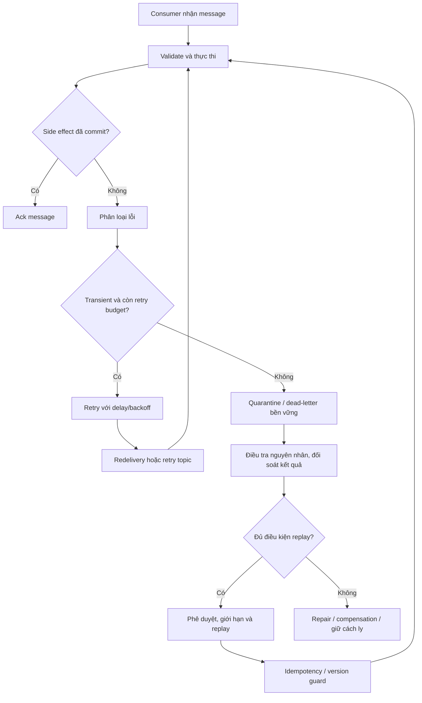

# Thử lại, dead-letter và giới hạn xử lý thông điệp lỗi

## 1. Vì sao Apache Pulsar cần một chính sách xử lý lỗi rõ ràng?

Trong hệ thống tích hợp Spring Boot, một consumer Pulsar có thể nhận sự kiện để ghi PostgreSQL, gọi HTTP API của đối tác, cập nhật cache hoặc chuyển tiếp tới adapter của Spring Integration. Một message hợp lệ có thể xử lý thất bại vì timeout, database mất kết nối hoặc API trả HTTP 503. Một message khác có thể lỗi lâu dài vì sai schema, thiếu trường bắt buộc hoặc vi phạm trạng thái nghiệp vụ.

Nếu tất cả lỗi được thử lại vô hạn, một **poison message** có thể chiếm CPU, connection pool và gây nghẽn toàn bộ consumer. Nếu ứng dụng ack rồi bỏ qua khi thất bại, dữ liệu có thể mất. Nếu đưa mọi lỗi sang dead-letter rồi replay tự động, hệ thống có thể tạo tác dụng phụ trùng lặp hoặc áp dụng một trạng thái cũ lên dữ liệu mới.

Bài này thuộc nhóm **Apache Pulsar** của `SPRING_BOOT_INTEGRATION`. Mục tiêu là thiết kế một luồng lỗi hoàn chỉnh từ nhận message, phân loại, retry, dead-letter, replay đến kiểm chứng kết quả tích hợp trên HTTP, cơ sở dữ liệu và broker. Một chính sách vận hành tốt cần giải quyết đồng thời:

- Lỗi nào nên retry và lỗi nào phải cách ly?
- Chọn `negativeAcknowledge`, `ackTimeout` hay `reconsumeLater` trong trường hợp nào?
- Giới hạn số lần thử, thời gian chờ và tài nguyên ra sao?
- Message đã vào dead-letter topic có được lưu đủ lâu để điều tra không?
- Khi nào được ack, và làm thế nào bảo vệ side effect đã commit?
- Khi nào replay là an toàn, đặc biệt với event có thứ tự?
- Ai được quan sát, phê duyệt và thực thi thao tác phục hồi?

**Nguyên tắc:** thất bại tạm thời được retry có giới hạn; thất bại không thể tự sửa được giữ trong kho cách ly; message được xác nhận hoàn tất chỉ sau khi kết quả nghiệp vụ đã bền vững hoặc khi đã chuyển thành công sang đường phục hồi được kiểm soát.

## 2. Các khái niệm cần phân biệt

| Khái niệm | Ý nghĩa | Rủi ro dễ nhầm |
| --- | --- | --- |
| `Message` | Bản ghi Pulsar chứa payload, key, properties và Message ID | Message ID broker không thay event ID nghiệp vụ |
| `Subscription` | Trạng thái nhận và ack message trên topic | Cùng topic có nhiều subscription, mỗi subscription quản lý tiến độ riêng |
| `acknowledge` | Xác nhận message được xử lý với subscription hiện tại | Ack sớm có thể mất khả năng redelivery sau lỗi |
| `negativeAcknowledge` | Yêu cầu redelivery sau thất bại | Có thể phá thứ tự xử lý và không nên coi là retry budget chắc chắn |
| `ackTimeout` | Phát hiện message nhận nhưng không ack đủ lâu | Có thể redeliver trong khi lần xử lý cũ vẫn chạy |
| `reconsumeLater` | Lập lịch nhận lại message có trì hoãn qua cơ chế retry | Cần bật retry và kiểm tra retry topic/DLQ |
| `retry topic` | Topic trung gian chứa message chờ retry | Không mặc nhiên giữ thứ tự với message mới ở source |
| `dead-letter topic` (DLT/DLQ) | Topic giữ message không xử lý được | Vào DLT không có nghĩa là nghiệp vụ đã thành công |
| `DeadLetterPolicy` | Cấu hình ngưỡng và điểm đến của thông điệp lỗi | Cần kiểm tra hành vi theo phiên bản client và kiểu subscription |
| `replay` | Thực thi lại thông điệp từ nguồn lỗi hoặc lịch sử | Có thể tạo duplicate, stale write và side effect ngoài |

Một số hành vi chi tiết của retry/DLQ thay đổi theo phiên bản Pulsar Java client và broker. Ví dụ Java trong bài minh họa cách tổ chức phổ biến; khi áp dụng phải kiểm chứng số attempts, subscription type và đường ack thực tế trên stack đang triển khai.

## 3. Luồng xử lý từ thất bại đến phục hồi



Luồng có bốn ranh giới cần xác định:

1. **Commit nghiệp vụ:** database transaction hoặc kết quả HTTP phải được xác nhận trước khi xem processing thành công.
2. **Ghi retry bền vững:** không ack message gốc trước khi đường retry/quarantine đã ghi nhận thành công theo API được dùng.
3. **Giữ thông tin gốc:** khi chuyển topic phải giữ event ID, key, phiên bản hợp đồng và thông tin để điều tra.
4. **Xác minh replay:** số bản ghi phát lại không phải số bản ghi đã được đích áp dụng thành công.

Một lần gọi HTTP bị timeout có thể vẫn đã được hệ thống đối tác xử lý. Đây là trạng thái **không rõ kết quả**, cần tra cứu bằng idempotency key hoặc đối soát; retry ngay như một lệnh mới có thể tạo tác dụng phụ lần hai.

## 4. Ba cơ chế retry dễ bị dùng lẫn

### 4.1. `negativeAcknowledge`

Java client cho phép báo xử lý thất bại:

```java
consumer.negativeAcknowledge(message);
```

Message sẽ được redeliver theo chính sách negative acknowledgment. Độ trễ có thể do `negativeAckRedeliveryDelay` hoặc cơ chế backoff được hỗ trợ cấu hình. Đây là cách tiện lợi cho lỗi ngắn hạn, nhưng không nên mặc định mỗi lần nack đều làm tăng một bộ đếm DLQ chuẩn xác bất kể phiên bản và kiểu subscription. Cần test hành vi đẩy sang dead-letter trên hệ thống thật.

Nack cũng có thể cho phép message phía sau tiếp tục được xử lý, vì vậy **thứ tự hoàn thành side effect** có thể khác thứ tự phát message.

### 4.2. `ackTimeout`

Nếu cấu hình acknowledgment timeout, message không được ack sau khoảng đó có thể được redeliver. Nó giúp phát hiện consumer treo hoặc mất quyền sở hữu tác vụ, nhưng không phải công cụ retry nghiệp vụ có kiểm soát.

Ví dụ: handler cần 90 giây để ghi dữ liệu, còn ack timeout là 30 giây. Một lần xử lý thứ hai có thể bắt đầu khi lần đầu vẫn đang ghi DB. Hệ quả là contention, duplicate HTTP request hoặc trùng event nếu thiếu idempotency.

Với tác vụ lâu, chọn timeout theo latency thực tế và deadline nghiệp vụ; đồng thời đặt giới hạn in-flight, metric redelivery và cơ chế chặn xử lý trùng.

### 4.3. `reconsumeLater` qua retry topic

Pulsar Java client có API:

```java
consumer.reconsumeLater(message, 15, TimeUnit.SECONDS);
```

Khi bật retry topic và `DeadLetterPolicy` phù hợp, message được lập lịch thử lại sau khoảng trì hoãn; sau khi chạm điều kiện của chính sách, message được chuyển sang DLQ. Đây là cơ chế hữu ích khi muốn **retry trì hoãn có lịch sử**, thay vì giữ một thread ngủ hoặc nack liên tục.

Không nên bật cùng lúc nhiều tầng retry mà không tính tổng attempts: HTTP client retry, business handler retry, nack và `reconsumeLater` có thể nhân số request thực tế lên nhiều lần.

### 4.4. Bảng quyết định

| Cơ chế | Khi nào cân nhắc | Hạn chế |
| --- | --- | --- |
| Retry ngắn ngay trong handler | Lỗi rất ngắn, số lần nhỏ, latency còn trong budget | Chiếm thread/slot xử lý |
| Nack với backoff | Muốn broker redeliver theo cơ chế đơn giản | Hành vi đếm retry/DLQ cần xác minh; có thể reorder |
| Ack timeout | Đề phòng consumer treo/chết | Dễ tạo overlapping attempts nếu timeout thấp |
| `reconsumeLater` | Muốn retry trì hoãn qua topic và DLQ có chính sách | Phải quản lý retry topic, retention, ordering |
| Quarantine ngay | Sai schema, thiếu dữ liệu không thể tự sửa | Cần durable store, publisher confirmation và runbook |
| Replay do operator | Nguyên nhân đã khắc phục và dữ liệu đã đối soát | Cần quyền, audit, giới hạn tốc độ |

## 5. Thiết kế retry budget và giới hạn tải

Một chính sách retry phải xác định **số lần thử, tổng thời gian và số tác vụ đồng thời**.

| Loại lỗi | Hành vi tham khảo | Điểm dừng |
| --- | --- | --- |
| HTTP 503 hoặc timeout tạm thời | Retry hữu hạn, backoff có jitter | Vào DLT khi hết budget |
| HTTP 429 | Tôn trọng hạn mức đối tác và `Retry-After` khi phù hợp | DLT hoặc chờ xử lý có kiểm soát |
| Database connection lỗi | Retry có delay và giới hạn concurrency | DLT/quarantine nếu kéo dài |
| Payload JSON/Avro sai schema | Không retry cùng bản ghi vô hạn | Quarantine, sửa producer/consumer |
| Entity tham chiếu chưa xuất hiện | Đợi có giới hạn, kiểm tra yêu cầu ordering | Gap queue/reconciliation khi quá hạn |
| Vi phạm trạng thái vĩnh viễn | Điều tra thay vì retry mù | Quarantine và yêu cầu sửa dữ liệu |
| HTTP timeout nhưng đối tác có thể đã xử lý | Tra cứu kết quả theo idempotency key | Retry/repair dựa trên đối soát |

Ví dụ `maxRedeliverCount=4` chỉ là ngưỡng của một policy, **không phải lời hứa** rằng toàn vòng đời nghiệp vụ có chính xác năm lần gọi API. Crash, redelivery, retry nội bộ hoặc replay của operator có thể phát sinh thêm attempts.

Nên giới hạn đồng thời:

- **Attempt budget:** số lần xử lý một event trong một đợt.
- **Time budget:** khoảng thời gian tối đa sự kiện được phép retry trước khi cần điều tra.
- **Rate budget:** thông điệp/phút hoặc số HTTP request/giây mà dependency chịu được.
- **Concurrency budget:** số message in-flight, connection DB/HTTP và worker đang chạy.
- **Backlog budget:** dung lượng/tuổi message chờ retry hoặc nằm trong DLQ.

Khi downstream bị outage, circuit breaker, bulkhead và backpressure giúp tránh **retry storm**. Việc tăng số consumer để “dọn backlog nhanh” có thể khiến dependency vừa hồi phục tiếp tục quá tải.

## 6. Ví dụ cấu hình Pulsar Java client với retry topic và DLQ

Giả sử service `order-projection` tiêu thụ topic `persistent://shop/integration/orders.events`, lưu projection vào PostgreSQL và muốn xử lý retry có trì hoãn.

### 6.1. Consumer builder

```java
import java.util.concurrent.TimeUnit;
import org.apache.pulsar.client.api.Consumer;
import org.apache.pulsar.client.api.DeadLetterPolicy;
import org.apache.pulsar.client.api.Message;
import org.apache.pulsar.client.api.PulsarClient;
import org.apache.pulsar.client.api.Schema;
import org.apache.pulsar.client.api.SubscriptionType;

String inputTopic = "persistent://shop/integration/orders.events";
String retryTopic = "persistent://shop/integration/orders.events-RETRY";
String dlqTopic = "persistent://shop/integration/orders.events-DLQ";

PulsarClient client = PulsarClient.builder()
        .serviceUrl("pulsar://pulsar-broker:6650")
        .build();

Consumer<String> consumer = client.newConsumer(Schema.STRING)
        .topic(inputTopic)
        .subscriptionName("order-projection")
        .subscriptionType(SubscriptionType.Shared)
        .enableRetry(true)
        .deadLetterPolicy(DeadLetterPolicy.builder()
                .maxRedeliverCount(4)
                .retryLetterTopic(retryTopic)
                .deadLetterTopic(dlqTopic)
                .initialSubscriptionName("order-projection-dlq")
                .build())
        .subscribe();
```

Cần hiểu đúng:

- `enableRetry(true)` dùng cho cơ chế retry topic với `reconsumeLater` trong các client hỗ trợ.
- `retryLetterTopic` và `deadLetterTopic` được đặt rõ ràng để dễ provision, phân quyền, kiểm soát retention và giám sát.
- `maxRedeliverCount(4)` là ngưỡng minh họa. Hãy test số deliveries và hành vi DLQ thực tế, vì các cơ chế nack/timeout/reconsume khác nhau.
- `initialSubscriptionName` có thể giúp chuẩn bị subscription ban đầu của DLQ theo API hiện có; vẫn phải kiểm tra topic, subscription, quyền, backlog policy và retention sau khi triển khai.
- `SubscriptionType.Shared` cho phép nhiều consumer cùng xử lý, nhưng không bảo đảm các event của một `orderId` sẽ có cùng thứ tự hoàn thành.

Đoạn code trên minh họa client API. Trong ứng dụng thật, kết nối cần auth/TLS, secret, timeout; client và consumer phải được đóng đúng vòng đời. Không chạy đồng thời một vòng `receive` thủ công và một `@PulsarListener` khác trên cùng subscription mà chưa có chủ đích thiết kế.

### 6.2. Xử lý message theo loại lỗi

```java
Message<String> message = consumer.receive();

try {
    // Transaction DB và idempotency nằm trong service này.
    projectionService.applyIdempotently(message.getValue());
    consumer.acknowledge(message);
} catch (TransientDownstreamException transientError) {
    consumer.reconsumeLater(message, 15, TimeUnit.SECONDS);
} catch (PermanentPayloadException permanentError) {
    quarantinePublisher.publishAndAwaitConfirmation(
            message, permanentError);
    consumer.acknowledge(message);
}
```

Đây là **khung nghiệp vụ minh họa**: `projectionService`, các exception và `quarantinePublisher` do project tự định nghĩa. Code production cần một vòng nhận message, xử lý exception từ client, metrics, shutdown và quản lý tài nguyên.

Đặc biệt:

1. Ack sau khi DB đã commit. Nếu commit thành công nhưng ack thất bại, redelivery là có thể; consumer phải dedupe.
2. Khi chuyển lỗi vĩnh viễn sang quarantine tự viết, chờ publish bền vững **trước khi ack**. Nếu publish thất bại, không được ack như đã cách ly thành công.
3. Nếu publish thành công mà ack nguồn thất bại, cùng message có thể xuất hiện lại; cả quarantine store và consumer phải chịu được duplicate.
4. Không bắt mọi exception chung một cách khiến **ack lỗi sau DB commit** bị coi như lỗi nghiệp vụ rồi phát lại side effect không kiểm soát.
5. Với lỗi kết quả không rõ như HTTP timeout sau khi server đối tác có thể đã commit, phải tra cứu và dùng idempotency key.

### 6.3. Spring Boot và Spring for Apache Pulsar

Cấu hình kết nối cơ bản:

```yaml
spring:
  pulsar:
    client:
      service-url: ${PULSAR_SERVICE_URL:pulsar://localhost:6650}
    admin:
      service-url: ${PULSAR_ADMIN_URL:http://localhost:8080}
```

Trong Spring Boot, `PulsarClient` có thể được framework quản lý và inject vào bean consumer/producer. Nếu dùng `@PulsarListener` thay vì vòng receive thủ công, cần cấu hình ack mode, dead-letter, retry và exception handler theo API chính xác của phiên bản **Spring for Apache Pulsar** đang dùng. Không sao chép cấu hình native Java client rồi mặc định nó đã được áp vào listener container của framework.

`spring.pulsar.admin.service-url` dùng khi ứng dụng thực sự cần Pulsar Admin API hoặc chức năng phụ thuộc admin; một consumer thông thường không cần được cấp quyền quản trị toàn cluster. Production cần TLS, authentication, quyền tenant/namespace/topic và cấu hình secret tương ứng.

## 7. Vì sao redelivery count không phải số lần xử lý nghiệp vụ?

Cùng một event có thể xuất hiện nhiều lần do:

- Consumer crash ngay trước ack.
- Ack timeout trong lúc handler đang chạy.
- Negative acknowledgment.
- `reconsumeLater` tạo lần thử lại qua retry topic.
- Reconnect, failover hoặc consumer assignment thay đổi.
- Operator replay message cũ từ DLQ.
- Cùng event được gửi đến nhiều subscription có side effect khác nhau.

Counter redelivery mà client cung cấp không nhất thiết là **tổng số lần API đối tác đã nhận**. Một business attempt có thể gọi HTTP nhiều lần do client-side retry; ngược lại, một message redelivery có thể bị bỏ qua ngay vì dedupe.

Nếu cần kiểm soát xuyên vòng đời, nên định nghĩa:

- `eventId`: định danh logic ổn định qua redelivery/replay.
- `firstSeenAt`: lúc bắt đầu xử lý sự kiện.
- `deliveryAttempt`: lần giao theo thông tin có được từ broker.
- `businessAttempt`: lần khởi động side effect có ý nghĩa; lưu có kiểm soát nếu cần.
- `replayRunId`: định danh đợt phát lại do operator.
- `lastFailureCode`: phân loại chuẩn hóa để quan sát.

Bộ đếm do ứng dụng tự duy trì phải bền vững và an toàn khi xử lý đồng thời, không chỉ là biến RAM của một instance. Đừng tự giả định crash và replay sẽ giữ nguyên mọi property của retry trên mọi phiên bản client.

## 8. Poison message và lỗi vĩnh viễn

**Poison message** là bản ghi mà bản code hiện tại không thể xử lý thành công nếu chỉ lặp lại cùng điều kiện. Ví dụ: JSON thiếu trường bắt buộc, Avro schema không tương thích, ID sai kiểu hoặc trạng thái nghiệp vụ không hợp lệ.

Quy trình phù hợp:

1. Validate payload, schema version và contract trước khi tạo side effect.
2. Nếu chắc chắn lỗi vĩnh viễn, tránh retry kỹ thuật nhiều lần.
3. Ghi vào quarantine/DLT bền vững với payload gốc, message key, topic, subscription, event ID và failure code.
4. Chờ acknowledgment từ nơi lưu lỗi khi dùng publisher tự viết, rồi mới ack nguồn.
5. Alert nhóm phụ trách producer/consumer và xác định bản sửa.
6. Replay theo quy trình có kiểm soát sau khi nguyên nhân đã hết.

Pulsar `DeadLetterPolicy` thường vận hành theo số lần redelivery/retry, không thể tự suy ra loại `PermanentPayloadException` do ứng dụng đặt. Muốn lỗi permanent đi thẳng tới quarantine, cần code hoặc cơ chế framework có định nghĩa rõ. Với lỗi deserialize trước khi đến handler, cấu hình error handler tại lớp serializer/listener thích hợp để giữ được **raw payload** phục vụ điều tra.

Không phải lỗi “thiếu entity” luôn vĩnh viễn. Sự kiện có thể đến lệch thứ tự, hoặc dữ liệu nguồn còn đang commit. Trường hợp đó cần xử lý **version gap**, chờ có giới hạn hoặc reconciliation, thay vì replay vô hạn.

## 9. Dead-letter topic phải là kho lỗi có vận hành

DLT/DLQ không phải nơi lưu vĩnh viễn mặc định. Topic và namespace chịu chính sách retention, backlog quota, TTL và subscription. Cần kiểm tra thực tế **message sẽ còn hay bị xóa** khi không có consumer điều tra trong nhiều ngày.

| Thành phần | Chính sách cần có |
| --- | --- |
| Tên topic | Rõ môi trường, tenant, namespace, source và chức năng |
| Subscription điều tra | Bền vững; được provision trước hoặc theo cơ chế được xác minh |
| Retention/TTL | Đủ thời gian xử lý sự cố, cảnh báo trước khi hết hạn |
| Backlog quota | Tránh DLT tăng vô hạn làm hại cluster |
| ACL | Consumer được produce đúng DLQ; người điều tra chỉ đọc theo phạm vi |
| Metadata | Giữ event ID, key, schema version, nguồn, failure code và retry info |
| Monitoring | Tốc độ vào DLT, số tồn, tuổi message, lỗi publish |
| Runbook | Owner, thời hạn xử lý, điều kiện replay/repair và trách nhiệm phê duyệt |

Ví dụ mô hình metadata điều tra:

```json
{
  "eventId": "evt-1823",
  "aggregateId": "order-4711",
  "aggregateVersion": 8,
  "origin": {
    "topic": "persistent://shop/integration/orders.events",
    "subscription": "order-projection",
    "messageId": "ledger:entry:partition"
  },
  "failure": {
    "code": "PARTNER_HTTP_503",
    "firstFailedAt": "2026-11-21T04:05:00Z",
    "lastFailedAt": "2026-11-21T04:07:40Z"
  },
  "operations": {
    "incidentId": "INC-421",
    "status": "QUARANTINED",
    "replayRunId": null
  }
}
```

Đây là định dạng **audit minh họa**, không phải bộ header chuẩn do Pulsar bắt buộc. Chuỗi Message ID chỉ là ký hiệu; nếu cần lưu thật, sử dụng API serialization của client tương ứng. Một số property của retry topic/DLQ là chi tiết thư viện, nên không xây logic nghiệp vụ quan trọng dựa trên tên header phỏng đoán.

Payload lỗi có thể chứa dữ liệu cá nhân hoặc tài chính. Dashboard nên mặc định hiển thị metadata đã che dữ liệu; raw payload cần quyền riêng và nhật ký truy cập.

## 10. Retry có thể phá thứ tự theo khóa nghiệp vụ

### 10.1. Các subscription type

| Subscription type | Phân phối bình thường | Rủi ro trong retry |
| --- | --- | --- |
| `Exclusive` | Một consumer của subscription | Một retry muộn vẫn có thể vượt/đi sau message mới |
| `Failover` | Một consumer active, có failover khi cần | Redelivery sau failover có thể dẫn đến xử lý lặp |
| `Shared` | Các message được chia cho nhiều consumer | Không bảo đảm thứ tự xử lý theo key |
| `Key_Shared` | Message cùng key được điều phối theo khóa | Retry topic và side effect async vẫn có thể đảo thứ tự hiệu lực |

Ví dụ:

```text
OrderCreated  orderId=A version=1  -> APPLIED
OrderPaid     orderId=A version=2  -> RETRY 30s
OrderShipped  orderId=A version=3  -> RECEIVED BEFORE RETRY V2
```

Nếu consumer cập nhật `SHIPPED` rồi sau đó replay `PAID`, trạng thái có thể quay về cũ. **Key_Shared không giải quyết tự động thứ tự nghiệp vụ xuyên retry topic.** Cần `aggregateVersion`, guard trong DB, chính sách chờ gap hoặc reconciliation.

### 10.2. Batching, key và concurrency

Với `Key_Shared`, producer batching cần được cấu hình phù hợp với cơ chế phân phối theo key. Trong các phiên bản hỗ trợ, nên dùng key-based batching hoặc tắt batching nếu cần đảm bảo phân phối đúng theo key; test nhiều key xen kẽ.

Không gửi message cùng aggregate với key ngẫu nhiên. Cũng không nên đẩy record vào `@Async` hoặc `ExecutorChannel` rồi ack ngay trước khi DB/HTTP hoàn tất; broker có thể giữ thứ tự giao nhận, nhưng ứng dụng làm đảo thứ tự commit.

## 11. Idempotency và transaction khi retry/redelivery

Pulsar có thể giao lại message sau lỗi ack hoặc crash. Cách thiết kế thực dụng là **at-least-once + idempotent consumer**.

Payload minh họa:

```json
{
  "eventId": "evt-2221",
  "orderId": "order-4711",
  "aggregateVersion": 8,
  "status": "PAID"
}
```

Database PostgreSQL:

```sql
CREATE TABLE processed_integration_event (
    consumer_name VARCHAR(120) NOT NULL,
    event_id VARCHAR(120) NOT NULL,
    processed_at TIMESTAMPTZ NOT NULL DEFAULT CURRENT_TIMESTAMP,
    PRIMARY KEY (consumer_name, event_id)
);

CREATE TABLE order_projection (
    order_id VARCHAR(120) PRIMARY KEY,
    status VARCHAR(40) NOT NULL,
    last_version BIGINT NOT NULL
);
```

Phác thảo xử lý **trong một transaction DB**:

```text
BEGIN TRANSACTION

1. Parse eventId, orderId, aggregateVersion; validate dữ liệu.
2. Insert (consumer_name, event_id) vào processed_integration_event;
   nếu duplicate và đã được commit trước đó -> skip an toàn.
3. Khóa dòng projection theo orderId hoặc dùng compare-and-set.
4. Kiểm tra incomingVersion:
   - bằng lastVersion + 1 (nếu stream bảo đảm version liên tiếp): áp dụng
   - nhỏ hơn/ bằng lastVersion: stale/duplicate, không ghi đè
   - lớn hơn lastVersion + 1: rollback, chờ gap/repair
5. Ghi projection và lastVersion.

COMMIT
Sau commit, mới acknowledge Pulsar message.
```

**Insert dedupe marker và ghi projection phải cùng transaction.** Nếu marker commit riêng nhưng xử lý thất bại, retry sẽ bị nhận nhầm là thành công.

Nếu stream chỉ chứa **một phần** sự kiện của aggregate, version nguồn có thể nhảy số hợp lệ. Khi đó phải thiết kế sequence riêng của luồng hoặc chính sách monotonic phù hợp; không ép điều kiện `+1` khi hợp đồng không bảo đảm.

Broker deduplication hoặc Pulsar transaction không tự tạo exactly-once xuyên PostgreSQL, HTTP API, email và broker khác. Khi gọi API có side effect, gửi idempotency key ổn định hoặc dùng transactional outbox/reconciliation theo ranh giới hệ thống.

## 12. Tích hợp retry với timeout, circuit breaker và bulkhead

Một consumer không nên ngồi retry liên tục khi API đối tác outage 15 phút. Chính sách nên kết hợp:

1. **Connect/read timeout:** không giữ connection và worker vô thời hạn.
2. **Circuit breaker:** tạm ngừng gọi một dependency đang lỗi hàng loạt.
3. **Retry có backoff và jitter:** tránh thác request cùng lúc.
4. **Bulkhead:** giới hạn số request DB/HTTP đồng thời.
5. **Rate limit:** điều tiết lượng message xử lý và replay.
6. **Retry topic:** hoãn message mà không giữ worker thread ngủ.
7. **DLQ:** cách ly bản ghi hết budget hoặc cần điều tra.

Nếu HTTP client retry ba lần cho mỗi delivery, handler retry hai lần và Pulsar retry thêm nhiều lần, tổng số lần gọi API có thể lớn hơn nhiều so với ngưỡng `maxRedeliverCount`.

\[
\text{HTTP attempts (ước tính)} \approx
\text{message deliveries} \times
\text{HTTP attempts per delivery}
\]

Công thức giúp lập ngân sách tải, không phải cam kết số lần chính xác khi có crash, redelivery bất thường hoặc replay thủ công.

## 13. Backpressure và giới hạn in-flight

| Giới hạn | Điều cần quan sát |
| --- | --- |
| Số consumer instance | Tổng công suất nhận, số kết nối và số request downstream |
| `receiverQueueSize` của client | Số message có thể prefetch vào bộ nhớ; không đồng nghĩa số tác vụ đang chạy |
| Executor/thread pool | Không tạo hàng đợi vô hạn trước HTTP/DB |
| HTTP/DB connection pool | Không vượt giới hạn dependency |
| Retry topic rate và backlog | Không dồn toàn bộ retry tới cùng một thời điểm |
| DLQ retention và quota | Message lỗi không biến thành khủng hoảng storage |
| Ack timeout | Không redeliver quá sớm khi tác vụ hợp lệ còn chạy |
| Max processing deadline | Không xử lý message cũ không giới hạn |

Nếu adapter Pulsar đưa message vào Spring Integration `ExecutorChannel` hoặc bộ xử lý async, phải xác định nơi ack và điều kiện đảm bảo side effect bền vững. Một queue RAM có thể nhận message thành công nhưng mất khi process chết; đó chưa phải handoff an toàn để ack nguồn.

**Head-of-line blocking** đôi khi là đánh đổi đúng khi cần giữ thứ tự theo aggregate. Không “chữa” bằng cách xử lý song song version cùng entity nếu không có version guard.

## 14. Quan sát DLQ và retry theo nguyên nhân

Chỉ số broker và chỉ số nghiệp vụ cần được xem cùng nhau:

| Chỉ số | Mục đích |
| --- | --- |
| Message redelivery rate | Phát hiện retry storm và consumer gặp lỗi |
| Ack timeout / unacked count | Phát hiện handler treo hoặc timeout quá thấp |
| Retry topic backlog và tuổi message | Hiểu mức độ trễ thử lại |
| DLQ inflow theo failureCode | Phát hiện poison message hoặc outage |
| DLQ backlog / oldest age | Theo dõi SLA điều tra và retention |
| Consumer processing latency | Đo p95/p99, tìm bottleneck HTTP/DB |
| Duplicate ignored / version gap / stale events | Phát hiện lỗi dữ liệu dù source topic hết backlog |
| Replay submitted / applied / failed | Không nhầm publish thành công với phục hồi |
| Connection/reconnect và assignment changes | Giải thích redelivery bất thường |

Pulsar broker và client có metric ở các cấp khác nhau; Spring Boot Actuator/Micrometer có thể bổ sung metric nghiệp vụ. Tên cụ thể tùy broker/exporter và phiên bản đang dùng, nên map theo metric thực thay vì suy đoán.

Structured log nên có `eventId`, `messageId`, `topic`, `subscription`, `aggregateId`, `attempt`, `failureCode`, `correlationId` và `replayRunId` khi cần. Không đưa ID cardinality cao hoặc payload nhạy cảm làm label Prometheus.

Hai cảnh báo có ý nghĩa khác nhau:

- **Transient outage:** redelivery rate tăng cùng HTTP 503; xem circuit breaker và dependency.
- **Hợp đồng dữ liệu sai:** DLQ chứa nhiều message schema-invalid sau deploy; cần sửa producer/consumer, không tự replay vô hạn.

DLQ tăng nhanh trong khi source backlog thấp **không chứng minh tích hợp khỏe**: nhiều event có thể đã bị chuyển sang kho lỗi mà chưa được áp dụng.

## 15. Phân quyền và quy trình replay

DLQ có thể chứa dữ liệu nhạy cảm; replay có thể kích hoạt side effect thật. Cần tách quyền:

- **Viewer/on-call:** xem metric, số message và metadata đã che dữ liệu.
- **Investigator:** xem payload gốc trong phạm vi đã cấp và có audit.
- **Requester:** tạo yêu cầu replay với danh sách event/tiêu chí, lý do và ticket.
- **Approver:** xác nhận phạm vi, số record, tốc độ, điều kiện dừng.
- **Executor/automation:** đọc đúng DLQ và produce đúng topic đích với service account hạn chế.
- **Platform admin:** quản lý namespace policy, ACL, retention; không mặc định thực thi replay nghiệp vụ.

Phân quyền Pulsar qua tenant/namespace/topic phải thống nhất với RBAC ứng dụng. Không cấp quyền quản trị toàn cluster hoặc reset subscription rộng chỉ để replay vài event. Các thao tác có ảnh hưởng tài chính hoặc lượng dữ liệu lớn nên yêu cầu phê duyệt độc lập.

Trước replay:

1. Xác minh nguyên nhân gốc đã sửa và consumer mới hiểu payload.
2. Đối soát xem event đã được áp dụng hay API ngoài đã xử lý trước đó.
3. Kiểm tra `aggregateVersion`: event cũ có còn hợp lệ không?
4. Cố định tập event hoặc phạm vi lọc đã duyệt; lưu snapshot và tổng số.
5. Đặt rate limit, max message, stop switch và thời gian thực hiện.
6. Replay canary, kiểm tra database/API đích rồi mới mở rộng.
7. Ghi audit theo `incidentId`, `replayRunId` và từng event.

Replay tạo message mới trên topic đích; nó không chèn record trở lại vị trí cũ trong lịch sử Pulsar. Với event version 8 khi trạng thái hiện tại đã version 10, cần version guard, reconciliation hoặc đánh dấu superseded, thay vì cố ép ghi version cũ.

## 16. Kiểm thử end-to-end với Pulsar và database

Nên kiểm thử bằng Pulsar broker thực và database cùng loại production (chẳng hạn Testcontainers phù hợp), vì mock hàm handler không chứng minh retry topic, dead-letter routing và ack hoạt động đúng.

| Tình huống | Điều kiện đạt |
| --- | --- |
| Message hợp lệ | DB commit và ack, không có bản sao trong retry/DLQ |
| HTTP 503 ngắn hạn | Retry theo delay, sau đó thành công; không duplicate |
| HTTP 503 kéo dài | Sau budget, record được giữ ở DLQ cùng metadata |
| Payload sai schema | Quarantine có raw payload, không retry vô hạn |
| Retry/DLQ không thể publish | Không ack sai message nguồn như đã được bảo vệ |
| Crash sau DB commit trước ack | Redelivery không nhân đôi side effect |
| Ack timeout quá ngắn | Test phơi bày duplicate in-flight để chọn timeout đúng |
| Nack và `reconsumeLater` | Kiểm tra khác biệt count/delay/DLQ theo phiên bản |
| `Shared` / `Key_Shared` với cùng key | Version guard ngăn ghi trạng thái cũ |
| Key_Shared với batching | Kiểm tra routing khi producer phát nhiều key |
| Replay event stale | Không ghi đè projection mới |
| DLQ không được consume nhiều ngày | Retention/subscription thực tế giữ bản ghi đúng SLA |
| Nhiều instance, reconnect | Không mất message và không duplicate side effect |

**Test quan trọng:** commit dữ liệu thành công rồi buộc consumer chết trước ack; sau khi khởi động lại, message được giao lại nhưng kết quả DB chỉ được ghi một lần. Đây là tình huống thường xảy ra trong tích hợp HTTP/database.

Không chỉ khẳng định message đã được gửi vào DLT; phải chứng minh message còn tồn tại và có thể truy xuất, sau đó replay với kết quả nghiệp vụ chính xác.

## 17. Tình huống tổng hợp: đồng bộ tồn kho

Giả sử `inventory-service` phát `StockReserved`, `StockReleased` và `StockAdjusted` lên Pulsar. Spring Boot service `warehouse-sync` tiêu thụ event, gọi HTTP API kho ngoài và lưu checkpoint trong PostgreSQL.

Thiết kế:

1. **Hợp đồng:** event có `eventId`, `skuId`, `aggregateVersion`, `occurredAt` và idempotency key.
2. **Key:** dùng `skuId` nếu cần ordering theo mặt hàng; kiểm tra Key_Shared và batching theo client đang chạy.
3. **Retry:** `reconsumeLater` cho HTTP 503, backoff và attempt budget hữu hạn; không retry vô hạn lỗi schema.
4. **DLQ:** giữ payload gốc, source topic, failure code, subscription, thời gian và event ID.
5. **Idempotency:** dedupe marker và checkpoint DB cùng transaction; API kho cần idempotency hoặc reconciliation.
6. **Giới hạn tải:** HTTP timeout, circuit breaker, bulkhead và giới hạn concurrency/rate.
7. **Vận hành:** đo retry backlog/age, DLQ inflow, version gap và độ trễ đồng bộ tới nguồn.
8. **Replay:** khi API đã khỏe, đối soát những lệnh có kết quả không rõ, phê duyệt tập event, phát theo lô nhỏ rồi xác minh dữ liệu.

Nếu `StockAdjusted(v5)` đã áp dụng và `StockReserved(v4)` đang ở DLQ, phát lại v4 có thể làm sai tồn kho. Cần chính sách trạng thái theo version hoặc rebuild từ nguồn sự thật, không chỉ gửi lại event cũ.

## 18. Các sai lầm thường gặp

| Sai lầm | Vì sao nguy hiểm | Cách khắc phục |
| --- | --- | --- |
| Xem nack là retry budget chuẩn xác | DLQ/count có thể khác kỳ vọng theo cơ chế và version | Test số attempts bằng broker thực, chọn cơ chế retry chính |
| Ack ngay khi đẩy vào executor | Side effect có thể fail sau khi ack | Ack sau commit hoặc handoff bền vững |
| Ack timeout thấp để “retry nhanh” | Handler cũ và mới có thể chạy chồng | Chọn timeout theo latency, có idempotency |
| Retry mọi exception | Poison message tạo vòng lặp | Phân loại permanent/transient/gap |
| DLT rồi replay tự động hết | Lỗi lại xảy ra, gây duplicate | Phê duyệt và kiểm soát replay |
| Dùng Shared mà yêu cầu thứ tự key | Consumer xử lý song song không đảm bảo order | Key_Shared khi phù hợp + version guard |
| Tin Key_Shared bảo đảm cả retry topic | Retry muộn có thể đảo thứ tự hiệu lực | Bảo vệ ở DB theo version |
| Dedupe marker commit trước DB update | Retry bị skip dù side effect chưa hoàn thành | Dedupe và update chung transaction |
| Không provision DLQ subscription/retention | Message lỗi biến mất trước khi xử lý | Kiểm tra policy, giữ backlog và alert tuổi |
| Chỉ đo source backlog | Event có thể đang nằm hết ở DLQ | Theo dõi retry/DLQ và business outcome |

## 19. Checklist đưa retry/DLQ Pulsar vào production

- [ ] Có phân loại transient, permanent, gap và lỗi kết quả không rõ.
- [ ] Đã chọn đường retry chính; hiểu nack, ack timeout và `reconsumeLater`.
- [ ] Có budget số lần thử, thời gian, rate, concurrency và backlog.
- [ ] Retry topic/DLQ được provision đúng namespace, ACL, retention và subscription.
- [ ] Đã kiểm thử `DeadLetterPolicy` với version Pulsar client/broker và subscription type thật.
- [ ] Không ack trước khi DB commit hoặc thông điệp lỗi được lưu an toàn ở retry/quarantine.
- [ ] Event có ID ổn định, version/sequence và idempotency key phù hợp.
- [ ] Consumer xử lý duplicate, stale event và version gap.
- [ ] Có metric redelivery, ack timeout, retry backlog/age, DLQ count/age và business outcome.
- [ ] Có runbook, quyền đọc payload, yêu cầu/phê duyệt/thực thi replay và audit.
- [ ] Đã test crash sau commit trước ack, publish DLQ thất bại, poison message và stale replay.
- [ ] Có kế hoạch tạm dừng, repair/reconciliation và kiểm tra kết quả phục hồi.

**Kết quả mong muốn:** với một thông điệp lỗi, nhóm vận hành biết chính xác khi nào thử lại, khi nào cách ly, khi nào được replay và bằng chứng nào xác nhận dữ liệu đích đã đúng. Retry, dead-letter, timeout, idempotency và giới hạn xử lý phải được thiết kế như một chuỗi thống nhất của hệ thống tích hợp Spring Boot.
