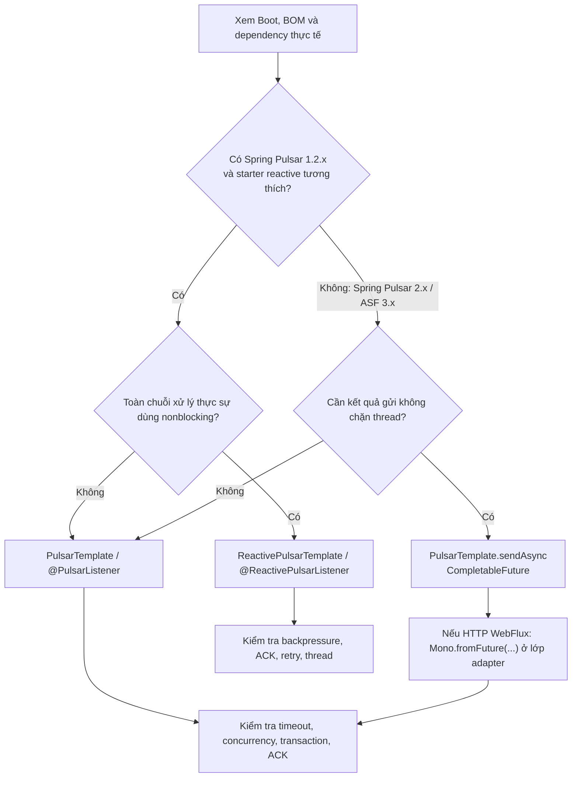
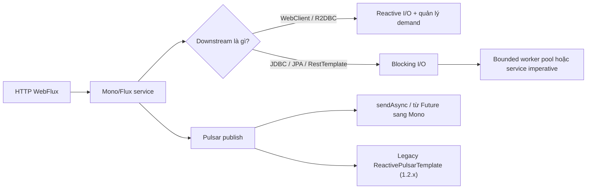

# Lựa chọn API thường hoặc reactive theo bộ phụ thuộc

Trong một dịch vụ Spring Boot dùng Apache Pulsar, lập trình viên thường đứng trước các kiểu API như `PulsarTemplate`, `@PulsarListener`, `sendAsync`, `ReactivePulsarTemplate` và `@ReactivePulsarListener`. Những tên này dễ khiến ta nghĩ rằng chỉ cần sử dụng `Mono`/`Flux`, thêm WebFlux hoặc đổi annotation là đã chuyển toàn bộ luồng message sang reactive. Thực tế, **API có sẵn phụ thuộc phiên bản Spring Boot, thư viện Pulsar trên classpath và vòng đời hỗ trợ của chúng**; cách phối hợp acknowledgment, xử lý lỗi và nguồn dữ liệu blocking cũng thay đổi theo lựa chọn đó.

Bài học thuộc chương **Apache Pulsar** của module `SPRING_BOOT_INTEGRATION` (tích hợp Spring Boot với HTTP client, cơ sở dữ liệu, cache, broker và các adapter Spring Integration). Trọng tâm là **chọn API theo bộ phụ thuộc thực tế** rồi triển khai producer/consumer với hợp đồng dữ liệu, tính nhất quán, xử lý trùng lặp, giao dịch, kiểm thử và khả năng quan sát phù hợp. Các ví dụ dùng Java 17+ và Spring Boot, với các trường hợp được ghi rõ phiên bản.

> **Mốc phiên bản quan trọng, đối chiếu ngày 21/11/2026:** Spring for Apache Pulsar **1.2.x** cùng Spring Boot **3.5.x** còn hỗ trợ module reactive riêng. Kể từ **Spring for Apache Pulsar 2.0.0** và **Spring Boot 4.0.0**, module reactive đó đã bị loại bỏ. Ngày **10/11/2026**, dự án chuyển sang Apache Software Foundation dưới tên *Apache Pulsar support for Spring*; bản **3.0.0-M1** dùng tọa độ Maven và package mới, vẫn có API thường. Vì thế không nên sao chép cấu hình reactive của Boot 3.x vào dự án Boot 4.x hoặc Apache Pulsar support for Spring 3.x mà không kiểm tra khả năng hỗ trợ.

## 1. Làm rõ ba nghĩa của từ “reactive”

Trong hệ sinh thái Java, những khái niệm sau có liên quan nhưng **không đồng nghĩa**:

| Khái niệm | Đặc điểm | Ví dụ | Lưu ý |
| --- | --- | --- | --- |
| API thường/imperative | Gọi method trực tiếp, listener chạy theo callback hoặc thread của container | `PulsarTemplate.send(...)`, `@PulsarListener` | Dễ kết hợp JDBC/JPA và xử lý nghiệp vụ đồng bộ. |
| API bất đồng bộ | Khởi động I/O rồi nhận kết quả sau qua future/callback | `PulsarTemplate.sendAsync(...)` → `CompletableFuture<MessageId>` | Có thể không chặn thread lúc chờ broker nhưng **chưa phải** reactive consumer. |
| Reactive Streams | Publisher thể hiện luồng dữ liệu, tín hiệu kết thúc/lỗi và demand/backpressure | `Mono<MessageId>`, `Flux<...>`, `ReactivePulsarTemplate` của dòng 1.2.x | Cần cả thư viện reactive tương ứng và quy tắc subscription/ACK đúng. |

`spring-boot-starter-webflux` bổ sung stack HTTP reactive, **không tự tạo** `ReactivePulsarTemplate`. Reactor có mặt trên classpath cũng không có nghĩa Spring Boot tự biến `@PulsarListener` thành reactive listener. Ngược lại, một ứng dụng Spring MVC hoàn toàn có thể gọi `sendAsync` mà không phải chuyển mọi controller sang WebFlux.

Giải pháp đúng bắt đầu bằng việc xem **phiên bản được quản lý và dependency thực sự được resolve**, sau đó chọn programming model phù hợp với công việc.

## 2. Ma trận phiên bản: starter nào cung cấp API nào?

| Stack | Dependency chính | API producer/consumer | Khuyến nghị |
| --- | --- | --- | --- |
| Spring Boot **3.5.x** + Spring Pulsar **1.2.x** | `org.springframework.boot:spring-boot-starter-pulsar` | `PulsarTemplate`, `@PulsarListener` | Mặc định cho code đồng bộ hoặc send bất đồng bộ. |
| Spring Boot **3.5.x** + Spring Pulsar **1.2.x** | `org.springframework.boot:spring-boot-starter-pulsar-reactive` | `ReactivePulsarTemplate`, `@ReactivePulsarListener`; reactive client/factory | Chỉ chọn khi cần duy trì stack cũ có reactive và đã xác nhận tương thích phiên bản. |
| Spring Boot **4.0–4.2** + Spring Pulsar **2.0.x** | `org.springframework.boot:spring-boot-starter-pulsar` | `PulsarTemplate`, `@PulsarListener`, `sendAsync` | **Không** tìm `spring-pulsar-reactive` trong 2.0.x; đã bị loại bỏ. |
| Apache Pulsar support for Spring **3.0.0-M1** (mốc 11/2026) | `org.apache.pulsar:pulsar-spring-boot-starter` | `PulsarTemplate`, `@PulsarListener`, `@PulsarReader`, API client Pulsar | Dùng khi đánh giá/migrate sang dự án mới; đây là milestone, cần quản lý phiên bản chủ động. |

Hai lưu ý lịch sử:

1. Trong các tutorial Spring Pulsar **0.2.x**, có thể gặp `org.springframework.pulsar:spring-pulsar-reactive-spring-boot-starter`. Đây là tọa độ **cũ**. Ở Spring Boot 3.2–3.5, starter reactive thuộc nhóm `org.springframework.boot` với tên `spring-boot-starter-pulsar-reactive`.
2. Spring Pulsar `2.0.8` là bản cuối do nhóm Spring phát hành. Dự án tiếp tục được phát triển tại Apache Pulsar; không trộn `org.springframework.pulsar` và `org.apache.pulsar:pulsar-spring` trong cùng dependency graph khi migrate.

**Không suy từ tên class rằng nó còn tồn tại trong mọi phiên bản.** Khi nâng cấp Boot 3.5 → Boot 4.x hoặc Spring Pulsar 1.2.x → 2.x/Apache 3.x, phải kiểm tra lại toàn bộ imports, auto-configuration và starter của producer/consumer.

### Sơ đồ quyết định



Đây là sơ đồ **chọn API Spring Pulsar**, không loại trừ việc tự sử dụng Pulsar Java Client cấp thấp hoặc thư viện reactive khác. Nếu dùng client/binder riêng, kiểm tra tài liệu và compatibility matrix riêng của **đúng artifact** đó; không gọi chúng là `ReactivePulsarTemplate` khi chúng không cung cấp class này.

## 3. Đọc dependency graph trước khi chọn code

### 3.1. Maven/Gradle trong dự án Spring Boot 3.5

Producer/consumer thường:

```xml
<dependency>
    <groupId>org.springframework.boot</groupId>
    <artifactId>spring-boot-starter-pulsar</artifactId>
</dependency>
```

Chỉ khi dự án thuộc **dòng hỗ trợ reactive 1.2.x** và muốn dùng reactive Pulsar:

```xml
<dependency>
    <groupId>org.springframework.boot</groupId>
    <artifactId>spring-boot-starter-pulsar-reactive</artifactId>
</dependency>
```

Với Gradle:

```groovy
dependencies {
    implementation 'org.springframework.boot:spring-boot-starter-pulsar'
    // Ở Boot 3.x tương thích Spring Pulsar 1.2.x, chọn starter reactive
    // nếu mục tiêu là dùng ReactivePulsarTemplate/@ReactivePulsarListener:
    // implementation 'org.springframework.boot:spring-boot-starter-pulsar-reactive'
}
```

Những đoạn trên thể hiện **các lựa chọn**; không phải hướng dẫn thêm cả hai starter vào mọi ứng dụng. Dùng Spring Boot BOM/parent tương ứng để quản lý phiên bản, rồi xác nhận artifact transitively được kéo vào.

Các lệnh người học có thể chạy tại dự án của mình:

```bash
# Maven: xem phiên bản thực sự được resolve
./mvnw dependency:tree -Dincludes=org.springframework.pulsar,org.springframework.boot,org.apache.pulsar

# Gradle: tập trung classpath runtime
./gradlew dependencies --configuration runtimeClasspath

# Gradle: tìm ai kéo một module vào graph
./gradlew dependencyInsight --dependency spring-pulsar-reactive --configuration runtimeClasspath
```

Không cần có ba công cụ cùng lúc; chọn lệnh đúng hệ thống build. Với Maven, `-Dincludes` có cú pháp lọc cụ thể theo groupId:artifactId tùy plugin; nếu kết quả thiếu dependency thì chạy `dependency:tree` đầy đủ hoặc lọc lần lượt. Cần phân biệt **dependency được khai báo** và dependency cuối cùng được giải quyết sau khi BOM, constraint và exclusion áp dụng.

### 3.2. Dự án Apache Pulsar support for Spring 3.0.0-M1

Khi chuyển sang dự án thuộc Apache Pulsar, tọa độ starter thay đổi:

```xml
<dependency>
    <groupId>org.apache.pulsar</groupId>
    <artifactId>pulsar-spring-boot-starter</artifactId>
    <version>3.0.0-M1</version>
</dependency>
```

Ở bản milestone này, Spring Boot BOM **không tự quản lý** phiên bản artifact mới; tài liệu chính thức còn lưu ý sự tương thích của Pulsar Client **5.0.x** và Netty. Theo hướng dẫn phát hành ngày 10/11/2026, Maven ví dụ có thể dùng:

```xml
<properties>
    <pulsar.version>5.0.1</pulsar.version>
    <netty.version>4.2.20.Final</netty.version>
</properties>
```

Khi chọn phiên bản khác, phải xem lại hướng dẫn tương thích tương ứng. Việc dùng `pulsar-spring-bom` hoặc pin version phụ thuộc vào BOM đã quản lý trong dự án. Đừng thêm starter mới **bên cạnh** starter cũ, vì có thể nhận hai bộ auto-configuration, package API và classpath không tương thích.

Từ phiên bản này, các class Spring Pulsar chuyển package:

```text
Trước (Spring Pulsar 1.x / 2.x):
  org.springframework.pulsar.core.PulsarTemplate
  org.springframework.pulsar.annotation.PulsarListener

Sau (Apache Pulsar support for Spring 3.x):
  org.apache.pulsar.spring.core.PulsarTemplate
  org.apache.pulsar.spring.annotation.PulsarListener
```

Phần cấu hình `spring.pulsar.*` tiếp tục được duy trì trong mốc 3.0.0-M1, nhưng thay package có nghĩa source code, test và cấu hình customizer phải được build/test lại.

## 4. Cấu hình kết nối chung cho API thường

Từ Spring Boot 3.5 đến Boot 4.2, cấu hình service URL dùng:

```yaml
spring:
  pulsar:
    client:
      service-url: pulsar://localhost:6650
    admin:
      service-url: http://localhost:8080
```

`6650` là cổng giao thức Pulsar của broker; `8080` ở đây là cổng HTTP admin của Pulsar chạy local (không phải cổng của ứng dụng Spring Boot). Trong production, thay bằng URL của cluster/tenant tương ứng, cấu hình TLS (`pulsar+ssl://...` khi hạ tầng yêu cầu), authentication token/OAuth2, authorization và secret manager.

Nếu producer không chỉ định topic, framework có thể áp dụng topic resolution/default topic. Khi viết hướng dẫn hoặc hợp đồng tích hợp, nên truyền topic tường minh hoặc khai báo quy tắc resolve rõ ràng; topic sai namespace là một lỗi triển khai phổ biến.

Ví dụ topic dùng xuyên suốt bài:

```text
persistent://public/default/orders.created.v1
```

Ở dự án có nhiều môi trường/tenant, không hard-code `public/default` trong production. Topic, subscription name, schema và chính sách retention nên được quản lý theo cấu hình triển khai.

## 5. API thường: PulsarTemplate và @PulsarListener

Mẫu này phù hợp ứng dụng Spring Boot MVC/JDBC/JPA và vẫn là con đường chính ở Spring Pulsar 2.x/Apache 3.x.

### 5.1. Gửi đồng bộ

Ví dụ theo **package Spring Pulsar 1.x/2.x**:

```java
package com.example.orders.messaging;

import org.apache.pulsar.client.api.MessageId;
import org.springframework.pulsar.core.PulsarTemplate;
import org.springframework.stereotype.Service;

@Service
public class OrderEventPublisher {
    private static final String TOPIC =
            "persistent://public/default/orders.created.v1";

    private final PulsarTemplate<String> pulsarTemplate;

    public OrderEventPublisher(PulsarTemplate<String> pulsarTemplate) {
        this.pulsarTemplate = pulsarTemplate;
    }

    public MessageId publish(String eventJson) {
        return pulsarTemplate.send(TOPIC, eventJson);
    }
}
```

Với **Apache Pulsar support for Spring 3.x**, thay import `PulsarTemplate` thành `org.apache.pulsar.spring.core.PulsarTemplate`; logic gọi API về cơ bản giữ nguyên. Dùng `String` giúp ví dụ ngắn; thực tế nên định nghĩa DTO event có `eventId`, `schemaVersion`, `occurredAt` và schema JSON/Avro/Protobuf phù hợp với consumer.

`send()` **chờ kết quả publish** và trả `MessageId` khi broker xác nhận theo hợp đồng producer; không có nghĩa consumer đã xử lý xong. Nếu broker chậm, thread caller bị giữ cho đến khi gửi hoàn tất hoặc timeout. Không dùng `send()` trực tiếp trên Netty event loop của WebFlux cho request cần hiệu năng nonblocking.

### 5.2. Tiêu thụ bằng listener

```java
package com.example.orders.messaging;

import org.springframework.pulsar.annotation.PulsarListener;
import org.springframework.stereotype.Component;

@Component
public class OrderCreatedListener {
    private final OrderProjectionService projectionService;

    public OrderCreatedListener(OrderProjectionService projectionService) {
        this.projectionService = projectionService;
    }

    @PulsarListener(
            topics = "persistent://public/default/orders.created.v1",
            subscriptionName = "billing-projection-v1")
    public void onMessage(String eventJson) {
        projectionService.applyEvent(eventJson);
    }
}
```

`OrderProjectionService` là service nghiệp vụ giả định, nhận JSON, validate schema và cập nhật dữ liệu idempotently; cần được triển khai riêng. Với Apache 3.x, annotation import đổi thành `org.apache.pulsar.spring.annotation.PulsarListener`.

Ở cấu hình container thường, **method kết thúc bình thường là tín hiệu xử lý thành công**, còn exception cho biết xử lý thất bại; container/consumer quyết định ACK, negative acknowledgment và retry theo cấu hình và loại subscription. Không suy rằng cứ ném exception thì chắc chắn message sẽ vào dead-letter topic. Cần cấu hình delivery/ack/retry/DLQ tương ứng và kiểm chứng bằng Pulsar thật.

### 5.3. Khi chọn imperative

- Đã dùng JDBC, JPA, API đối tác blocking hoặc xử lý từng message với transaction cục bộ rõ ràng.
- Muốn quản lý mỗi lượt xử lý qua listener thread/worker pool có giới hạn.
- Dự án đang dùng Spring Pulsar 2.x hoặc Apache Pulsar support for Spring 3.x, không còn reactive module Spring Pulsar.
- Phần lớn tác vụ I/O được cân đối bằng thread pool/batching/timeout và không cần một pipeline `Flux` xuyên suốt.

Imperative vẫn có thể scale hiệu quả bằng partition/topic phù hợp, subscription type, concurrency có giới hạn và async publish. Reactive không tự tạo thêm parallelism nếu downstream chỉ có một connection database hoặc xử lý theo một khóa.

## 6. Gửi bất đồng bộ bằng sendAsync mà không cần starter reactive

`PulsarTemplate` thường có cả `send()` và `sendAsync()`. `sendAsync()` trả một `CompletableFuture<MessageId>`, giúp caller nhận kết quả khi broker xác nhận mà không phải chờ đồng bộ trên thread hiện tại.

```java
import java.util.concurrent.CompletableFuture;
import org.apache.pulsar.client.api.MessageId;
import org.springframework.pulsar.core.PulsarTemplate;

public class AsyncOrderEventPublisher {
    private final PulsarTemplate<String> template;

    public AsyncOrderEventPublisher(PulsarTemplate<String> template) {
        this.template = template;
    }

    public CompletableFuture<MessageId> publish(String json) {
        return template.sendAsync(
                "persistent://public/default/orders.created.v1", json);
    }
}
```

Nếu caller là controller HTTP/WebFlux, không nên gọi `sendAsync()` rồi lập tức trả `202 Accepted` với thông báo “đã publish” khi future chưa hoàn tất. Chọn một trong hai hợp đồng:

1. **Chờ broker confirm** theo future, sau đó trả trạng thái HTTP phù hợp; timeout và lỗi publish được chuyển thành lỗi rõ ràng.
2. **Nhận công việc vào bộ nhớ/outbox bền vững** rồi trả `202` theo nghĩa “đã tiếp nhận”, không tuyên bố broker đã nhận khi chưa có xác nhận. Nếu yêu cầu bảo đảm qua crash, dùng transactional outbox.

Số lượng future in-flight cần có giới hạn. Không gọi `sendAsync()` liên tục từ một `Flux` không có bound rồi giữ hàng trăm nghìn future chờ network; bản thân API async không tự áp dụng backpressure cho producer queue hoặc database.

## 7. Bridge sendAsync sang Reactor trong dự án WebFlux hiện đại

Khi dùng WebFlux ở Spring Pulsar **2.x** hoặc Apache **3.x**, vẫn có thể expose `Mono<MessageId>` tại adapter bằng cách chuyển `CompletableFuture` từ API thường:

```java
import org.apache.pulsar.client.api.MessageId;
import reactor.core.publisher.Mono;

// Đối với Spring Pulsar 2.x:
import org.springframework.pulsar.core.PulsarTemplate;

public class ReactiveHttpFacingPublisher {
    private final PulsarTemplate<String> template;

    public ReactiveHttpFacingPublisher(PulsarTemplate<String> template) {
        this.template = template;
    }

    public Mono<MessageId> publish(String eventJson) {
        return Mono.defer(() -> Mono.fromFuture(
                template.sendAsync(
                        "persistent://public/default/orders.created.v1",
                        eventJson)));
    }
}
```

`Mono.defer(...)` bảo đảm mỗi lần subscribe mới gọi `sendAsync()`; nếu chỉ viết `Mono.fromFuture(template.sendAsync(...))` ở thời điểm xây dựng publisher, lệnh publish có thể đã bắt đầu **trước khi subscription** được tạo. Điều này quan trọng khi code cần retry hoặc khi một publisher được sử dụng lại.

Trong Apache 3.x, thay **chỉ** import PulsarTemplate như phần trước. API Reactor sử dụng `reactor-core`; `spring-boot-starter-webflux` cung cấp stack HTTP WebFlux nếu ứng dụng thật sự có web endpoint reactive. Đây là **bridge giữa API async và Reactor**, không phải sự hồi sinh của `ReactivePulsarTemplate`/`@ReactivePulsarListener` đã bị loại bỏ.

### Ví dụ REST WebFlux chờ xác nhận publish

```java
@RestController
@RequestMapping("/api/events")
public class PublishController {
    private final ReactiveHttpFacingPublisher publisher;

    public PublishController(ReactiveHttpFacingPublisher publisher) {
        this.publisher = publisher;
    }

    @PostMapping
    public Mono<ResponseEntity<String>> publish(@RequestBody String payload) {
        return publisher.publish(payload)
                .map(messageId -> ResponseEntity.accepted()
                        .body("Pulsar accepted: " + messageId))
                .timeout(Duration.ofSeconds(5));
    }
}
```

Đoạn này là ví dụ rút gọn (cần import Spring WebFlux/`Duration`). API production phải validate/authenticate request, tạo event DTO do server kiểm soát và quyết định rõ timeout tương ứng trạng thái “chưa biết đã publish hay chưa”. `Mono.timeout(...)` có thể kết thúc request ở client trong khi broker vẫn nhận được event; retry từ client phải dùng idempotency key của lệnh logic và cơ chế deduplication/đối soát phù hợp.

**Không** gọi `.block()` trên event-loop. Nếu downstream dùng JDBC/JPA blocking, đẩy công việc đó sang một service imperative có thread pool được quản lý, hoặc dùng R2DBC nếu cần một chuỗi nonblocking thực sự. `sendAsync()` không biến giao dịch JDBC thành reactive transaction.

## 8. ReactivePulsarTemplate trong stack cũ 1.2.x

Phần này **chỉ áp dụng** khi dependency graph thực sự chứa `org.springframework.pulsar:spring-pulsar-reactive` tương thích với Spring Boot 3.x. Không áp dụng cho Spring Pulsar 2.0+, Spring Boot 4.x hoặc Apache Pulsar support for Spring 3.x.

```java
package com.example.orders.legacyreactive;

import org.apache.pulsar.client.api.MessageId;
import org.springframework.pulsar.reactive.core.ReactivePulsarTemplate;
import reactor.core.publisher.Mono;

public class LegacyReactivePublisher {
    private final ReactivePulsarTemplate<String> template;

    public LegacyReactivePublisher(ReactivePulsarTemplate<String> template) {
        this.template = template;
    }

    public Mono<MessageId> publish(String json) {
        return template.send(
                "persistent://public/default/orders.created.v1", json);
    }
}
```

Ở đây `send(...)` trả `Mono<MessageId>` theo API reactive của Spring Pulsar 1.2.x. **Chưa có publish thực tế nếu chuỗi không được subscribe bởi framework/caller**. Trong controller WebFlux, trả `Mono` để HTTP runtime quản lý subscription; trong integration test dùng `StepVerifier` để subscribe và assert kết quả; trong service không gọi `.subscribe()` một cách vô điều kiện rồi coi công việc đã xong.

Ví dụ consumer reactive one-by-one ở dòng 1.2.x:

```java
import org.springframework.pulsar.reactive.config.annotation.ReactivePulsarListener;
import org.springframework.stereotype.Component;
import reactor.core.publisher.Mono;

@Component
public class LegacyReactiveOrderListener {
    private final ReactiveOrderProcessor processor;

    public LegacyReactiveOrderListener(ReactiveOrderProcessor processor) {
        this.processor = processor;
    }

    @ReactivePulsarListener(
            topics = "persistent://public/default/orders.created.v1",
            subscriptionName = "billing-reactive-v1")
    public Mono<Void> onMessage(String eventJson) {
        return processor.applyEvent(eventJson);
    }
}
```

`ReactiveOrderProcessor.applyEvent(...)` được giả định trả một `Mono<Void>` chỉ hoàn tất khi cập nhật nghiệp vụ đã bền vững. Trong kiểu **one-by-one** của Spring Pulsar 1.2.x:

- `Mono.empty()` hoặc hoàn thành thành công là tín hiệu để container ACK message.
- `Mono.error(...)` là tín hiệu thất bại để container xử lý negative acknowledgment.
- Nếu tự gọi `processor.applyEvent(...).subscribe()` bên trong rồi trả `Mono.empty()` ngay, container có thể ACK **trước** khi xử lý thật kết thúc.

Reactive listener **streaming** (`stream = true`) có hợp đồng khác: nhận `Flux<Message<...>>` và trả `Flux<MessageResult<Void>>` cho từng message, trong đó message result thể hiện ACK/NACK. Không lấy code của listener one-by-one rồi áp cho streaming mà bỏ qua message result.

Những API/reactive dependency cũ không còn được duy trì trong dòng mới. Khi vận hành một ứng dụng đã pin Boot 3.5 + Spring Pulsar 1.2.x, cần lên kế hoạch upgrade với ma trận kiểm thử rõ ràng, thay vì cố gắng bổ sung lại module bị gỡ vào Boot 4 theo cách ép version.

## 9. Kiểm tra toàn bộ chuỗi xử lý có thực sự nonblocking?

Một pipeline `Mono` chỉ đạt lợi ích mong đợi khi các đoạn I/O chính không giữ event loop trong thời gian dài:



Ví dụ cần dùng JPA từ code trả `Mono`:

```java
Mono<OrderSummary> readFromBlockingJpa(String id) {
    return Mono.fromCallable(() -> orderQueryService.findSummary(id))
            .subscribeOn(Schedulers.boundedElastic());
}
```

Đây là cầu nối blocking có **giới hạn worker**, không biến JPA thành nonblocking. `orderQueryService` phải là một Spring bean có transaction boundary thật; với `@Transactional` trên method đó, transaction mở và đóng trên thread thực thi service. Không truyền một entity lazy sang pipeline khác thread rồi truy cập nó sau khi transaction đã đóng. Nên ánh xạ sang DTO khi transaction còn hiệu lực.

Nếu dùng `Flux.flatMap(...)` để publish nhiều message, giới hạn concurrency:

```java
Flux<MessageId> results = Flux.fromIterable(events)
        .flatMap(event ->
                publisher.publish(event.json()),
                16); // Tối đa 16 publisher cùng in-flight tại đây
```

`flatMap` có thể đổi thứ tự completion; nếu hợp đồng yêu cầu thứ tự theo `orderId`, dùng key phù hợp và chiến lược serialize theo key, xem xét `concatMap` ở phạm vi cần thiết, cũng như subscription/key routing của Pulsar. Concurrency bằng 16 chỉ là ví dụ; giới hạn thực tế phải đo theo throughput broker, latency, memory, producer queue và downstream.

## 10. Subscription và thứ tự xử lý độc lập với API

Chọn imperative hay reactive **không** quyết định chế độ chia message giữa nhiều instance. Trong Pulsar, subscription type ảnh hưởng trực tiếp đến phân phối và thứ tự:

| Kiểu subscription | Hành vi khái quát | Tình huống |
| --- | --- | --- |
| `Exclusive` | Một consumer hoạt động cho một subscription tại một thời điểm | Tác vụ cần một consumer; scale-out bị giới hạn. |
| `Failover` | Một consumer hoạt động, consumer khác dự phòng | Duy trì một lượt tiêu thụ với failover. |
| `Shared` | Message được phân phối giữa nhiều consumer cùng subscription | Tăng throughput; không mặc định giữ thứ tự toàn topic. |
| `Key_Shared` | Message cùng key được gắn với cùng consumer theo cơ chế key routing | Xử lý có tính tuần tự theo khóa với các giới hạn và cấu hình riêng. |

Hai listener với **hai subscription name khác nhau** sẽ nhận hai luồng tiêu thụ độc lập theo subscription; chúng không cạnh tranh để xử lý một message theo cách một consumer group đơn lẻ. Cần xác định rõ `subscriptionName`, `subscriptionType` và khóa message khi scale nhiều replica.

Không giả định chỉ cần khai báo `Key_Shared` là mọi xử lý bất đồng bộ nội bộ giữ nguyên thứ tự: nếu ứng dụng nhận message cùng key rồi xử lý bằng `flatMap` có concurrency, completion có thể đổi thứ tự dù delivery được điều phối theo key. Thứ tự áp dụng vào database cũng còn phụ thuộc transaction và idempotency.

## 11. ACK, retry, dead-letter và xử lý trùng lặp

Pulsar có cơ chế acknowledgment, negative acknowledgment, redelivery và dead-letter policy. Những cơ chế đó vận hành ở **consumer/subscription**, không xuất hiện tự động chỉ vì ứng dụng dùng `Mono` hay `PulsarTemplate`.

| Giai đoạn | Với listener thường | Với reactive listener 1.2.x one-by-one | Điều cần đảm bảo |
| --- | --- | --- | --- |
| Xử lý thành công | Method trả về bình thường | `Mono` hoàn thành thành công | Dữ liệu nghiệp vụ đã commit trước ACK. |
| Xử lý thất bại | Exception được đưa cho container | `Mono` phát `onError` | Container/nack/retry theo policy, không ACK thành công giả. |
| Redelivery | Broker gửi lại sau failover/nack/timeout theo cấu hình | Tương tự | Handler idempotent theo `eventId`. |
| Poison message | Chuyển qua dead-letter policy phù hợp | Reactive 1.2.x có quy tắc DLQ riêng theo mode/subscription | Không loop vô hạn; có quy trình redrive. |
| Kết quả không chắc chắn | HTTP/giao dịch đã thành công nhưng ACK chưa ghi nhận | Tương tự | Checkpoint/inbox và idempotency key bảo vệ side effect. |

Ví dụ một message `OrderCreatedV1(eventId=evt-71)`:

1. Consumer A ghi dữ liệu vào PostgreSQL và commit thành công.
2. Process A bị kill trước khi ACK broker.
3. Broker giao lại event cho consumer B trên cùng subscription.
4. B kiểm tra inbox/unique key `evt-71`, nhận ra đã xử lý và ACK mà không ghi lặp.

Như vậy “đã dùng Pulsar + reactive” không cung cấp exactly-once end-to-end giữa Pulsar, database, HTTP partner và cache. Nếu consumer thực hiện side effect ở hệ thống ngoài, sử dụng idempotency key và đối soát trạng thái. Nếu producer phải ghi database rồi publish event, cân nhắc transactional outbox; Pulsar transaction không tự tạo một giao dịch ACID chung với PostgreSQL.

### Không ACK trước khi công việc thật kết thúc

Anti-pattern trong reactive legacy:

```java
@ReactivePulsarListener(topics = "orders.created")
Mono<Void> badListener(String payload) {
    processAsync(payload).subscribe(); // Fire-and-forget
    return Mono.empty();                // Container thấy thành công quá sớm
}
```

Sửa lại:

```java
@ReactivePulsarListener(topics = "orders.created")
Mono<Void> goodListener(String payload) {
    return processAsync(payload);       // Trả đúng completion/error signal
}
```

Với imperative listener, cũng không bắt đầu background task rồi trả về ngay nếu hệ thống yêu cầu ACK sau khi task hoàn thành. Nếu thực sự chuyển trách nhiệm sang hàng đợi bền vững khác, hãy ghi/commit việc bàn giao theo hợp đồng trước khi ACK và thiết kế khả năng replay.

## 12. Giao dịch: điều gì được đảm bảo?

Spring Pulsar hỗ trợ transaction trong phạm vi broker/Pulsar theo cấu hình phù hợp; Spring Boot có thuộc tính `spring.pulsar.transaction.enabled` ở stack hỗ trợ:

```yaml
spring:
  pulsar:
    transaction:
      enabled: true
```

Việc bật transaction cần được kiểm chứng với broker và phiên bản client, bao gồm cấu hình transaction coordinator của Pulsar. **Transaction broker không tự bao gồm `@Transactional` của JPA/JDBC**. Ví dụ flow:

```text
BEGIN transaction PostgreSQL
INSERT order
COMMIT PostgreSQL
PUBLISH event Pulsar
```

Nếu process chết giữa commit và publish, có thể mất event. Cách thông dụng để giải quyết là ghi `outbox_event` trong transaction PostgreSQL với order, sau đó publisher riêng gửi Pulsar và đánh dấu kết quả khi broker xác nhận. Publisher có thể gửi lặp nếu crash sau publish trước khi mark-sent, vì vậy consumer vẫn cần deduplication.

Với reactive pipeline, transaction context của R2DBC/Reactor khác transaction gắn thread của JDBC. Không bọc `Mono` rồi mặc định `@Transactional` JDBC kéo dài qua các async stage; kiểm tra transaction manager, lifecycle subscription và phần nào thực sự nằm trong transaction.

## 13. Kiểm thử lựa chọn API và hành vi gửi/nhận

Một số kiểm thử có thể làm nhanh bằng unit test; các guarantee về broker và delivery cần integration test với Pulsar thực (ví dụ Testcontainers Pulsar).

### 13.1. Kiểm thử classpath / auto-configuration

| Kiểm thử | Mong đợi |
| --- | --- |
| Boot 3.5 + starter thường | Inject được `PulsarTemplate`, hoạt động `@PulsarListener`. |
| Boot 3.5 + starter reactive tương thích | Inject được `ReactivePulsarTemplate`, hoạt động `@ReactivePulsarListener`. |
| Boot 4 + Spring Pulsar 2.x | Không kỳ vọng bean reactive Pulsar; dùng `PulsarTemplate`/`sendAsync`. |
| Apache support 3.0-M1 | Import package `org.apache.pulsar.spring.*`; starter mới, bỏ starter cũ. |
| Chỉ thêm `spring-boot-starter-webflux` | Không kỳ vọng `ReactivePulsarTemplate` nếu thiếu Pulsar reactive module. |

Kiểm tra một bean có mặt/chưa có là bước đầu; luôn xác minh **producer thật publish** và **listener thật ACK đúng** trên cluster. Một context có bean nhưng cấu hình sai `service-url`, topic hoặc auth vẫn không thể làm việc.

### 13.2. Test producer thường và async bridge

Với `sendAsync`, fake hoặc mock trả `CompletableFuture` có thể kiểm tra hợp đồng future; chẳng hạn ý tưởng JUnit:

```java
@Test
void deferredPublisherStartsWhenSubscribed() {
    AtomicInteger sends = new AtomicInteger();
    Supplier<CompletableFuture<String>> send = () -> {
        sends.incrementAndGet();
        return CompletableFuture.completedFuture("message-id");
    };

    Mono<String> publisher = Mono.defer(
            () -> Mono.fromFuture(send.get()));

    assertEquals(0, sends.get());
    StepVerifier.create(publisher)
            .expectNext("message-id")
            .verifyComplete();
    assertEquals(1, sends.get());
}
```

Đây là unit test minh họa quy tắc **defer** với future (cần JUnit, `reactor-test`, import `Supplier`, `AtomicInteger`, `CompletableFuture`). Nó không kiểm tra network Pulsar hoặc `MessageId`. Integration test cần gửi qua `PulsarTemplate` tới topic test, chờ confirm, rồi tiêu thụ và đối chiếu payload/schema/key.

Với code legacy `ReactivePulsarTemplate`, dùng `StepVerifier` để kiểm tra `Mono` phát `MessageId` hoặc `onError`. Không dùng `.subscribe()` trong test rồi `Thread.sleep()` và đoán kết quả: dễ bỏ lỡ lỗi async.

### 13.3. Test consumer và khả năng phục hồi

Tạo các kịch bản:

1. Gửi một event hợp lệ, consumer lưu database và ACK; sau khi commit, trạng thái đúng.
2. Gửi lại cùng `eventId` với cùng subscription; không thêm bản ghi nghiệp vụ thứ hai.
3. Consumer ném lỗi tạm thời: broker redeliver theo policy; sau khi nguyên nhân hết, xử lý thành công.
4. Consumer gặp poison message: chuyển DLQ sau ngân sách redelivery phù hợp; không loop.
5. Kill instance sau DB commit nhưng trước ACK: redelivery không gây side effect lặp.
6. Với reactive 1.2.x, `Mono.error` phải dẫn đến xử lý lỗi của listener container; `Mono.empty` sau commit dẫn tới success; test phải phân biệt hai trường hợp.
7. Hai replica cùng subscription `Shared`/`Key_Shared`: kiểm tra phân phối, thứ tự theo key, throughput và idempotency trong cạnh tranh thật.
8. Ngắt broker hoặc đưa credential sai: producer/consumer báo lỗi và retry theo ngân sách; không nuốt exception trong future/Mono.

Những bài test liên quan ACK và redelivery phải dùng **Pulsar thật**, vì mock chỉ kiểm tra lời gọi Java. Với Testcontainers, cấu hình client service URL từ container và admin HTTP URL riêng; mỗi test nên có topic/subscription được cô lập để tránh backlog còn sót từ bài trước.

### 13.4. Quan sát và giới hạn tài nguyên

Theo dõi publish latency, in-flight futures, số message retry/negative-ack, DLQ depth, consumer backlog, connection pool và thời gian xử lý. Với reactive pipeline, đo cả operator concurrency, subscriber cancellation và thread blocked; với imperative, đo thời gian listener giữ thread và backlog. Không dùng `eventId` có cardinality cao làm metric label.

## 14. Các lỗi cấu hình thường gặp

| Triệu chứng | Nguyên nhân có thể | Hướng xử lý |
| --- | --- | --- |
| `ClassNotFoundException: ReactivePulsarTemplate` | Đang dùng Spring Pulsar 2.x/Apache 3.x hoặc thiếu reactive module ở Boot 3.x | Đối chiếu version; dùng API thường/sendAsync cho stack hiện tại. |
| `NoSuchBeanDefinitionException` cho ReactivePulsarTemplate | Chỉ có `starter-webflux` hoặc starter thường, không có reactive Pulsar 1.2.x | Bổ sung đúng dependency **nếu** stack còn hỗ trợ; ngược lại đổi code. |
| IDE import `org.springframework.pulsar.*` không còn | Đã migrate sang Apache Pulsar support 3.x | Chuyển package sang `org.apache.pulsar.spring.*`, build/test lại. |
| Trùng bean hoặc cấu hình listener khó đoán | Trộn starter Spring cũ và Apache mới | Gỡ dependency cũ; chỉ một bộ auto-configuration thích hợp. |
| HTTP WebFlux chậm, log cảnh báo blocking | Dùng `PulsarTemplate.send()` hoặc JDBC trực tiếp trên event loop | Chọn `sendAsync`/Mono bridge, tách blocking work sang worker. |
| HTTP trả thành công trước khi broker nhận event | Gọi `sendAsync` rồi bỏ future; `.subscribe()` fire-and-forget | Chờ completion hoặc ghi outbox trước khi trả `202`. |
| Reactive listener mất message khi xử lý lâu | Trả `Mono.empty()` sớm sau khi `.subscribe()` thủ công | Trả publisher chứa chính công việc để container ACK sau completion. |
| Backlog và RAM tăng khi dùng `flatMap` | Concurrency không giới hạn, downstream chậm | Giới hạn in-flight, batching, timeout; đo pool và broker quota. |
| Message cùng khóa xử lý đảo thứ tự | Dùng `Shared` hoặc xử lý `flatMap` song song | Chọn subscription/key routing và concurrency theo hợp đồng ordering. |
| Handler chạy lặp sau restart | ACK chưa hoàn tất hoặc redelivery | Idempotency, inbox, outbox và recovery đúng. |
| Timeout nhưng đối tác đã cập nhật | Không xác định kết quả HTTP hoặc broker publish | Tra cứu theo correlation/idempotency key, không phát lệnh mới tùy tiện. |
| Upgrade Boot làm test reactive không compile | Module đã loại bỏ, package/annotation khác | Lập kế hoạch chuyển API, cập nhật dependency và test ACK/retry. |

## 15. Kế hoạch nâng cấp từ reactive 1.2.x

Nếu hệ thống đang chạy `ReactivePulsarTemplate`/`@ReactivePulsarListener`, việc upgrade qua Spring Pulsar 2.x hoặc chuyển sang Apache 3.x cần một bước thay thế có thiết kế:

1. **Chốt inventory hiện tại:** liệt kê endpoint reactive, listener one-by-one/stream, builder customization, `Mono`/`Flux`, schema và chính sách ACK/NACK/redelivery.
2. **Xác định bảo đảm nghiệp vụ:** thứ tự theo key, idempotency, retry, DLQ, transaction, outbox, throughput và latency mục tiêu.
3. **Chọn producer mới:** thay `ReactivePulsarTemplate.send()` bằng `PulsarTemplate.sendAsync()`; với WebFlux chuyển future sang `Mono` tại adapter, không đổi contract bền vững của event.
4. **Chọn consumer mới:** chuyển `@ReactivePulsarListener` sang `@PulsarListener`/service imperative có transaction rõ ràng, hoặc dùng Pulsar Java Client ở mức thấp khi có nhu cầu tùy biến đặc biệt. Nếu code giữ các service trả `Mono`, phải xác định ai subscribe, ai chờ completion và khi nào ACK.
5. **Đổi dependency và imports:** với Spring Pulsar 2.x dùng starter thường; khi sang Apache 3.x thay hoàn toàn tọa độ Maven/Gradle và package sang `org.apache.pulsar.spring.*`, căn chỉnh Pulsar client/Netty.
6. **Chạy kiểm thử hành vi:** đo số lần publish, commit trước ACK, error propagation, DLQ, redelivery, cancellation, thứ tự và throughput trên broker thật.
7. **Triển khai từng giai đoạn:** giữ subscription/consumer compatibility, canary trên một tập topic/subscription đã kiểm soát, quan sát backlog và điều kiện rollback.

Không dùng `Mono.block()` hàng loạt trong một reactive listener cũ rồi mặc định đổi annotation là đủ. Một `Mono` đã bị block trên thread listener có semantics khác khi retry/cancellation; code phải được thiết kế lại để **completion của xử lý** trùng với **thời điểm listener thông báo thành công**.

## 16. Checklist lựa chọn cho dự án mới

- [ ] Đã biết chính xác Spring Boot, Spring Pulsar/Apache Pulsar support và Pulsar Client version từ dependency graph.
- [ ] Có quyết định API dựa trên artifact đang được hỗ trợ; không mặc định WebFlux đồng nghĩa reactive Pulsar.
- [ ] Với Boot 3.5/Pulsar 1.2.x: nếu dùng reactive, có `spring-boot-starter-pulsar-reactive`, test `Mono`/`Flux` và đường ACK đầy đủ.
- [ ] Với Boot 4/Pulsar 2.x hoặc Apache 3.x: dùng `PulsarTemplate`/`@PulsarListener`, cần nonblocking publish thì dùng `sendAsync` hoặc adapter Reactor.
- [ ] Không trộn starter và package cũ/mới; nếu dùng Apache 3.0.0-M1, đã quản lý phiên bản client và Netty tương thích.
- [ ] Tất cả topic, subscription name, subscription type, key, schema và tenant/namespace được quy định rõ.
- [ ] DTO event có event ID, schema version, correlation ID khi cần; producer và consumer thống nhất serialization.
- [ ] HTTP/JDBC/JPA blocking không chạy trên event-loop; concurrency, timeout và producer in-flight có giới hạn.
- [ ] Consumer chỉ ACK sau khi nghiệp vụ thành công, phân loại retry/DLQ và idempotency cho redelivery.
- [ ] Có test producer/consumer trên Pulsar thật, test crash trước ACK, test timeouts và test nhiều replica.
- [ ] Có giám sát backlog, publish latency, broker errors, retry, DLQ và dấu vết xử lý message.

**Bài tập thực hành:** tạo hai nhánh ứng dụng riêng, dùng cùng topic `persistent://public/default/orders.created.v1`. Nhánh A sử dụng Spring Boot 3.5 + Spring Pulsar 1.2.x để so sánh `PulsarTemplate.sendAsync` và `ReactivePulsarTemplate.send`; viết test chứng minh một bên trả `CompletableFuture`, bên kia trả `Mono`, và trong listener reactive phải đợi `Mono<Void>` hoàn thành mới ACK. Nhánh B sử dụng Spring Boot 4.x hoặc bản Apache Pulsar support for Spring tương thích để gửi bằng `PulsarTemplate.sendAsync`, bọc `Mono.defer/fromFuture` cho controller WebFlux, rồi nhận bằng `@PulsarListener`. Cố tình gây timeout, đưa broker offline và phát lại cùng `eventId`; so sánh log publish, ACK, retry và bản ghi database để chứng minh hai nhánh giữ cùng **hợp đồng nghiệp vụ** dù khác kiểu API.

## 17. Tài liệu tham khảo và các mốc duy trì

- [Spring Boot 3.5 – Apache Pulsar Support](https://docs.spring.io/spring-boot/3.5/reference/messaging/pulsar.html): starter thường và reactive, cấu hình client, producer/consumer ở dòng 3.x.
- [Spring for Apache Pulsar 1.2 – Reactive message consumption](https://docs.spring.io/spring-pulsar/docs/1.2.x/reference/reference/reactive-pulsar/reactive-message-consumption.html): `@ReactivePulsarListener`, hợp đồng `Mono<Void>`/`Flux<MessageResult<...>>`, ACK/NACK.
- [Spring for Apache Pulsar – What's new](https://docs.spring.io/spring-pulsar/reference/whats-new.html): reactive bị loại từ 2.0.0.
- [Spring Boot 4.2 – Apache Pulsar Support](https://docs.spring.io/spring-boot/reference/messaging/pulsar.html): starter imperative và `PulsarTemplate` trong dòng Boot 4.
- [Thông báo chuyển Spring Pulsar sang Apache Software Foundation, 10/11/2026](https://spring.io/blog/2026/11/10/spring-pulsar-new-home-asf/): ngừng duy trì ở Spring sau 2.0.8.
- [Apache Pulsar – Spring Pulsar Has a New Home](https://pulsar.apache.org/blog/2026/11/10/apache-pulsar-support-for-spring/): tọa độ và package mới, mốc 3.0.0-M1, lưu ý dependency management.
- [Apache Pulsar support for Spring – Migration guide](https://pulsar.apache.org/pulsar-spring/reference/migration.html): thay Maven coordinates, import Java và cấu hình test.

Việc chọn API thường hay reactive cho Apache Pulsar là quyết định **về contract, dependency, phiên bản và cách vận hành cả luồng**. Với stack đã bỏ module reactive, `sendAsync()` và adapter Reactor đủ cho nhiều nhu cầu WebFlux; listener imperative vẫn có thể xử lý hiệu quả nếu có concurrency, ACK và idempotency đúng. Với ứng dụng còn ở Spring Pulsar 1.2.x, reactive API có thể phù hợp nhưng phải được ràng buộc theo phiên bản và kế hoạch nâng cấp, để không đánh đổi tính đúng đắn của message flow lấy hình thức `Mono`/`Flux`.
