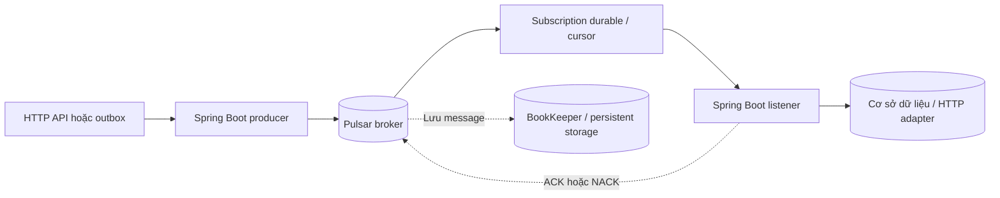

# Kiểm thử broker, lỗi kết nối và xử lý lại sau khởi động

## Bối cảnh và mục tiêu

Trong **Spring Boot Integration**, Apache Pulsar thường nằm giữa ứng dụng nhận yêu cầu và các hệ thống xử lý bất đồng bộ như dịch vụ đơn hàng, cơ sở dữ liệu, HTTP adapter hoặc hệ thống gửi thông báo. Một luồng tích hợp có thể hoạt động tốt khi broker luôn sẵn sàng nhưng gặp lỗi khi broker chưa khởi động, kết nối bị cắt, consumer dừng giữa chừng, hoặc ứng dụng chạy lại sau khi đã cập nhật dữ liệu nhưng chưa gửi acknowledgment (ACK).

Chủ đề này tập trung vào **kiểm thử broker, lỗi kết nối và xử lý lại sau khởi động**, với ba câu hỏi cần trả lời bằng kiểm thử quan sát được:

1. Ứng dụng có gửi/nhận đúng qua **broker Pulsar thật** và phát hiện được tình trạng broker không sẵn sàng không?
2. Khi producer, consumer hoặc broker bị gián đoạn, hệ thống **phục hồi kết nối và xử lý lại** theo hợp đồng nào?
3. Sau khi ứng dụng hoặc broker khởi động lại, message chưa ACK có được chuyển lại, còn message đã ACK có bị xử lý lại ngoài ý muốn không?

Ví dụ dùng **Spring Boot 3.5 / Spring for Apache Pulsar 1.2.x / Testcontainers 1.x** làm mốc minh họa; các phiên bản khác cần kiểm tra lại API, dependency và chính sách startup. Nội dung áp dụng cho service tích hợp có cơ sở dữ liệu/HTTP downstream, nhưng không giả định giao dịch database và ACK Pulsar là một giao dịch nguyên tử.

## 1. Mô hình lỗi cần phân biệt

### 1.1. Những thành phần có thể hỏng độc lập



Một lần gọi gửi thành công chỉ chứng minh producer đã nhận kết quả từ broker theo hợp đồng gửi tương ứng, **chưa chứng minh listener đã xử lý xong**. Ngược lại, listener có thể ghi dữ liệu thành công vào database rồi chết trước khi ACK: broker vẫn xem message là chưa hoàn tất và có thể gửi lại. Đây là nguồn phát sinh bản ghi trùng lặp phổ biến.

| Tình huống | Điều thay đổi | Điều cần kiểm thử |
|---|---|---|
| Broker chưa sẵn sàng khi app mở | Producer/consumer không kết nối; listener có thể không khởi động được. | Startup policy, trạng thái readiness, thông báo lỗi, khả năng khởi động listener sau khi broker có lại. |
| Broker mất kết nối khi app đang chạy | Producer gửi lỗi/timeout; consumer bị ngắt và cần kết nối lại. | Retry có giới hạn, không mất message đã được broker lưu, không báo thành công khi chưa có xác nhận. |
| Consumer bị dừng trước ACK | Cursor durable chưa ghi nhận message đã xử lý. | Consumer mới cùng subscription nhận lại message chưa ACK. |
| Consumer đã ACK rồi mới dừng | Cursor đã tiến, theo trạng thái ACK bền vững. | Khởi động lại không tự phát lại message đó trên cùng subscription. |
| Downstream HTTP/DB lỗi | Listener đã nhận message nhưng business operation thất bại. | NACK/redelivery hoặc DLT, tránh ACK sớm và tránh retry vô hạn. |
| Broker container bị xóa và tạo mới | Có thể mất dữ liệu/metadata của môi trường test. | Phân biệt **tái tạo môi trường** với **khởi động lại broker giữ nguyên storage**. |

## 2. Nền tảng để hiểu kết quả sau khởi động lại

### 2.1. Persistent topic, durable subscription và vị trí đọc

- **Persistent topic** (`persistent://tenant/namespace/topic`) lưu message qua hệ lưu trữ của Pulsar; không đồng nghĩa với việc mọi môi trường Docker thử nghiệm đều giữ dữ liệu khi xóa container và volume.
- **Durable subscription** lưu cursor/tiến độ ACK. Khi consumer kết nối lại với **cùng tên subscription**, broker dùng trạng thái đã lưu để quyết định message tiếp theo. Durable là chế độ subscription mặc định của Pulsar Java client.
- **Non-durable subscription** không bảo đảm giữ cursor qua broker restart. `Reader` có ngữ nghĩa khác consumer subscription và không nên được dùng thay cho test phục hồi durable consumer.
- **`subscriptionInitialPosition(Earliest/Latest)`** chủ yếu áp dụng khi **tạo subscription mới**. Đổi `Earliest` rồi kết nối lại với một subscription đã có cursor không phải thao tác tự động replay toàn bộ lịch sử.
- **Message chưa ACK** có thể được redeliver sau consumer disconnect/crash; **message đã ACK** không được tự phát lại chỉ vì khởi động lại ứng dụng. Muốn replay dữ liệu đã ACK cần chính sách retention và thao tác cursor/seek phù hợp, có chủ đích.

Tránh dùng tên subscription sinh ngẫu nhiên trong ứng dụng production cần theo dõi backlog qua nhiều lần triển khai. Tên cố định theo **nhóm nghiệp vụ** (`orders-projection-v1`, `billing-posting-v1`) giúp kiểm thử cùng cursor giữa các lần khởi động; tên ngẫu nhiên chỉ nên dành cho **cách ly từng ca test**.

### 2.2. ACK, NACK và bảo đảm giao nhận

| Cơ chế | Kết quả mong đợi | Điểm cần lưu ý khi restart |
|---|---|---|
| ACK sau khi xử lý thành công | Đánh dấu đã xử lý trên subscription. | Nếu ACK đã được broker ghi nhận, lần chạy lại không lấy lại message đó theo cursor cũ. |
| NACK khi xử lý lỗi | Yêu cầu broker gửi lại message theo độ trễ/policy. | Redelivery có thể đến consumer khác; thứ tự không luôn được giữ với `Shared`. |
| Không ACK và consumer đóng/crash | Message vẫn chưa hoàn tất. | Broker có thể chuyển lại khi consumer/subscription hoạt động, không cần bắt buộc cấu hình ack timeout. |
| `ackTimeout` (tùy chọn) | Message không ACK quá thời gian quy định được lên lịch redelivery. | Theo mặc định timeout này bị **tắt**; timeout quá ngắn có thể gây xử lý trùng khi xử lý bình thường còn chạy. |
| Dead letter topic (DLT/DLQ) | Tách message nhiều lần xử lý thất bại ra khỏi luồng chính. | Cần kiểm tra retry count, retention và subscription đọc DLT; không suy ra mọi trường hợp restart đều giữ nguyên bộ đếm retry. |

**At-least-once** nghĩa là hệ thống có thể giao lại một message chưa xác nhận. Nó không bảo đảm business side effect đúng một lần. Với thao tác ghi database, gọi HTTP hoặc trừ tiền, phải thiết kế **idempotency** riêng. Pulsar message ID thích hợp để đối chiếu một lần publish, còn **business event ID** ổn định hữu ích hơn khi upstream gửi lại cùng sự kiện thành một message mới.

## 3. Môi trường kiểm thử broker bằng Testcontainers

Không nên chỉ dùng mock `PulsarTemplate` hay gọi trực tiếp phương thức listener: hai cách đó không kiểm tra được kết nối, schema, subscription, cursor, ACK hoặc redelivery. Nên tách các lớp kiểm thử:

| Tầng kiểm thử | Mục tiêu | Công cụ gợi ý |
|---|---|---|
| Unit | Parse payload, validate hợp đồng, logic idempotency, phân loại lỗi. | JUnit, Mockito, repository fake. |
| Integration với broker thật | Gửi/nhận, subscription, ACK/NACK, retry và đọc lại sau consumer reconnect. | Pulsar Testcontainers + `@SpringBootTest`. |
| Fault injection | Broker/network bị ngắt, lỗi downstream, timeout, quá trình hồi phục. | Toxiproxy hoặc điều khiển kết nối/container trong test cô lập. |
| Recovery/chaos trên hạ tầng gần production | Broker restart với storage bền, rolling upgrade, failover, nhiều instance consumer, tính nhất quán database. | Cụm Pulsar riêng và hạ tầng quan sát được; không suy từ một container tạm. |

### 3.1. Dependency và cấu hình theo một dòng phiên bản

Với **Spring Boot 3.5** quản lý **Testcontainers 1.x**, ví dụ Gradle (Groovy DSL):

```groovy
dependencies {
    implementation 'org.springframework.boot:spring-boot-starter-pulsar'

    testImplementation 'org.springframework.boot:spring-boot-starter-test'
    testImplementation 'org.springframework.boot:spring-boot-testcontainers'
    testImplementation 'org.testcontainers:junit-jupiter'
    testImplementation 'org.testcontainers:pulsar'
}
```

**Chú ý khi nâng phiên bản:** Testcontainers **2.x** đổi tên nhiều artifact; module Pulsar 2.x là `org.testcontainers:testcontainers-pulsar`, còn Testcontainers 1.x dùng `org.testcontainers:pulsar`. Dùng dependency BOM mà dự án thực sự resolve; không trộn ví dụ import/module của hai dòng. Cấu hình Pulsar Spring Boot thường dùng:

```yaml
spring:
  pulsar:
    client:
      service-url: pulsar://localhost:6650
    admin:
      service-url: http://localhost:8080
```

Đây là cấu hình mẫu chạy broker local. Trong integration test, nên dùng `@ServiceConnection` để Spring Boot nhận địa chỉ broker và Admin từ container, vì port do Testcontainers cấp thường thay đổi. Với setup không dùng service connection, đăng ký **cả hai** property bằng `@DynamicPropertySource` từ `PulsarContainer.getPulsarBrokerUrl()` và `getHttpServiceUrl()`.

### 3.2. Một integration test kiểm tra ACK và xử lý lại

Đoạn sau kiểm tra **consumer đóng mà chưa ACK**, sau đó tạo consumer mới với **cùng subscription**. Đây là ca nhỏ, quyết định và dễ lặp lại, vì không phụ thuộc việc chờ một lỗi ngẫu nhiên của mạng.

```java
import static org.assertj.core.api.Assertions.assertThat;

import java.util.UUID;
import java.util.concurrent.TimeUnit;

import org.apache.pulsar.client.api.Consumer;
import org.apache.pulsar.client.api.Message;
import org.apache.pulsar.client.api.MessageId;
import org.apache.pulsar.client.api.PulsarClient;
import org.apache.pulsar.client.api.Schema;
import org.apache.pulsar.client.api.SubscriptionInitialPosition;
import org.apache.pulsar.client.api.SubscriptionMode;
import org.apache.pulsar.client.api.SubscriptionType;
import org.junit.jupiter.api.Test;
import org.springframework.beans.factory.annotation.Autowired;
import org.springframework.boot.test.context.SpringBootTest;
import org.springframework.boot.testcontainers.service.connection.ServiceConnection;
import org.springframework.pulsar.core.PulsarTemplate;
import org.testcontainers.containers.PulsarContainer;
import org.testcontainers.junit.jupiter.Container;
import org.testcontainers.junit.jupiter.Testcontainers;
import org.testcontainers.utility.DockerImageName;

@Testcontainers
@SpringBootTest
class PulsarConsumerRecoveryIT {

    @Container
    @ServiceConnection
    static final PulsarContainer BROKER = new PulsarContainer(
            DockerImageName.parse("apachepulsar/pulsar:3.0.0"));

    @Autowired PulsarClient client;
    @Autowired PulsarTemplate<String> template;

    @Test
    void deliversUnacknowledgedMessageAfterConsumerReconnect() throws Exception {
        String suffix = UUID.randomUUID().toString();
        String topic = "persistent://public/default/orders-recovery-" + suffix;
        String subscription = "orders-worker-" + suffix;
        MessageId originalId;

        try (Consumer<String> first = newConsumer(topic, subscription)) {
            template.send(topic, "order-42");

            Message<String> message = first.receive(15, TimeUnit.SECONDS);
            assertThat(message).isNotNull();
            assertThat(message.getValue()).isEqualTo("order-42");
            originalId = message.getMessageId();
            // Mô phỏng consumer chết trước ACK: cố ý KHÔNG acknowledge.
        }

        try (Consumer<String> restarted = newConsumer(topic, subscription)) {
            Message<String> again = restarted.receive(15, TimeUnit.SECONDS);
            assertThat(again).isNotNull();
            assertThat(again.getValue()).isEqualTo("order-42");
            assertThat(again.getMessageId()).isEqualTo(originalId);
            restarted.acknowledge(again);
        }
    }

    private Consumer<String> newConsumer(String topic, String subscription)
            throws Exception {
        return client.newConsumer(Schema.STRING)
                .topic(topic)
                .subscriptionName(subscription)
                .subscriptionMode(SubscriptionMode.Durable)
                .subscriptionType(SubscriptionType.Exclusive)
                .subscriptionInitialPosition(SubscriptionInitialPosition.Earliest)
                .subscribe();
    }
}
```

Điều kiện chạy: có Docker và Spring Boot application context tối thiểu với Pulsar auto-configuration; broker test cho phép tự tạo topic hoặc đã được tạo trước. Tên topic/subscription được phân lập bằng UUID để các ca test không tranh cursor; image được cố định để giảm sai khác môi trường. Đây là **integration test consumer reconnect**, **chưa phải broker restart**. Để chứng minh phần business của `@PulsarListener`, bổ sung test chạy listener thật và quan sát cập nhật database hoặc trạng thái đích sau khi nhận message.

Có thể mở rộng thành hai trường hợp đối chứng: **không ACK ⇒ được gửi lại** và **đã ACK ⇒ không được gửi lại**. Với trường hợp đã ACK, cần chờ broker ghi nhận trạng thái, sau đó dùng `receive(timeout)` để xác nhận không có message cũ; luôn đặt timeout hữu hạn và tránh giả định thời gian tức thì.

## 4. Kiểm thử lỗi kết nối và khởi động

### 4.1. Broker chưa sẵn sàng khi ứng dụng mở

Spring for Apache Pulsar khởi động listener container khi application context được làm mới. Ở dòng Spring Pulsar có `StartupFailurePolicy` cho listener container:

| Chính sách | Hành vi khi listener không khởi động được | Điều test phải khẳng định |
|---|---|---|
| `Stop` (mặc định) | Ghi lỗi rồi ném lại exception, thường khiến ứng dụng không khởi động thành công. | Deployment phát hiện lỗi startup; không tạo ảo giác service sẵn sàng nhận message. |
| `Continue` | Ghi lỗi, không dừng ứng dụng; listener ở trạng thái không chạy. | **Liveness và readiness tách biệt**: process có thể sống nhưng chức năng xử lý message chưa hoạt động. |
| `Retry` | Retry việc **khởi động listener container** bất đồng bộ; nếu hết retry thì container có thể vẫn không chạy. | Khi broker có lại trong cửa sổ retry, listener chạy và xử lý backlog; khi hết retry, cảnh báo/phục hồi có chủ đích. |

Trong tài liệu Spring Pulsar 1.2, cơ chế retry startup mặc định là **3 lần**, mỗi lần cách **10 giây**, và có thể tùy chỉnh. Đây là retry **khởi động container**; đừng nhầm với retry gửi message từ producer, retry kết nối của Pulsar Java client, hoặc NACK của consumer đã nhận message. Cấu hình chính sách này qua `PulsarContainerFactoryCustomizer`/container properties theo đúng phiên bản; không mặc định rằng chỉ bật `spring.pulsar.client.*` là đã chuyển chính sách startup.

Kịch bản test nên khởi động app khi broker chưa truy cập được, quan sát phản ứng theo policy; sau đó cho broker có lại và kiểm tra listener thực sự tiêu thụ được một message mới. Nếu policy hết retry trước khi broker hồi phục, cần **restart app, restart listener container hoặc orchestration retry** theo thiết kế, không coi việc context vẫn `UP` là đủ.

### 4.2. Broker mất kết nối trong khi đang chạy

Thử nghiệm có thể dùng proxy mạng độc lập giữa Spring Boot và broker để cắt/làm chậm kết nối, sau đó khôi phục. **Toxiproxy** hữu ích khi cần tái lập lỗi ở mức kết nối mà vẫn giữ nguyên dữ liệu broker. Test phải có hạn mức thời gian cho mọi thao tác; lỗi có thể được trả về ngay, sau timeout, hoặc sau một số vòng retry tùy cấu hình client.

Quy trình có thể quan sát bằng các mốc sau:

1. Khởi động broker và listener; gửi message `event-1`, xác nhận consumer xử lý và ACK.
2. Chặn kết nối producer/consumer tới broker qua proxy; thử gửi `event-2` và ghi nhận send future/exception hoặc timeout, **không** xem lời gọi đã khởi tạo future là gửi thành công.
3. Khôi phục kết nối; xác nhận client reconnect và listener tiếp tục nhận được `event-3`.
4. Đối chiếu những message đã được broker xác nhận với message phía downstream; kiểm tra `event-2` có thể chưa được lưu, được gửi một lần, hoặc bị gửi lặp nếu producer đã retry trong lúc không chắc broker có nhận hay chưa.
5. Đọc log reconnect, số lượng unacked/backlog, thời gian phục hồi, và bảo đảm không có thread hoặc future treo vô hạn.

Không gán một số lần retry cố định cho mọi lỗi mạng. Kiểm thử chính xác cần đặt rõ `operationTimeout`, giới hạn retry phía ứng dụng, chính sách producer reconnect và ngưỡng chờ của test. Nếu downstream HTTP/DB mất kết nối, hãy tạo lỗi ở **downstream** riêng để chứng minh listener NACK đúng; không dùng việc tắt broker để giả lập mọi lỗi tích hợp.

### 4.3. Broker restart khác với xóa và tạo lại Testcontainer

Khởi động lại **tiến trình broker với metadata và persistent storage còn nguyên** là bài toán khác với `stop()` rồi tạo một standalone container mới. Với Testcontainers, việc dừng/xóa container và tạo lại thường làm mất filesystem tạm hoặc làm thay đổi metadata, nên một test “không đọc lại được message” có thể đơn thuần là **mất trạng thái của môi trường test**, không chứng minh lỗi của subscription.

Muốn kiểm thử **broker restart thực sự**:

- Dùng broker/cụm có BookKeeper và metadata store tồn tại độc lập với vòng đời process/container; giữ nguyên topic, subscription, storage và địa chỉ truy cập phù hợp.
- Gửi message, tạo durable subscription, nhận message nhưng chưa ACK; restart broker mà **không xóa dữ liệu**; chờ client hồi phục và xác nhận message được redeliver.
- Kiểm tra thêm message đã ACK không tự quay lại và backlog/cursor vẫn đúng; ghi rõ phiên bản broker, số node, partition, chính sách retention/TTL và topology.

`docker pause`/`unpause` có thể mô phỏng một kiểu gián đoạn dịch vụ tạm thời nhưng **không** thay thế test broker restart/BookKeeper recovery. Mô hình một standalone container cho test giao thức rất hữu ích, còn kết luận về độ bền của dữ liệu qua crash broker phải được xác thực trên môi trường lưu trữ tương ứng.

## 5. Xử lý lỗi trong `@PulsarListener` và giới hạn retry

### 5.1. Chọn ACK mode khớp với đơn vị công việc

Spring for Apache Pulsar có ba ACK mode chính:

| Mode | Cách hoạt động với listener thông thường | Khi nào phù hợp |
|---|---|---|
| `BATCH` (mặc định) | Container nhận một batch nội bộ; với **single-record listener**, các record thành công được ACK, record lỗi được NACK sau khi xử lý batch. | Chấp nhận xác nhận theo nhịp batch và đã hiểu ranh giới batch nhận. |
| `RECORD` | ACK hoặc NACK theo từng record sau khi method thành công hoặc ném exception. | Dễ test các side effect độc lập theo event. |
| `MANUAL` | Ứng dụng tự gọi `Acknowledgement.acknowledge()` hoặc `.nack()`; framework không tự ACK/NACK. | Cần quyết định ACK sau một bước nghiệp vụ rõ ràng, nhưng phải kiểm soát mọi nhánh lỗi. |

Chẳng hạn, listener single-record nhận sự kiện đơn hàng và chỉ ACK sau khi `projectionService` hoàn tất:

```java
import org.apache.pulsar.client.api.SubscriptionType;
import org.springframework.pulsar.annotation.PulsarListener;
import org.springframework.pulsar.listener.AckMode;
import org.springframework.stereotype.Component;

@Component
class OrderProjectionListener {
    private final OrderProjectionService projectionService;

    OrderProjectionListener(OrderProjectionService projectionService) {
        this.projectionService = projectionService;
    }

    @PulsarListener(
            topics = "persistent://public/default/order-created",
            subscriptionName = "orders-projection-v1",
            subscriptionType = SubscriptionType.Shared,
            ackMode = AckMode.RECORD,
            properties = {"negativeAckRedeliveryDelay=5s"})
    void onMessage(String eventJson) {
        projectionService.applyIdempotently(eventJson);
        // Thành công: container ACK; exception: container xử lý NACK.
    }
}
```

`OrderProjectionService.applyIdempotently` là **interface nghiệp vụ minh họa**, cần hiện thực trong dự án. Ví dụ trên cho thấy ranh giới ACK, không phải một lớp tự chạy độc lập. Trường hợp xử lý không thành công, **để exception truyền về container** nhằm kích hoạt NACK/redelivery ở `RECORD` mode; không bắt mọi exception rồi chỉ ghi log, vì return bình thường có thể làm message bị ACK sai.

Với `MANUAL`, ví dụ nhánh thành công và lỗi:

```java
@PulsarListener(
        topics = "persistent://public/default/order-created",
        subscriptionName = "orders-projection-v1",
        ackMode = AckMode.MANUAL)
void receive(String eventJson, Acknowledgement ack) {
    try {
        projectionService.applyIdempotently(eventJson);
        ack.acknowledge();
    } catch (RuntimeException ex) {
        ack.nack();
    }
}
```

Đoạn trích dùng `org.springframework.pulsar.listener.Acknowledgement` và minh họa cơ chế ACK thủ công. Khi kết hợp `MANUAL` với `PulsarConsumerErrorHandler` để retry tại container hoặc chuyển sang DLT, **không tự NACK rồi nuốt exception**: hãy để handler nhận lỗi theo hợp đồng của framework. Với batch listener, `BATCH` lỗi có thể redeliver cả batch; nếu cần ACK từng message của batch hãy dùng `MANUAL` và xử lý `MessageId` phù hợp.

### 5.2. Retry và DLT: xử lý lỗi tạm thời khác lỗi dữ liệu

- **Lỗi tạm thời** như HTTP 503, connection refused hoặc database unavailable: thử lại với backoff có giới hạn, jitter, timeout và giám sát.
- **Lỗi không thể phục hồi bằng retry** như schema sai hoặc mã hàng không hợp lệ: tránh vòng lặp NACK vô hạn; gửi DLT có thông tin truy vết rồi xử lý theo quy trình vận hành.
- **Lỗi phân vùng / quá tải:** có thể cần tạm dừng listener hoặc giảm concurrency để downstream hồi phục, thay vì tăng retry làm quá tải thêm.

Pulsar hỗ trợ `ackTimeout`, `negativeAckRedeliveryBackoff`, `DeadLetterPolicy` và retry letter topic. Spring Pulsar còn có `PulsarConsumerErrorHandler`/`DefaultPulsarConsumerErrorHandler` để retry ở tầng listener và phát tới DLT bằng recoverer. **Không cấu hình đồng thời các cơ chế retry mà chưa tính số lần xử lý tổng thể**, vì retry ở nhiều tầng có thể nhân số attempt.

Đặc biệt, bộ đếm redelivery của một số cơ chế **NACK không được lưu bền qua broker disconnect/restart/topic unload**. Vì vậy không coi `maxRedeliverCount = 5` của native dead letter policy là giới hạn tuyệt đối sau mọi sự cố. Nếu cần ngân sách retry vẫn đúng sau restart, dùng luồng retry có thông tin số lần thử **được lưu trong message** (`enableRetry`/`reconsumeLater` khi phù hợp) hoặc trạng thái retry bền vững trong database. Đồng thời tạo subscription đọc DLT để không mất dấu message lỗi.

## 6. Idempotency để xử lý lại an toàn sau crash

Xét chuỗi sự kiện:

```text
T0: Pulsar giao eventId=E-42 cho listener
T1: Listener ghi thành công đơn hàng vào DB
T2: Process Spring Boot bị kill trước khi ACK
T3: Process khởi động lại, cùng durable subscription
T4: Pulsar gửi lại E-42 vì ACK chưa được ghi nhận
```

Tại `T4`, nếu code chỉ gọi `INSERT` hoặc gọi thanh toán lại, dữ liệu có thể bị trùng. Mô hình xử lý thường là **inbox/deduplication trong cùng giao dịch database** với cập nhật nghiệp vụ:

```sql
CREATE TABLE processed_event (
    consumer_name VARCHAR(100) NOT NULL,
    event_id VARCHAR(100) NOT NULL,
    processed_at TIMESTAMP NOT NULL DEFAULT CURRENT_TIMESTAMP,
    PRIMARY KEY (consumer_name, event_id)
);
```

```text
BEGIN TRANSACTION
  Thử INSERT (consumer_name, event_id) vào processed_event
  Nếu đã tồn tại: bỏ qua side effect của lần nhận lặp
  Nếu insert mới: ghi projection / nghiệp vụ vào DB
COMMIT
Sau khi COMMIT thành công: ACK message
```

Việc thử insert phải **nguyên tử và dựa trên unique constraint**, xử lý trường hợp hai consumer cùng nhận một event ID. Tránh chiến lược `SELECT chưa có` rồi mới `INSERT` không có ràng buộc unique, vì hai request song song có thể cùng thấy “chưa có”. Nếu transaction rollback, marker `processed_event` cũng phải rollback để lần redelivery có thể làm lại.

Đây là minh họa cho **side effect trong cùng một database**. Nếu xử lý bao gồm HTTP call, ghi hai database, hoặc gửi sang broker khác, một transaction local không bảo đảm nguyên tử xuyên hệ thống; cân nhắc **outbox, idempotency key phía downstream, saga hoặc các giao dịch được hỗ trợ thực tế**. Nếu API thanh toán bên ngoài đã thực hiện nhưng kết nối mất trước khi nhận response, retry phải sử dụng cùng idempotency key để kiểm tra trạng thái trước khi yêu cầu lại.

## 7. Ma trận test phục hồi cần có

| Mã test | Kích hoạt | Kết quả/điểm chốt cần xác minh |
|---|---|---|
| **T01 - Happy path** | Producer gửi 1 event với broker thật và listener chạy. | Đã nhận đúng schema/payload; side effect hoàn tất và ACK; backlog về 0 theo ngưỡng quan sát hợp lý. |
| **T02 - Consumer trước ACK** | Nhận message, đóng consumer không ACK, mở consumer mới cùng durable subscription. | Nhận lại **cùng MessageId** hoặc event ID; sau ACK không bị nhận lại tự phát. |
| **T03 - Consumer sau ACK** | Nhận rồi ACK, đóng/mở lại cùng subscription. | Không nhận lại message đã xác nhận; không nhầm với subscription mới `Earliest`. |
| **T04 - Broker down lúc startup** | Chưa cho broker chạy rồi start app. | `Stop`/`Continue`/`Retry` đúng như cấu hình; readiness phản ánh khả năng tiêu thụ; có quy trình phục hồi. |
| **T05 - Network partition** | Ngắt mạng app↔broker giữa lúc producer send/consumer receive. | Timeout bounded; gửi lại không gây side effect trùng; reconnect và tiêu thụ tiếp sau khi mở mạng. |
| **T06 - Downstream 503** | Handler gọi HTTP adapter trả lỗi tạm thời. | Exception không bị nuốt; NACK/retry theo backoff, hồi phục thì ACK. |
| **T07 - Poison message** | Payload sai schema/hợp đồng hoặc lỗi nghiệp vụ không thể xử lý. | Được phân loại và đưa DLT theo cơ chế chọn; message khác không bị chặn vô hạn. |
| **T08 - Crash sau DB commit** | DB đã commit, kill app trước ACK. | Redelivery xảy ra; marker idempotency khiến side effect chỉ áp dụng **một lần**. |
| **T09 - Broker restart giữ storage** | Restart process broker với BookKeeper/metadata còn nguyên. | Cursor durable tồn tại; message chưa ACK đến lại, message đã ACK không tự phát lại. |
| **T10 - Nhiều consumer** | Tăng số instance trên `Shared`/`Failover`/`Key_Shared`. | Không giả định thứ tự toàn cục ở `Shared`; không có race gây trùng side effect; failover xử lý backlog. |
| **T11 - Hết retry** | Broker không thể khởi động lại trong giới hạn startup retry. | Container không chạy được báo động; không quảng bá readiness giả; restart có kiểm soát khi lỗi hết. |

Khi test các luồng bất đồng bộ, tránh `Thread.sleep(...)` như một tiêu chí pass. Dùng polling có **timeout hữu hạn** (Awaitility, latch, `receive(timeout)`, kiểm tra repository) để kiểm tra **trạng thái cuối**, không kiểm tra “đã ngủ đủ lâu”. Riêng test mất kết nối không nên gán thứ tự cố định giữa nhiều consumer cạnh tranh.

## 8. Quan sát và điều kiện chấp nhận

Một bài test recovery tốt phải ghi lại **trạng thái kỹ thuật** lẫn **kết quả nghiệp vụ**:

| Tín hiệu | Vì sao cần |
|---|---|
| Producer send success/error/timeout và số lần retry | Phân biệt message thật sự được broker xác nhận với message mới chỉ được tạo thành future. |
| Listener startup, running/paused, reconnect | Biết process đã sống nhưng listener chưa chạy hay đã phục hồi. |
| Backlog, unacked messages, redelivery rate, DLT volume | Phát hiện nghẽn và poison-message loop. |
| Consumer lag / thời gian event-to-processing | Đo tác động lên SLA khi broker hoặc downstream gián đoạn. |
| `eventId`, `messageId`, `subscription`, `topic`, correlation/trace ID | Đối chiếu một business event qua lần gửi lại hoặc nhiều hệ thống. |
| Số row nghiệp vụ và unique marker sau khi chạy lại | Chứng minh idempotency bằng trạng thái bền vững, không chỉ bằng log. |

Nên định nghĩa trước ngưỡng chấp nhận phù hợp hệ thống, ví dụ “sau khi broker phục hồi, message còn backlog được xử lý trong **ngưỡng SLO đã công bố**”. Không dùng các con số mẫu làm SLA nếu chưa đo tải thực. Với Spring Boot Actuator/Micrometer, có thể bổ sung health/readiness và observation, nhưng cần xác nhận **Pulsar client/listener running** theo đúng thành phần đang triển khai; trạng thái HTTP `/actuator/health = UP` không tự chứng minh backlog đang được xử lý.

**Checklist khi chốt một ca sự cố:**

1. Xác định lỗi xảy ra **trước hay sau** broker xác nhận publish, **trước hay sau** DB commit, **trước hay sau** ACK.
2. Kiểm tra tên topic, subscription và mode (`Durable`/`NonDurable`; `Exclusive`/`Shared`/`Failover`/`Key_Shared`).
3. Giữ nguyên storage nếu mục tiêu là broker restart; không gọi test container được tạo mới là kiểm thử độ bền.
4. Đo message delivery, trạng thái cursor/backlog, retry/DLT và business side effect bằng một test có timeout.
5. Kiểm chứng xử lý lặp an toàn bằng unique constraint hoặc cơ chế idempotency bền vững.

## 9. Sai lầm thường gặp và cách tránh

| Sai lầm | Vì sao sai | Cách khắc phục |
|---|---|---|
| Test chỉ mock `PulsarTemplate` | Không chạm broker, subscription, schema và ACK. | Có ít nhất một integration test với Pulsar thật. |
| Dùng subscription mới với `Earliest` rồi gọi là “recovery” | Broker tạo cursor mới nên replay có chủ ý, không chứng minh cursor cũ sống sót. | Reconnect **cùng subscription** cho test recovery. |
| Dùng `stop/start` Testcontainers như broker restart bền vững | Có thể tạo lại container và làm mất storage/metadata. | Kiểm thử restart trên hạ tầng giữ nguyên persistent storage. |
| ACK trước khi side effect hoàn tất | Crash giữa hai bước khiến broker không gửi lại dữ liệu chưa xử lý. | ACK sau thành công; xử lý trùng bằng idempotency. |
| `catch(Exception)` rồi log và return | Listener xem lời gọi thành công; message có thể bị ACK dù nghiệp vụ lỗi. | Ném lỗi để framework xử lý hoặc ACK/NACK thủ công đầy đủ. |
| Cho rằng `maxRedeliverCount` tuyệt đối qua restart | Một số bộ đếm redelivery nằm trong bộ nhớ và reset khi disconnect. | Retry metadata bền vững hoặc database retry state khi bắt buộc. |
| Chỉ kiểm tra app process lên sau lỗi broker | Listener có thể chưa chạy hoặc đã hết startup retry. | Gắn readiness/alert vào trạng thái listener và kiểm thử nhận message thực. |
| Kỳ vọng “exactly once” nhờ ACK của Pulsar | DB commit và ACK không tự động atomic. | Transaction local + inbox idempotency/outbox theo ranh giới dữ liệu. |

## Tài liệu tham khảo

- [Spring Boot 3.5 – Apache Pulsar Support](https://docs.spring.io/spring-boot/3.5/reference/messaging/pulsar.html): client, Admin, producer, consumer và cấu hình.
- [Spring Boot 3.5 – Testcontainers Service Connections](https://docs.spring.io/spring-boot/3.5/reference/testing/testcontainers.html): `@ServiceConnection`, `PulsarConnectionDetails`.
- [Spring for Apache Pulsar 1.2 – Message Consumption](https://docs.spring.io/spring-pulsar/docs/1.2.x/reference/reference/pulsar/message-consumption.html): ACK mode, NACK, DLT, listener container, startup policy.
- [Spring for Apache Pulsar – Testing Applications](https://docs.spring.io/spring-pulsar/reference/reference/testing-applications.html): `spring-pulsar-test`, `PulsarConsumerTestUtil`, test container support.
- [Apache Pulsar 4.0 – Messaging](https://pulsar.apache.org/docs/4.0.x/concepts-messaging/): subscription modes, durable cursor, ACK, redelivery, retry, persistent/non-persistent topics.
- [Apache Pulsar – Work with Consumers](https://pulsar.apache.org/docs/client-libraries/consumers/): consumer reconnect, backoff, ACK/NACK.
- [Testcontainers for Java – Apache Pulsar Module](https://java.testcontainers.org/modules/pulsar/): `PulsarContainer` và broker/Admin URL.
