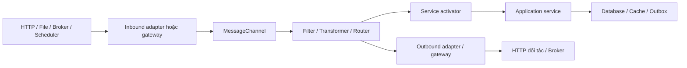
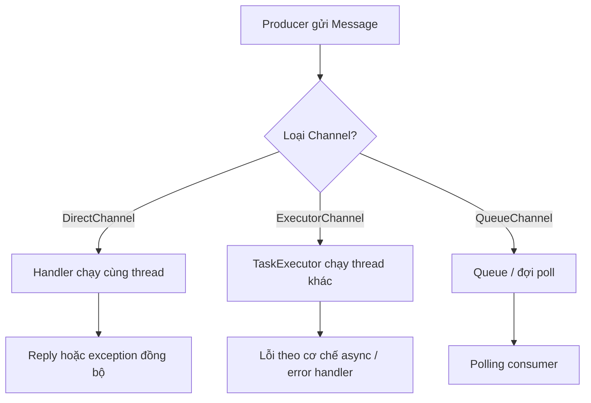
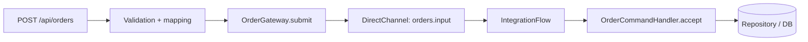

# spring-boot-starter-integration và hạ tầng Boot khởi tạo

Trong module **SPRING_BOOT_INTEGRATION**, một dịch vụ Spring Boot có thể nhận dữ liệu qua HTTP, truy xuất cơ sở dữ liệu, sử dụng cache, gửi/nhận thông điệp qua broker và phối hợp các adapter. Khi luồng không còn là một lời gọi service đơn giản, **Spring Integration** cung cấp mô hình xử lý thông điệp và các mẫu tích hợp doanh nghiệp (Enterprise Integration Patterns – EIP) để xây dựng các tuyến xử lý rõ ràng: nhận message, chuyển đổi, lọc, định tuyến và gọi thành phần nghiệp vụ.

Dependency **`spring-boot-starter-integration`** giúp ứng dụng Boot đưa Spring Integration vào context theo cách nhất quán. Tuy nhiên, **starter không tự tạo luồng nghiệp vụ của bạn**. Cần phân biệt ba trách nhiệm: thư viện Spring Integration cung cấp mô hình và các thành phần, Spring Boot tự cấu hình một phần hạ tầng theo điều kiện, còn ứng dụng tự khai báo channel, endpoint, mapping, giao dịch, chính sách lỗi và quan sát.

Bài thuộc chương **Spring Integration**, tập trung vào starter và những gì Boot khởi tạo. Ví dụ sử dụng Java 17+ theo hệ sinh thái Spring Boot 3.x / Spring Integration 6.x. Các tùy chọn và API có thể thay đổi giữa phiên bản; nên giữ BOM và tài liệu cùng thế hệ khi áp dụng.

## 1. Mục tiêu học tập

Sau bài học, bạn có thể:

1. Giải thích vai trò của `Message`, `MessageChannel`, endpoint, `IntegrationFlow` và message handler.
2. Thêm đúng starter, phân biệt core với module adapter theo giao thức.
3. Nhận diện chính xác việc **Boot tự cấu hình hạ tầng có điều kiện** so với những bean ứng dụng phải tự khai báo.
4. Xây dựng flow cơ bản bằng Java DSL, dùng messaging gateway gọi từ HTTP adapter và hiểu thời điểm chạy đồng bộ.
5. Chọn channel/poller phù hợp, nhận diện lỗi và ranh giới transaction khi đổi thread hay đi qua broker.
6. Kiểm thử wiring, hợp đồng DTO, xử lý trùng, retry và khả năng quan sát của một luồng thực tế.

## 2. Định vị Spring Integration trong kiến trúc

Spring Integration tổ chức lời gọi giữa các thành phần thành **message flow**. Mỗi message mang payload cùng headers; các endpoint chuyển message vào/ra channel hoặc gọi service. Một flow không bắt buộc phải kết nối broker: channel có thể truyền thông điệp **trong cùng tiến trình**, giữa hai bean Java.



| Khái niệm | Vai trò | Không nên hiểu nhầm |
| --- | --- | --- |
| `Message<T>` | Payload có kiểu và tập headers đi kèm | Header không phải nơi chứa dữ liệu nghiệp vụ nhạy cảm không kiểm soát. |
| `MessageChannel` | Kết nối producer với consumer trong ứng dụng | Channel nội bộ không mặc nhiên bền vững như Kafka queue/topic. |
| Message endpoint | Nối channel với một phương thức xử lý hoặc hệ thống ngoài | Endpoint không phải lúc nào cũng là HTTP endpoint. |
| `IntegrationFlow` | Java DSL mô tả chuỗi endpoint, channel, filter, transformer, router | Định nghĩa flow là trách nhiệm ứng dụng. |
| Message handler / service activator | Thực thi một bước nghiệp vụ hoặc chuyển sang service | Không tự mở transaction DB hay bảo đảm retry. |
| Inbound adapter/gateway | Đưa dữ liệu từ nguồn vào message flow | Module giao thức và cấu hình nguồn phải được chọn cụ thể. |
| Outbound adapter/gateway | Gửi dữ liệu từ flow sang đích | Không tự bảo đảm tác động ngoài hệ thống được rollback cùng DB. |

Spring Integration đặc biệt hữu ích khi cùng một nghiệp vụ được gọi từ nhiều nguồn, ví dụ HTTP controller, Kafka consumer và file poller đều chuyển về một lệnh `CreateOrderCommand`. Tuy vậy, một ứng dụng chỉ có controller → service → repository đơn giản thường không cần thêm tầng messaging.

## 3. Cài đặt `spring-boot-starter-integration`

Với Maven và Spring Boot parent/BOM:

```xml
<dependencies>
    <dependency>
        <groupId>org.springframework.boot</groupId>
        <artifactId>spring-boot-starter-integration</artifactId>
    </dependency>

    <!-- Chỉ cần khi ví dụ có HTTP controller. -->
    <dependency>
        <groupId>org.springframework.boot</groupId>
        <artifactId>spring-boot-starter-web</artifactId>
    </dependency>

    <dependency>
        <groupId>org.springframework.boot</groupId>
        <artifactId>spring-boot-starter-validation</artifactId>
    </dependency>
</dependencies>
```

Với Gradle Groovy DSL:

```groovy
dependencies {
    implementation 'org.springframework.boot:spring-boot-starter-integration'
    implementation 'org.springframework.boot:spring-boot-starter-web'
    implementation 'org.springframework.boot:spring-boot-starter-validation'
    testImplementation 'org.springframework.boot:spring-boot-starter-test'
}
```

`spring-boot-starter-integration` mang hạ tầng nền cho Integration message flow. Các **adapter theo giao thức** thường cần module Spring Integration riêng, ví dụ:

| Nhu cầu | Phần bổ sung thường dùng | Hạ tầng liên quan |
| --- | --- | --- |
| Channel/flow chỉ trong bộ nhớ | Starter Integration là đủ | Spring context, message channels, handlers |
| Nhận/đẩy HTTP theo mô hình message endpoint | `spring-integration-http` | HTTP server/client phù hợp, JSON/XML contract |
| File inbound/outbound | `spring-integration-file` | Đường dẫn, filter, poller, cơ chế archive |
| JDBC message endpoint/poller | `spring-integration-jdbc` | `DataSource`, SQL, transaction manager |
| RabbitMQ / AMQP | `spring-integration-amqp` | Spring AMQP connection factory, queue, ack/DLQ |
| Kafka message channel adapter | `spring-integration-kafka` | Spring Kafka producer/consumer factory, topic, offset |
| JMS broker | `spring-integration-jms` | JMS connection factory và broker |
| Redis message endpoint | `spring-integration-redis` | Spring Data Redis connection factory |
| SFTP remote file | `spring-integration-sftp` | Session factory, xác thực, polling/synchronization |

Không thêm đồng loạt mọi adapter. Nếu chỉ muốn một method Java gửi Kafka event, có thể dùng `KafkaTemplate` trực tiếp; nếu chỉ cần query database, `JdbcTemplate`/jOOQ thường đủ. Khi kết nối trở thành một **bước của flow**, module Integration dành cho giao thức giúp adapter tuân theo hợp đồng message.

Dependency của adapter **không tự đăng ký các business flow**: thêm `spring-integration-kafka` không khiến ứng dụng subscribe một topic tự chọn; thêm `spring-integration-file` không làm Boot quét một thư mục mặc định.

## 4. Boot tự cấu hình hạ tầng nào?

Spring Boot dùng auto-configuration **có điều kiện**: kiểm tra classpath, bean đã tồn tại, loại ứng dụng và thuộc tính cấu hình trước khi tạo bean. Khi Spring Integration phù hợp điều kiện, Boot kích hoạt hỗ trợ tích hợp với Spring context và cung cấp các thành phần/hook nền cần thiết. Phần Integration framework có thể tạo những thành phần mặc định khi khởi động context tích hợp, ví dụ các kênh hạ tầng như `errorChannel` và `nullChannel` theo cấu hình được kích hoạt.

Đây là **bean hạ tầng**, không phải những channel/endpoint nghiệp vụ có ý nghĩa đối với ứng dụng. Boot không thể tự suy ra `orders.input`, hợp đồng DTO, kênh nhận từ Kafka hay thời điểm một poller được phép chạy.

| Thành phần | Hạ tầng được cung cấp khi đủ điều kiện | Việc ứng dụng vẫn phải làm |
| --- | --- | --- |
| Spring Integration core | Message dispatching, framework infrastructure và hỗ trợ xử lý annotation/DSL | Định nghĩa message flow và ranh giới nghiệp vụ |
| Các kênh hệ thống của Spring Integration | Cơ chế lỗi và kênh tiêu thụ bỏ qua kết quả, tùy runtime/config | Không dựa vào default error channel như chính sách retry/DLQ đầy đủ |
| Java DSL | API xây flow trong Spring context | Tạo `@Bean IntegrationFlow` hoặc cấu hình endpoint |
| Messaging gateway | Hạ tầng tạo proxy cho interface gateway đã được đăng ký | Khai báo `@MessagingGateway`, bảo đảm component scanning, channel request/reply |
| Polling/TaskScheduler infrastructure | Hỗ trợ lập lịch khi cần endpoint pollable và đủ bean/cấu hình | Khai báo poller, interval, số message/poll, concurrency, checkpoint/claim |
| Actuator/Micrometer (nếu bổ sung và bật) | Một phần quan sát/management theo điều kiện và phiên bản | Chọn metric nghiệp vụ, correlation ID, tracing, chính sách bảo vệ endpoint |
| JDBC/Redis/Kafka/AMQP starters (nếu thêm) | Các connection factory, template, `DataSource` hoặc client factory theo điều kiện | Chọn topic/queue, schema, TTL, transaction, idempotency và adapter thực tế |

**Ba lớp phải được phân biệt:**

1. **Starter** mang dependencies và tạo điều kiện kích hoạt các auto-configuration.
2. **Spring Integration framework** đăng ký infrastructure, triển khai `MessageChannel`, message handlers, lifecycle và các mẫu xử lý message.
3. **Ứng dụng** khai báo flow, bean endpoint, channel nghiệp vụ, business DTO, cấu hình nguồn/đích, lỗi và giao dịch.

Không nên khẳng định rằng một tên bean cụ thể luôn tồn tại ở mọi phiên bản hay mọi context. Nếu ứng dụng tự khai báo thành phần cùng loại, hoặc điều kiện auto-configuration không thỏa, bean được tạo có thể khác đi. Xác minh trên **phiên bản và cấu hình thực tế** thay vì dựa vào giả định.

### 4.1. Các thuộc tính cấu hình có hai nguồn sở hữu

```yaml
spring:
  application:
    name: order-integration

app:
  orders:
    channel: orders.input
    importer-enabled: false
```

`spring.application.name` là thuộc tính do Spring Boot hiểu. Ngược lại, `app.orders.*` chỉ là **quy ước của ứng dụng**: giá trị sẽ không làm thay đổi flow trừ khi code ứng dụng đăng ký `@ConfigurationProperties`, `@ConditionalOnProperty` hoặc trực tiếp đọc chúng. Không tự tạo property `spring.integration.*` tùy ý và kỳ vọng Boot hiểu; chỉ dùng những khóa được tài liệu phiên bản cụ thể công bố.

Trong ví dụ file inbound ở phần 7, `@ConditionalOnProperty` được gắn trực tiếp vào bean `csvFlow` để chỉ tạo endpoint khi `app.orders.importer-enabled=true`. Khi không bật cờ, Spring không đăng ký flow đó. Đây là điều kiện của **bean do ứng dụng khai báo**; Boot đánh giá điều kiện nhưng không tự sinh logic nhập file từ property.

## 5. Các kênh và cách message được thực thi

Lựa chọn `MessageChannel` có ảnh hưởng trực tiếp đến thread, transaction và cách phản hồi lỗi:

| Kênh | Hành vi điển hình | Phù hợp khi | Cảnh báo |
| --- | --- | --- | --- |
| `DirectChannel` | Dispatch đồng bộ trong thread của người gửi | Flow ngắn, cần phản hồi/lỗi ngay | Handler chậm sẽ làm chậm producer; exception có thể truyền về caller |
| `ExecutorChannel` | Đưa công việc qua `TaskExecutor` | Tách thread khi cần xử lý bất đồng bộ | Không tự truyền transaction context sang thread mới; phải quản lý queue, lỗi và shutdown |
| `QueueChannel` | Chứa message trong queue trong bộ nhớ và chờ consumer poll | Cần tách producer/consumer theo kiểu pollable | Queue thông thường không bền vững qua restart; cần poller và giới hạn dung lượng |
| `PublishSubscribeChannel` | Phát đến nhiều subscriber | Fan-out tới nhiều bước xử lý | Không phải pub/sub broker bền vững; hành vi lỗi và đồng bộ phụ thuộc cấu hình |



`DirectChannel` được dùng trong ví dụ đầu tiên vì dễ hiểu đường đi và lỗi. Chỉ đổi sang `ExecutorChannel` để “tăng hiệu năng” sau khi đã đo tải và xác định chính sách xử lý lỗi, backpressure, timeout và độ tin cậy. Việc chuyển thread có thể thay đổi kết quả mong đợi của `@Transactional` và response HTTP.

**Header và payload:** các header như `id`, `timestamp`, `correlationId` và `replyChannel` phục vụ routing và liên hệ message; payload nên là DTO hoặc command có hợp đồng rõ. Đừng log toàn bộ message khi chứa dữ liệu cá nhân, token hoặc thông tin thanh toán. Không dựa vào `MessageHeaders.ID` được tạo tự động để chống xử lý trùng qua nhiều lần giao: mỗi lần tạo message mới có thể có ID mới, trong khi business event vẫn là một.

## 6. Ví dụ Java DSL: từ HTTP tới service qua gateway

Ta xây một luồng nhận lệnh xử lý đơn hàng. HTTP adapter nhận `OrderRequest`; tầng ứng dụng chuyển thành `OrderCommand` và gửi qua messaging gateway tới `orders.input`. Một `IntegrationFlow` chuyển lệnh đến handler nghiệp vụ.



### 6.1. DTO và command nội bộ

```java
import jakarta.validation.constraints.NotBlank;
import jakarta.validation.constraints.NotNull;
import jakarta.validation.constraints.Positive;

public record OrderRequest(
        @NotBlank String requestId,
        @NotBlank String orderId,
        @NotNull @Positive Long amountCents
) {}

public record OrderCommand(
        String requestId,
        String orderId,
        long amountCents
) {}
```

Trong project Java, đặt mỗi `public` top-level type vào file riêng. Request DTO mô tả JSON đầu vào; command mô tả ý nghĩa nghiệp vụ bên trong. Adapter nào khác (Kafka, file, HTTP client) cũng có thể chuyển hợp đồng của nó thành `OrderCommand`, nhưng phải giữ semantic và validation tương ứng.

### 6.2. Đăng ký messaging gateway và flow

```java
import org.springframework.integration.annotation.MessagingGateway;

@MessagingGateway(defaultRequestChannel = "orders.input")
public interface OrderGateway {
    void submit(OrderCommand command);
}
```

```java
import org.springframework.beans.factory.annotation.Qualifier;
import org.springframework.context.annotation.Bean;
import org.springframework.context.annotation.Configuration;
import org.springframework.integration.annotation.IntegrationComponentScan;
import org.springframework.integration.channel.DirectChannel;
import org.springframework.integration.dsl.IntegrationFlow;
import org.springframework.messaging.MessageChannel;

@Configuration(proxyBeanMethods = false)
@IntegrationComponentScan
public class OrderIntegrationConfiguration {

    @Bean("orders.input")
    MessageChannel orderInput() {
        return new DirectChannel();
    }

    @Bean
    IntegrationFlow orderFlow(
            @Qualifier("orders.input") MessageChannel input,
            OrderCommandHandler handler) {

        return IntegrationFlow.from(input)
                .handle(OrderCommand.class, (command, headers) -> {
                    handler.accept(command);
                    return null; // Handler một chiều, không có reply.
                })
                .get();
    }
}
```

`@IntegrationComponentScan` cho phép Spring tìm các interface mang `@MessagingGateway` trong phạm vi package scan, tạo proxy khi hạ tầng Integration đã hoạt động. Tùy tổ chức package, có thể chỉ định `basePackages`. Nếu một interface gateway đã được đăng ký bằng cấu hình khác, không cần quét trùng.

Ở đây ứng dụng **tự tạo** `orders.input` bằng `DirectChannel` và **tự tạo** bean `orderFlow`. Boot không tạo hai bean này. Trong ứng dụng Boot đã bật auto-configuration Integration, thường không cần thêm `@EnableIntegration` chỉ để có các thành phần nền; nếu triển khai cấu hình Spring không dùng Boot, cách kích hoạt Integration có thể khác.

`OrderCommandHandler` là application service do dự án triển khai, ví dụ:

```java
import org.springframework.stereotype.Service;
import org.springframework.transaction.annotation.Transactional;

@Service
public class OrderCommandHandler {
    private final OrderRepository repository;

    public OrderCommandHandler(OrderRepository repository) {
        this.repository = repository;
    }

    @Transactional
    public void accept(OrderCommand command) {
        if (command.amountCents() <= 0) {
            throw new IllegalArgumentException("amountCents must be positive");
        }
        repository.recordOnce(command);
    }
}

public interface OrderRepository {
    void recordOnce(OrderCommand command);
}
```

`OrderRepository.recordOnce` là một **hợp đồng của adapter lưu trữ** mà ứng dụng phải tự hiện thực bằng JDBC/jOOQ/JPA và ràng buộc unique trong database. Mẫu trên mô tả wiring giữa Boot và Integration, chưa thể chạy nghiệp vụ lưu dữ liệu nếu không có implementation bean, schema và `DataSource` thực tế. Transaction được mở theo cấu hình Spring Transaction của ứng dụng, không phải tính năng tự có của `DirectChannel`.

### 6.3. Gọi gateway từ HTTP controller

```java
import jakarta.validation.Valid;
import org.springframework.http.ResponseEntity;
import org.springframework.web.bind.annotation.PostMapping;
import org.springframework.web.bind.annotation.RequestBody;
import org.springframework.web.bind.annotation.RequestMapping;
import org.springframework.web.bind.annotation.RestController;

@RestController
@RequestMapping("/api/orders")
public class OrderController {
    private final OrderGateway gateway;

    public OrderController(OrderGateway gateway) {
        this.gateway = gateway;
    }

    @PostMapping
    public ResponseEntity<Void> accept(@Valid @RequestBody OrderRequest request) {
        gateway.submit(new OrderCommand(
                request.requestId(), request.orderId(), request.amountCents()));
        return ResponseEntity.noContent().build();
    }
}
```

Vì gateway gửi vào `DirectChannel`, handler chạy đồng bộ trong thread yêu cầu HTTP, và controller chỉ trả **204 No Content** sau khi lời gọi handler hoàn thành thành công. Nếu handler ném exception, lời gọi gateway có thể thất bại; ứng dụng phải định nghĩa cơ chế chuyển exception thành HTTP status hoặc response error đúng hợp đồng. **Đừng tự đổi channel sang async mà giữ giả định 204 này**: nếu xử lý bất đồng bộ, endpoint thường nên phản hồi theo nghĩa “đã tiếp nhận”, có định danh công việc để theo dõi tiến độ.

## 7. Poller, lifecycle và sự khác nhau giữa nguồn đẩy với nguồn được hỏi

Không phải integration endpoint nào cũng có cùng cơ chế nhận dữ liệu:

- **Message-driven**: nguồn tự phát sự kiện hoặc listener nhận sự kiện khi đến. Ví dụ, broker listener đưa message vào channel ngay khi consumer nhận được từ queue/topic.
- **Polling**: ứng dụng chủ động gọi nguồn theo lịch. Ví dụ quét thư mục file, kiểm tra bảng database có bản ghi mới, nhận một phần dữ liệu từ API hỗ trợ lấy định kỳ.

Khi cần polling, Spring Integration hỗ trợ `Pollers` và `TaskScheduler`. Hạ tầng có khả năng lên lịch không đồng nghĩa ứng dụng đã chọn lịch, thư mục, điều kiện chọn dữ liệu hoặc cách đánh dấu tiến độ. Poller phù hợp cần khai báo chủ động theo đặc tính nguồn.

Ví dụ file inbound adapter yêu cầu dependency `spring-integration-file` ngoài starter Integration:

```java
import java.io.File;
import java.time.Duration;
import org.springframework.boot.autoconfigure.condition.ConditionalOnProperty;
import org.springframework.context.annotation.Bean;
import org.springframework.context.annotation.Configuration;
import org.springframework.integration.dsl.IntegrationFlow;
import org.springframework.integration.dsl.Pollers;
import org.springframework.integration.file.dsl.Files;

@Configuration(proxyBeanMethods = false)
public class CsvFlowConfiguration {

    @Bean
    @ConditionalOnProperty(
            prefix = "app.orders",
            name = "importer-enabled",
            havingValue = "true")
    IntegrationFlow csvFlow(CsvImportService importer) {
        return IntegrationFlow
                .from(
                        Files.inboundAdapter(new File("/var/app/inbox"))
                                .patternFilter("*.csv"),
                        endpoint -> endpoint.poller(
                                Pollers.fixedDelay(Duration.ofSeconds(10))
                                        .maxMessagesPerPoll(10)))
                .handle(File.class, (file, headers) -> {
                    importer.importFile(file);
                    return null;
                })
                .get();
    }
}
```

`CsvImportService` là thành phần nghiệp vụ do ứng dụng tự triển khai. Dù Spring Integration cung cấp `Files.inboundAdapter` và `Pollers`, **không có file nào được đọc nếu ứng dụng không định nghĩa endpoint, directory và lịch poll**. Cấu hình đường dẫn cứng ở đây phục vụ minh họa; thực tế nên lấy từ `@ConfigurationProperties`, kiểm tra quyền truy cập và dùng đường dẫn riêng theo môi trường.

| Thuộc tính/kỹ thuật | Điều cần cân nhắc |
| --- | --- |
| `fixedDelay` | Đếm khoảng nghỉ sau khi một lượt poll hoàn thành; giúp kiểm soát khoảng cách giữa các lượt. |
| `fixedRate` | Lập lịch theo nhịp cố định; cần hiểu tác động khi mỗi lượt thực thi lâu hơn chu kỳ. |
| `maxMessagesPerPoll` | Giới hạn số message lấy trong một lượt; giúp kiểm soát backlog và thời gian chiếm thread. |
| Poller nhiều instance | Nguồn DB/file có thể bị hai instance lấy cùng dữ liệu; cần cơ chế claim/lock/lease có độ bền phù hợp. |
| Checkpoint/archive | File đã xử lý phải được đánh dấu bền vững, archive hoặc quarantine theo chính sách. |

**Lỗi phổ biến:** dùng một bộ lọc “accept once” chỉ lưu trong bộ nhớ rồi suy ra hệ thống đã chống trùng vĩnh viễn. Khi restart hoặc triển khai nhiều instance, trạng thái bộ nhớ không đủ. Với file và DB polling, thiết kế một trạng thái nhập/xử lý có ràng buộc bền vững (ví dụ checksum/ID + unique constraint), và xử lý tình huống file đang được ghi dở.

## 8. Channel không thay thế broker, database hoặc cache

Spring Integration `DirectChannel`, `QueueChannel` và `PublishSubscribeChannel` thường là các cơ chế trao đổi **trong tiến trình**. Chúng không tự có những thuộc tính như replication, retention, consumer offset, dead-letter hoặc phục hồi sau process crash của một broker thực. Hạ tầng Boot khởi tạo Integration không tạo ra một Kafka/RabbitMQ cluster hay Redis server.

| Bài toán | Cơ chế phù hợp | Lưu ý |
| --- | --- | --- |
| Chia tách các bước xử lý Java trong cùng ứng dụng | Channel + flow của Spring Integration | Ranh giới thread và exception tùy loại channel. |
| Cần truyền message bền vững giữa service | Kafka/AMQP/JMS qua starter/client và adapter tương ứng | Phải thiết kế topic/queue, ack, retention, retry, DLQ. |
| Cần lưu trạng thái xử lý trùng | DB unique constraint / inbox / state store phù hợp | ID nghiệp vụ ổn định, transaction và concurrency. |
| Cần giảm tải truy vấn đọc | Redis/Spring Cache | TTL và invalidation; cache không tự tạo message durability. |
| Cần ghi DB rồi phát event đáng tin cậy | Transactional outbox | Outbox commit cùng dữ liệu, publisher phát lại, consumer idempotent. |

Một integration flow có thể dùng JDBC repository, cache và broker ở các bước khác nhau, nhưng **mỗi hệ thống có hợp đồng và giao dịch riêng**. Đừng mặc định một message đi qua channel là “đã được lưu an toàn” nếu nó chưa nằm trong một hệ thống bền vững.

## 9. Lỗi trong flow: đường đi phụ thuộc thread và endpoint

Spring Integration có những thành phần chuẩn cho lỗi, trong đó `errorChannel` được dùng trong nhiều đường xử lý bất đồng bộ để chuyển `ErrorMessage` tới error handler. Tuy nhiên, **không phải mọi lỗi đều tự động được gửi vào error channel toàn cục**.

Ví dụ phân biệt:

| Tình huống | Hành vi lỗi điển hình | Quyết định của ứng dụng |
| --- | --- | --- |
| Gateway gửi tới `DirectChannel` và handler ném exception | Lỗi có thể truyền về thread gọi gateway | Mapping sang HTTP 4xx/5xx hoặc response nghiệp vụ đúng hợp đồng. |
| Poller đọc nguồn và handler thất bại | Endpoint/poller xử lý lỗi theo error handler và cấu hình của nó | Retry/backoff, cách đánh dấu dữ liệu và dead-letter/quarantine. |
| `ExecutorChannel` xử lý async | Producer có thể đã gửi thành công trước khi handler lỗi | Error channel, giám sát, cách phát lại và lưu trạng thái. |
| Broker listener giao trùng message sau lỗi | Message có thể redeliver tùy ack/transaction | Idempotency, retry có giới hạn, DLQ. |
| Outbound HTTP timeout | Đối tác có thể đã hoàn tất thao tác dù client không nhận response | Idempotency key và chính sách retry theo hợp đồng đối tác. |

Có thể khai báo một consumer cho error channel để **quan sát** các lỗi được gửi đến đó:

```java
import org.slf4j.Logger;
import org.slf4j.LoggerFactory;
import org.springframework.integration.annotation.ServiceActivator;
import org.springframework.messaging.support.ErrorMessage;
import org.springframework.stereotype.Component;

@Component
public class IntegrationErrorObserver {
    private static final Logger log =
            LoggerFactory.getLogger(IntegrationErrorObserver.class);

    @ServiceActivator(inputChannel = "errorChannel")
    public void onError(ErrorMessage error) {
        Throwable cause = error.getPayload();
        log.error("Integration message failed: type={}",
                cause.getClass().getSimpleName());
    }
}
```

Đây là **ví dụ về quan sát**, không phải triển khai retry/DLQ hoàn chỉnh. Việc consumer nhận error rồi chỉ log có thể dẫn đến mất cơ hội xử lý lại nếu luồng nguồn coi message đã xử lý. Cần xác định ai sở hữu việc retry, thời điểm ack, số lần thử và đường đi của message không thể xử lý. Không log toàn bộ payload hoặc headers nhạy cảm; trong production nên bổ sung định danh luồng, error type và correlation ID đã lọc.

Đối với lỗi nghiệp vụ không nên retry (sai schema, không đủ quyền, mã trạng thái không hợp lệ), định nghĩa một kiểu lỗi/hợp đồng xử lý rõ. Đối với lỗi transient (mất kết nối DB, HTTP timeout, broker chưa sẵn sàng), có thể retry với **giới hạn số lần, backoff và deadline** nếu tác động an toàn để lặp. Spring Integration cung cấp các interceptor và advice để xây chiến lược lỗi, nhưng Boot không thể tự chọn chính sách thích hợp cho từng endpoint.

## 10. Giao dịch và idempotency khi flow đi qua hệ thống ngoài

Hãy xét một luồng nhận event:

```mermaid
sequenceDiagram
    participant K as Kafka consumer
    participant F as IntegrationFlow
    participant S as OrderService
    participant D as PostgreSQL
    participant O as Outbox publisher
    participant B as Broker
    K->>F: OrderEvent(eventId)
    F->>S: process(command)
    S->>D: BEGIN; claim eventId + update order + outbox; COMMIT
    S-->>F: success
    F-->>K: ack theo cấu hình listener
    O->>D: Đọc outbox pending
    O->>B: Publish event
    Note over O,B: Có thể publish lại, consumer phải idempotent
```

Ba giới hạn cần ghi nhớ:

1. `@Transactional` ở service hỗ trợ transaction JDBC/JPA **nếu** method được gọi qua Spring proxy và dùng đúng transaction manager. Channel `DirectChannel` thường giữ thread nên service invocation nằm trong đường đồng bộ, nhưng channel bản thân không mở transaction.
2. Chuyển sang `ExecutorChannel`, poller hay listener khác thread có thể thay đổi transaction context. Đừng giả định transaction ban đầu truyền xuyên các thread.
3. Transaction database không bao trùm Kafka ack, HTTP side effect, Redis update hoặc file move nếu không có một cơ chế phối hợp được thiết kế rõ. Ngay cả khi dùng transaction riêng của broker, cần hiểu giới hạn của nó đối với database.

### Chống xử lý trùng là trách nhiệm của nghiệp vụ

Nếu broker giao cùng `eventId` hai lần, consumer có thể chạy handler hai lần. Khóa idempotency nên đến từ **hợp đồng sự kiện** hoặc khóa nghiệp vụ được định nghĩa sẵn, không dùng ID ngẫu nhiên mới cho mỗi lần nhận. Một cách triển khai là bảng `processed_event(event_id PRIMARY KEY)` và ghi dấu trong cùng transaction với tác động nghiệp vụ. Nếu update thất bại, rollback cả dấu đã xử lý để lần retry sau có thể thực hiện hợp lệ.

Trường hợp cùng `eventId` nhưng payload khác nhau cần chính sách riêng: so sánh fingerprint/giá trị đã lưu và trả xung đột; không mặc nhiên coi mọi message cùng ID là bản sao hợp lệ.

### Khi nào dùng outbox hoặc inbox?

- **Inbox/processed-event:** người nhận ghi nhận sự kiện đã xử lý để bảo vệ side effect trước redelivery.
- **Transactional outbox:** producer ghi dữ liệu nghiệp vụ và event dự định phát trong một transaction DB. Publisher gửi về sau; nếu crash trước khi ghi nhận hoàn tất, event có thể được gửi lại.
- **Retry/DLQ:** giúp phục hồi hoặc cô lập message lỗi, nhưng không tự thay thế idempotency và transaction.

Không diễn giải “luồng chạy thành công một lần” thành bảo đảm **exactly once** trên nhiều hệ thống. Mục tiêu thường thực tế hơn là **tác động nghiệp vụ không bị nhân đôi** dù có message được giao lại.

## 11. Kết hợp với HTTP client, JDBC, Redis và broker

Khi thêm nhiều công nghệ, cần giữ ranh giới giữa phần Boot cấu hình hạ tầng và phần Spring Integration điều phối message.

| Luồng | Boot/starter có thể chuẩn bị | Ứng dụng/Integration phải triển khai |
| --- | --- | --- |
| HTTP inbound | Spring MVC/Servlet từ `spring-boot-starter-web` | Controller hoặc `spring-integration-http` inbound gateway, DTO, validation, mapping lỗi |
| HTTP outbound | `RestClient.Builder` hoặc hạ tầng WebClient tùy starter | URI, headers, timeout, auth, retry và outbound gateway nếu dùng flow |
| JDBC | `DataSource`, connection pool, `JdbcTemplate` từ JDBC starter | SQL, repository, transaction, polling adapter nếu cần |
| Redis cache | Redis connection factory, Spring Cache support theo dependency | Cache key, TTL, eviction và consistency |
| Kafka | Producer/consumer factories, `KafkaTemplate` theo điều kiện | Topic/group, message serializer, integration adapter hoặc listener, ack, DLQ |
| AMQP | Connection factory, `RabbitTemplate` và hạ tầng listener theo điều kiện | Queue/exchange/routing, adapter hoặc listener, redelivery, dead-letter |
| File | Module file adapter khi khai báo dependency | Directory, filter, poller, archive/quarantine, durable deduplication |

Không chuyển trực tiếp JPA entity hoặc JDBC row ra HTTP/broker chỉ vì chúng đang có sẵn trong flow. Một inbound adapter nên parse và validate dữ liệu theo hợp đồng của nguồn, sau đó chuyển sang **command hoặc DTO nội bộ**. Một outbound adapter chọn schema của bên nhận và ánh xạ chủ động từ mô hình nghiệp vụ; như vậy thay đổi database hoặc payload đối tác không buộc mọi flow khác thay đổi theo.

Ví dụ cùng `OrderCommand` có thể đi vào từ HTTP request, `OrderCreatedEventV1` từ Kafka và một dòng CSV. Ba nguồn có cách xác thực, dấu thời gian, version, lỗi và duplicate khác nhau; mỗi adapter phải xử lý hợp đồng của mình trước khi gọi service chung.

## 12. Xác minh hạ tầng Boot đã thật sự được khởi tạo

Khi flow không hoạt động, thường có hai nhóm nguyên nhân: **infrastructure chưa được tạo** hoặc **flow/endpoint nghiệp vụ chưa được khai báo hoặc khởi động**.

Hãy kiểm tra theo thứ tự:

1. **Classpath/BOM:** `spring-boot-starter-integration` có trong runtime? Module giao thức cần thiết đã thêm và cùng dải phiên bản chưa?
2. **Auto-configuration:** cấu hình theo profile, điều kiện bean và các bean do ứng dụng tự định nghĩa có làm thay đổi auto-configuration không?
3. **Gateway:** interface `@MessagingGateway` có được Spring quét/đăng ký chưa; `defaultRequestChannel` có khớp tên bean channel không?
4. **Channel/flow:** có bean `MessageChannel` đúng tên, `IntegrationFlow` và consumer/handler đang hoạt động không?
5. **Endpoint bên ngoài:** adapter Kafka/file/JDBC có được khai báo, bật lifecycle và kết nối đúng nguồn/đích không?
6. **Poller:** nếu là pollable source, lịch poll có được đặt, executor/scheduler có thread và source có dữ liệu phù hợp filter không?
7. **Error flow:** lỗi đang truyền ngược về caller, đi qua error channel hay được listener/poller xử lý? Có thông tin đủ để tìm nguyên nhân không?

Với ứng dụng Spring Boot, có thể bật `--debug` lúc khởi động trong môi trường phù hợp để xem **Conditions Evaluation Report**, hoặc dùng endpoint Actuator `conditions` nếu đã bật và bảo vệ quyền truy cập. Các báo cáo cho biết auto-configuration nào được áp dụng và vì sao, nhưng không chứng minh rằng Kafka đã ack đúng hay một file đã nhập thành công.

Lưu ý khi xem bean: một số channel mặc định là **infrastructure của Spring Integration**, chứ không phải bean flow do Boot tự sinh. Có bean `errorChannel` không có nghĩa đã có consumer nghiệp vụ, đã cấu hình retry hoặc có DLQ.

## 13. Observability và vận hành

Đối với message flow, điều cần quan sát là **dòng chảy từ nguồn đến kết quả**, không chỉ tình trạng application process.

| Tín hiệu | Dùng để trả lời câu hỏi gì? |
| --- | --- |
| Số message nhận/xử lý theo flow | Nguồn có hoạt động? Có điểm nghẽn giữa inbound và handler? |
| Độ trễ xử lý | Bước filter/transform/DB/HTTP nào làm chậm yêu cầu? |
| Backlog và thời gian chờ | Poller có lấy kịp file/bản ghi, broker lag có tăng không? |
| Error type, retry, DLQ/quarantine | Payload lỗi hợp đồng hay hạ tầng tạm thời? |
| Thread pool, queue capacity | `ExecutorChannel`/`QueueChannel` có bị nghẽn hoặc đầy không? |
| DB pool, cache latency, HTTP timeout | Hạ tầng đích có làm flow chậm hay thất bại không? |
| Event ID, correlation ID, flow name | Có nối được một yêu cầu với các bước đi qua adapter và service không? |

Spring Boot Actuator/Micrometer và cơ chế observability của Spring Integration hỗ trợ đo lường khi dependency/cấu hình phù hợp. Phạm vi metric tự động có thể khác theo version và thành phần; ứng dụng vẫn cần thêm metric kết quả nghiệp vụ, chẳng hạn số order được commit, số event duplicate hoặc số file nhập thất bại. Không dùng order ID, email hoặc request ID làm **metric tag** vì cardinality cao; đặt chúng trong trace/log có kiểm soát và đã lọc thông tin nhạy cảm.

Khi message đi qua thread khác hoặc broker, phải **propagate correlation context** một cách có chủ đích; MDC trong thread HTTP không tự xuất hiện ở thread consumer. Nếu dùng message headers để truyền trace context, xác định danh sách header được phép chuyển ra hệ thống ngoài để tránh vô tình rò rỉ credential.

## 14. Kiểm thử starter, wiring và message flow

Một test chỉ kiểm tra Spring context khởi động được **không đủ** chứng minh IntegrationFlow đã chạy đúng. Chọn test theo ranh giới cần bảo đảm:

| Cấp kiểm thử | Mục tiêu | Cách làm |
| --- | --- | --- |
| Unit test | Mapper, validation và nhánh logic handler | JUnit/Mockito, không cần Spring context. |
| Integration wiring test | Gateway được đăng ký, channel đúng tên, flow gọi handler | `@SpringBootTest` với repository fake/mock và bean thực cho gateway/flow. |
| File poller test | Poll đúng directory, filter và xử lý duplicate | Directory tạm, timer có giới hạn, kiểm tra archive/claim thực. |
| JDBC integration test | Constraint, transaction, duplicate key, rollback | PostgreSQL Testcontainers và migration thật. |
| Broker integration test | Serializer, topic/queue, ack, redelivery, DLQ | Kafka/RabbitMQ container hoặc test environment cô lập. |
| End-to-end test | Hành trình HTTP → flow → DB → outbox → broker/consumer | HTTP server thật + dependency thật trong phạm vi công bố. |

Spring Integration còn có module kiểm thử **`spring-integration-test`** cung cấp tiện ích như `@SpringIntegrationTest` và `MockIntegrationContext` cho các trường hợp cần thay thế endpoint trong một IntegrationFlow đang chạy.

Dependency Maven:

```xml
<dependency>
    <groupId>org.springframework.integration</groupId>
    <artifactId>spring-integration-test</artifactId>
    <scope>test</scope>
</dependency>
```

Ví dụ kiểm thử đường đồng bộ `gateway → flow → handler` bằng một fake repository:

```java
import static org.mockito.Mockito.verify;
import static org.mockito.Mockito.mock;

import org.junit.jupiter.api.Test;
import org.springframework.beans.factory.annotation.Autowired;
import org.springframework.boot.test.context.SpringBootTest;
import org.springframework.boot.test.context.TestConfiguration;
import org.springframework.context.annotation.Bean;
import org.springframework.context.annotation.Import;

@SpringBootTest
@Import(OrderFlowWiringTest.FakeRepositoryConfig.class)
class OrderFlowWiringTest {
    @TestConfiguration
    static class FakeRepositoryConfig {
        @Bean
        OrderRepository orderRepository() {
            return mock(OrderRepository.class);
        }
    }

    @Autowired OrderGateway gateway;
    @Autowired OrderRepository repository;

    @Test
    void gatewayDispatchesCommandToApplicationHandler() {
        var command = new OrderCommand("req-1", "ord-1", 120000L);

        gateway.submit(command);

        verify(repository).recordOnce(command);
    }
}
```

Test này xác minh proxy gateway, bean channel, flow và lời gọi handler trong cùng context. Nó **không** khẳng định JDBC SQL/transaction là đúng, vì repository đã được mock. Nếu dự án có test infrastructure/transaction management riêng, cần cấu hình phù hợp; còn để kiểm tra rollback thực, dùng repository implementation và DB cùng dialect production.

### Bài test nào dễ bị thiếu?

1. **Nhầm channel:** tên trong `@MessagingGateway` không khớp `@Bean("orders.input")`, nên gateway lỗi hoặc gửi vào channel không có consumer.
2. **Thread boundary:** chuyển `DirectChannel` sang `ExecutorChannel` làm controller kết thúc trước khi handler thực hiện; test đồng bộ cũ không còn phản ánh behavior.
3. **Lỗi sau commit:** handler DB commit, publisher lỗi, message được phát lại; test happy path một lần không kiểm chứng được.
4. **Redelivery trùng:** cùng `requestId` hoặc `eventId` được giao nhiều lần; unique constraint và business state không được phép nhân đôi.
5. **Poller restart:** file/row chưa hoàn tất được phát lại; cần xác minh tiến độ lưu bền vững.
6. **Message contract:** adapter nhận event version mới nhưng mapper vẫn dựa vào trường cũ, cần reject/quarantine rõ ràng.

Với flow bất đồng bộ, hãy dùng phép chờ theo **điều kiện quan sát được** và deadline, ví dụ Awaitility kiểm tra trạng thái DB/outbox hoặc số message xử lý. Tránh `Thread.sleep` cố định và tránh dùng mock để suy ra hành vi ack/transaction của broker thật.

## 15. Các lỗi cấu hình và hiểu nhầm thường gặp

| Hiện tượng | Nguyên nhân có thể | Cách xử lý |
| --- | --- | --- |
| Có starter nhưng không thấy flow chạy | Chưa khai báo `IntegrationFlow`, channel hay inbound adapter | Kiểm tra bean definition và endpoint thực tế. |
| Không inject được gateway interface | `@MessagingGateway` chưa được đăng ký qua scan/cấu hình | Kiểm tra `@IntegrationComponentScan` và package scan. |
| “Dispatcher has no subscribers” | Gửi vào `DirectChannel` không có handler subscriber | Kiểm tra channel name, flow lifecycle, handler wiring. |
| Poller không đọc file/DB | Thiếu poller, sai path, filter loại dữ liệu, nguồn rỗng | Kiểm tra poll interval và trạng thái nguồn. |
| Caller HTTP không nhận được lỗi xử lý | Flow đã chuyển sang async channel | Chuyển sang status tracking và error flow có chủ đích. |
| Request bị xử lý hai lần sau restart | Chỉ chống trùng bằng memory filter hoặc message ID mới | Dùng khóa nghiệp vụ bền vững, transaction/inbox. |
| Producer ghi DB xong nhưng broker không có event | Hai hệ thống không cùng transaction | Dùng outbox và publisher có retry/quan sát. |
| Tăng concurrency nhưng DB pool hết kết nối | Thread/poller/broker listener vượt giới hạn tài nguyên | Đo latency, backpressure, pool và cân chỉnh concurrency. |
| Không thấy lỗi trong `errorChannel` | Exception vẫn đồng bộ hoặc endpoint dùng error handler riêng | Xác định ranh giới thread và cấu hình từng endpoint. |
| Actuator báo bean tồn tại nhưng nghiệp vụ thất bại | Bean health không đồng nghĩa message xử lý đúng | Assert trạng thái nghiệp vụ, log/trace và metric sau handler. |

## 16. Checklist khi đưa starter vào dự án thật

Trước khi dùng `spring-boot-starter-integration` trong luồng tích hợp quan trọng, xác minh lần lượt:

1. **Có thực sự cần flow?** Nếu chỉ có một lời gọi service, dùng controller/service/repository thông thường có thể rõ hơn.
2. **Dependency đúng?** Starter Integration và đúng các module adapter theo giao thức, dùng BOM tương thích.
3. **Hạ tầng Boot rõ ràng?** Auto-configuration nào được áp dụng, bean mặc định nào tồn tại, bean nào do ứng dụng tạo?
4. **Wiring đúng?** Tên channel, gateway, `IntegrationFlow`, handler, lifecycle và poller đã được kết nối?
5. **Kiểu thực thi đã chọn?** Đồng bộ hay bất đồng bộ, transaction context và error propagation có đúng kỳ vọng?
6. **Hợp đồng dữ liệu rõ?** DTO, schema version, validation, thông tin nhạy cảm, message headers và mapping?
7. **Độ tin cậy đã thiết kế?** Retry/backoff, idempotency, DB commit, broker ack, outbox/inbox, dead-letter và checkpoint?
8. **Kiểm thử có ý nghĩa?** Unit logic, wiring, Testcontainers cho DB/broker, duplicate, rollback, restart và eventual consistency?
9. **Quan sát đủ?** Correlation ID, latency, backlog, error type, retry count và kết quả cuối nghiệp vụ?

**Ghi nhớ:** `spring-boot-starter-integration` giúp Spring Boot chuẩn bị **nền tảng** để dùng Spring Integration, còn **message flow, adapter, dữ liệu, transaction và độ tin cậy** phải do ứng dụng thiết kế. Hãy phân biệt rõ channel trong tiến trình với broker bền vững, lỗi đồng bộ với lỗi bất đồng bộ và component tự cấu hình với endpoint nghiệp vụ. Nhờ vậy hệ thống tích hợp HTTP, cơ sở dữ liệu, cache và message broker có thể được kiểm thử và vận hành theo đúng những bảo đảm mà nó thực sự cung cấp.
