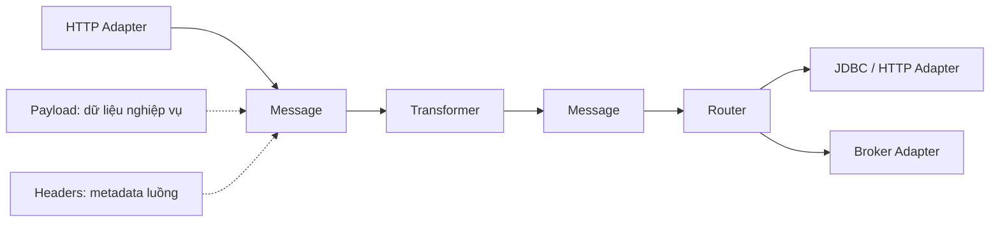
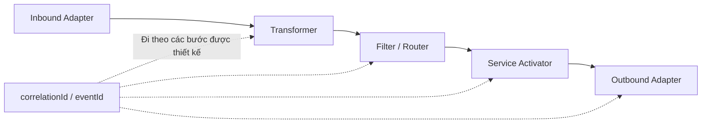
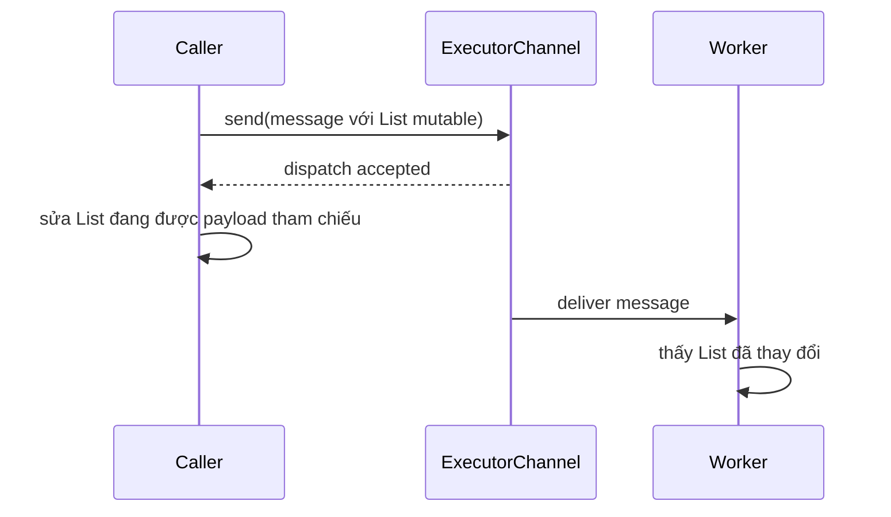
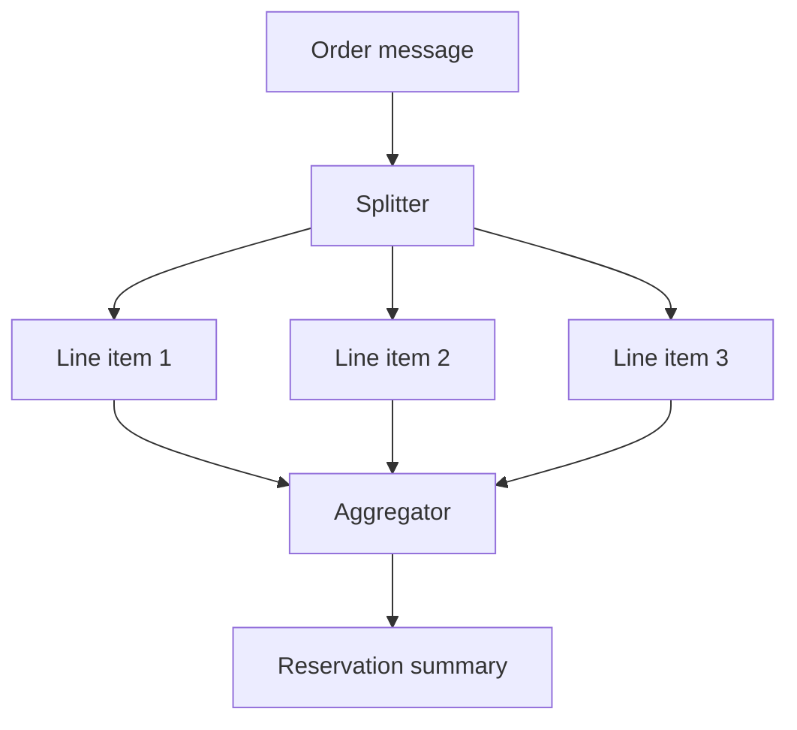
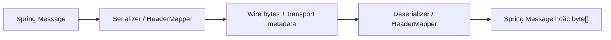
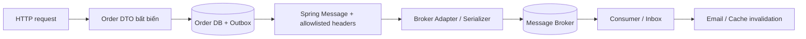

# Message, payload, MessageHeaders và tính bất biến

## 1. Vì sao cấu trúc Message quan trọng trong Spring Integration?

Trong mô-đun **SPRING_BOOT_INTEGRATION**, Spring Boot tích hợp HTTP client, cơ sở dữ liệu, cache, message broker và các adapter của Spring Integration. Một luồng có thể nhận đơn hàng từ REST API, biến đổi dữ liệu, ghi database, gửi một sự kiện lên RabbitMQ rồi cập nhật Redis. Nếu mỗi bước chỉ chuyển một object Java mà không mang ngữ cảnh, ta sẽ khó truy vết nguồn yêu cầu, liên hệ lỗi với đơn hàng và kiểm tra hợp đồng giữa hai hệ thống.

**Spring Integration** áp dụng mô hình Enterprise Integration Patterns. Đơn vị trao đổi giữa các endpoint là một **`Message<T>`** gồm:

- **Payload**: dữ liệu chính của message, ví dụ `OrderCreated`, JSON đã decode, `byte[]` hoặc một object nghiệp vụ.
- **Headers**: metadata của message, ví dụ `id`, `timestamp`, `contentType`, `correlationId`, `replyChannel` và `errorChannel`.

Hai thành phần phục vụ các mục đích khác nhau. Payload trả lời “đang xử lý dữ liệu gì?”, còn headers trả lời “dữ liệu đi qua flow như thế nào và liên hệ với yêu cầu nào?”.



Bài học giải thích chính xác vai trò `Message`, `payload` và `MessageHeaders`; cơ chế tạo message với builder; ý nghĩa **tính bất biến ở ranh giới message**; việc giữ hoặc thay headers trong transformer, router, gateway; rủi ro serialization khi qua HTTP/broker; cách kiểm thử và quan sát các luồng tích hợp.

Các ví dụ dùng Spring Boot 3.x, Spring Framework 6.x và Spring Integration 6.x với Java 17 trở lên. Không nên coi một ví dụ Java object in-memory là hợp đồng serialization giữa các dịch vụ độc lập.

## 2. Mô hình hai phần: Message<T> = payload + headers

API `Message<T>` thuộc `org.springframework.messaging`, không phải chỉ riêng Spring Integration:

```java
package org.springframework.messaging;

public interface Message<T> {
    T getPayload();
    MessageHeaders getHeaders();
}
```

Đây là **chữ ký rút gọn để học ý tưởng**, không phải toàn bộ source code framework. Kiểu generic `T` mô tả payload ở phía Java compile-time; khi đi qua messaging adapter có thể xuất hiện `Message<?>` do loại payload được xác định động.

Một ví dụ tạo message:

```java
import org.springframework.messaging.Message;
import org.springframework.messaging.support.MessageBuilder;

public record OrderCreated(String orderId, String customerId) {}

Message<OrderCreated> message =
    MessageBuilder.withPayload(
            new OrderCreated("ord-1024", "cus-17")
        )
        .setHeader("correlationId", "req-80a7")
        .setHeader("eventType", "OrderCreated")
        .build();

OrderCreated payload = message.getPayload();
Object correlation = message.getHeaders().get("correlationId");
```

Ở đây:

- `message.getPayload()` trả về `OrderCreated`.
- `message.getHeaders()` trả về một đối tượng `MessageHeaders` giống một map **chỉ đọc** từ góc nhìn caller.
- Spring tạo một số headers hệ thống, điển hình là `id` và `timestamp`, theo cơ chế tạo message.
- `correlationId` và `eventType` do code ứng dụng đặt; Spring không tự bảo đảm chúng đã đúng hay được forward qua mọi transport.

```text
Message<OrderCreated>
├── payload
│   ├── orderId = "ord-1024"
│   └── customerId = "cus-17"
└── headers
    ├── id = <UUID của message>
    ├── timestamp = <thời điểm tạo message>
    ├── correlationId = "req-80a7"
    └── eventType = "OrderCreated"
```

### 2.1. Message không nhất thiết là event

Một `Message` có thể biểu diễn command, request, reply, event, bản ghi file, một phần dữ liệu stream hay lỗi xử lý. Tên class payload như `OrderCreated` mô tả sự kiện nghiệp vụ, còn `Message<OrderCreated>` là **phong bì truyền dữ liệu trong một flow**.

| Loại dữ liệu | Payload ví dụ | Điều cần định nghĩa |
| --- | --- | --- |
| Command | `ReserveInventory` | Hành động cần thực hiện, idempotency key |
| Event | `OrderCreated` | Sự kiện đã xảy ra, event ID, schema version |
| Request | `GetCustomerById` | Reply/error contract, timeout |
| Reply | `CustomerSnapshot` | Correlation với request, trạng thái không có dữ liệu |
| Technical error | `Throwable` trong `ErrorMessage` | Failed message, bước lỗi, xử lý lại |
| Raw transport | `byte[]`/`String` | Encoding, content type, parser, size limit |

Một object `Message` có thể đổi lớp payload giữa các bước (raw JSON → DTO → enriched DTO) trong khi metadata được chọn lọc để giữ lại. Đừng mặc định mọi header phải được sao chép qua tất cả các bước.

## 3. MessageHeaders là gì và tại sao không sửa trực tiếp?

`MessageHeaders` thuộc `org.springframework.messaging.MessageHeaders`. Nó triển khai giao diện dạng `Map<String, Object>` để tiện đọc headers, nhưng **được thiết kế bất biến ở cấp cấu trúc map**.

Đọc headers:

```java
import java.util.UUID;
import org.springframework.messaging.MessageHeaders;

MessageHeaders headers = message.getHeaders();

UUID messageId = headers.getId();
Long createdAtEpochMillis = headers.getTimestamp();
String correlationId = (String) headers.get("correlationId");

boolean hasEventType = headers.containsKey("eventType");
```

Ví dụ cố gắng thay đổi không đúng:

```java
// Không làm vậy: MessageHeaders không cho sửa map qua API trực tiếp.
message.getHeaders().put("correlationId", "new-correlation");

// Tương tự, remove/clear trên headers cũng không phải cách tạo
// một message mới với metadata đã sửa.
```

Các thao tác thay đổi map như `put`, `remove` hoặc `clear` qua `MessageHeaders` thường ném `UnsupportedOperationException`. Mục đích là hạn chế một handler lén sửa metadata của cùng message mà các handler khác cũng đang nhìn thấy.

**Muốn đổi header? Tạo message mới bằng builder**, không mutate message đã phát hành. Tuy vậy, tính bất biến của headers **không phải bất biến sâu** đối với object nằm bên trong; phần đó được phân tích ở mục 6.

### 3.1. MessageHeaders không phải tất cả “header” trên mọi giao thức

`MessageHeaders` là metadata trong môi trường Spring Messaging. Nó khác với:

- HTTP request/response headers trên mạng.
- JMS message properties và JMS system headers.
- RabbitMQ AMQP headers/properties.
- Kafka record headers, key, timestamp và offset.

Adapters có thể **ánh xạ** giữa Spring MessageHeaders và metadata của transport, nhưng không có quy tắc chung rằng mọi header Java đều sẽ đi nguyên vẹn qua HTTP, Kafka, JMS hoặc AMQP. Các giá trị header là Java object có thể không được transport hỗ trợ hoặc không an toàn để serialize.

## 4. Tạo message với MessageBuilder và GenericMessage

Spring Messaging cung cấp `MessageBuilder` để tạo message theo cách rõ ràng:

```java
import org.springframework.messaging.Message;
import org.springframework.messaging.MessageHeaders;
import org.springframework.messaging.support.MessageBuilder;
import org.springframework.util.MimeTypeUtils;

Message<OrderCreated> created =
    MessageBuilder.withPayload(
            new OrderCreated("ord-1024", "cus-17")
        )
        .setHeader("eventId", "evt-1024")
        .setHeader("correlationId", "req-80a7")
        .setHeader(
            MessageHeaders.CONTENT_TYPE,
            MimeTypeUtils.APPLICATION_JSON
        )
        .build();
```

Builder giúp chuẩn bị payload và headers trước khi message được công bố ra flow. `MessageBuilder` trong ví dụ thuộc **`org.springframework.messaging.support`**; Spring Integration cũng có các tiện ích xây dựng message của riêng nó. Khi đọc code dự án, luôn kiểm tra import và API tương ứng.

### 4.1. Một số thao tác của builder

```java
Message<OrderCreated> updated =
    MessageBuilder.fromMessage(created)
        .setHeader("processingStage", "validated")
        .setHeaderIfAbsent("schemaVersion", 1)
        .removeHeader("debug-only")
        .build();
```

| Thao tác | Ý nghĩa |
| --- | --- |
| `withPayload(value)` | Khởi đầu với payload mới |
| `fromMessage(existing)` | Khởi đầu dựa trên message đã có |
| `setHeader(name, value)` | Thêm hoặc thay một header trong builder |
| `setHeaderIfAbsent(name, value)` | Chỉ đặt nếu header chưa có |
| `copyHeaders(map)` | Sao chép các entry header vào builder theo cơ chế API |
| `copyHeadersIfAbsent(map)` | Sao chép những entry chưa có |
| `removeHeader(name)` | Bỏ header được chỉ định khỏi message mới |
| `build()` | Tạo một `Message` kết quả |

Tính bất biến của message được hiểu là **sửa đổi thông qua việc tạo message kế tiếp**, không phải “mọi lần gọi builder đều giữ nguyên chính xác mọi metadata hệ thống”. Các header đặc biệt như `id`/`timestamp` có quy tắc riêng; khi dùng builder từ message cũ, đừng dựa vào giả định UUID luôn được giữ hoặc luôn đổi mà chưa kiểm tra framework API và hướng chuyển đổi thực tế.

### 4.2. GenericMessage khi nào hữu ích?

`GenericMessage<T>` là implementation cơ bản của `Message<T>` trong Spring Messaging. Ví dụ tạo trực tiếp:

```java
import java.util.Map;
import org.springframework.messaging.Message;
import org.springframework.messaging.support.GenericMessage;

Message<String> raw = new GenericMessage<>(
    "{\"orderId\":\"ord-1024\"}",
    Map.of("source", "http-adapter")
);
```

Trong application code thông thường, builder thường rõ ràng và dễ mở rộng hơn. Dù dùng constructor hay builder, **payload được truyền vào không mặc nhiên được deep-copy**. Một DTO chứa list, map hoặc `byte[]` mutable vẫn cần chiến lược bất biến của riêng ứng dụng.

### 4.3. Payload null có hợp lệ không?

Theo mô hình `GenericMessage`/`MessageBuilder` thông dụng, payload được yêu cầu **không null**. `MessageBuilder.withPayload(null)` không được dùng để biểu diễn “không có event”.

Nếu một poller đang đợi `QueueChannel.receive(timeout)` và không có message, nó có thể nhận **`null` từ phương thức receive** để biểu diễn timeout/không có message. Điều này khác với một `Message` có payload null.

Khi muốn biểu diễn “không tìm thấy kết quả”, hãy dùng hợp đồng reply rõ ràng (empty response, optional result, status code, không gửi message hoặc một loại sự kiện riêng tùy flow), thay vì gửi `null` như payload.

## 5. Message ID, timestamp, correlation ID và business event ID

Đây là nhóm thông tin dễ bị nhầm lẫn nhất khi ghép nhiều hệ thống.

| Metadata | Vai trò | Có nên dùng để chống trùng nghiệp vụ? |
| --- | --- | --- |
| `id` (`MessageHeaders.ID`) | Định danh một Spring message theo cơ chế framework | **Không mặc nhiên**; có thể thay đổi khi tái tạo/chuyển transport |
| `timestamp` (`MessageHeaders.TIMESTAMP`) | Thời điểm tạo message ở tầng messaging | Không; không chứng minh thời gian sự kiện nghiệp vụ |
| `correlationId` | Gom các message cùng request/job/chuỗi xử lý | Chỉ khi hợp đồng chỉ rõ; thường phục vụ truy vết |
| `eventId` | Định danh **sự kiện nghiệp vụ** được producer cấp ổn định | **Có thể**, khi producer giữ nguyên qua retry/redelivery |
| `schemaVersion` | Phiên bản hợp đồng payload/event | Không; phục vụ giải mã và tương thích |
| `causationId` | Sự kiện/request trực tiếp dẫn đến event hiện tại | Không; phục vụ chuỗi nguyên nhân |

Ví dụ một đơn hàng phát hai sự kiện:

```text
HTTP correlationId = req-80a7
  ├── OrderCreated eventId = evt-1024
  │     └── Spring Message id = UUID-A
  └── ReservationRequested eventId = evt-1025
        └── Spring Message id = UUID-B
```

Nếu `OrderCreated` được publish lại sau lỗi network, một adapter có thể tạo Spring Message mới với một `id` khác. **`eventId=evt-1024` phải giữ nguyên** nếu đó là cùng business event cần deduplicate.

### 5.1. Các header hệ thống và header của Spring Integration

Một số tên chuẩn trong Spring Messaging:

```java
MessageHeaders.ID;
MessageHeaders.TIMESTAMP;
MessageHeaders.CONTENT_TYPE;
MessageHeaders.REPLY_CHANNEL;
MessageHeaders.ERROR_CHANNEL;
```

Spring Integration còn dùng nhiều metadata cho flow như correlation, sequence, priority, routing slip, history… Các header này có thể được thao tác qua `IntegrationMessageHeaderAccessor` và các tiện ích tương ứng theo version.

**Không viết code phụ thuộc vào chuỗi header tự đặt** như `"correlation-id"` nếu hệ thống đang dùng `"correlationId"`. Quy định tên, kiểu và cách propagate thống nhất; nếu dùng adapter Kafka/JMS/AMQP, kiểm tra mapping/codec của từng transport.

### 5.2. replyChannel và errorChannel không phải header nghiệp vụ

`replyChannel` và `errorChannel` có thể mang reference tới `MessageChannel` hoặc tên channel mà framework resolve theo ngữ cảnh. Chúng định tuyến **reply hoặc lỗi kỹ thuật** trong flow, khác với các field nghiệp vụ như orderId.

Không đưa một Java `MessageChannel` object vào JSON event rồi kỳ vọng consumer ở service khác gọi lại được. Khi rời process, cần một giao thức reply-to/correlation hoặc một callback endpoint có hợp đồng riêng.

## 6. Bất biến của MessageHeaders không có nghĩa payload bất biến sâu

Đây là điểm cốt lõi của bài học.

Hãy xét:

```java
import java.util.ArrayList;
import java.util.List;
import org.springframework.messaging.Message;
import org.springframework.messaging.support.MessageBuilder;

List<String> skus = new ArrayList<>();
skus.add("sku-1");

Message<List<String>> message =
    MessageBuilder.withPayload(skus).build();

skus.add("sku-2");

// Payload vẫn tham chiếu đến cùng list mutable ban đầu.
System.out.println(message.getPayload()); // [sku-1, sku-2]
```

Dù headers không cho `put`, `message.getPayload()` ở ví dụ này vẫn trỏ đến một `ArrayList` đang được sửa. Khi message được dispatch qua `ExecutorChannel`, handler có thể đọc dữ liệu vào thời điểm khác thread caller và thấy một trạng thái khác với lúc message được tạo.

**Tính bất biến của envelope không bảo vệ khỏi race condition trên payload mutable**.

### 6.1. Dùng record và defensive copy

Ví dụ một event dùng dữ liệu bất biến:

```java
import java.util.List;

public record OrderLine(String sku, int quantity) {}

public record OrderSubmitted(
    String orderId,
    List<OrderLine> lines
) {
    public OrderSubmitted {
        lines = List.copyOf(lines);
    }
}
```

`List.copyOf(lines)` tạo một danh sách không hỗ trợ thay đổi cấu trúc qua reference đó. Khi các phần tử `OrderLine` là record chỉ chứa `String`/`int`, mô hình dữ liệu này tương đối dễ giữ bất biến.

Tuy nhiên, **`List.copyOf` chỉ sao chép nông**: nếu phần tử là bean mutable (ví dụ `PriceInfo` có setter), caller vẫn có thể sửa object đó. Cần defensive copy cho cả phần tử hoặc chọn kiểu bất biến phù hợp.

### 6.2. Với byte[] cần copy cả đầu vào lẫn đầu ra

`byte[]` là mutable ngay cả khi nằm trong một `record`:

```java
public record RawDocument(byte[] bytes) {

    public RawDocument {
        bytes = bytes.clone();
    }

    @Override
    public byte[] bytes() {
        return bytes.clone();
    }
}
```

Nhờ clone trong constructor và accessor, code bên ngoài không thể thay đổi nội dung đã lưu bằng cách sửa array ban đầu hoặc array được trả về.

Khi payload chứa `ByteBuffer`, `Map`, entity JPA, collection hoặc object từ thư viện không bất biến, cần đánh giá tương tự. Không nên truyền một JPA entity đang gắn với persistence context qua executor/broker rồi để worker khác đọc lazy field sau khi transaction đã kết thúc.

### 6.3. Giá trị nằm trong header cũng có thể mutable

`MessageHeaders` ngăn thay đổi **cấu trúc map** nhưng không tự đóng băng **value object**:

```java
import java.util.ArrayList;
import java.util.List;
import org.springframework.messaging.Message;

List<String> traceSteps = new ArrayList<>();
traceSteps.add("received");

Message<OrderCreated> message =
    MessageBuilder.withPayload(
        new OrderCreated("ord-1024", "cus-17")
    )
    .setHeader("traceSteps", traceSteps)
    .build();

traceSteps.add("validated");

// Nội dung object dùng làm value có thể đã thay đổi.
```

Đây là lý do nên dùng header values dạng `String`, `UUID`, `Long`, `Integer`, enum ổn định hoặc DTO bất biến; tránh nhét mutable collection lớn, open HTTP request object hoặc database connection vào header.

**Nguyên tắc:** immutable message envelope + immutable payload + immutable header values mới tạo ra mô hình giao tiếp an toàn và dễ suy luận giữa các thread.

## 7. Tạo message mới khi cần sửa metadata hoặc payload

Khi một handler muốn bổ sung metadata, nên tạo message mới:

```java
Message<OrderCreated> source =
    MessageBuilder.withPayload(
        new OrderCreated("ord-1024", "cus-17")
    )
    .setHeader("correlationId", "req-80a7")
    .build();

Message<OrderCreated> next =
    MessageBuilder.fromMessage(source)
        .setHeader("processingStage", "validated")
        .build();
```

Ở đây `source` vẫn mang các header ban đầu; `next` là một message result từ builder. **Không trực tiếp thao tác trên `source.getHeaders()`.**

Khi cần đổi payload:

```java
public record ValidatedOrder(String orderId, boolean accepted) {}

public Message<ValidatedOrder> validate(Message<OrderCreated> input) {
    OrderCreated order = input.getPayload();
    ValidatedOrder validated =
        new ValidatedOrder(order.orderId(), true);

    var builder = MessageBuilder.withPayload(validated);
    Object correlationId = input.getHeaders().get("correlationId");

    if (correlationId instanceof String value) {
        builder.setHeader("correlationId", value);
    }

    return builder
        .setHeader("processingStage", "validated")
        .build();
}
```

Ví dụ trên **chỉ chuyển header đã được phép**. Cách này hữu ích khi chuyển sang ranh giới trust khác: tránh gửi nhầm `replyChannel`, `errorChannel`, access token, stack trace hoặc metadata nội bộ.

Nếu mọi header đều an toàn và cùng nằm trong một flow nội bộ, có thể dùng `copyHeaders` hoặc `copyHeadersIfAbsent`. Nhưng với integration qua broker hoặc HTTP, nên thực hiện **allowlist** cho metadata cần thiết thay vì copy tất cả.

## 8. Bài toán header propagation qua nhiều endpoint

Một flow phổ biến:



Từng endpoint có thể ảnh hưởng đến metadata:

| Endpoint | Thay đổi có thể xảy ra | Điều cần kiểm tra |
| --- | --- | --- |
| Inbound HTTP adapter | Chuyển HTTP headers/body thành Spring Message | Header nào được map? Field nào được coi là tin cậy? |
| Transformer | Đổi class/shape payload, tạo message mới | Có giữ correlationId/eventId/schemaVersion cần thiết không? |
| Filter | Loại message không thỏa điều kiện | Trạng thái bị lọc có cần ack/reply/audit không? |
| Router | Chọn output channel theo header/payload | Header thiếu dẫn tới default route hay lỗi? |
| Splitter | Tạo nhiều message con từ một message | Cần correlation/sequence để aggregator ghép lại |
| Aggregator | Ghép nhiều message về kết quả chung | Correlation key, release strategy, expiry, duplicate |
| Service Activator | Gọi nghiệp vụ/DB/HTTP và có thể trả reply | Lỗi/reply channel nào được dùng? |
| Outbound Kafka/JMS/AMQP adapter | Chuyển message sang wire format | Header mapper/serializer, size, type và giới hạn hệ thống đích |

**Không mặc định toàn bộ headers đi qua từng bước không đổi**. Một transformer trả object thường được framework bao bọc theo quy tắc endpoint; một transformer trả nguyên `Message<?>` có thể thể hiện việc quản lý headers rõ hơn. Khi nghi ngờ, viết test xác nhận các header contract cụ thể trên output channel.

### 8.1. Header là kỹ thuật, payload là nghiệp vụ — nhưng có vùng chồng lấn

Một field như `eventId` có thể nằm trong payload của sự kiện được phát qua broker và đồng thời nằm trong header phục vụ routing/deduplication. Điều đó hợp lý nếu hợp đồng rõ ràng, nhưng **phải xác định một nguồn sự thật** khi hai giá trị lệch nhau.

Ví dụ:

```json
{
  "eventId": "evt-1024",
  "eventType": "OrderCreated",
  "schemaVersion": 1,
  "occurredAt": "2026-11-21T02:15:00Z",
  "data": {
    "orderId": "ord-1024"
  }
}
```

Nếu wire event schema xác định `eventId` trong payload, hãy dùng nó để deduplicate; một Kafka/JMS header lặp lại event ID có thể được sử dụng để tối ưu routing/tracing nhưng không được âm thầm mang giá trị khác.

## 9. Header routing trong Spring Integration

Có nhiều cách định tuyến một message: theo nội dung payload, theo header hoặc bằng rule kết hợp.

Ví dụ header từ một message:

```java
Message<OrderCreated> event =
    MessageBuilder.withPayload(
        new OrderCreated("ord-1024", "cus-17")
    )
    .setHeader("destination", "notifications")
    .build();
```

Một router có thể đọc `destination` để gửi đến kênh xử lý thông báo. Tuy nhiên, **không tin tuyệt đối giá trị header được đưa vào từ client bên ngoài**. Nếu một inbound HTTP adapter cho phép caller đặt `destination=payments`, họ có thể tác động đến route nội bộ ngoài ý định.

Chiến lược an toàn:

1. Xác thực đầu vào và quyền của caller ở ranh giới inbound.
2. Chỉ map những header được cho phép; bỏ header điều khiển nội bộ từ phía không tin cậy.
3. Router định nghĩa danh sách route hợp lệ và default/error route rõ ràng.
4. Không diễn giải trực tiếp một header tùy ý như tên bean hoặc channel có quyền cao.
5. Test trường hợp thiếu header, giá trị không hợp lệ và giá trị bị spoof.

### 9.1. Service activator nhận payload hoặc toàn bộ message

Spring Integration hỗ trợ handler chỉ nhận payload:

```java
import org.springframework.integration.annotation.ServiceActivator;
import org.springframework.stereotype.Component;

@Component
public class OrderHandler {

    @ServiceActivator(inputChannel = "ordersInput")
    public void handle(OrderCreated event) {
        // Xử lý logic nghiệp vụ từ payload.
    }
}
```

Nếu cần metadata, có thể nhận `Message<OrderCreated>`:

```java
import org.springframework.integration.annotation.ServiceActivator;
import org.springframework.messaging.Message;
import org.springframework.stereotype.Component;

@Component
public class AuditedOrderHandler {

    @ServiceActivator(inputChannel = "auditedOrdersInput")
    public void handle(Message<OrderCreated> message) {
        OrderCreated event = message.getPayload();
        Object correlationId =
            message.getHeaders().get("correlationId");

        // Log correlationId an toàn và xử lý event.
    }
}
```

Đây là **hai handler minh họa cho hai input channels khác nhau**, không phải yêu cầu phải có cả hai cho một use case. Method dùng toàn bộ `Message` hữu ích khi cần header metadata, nhưng không nên làm business service phụ thuộc vào `MessageHeaders` ở mọi tầng; có thể tách adapter/gateway ở biên rồi gọi service nghiệp vụ bằng DTO và context rõ ràng.

## 10. Message và các kiểu channel: bất biến càng quan trọng khi có executor

Spring Integration phân biệt việc chuyển message đồng bộ và bất đồng bộ:

- `DirectChannel` thường gọi handler trên thread của caller.
- `ExecutorChannel` giao việc cho executor, handler xử lý trên worker thread.
- `QueueChannel` giữ message để một poller hoặc consumer nhận sau.
- `PublishSubscribeChannel` có thể dispatch đồng bộ hoặc với executor tùy cấu hình.

Nếu payload hoặc header value bị sửa giữa lúc `send()` và lúc handler thực sự đọc, hệ thống có thể gặp race condition khó tái hiện.



Đây là **shared mutable state** chứ không phải một cam kết “Message bất biến”. Chuyển thành DTO bất biến trước khi gửi giúp giảm loại bug này. Nếu payload rất lớn và cần tránh copy, phải thiết kế quyền sở hữu dữ liệu và concurrency chặt chẽ thay vì dựa vào may mắn.

### 10.1. Lỗi đồng bộ và bất đồng bộ không cùng đường

Với `DirectChannel`, exception từ handler thường truyền ngược qua call stack. Với `ExecutorChannel`, lỗi phát sinh **sau dispatch thành công** ở worker không thể tự quay lại `try/catch` của caller; framework có thể xuất bản `ErrorMessage` qua error channel được cấu hình.

Một `ErrorMessage` cũng là message, nhưng payload là `Throwable`:

```java
import org.springframework.messaging.support.ErrorMessage;

public void inspectError(ErrorMessage error) {
    Throwable cause = error.getPayload();
    // Phân loại lỗi và tra cứu failed/original message nếu có.
}
```

Không assume `failedMessage` luôn tồn tại, và không log toàn bộ payload nhạy cảm qua exception. Nếu một executor từ chối task **ngay khi submit**, lỗi dispatch vẫn có thể quay về caller đồng bộ. Vì vậy test lỗi cần phân biệt lỗi chấp nhận task với lỗi handler xảy ra sau đó.

## 11. Correlation và sequence khi chia nhỏ/gom message

Một use case phổ biến: Order Service nhận đơn có 3 dòng hàng; flow **split** thành 3 message để kiểm tra tồn kho rồi **aggregate** kết quả.



Spring Integration thường dùng metadata correlation và sequence để hỗ trợ các EIP này. Các thông tin cần hiểu:

- **Correlation key**: nhóm các message con thuộc cùng một lần split/request.
- **Sequence number**: thứ tự message trong nhóm khi có thông tin thứ tự.
- **Sequence size**: tổng số message trong nhóm, nếu biết.
- **Release strategy**: điều kiện nào khiến aggregator xuất kết quả.
- **Expiry/timeout**: nhóm thiếu message sẽ được xử lý thế nào.

Nếu truyền một `correlationId` do client ngoài cung cấp mà không chuẩn hóa/kiểm soát quyền, hai request khác nhau có thể vô tình bị gom chung. Khi dùng aggregator, nên định nghĩa correlation key đủ duy nhất cho ngữ cảnh xử lý và không dùng giá trị ngắn dễ trùng như `"order"`.

Một vấn đề khác: message redelivery có thể làm splitter phát một phần tử hai lần. Aggregator cần chiến lược xử lý duplicate và timeout; **header sequence không tự bảo đảm exactly-once**.

## 12. Qua HTTP, Kafka, JMS, RabbitMQ: message ở wire không còn là object Java ban đầu

Trong một flow **nội bộ JVM**, adapter có thể truyền tham chiếu tới payload object. Qua transport mạng, message phải được encode/decode:



### 12.1. Payload phải có hợp đồng schema

Một `OrderCreated` record Java không tự tạo hợp đồng tương thích giữa hai service. Nên công bố:

- `eventType` và `schemaVersion`;
- các trường bắt buộc, kiểu, `null`/missing, constraints;
- encoding/content type: JSON, Avro, Protobuf, XML…;
- quy tắc bổ sung field, xóa field, enum mở rộng;
- ý nghĩa timestamp, đơn vị tiền và dữ liệu cá nhân.

Thêm một field mới vào record không có nghĩa mọi consumer cũ decode được. Cần schema contract test ở producer và consumer, và chính sách chuyển đổi khi tồn tại message cũ trên broker.

### 12.2. Header mapping là hợp đồng riêng

| Vấn đề | Mối nguy |
| --- | --- |
| Header chứa object `MessageChannel` | Không thể serialize thành transport metadata dùng xuyên JVM |
| Header chứa `Throwable`/`HttpServletRequest` | Lộ thông tin nội bộ, không phù hợp serializer |
| Header chứa Java class name tùy ý | Rủi ro deserialize type không tin cậy |
| Header quá dài hoặc quá nhiều | Bị transport/proxy/broker giới hạn kích thước |
| Header type là `UUID`/`Instant`/enum | Converter phía khác có thể nhận `String` hoặc bytes |
| Header `id` bị tạo lại | Consumer lầm ID framework là ID event bền vững |
| Header nhạy cảm bị propagate | Rò token, cookie, PII sang downstream |
| Inbound header tên giống header kỹ thuật | Có thể chi phối routing/reply khi chưa xác thực |

**Chỉ forward allowlist header** cần thiết, ví dụ `eventId`, `schemaVersion`, `correlationId`, `contentType` và message type khi hợp đồng yêu cầu. Với Kafka/JMS/AMQP, chọn header mapper/serializer theo adapter và kiểm thử round-trip qua broker thật.

### 12.3. Không dùng MessageHeaders như kho chứa business state lớn

Nếu workflow cần theo dõi trạng thái lâu dài như `PENDING`, `RETRYING`, `SUCCEEDED`, `FAILED`, dữ liệu đó phải được lưu trong database/broker/job store tùy SLA. Headers thường mô tả metadata của **một message đang lưu chuyển**, không thay thế persistence hoặc transaction management.

## 13. Message không tự giải quyết transaction, retry và tính đúng đắn

Xét flow:

```text
HTTP request
  -> Message<OrderCommand>
  -> JDBC insert order
  -> Message<OrderCreated>
  -> Broker publish
  -> Notification consumer
```

Một message envelope bất biến giúp dễ suy luận về dữ liệu đã công bố, nhưng không tạo transaction phân tán:

1. Spring `@Transactional` chỉ quản lý các tài nguyên tham gia transaction được cấu hình, không mặc nhiên bao trùm HTTP client và broker.
2. Nếu database commit rồi process chết trước khi publish broker, event có thể bị mất nếu không có outbox hoặc cơ chế đảm bảo khác.
3. Broker có thể redeliver message; consumer phải xử lý trùng theo `eventId`.
4. Timeout khi gọi downstream không chứng minh bên kia chưa thực hiện side effect.
5. `MessageHeaders.ID` không thay cho idempotency key nghiệp vụ ổn định.

**Mẫu thiết kế phù hợp:** ghi order và outbox event trong một DB transaction, publisher đọc outbox đã commit để gửi broker, consumer dùng inbox/unique constraint theo event ID trước khi gây side effect.

### 13.1. Header timestamp không thay cho thời gian nghiệp vụ

`message.getHeaders().getTimestamp()` thường gắn với thời điểm message được tạo trong ứng dụng. Một sự kiện đặt hàng có thể xảy ra từ trước đó; khi reprocess message, timestamp ở transport hoặc Spring envelope có thể khác.

Nếu thời gian nghiệp vụ quan trọng, đặt `occurredAt` trong event contract và định nghĩa timezone/precision rõ ràng. Với ordering, không dựa riêng vào timestamp do nhiều producer có clock skew; chọn sequence/version/offset hoặc quy tắc business tương ứng.

## 14. Kiểm thử payload và headers bằng JUnit

### 14.1. Headers là read-only

```java
import static org.assertj.core.api.Assertions.assertThat;
import static org.assertj.core.api.Assertions.assertThatThrownBy;

import org.junit.jupiter.api.Test;
import org.springframework.messaging.Message;
import org.springframework.messaging.support.MessageBuilder;

class MessageImmutabilityTest {

    @Test
    void headersAreReadOnly() {
        Message<String> message = MessageBuilder
            .withPayload("created")
            .setHeader("correlationId", "req-80a7")
            .build();

        assertThat(message.getHeaders().get("correlationId"))
            .isEqualTo("req-80a7");

        assertThatThrownBy(
            () -> message.getHeaders().put("correlationId", "changed")
        ).isInstanceOf(UnsupportedOperationException.class);
    }

    @Test
    void aNewMessageCanHaveAnUpdatedHeader() {
        Message<String> original = MessageBuilder
            .withPayload("created")
            .setHeader("stage", "received")
            .build();

        Message<String> revised = MessageBuilder
            .fromMessage(original)
            .setHeader("stage", "validated")
            .build();

        assertThat(original.getHeaders().get("stage"))
            .isEqualTo("received");
        assertThat(revised.getHeaders().get("stage"))
            .isEqualTo("validated");
    }
}
```

Bài test trên kiểm tra **khả năng không mutate headers trực tiếp và tạo message mới**, không nhằm khẳng định logic sinh UUID/`timestamp` ở tất cả phiên bản.

### 14.2. Test defensive copy của payload

```java
import static org.assertj.core.api.Assertions.assertThat;

import java.util.ArrayList;
import java.util.List;
import org.junit.jupiter.api.Test;
import org.springframework.messaging.Message;
import org.springframework.messaging.support.MessageBuilder;

class PayloadCopyTest {

    @Test
    void copiedListDoesNotFollowChangesToInputList() {
        List<OrderLine> input = new ArrayList<>();
        input.add(new OrderLine("sku-1", 2));

        Message<OrderSubmitted> message = MessageBuilder
            .withPayload(new OrderSubmitted("ord-1024", input))
            .build();

        input.add(new OrderLine("sku-2", 3));

        assertThat(message.getPayload().lines())
            .hasSize(1);
    }
}
```

Test này pass vì `OrderSubmitted` đã dùng `List.copyOf` trong canonical constructor, không phải vì `MessageBuilder` tự copy list.

### 14.3. Test chuyển headers qua channel trong bộ nhớ

Có thể kiểm tra đường xử lý mà không cần broker:

```java
import static org.assertj.core.api.Assertions.assertThat;

import org.junit.jupiter.api.Test;
import org.springframework.integration.channel.DirectChannel;
import org.springframework.integration.channel.QueueChannel;
import org.springframework.messaging.Message;
import org.springframework.messaging.support.MessageBuilder;

class HeaderPropagationTest {

    @Test
    void handlerAddsMetadataWithoutChangingOriginal() {
        DirectChannel input = new DirectChannel();
        QueueChannel output = new QueueChannel();

        input.subscribe(message -> output.send(
            MessageBuilder.fromMessage(message)
                .setHeader("stage", "validated")
                .build()
        ));

        Message<String> source = MessageBuilder
            .withPayload("ord-1024")
            .setHeader("correlationId", "req-80a7")
            .build();

        input.send(source);
        Message<?> forwarded = output.receive(1000);

        assertThat(forwarded).isNotNull();
        assertThat(forwarded.getHeaders().get("stage"))
            .isEqualTo("validated");
        assertThat(forwarded.getHeaders().get("correlationId"))
            .isEqualTo("req-80a7");
        assertThat(source.getHeaders().containsKey("stage"))
            .isFalse();
    }
}
```

`DirectChannel` gửi cho handler đồng bộ; `QueueChannel` giúp thu message output có giới hạn thời gian trong test. Đây là test **in-memory mapping**, không kiểm chứng serialization và header mapper của Kafka/JMS/AMQP. Để kiểm chứng wire contract, cần integration test với broker/HTTP server thật hoặc provider/consumer contract verification.

## 15. Những lỗi biên thường gặp

| Hiện tượng | Nguyên nhân | Cách kiểm tra/sửa |
| --- | --- | --- |
| `UnsupportedOperationException` khi sửa header | `MessageHeaders` không cho mutate map | Dùng `MessageBuilder.fromMessage(...)` |
| Handler thấy payload khác lúc gửi | Payload chứa list/map/bean mutable | Dùng immutable DTO và defensive copy |
| Handler không lấy được `correlationId` | Transformer/adapter không forward header | Xác định allowlist và test propagation |
| Hai consumer xử lý cùng event hai lần | Dùng Spring Message ID làm dedupe, hoặc không có inbox | Dùng `eventId` nghiệp vụ ổn định |
| Error handler không biết message nào hỏng | Thiếu correlation/failed message hoặc context bị mất | Mang jobId/eventId, kiểm tra `ErrorMessage` an toàn |
| Kafka/JMS header decode sai kiểu | Adapter mapping khác Java map | Kiểm tra serializer/header mapper |
| Header `replyChannel` không dùng được qua broker | Channel reference chỉ hợp lệ trong ngữ cảnh nội bộ | Dùng reply-to/correlation contract phù hợp |
| Payload JSON decode được nhưng dữ liệu sai | Schema không kiểm tra đơn vị/null/enum | Contract validation và semantic tests |
| Executor worker nhận dữ liệu JPA lỗi lazy loading | Truyền entity gắn với transaction thread cũ | Chuyển sang DTO bất biến trước thread boundary |
| Có nhiều trường `timestamp` khác nhau | Framework/transport/business timestamps khác ngữ nghĩa | Định nghĩa `occurredAt` và thời gian từng lớp |
| Header có token người dùng bị gửi sang downstream | Copy toàn bộ headers qua outbound adapter | Chỉ forward allowlist và redaction |
| Message `null` hoặc không có reply gây timeout | Nhầm payload null, missing reply, queue receive timeout | Quy định empty/error semantics riêng |

### 15.1. Payload bất biến nhưng nghiệp vụ vẫn có thể sai

Một message chứa `OrderCreated` record bất biến có thể mang `quantity=-3` hoặc `currency="ABC"`. Tính bất biến không thay thế validation. Cần kiểm tra schema, boundary values, business rules và downstream contract. Ngược lại, dữ liệu hợp lệ lúc parse nhưng bị sửa sau khi dispatch là lỗi về **ownership/mutability**.

### 15.2. Đừng dùng MessageHeaders để truyền dữ liệu bí mật

Headers có thể bị đưa vào log mặc định hoặc được mapper forward khi đi qua adapter. Bảo vệ bearer token/password/PII bằng cách:

- Không lưu credential raw vào header nếu có thể dùng security context/credential provider riêng.
- Khi phải truyền metadata nhạy cảm, xác định rõ header mapper, masking và thời gian sống.
- Không dùng `MessageHeaders.toString()` làm audit log cho tất cả message trong production.
- Giới hạn kích thước và cardinality header, tránh gắn toàn bộ domain objects vào headers.

## 16. Quan sát message mà không phụ thuộc vào Message ID

Để điều tra một flow gồm nhiều hop:

```text
HTTP POST /orders
  correlationId=req-80a7
  ↓
Message<OrderCommand>
  eventId=cmd-1024
  ↓
DB transaction + Outbox
  eventId=evt-1024
  ↓
Broker event OrderCreated
  eventId=evt-1024
  ↓
Consumer
  inbox key=(consumerName,evt-1024)
```

Một số dữ liệu nên quan sát:

- Số message vào/ra channel, latency handler, lỗi theo endpoint/flow.
- Correlation ID và trace context (không dùng giá trị này làm metric label cardinality cao).
- Event ID/job ID để đối soát retry và deduplication.
- Số lỗi deserialize/schema mismatch, tần suất header mapping failure.
- Executor saturation, queue depth và số message bị kẹt nếu flow bất đồng bộ.
- Broker lag/redelivery/DLQ và transaction/outbox backlog.

Spring Integration có các cơ chế observation, message history và Micrometer integration tùy dependency/configuration. Chỉ bật mức quan sát cần thiết; message history và full payload/header logging có thể tăng chi phí hoặc lộ thông tin nhạy cảm. **Không coi Message ID framework là truy vết end-to-end duy nhất** qua nhiều process và transport.

## 17. Tình huống tổng hợp: Order Service gửi OrderCreated qua broker

Giả sử Order Service nhận yêu cầu HTTP, lưu đơn hàng vào database, phát event qua RabbitMQ và Notification Service gửi email. Dữ liệu cần đi từ payload trong process đến JSON wire event mà vẫn giữ ngữ nghĩa.

**Bước 1 — Định nghĩa payload bất biến có hợp đồng rõ.**

```java
import java.time.Instant;
import java.util.List;

public record OrderLine(String sku, int quantity) {}

public record OrderCreatedEvent(
    String eventId,
    String orderId,
    Instant occurredAt,
    int schemaVersion,
    List<OrderLine> lines
) {
    public OrderCreatedEvent {
        lines = List.copyOf(lines);
    }
}
```

`eventId` thuộc event contract và ổn định qua các lần publish lại. `occurredAt` là thời gian sự kiện nghiệp vụ, không bị thay bằng timestamp của Spring Message sau mỗi hop.

**Bước 2 — Tạo Message ở boundary nội bộ.**

```java
OrderCreatedEvent event = new OrderCreatedEvent(
    "evt-1024",
    "ord-1024",
    java.time.Instant.parse("2026-11-21T02:15:00Z"),
    1,
    java.util.List.of(new OrderLine("sku-123", 2))
);

Message<OrderCreatedEvent> message =
    MessageBuilder.withPayload(event)
        .setHeader("correlationId", "req-80a7")
        .setHeader("eventId", event.eventId())
        .setHeader("eventType", "OrderCreated")
        .setHeader("schemaVersion", event.schemaVersion())
        .build();
```

**Bước 3 — Ở outbound adapter, chọn metadata hợp lệ.**

- Encode payload thành JSON/Avro/Protobuf theo schema được công bố.
- Chỉ map các header như `correlationId`, `eventId`, `eventType`, `schemaVersion` và content type khi hợp đồng yêu cầu.
- Bỏ reference tới channel, Throwable, security context hoặc các object Java nội bộ.
- Không dựa vào Spring `MessageHeaders.ID` để làm business event ID ở consumer.

**Bước 4 — Đảm bảo durability và xử lý trùng.**

- Ghi order và outbox trong cùng database transaction.
- Publisher gửi event từ outbox, retry có giới hạn và giữ nguyên `eventId`.
- Consumer kiểm tra unique key theo `(consumerName,eventId)` trước side effect.
- Khi lỗi, dùng error flow/DLQ và trạng thái công việc có thể đối soát.
- Kiểm thử consumer trên cả schema hiện tại và những version cũ còn tồn tại trong broker.



### Checklist trước khi merge một flow mới

- [ ] Xác định đúng `Message<T>`, payload và `MessageHeaders` của mỗi endpoint?
- [ ] Payload và những header values chia sẻ giữa thread có bất biến hoặc defensive copy?
- [ ] Không sửa trực tiếp `getHeaders()`; nếu cần biến đổi có tạo message mới?
- [ ] Có phân biệt message ID, correlation ID, event ID và business timestamp?
- [ ] Header mapper chỉ forward những field được phép giữa các transport?
- [ ] Có kiểm tra schema, nullable/unknown field, content type và phiên bản sự kiện?
- [ ] Có quy tắc trả reply/error khi không có payload hoặc khi xử lý thất bại?
- [ ] Có kiểm thử các đường handler, transformer, router, executor và broker adapter?
- [ ] Có transaction/outbox/inbox, retry và idempotency cho side effect quan trọng?
- [ ] Có trace/correlation, metric và log được ẩn dữ liệu nhạy cảm?

**Kết luận:** `Message<T>` là phong bì gồm **payload nghiệp vụ** và **MessageHeaders metadata**. Spring Messaging không cho sửa trực tiếp map header sau khi tạo message; hãy dùng builder để tạo message tiếp theo. Nhưng **tính bất biến của headers không kéo theo tính bất biến sâu của payload hoặc header values**. Khi Spring Boot nối HTTP, database, cache, broker và Spring Integration adapters, cần dùng DTO bất biến, metadata có hợp đồng, header mapping được kiểm soát, business event ID ổn định và kiểm thử trên ranh giới transport để dữ liệu đi qua các flow một cách dự đoán được.
