# MessageChannel và đường đi giữa các endpoint

## 1. Vì sao cần hiểu đường đi của một Message?

Trong hệ thống tích hợp viết bằng Spring Boot, dữ liệu hiếm khi chỉ đi từ controller tới repository rồi kết thúc. Một lệnh tạo đơn hàng có thể đi qua HTTP inbound gateway, bộ kiểm tra hợp đồng dữ liệu, transformer, router, database service, outbox publisher và Kafka outbound adapter. Spring Integration cho phép kết nối các công đoạn bằng **message** và **channel**, thay vì để mọi thành phần gọi trực tiếp nhau.

Một luồng có thể trông như sau:

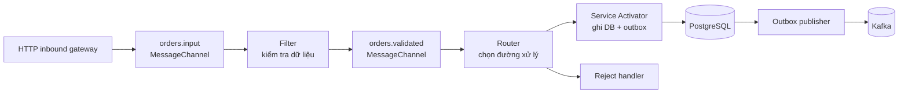

Trong sơ đồ, **endpoint** là nơi thực hiện công việc: nhận, lọc, biến đổi, định tuyến, gọi business service hoặc gửi dữ liệu. **MessageChannel** là ranh giới giao tiếp giữa các endpoint. Một channel không nhất thiết là một hàng đợi bền vững: có channel chỉ chuyển message ngay trên thread của người gửi, có channel lưu tạm trong bộ nhớ, có channel phân phối tới nhiều subscriber.

Hiểu đúng loại channel quyết định:

- Handler có chạy ngay trong thread gửi hay không?
- Khi `send()` trả về, nghiệp vụ đã hoàn thành hay mới đưa vào buffer?
- Khi exception xảy ra, nó trả về caller hay chuyển tới error flow?
- Thread-bound database transaction có tiếp tục qua ranh giới channel không?
- Khi queue đầy, ai phải giảm tốc và message chưa ack nằm ở đâu?
- Nếu có hai subscriber, cả hai đều được gọi hay chỉ một subscriber được chọn?

Trong module **SPRING_BOOT_INTEGRATION**, các câu hỏi này liên hệ trực tiếp tới HTTP, JDBC/JPA, Redis, Kafka/RabbitMQ/Pulsar và adapter của Spring Integration. Thiết kế đúng channel giúp bảo toàn hợp đồng dữ liệu, giao dịch, idempotency, kiểm thử và khả năng quan sát.

### Mục tiêu học tập

Sau bài này, bạn có thể:

1. Giải thích vai trò của `Message<?>`, `MessageHeaders`, `MessageChannel`, `SubscribableChannel` và `PollableChannel`.
2. Phân biệt `DirectChannel`, `PublishSubscribeChannel`, `QueueChannel`, `ExecutorChannel` cùng các lựa chọn nâng cao.
3. Đọc đường đi giữa endpoint nhận dữ liệu, transformer, filter, router, service activator, outbound adapter và gateway.
4. Viết flow bằng annotation và Java DSL trong Spring Boot, có ví dụ request-reply và polling.
5. Chỉ ra ranh giới thread, transaction, ack/retry, reply/error channel và độ bền dữ liệu.
6. Đặt giới hạn hàng đợi, xử lý lỗi, quan sát và kiểm thử một integration flow.

> **Phiên bản minh họa:** Java 17+, Spring Boot 3.x và Spring Integration 6.x tương thích với BOM của Spring Boot. Một số API/annotation khác giữa các nhánh 6.x và Spring Integration 7.x, vì vậy cần kiểm tra theo phiên bản thực tế. Những ví dụ DB/broker là mô hình tích hợp, không có nghĩa MessageChannel tự bảo đảm transaction phân tán.

## 2. Ba khái niệm nền tảng: Message, Channel và Endpoint

### 2.1. Message gồm payload và headers

Một Spring Messaging `Message<T>` có hai thành phần:

```text
Message<OrderCreated>
├── payload: OrderCreated(eventId, orderId, totalMinor, ...)
└── headers:
    ├── id
    ├── timestamp
    ├── correlationId (do ứng dụng chọn)
    ├── replyChannel (nếu là request-reply)
    ├── errorChannel (nếu cần đường lỗi)
    └── metadata của adapter/giao thức tương ứng
```

Trong mã Java:

```java
package example.integration.message;

import org.springframework.messaging.Message;
import org.springframework.messaging.support.MessageBuilder;

public class MessageExample {

    public static Message<OrderCreated> newMessage() {
        OrderCreated event = new OrderCreated(
                "evt-42", "ORD-42", 129900L);

        return MessageBuilder.withPayload(event)
                .setHeader("correlationId", "trace-42")
                .setHeader("schemaVersion", 1)
                .build();
    }

    public record OrderCreated(
            String eventId,
            String orderId,
            long totalMinor) {
    }
}
```

Headers của một `Message` thường được xem như **metadata không sửa tại chỗ**. Khi thêm hoặc thay header, dùng `MessageBuilder.fromMessage(oldMessage)...build()` để tạo message mới; đừng giả định một header là bằng chứng xác thực chỉ vì nó được gắn trên Message.

**Payload contract** vẫn phải rõ: `totalMinor` là số nguyên theo minor units, `eventId` dùng cho idempotency, `orderId` là aggregate ID. Header `correlationId` hỗ trợ tracing chứ không thay quyền truy cập hoặc business event ID.

### 2.2. MessageChannel là hợp đồng gửi

Spring Messaging định nghĩa interface:

```java
public interface MessageChannel {
    boolean send(Message<?> message);
    boolean send(Message<?> message, long timeout);
}
```

Đoạn trên tóm tắt các phương thức chính, không phải yêu cầu ứng dụng tự khai báo lại interface. `send()` chỉ là lời gọi tới một channel. Ý nghĩa thực tế của việc “gửi thành công” phụ thuộc **loại channel và downstream**: với `DirectChannel` có thể vừa chạy handler xong; với `QueueChannel` có thể mới enqueue vào bộ nhớ; với `ExecutorChannel` có thể mới được executor chấp nhận.

Không suy ra rằng `send()==true` luôn đồng nghĩa **database đã commit, broker đã ack hoặc message đã được lưu bền vững**.

### 2.3. Endpoint là thành phần làm việc với message

Endpoint có thể:

- **Nhận** message từ HTTP, file, JDBC polling, Kafka, RabbitMQ hoặc Pulsar.
- **Lọc** message không đạt điều kiện, chuyển sang discard flow hoặc ném lỗi.
- **Biến đổi** payload/headers sang hợp đồng mà bước sau hiểu được.
- **Định tuyến** tới các channel tương ứng theo loại sự kiện, priority hay tenant.
- **Gọi service** để thực hiện nghiệp vụ, ví dụ ghi `orders` và `integration_outbox`.
- **Gửi** tới HTTP client, Kafka producer, RabbitMQ template hoặc JDBC adapter.

`@ServiceActivator`, `@Transformer`, `@Filter`, `@Router` hay Java DSL là cách khai báo endpoint. Channel nối các endpoint; bản thân channel không mặc định biết logic nghiệp vụ.

## 3. Hai họ interface: SubscribableChannel và PollableChannel

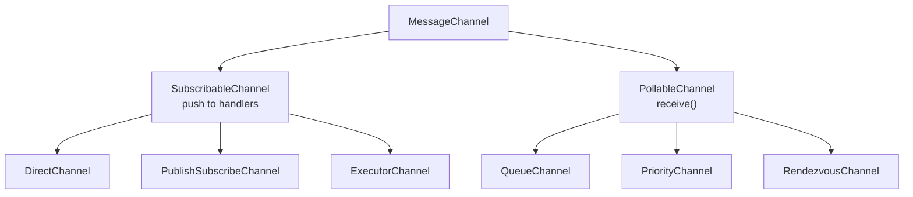

| Họ channel | Ai chủ động lấy message? | Cách endpoint thường hoạt động |
| --- | --- | --- |
| `SubscribableChannel` | Channel đẩy message tới `MessageHandler` đã subscribe | **Event-driven consumer** nhận ngay khi channel dispatch |
| `PollableChannel` | Polling endpoint gọi `receive()` theo lịch hoặc yêu cầu | **Polling consumer** lấy message từng đợt |

Một `SubscribableChannel` có `subscribe(MessageHandler)`/`unsubscribe(...)`. Một `PollableChannel` có `receive()`/`receive(timeout)`. Hai họ cho phép lập trình tương đối độc lập với producer/consumer, nhưng **semantics khác nhau rõ rệt** về thread, ack, hàng đợi và thứ tự.

### 3.1. Không đồng nhất Subscribable với bất đồng bộ

`DirectChannel` thuộc `SubscribableChannel`, nhưng handler mặc định chạy **đồng bộ trong sender thread**. Trong khi `ExecutorChannel` cũng thuộc SubscribableChannel nhưng có thể dispatch qua executor.

### 3.2. Không đồng nhất Pollable với broker

`QueueChannel` là một hàng đợi **bộ nhớ của JVM** theo cấu hình thông thường. Nó không tự có durability/retention/replication/consumer group như Kafka, Pulsar hoặc RabbitMQ. Nếu app crash sau khi nguồn đã ack, những message chỉ còn trong `QueueChannel` có thể mất.

## 4. DirectChannel: giao tiếp đồng bộ trong một luồng gọi

`DirectChannel` thường là lựa chọn mặc định khi muốn endpoint kế tiếp được gọi ngay. Với một subscriber, đường đi có thể là:

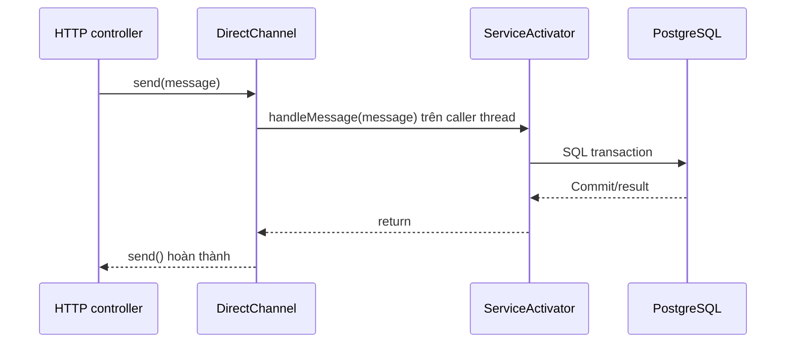

Các đặc điểm:

- **Đồng bộ:** handler thường chạy trong thread đang gọi `send()`.
- **Không buffer:** nếu handler chậm, caller cũng chậm.
- **Lỗi đồng bộ:** exception từ handler có thể lan ngược về caller dưới dạng exception messaging/integration phù hợp.
- **Transaction context:** cùng thread giúp Spring thread-bound transaction có thể đi qua các bước đồng bộ, khi transaction manager/handler được cấu hình đúng.
- **Nhiều subscriber:** `DirectChannel` dùng dispatcher để chọn handler theo load balancing/failover policy, **không tự broadcast tới tất cả**.

> **Quan trọng:** `DirectChannel` không mặc định cho bạn một transaction database. Nó chỉ không đổi thread. Một `@Transactional` có hoạt động hay không còn tùy transaction proxy, method invocation và transaction manager.

### 4.1. Nhiều sender không bảo đảm thứ tự toàn cục

Nếu hai HTTP threads đồng thời gửi message, hai lời gọi có thể xử lý song song trên hai sender threads. Vì vậy `DirectChannel` không bảo đảm thứ tự mọi event của toàn ứng dụng. Nếu cần ordering theo `orderId`, phải xét partitioning, correlation, concurrency và business state ở cấp luồng.

### 4.2. Khi nào nên dùng?

`DirectChannel` phù hợp với transform/validate nhanh, handler trong một transaction ngắn hoặc yêu cầu request-reply đồng bộ. Tránh để thread HTTP/người gọi giữ connection database trong khi endpoint sau đó chờ HTTP đối tác nhiều giây.

## 5. PublishSubscribeChannel: gửi một message tới nhiều subscriber

`PublishSubscribeChannel` khác `DirectChannel`: nó phân phối message tới **nhiều handler** đã đăng ký, phù hợp fan-out nội bộ:

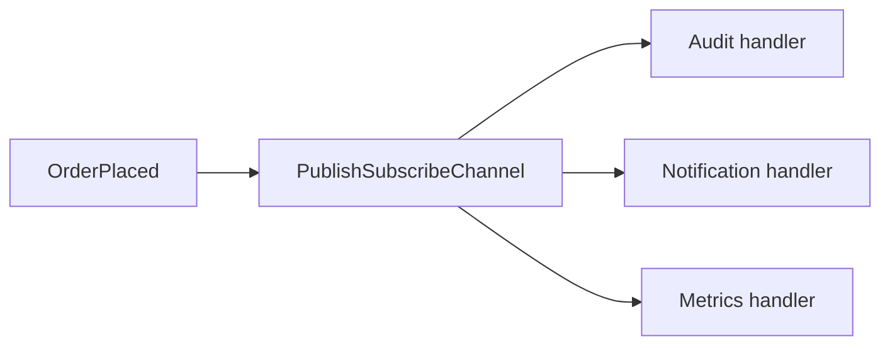

Mặc định, nếu không gắn executor, các subscriber thường được gọi theo mô hình đồng bộ trong thread gửi. Nếu cấu hình `TaskExecutor`, chúng có thể được dispatch bất đồng bộ và có vấn đề thread/transaction khác.

### 5.1. Không coi PublishSubscribeChannel như Kafka topic

`PublishSubscribeChannel` không tự:

- Lưu bền message khi process tắt.
- Phát lại message cho subscriber xuất hiện sau.
- Đảm bảo một transaction nguyên tử qua tất cả subscriber.
- Cung cấp broker consumer group, retention, partition hoặc network replication.

Nếu notification handler lỗi, tùy cấu hình dispatcher/executor/error handler, các subscriber khác có thể bị ảnh hưởng khác nhau. **Không dùng fan-out nội bộ để bảo đảm các side effect ngoài DB đều xảy ra exactly-once**.

### 5.2. Fan-out an toàn hơn cho nghiệp vụ quan trọng

Khi đơn hàng được tạo cần vừa ghi audit vừa gửi email, hãy cân nhắc:

```text
DB transaction: order + outbox rows
       ↓ commit
Broker topics / durable queues
       ├── audit consumer
       └── notification consumer
```

Fan-out nội bộ vẫn phù hợp cho metrics hoặc công việc best-effort. Với side effect phải phục hồi sau crash, sử dụng durable broker/outbox và idempotency tương ứng.

## 6. QueueChannel: bộ đệm hữu hạn, polling consumer

`QueueChannel` cho phép người gửi và người nhận tách thời điểm xử lý:

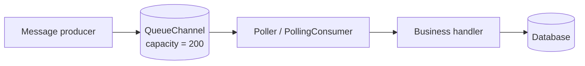

Mặc định, một `QueueChannel` sử dụng bộ nhớ JVM và nhận message theo thứ tự FIFO của hàng đợi. Nhiều polling consumers hoặc việc xử lý song song có thể làm **thứ tự hoàn thành** khác thứ tự enqueue.

Ví dụ bean:

```java
package example.integration.channels;

import org.springframework.context.annotation.Bean;
import org.springframework.context.annotation.Configuration;
import org.springframework.integration.channel.QueueChannel;

@Configuration(proxyBeanMethods = false)
public class QueueChannels {
    @Bean
    QueueChannel ordersBuffer() {
        return new QueueChannel(200);
    }
}
```

Với capacity 200, cần quyết định **khi đầy thì làm gì**. `send(message, 0)` cho phép thử gửi không chờ; `send(message, 100)` chờ tối đa khoảng 100 ms theo semantics API. Nếu không thể enqueue, caller có thể nhận `false` hoặc exception liên quan từng trường hợp. Không chuyển lỗi “queue đầy” thành `200 OK`/`ACK` cho upstream khi chưa có một điểm lưu bền vững khác.

### 6.1. Timeout gửi không phải timeout xử lý

```java
Message<OrderCreated> message = MessageBuilder
        .withPayload(event)
        .build();

boolean accepted = ordersBuffer.send(message, 100);
if (!accepted) {
    throw new RejectedExecutionException("Orders buffer full");
}
```

Ở đoạn trên, `event` là đối tượng `OrderCreated` của ứng dụng, `ordersBuffer` là `QueueChannel` được inject; cần import `org.springframework.messaging.Message`, `org.springframework.messaging.support.MessageBuilder`, `java.util.concurrent.RejectedExecutionException`. `accepted == true` chỉ có nghĩa message đã được **đưa vào queue**, chưa có business transaction hoàn tất.

### 6.2. Khi nên dùng

QueueChannel thích hợp để làm mềm một burst ngắn, điều tiết producer/consumer trong một process, hoặc mô phỏng polling semantics ở demo/test. Nó không nên là nguồn lưu trữ duy nhất cho thanh toán, đơn hàng hoặc hoạt động phải xử lý sau crash.

## 7. ExecutorChannel: dispatch thông qua TaskExecutor

Khác với `QueueChannel`, `ExecutorChannel` thuộc họ **SubscribableChannel** và gửi tác vụ xử lý tới `TaskExecutor`. Handler được kích hoạt nhờ executor, không cần một poller gọi `receive()`.

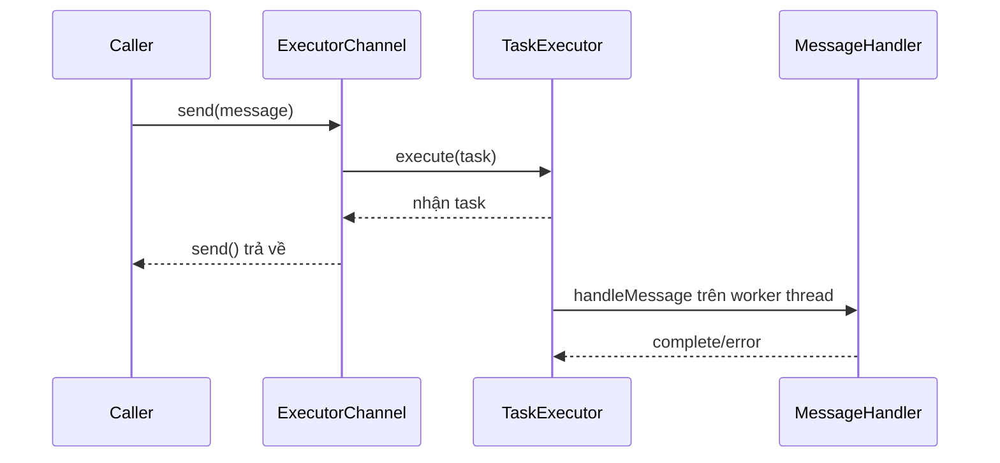

Ví dụ:

```java
package example.integration.channels;

import org.springframework.context.annotation.Bean;
import org.springframework.context.annotation.Configuration;
import org.springframework.integration.channel.ExecutorChannel;
import org.springframework.scheduling.concurrent.ThreadPoolTaskExecutor;

@Configuration(proxyBeanMethods = false)
public class ExecutorChannels {

    @Bean
    ThreadPoolTaskExecutor integrationExecutor() {
        var executor = new ThreadPoolTaskExecutor();
        executor.setCorePoolSize(4);
        executor.setMaxPoolSize(8);
        executor.setQueueCapacity(100);
        executor.setThreadNamePrefix("integration-");
        executor.initialize();
        return executor;
    }

    @Bean
    ExecutorChannel ordersAsync(ThreadPoolTaskExecutor integrationExecutor) {
        return new ExecutorChannel(integrationExecutor);
    }
}
```

Chú ý:

- Queue của executor là một **buffer khác** với broker backlog.
- `send()` có thể trả về trước khi handler hoàn tất.
- Exception ở worker thread thường không thể ném trực tiếp về sender đã rời đi; phải có **error-handling strategy** phù hợp.
- Thread-local transaction và MDC/tracing context không mặc định đi xuyên mọi executor nếu không được truyền theo cơ chế chính thức.
- Khi queue executor đầy, executor có thể reject; rejection policy (ví dụ chạy trên caller thread) còn có thể làm thay đổi kỳ vọng về đồng bộ/bất đồng bộ.

`ExecutorChannel` không làm database hoặc API đối tác nhanh hơn. Nếu có 8 workers nhưng JDBC pool chỉ 4 connections và mỗi worker giữ connection khi gọi HTTP, tăng worker có thể chỉ tạo thêm threads chờ.

## 8. So sánh bốn channel phổ biến

| Đặc điểm | `DirectChannel` | `PublishSubscribeChannel` | `QueueChannel` | `ExecutorChannel` |
| --- | --- | --- | --- | --- |
| Họ API | Subscribable | Subscribable | Pollable | Subscribable |
| Gửi tới | Một handler được chọn | Nhiều subscribers | Message chờ được poll | Handler được executor dispatch |
| Thread | Sender thread mặc định | Sender thread mặc định, hoặc executor | Poller/consumer thread | Worker thread, tùy executor/rejection |
| Buffer nội bộ | Không | Không bắt buộc | Có | Có thể có executor queue |
| `send()==true` | Dispatch thành công theo sync semantics | Chấp nhận/dispatch theo cấu hình | Enqueue thành công | Executor nhận task, không bảo đảm xử lý xong |
| Transaction của sender | Có thể tiếp nối nếu cùng thread | Có thể tiếp nối khi sync | Không tự đi qua poll boundary | Không tự đi qua async boundary |
| Persistence qua crash | Không | Không | Không theo mặc định | Không theo mặc định |
| Nhu cầu điển hình | Xử lý đồng bộ | Fan-out nội bộ | Buffer/poller | Offload async tasks |

**Cần nhớ:** đây là semantics mặc định/phổ biến, không thay thế việc đọc cấu hình executor, polling, dispatcher, store hoặc extension thực tế. Không thể chọn channel chỉ từ tên lớp rồi suy đoán tất cả delivery guarantees.

## 9. Những channel đặc thù khác

Spring Integration còn có một số loại channel và cơ chế:

- **`PriorityChannel`**: hàng đợi theo độ ưu tiên, thường dựa trên `priority` header/comparator. Thứ tự ưu tiên không giống FIFO; starvation có thể xảy ra khi liên tục có message ưu tiên cao.
- **`RendezvousChannel`**: dạng handoff đồng bộ, người gửi/nhận cần gặp nhau theo semantics của channel; không phải hàng đợi lưu trữ dài hạn.
- **`FluxMessageChannel`**: cầu nối dựa trên Reactor `Flux`, thường dùng khi kết nối integration flow với reactive stream. Phải hiểu demand, subscriber lifecycle và cách source hỗ trợ backpressure.
- **Persistent channels bằng `MessageStore` phù hợp**: một số cấu hình channel có thể sử dụng store để bảo toàn message, nhưng transaction/serialization/ack và tính bền vững phụ thuộc store, polling và failure handling.
- **`nullChannel`**: tên channel đặc biệt dùng để chủ động bỏ message ở nơi được thiết kế; gửi vào đó không tương đương hoàn thành nghiệp vụ hay xử lý lỗi an toàn.

Không nên dùng `PriorityChannel` để “ưu tiên tất cả” mà không có công bằng hoặc SLA cho low priority. Tương tự, `FluxMessageChannel` không biến một JDBC driver blocking thành nonblocking và không tự giải quyết giới hạn downstream.

## 10. Endpoint: event-driven consumer hay polling consumer?

Một endpoint nhận từ `SubscribableChannel` thường hoạt động theo kiểu **event-driven**: handler subscribe vào channel, message tới thì được dispatch. Ngược lại, với `PollableChannel`, endpoint cần **poller** để lấy message.

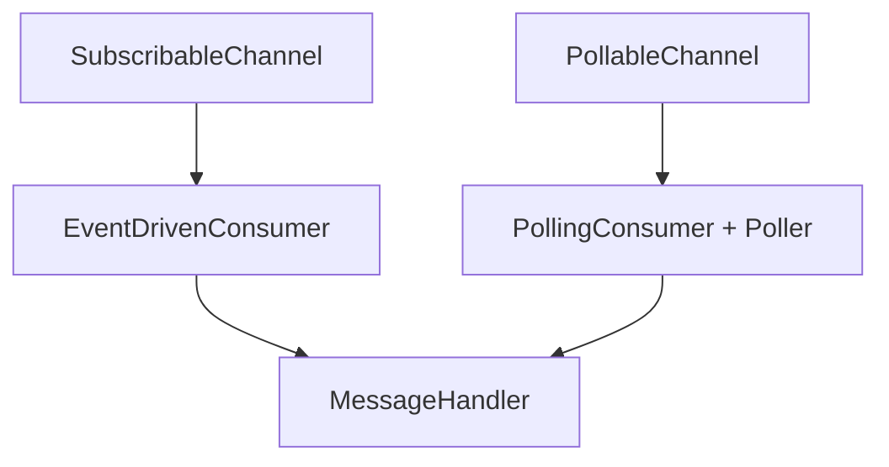

**Poller** quyết định lịch gọi `receive()`, số message tối đa mỗi lượt và executor/transaction advice nếu có:

```text
Poller fixedDelay 200 ms
  → kiểm tra channel
  → lấy tối đa 10 message mỗi lượt theo cấu hình
  → gửi từng message tới handler
  → lập lịch lượt tiếp theo
```

`maxMessagesPerPoll(10)` **không cam kết** throughput 50 message/giây khi fixedDelay là 200 ms. Thời gian xử lý, số poller threads, backlog, scheduler, transaction và downstream capacity quyết định throughput thực.

### 10.1. Một adapter có thể tạo message, không chỉ tiêu thụ

Các khái niệm inbound/outbound:

| Loại | Vai trò | Ví dụ |
| --- | --- | --- |
| Inbound channel adapter | Đưa message từ nguồn vào integration flow, thường một chiều | Poll file, JDBC, broker listener |
| Outbound channel adapter | Nhận message trong flow rồi gửi tới hệ ngoài, thường một chiều | Gửi Kafka/AMQP, ghi file |
| Inbound gateway | Nhận request từ bên ngoài, có thể gửi reply | HTTP inbound gateway |
| Outbound gateway | Gửi request ra hệ ngoài và chờ/nhận reply | HTTP outbound gateway |

Một **inbound adapter** là producer đối với channel bên trong; một **outbound adapter** là consumer của channel ấy. Gateway có đường request và đường reply, nên còn phải quản lý timeout, correlation, `replyChannel` và error handling.

## 11. Các building blocks trong một IntegrationFlow

| Endpoint/EIP | Vai trò trong đường đi | Câu hỏi cần quyết định |
| --- | --- | --- |
| Transformer | Đổi payload/headers, ví dụ String JSON → DTO | Hợp đồng output, mapping lỗi và version |
| Filter | Giữ message hợp lệ, loại/trả message không hợp lệ | Discard, exception hay DLT? |
| Router | Chọn output channel theo rule | Khi không match thì làm gì? |
| Splitter | Một message thành nhiều message | Correlation, sequence, partial failure |
| Aggregator | Gom nhiều message thành một nhóm | Correlation key, completion, timeout, message store |
| Service Activator | Gọi phương thức nghiệp vụ/adapter | Transaction, side effects, return/reply |
| Bridge | Nối hai channel không đổi payload nghiệp vụ | Có đổi thread/durability không? |
| Gateway | Request-reply giữa code ứng dụng và flow | Reply timeout, error channel, caller blocking |
| Wire Tap | Gửi một bản sang channel quan sát | Dữ liệu nhạy cảm, chi phí và lỗi audit |

### 11.1. Khác biệt giữa channel và endpoint

Một `Transformer` nhận message từ **input channel** và thường phát message kết quả tới **output channel**. Không nên nói “DirectChannel thực hiện transform”; transform do **endpoint handler** thực hiện, còn channel dispatch.

Khi đọc Java DSL như:

```text
from("rawOrders")
    → transform(...)
    → filter(...)
    → channel("validatedOrders")
    → handle(...)
```

có thể có các channel nội bộ ngầm định giữa những thành phần của flow. Hãy xác định ranh giới **explicit `.channel(...)`** và những đoạn đồng bộ/ngầm định khi cần điều tra.

## 12. Dependencies và cấu hình nền tảng

Với Maven và Spring Boot BOM:

```xml
<dependency>
    <groupId>org.springframework.boot</groupId>
    <artifactId>spring-boot-starter-integration</artifactId>
</dependency>

<dependency>
    <groupId>org.springframework.boot</groupId>
    <artifactId>spring-boot-starter-test</artifactId>
    <scope>test</scope>
</dependency>

<dependency>
    <groupId>org.springframework.integration</groupId>
    <artifactId>spring-integration-test</artifactId>
    <scope>test</scope>
</dependency>
```

Đây là dependency cơ sở cho core Spring Integration và testing. Khi thực sự dùng adapter Kafka/HTTP/JDBC/AMQP/Redis, cần thêm **module Spring Integration tương ứng** và client/starter cần thiết, ví dụ:

```xml
<!-- Chỉ thêm module mà flow thực sự sử dụng -->
<dependency>
    <groupId>org.springframework.integration</groupId>
    <artifactId>spring-integration-http</artifactId>
</dependency>
<dependency>
    <groupId>org.springframework.integration</groupId>
    <artifactId>spring-integration-jdbc</artifactId>
</dependency>
```

Không hiểu `spring-boot-starter-integration` là đã cài mọi connector hoặc tự cấu hình TLS/credentials cho broker. Một endpoint HTTP còn cần HTTP client được cấu hình đúng timeout, SSL bundle và authentication; JDBC adapter cần `DataSource`, pool và transaction manager.

Trong Spring Boot 3.x, starter integration thường kích hoạt infrastructure cần thiết cho cấu hình mặc định. Có thể dùng `@EnableIntegration` tường minh nếu dự án không dựa hoàn toàn vào Boot auto-configuration; tránh tạo nhiều cấu hình chồng chéo mà không kiểm tra bean.

## 13. Ví dụ hoàn chỉnh A: DirectChannel giữa Filter và Service Activator

Giả sử ứng dụng nhận `OrderCommand` từ một HTTP controller hoặc gateway, kiểm tra đơn hàng rồi ghi transaction DB. Mô hình:

```text
Caller
   │ send(OrderCommand)
   ▼
ordersInput: DirectChannel
   ▼
@Filter validate
   ├─ true  → ordersValidated: DirectChannel → @ServiceActivator accept
   └─ false → ordersRejected: DirectChannel → @ServiceActivator reject
```

### 13.1. Khai báo DTO và ba channel

```java
// OrderCommand.java
package example.integration.order;

public record OrderCommand(
        String eventId,
        String orderId,
        long totalMinor) {
}
```

```java
// OrderChannelConfiguration.java
package example.integration.order;

import org.springframework.context.annotation.Bean;
import org.springframework.context.annotation.Configuration;
import org.springframework.integration.config.EnableIntegration;
import org.springframework.integration.channel.DirectChannel;
import org.springframework.messaging.MessageChannel;

@Configuration(proxyBeanMethods = false)
@EnableIntegration
public class OrderChannelConfiguration {

    @Bean
    MessageChannel ordersInput() {
        return new DirectChannel();
    }

    @Bean
    MessageChannel ordersValidated() {
        return new DirectChannel();
    }

    @Bean
    MessageChannel ordersRejected() {
        return new DirectChannel();
    }
}
```

### 13.2. Endpoint bằng annotation

```java
// OrderEndpoints.java
package example.integration.order;

import org.springframework.integration.annotation.Filter;
import org.springframework.integration.annotation.ServiceActivator;
import org.springframework.stereotype.Component;

@Component
public class OrderEndpoints {

    private final OrderBusinessService service;
    private final RejectedOrderRecorder rejectedOrders;

    public OrderEndpoints(
            OrderBusinessService service,
            RejectedOrderRecorder rejectedOrders) {
        this.service = service;
        this.rejectedOrders = rejectedOrders;
    }

    @Filter(
            inputChannel = "ordersInput",
            outputChannel = "ordersValidated",
            discardChannel = "ordersRejected")
    public boolean validate(OrderCommand command) {
        return command.eventId() != null
                && !command.eventId().isBlank()
                && command.orderId() != null
                && !command.orderId().isBlank()
                && command.totalMinor() >= 0;
    }

    @ServiceActivator(inputChannel = "ordersValidated")
    public void accept(OrderCommand command) {
        service.processIdempotently(command);
    }

    @ServiceActivator(inputChannel = "ordersRejected")
    public void reject(OrderCommand command) {
        rejectedOrders.record(command.eventId(), "Invalid order contract");
    }
}
```

Các interface nghiệp vụ do dự án cung cấp:

```java
package example.integration.order;

public interface OrderBusinessService {
    void processIdempotently(OrderCommand command);
}
```

```java
package example.integration.order;

public interface RejectedOrderRecorder {
    void record(String eventId, String reason);
}
```

**Điểm cần hiểu:**

- `@Filter` quyết định chấp nhận hay loại; message bị loại đi tới `ordersRejected`.
- `@ServiceActivator` gọi business service, không phải channel tự ghi DB.
- Cả ba channel đều là `DirectChannel`, nên các bước chính thường chạy trong **thread của caller**.
- `RejectedOrderRecorder` nên lưu quyết định loại bỏ bền vững nếu nguồn upstream yêu cầu audit; chỉ log rồi bỏ có thể không đủ.
- Việc `@Filter` chuyển sang discard flow **không tự ném lỗi về caller**. Nếu hợp đồng HTTP đòi trả 400, thiết kế phải ném exception/định nghĩa reply phù hợp, không coi mọi message reject là thành công.

### 13.3. Gửi message từ code ứng dụng

```java
// OrderIngress.java
package example.integration.order;

import org.springframework.beans.factory.annotation.Qualifier;
import org.springframework.messaging.MessageChannel;
import org.springframework.messaging.support.MessageBuilder;
import org.springframework.stereotype.Component;

@Component
public class OrderIngress {

    private final MessageChannel ordersInput;

    public OrderIngress(
            @Qualifier("ordersInput") MessageChannel ordersInput) {
        this.ordersInput = ordersInput;
    }

    public void submit(OrderCommand command, String correlationId) {
        boolean accepted = ordersInput.send(
                MessageBuilder.withPayload(command)
                        .setHeader("correlationId", correlationId)
                        .build()
        );
        if (!accepted) {
            throw new IllegalStateException("Order message was not accepted");
        }
    }
}
```

**Không coi `submit()` trả về là dấu hiệu mọi side effect đã commit ở mọi mô hình.** Trong cấu hình DirectChannel hiện tại, handler đồng bộ có thể đã hoàn tất nếu không lỗi; nhưng khi thay một đoạn bằng QueueChannel/ExecutorChannel, `send()` có thể trả về sớm. Việc chuyển channel type là **thay đổi semantics hợp đồng**, cần review lại HTTP response, ack và transaction.

### 13.4. Một biến thể tương đương bằng Java DSL

Thay bộ annotation endpoint ở trên bằng một `IntegrationFlow` (không đăng ký **đồng thời** với endpoint annotation cùng input channel nếu không chủ đích tạo nhiều subscriber):

```java
package example.integration.order;

import org.springframework.context.annotation.Bean;
import org.springframework.context.annotation.Configuration;
import org.springframework.integration.dsl.IntegrationFlow;

@Configuration(proxyBeanMethods = false)
public class OrderFlowConfiguration {

    @Bean
    IntegrationFlow validateAndProcessFlow(
            OrderBusinessService service) {

        return IntegrationFlow.from("ordersInput")
                .filter(
                        OrderCommand.class,
                        command -> command.orderId() != null
                                && !command.orderId().isBlank()
                                && command.totalMinor() >= 0,
                        spec -> spec.discardChannel("ordersRejected"))
                .channel("ordersValidated")
                .handle(
                        OrderCommand.class,
                        (command, headers) -> {
                            service.processIdempotently(command);
                            return null;
                        })
                .get();
    }
}
```

Trong flow trên, `return null` từ handler được dùng để kết thúc luồng **một chiều**; nếu muốn trả reply, handler phải trả một payload/message thích hợp. Cần có endpoint riêng cho `ordersRejected` (như ví dụ trước, hoặc một flow khác). Không nên đăng ký cả `OrderEndpoints.validate` lẫn flow này vào cùng `ordersInput` khi mong đợi đúng một lần xử lý, vì có thể có nhiều subscribers trên DirectChannel.

## 14. Ví dụ B: Messaging Gateway và đường reply

Một `MessageChannel` có thể là điểm đi vào của một interface theo **request-reply**. Spring Integration gateway nhận lời gọi Java, đóng gói request thành Message, gửi tới request channel và chờ reply hợp lệ.

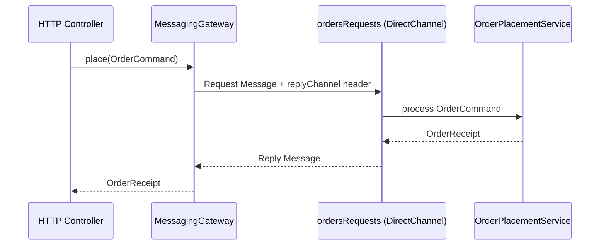

### 14.1. Interface gateway

```java
// OrderRequestGateway.java
package example.integration.gateway;

import example.integration.order.OrderCommand;
import org.springframework.integration.annotation.Gateway;
import org.springframework.integration.annotation.MessagingGateway;

@MessagingGateway(defaultRequestChannel = "ordersRequests")
public interface OrderRequestGateway {

    @Gateway(requestTimeout = 2000, replyTimeout = 5000)
    OrderReceipt place(OrderCommand command);
}
```

```java
// OrderReceipt.java
package example.integration.gateway;

public record OrderReceipt(String orderId, String status) {
}
```

### 14.2. Đăng ký gateway và flow trả kết quả

```java
// GatewayFlowConfiguration.java
package example.integration.gateway;

import example.integration.order.OrderCommand;
import org.springframework.context.annotation.Bean;
import org.springframework.context.annotation.Configuration;
import org.springframework.integration.annotation.IntegrationComponentScan;
import org.springframework.integration.channel.DirectChannel;
import org.springframework.integration.dsl.IntegrationFlow;
import org.springframework.messaging.MessageChannel;

@Configuration(proxyBeanMethods = false)
@IntegrationComponentScan
public class GatewayFlowConfiguration {

    @Bean
    MessageChannel ordersRequests() {
        return new DirectChannel();
    }

    @Bean
    IntegrationFlow orderRequestReplyFlow(OrderPlacementService service) {
        return IntegrationFlow.from("ordersRequests")
                .handle(OrderCommand.class,
                        (command, headers) -> service.accept(command))
                .get();
    }
}
```

```java
// OrderPlacementService.java
package example.integration.gateway;

import example.integration.order.OrderCommand;

public interface OrderPlacementService {
    OrderReceipt accept(OrderCommand command);
}
```

`@IntegrationComponentScan` giúp tìm các interface `@MessagingGateway` trong package được quét. Khi handler trả về `OrderReceipt`, reply được gửi về đường reply mà gateway đã đặt trong message header.

Hai timeout cần phân biệt:

- `requestTimeout` liên quan việc **gửi request vào channel**, nhất là khi channel có thể block vì capacity. Nó không phải deadline chắc chắn cho mọi JDBC/HTTP call sau đó.
- `replyTimeout` liên quan thời gian chờ reply theo gateway. Nếu downstream xử lý bất đồng bộ, timeout ở caller **không bảo đảm** worker đã dừng hoặc transaction đã rollback.

Nếu endpoint dùng HTTP `202 Accepted`, chỉ trả 202 khi ứng dụng đã đạt **mức cam kết tiếp nhận** (ví dụ durable inbox). Gateway nhận reply nhanh từ QueueChannel không có nghĩa toàn bộ nghiệp vụ đã hoàn tất.

### 14.3. Khi không có reply

Nếu handler `void`, trả `null` hoặc route sang channel không trả kết quả, gateway có thể timeout hay nhận kết quả trống tùy chữ ký và cấu hình. Không sử dụng `null` như câu trả lời “thành công” khi hợp đồng đòi `OrderReceipt`. Transformer và router trong chuỗi request-reply phải giữ thông tin `replyChannel`/correlation cần thiết.

## 15. Ví dụ C: QueueChannel và polling endpoint

Giả sử một batch job đưa nhiều `OrderCommand` vào hàng đợi trong process, poller xử lý tối đa một số message mỗi đợt:

```java
package example.integration.polling;

import java.time.Duration;
import example.integration.order.OrderCommand;
import org.springframework.context.annotation.Bean;
import org.springframework.context.annotation.Configuration;
import org.springframework.integration.channel.QueueChannel;
import org.springframework.integration.dsl.IntegrationFlow;
import org.springframework.integration.dsl.Pollers;

@Configuration(proxyBeanMethods = false)
public class OrderPollingFlowConfiguration {

    @Bean
    QueueChannel queuedOrders() {
        return new QueueChannel(200);
    }

    @Bean
    IntegrationFlow queuedOrdersFlow(
            QueueChannel queuedOrders,
            QueuedOrderProcessor processor) {

        return IntegrationFlow.from(
                        queuedOrders,
                        endpoint -> endpoint.poller(
                                Pollers.fixedDelay(Duration.ofMillis(200))
                                        .maxMessagesPerPoll(10)))
                .handle(OrderCommand.class, (command, headers) -> {
                    processor.process(command);
                    return null;
                })
                .get();
    }
}
```

```java
package example.integration.polling;

import example.integration.order.OrderCommand;

public interface QueuedOrderProcessor {
    void process(OrderCommand command);
}
```

**Đường đi:**

1. Producer gọi `queuedOrders.send(message, timeout)`.
2. Nếu queue còn chỗ, send thành công ngay khi enqueue, **trước khi handler chạy**.
3. Poller lấy message theo lịch và gọi handler `processor.process(...)`.
4. Nếu handler lỗi, phải có recovery/error flow riêng; message đã lấy khỏi QueueChannel bộ nhớ không tự quay về broker.

`maxMessagesPerPoll(10)` giới hạn số message lấy trong một lượt, không có nghĩa 10 handler cùng chạy. `fixedDelay(200 ms)` không cam kết 50 message/s vì processing duration, scheduler, executor và DB/HTTP bottleneck.

### 15.1. Với dữ liệu quan trọng, hãy giữ điểm lưu bền vững

```text
Kafka event → inbox table + commit → Kafka ACK
              ↓
         background poller
              ↓
     xử lý nghiệp vụ idempotent
```

Inbox table mới là nguồn công việc có thể phục hồi. Polling DB bằng Spring Integration JDBC cần thêm claim/locking, transaction isolation, retry và status; `Poller` một mình không bảo đảm distributed lock.

## 16. Filter, Router, Splitter, Aggregator và Bridge

Một flow thực tế thường không tuyến tính:

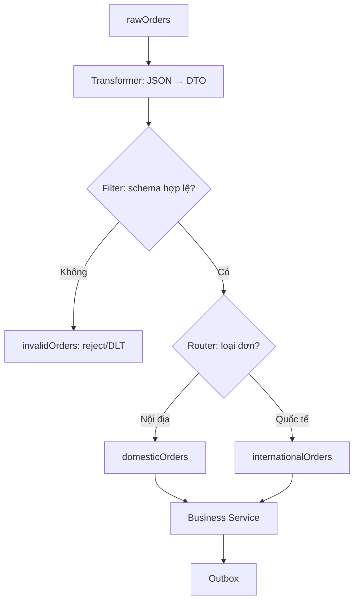

### 16.1. Filter: discard không đồng nghĩa xử lý lỗi

Khi predicate false, filter có thể chuyển message tới discard channel, ném exception hoặc bỏ có chủ đích. Với event có ý nghĩa nghiệp vụ, không dùng `nullChannel` để che dữ liệu sai; phải có DLT/parking/reject policy được phê duyệt. Nếu Kafka adapter thấy listener kết thúc thành công, offset có thể được commit theo ack policy dù business event đã bị bỏ.

### 16.2. Router: chọn channel theo giá trị được cho phép

```text
eventType = order.created   → ordersCreated
eventType = order.cancelled → ordersCancelled
eventType = khác           → unsupportedEvents
```

Đặt default route hoặc lỗi rõ cho eventType không được hỗ trợ. Header có nguồn từ bên ngoài **không phải thông tin đáng tin**: không dùng giá trị bất kỳ làm Java class name, bean name hoặc URL để thực thi mà không whitelist.

### 16.3. Splitter và Aggregator

```text
Order ORD-7
  → split item 1
  → split item 2
  → split item 3
        ↓
  xử lý có thể song song
        ↓
  aggregate theo ORD-7
        ↓
  kết quả chung
```

Aggregator cần correlation key, sequence size hoặc completion strategy, group timeout và message store. Khi một phần đến muộn, thất bại hoặc được giao lại, phải có **chính sách partial groups, duplicate và idempotency**. Thay `DirectChannel` thành `ExecutorChannel` có thể làm thứ tự hoàn thành khác thứ tự nhận: aggregator không được ghép dựa vào giả định FIFO tổng thể.

### 16.4. Bridge không tạo durability

`BridgeHandler` hoặc `.bridge()` của Java DSL nối những channel không cần biến đổi payload. Nó không tự thêm transaction, storage, retry hoặc broker persistence. Nếu hai channel khác loại, vẫn cần phân tích thread boundary và failure semantics.

## 17. `replyChannel`, `errorChannel` và đường phản hồi

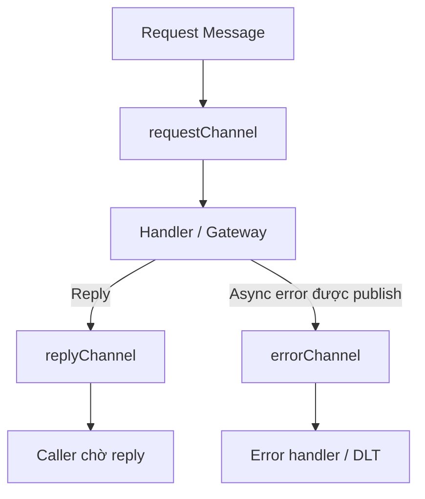

### 17.1. ErrorMessage có payload là Throwable

```java
package example.integration.errors;

import org.slf4j.Logger;
import org.slf4j.LoggerFactory;
import org.springframework.integration.annotation.ServiceActivator;
import org.springframework.messaging.support.ErrorMessage;
import org.springframework.stereotype.Component;

@Component
public class IntegrationErrorHandler {

    private static final Logger log =
            LoggerFactory.getLogger(IntegrationErrorHandler.class);

    @ServiceActivator(inputChannel = "integrationErrors")
    public void handle(ErrorMessage error) {
        Throwable cause = error.getPayload();
        log.error("Integration message failed: {}",
                cause.getClass().getSimpleName(), cause);
    }
}
```

Đây mới là **handler**. Ứng dụng cần khai báo channel `integrationErrors` tương ứng và cấu hình các endpoint/async error publisher sử dụng nó. Một exception trong `DirectChannel` đồng bộ thường **lan về caller**, không mặc định được đẩy tới global error channel. Cần kiểm chứng behavior ở đúng poller, gateway và broker listener container đang dùng.

### 17.2. Error handler không được âm thầm bỏ dữ liệu

Chỉ log lỗi rồi cho upstream ack có thể làm mất công việc. Error flow nên phân loại transient/permanent, có retry/backoff hữu hạn, DLT hoặc durable retry storage, và metric điều tra. Lưu `eventId`, topic/partition/offset hoặc correlation ID phù hợp, **không** đưa raw payload nhạy cảm hay credentials vào log.

### 17.3. Header trả lời không phải nội dung business event

`MessageHeaders.REPLY_CHANNEL` và `MessageHeaders.ERROR_CHANNEL` có thể tham chiếu channel object hoặc tên channel nội bộ. Không serialize một Java MessageChannel object thành JSON rồi kỳ vọng service khác biết cách trả lời qua nó. Với Kafka/HTTP request-reply xuyên process, cần correlation key và reply topic/endpoint được ánh xạ theo hợp đồng giao thức.

## 18. Ranh giới thread và transaction là quyết định kiến trúc

Một sai lầm nghiêm trọng là cho rằng `@Transactional` trên method đầu flow tự động bao trùm cả xử lý sau `QueueChannel` hoặc `ExecutorChannel`.

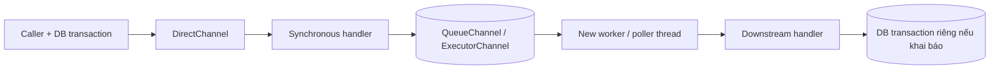

| Ranh giới | Cùng sender thread? | Transaction context từ upstream |
| --- | --- | --- |
| `DirectChannel` mặc định | Có | Có thể tham gia transaction thread-bound hiện có |
| `PublishSubscribeChannel` không executor | Thường có | Có thể cùng transaction khi đồng bộ; không bảo đảm atomicity qua nhiều hệ thống |
| `ExecutorChannel` | Thường không | Không tự truyền Spring thread-bound transaction |
| `QueueChannel` + poller | Không ở lượt poll riêng | Không tự truyền transaction gốc |
| Broker inbound/outbound adapter | Có ranh giới network/commit riêng | Không có transaction nguyên tử DB + broker chỉ nhờ channel |

### 18.1. Anti-pattern: coi enqueue như đã commit

```java
@Transactional
public void receiveOrder(OrderCommand command) {
    ordersRepository.insert(command);
    queuedOrders.send(MessageBuilder.withPayload(command).build());
}
```

Ở đây `ordersRepository` và `queuedOrders` là dependencies của service; ví dụ chỉ minh họa **anti-pattern**, không phải một class hoàn chỉnh. Nếu `queuedOrders` là QueueChannel bộ nhớ, message có thể được nhận bởi poller **trước khi transaction DB bên gửi commit**. Transaction sau đó rollback thì worker đã xử lý một công việc không có state DB tương ứng.

Một hướng an toàn khi cần bền vững:

```text
BEGIN DB transaction
  insert orders
  insert integration_outbox(eventId, payload, status)
COMMIT
       ↓
Outbox worker chỉ đọc row đã commit
       ↓
Gửi broker / xử lý tiếp có retry và idempotency
```

Đó là transactional outbox. Nếu gửi broker thành công nhưng DB chưa đánh dấu outbox đã gửi rồi process crash, cùng event có thể được publish lại; consumer cần dedupe theo event ID.

### 18.2. Trả JDBC connection đúng thời điểm

Trong chuỗi `DirectChannel` đồng bộ, nếu một business method mở transaction DB rồi gọi HTTP đối tác trong cùng transaction, connection có thể bị giữ suốt thời gian chờ HTTP. Kết quả: Hikari pending tăng, throughput giảm, request timeout dây chuyền.

```text
HTTP ingress
  → validate/transform
  → DB transaction ngắn: business state + outbox
  → commit
  → async publisher có giới hạn
  → HTTP partner / Kafka
```

Đổi channel sang bất đồng bộ chỉ tách thread, **không tự tạo lưu trữ bền vững** và không tự xử lý coupling DB với HTTP.

## 19. Broker adapter: nguồn message và quyền ack thuộc container

Khi `@KafkaListener` hoặc Spring Integration Kafka inbound adapter nhận record, có ít nhất ba ranh giới:

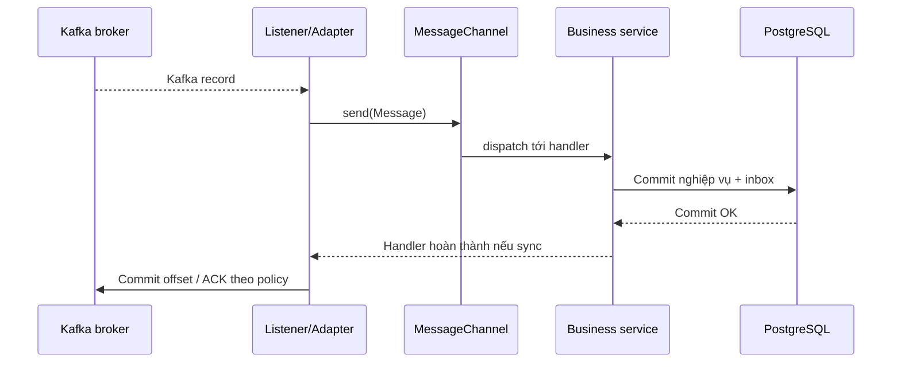

Với `DirectChannel` đồng bộ và handler commit thành công trước khi trả về, adapter/container **có thể** dùng kết quả xử lý để quyết định ack theo chính sách. Nhưng ack timing còn phụ thuộc ack mode, transaction manager và error handler của Kafka/Spring Integration. Không mặc định mọi container commit offset ngay sau handler trong mọi cấu hình.

Khi chèn `QueueChannel` hoặc `ExecutorChannel`:

```text
Broker → listener → send() được chấp nhận → listener kết thúc
                                     ↓
                         worker xử lý DB sau đó
```

Listener có thể kết thúc **trước khi** DB commit. Nếu container ack theo việc listener trở về, message có nguy cơ mất khi process crash. Một channel không tự “giữ lại” ack của broker cho tới khi worker hoàn tất.

### 19.1. Các lựa chọn giữ semantics

| Lựa chọn | Phù hợp khi | Cần kiểm chứng |
| --- | --- | --- |
| Handler đồng bộ qua DirectChannel, commit DB rồi ack | Handler tương đối nhanh | Poll interval, DB transaction, error propagation |
| Persist inbox rồi ack, worker xử lý async | Công việc dài, đòi hỏi durability | Unique eventId, retry, checkpoint, monitoring |
| Giữ message ở broker đến lúc xử lý | Dùng broker làm durable queue | Prefetch/poll, container ack, rebalance |
| Enqueue in-memory rồi ack | Chỉ khi business contract cho phép mất khi crash | Không dùng mặc định cho đơn hàng/thanh toán |

Kafka quản lý offset và consumer group; RabbitMQ có ack/nack/prefetch; Pulsar có subscription/ack/redelivery theo client. **MessageChannel không thay các cơ chế đó** và không thể áp một thuộc tính ack chung cho mọi broker adapter.

### 19.2. Duplicate delivery khác duplicate business effect

Crash sau khi DB commit nhưng trước broker ack có thể khiến record được giao lại: đây là rủi ro thông thường của xử lý at-least-once. Một schema đơn giản:

```sql
CREATE TABLE processed_event (
    consumer_name VARCHAR(120) NOT NULL,
    event_id VARCHAR(80) NOT NULL,
    processed_at TIMESTAMPTZ NOT NULL,
    PRIMARY KEY (consumer_name, event_id)
);
```

Ứng dụng ghi receipt và side effect nghiệp vụ trong **cùng database transaction**, xử lý race bằng unique constraint. MessageChannel không tự thêm idempotency. Không dùng `ConcurrentHashMap` trong một JVM thay database constraint trên hệ nhiều replicas.

## 20. Buffer, backpressure và giới hạn tải

Giả sử ingress là 800 events/s còn pipeline chỉ hoàn tất 500 events/s:

\[
\Delta Q/\Delta t \approx \lambda-\mu=300\text{ events/s}
\]

Sau 60 giây, backlog tăng gần `300 × 60 = 18.000` events nếu tốc độ tương đối ổn định. Một `QueueChannel(200)` không thể hấp thụ chênh lệch đó lâu dài.

### 20.1. Nơi công việc tích tụ

```text
Kafka / RabbitMQ / Pulsar backlog (durable theo policy)
        ↓
Consumer fetch/prefetch queue
        ↓
QueueChannel / Executor task queue trong JVM
        ↓
HikariCP pending / HTTP client connection-pool pending
```

Broker lag bằng 0 chưa chắc business latency thấp: công việc có thể đã chuyển vào một hàng đợi trong process. Đo **backlog theo từng tầng và tuổi message**, không chỉ broker queue depth.

### 20.2. Bounded queue cần cơ chế phản hồi

Với HTTP ingress:

- Trả **429** khi vượt quota/rate limit hoặc **503** khi tạm thời thiếu capacity, phù hợp hợp đồng HTTP.
- Dùng `Retry-After` khi có khả năng xác định thời điểm thử lại.
- Chỉ trả **202 Accepted** sau điểm tiếp nhận đã được cam kết, ví dụ commit inbox/outbox.

Với broker:

- Giảm poll/fetch/prefetch hoặc tạm dừng consume qua API listener container hỗ trợ.
- Giữ message chưa ack ở nguồn bền vững theo delivery policy.
- Giới hạn concurrency hướng tới JDBC và outbound HTTP, có timeout/retry budget.

Với reactive streams, demand/backpressure phải được truyền qua các ranh giới theo contract Reactor/Reactive Streams; không giả định QueueChannel tự điều tiết Kafka hoặc HTTP ingress.

### 20.3. Rate limit khác concurrency limit

`Semaphore(8)` giới hạn tối đa 8 request đang xử lý **trên một instance**, không bảo đảm quota 100 request/s của đối tác. Với 10 replicas, toàn cụm có thể có khoảng 80 request in-flight. Chọn quota/rate và concurrency theo năng lực upstream/downstream **toàn cụm**, không chỉ theo số threads của một pod.

## 21. Observability: tên channel, correlation và WireTap

Một flow nhiều endpoint khó điều tra nếu mọi log chỉ ghi “message processed”. Cần biết message đi qua kênh nào, đã tới endpoint nào, mất bao lâu và đã commit điều gì.

### 21.1. Tên channel phản ánh trạng thái

```text
orders.raw
orders.validated
orders.rejected
orders.persisted
orders.publish.retry
```

Không đặt tên `orders.completed` cho QueueChannel chỉ chứa công việc đang chờ. Tên channel/endpoint nên cho biết **trước hay sau ranh giới business commit**.

### 21.2. Các ID không thay thế cho nhau

| Trường | Dùng cho | Không nên dùng thay |
| --- | --- | --- |
| `correlationId` | Kết nối nhiều bước xử lý/traces | Idempotency ID nếu không cam kết unique |
| `eventId` | Định danh event, chống side effect lặp | Kafka topic-partition-offset |
| `orderId` | Business aggregate | ID riêng của một lần gửi |
| `traceparent` | Distributed tracing | Authorization/chữ ký bảo mật |
| `replyChannel` | Reply nội bộ framework | Reply topic xuyên process không mapping |
| `errorChannel` | Đường lỗi theo framework | Durable DLT mặc định |

Không đặt raw payment data, secret hoặc thông tin cá nhân nhạy cảm vào header chỉ để tiện log.

### 21.3. WireTap không phải audit bền vững

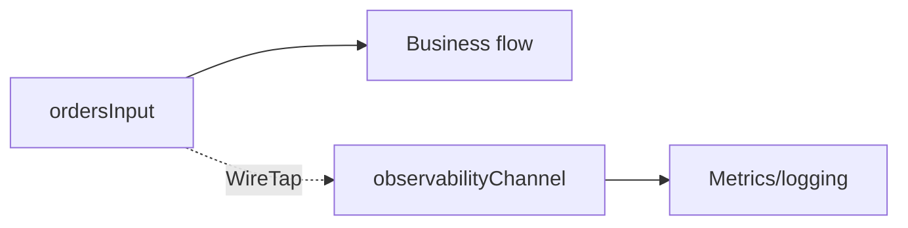

`WireTap` có thể chuyển bản message sang một channel để quan sát. Nếu observability handler đồng bộ và chậm, nó vẫn có thể ảnh hưởng đường chính. Nếu audit bắt buộc phải lưu được qua crash, dùng transactional outbox/DB hoặc persistent store có semantics rõ thay vì một wire tap best-effort.

### 21.4. Các metric cần xem

| Vị trí | Metric/tín hiệu | Câu hỏi |
| --- | --- | --- |
| Input channel | Send count/error, dispatch latency | Có lỗi khi giao message? |
| QueueChannel | Queue depth/capacity, waiting time | Có backlog trong heap? |
| Executor | Active workers, queued tasks, rejections | Worker pool có bão hòa? |
| Poller | Poll count, duration, messages per poll | Có tiêu backlog được? |
| Handler | Success/failure, p95/p99 | Bước nghiệp vụ nào chậm? |
| JDBC/HTTP | Connection pending, timeout, 429/503 | Downstream nào nghẽn? |
| Broker | Consumer lag, oldest age, retries/DLT | Message chưa được xử lý bền vững? |
| Outbox/inbox | Pending age, duplicate rate | Business effect đã hoàn thành? |

Spring Integration hỗ trợ monitoring và Micrometer tùy phiên bản/cấu hình; xác minh **meter thực sự được export**, không đoán tên metric luôn tồn tại. Kết hợp Actuator, structured logging, tracing và broker/database dashboards.

## 22. Endpoint lifecycle và graceful shutdown

Nhiều Spring Integration endpoints tham gia lifecycle của Spring, gồm những component tương thích `SmartLifecycle`. Khi khởi động, listener/poller cần chỉ tiếp nhận khi datasource, migration và dependency quan trọng đã sẵn sàng theo chính sách vận hành.

```text
Ngừng nhận thêm HTTP/broker work
        ↓
Tạm dừng/đóng inbound endpoint theo lifecycle
        ↓
Cho in-flight tasks hoàn tất trong grace period
        ↓
Commit/ack đúng điểm bền vững
        ↓
Đóng clients và DataSource
```

`QueueChannel` trong bộ nhớ **không tự chuyển item sang replica mới**. Nếu upstream đã ack, những item đó có thể mất trong rolling restart. Công việc quan trọng nên ở broker, inbox hoặc persistent message store có transaction/recovery phù hợp.

### 22.1. Readiness và liveness

- **Readiness**: instance có nên nhận công việc mới không?
- **Liveness**: process còn sống và có khả năng phục hồi không?

Không mặc định một message sai schema hoặc một HTTP đối tác lỗi khiến liveness fail, tạo restart storm. Có thể tạm dừng inbound adapter, mở circuit breaker hoặc giữ backlog ở broker trong khi process phục hồi.

### 22.2. `autoStartup` và endpoint IDs

Nhiều endpoint hỗ trợ `autoStartup`, ID và các phương thức lifecycle phù hợp. Chỉ định ID có ý nghĩa giúp điều khiển/quan sát flow và tránh tên bean sinh tự động khó chẩn đoán. Tránh tự spawn thread trong constructor hoặc bắt đầu poll database trước khi Spring Boot hoàn tất database initialization.

## 23. Kiểm thử channel và đường đi

Cần tách **unit test semantics channel** khỏi **integration test Spring context** và **end-to-end test với broker/database thật**.

### 23.1. Test DirectChannel: xử lý đồng bộ

```java
package example.integration.channels;

import java.util.concurrent.atomic.AtomicReference;
import org.junit.jupiter.api.Test;
import org.springframework.integration.channel.DirectChannel;
import org.springframework.messaging.support.GenericMessage;

import static org.assertj.core.api.Assertions.assertThat;

class DirectChannelTest {

    @Test
    void handlerRunsOnSendingThreadByDefault() {
        DirectChannel channel = new DirectChannel();
        AtomicReference<String> handlerThread = new AtomicReference<>();

        channel.subscribe(message ->
                handlerThread.set(Thread.currentThread().getName()));

        String sendingThread = Thread.currentThread().getName();
        boolean accepted = channel.send(new GenericMessage<>("order"));

        assertThat(accepted).isTrue();
        assertThat(handlerThread.get()).isEqualTo(sendingThread);
    }
}
```

Test này kiểm tra **một trường hợp** DirectChannel mặc định, không chứng minh transaction hoặc tính bền vững sau crash.

### 23.2. Test QueueChannel: bounded capacity

```java
package example.integration.channels;

import org.junit.jupiter.api.Test;
import org.springframework.integration.channel.QueueChannel;
import org.springframework.messaging.Message;
import org.springframework.messaging.support.GenericMessage;

import static org.assertj.core.api.Assertions.assertThat;

class QueueChannelTest {

    @Test
    void fullQueueRejectsImmediateSend() {
        QueueChannel channel = new QueueChannel(1);

        assertThat(channel.send(new GenericMessage<>("first")))
                .isTrue();
        assertThat(channel.send(new GenericMessage<>("second"), 0))
                .isFalse();

        Message<?> message = channel.receive(0);
        assertThat(message).isNotNull();
        assertThat(message.getPayload()).isEqualTo("first");
    }
}
```

Đừng viết test sử dụng timeout vô hạn khi queue đầy. Dùng deadline hữu hạn và cleanup. Một unit test `QueueChannel` chỉ đo hành vi in-memory, không chứng minh ack broker hoặc retry DLT.

### 23.3. Integration test với Spring context

Sau khi khai báo `OrderChannelConfiguration`, `OrderEndpoints` và fake `OrderBusinessService`/`RejectedOrderRecorder`, có thể kiểm tra:

1. Gửi `OrderCommand` hợp lệ vào `ordersInput`; service được gọi đúng một lần.
2. Gửi command thiếu `orderId`; reject recorder được gọi, service không cập nhật DB.
3. Kiểm tra `correlationId` qua transformer/router nếu luồng cần tracing.
4. Cho handler ném exception; với `DirectChannel` xác minh lỗi lan về caller như thế nào.
5. Đổi channel sang `QueueChannel` trong **cấu hình test riêng**; xác minh `send()` hoàn thành trước business processing.
6. Test `@MessagingGateway` trả reply đúng class, handling timeout và error channel.

**Không đăng ký đồng thời bộ endpoint annotation và bộ Java DSL demo** trên cùng channel khi mong đợi mỗi message được xử lý một lần. Một testcase `send()` thành công không chứng minh ứng dụng đã commit DB và ack broker.

### 23.4. End-to-end test với PostgreSQL và Kafka

```text
Publish record vào test Kafka
  → inbound adapter tạo Spring Message
  → channel → filter/transform
  → business service commit PostgreSQL + inbox
  → consumer ack/commit theo policy
  → verify DB state, DLT, idempotency và consumer lag
```

Testcontainers hoặc hạ tầng test tương đương giúp kiểm chứng:

- Producer/consumer serialization, headers, trace propagation.
- Deserialization exception **trước khi** business endpoint được gọi.
- Crash sau DB commit nhưng trước offset commit → redelivery an toàn.
- Poison message, retry hữu hạn, DLQ/DLT và error routing.
- Bounded queue, rejection, executor capacity và graceful shutdown.
- Nhiều replicas/partitions khi cần kiểm tra khả năng scale và ordering.

Mock Spring Integration channel **không thay** test broker thực, vì offset/ack, transaction và rebalance thuộc listener container/giao thức thực tế.

## 24. Chẩn đoán đường đi khi có sự cố

| Triệu chứng | Nguyên nhân có thể | Kiểm tra |
| --- | --- | --- |
| `Dispatcher has no subscribers` hoặc lỗi tương tự | `DirectChannel` chưa có subscriber | Bean endpoint, tên input channel, component scan, lifecycle |
| Message không đến handler | Sai tên channel, router sai nhánh, filter discard | Flow graph, bean names, discard/error routes |
| `QueueChannel` nhận nhưng không xử lý | Không cấu hình polling endpoint/poller | `PollableChannel` vs `SubscribableChannel` |
| Gateway timeout | Thiếu reply hoặc mất `replyChannel` | Handler return, transformer, reply routing |
| Send thành công nhưng DB chưa có bản ghi | Worker xử lý async hoặc lỗi sau send | Thread boundary, transaction, error channel |
| Kafka lag thấp nhưng nghiệp vụ chậm | Backlog dồn vào JVM queue hoặc JDBC pool | Queue depth, Hikari pending, end-to-end age |
| Một event xử lý hai lần | Flow trùng, redelivery hoặc retry producer | Subscriber wiring, eventId, broker ack |
| Audit handler lỗi làm order chậm | PubSub đồng bộ, handler có side effect chậm | Executor, tách durable audit |
| Transaction biến mất giữa các bước | Cross Executor/Queue/Poller thread | Thread IDs, transaction propagation, service boundary |
| Retry vô hạn với payload sai | Không phân loại lỗi/DLT | Deserializer, error handler, poison message |
| Queue đầy và HTTP timeout | Capacity không đủ, thiếu throttle | Sender timeout, reject policy, arrival/completion rate |
| Poller còn chạy khi shutdown | Lifecycle điều phối sai | `autoStartup`, graceful shutdown, executor |
| Metrics không phản ánh latency | Đo message sent thay business completion | Instrumentation, lag/age, trace spans |

### 24.1. Runbook điều tra một message có vẻ “biến mất”

1. Tìm **eventId**, orderId/correlation ID và thời điểm.
2. Xác định ingress: HTTP đã trả gì, broker đã deliver/ack/commit offset chưa?
3. Liệt kê channel/endpoint: Direct, Queue, Executor, PubSub, router, discard, error.
4. Xác định **điểm lưu bền vững cuối cùng**: broker, inbox, DB nghiệp vụ, outbox.
5. Đọc thread/transaction boundary: `send()` trả trước hay sau khi business commit?
6. Đối chiếu metrics: channel send errors, queue depth, poll rate, JDBC pool, HTTP latency.
7. Kiểm tra error flow, DLT/parking và retry attempts.
8. Chỉ replay sau khi đánh giá idempotency và khả năng side effect đã xảy ra.

Đừng chỉ nhìn log `Sent message to channel` rồi kết luận record đã được lưu an toàn trong PostgreSQL hoặc Kafka.

## 25. Tình huống: mất đơn hàng sau khi đổi channel để tăng throughput

**Bối cảnh giả định:**

- Một Kafka consumer nhận 300 order events/s.
- Service dùng `DirectChannel ordersInput`, business handler ghi PostgreSQL và `processed_event` trong một transaction.
- Consumer lag tăng vào giờ cao điểm.
- Đội phát triển thay `DirectChannel` bằng `ExecutorChannel` với 32 workers vì listener trả về nhanh hơn.
- Ack mode của container có thể commit offset khi callback listener kết thúc.

### 25.1. Vì sao nguy hiểm?

```text
Kafka record
   ↓
Adapter / listener
   ↓
ExecutorChannel.send() nhận task
   ↓
Listener trở về / có thể commit offset
   ↓
Worker DB transaction hoàn tất sau đó
```

Nếu process crash giữa “broker offset đã commit” và “DB chưa commit”, event không còn được tự redeliver qua consumer group nhưng database chưa ghi nhận nghiệp vụ. Đây là **thay đổi delivery semantics tại thread boundary**, không phải lỗi Kafka.

Nếu executor queue quá lớn, số message “đã nhận” tăng nhanh nhưng completion throughput DB không tăng, latency và memory cùng tăng. Nếu Hikari pool chỉ có 10 connections, 32 workers còn tạo thêm pending callers chờ pool.

### 25.2. Cách điều tra

1. So sánh `messagesConsumed/s` với **businessCompleted/s**.
2. Đo executor queue, active workers và Hikari active/pending.
3. Xác định ack/offset commit boundary thật của listener container.
4. Tìm eventId có offset đã commit nhưng không có receipt trong inbox.
5. Đánh giá broker retention, upstream source và khả năng replay an toàn.

### 25.3. Các hướng sửa

**Giữ xử lý đồng bộ:**

- Tiếp tục dùng `DirectChannel` qua DB transaction ngắn.
- Tăng concurrency vừa phải theo partition count và database capacity.
- Tối ưu SQL/index/batch, chuyển HTTP chậm ra ngoài DB transaction.
- Chỉ ack theo điểm xử lý bền vững.

**Dùng xử lý async nhưng bền vững:**

- Listener persist inbox receipt + payload, commit database.
- Sau commit mới ack broker.
- Worker đọc inbox pending, xử lý idempotent, có retry/checkpoint.
- Theo dõi tuổi inbox và queue size theo SLO.

**Giữ backlog tại broker:**

- Để records chờ ở Kafka thay vì đưa hết vào JVM.
- Điều tiết poll/batch/concurrency và retry có backoff.
- Kết hợp outbox/inbox khi có side effects xuyên database/broker.

### 25.4. Fan-out cho audit và metrics

Metrics best-effort có thể dùng wire tap/pub-sub handler ngắn. Nhưng audit bắt buộc bền vững phải ghi DB/outbox hoặc durable broker. Nếu dùng executor cho audit, cần quy định khi nào caller được báo thành công và cơ chế phục hồi khi audit thất bại.

**Bài học:** đổi `MessageChannel` là đổi **thời điểm xử lý, lỗi và cam kết dữ liệu**, không chỉ thay tối ưu thread. Mỗi lần đổi Direct → Queue/Executor hoặc một subscriber → fan-out cần được review cùng broker ack, transaction và SLO.

## 26. Checklist thiết kế MessageChannel và đường đi

1. **Điểm đầu/cuối:** nguồn nào nhận, endpoint nào biến đổi, lọc, định tuyến, ghi DB và gửi broker?
2. **Tên channel:** mỗi tên đại diện một ranh giới rõ, không gọi buffer chưa commit là “completed”.
3. **Channel type:** Direct, PubSub, Queue, Executor theo semantics, không chỉ theo throughput.
4. **Thread boundary:** handler ở sender thread hay worker/poller thread?
5. **Transaction boundary:** business DB commit trước hay sau send/ack?
6. **Request-reply:** `replyChannel`, `errorChannel`, timeout và thiếu reply.
7. **Filter/router:** invalid message phải đi reject/DLT hoặc exception, không bị mất ngầm.
8. **Buffer hữu hạn:** capacity, sender timeout, reject policy và upstream feedback.
9. **Durability:** với nghiệp vụ quan trọng, dùng broker/inbox/outbox/persistent store phù hợp.
10. **Idempotency:** event ID, unique constraint và recovery cho redelivery.
11. **Backpressure:** broker poll/prefetch, HTTP 429/503, downstream budgets.
12. **Fan-out:** DirectChannel không broadcast; PubSub phải xử lý lỗi từng nhánh.
13. **Observability:** correlation, metrics, queue depth, business completion, DLT/lag.
14. **Lifecycle:** inbound startup, graceful shutdown và pending in-memory tasks.
15. **Testing:** unit semantics, Spring wiring, broker/database integration và replay.

### Câu hỏi tự kiểm tra

**1.** Khi `ordersInput` là DirectChannel, handler chạy trên thread nào? Điều gì thay đổi với ExecutorChannel?

**2.** `QueueChannel.send(message)==true` chứng minh những điều gì và **không chứng minh** điều gì?

**3.** Khác biệt giữa SubscribableChannel và PollableChannel là gì? QueueChannel không có poller sẽ ra sao?

**4.** Hai Service Activator cùng subscribe vào DirectChannel có mặc định nhận **mỗi người một bản** không? Nếu cần fan-out thì dùng gì?

**5.** Vì sao một Gateway có thể timeout khi handler không trả payload hoặc làm mất `replyChannel`?

**6.** Vì sao đổi DirectChannel thành ExecutorChannel tại Kafka listener có thể làm mất event dù Kafka không bị lỗi?

**7.** `@Transactional` ở HTTP thread có tự tiếp tục trong worker polling từ QueueChannel không?

**8.** Với filter nhận event sai schema, điều kiện nào quyết định discard, DLT hoặc throw?

**9.** Splitter tạo 10 messages cho các line items; Aggregator cần dữ liệu gì để gom đúng một order và phục hồi khi thiếu phần?

**10.** Broker lag bằng 0 nhưng end-to-end latency tăng: cần kiểm tra những buffer/pool nào?

## Tài liệu tham khảo

- [Spring Integration — Reference Manual](https://docs.spring.io/spring-integration/reference/): kiến trúc, messages, channels, endpoints và Java DSL.
- [Spring Integration — Message Channels](https://docs.spring.io/spring-integration/reference/channel.html): các channel types và đặc điểm dispatch.
- [Spring Integration — Message Endpoints](https://docs.spring.io/spring-integration/reference/endpoint.html): event-driven/polling consumers, gateways, annotations và pollers.
- [Spring Integration — Java DSL](https://docs.spring.io/spring-integration/reference/dsl.html): định nghĩa IntegrationFlow, filters, routers, handlers và channel wiring.
- [Spring Integration — Error Handling](https://docs.spring.io/spring-integration/reference/error-handling.html): error channels và lỗi đồng bộ/bất đồng bộ.
- [Spring Boot 3.5 — Spring Integration](https://docs.spring.io/spring-boot/3.5/reference/messaging/spring-integration.html): starter và auto-configuration.
- [Spring Integration — Testing](https://docs.spring.io/spring-integration/reference/testing.html): test components, integration context và test strategy.

## Kết luận

`MessageChannel` là **ranh giới kết nối các endpoint**, không tự đồng nghĩa với durable queue hoặc transaction hoàn chỉnh. `DirectChannel` thường giữ xử lý đồng bộ; `PublishSubscribeChannel` fan-out tới nhiều subscribers; `QueueChannel` đệm message cho polling consumer; còn `ExecutorChannel` chuyển xử lý qua task executor. Mỗi lựa chọn làm thay đổi **thread, timeout, transaction, ordering, đường lỗi và thời điểm trả kết quả**. Khi nối HTTP, JDBC, Redis, Kafka/RabbitMQ/Pulsar và các Spring Integration adapters, cần đảm bảo `send()` không bị hiểu nhầm thành business completion. Thiết kế flow đáng tin cậy phải xác định rõ **ack/retry, điểm lưu bền vững, inbox/outbox, idempotency, monitoring và kiểm thử recovery**, để message thực sự đi đến đúng endpoint và dữ liệu được xử lý theo hợp đồng đã cam kết.
