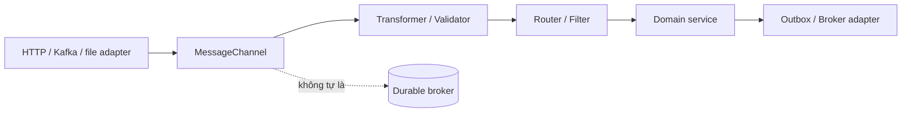
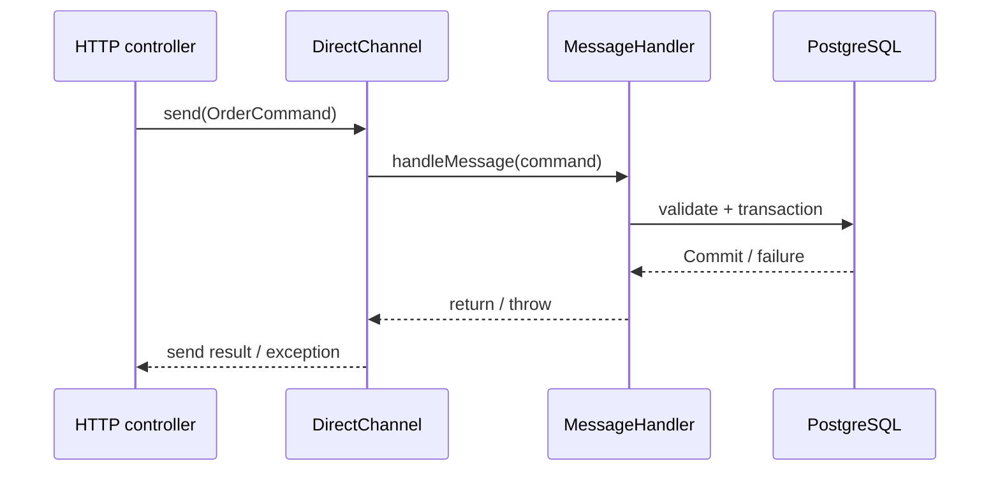
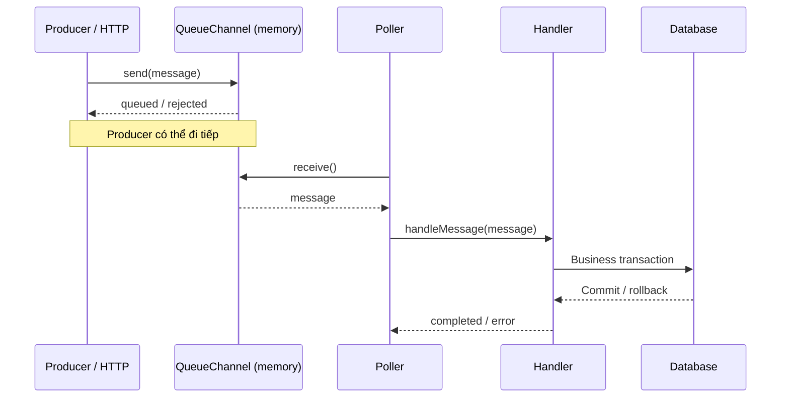
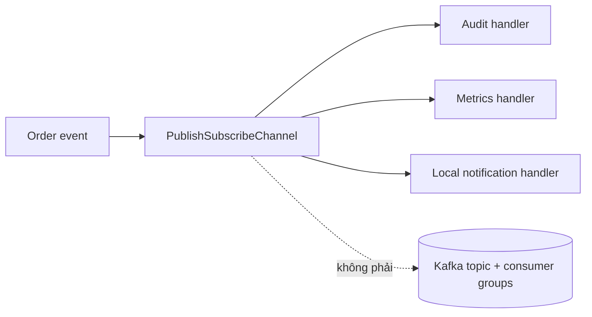
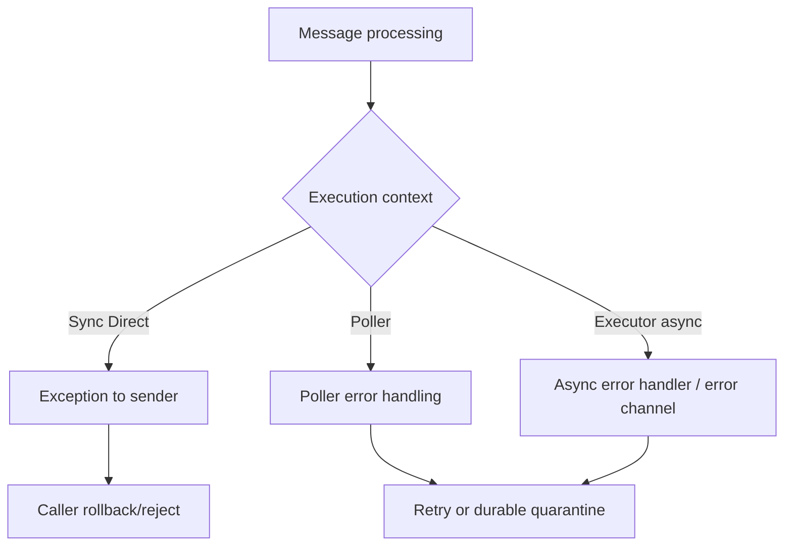
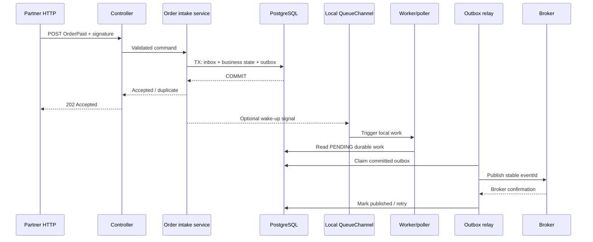
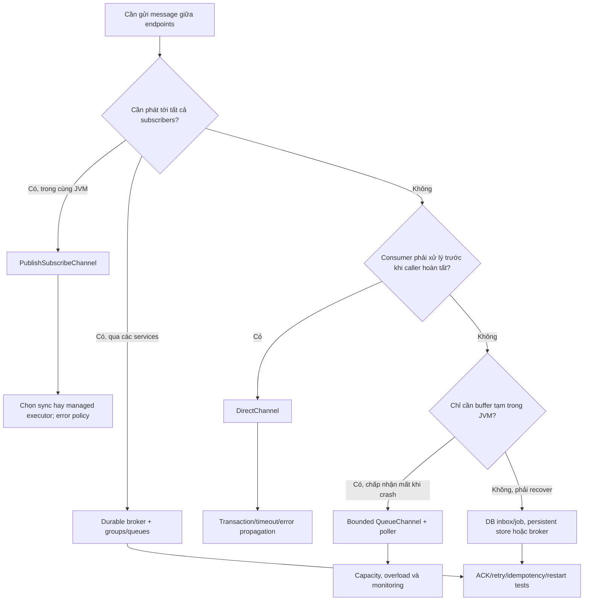

# DirectChannel, QueueChannel và PublishSubscribeChannel

> **Chương:** Spring Integration  
> **Module:** `SPRING_BOOT_INTEGRATION` — tổ chức tích hợp hệ thống Spring Boot qua HTTP client, cơ sở dữ liệu, cache, broker thông điệp và adapter Spring Integration; trọng tâm là cấu hình, hợp đồng dữ liệu, lỗi, chống xử lý trùng lặp, kiểm thử và quan sát luồng tích hợp thực tế.
>
> **Phạm vi ví dụ:** Java 17+, Spring Boot 3, Spring Framework 6 và Spring Integration Java DSL. Các ví dụ minh họa cách dùng phổ biến; phiên bản Spring Integration, transaction manager, executor và channel store thực tế phải được kiểm tra trước khi triển khai. Những lớp nghiệp vụ như `OrderCommandService` hoặc `AuditService` là interface/service của ứng dụng, không phải API tích hợp có sẵn trong Spring.

## 1. Bài toán: một message đi qua hệ thống bằng cách nào?

Một dịch vụ Spring Boot nhận webhook `OrderPaid` qua HTTP, xác minh hợp đồng dữ liệu, cập nhật PostgreSQL, xóa cache Redis và tạo outbox event để publish lên Kafka/RabbitMQ. Đội phát triển muốn phân tách việc tiếp nhận, xử lý đơn hàng, audit và metrics bằng Spring Integration.

Ba phương án ban đầu trông gần giống nhau:

```text
HTTP controller -> DirectChannel -> business handler

HTTP controller -> QueueChannel -> poller -> business handler

Business handler -> PublishSubscribeChannel
                 |-> audit handler
                 |-> metrics handler
                 |-> notification handler
```

Nhưng chúng khác nhau về **người thực thi, thời điểm xử lý, số subscriber nhận message, tính bền vững và cách lỗi truyền về**:

- `DirectChannel`: giao trực tiếp cho **một** handler được chọn, thông thường trong **luồng của người gửi**; phù hợp đường xử lý đồng bộ.
- `QueueChannel`: nhận message vào **hàng đợi nội bộ** để bên khác `receive()` hoặc poller lấy sau; ngắt nhịp giữa producer và consumer.
- `PublishSubscribeChannel`: phát message tới **nhiều subscriber**, thường đồng bộ nếu không cấu hình executor, có thể bất đồng bộ nếu có executor.

**Câu hỏi chính của bài:** Chọn channel nào để rõ ràng về thời điểm trả HTTP, thời điểm commit database, nguy cơ mất message khi JVM chết, retry, thứ tự và yêu cầu quan sát? Không thể trả lời chỉ bằng việc channel có method `send()`.

### Mục tiêu học tập

Sau bài học, bạn có thể:

1. Phân biệt `MessageChannel`, `SubscribableChannel` và `PollableChannel`.
2. Giải thích luồng gọi, dispatch, load balancing và exception của `DirectChannel`.
3. Dùng `QueueChannel` với capacity và poller có giới hạn, không tưởng nó mặc định bền vững.
4. Dùng `PublishSubscribeChannel` cho fan-out và hiểu đồng bộ so với executor bất đồng bộ.
5. Xác định transaction/thread boundary khi thay channel hoặc thêm poller.
6. Thiết kế luồng HTTP–PostgreSQL–Redis–broker với inbox/outbox và idempotency.
7. Test message delivery, fan-out, lỗi, queue đầy và restart thay vì chỉ kiểm tra happy path.
8. Quan sát latency, queue depth, lỗi handler và backlog xuyên các hệ thống.

## 2. Vị trí của channel trong Spring Integration

Spring Integration hiện thực nhiều **Enterprise Integration Patterns (EIP)**: message channel, gateway, transformer, filter, router, splitter, aggregator, service activator, inbound/outbound adapter, poller và error channel.



Trong Spring Integration:

- **Message** gồm payload và headers, thường là `org.springframework.messaging.Message<T>`.
- **MessageChannel** là hợp đồng gửi message giữa các endpoint.
- **Consumer endpoint** nhận message bằng subscription hoặc polling.
- **Handler** xử lý message và có thể gọi service nghiệp vụ.
- **Adapter** gắn luồng nội bộ với HTTP, Kafka, JDBC, file, AMQP và các hệ ngoài.
- **MessageStore** có thể cung cấp persistence cho một số pattern/channel khi được cấu hình phù hợp; nó **không tự xuất hiện** chỉ vì dùng Spring Integration starter.

Spring Boot hỗ trợ quản lý bean, external configuration và lifecycle. Spring Integration tạo graph thông điệp. Nhưng **Spring không tự làm payload hợp lệ, transaction xuyên broker hay business exactly-once**.

## 3. Ba trục phải xét trước khi chọn channel

| Trục | Câu hỏi | Ví dụ hệ quả |
|---|---|---|
| **Dispatch** | Một subscriber hay tất cả subscriber? | Worker chia việc khác audit fan-out |
| **Execution** | Đồng bộ trên sender thread hay async/poll? | Request latency, ThreadLocal transaction, exception |
| **Durability** | Message nằm ở RAM hay nguồn bền vững? | Restart, mất điện, retry, kiểm tra đã tiếp nhận |
| **Capacity** | Có chặn hoặc từ chối khi quá tải không? | Backpressure và HTTP 429/503 |
| **Ordering** | Cần xử lý tuần tự theo key không? | Trạng thái đơn hàng thay đổi có thứ tự |
| **Error policy** | Lỗi đến caller hay error channel? | Rollback, ACK/NACK, quarantine |
| **Scale** | Một JVM hay nhiều replica? | Queue trong mỗi pod không phải queue chung |

Ba channel đầu bài giải quyết chủ yếu **dispatch và scheduling nội bộ**. Durability và transaction là **lựa chọn bổ sung**; không nên suy ra từ tên lớp.

### 3.1. Bảng đối chiếu nhanh

| Đặc điểm | DirectChannel | QueueChannel | PublishSubscribeChannel |
|---|---|---|---|
| API chính | `SubscribableChannel` | `PollableChannel` | `SubscribableChannel` |
| Chọn người nhận | Một handler được dispatcher chọn | Một receiver/poller lấy một item | Gửi tới các subscriber |
| Đồng bộ mặc định | Có | `send`/`receive` tách thời điểm | Có nếu không có executor |
| Async mặc định? | Không | Bất đồng bộ về **thời điểm xử lý**; `send` có thể chờ capacity | Không nếu không có executor |
| Lưu đệm | Không | Có | Không phải queue |
| Bền vững mặc định | Không | Không (thường in-memory) | Không |
| Bảo toàn caller thread | Có trên đường sync | Không qua poller | Có nếu dispatch sync; không nếu executor |
| Mẫu dùng | Request/command xử lý ngay | Buffer/poll với giới hạn | Event fan-out trong cùng app |

**Lưu ý thuật ngữ:** “asynchronous” không đồng nghĩa “non-blocking”. `QueueChannel.send(...)` có thể chờ khi queue đầy; handler chạy sau trên thread khác nhưng sender vẫn có thể bị block vì capacity. Channel này cũng không mặc nhiên dùng Reactor `Mono/Flux`.

## 4. MessageChannel, SubscribableChannel và PollableChannel

Spring Messaging định nghĩa các interface nền tảng:

```java
import org.springframework.messaging.Message;
import org.springframework.messaging.MessageChannel;
import org.springframework.messaging.PollableChannel;
import org.springframework.messaging.SubscribableChannel;

// MessageChannel:
boolean accepted = channel.send(message);
boolean acceptedWithDeadline = channel.send(message, timeoutMillis);

// SubscribableChannel:
boolean registered = subscribable.subscribe(messageHandler);

// PollableChannel:
Message<?> next = pollable.receive(timeoutMillis);
```

Đây là **đoạn mô tả chữ ký sử dụng**, không phải một class hoàn chỉnh: các biến `channel`, `message`, `timeoutMillis`, `subscribable`, `messageHandler` và `pollable` phải được tạo/cấp ở ứng dụng.

- `send` trả trạng thái bàn giao theo semantics channel, **không phải HTTP response từ downstream**.
- `receive` chỉ dành cho `PollableChannel`; một `DirectChannel` không có queue để poll.
- `subscribe` gắn handler với `SubscribableChannel`; `QueueChannel` thường được poller hoặc consumer chủ động đọc.

Một message đơn giản:

```java
import org.springframework.messaging.Message;
import org.springframework.messaging.support.MessageBuilder;

Message<String> msg = MessageBuilder.withPayload("order-1001")
    .setHeader("eventId", "evt-order-1001")
    .setHeader("correlationId", "checkout-1001")
    .build();
```

Payload không thay thế headers; headers không tự được bảo toàn khi qua mọi serializer/transport. Đặc biệt `MessageHeaders.ID` là ID kỹ thuật của Spring Message, không phải `eventId` nghiệp vụ hoặc broker MessageId.

## 5. DirectChannel: gọi handler trực tiếp

`DirectChannel` là **point-to-point, subscribable, synchronous-dispatch** channel. Khi có message:



Một handler trên DirectChannel thường chạy **trong thread gọi `send`**. Vì vậy:

- Handler chậm làm caller chờ.
- Exception của handler có thể lan ngược về caller qua messaging infrastructure.
- Nếu handler tham gia một JDBC transaction đang mở trong cùng thread và dùng đúng transaction manager, nó có thể cùng transaction boundary với caller.
- Không tự có queue, persisted backlog hay retry sau crash.

Đây là lợi thế khi cần một pipeline đồng bộ, ít bước và mong muốn rollback thống nhất **trong một nguồn dữ liệu giao dịch**. Nó cũng là rủi ro nếu handler gọi HTTP đối tác chậm, làm thread phục vụ request bị giữ lâu.

### 5.1. Tạo và gửi vào DirectChannel

```java
import org.springframework.context.annotation.Bean;
import org.springframework.context.annotation.Configuration;
import org.springframework.integration.channel.DirectChannel;
import org.springframework.messaging.MessageChannel;

@Configuration(proxyBeanMethods = false)
class OrderChannels {

    @Bean
    MessageChannel orderCommandInput() {
        return new DirectChannel();
    }
}
```

```java
import org.springframework.beans.factory.annotation.Qualifier;
import org.springframework.messaging.MessageChannel;
import org.springframework.messaging.support.MessageBuilder;
import org.springframework.stereotype.Service;

@Service
class OrderCommandGateway {
    private final MessageChannel orderCommandInput;

    OrderCommandGateway(
            @Qualifier("orderCommandInput")
            MessageChannel orderCommandInput) {
        this.orderCommandInput = orderCommandInput;
    }

    void submit(String commandJson, String eventId) {
        boolean accepted = orderCommandInput.send(
            MessageBuilder.withPayload(commandJson)
                .setHeader("eventId", eventId)
                .build()
        );
        if (!accepted) {
            throw new IllegalStateException("No handler accepted command");
        }
    }
}
```

Nếu không có handler, `send` có thể trả `false` hoặc ném messaging exception tùy dispatcher/`requireSubscribers` và cấu hình. Ứng dụng không nên chỉ log `false` rồi trả HTTP `200` khi không có consumer.

### 5.2. Flow xử lý đồng bộ bằng Java DSL

```java
import org.springframework.context.annotation.Bean;
import org.springframework.context.annotation.Configuration;
import org.springframework.integration.dsl.IntegrationFlow;

@Configuration(proxyBeanMethods = false)
class DirectOrderFlowConfiguration {

    @Bean
    IntegrationFlow orderCommandFlow(OrderCommandService service) {
        return IntegrationFlow.from("orderCommandInput")
            .handle(String.class, (payload, headers) -> {
                service.accept(payload, (String) headers.get("eventId"));
                return null; // One-way handler; không tạo reply.
            })
            .get();
    }
}
```

`OrderCommandService` là service tự triển khai, chịu trách nhiệm xác thực contract, tenant authorization, transaction, idempotency và kết quả nghiệp vụ. Phần IntegrationFlow chỉ kết nối message với handler.

### 5.3. Một handler khác một subscriber

**DirectChannel không broadcast.** Nếu nhiều handler subscribe cùng channel, dispatcher chọn một handler cho message; không phải cả hai cùng xử lý. Muốn `audit` và `billing` **đều** nhận cùng business event, không thêm hai subscriber vào DirectChannel rồi mong cả hai được gọi.

## 6. DirectChannel, load balancing và failover

Nhiều subscriber trên DirectChannel thường có **UnicastingDispatcher**. Trong Spring Integration, dispatcher có thể hỗ trợ round-robin load balancing và failover tùy phiên bản/cấu hình.

```text
             +--> Worker A
DirectChannel|
             +--> Worker B
             +--> Worker C

Mỗi message: dispatcher chọn một handler, không phát tới cả A/B/C.
```

Cần phân biệt:

- **Load balancing:** quyết định handler nào nhận một message.
- **Failover:** nếu handler được chọn lỗi, dispatcher có thể thử handler khác **theo chính sách**.
- **Retry nghiệp vụ:** thử lại cùng lệnh dựa trên error classification.
- **Idempotency:** bảo đảm dù message được giao/áp dụng lại, tác động nghiệp vụ không bị nhân đôi.

Failover ở mức dispatcher không tương đương retry an toàn. Handler A có thể đã commit DB rồi ném exception khi gọi HTTP downstream; gọi handler B tiếp có thể gây side effect lần hai.

### 6.1. Khi có nhiều subscriber

Dùng nhiều subscriber cho cùng DirectChannel khi các handler thực sự **thay thế được nhau** và cùng hợp đồng, ví dụ các worker thực thi cùng một công việc với dedup bền vững. Nếu hai handler khác trách nhiệm, hãy dùng router hoặc PublishSubscribeChannel.

Không dựa vào round-robin để bảo đảm cân bằng chính xác theo từng instance trong nhiều pod: một DirectChannel trong mỗi Spring context chỉ thấy handler **trong JVM đó**, không phân phối trực tiếp qua mạng.

### 6.2. Không suy ra ordering toàn cục

Một DirectChannel đồng bộ giúp giữ thứ tự lời gọi của **một thread gửi** nếu không có xử lý async bên trong. Nhưng hai sender thread gửi đồng thời có thể tạo interleaving; nhiều handler và transaction khác nhau có thể hoàn tất không theo thứ tự nhận. Nếu thứ tự theo `orderId` quan trọng, cần version/state-machine hoặc cơ chế serialisation theo key.

## 7. DirectChannel và transaction đồng bộ

Giả sử HTTP controller gọi service qua gateway → DirectChannel → `@Transactional` application service. Vì luồng không chuyển thread, handler có thể chạy trong transaction được tạo bởi Spring proxy trên service.

```java
import org.springframework.stereotype.Service;
import org.springframework.transaction.annotation.Transactional;

@Service
class OrderCommandService {

    private final OrderRepository repository;
    private final OutboxRepository outbox;
    private final OrderCommandParser parser;

    OrderCommandService(
            OrderRepository repository,
            OutboxRepository outbox,
            OrderCommandParser parser) {
        this.repository = repository;
        this.outbox = outbox;
        this.parser = parser;
    }

    @Transactional
    public void accept(String json, String eventId) {
        OrderCommand cmd = parser.parseAndValidate(json, eventId);

        if (!repository.insertInboxIfAbsent(cmd)) {
            return; // Duplicate: không tạo business effect mới.
        }
        repository.applyOrder(cmd);
        outbox.insertPendingEvent(cmd);
    }
}
```

Các repository, `OrderCommand` và `OrderCommandParser` là các thành phần do ứng dụng định nghĩa. `OrderCommandParser.parseAndValidate(...)` phải kiểm tra hợp đồng dữ liệu, `eventId`, tenant và quyền nguồn gửi trước khi ghi inbox. Đoạn này minh họa **vị trí transaction**; nó cần những dependency nghiệp vụ đã được triển khai để chạy và không thay thế bước xác thực chữ ký ở HTTP adapter.

**Điểm then chốt:** `@Transactional` chỉ bao trùm resource tham gia đúng transaction manager. Nó không tự rollback HTTP call, Redis mutation hoặc Kafka publish. Dù DirectChannel xử lý đồng bộ, nó **không tạo distributed transaction**.

### 7.1. Exception propagation và rollback

Nếu handler ném unchecked exception trước DB commit, transaction của Spring thường rollback theo rule mặc định. Nhưng nếu handler bắt exception rồi **return bình thường**, Spring có thể commit dù nghiệp vụ chưa hoàn tất. Vì vậy, error handling tại từng endpoint phải phản ánh policy:

- Duplicate đã commit: return bình thường nếu là kết quả hợp lệ.
- Lỗi DB transient: ném exception để rollback và retry ở owner được xác định.
- Poison payload: reject/quarantine, không retry vô hạn.
- Timeout HTTP downstream: không giả định phía đối tác chưa thực thi lệnh.

## 8. QueueChannel: đưa vào queue, xử lý sau

`QueueChannel` là **PollableChannel**. Send và receive là hai thao tác độc lập:



QueueChannel **đệm message** và cho receiver/poller lấy ra khi sẵn sàng. Đây là một ranh giới quan trọng:

- `send` thành công thường có nghĩa message **đã được đặt vào queue**, không có nghĩa business handler đã chạy.
- `receive` có thể chạy trên thread poller khác.
- Exception của handler không tự truyền ngược tới producer đã send từ lâu.
- Queue mặc định thường là **in-memory**; JVM crash có thể làm mất message chưa xử lý.
- Queue cần chính sách **capacity**, poller, shutdown và recovery.

### 8.1. Tạo bounded QueueChannel

```java
import org.springframework.context.annotation.Bean;
import org.springframework.context.annotation.Configuration;
import org.springframework.integration.channel.QueueChannel;
import org.springframework.messaging.PollableChannel;

@Configuration(proxyBeanMethods = false)
class QueueConfiguration {

    @Bean
    PollableChannel pendingOrderCommands() {
        return new QueueChannel(256); // Bounded in-memory queue.
    }
}
```

`256` là số slot, **không phải** số byte. Nếu một payload lớn vài MB, 256 item vẫn có thể gây áp lực heap. Với luồng có dữ liệu lớn, nên giới hạn **size/message, count và total inflight** ở ingress.

### 8.2. Gửi có timeout rõ ràng

```java
import org.springframework.messaging.MessageChannel;
import org.springframework.messaging.support.MessageBuilder;

boolean queued = pendingOrders.send(
    MessageBuilder.withPayload("evt-1001").build(),
    200L  // milliseconds: thời gian chờ send khi capacity không còn.
);

if (!queued) {
    // Backpressure: không âm thầm coi lệnh đã tiếp nhận.
    throw new IllegalStateException("Queue capacity exhausted");
}
```

`pendingOrders` là `MessageChannel` đã inject. Khi queue đầy, send có thể chờ theo timeout hoặc fail theo contract; exception cũng có thể xảy ra. Trên HTTP, dịch trạng thái quá tải thành `429`/`503` hoặc policy khác phù hợp, thay vì trả `202` sai.

**Cảnh báo lớn:** `queued == true` vẫn **không bền vững sau crash** nếu đây là QueueChannel lưu RAM. Nếu HTTP trả Accepted mang nghĩa “công việc đã được tiếp nhận bền vững”, phải persist DB inbox/job/outbox hoặc dùng broker với delivery contract trước khi phản hồi.

## 9. PollableChannel.receive() và polling consumer

Có thể dùng PollableChannel trực tiếp:

```java
import org.springframework.messaging.Message;
import org.springframework.messaging.PollableChannel;

Message<?> next = pendingOrders.receive(1000L);

if (next != null) {
    // Đã lấy một message khỏi queue.
    process(next);
}
```

`receive(1000L)` chờ tối đa khoảng 1 giây theo API; `null` thường biểu thị không có message trong thời hạn đó. Nhưng tự viết `while(true)` trong request thread hoặc không xử lý stop/cancellation là anti-pattern.

Spring Integration cung cấp **polling consumer** và `PollerMetadata`, giúp quản lý scheduler, số message mỗi lần poll, error handling và một số advice/transaction policy.

### 9.1. IntegrationFlow với poller

```java
import java.time.Duration;
import org.springframework.context.annotation.Bean;
import org.springframework.context.annotation.Configuration;
import org.springframework.integration.dsl.IntegrationFlow;
import org.springframework.integration.dsl.Pollers;

@Configuration(proxyBeanMethods = false)
class QueuedOrderFlowConfiguration {

    @Bean
    IntegrationFlow queuedOrderFlow(OrderCommandService service) {
        return IntegrationFlow
            .from("pendingOrderCommands", spec ->
                spec.poller(Pollers
                    .fixedDelay(Duration.ofMillis(250))
                    .maxMessagesPerPoll(20)))
            .handle(String.class, (payload, headers) -> {
                service.accept(payload, (String) headers.get("eventId"));
                return null;
            })
            .get();
    }
}
```

Đây là Java DSL phổ biến cho **nguồn pollable channel**. Tùy version, method overload/DSL có khác nhỏ; phải biên dịch với Spring Integration version của dự án. Các tên bean channel và service cần khớp configuration thực tế.

Ý nghĩa:

- `fixedDelay(250ms)`: lịch polling được scheduler điều phối theo chính sách.
- `maxMessagesPerPoll(20)`: giới hạn số message một lần kích hoạt poller.
- Không đồng nghĩa “20 message được xử lý song song”; nếu handler đồng bộ, poller có thể xử lý từng message trong thread poller.
- Mỗi application instance có scheduler/queue riêng trừ khi bạn thiết kế nguồn chung.
- Delay thực tế phụ thuộc handler latency, scheduler capacity và cách poller được cấu hình.

## 10. QueueChannel và transaction boundary

Đây là khác biệt dễ gây lỗi nhất khi đổi `DirectChannel` sang `QueueChannel`.

```text
Request thread:
  BEGIN TX
  send(message) -> QueueChannel
  COMMIT TX
  HTTP 202

Poller thread (sau đó):
  receive(message)
  BEGIN NEW BUSINESS TX
  UPDATE orders
  COMMIT / FAIL
```

Một transaction **ThreadLocal** của JDBC ở request thread không tự chuyển sang poller thread. Khi poller lấy message ra, business transaction cần được **bắt đầu tại consumer** hoặc ở poller theo cấu hình.

### 10.1. Nếu dùng queue RAM thì transaction rollback không phục hồi message

Giả sử message được lấy khỏi QueueChannel in-memory, handler chạy `@Transactional`, DB rollback do lỗi. Việc DB rollback **không tự đưa message trở lại queue**. Nếu không có retry/error path thực sự, message có thể đã bị lấy ra và mất khỏi luồng xử lý.

Đây là lý do **“có @Transactional ở consumer” không đủ để tạo queue bền vững**.

Các lựa chọn:

1. Để caller ghi một **durable job/inbox** trong DB, QueueChannel chỉ dùng làm tín hiệu tối ưu; poller có thể quét lại DB khi restart.
2. Dùng channel backed by **persistent MessageStore** tương thích, có transactional polling/recovery được kiểm chứng.
3. Dùng Kafka/RabbitMQ/Pulsar/Redis Streams với ACK/retry/redelivery phù hợp.
4. Với pipeline xử lý lô dài có checkpoint, dùng Spring Batch hoặc DB job table.

### 10.2. Transaction của poller không phải transaction người gửi

Một poller có thể được gắn transaction advice phù hợp nếu data store và transaction manager hỗ trợ. Nhưng phải kiểm tra:

- Message được **lấy khỏi persistent queue** và business SQL có thuộc **cùng một DB transaction**?
- Nếu handler ném exception, message có sẵn để retry sau rollback?
- Nếu poller không có persistent store, rollback có ảnh hưởng gì tới in-memory queue?
- Nếu handler publish broker, broker ACK có nằm trong transaction không?
- Nếu app crash sau business commit nhưng trước đánh dấu done, duplicate có được dedup?

Đừng tuyên bố `QueueChannel` là transactional chỉ vì service xử lý có `@Transactional`.

## 11. Queue capacity, send timeout và backpressure

Một QueueChannel có capacity hữu hạn giúp thấy rõ overload hơn queue mặc định có kích thước rất lớn.

| Thiết kế | Điều tốt | Rủi ro |
|---|---|---|
| Queue không giới hạn thực dụng | Producer hiếm khi bị từ chối lúc đầu | RAM tăng, OOM, latency ẩn |
| Bounded queue | Có chặn overload rõ | `send` có thể chờ/fail, cần response policy |
| Poller nhanh hơn ingress | Queue ổn định | Handler/database vẫn có thể quá tải khi spike |
| Poller chậm hơn ingress kéo dài | Buffer đệm tạm thời | Queue đầy, backlog tăng |
| Nhiều poller | Throughput có thể tăng | Ordering/duplicate/DB contention, thread giới hạn |

Không dùng một phép tính cố định “capacity = throughput × số giây” rồi coi là đủ. Kích thước message, thời gian xử lý p99, burst, số pod và memory budget đều ảnh hưởng.

### 11.1. Thiết kế admission control

Nếu CPU/DB pool đang quá tải, dồn thêm 100.000 message vào RAM có thể làm sự cố nghiêm trọng hơn. Một hệ tích hợp đáng tin:

- Giới hạn request payload/batch size.
- Chỉ nhận công việc sau khi xác minh contract và danh tính nguồn.
- Persist ý định xử lý bền vững khi hợp đồng yêu cầu.
- Dùng bounded queue để điều hòa thread trong một instance.
- Trả phản hồi overload có thể retry với backoff/jitter.
- Đo queue depth, oldest age, rate vào/ra và thời gian chờ send.

### 11.2. Per-instance queue không phải distributed queue

Ba pod, mỗi pod có `new QueueChannel(256)`, tạo **ba hàng đợi riêng**. Khi load balancer gửi request lệch, pod A có thể đầy trong khi B rảnh. Không có broker partition assignment hoặc consumer group toàn cụm tự nhiên chỉ vì chúng có cùng bean name.

Muốn work distribution xuyên pod, dùng DB claim/lease hoặc middleware có consumer group/queue semantics phù hợp.

## 12. QueueChannel bền vững: cần MessageStore và chính sách recovery

Spring Integration có các abstraction như `MessageGroupStore` và các implementation persistent store thích hợp; có thể cấu hình queue theo store/queue strategy hỗ trợ ở phiên bản đang dùng. Ví dụ các thuật ngữ thường gặp:

- `MessageStore`/`MessageGroupStore`: lưu message/group tùy hợp đồng.
- `JdbcChannelMessageStore`: thành phần lưu channel message bằng JDBC trong Spring Integration JDBC.
- `MessageGroupQueue` hoặc cấu trúc tương ứng: queue abstraction backed by store khi được ghép đúng.
- Poller transaction advice/transaction manager: phối hợp receive, business SQL và commit/rollback khi resource hỗ trợ.

**Không** lắp ghép class bằng tên rồi suy rằng đã có exactly-once. Một persistent queue cần schema DB, transaction manager, serialization, expiry, cleanup, locking và vận hành.

### 12.1. Các câu hỏi bắt buộc trước khi dùng persistent QueueChannel

1. Store có hỗ trợ đúng kiểu message và headers cần giữ không?
2. Payload serializer có đọc được dữ liệu từ bản ứng dụng cũ?
3. Hai instance poll chung store có claim chính xác một worker tại một thời điểm không?
4. Handler thất bại và transaction rollback có khôi phục message không?
5. Message đã xử lý nhưng ack/delete chưa commit có thể được giao lại không?
6. Có poison message gây kẹt đầu queue không?
7. Có chính sách TTL, cleanup và quan sát backlog lâu ngày không?
8. Có migration store/schema và test restart/crash không?

Nếu chỉ cần một công việc background với DB là nguồn dữ liệu chính, **bảng job + trạng thái + lease** có thể rõ và dễ kiểm soát hơn một MessageStore phức tạp.

## 13. PublishSubscribeChannel: phát tới nhiều subscriber

`PublishSubscribeChannel` hiện thực pattern **publish–subscribe trong cùng application context**. Khi message tới channel, các subscriber được đăng ký nhận một lần dispatch theo channel policy.



Không nhầm:

- **PublishSubscribeChannel**: fan-out tới các handler **trong JVM**.
- **Kafka topic**: broker lưu record theo partition/retention; nhóm consumer có tiến độ riêng.
- **RabbitMQ fanout exchange**: broker route đến queue/binding có độ bền/ACK riêng.
- **Redis Pub/Sub**: không mặc nhiên lưu backlog cho subscriber offline.

Ba subscriber trong một PublishSubscribeChannel không tự trở thành ba dịch vụ độc lập có tiến độ, retry và replay riêng.

### 13.1. Tạo channel và đăng ký hai flow

```java
import org.springframework.context.annotation.Bean;
import org.springframework.context.annotation.Configuration;
import org.springframework.integration.channel.PublishSubscribeChannel;

@Configuration(proxyBeanMethods = false)
class EventChannelConfiguration {

    @Bean
    PublishSubscribeChannel orderEventFanOut() {
        return new PublishSubscribeChannel();
    }
}
```

```java
import org.springframework.context.annotation.Bean;
import org.springframework.context.annotation.Configuration;
import org.springframework.integration.dsl.IntegrationFlow;

@Configuration(proxyBeanMethods = false)
class EventSubscriberFlows {

    @Bean
    IntegrationFlow auditOrderEvents(AuditService audit) {
        return IntegrationFlow.from("orderEventFanOut")
            .handle(String.class, (payload, headers) -> {
                audit.append(payload);
                return null;
            })
            .get();
    }

    @Bean
    IntegrationFlow metricsOrderEvents(OrderMetrics metrics) {
        return IntegrationFlow.from("orderEventFanOut")
            .handle(String.class, (payload, headers) -> {
                metrics.recordEvent(payload);
                return null;
            })
            .get();
    }
}
```

`AuditService` và `OrderMetrics` là dependencies do ứng dụng định nghĩa. Cả hai flow subscribe vào cùng channel, nên mỗi message hợp lệ có thể kích hoạt cả hai handler **nếu dispatch thành công**. Thứ tự thực thi và xử lý lỗi phụ thuộc chính sách dispatcher/subscriber.

### 13.2. Không dùng fan-out cho các hành động bắt buộc phải commit cùng nhau

Nếu audit và update inventory **đều là phần bắt buộc của một business transaction**, việc gửi vào PublishSubscribeChannel rồi hy vọng cả hai đều hoàn tất là rủi ro: handler đầu có thể đã commit side effect, handler sau thất bại.

Tốt hơn là:

- Chạy các SQL bắt buộc trong cùng **application service transaction**.
- Ghi **outbox** trong transaction nếu cần fan-out xuyên dịch vụ.
- Cho các downstream độc lập consume event với idempotency và reconciliation.

## 14. PublishSubscribeChannel mặc định đồng bộ, không phải async

Không cấu hình executor:

```java
PublishSubscribeChannel channel = new PublishSubscribeChannel();
```

Trong cách dùng thông thường, channel dispatch tới subscriber **trên thread gửi**. Vì vậy:

- Handler A chậm sẽ làm sender chờ.
- Một exception đồng bộ có thể ảnh hưởng quá trình gửi và các subscriber tiếp theo, tùy cấu hình error handling.
- Không có “fire-and-forget” chỉ nhờ chữ `PublishSubscribe`.
- Caller có thể tham gia cùng transaction/thread context nếu các handler được gọi đồng bộ, nhưng **không có cam kết atomic toàn bộ side effects** nếu mỗi handler có transaction hoặc resource khác nhau.

Không dựa vào thứ tự đăng ký subscriber để mô tả quy trình nghiệp vụ, ví dụ “chắc chắn audit trước rồi mới notify”. Nếu **phải** có thứ tự và phụ thuộc kết quả trước, hãy dùng chuỗi handler/flow tường minh.

### 14.1. Một subscriber lỗi thì subscriber còn lại sao?

Với dispatch đồng bộ, lỗi có thể lan về sender và ngắt dispatch tiếp theo tùy channel configuration. Với executor bất đồng bộ, lỗi có thể được chuyển tới error handler và sender đã trả về.

Do đó **fan-out không đồng nghĩa bảo đảm giao thành công cho mọi subscriber**. Nếu hai hệ thống bắt buộc nhận event dù một hệ thống lỗi, dùng broker với subscriber/group/queue độc lập và outbox publish có xác nhận.

## 15. PublishSubscribeChannel có executor: fan-out bất đồng bộ

Để dispatcher nộp công việc cho executor, có thể tạo channel với `Executor` được Spring quản lý.

```java
import org.springframework.context.annotation.Bean;
import org.springframework.context.annotation.Configuration;
import org.springframework.integration.channel.PublishSubscribeChannel;
import org.springframework.scheduling.concurrent.ThreadPoolTaskExecutor;

@Configuration(proxyBeanMethods = false)
class AsyncFanOutConfiguration {

    @Bean
    ThreadPoolTaskExecutor eventFanOutExecutor() {
        ThreadPoolTaskExecutor executor = new ThreadPoolTaskExecutor();
        executor.setCorePoolSize(2);
        executor.setMaxPoolSize(6);
        executor.setQueueCapacity(100);
        executor.setThreadNamePrefix("order-fanout-");
        return executor;
    }

    @Bean
    PublishSubscribeChannel asyncOrderFanOut(
            ThreadPoolTaskExecutor eventFanOutExecutor) {
        return new PublishSubscribeChannel(eventFanOutExecutor);
    }
}
```

Spring quản lý lifecycle/initialization của `ThreadPoolTaskExecutor` khi tạo bean theo cơ chế được hỗ trợ. Giới hạn thread/queue chỉ là **per-instance capacity**, không phải durable backlog.

Khi dùng executor:

- `send` có thể trả về sau khi task được **submit**, trước khi handler thật sự chạy.
- Handler chạy ở thread khác; ThreadLocal JDBC transaction/security/MDC không tự được bảo toàn đúng trong mọi trường hợp.
- Nếu executor queue đầy, có thể xảy ra rejection; cần policy/monitoring, không âm thầm bỏ message.
- JVM crash có thể làm mất các task còn trong executor queue.
- Uncaught async error cần error handler/error channel phù hợp; caller không nên trông đợi catch exception sau khi send đã return.

### 15.1. Một executor không thay transactional outbox

`AsyncTaskExecutor` giải quyết scheduling trong JVM. Nó không cung cấp replay sau restart, business idempotency, broker acknowledgement hay distributed transaction.

Ví dụ một HTTP endpoint trả `202` ngay sau khi `asyncOrderFanOut.send(...)` thành công là **không đủ** nếu contract hứa sự kiện đã được lưu bền vững. Cần DB inbox/outbox hoặc broker durable operation trước response.

## 16. PublishSubscribeChannel và hành vi khi không có subscribers

Có hai tình huống:

- **Không có subscriber nào:** send có thể thất bại, bị từ chối hoặc xử lý khác tùy cờ `minSubscribers`, `requireSubscribers` và phiên bản/configuration.
- **Có subscriber nhưng handler lỗi:** sự kiện có thể chỉ được xử lý bởi một phần subscriber nếu không có policy recover.

Spring Integration có các tùy chọn liên quan số subscriber, error handler và executor ở các phiên bản. Không dựa vào default khi yêu cầu **không được mất audit**.

Cần kiểm thử riêng:

1. Chưa có handler được đăng ký thì flow báo lỗi rõ.
2. Một subscriber ném exception: số subscriber còn lại được gọi theo cấu hình nào?
3. Executor đầy hoặc shutdown: send trả gì, error đi đâu?
4. Async handler DB commit rồi JVM chết trước cập nhật tiến độ: replay từ đâu?
5. Một subscriber xử lý lại event: có thể no-op theo eventId không?

Một channel broadcast không có **per-subscriber durable checkpoint** mặc định. Đó là ranh giới khác biệt so với một broker topology với queue/group riêng.

## 17. Ví dụ trực tiếp không cần Spring context: quan sát ba hành vi

### 17.1. DirectChannel gọi một handler đồng bộ

```java
import java.util.concurrent.atomic.AtomicReference;
import org.springframework.integration.channel.DirectChannel;
import org.springframework.messaging.support.GenericMessage;

DirectChannel direct = new DirectChannel();

AtomicReference<String> seen = new AtomicReference<>();

direct.subscribe(message ->
    seen.set((String) message.getPayload()));

boolean ok = direct.send(new GenericMessage<>("cmd-1"));

assert ok;
assert "cmd-1".equals(seen.get());
```

Sau `send`, `seen` đã thay đổi trên đường xử lý đồng bộ.

### 17.2. QueueChannel cho nhận sau

```java
import org.springframework.integration.channel.QueueChannel;
import org.springframework.messaging.Message;
import org.springframework.messaging.support.GenericMessage;

QueueChannel queue = new QueueChannel(3);

queue.send(new GenericMessage<>("job-1"));

Message<?> later = queue.receive(0L);
assert later != null;
assert "job-1".equals(later.getPayload());

Message<?> empty = queue.receive(0L);
assert empty == null;
```

Không có polling consumer thì message nằm trong queue cho tới khi được đọc, queue bị mất hoặc channel lifecycle thay đổi.

### 17.3. PublishSubscribeChannel gửi tới hai handler

```java
import java.util.List;
import java.util.concurrent.CopyOnWriteArrayList;
import org.springframework.integration.channel.PublishSubscribeChannel;
import org.springframework.messaging.support.GenericMessage;

PublishSubscribeChannel pubsub = new PublishSubscribeChannel();
List<String> seen = new CopyOnWriteArrayList<>();

pubsub.subscribe(m -> seen.add("audit:" + m.getPayload()));
pubsub.subscribe(m -> seen.add("metric:" + m.getPayload()));

pubsub.send(new GenericMessage<>("evt-1"));

assert seen.contains("audit:evt-1");
assert seen.contains("metric:evt-1");
```

Đây là test minh họa **chỉ khi cả hai handler thành công**. Đừng dùng nó để suy luận fan-out bền vững, transaction atomic hay subscriber không bao giờ bỏ lỡ sự kiện.

## 18. Cùng một business command nhưng ba đường lỗi khác nhau

Giả sử `processOrder` ném `DataAccessResourceFailureException` vì DB mất kết nối.

| Channel | Ai nhìn thấy lỗi? | Khi nào có thể retry? | Rủi ro chính |
|---|---|---|---|
| DirectChannel | Sender đồng bộ có thể nhận messaging exception | Caller hoặc retry advice có owner rõ | Retry sau side effect không chắc chắn |
| QueueChannel in-memory | Poller/consumer xử lý lỗi sau khi send đã thành công | Poller error handler/re-enqueue được thiết kế riêng | Message bị lấy khỏi RAM queue rồi mất |
| PubSub sync | Sender có thể thấy lỗi từ subscriber | Chính sách dispatcher/endpoint | Các subscriber trước đó đã xử lý |
| PubSub async | Async error handler/error channel | Worker retry/recovery tùy thiết kế | Caller đã trả về; executor queue mất khi crash |

### 18.1. Không bắt rồi bỏ qua

```java
.handle(String.class, (payload, headers) -> {
    try {
        service.accept(payload);
    } catch (Exception ex) {
        log.error("Failed", ex);
    }
    return null; // Có thể biến xử lý thất bại thành "thành công".
})
```

Đoạn trên là **anti-pattern** nếu nguồn là broker có cơ chế ACK khi handler return bình thường. Message thất bại có thể bị ACK và không còn khả năng redelivery.

Hãy phân loại:

- Lỗi contract/security không thể phục hồi → reject/quarantine.
- DB/broker tạm thời → retry có giới hạn.
- Event duplicate đã commit → no-op thành công.
- Publish outcome không rõ → giữ event ID, reconciliation/dedup.

## 19. Error channel khác retry/DLQ và exception của caller

Spring Integration có `errorChannel` và `ErrorMessage` cho các lỗi ở luồng message. Khi handler chạy **đồng bộ** qua DirectChannel, exception có thể lan ra caller; khi chạy từ **poller/async executor**, lỗi thường cần được chuyển qua error infrastructure phù hợp.



Những điểm cần làm rõ:

1. `errorChannel` có thể là một **Spring MessageChannel nội bộ**, không phải Kafka DLT/RabbitMQ DLQ.
2. Muốn lưu message lỗi bền vững, phải có adapter/store/recoverer thật sự ghi vào nơi durable.
3. Error handler có thể thấy `MessagingException` chứa failed message; cần tránh log payload nhạy cảm.
4. Retry advice ở endpoint, poller retry và broker redelivery có thể **chồng số lần thử**.
5. Khi dùng custom executor/transaction boundaries, cần test xem lỗi thực tế tới handler nào; không suy diễn từ tên bean.

### 19.1. ErrorMessage không biến nghiệp vụ thành exactly-once

Ngay cả khi một error flow có đủ metadata, nếu side effect đã commit trước exception thì retry vẫn có thể áp dụng lại nghiệp vụ. Unique constraint/inbox theo eventId là điểm phòng thủ chính.

## 20. Khi nào chuyển từ Direct sang Queue là thay đổi semantics lớn?

Một refactor tưởng vô hại:

```java
// Trước:
@Bean MessageChannel commands() {
    return new DirectChannel();
}

// Sau:
@Bean PollableChannel commands() {
    return new QueueChannel(100);
}
```

Nếu các handler/caller giữ nguyên code nhưng chuyển channel:

- Sender không còn chờ handler hoàn tất.
- Exception không lan về caller theo cùng cách.
- Transaction context không còn chia sẻ tự nhiên qua thread polling.
- HTTP response có thể trả trước DB commit.
- Nếu queue RAM, restart có thể mất message.
- Ordering/concurrency thay đổi theo poller.
- Test và observability phải kiểm tra lại.

**Đây là thay đổi kiến trúc, không phải tối ưu hiệu năng đơn giản.** Cần review business contract và crash/retry, không chỉ benchmark p95 của `send`.

### 20.1. HTTP 202 phải có nghĩa chính xác

Giả sử webhook được ký số, cần xử lý sau:

- Nếu đã **ghi inbox bền vững** trong PostgreSQL và commit, trả `202 Accepted` có thể đúng theo hợp đồng.
- Nếu mới đặt vào QueueChannel **in-memory**, trả `202` với hàm ý “đã bảo đảm xử lý sau restart” là sai.
- Nếu chỉ dispatch tới async PubSub executor, cũng chưa có durable acceptance.
- Nếu dùng Kafka producer, phải hiểu ack/publish confirmation; `send` thành công ở ứng dụng không tự chứng minh downstream business complete.

## 21. Ví dụ luồng HTTP → DB inbox/outbox → channel nội bộ

Một thiết kế rõ ranh giới là:



`QueueChannel` ở đây chỉ là **tín hiệu tăng tốc**: nếu mất signal trong RAM, worker vẫn có thể quét DB tìm công việc `PENDING`. Vì vậy, hệ thống không phụ thuộc vào độ bền của channel in-memory.

### 21.1. Những điều phải giữ riêng

- Signature/hợp đồng JSON xác minh trước business side effect.
- DB unique key chống trùng `(partner,eventId)`.
- Inbox/outbox và state nằm trong **một transaction DB**.
- QueueChannel nội bộ có capacity và xử lý overload.
- Outbox relay publish theo ACK thật của broker, retry với eventId ổn định.
- Consumer downstream dedup do broker có thể redeliver.
- Metrics phân biệt `accepted`, `queued`, `published` và `processed`.

## 22. Redis cache và channel nội bộ: cache invalidation là side effect

Sau khi đơn hàng được cập nhật, ứng dụng muốn xóa cache Redis và ghi audit:

```text
DB commit
   |
   +--> invalidate Redis order-summary
   +--> write audit
   +--> publish OrderPaid event
```

Có thể dùng PublishSubscribeChannel làm notification trong **một instance**, nhưng:

- Nếu xóa Redis thất bại, cache có thể stale.
- Nếu audit ghi PostgreSQL còn Kafka publish lỗi, không có transaction chung.
- Nếu instance chết sau DB commit, message PubSub trong RAM không được phát lại.
- Nếu một subscriber chạy async, caller không có kết quả hoàn tất của nó.

Đối với invalidation cần bảo đảm **được thực hiện lại sau crash**, nên ghi một outbox/job vào DB cùng transaction rồi để các adapter/consumer có retry thực hiện. Redis vẫn cần TTL/version policy để xử lý race giữa cache-aside reader và invalidation.

### 22.1. Đừng dùng event channel làm message broker xuyên microservices

Một PublishSubscribeChannel trên instance A **không phát** trực tiếp tới subscriber trong instance B. Tên bean giống nhau ở hai pod không tạo cross-pod fan-out. Dùng broker như Kafka/RabbitMQ/Pulsar và đặt consumer group/queue/subscription theo business responsibility.

## 23. Gắn Kafka/RabbitMQ adapter với channel: hai ranh giới

Spring Integration có inbound/outbound adapters cho broker. Trong một flow:

```text
Kafka inbound adapter
    -> DirectChannel hoặc QueueChannel
    -> Transformer / Validator
    -> Application service
    -> Database inbox + outbox

Outbox relay / event publisher
    -> Outbound channel
    -> Kafka/Rabbit outbound adapter
```

Channel là **điểm nối trong Spring context**. Broker quyết định partition/group/queue, redelivery, ACK và retention.

### 23.1. Nhận từ broker rồi đưa vào QueueChannel RAM: nguy cơ ACK sớm

Nếu inbound adapter/consumer coi “đã send vào channel RAM” là xử lý xong, có thể commit offset/ACK trong khi poller chưa chạy. Pod crash gây mất message đã được broker xem là hoàn tất.

Giải pháp phải tùy adapter/container và ACK mode thực tế:

- Giữ đường synchronous tới DB commit nếu muốn ACK sau transaction.
- Hoặc persist inbox/task trước khi ACK nguồn.
- Hoặc cấu hình broker consumer để đợi kết quả xử lý bền vững, không chờ một queue nội bộ không được persist.
- Với bất đồng bộ cần giải thích ai giữ acknowledgement context và xử lý lỗi khi poller thất bại.

**Không khẳng định một cấu hình ACK cụ thể có thể mang transaction qua QueueChannel** nếu chưa test integration với driver/broker của phiên bản thật.

### 23.2. Fan-out broker khác PublishSubscribeChannel

Nếu Inventory và Billing cần mỗi bên nhận `OrderPaid`, Kafka thường dùng hai consumer groups hoặc RabbitMQ dùng các queue/binding riêng. Cả hai có tiến độ và retry độc lập. Dùng PubSubChannel chỉ khi cần fan-out đến **các handler trong một app**, không thay broker subscription.

## 24. Ordering, correlation và khả năng xử lý song song

### 24.1. Một message, nhiều handler không phải đảm bảo thứ tự nghiệp vụ

DirectChannel với nhiều subscriber chọn một handler, PubSubChannel gửi nhiều subscriber, QueueChannel được poll; cả ba đều có thể gặp interleaving khi nhiều thread hoạt động.

Muốn xử lý các event của cùng `orderId` theo version:

- Đặt `aggregateId` và `aggregateVersion` trong hợp đồng.
- Trong DB, từ chối hoặc hoãn event cũ/mất thứ tự.
- Nếu dùng broker, chọn routing/partition key phù hợp và test redelivery.
- Không suy ordering toàn hệ thống chỉ từ tên channel.
- Nếu cần tuần tự theo key, dùng thiết kế single-consumer/partition/serial executor phù hợp và giới hạn throughput.

### 24.2. CorrelationId và EventId khác nhau

- `eventId`: khóa chống trùng của một sự kiện.
- `correlationId`: nối các bước của một workflow.
- `causationId`: chỉ ra sự kiện/lệnh nguồn của message mới.
- `MessageHeaders.ID`: ID kỹ thuật của một Spring Message.
- Broker offset/MessageId: vị trí/định danh transport.

Một workflow có thể gồm nhiều event cùng correlationId. Dùng correlationId làm unique key inbox sẽ làm mất event hợp lệ.

### 24.3. Splitter/Aggregator không tự được tạo bởi PublishSubscribeChannel

PubSub chỉ phát cùng một message tới nhiều subscriber; nó không “đợi đủ hai subscriber hoàn thành” rồi tự trả tổng kết. Nếu cần request/reply sau fan-out, phải thiết kế aggregator/correlation/release/timeout và store phù hợp, đồng thời hiểu lỗi và partial results.

## 25. Test DirectChannel: handler được gọi đồng bộ

Ví dụ JUnit 5 và AssertJ (Spring Integration + test dependencies):

```java
import static org.assertj.core.api.Assertions.assertThat;

import java.util.concurrent.atomic.AtomicReference;
import org.junit.jupiter.api.Test;
import org.springframework.integration.channel.DirectChannel;
import org.springframework.messaging.support.GenericMessage;

class DirectChannelTest {

    @Test
    void invokesHandlerBeforeSendReturns() {
        DirectChannel channel = new DirectChannel();
        AtomicReference<String> seen = new AtomicReference<>();

        channel.subscribe(message ->
            seen.set((String) message.getPayload()));

        boolean accepted =
            channel.send(new GenericMessage<>("order-1"));

        assertThat(accepted).isTrue();
        assertThat(seen.get()).isEqualTo("order-1");
    }
}
```

Test này chứng minh handler đồng bộ trên đường đơn giản. Cần thêm test exception propagation, nhiều subscriber và failover policy nếu ứng dụng tùy chỉnh dispatcher.

### 25.1. Test transaction phải có database thật

Không đủ khi mock repository rồi assert method được gọi. Để chắc chắn rollback, chạy PostgreSQL integration test với migration thật, một handler cố tình ném exception sau insert, kiểm tra DB không commit dữ liệu ngoài ý muốn.

Nếu dùng messaging gateway, test reply timeout và mapping HTTP status khi handler lỗi.

## 26. Test QueueChannel: bounded capacity và receive

```java
import static org.assertj.core.api.Assertions.assertThat;

import org.junit.jupiter.api.Test;
import org.springframework.integration.channel.QueueChannel;
import org.springframework.messaging.Message;
import org.springframework.messaging.support.GenericMessage;

class QueueChannelTest {

    @Test
    void buffersUntilPolled() {
        QueueChannel channel = new QueueChannel(1);

        assertThat(channel.send(new GenericMessage<>("job-1"), 0L))
            .isTrue();

        assertThat(channel.send(new GenericMessage<>("job-2"), 0L))
            .isFalse(); // Queue đầy, không chờ.

        Message<?> received = channel.receive(0L);
        assertThat(received).isNotNull();
        assertThat(received.getPayload()).isEqualTo("job-1");
        assertThat(channel.receive(0L)).isNull();
    }
}
```

Test mẫu dùng QueueChannel in-memory với capacity một slot; actual semantics của `send(...,0)` phải kiểm tra theo version. Với production, cần test:

- Poller thực sự được khởi động và xử lý item.
- Handler ném exception: message còn hay mất, retry path ở đâu.
- Queue bị quá tải: sender nhận đúng exception/false.
- JVM restart: queue mặc định không khôi phục message.
- Nhiều pod: queue không tự phân phối chung.
- Poller dừng: backlog và readiness được đo.

## 27. Test PublishSubscribeChannel: hai subscribers cùng nhận

```java
import static org.assertj.core.api.Assertions.assertThat;

import java.util.List;
import java.util.concurrent.CopyOnWriteArrayList;
import org.junit.jupiter.api.Test;
import org.springframework.integration.channel.PublishSubscribeChannel;
import org.springframework.messaging.support.GenericMessage;

class PublishSubscribeChannelTest {

    @Test
    void broadcastsToTwoSuccessfulHandlers() {
        PublishSubscribeChannel channel =
            new PublishSubscribeChannel();

        List<String> calls = new CopyOnWriteArrayList<>();

        channel.subscribe(message ->
            calls.add("audit:" + message.getPayload()));
        channel.subscribe(message ->
            calls.add("metric:" + message.getPayload()));

        assertThat(channel.send(new GenericMessage<>("evt-1")))
            .isTrue();

        assertThat(calls)
            .containsExactlyInAnyOrder("audit:evt-1", "metric:evt-1");
    }
}
```

Đây là happy-path đồng bộ. Khi dùng executor, phải dùng test đồng bộ hóa an toàn (ví dụ `CountDownLatch` hoặc Awaitility với deadline) thay vì `Thread.sleep` tùy ý rồi assert ngay.

### 27.1. Test lỗi ở subscriber

Cần xác minh liệu subscriber thứ hai được gọi khi subscriber đầu ném exception, theo đúng error handler/dispatcher policy. Một test chỉ kiểm tra hai handler thành công **không chứng minh** fan-out có recovery đáng tin cậy.

Nếu fan-out có side effects quan trọng, test “handler A commit, handler B fail” và đánh giá replay/idempotency đúng như business contract.

## 28. Integration test: từ Webhook đến DB và broker

Một ma trận kiểm thử thực tế:

| Kịch bản | Điều cần xác minh |
|---|---|
| HTTP body/schema sai | Không gọi business handler; 4xx phù hợp |
| DirectChannel handler thành công | Caller chỉ hoàn tất sau DB commit theo contract |
| DirectChannel handler lỗi | Exception/rollback được lan đúng |
| QueueChannel đầy | Có overload response, không silently drop |
| QueueChannel RAM bị restart | Chứng minh mất backlog để không hứa durability sai |
| Queue backed by durable store | Retry/recover đúng sau restart/rollback |
| PublishSubscribeChannel sync có một handler lỗi | Biết rõ các handler nào đã chạy |
| PublishSubscribeChannel async executor đầy | Rejection được giám sát và xử lý |
| Broker inbound ACK sau submit queue RAM | Test chứng minh nguy cơ, tránh thiết kế này |
| Kafka/Rabbit inbound với inbox | DB commit rồi crash trước ACK → redelivery idempotent |
| Outbox publish thành công, mark DB fail | Relay retry nhưng consumer không nhân đôi nghiệp vụ |
| Cache Redis invalidation fail | TTL/version/retry giữ consistency đủ SLA |
| Multi-pod | Per-instance channel không bị nhầm với distributed queue |
| Schema evolution | Message V1/V2 và header mapping tương thích |
| Slow downstream | Thread pool và request deadlines không cạn tài nguyên |
| Duplicate eventId | Unique constraint ngăn side effects lặp |

### 28.1. Vì sao unit test channel chưa đủ?

`channel.send(...)` chạy được không chứng minh:

- JDBC transaction rollback cùng message store.
- Kafka offset commit đúng thời điểm.
- RabbitMQ requeue và DLQ đúng topology.
- Một subscriber async đã hoàn tất khi HTTP response được trả.
- Key Redis đã invalidated sau DB commit.
- Worker khôi phục message khi crash.

Cần Testcontainers/embedded infrastructure phù hợp, cấu hình broker/DB/Redis thật ở môi trường test, fault injection và quan sát state sau restart.

## 29. Observability và operational controls

Theo dõi mỗi tầng thay vì chỉ một metric “message sent”:

| Tầng | Metric/log | Câu hỏi |
|---|---|---|
| HTTP ingress | Request rate, 4xx/5xx, latency, validation failures | Có quá tải hoặc payload sai? |
| DirectChannel | Send latency, handler errors, active threads | Có handler chậm kéo request? |
| QueueChannel | Queue depth, age, send timeout/rejections, poll throughput | Backlog có tăng đến giới hạn? |
| Poller | Poll rate, processed count, failure, scheduler saturation | Có đang lấy message không? |
| PubSub sync | Dispatch latency, lỗi theo subscriber | Subscriber nào kéo chậm caller? |
| PubSub async | Executor active/queued/rejected, async exceptions | Task có bị bỏ/lỗi ngoài caller? |
| Database | Transaction duration, rollback, lock wait, pool pending | Lỗi nghiệp vụ hay bottleneck I/O? |
| Outbox | Pending count, oldest pending age, attempt count | Event đã commit nhưng chưa publish? |
| Broker | Publish ACK, consumer lag, DLT/DLQ | Downstream có nhận đủ và xử lý? |
| Redis cache | Hit/miss, invalidation failures, stale read | Cache có phản ánh DB đủ SLA? |

Spring Integration có cơ chế integration management/observability và Spring Boot Actuator/Micrometer tùy phiên bản và cấu hình. Không khẳng định mọi channel tự xuất metrics sẵn; cần bật instrumentation thích hợp và kiểm tra metric names/labels trên ứng dụng thật.

### 29.1. Trace và correlation

Nên gắn `eventId`, `correlationId`, `schemaVersion` và `source` vào log/traces phù hợp, giữ metadata cần thiết khi qua adapter. Không dùng `eventId`/`orderId` làm **metric labels** có cardinality cao. Không log raw webhook payload, token hay dữ liệu nhạy cảm.

Với async executor, cần cấu hình context propagation/tracing đúng; một `ThreadLocal` lấy từ sender thread không tự theo sang worker.

### 29.2. Pause/stop không tự giải quyết durability

Dừng poller hoặc container có thể làm queue tích tụ. Nếu queue in-memory và tiến trình shutdown đột ngột, message có thể mất. Runbook cần mô tả graceful shutdown, drain, timeout, recovery và source-of-truth để quét lại.

## 30. Troubleshooting: triệu chứng và hướng xử lý

| Triệu chứng | Nguyên nhân thường gặp | Hướng kiểm tra |
|---|---|---|
| `MessageDeliveryException: Dispatcher has no subscribers` | Flow chưa đăng ký/khởi động, tên channel sai | Bean scan, IntegrationFlow, subscribers |
| HTTP latency tăng sau thêm DirectChannel | Handler chạy đồng bộ, gọi DB/HTTP chậm | Thread dumps, handler duration, timeout |
| Chỉ một trong hai handlers nhận event | Dùng DirectChannel thay PubSub | Chọn fan-out hay competing consumer đúng |
| `QueueChannel.send` chậm/timeout | Queue đầy, poller chậm/dừng | Capacity, queue depth, scheduler, consumer errors |
| Queue mất message sau restart | In-memory queue | Durable inbox/job/store/broker |
| Queue đã lấy item nhưng DB rollback | Receive không tham gia recovery transaction | Poller/store/transaction design |
| Poller không bao giờ chạy | Thiếu poller hoặc endpoint chưa start | Integration endpoint lifecycle, poller config |
| Thay Direct sang Queue rồi @Transactional không rollback | Thread boundary thay đổi | Đặt transaction tại consumer/poller |
| Fan-out không đủ subscribers khi lỗi | Handler sync ném exception, dispatch policy | Kiểm thử failover/error handler |
| PubSub async trả nhanh nhưng audit không có | Executor task fail/reject hoặc JVM crash | Executor metrics, error channel, durability |
| Event bị xử lý trùng | Redelivery, multi ingress, retry sau commit | Inbox unique key/eventId, idempotency |
| Kafka ACK trước khi business xử lý | Bàn giao qua queue RAM rồi return | ACK boundary và durable persistence |
| Redis stale sau update | Invalidation ngoài DB transaction, race | Version/TTL/outbox reconciliation |
| Outbox pending tăng | Broker publish lỗi hoặc relay dừng | Error logs, attempts, oldest age |
| Spring Integration không hiển thị metrics | Chưa bật instrumentation/Actuator | Dependency, observation config, endpoint exposure |
| Thay cấu hình executor mà throughput giảm | DB pool/locks là bottleneck | Điều chỉnh tổng concurrency và DB limits |

**Không “chữa” lỗi bằng cách nuốt exception, tăng queue capacity vô hạn hoặc biến mọi handler thành async.** Những thay đổi ấy có thể chỉ che đi trạng thái mất dữ liệu/bất định.

## 31. Chọn channel bằng yêu cầu nghiệp vụ

| Yêu cầu | Điểm khởi đầu | Vì sao |
|---|---|---|
| Handler phải chạy trước khi trả request | DirectChannel | Đồng bộ và error propagation rõ |
| Có nhiều handler thay thế nhau trong một JVM | DirectChannel nhiều subscriber | Dispatch tới một handler, cần chính sách failover |
| Cần đệm tạm giữa hai endpoint trong một instance | QueueChannel bounded + poller | Ngắt nhịp producer/consumer |
| Cần queue bền vững sau restart | DB job/inbox, persistent MessageStore hoặc broker | Không dựa QueueChannel RAM |
| Một event tới audit + metrics trong cùng app, best-effort | PublishSubscribeChannel | Fan-out nội bộ |
| Fan-out tới nhiều microservices độc lập | Kafka/RabbitMQ/Pulsar | Durable subscription/queue/group độc lập |
| Cần async fan-out best-effort trong một pod | PublishSubscribeChannel + managed executor | Có queue/thread bounded, xử lý async errors |
| Cần nhiều bước xử lý phụ thuộc nhau | IntegrationFlow với chuỗi endpoint | Thứ tự, transformation và contract rõ |
| Cần request/reply với timeout/correlation | Messaging gateway | Trả response gắn workflow |
| Cần DB commit trước broker publish | Transactional outbox | Transaction boundary rõ và recoverable |
| Event có thể được giao lại | Inbox/dedup + idempotent handler | Chống side effect lặp |
| Cần job restartable nhiều giờ | Spring Batch hoặc DB job framework | Checkpoint/restart/skip rõ |

### 31.1. Sơ đồ ra quyết định



Sơ đồ này là **điểm khởi đầu**, không thay quyết định về transaction, dữ liệu nhạy cảm, ordering và SLO cụ thể.

## 32. Checklist review trước production

1. **Channel role:** đã chọn rõ point-to-point, pollable buffer hay broadcast?
2. **Thread:** biết handler chạy trong caller thread hay poller/executor?
3. **Transaction:** biết chính xác boundary DB commit và có hay không propagation?
4. **Durability:** mỗi message cần sống qua restart chưa, nếu có nơi lưu bền vững nào?
5. **ACK:** nguồn HTTP/broker xác nhận khi nào, trước hay sau persist/commit?
6. **Capacity:** queue/executor có giới hạn, send timeout và overload response rõ?
7. **Poller:** scheduler, maxMessagesPerPoll và recovery policy đã kiểm thử?
8. **Subscriber semantics:** một handler hay tất cả; round-robin/failover đúng nhu cầu?
9. **Error handling:** sync throw, async errorChannel, retry, quarantine và alert có owner?
10. **Idempotency:** unique key `(consumer,eventId)`/`(partner,eventId)` bảo vệ duplicate?
11. **Outbox:** commit business+event intent nguyên tử, publish retry an toàn?
12. **Ordering:** nếu cần theo aggregate, có version/checkpoint thay vì dựa vào channel?
13. **Security:** xác thực nguồn, kiểm tra schema/tenant và bảo vệ payload/headers?
14. **Multi-pod:** đã phân biệt queue trong JVM với DB/broker cluster?
15. **Observability:** queue depth, channel send time, subscriber errors, outbox age, consumer lag?
16. **Performance:** đã test slow handler, queue full, executor rejection và DB pool saturation?
17. **Failure injection:** kill pod ở các mốc commit/ACK, test replay và recovery?
18. **Upgrade:** metadata/serializer/MessageStore schema và Integration DSL version tương thích?
19. **Runbook:** biết cách drain/pause/restart và replay mà không tạo side effects kép?
20. **Ownership:** một component rõ chịu trách nhiệm cho mọi retry/ACK/state transition?

## 33. Tự kiểm tra kiến thức

**Câu 1:** DirectChannel có gửi một message tới tất cả handler subscribe không?  
**Đáp án:** Không. Nó là point-to-point, dispatcher chọn một handler; muốn broadcast tới các subscriber dùng PublishSubscribeChannel.

**Câu 2:** DirectChannel có luôn chạy trên thread khác không?  
**Đáp án:** Không. Thông thường handler chạy đồng bộ trong thread gửi; caller chờ và có thể nhận exception.

**Câu 3:** `QueueChannel.send(...) == true` chứng minh nghiệp vụ đã được commit chưa?  
**Đáp án:** Chưa. Nó chỉ chứng minh channel nhận message theo semantics của queue; poller có thể chưa xử lý và queue mặc định có thể nằm trong RAM.

**Câu 4:** Một QueueChannel capacity 100 dùng ở ba pod có tạo một distributed queue capacity 300 không?  
**Đáp án:** Không. Có ba queue độc lập trong ba JVM trừ khi cấu hình nguồn persistent/shared riêng và kiểm thử concurrency.

**Câu 5:** Vì sao chuyển DirectChannel thành QueueChannel có thể phá `@Transactional`?  
**Đáp án:** Handler chạy trên poller thread khác, nên transaction context dựa trên ThreadLocal ở caller không tự theo sang; cần transaction boundary ở consumer/poller.

**Câu 6:** PublishSubscribeChannel có executor có bảo đảm mọi subscriber hoàn tất trước khi `send` return không?  
**Đáp án:** Không. Tác vụ có thể được submit rồi handler chạy về sau; lỗi cần async error handling và không có durable guarantee mặc định.

**Câu 7:** PublishSubscribeChannel có thay được Kafka topic cho các microservices độc lập không?  
**Đáp án:** Không. Nó fan-out trong Spring context, không có per-service durable subscription/retention/replay như broker.

**Câu 8:** DB handler commit thành công nhưng producer/broker mất ACK. Retry có an toàn không?  
**Đáp án:** Chỉ khi dùng stable event ID, idempotency/dedup và cơ chế reconciliation; kết quả timeout có thể không chắc chắn.

**Câu 9:** `errorChannel` của Spring Integration có tự là RabbitMQ DLQ không?  
**Đáp án:** Không. Nó là luồng lỗi nội bộ; muốn durable DLQ cần adapter/store/recoverer được cấu hình và xác nhận.

**Câu 10:** Nếu QueueChannel in-memory nhận message nhưng poller crash, `@Transactional` ở service có đưa message trở lại queue không?  
**Đáp án:** Không tự động. Cần durable store/transactional dequeue hoặc DB job/recovery pattern.

**Câu 11:** Tại sao một handler audit lỗi có thể làm fan-out không hoàn thành?  
**Đáp án:** Dispatch đồng bộ có thể truyền exception và ngắt tiến trình tùy error policy; channel không cung cấp atomic delivery đến mọi subscriber.

**Câu 12:** Event ID và correlation ID khác nhau ở điểm nào?  
**Đáp án:** Event ID định danh một sự kiện để chống trùng; correlation ID liên kết nhiều bước/sự kiện của cùng workflow.

**Câu 13:** Cần xử lý lệnh theo thứ tự tuyệt đối cho một `orderId`, chọn channel nào là đủ?  
**Đáp án:** Không channel nào tự đủ trong hệ concurrent. Cần hợp đồng aggregate version và cơ chế sequencing/partitioning/state guard phù hợp.

**Câu 14:** Khi nào có thể trả HTTP `202 Accepted` đáng tin cậy?  
**Đáp án:** Khi request đã được xác thực/validate và ý định xử lý đã lưu bền vững theo contract, chẳng hạn inbox/outbox DB commit; không chỉ khi được đưa vào queue RAM.

### Tài liệu để đối chiếu theo phiên bản

- [Spring Integration Reference — Message Channels](https://docs.spring.io/spring-integration/reference/channel.html).
- [Spring Integration Reference — Java DSL](https://docs.spring.io/spring-integration/reference/dsl.html).
- [Spring Integration Reference — Pollers](https://docs.spring.io/spring-integration/reference/polling-consumer.html).
- [Spring Integration Reference — Message Stores](https://docs.spring.io/spring-integration/reference/message-store.html).
- [Spring Framework Reference — Transaction Management](https://docs.spring.io/spring-framework/reference/data-access/transaction.html).
- [Enterprise Integration Patterns — Message Channel](https://www.enterpriseintegrationpatterns.com/patterns/messaging/MessageChannel.html).

Các API/version cụ thể nên được đối chiếu với build trước khi chạy ví dụ; cấu trúc bài nhấn mạnh **ngữ nghĩa channel và ranh giới lỗi** thay vì xem snippet là một dự án production hoàn chỉnh.

---

Trong chương **Spring Integration** của `SPRING_BOOT_INTEGRATION`, hãy nhớ: **DirectChannel là điểm chuyển giao đồng bộ tới một handler; QueueChannel là hàng đợi có poller và ranh giới thời gian nhưng mặc định không bền vững; PublishSubscribeChannel phát tới nhiều subscriber trong cùng ứng dụng, đồng bộ hoặc bất đồng bộ theo executor**. Ba channel làm rõ cách message di chuyển *bên trong* Spring context; chúng **không thay thế** xác thực hợp đồng, transaction database, idempotency, outbox, broker ACK/replay, retry, kiểm thử và observability của luồng HTTP–database–cache–broker.
