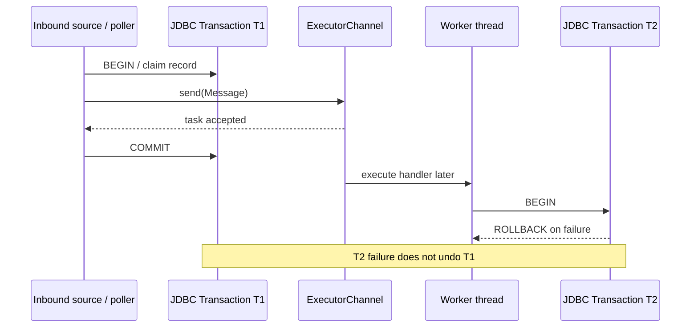
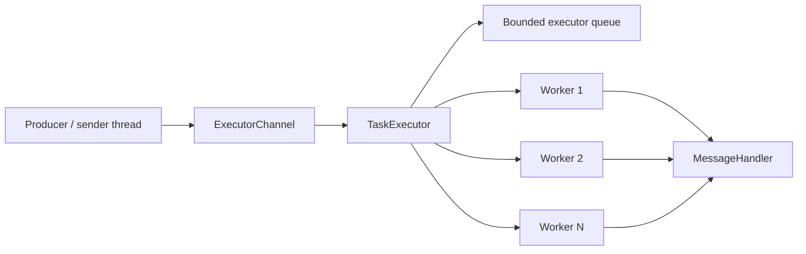
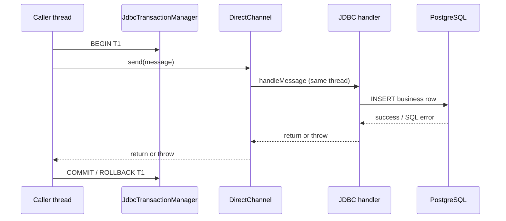
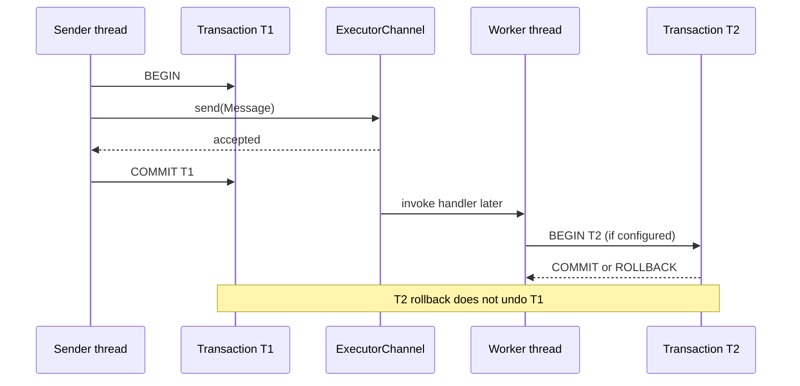
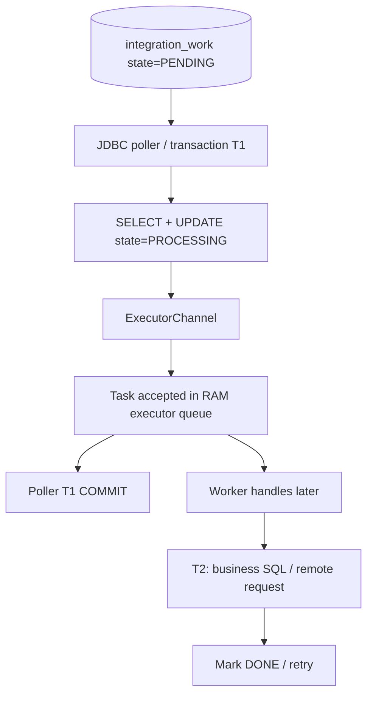
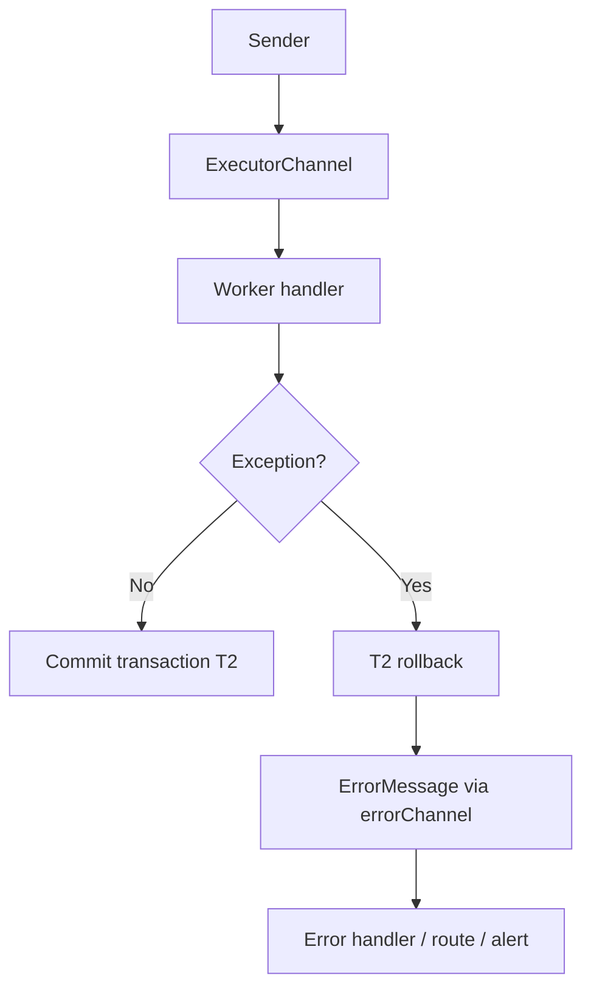
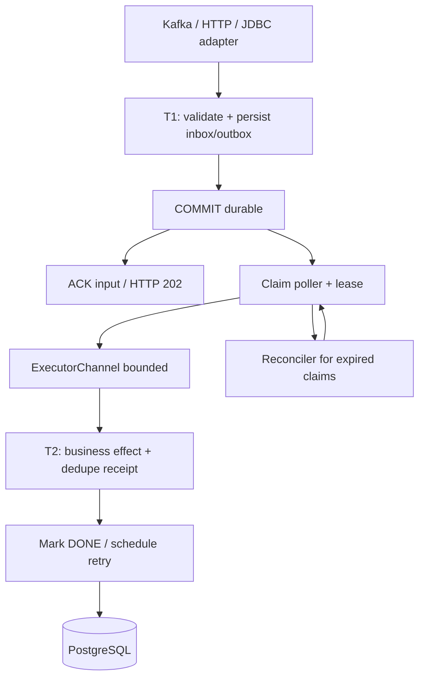
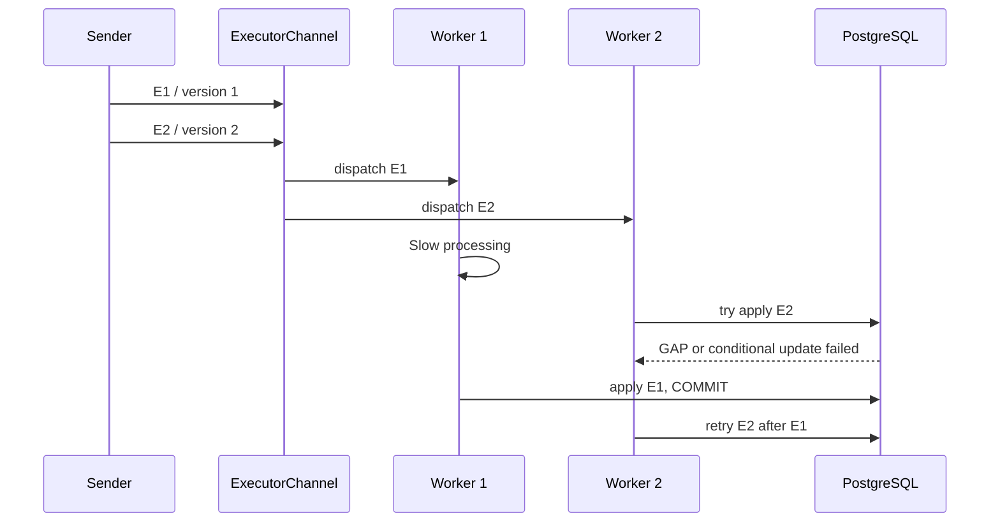
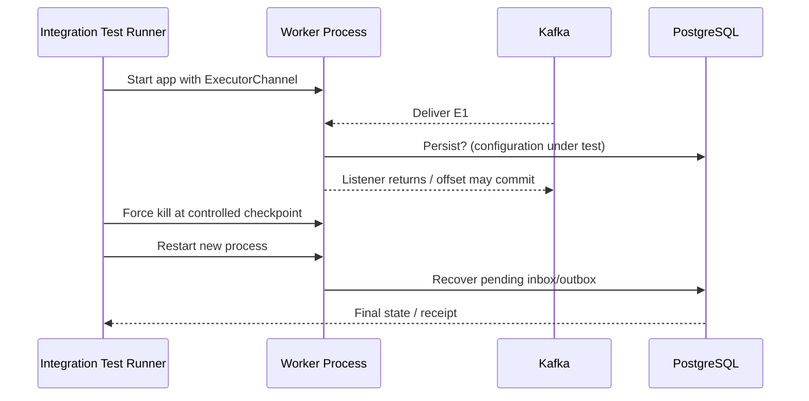
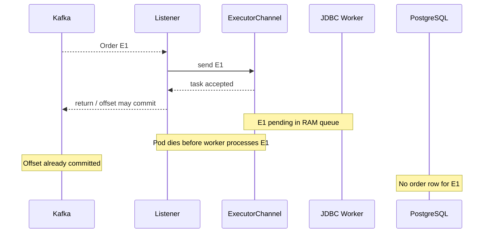

# ExecutorChannel, ranh giới luồng và tác động tới giao dịch

## 1. Bài toán: xử lý nhanh hơn nhưng lại commit trước khi công việc hoàn tất

Trong một dịch vụ thuộc module **SPRING_BOOT_INTEGRATION**, Spring Boot có thể nhận yêu cầu HTTP, đọc một PostgreSQL outbox, tiêu thụ Kafka/RabbitMQ/Pulsar và gọi API đối tác. Vì một handler đôi khi tốn hàng trăm mili giây, nhóm phát triển thường thay kênh đồng bộ `DirectChannel` bằng `ExecutorChannel` để không giữ thread tiếp nhận message.

Thay đổi trông đơn giản:

```text
Trước:
  Kafka listener -> DirectChannel -> JdbcService -> DB commit -> listener return

Sau:
  Kafka listener -> ExecutorChannel -> worker -> JdbcService -> DB commit
        |
        +-- listener return sớm, có thể ACK trước DB commit
```

Về hiệu năng, thread nhận message có thể được giải phóng nhanh. Về tính đúng đắn, **điểm mà sender coi công việc đã được bàn giao thành công không còn là điểm nghiệp vụ đã commit**. Nếu pod chết sau khi message được đưa vào queue executor nhưng trước khi JDBC write commit, dữ liệu có thể mất nếu broker/HTTP đã được ACK và không có inbox bền vững.

Một trường hợp khác: nguồn là JDBC poller đang giữ transaction T1 để `SELECT ... FOR UPDATE` và đánh dấu row `PROCESSING`. Sau khi message được `ExecutorChannel` chấp nhận, T1 có thể commit, còn transaction T2 ở worker chưa bắt đầu. Một lỗi T2 không tự rollback T1.



**Điểm cốt lõi:** `ExecutorChannel` là cơ chế **dispatch qua `TaskExecutor`**, không phải một hàng đợi message bền vững, một distributed transaction manager, hay một API tự xác nhận đã xử lý nghiệp vụ.

### Mục tiêu học tập

Sau bài học, bạn có thể:

1. Phân biệt `DirectChannel`, `ExecutorChannel`, `QueueChannel` và broker channel ở các khía cạnh thread, thời điểm hoàn tất, lỗi và transaction.
2. Giải thích vì sao JDBC/`JpaTransactionManager` sử dụng transaction context gắn với thread, và vì sao chuyển thread làm mất việc tự động tham gia transaction.
3. Viết Spring Boot Java configuration/IntegrationFlow dùng `ThreadPoolTaskExecutor` với bounded queue và rejection policy tường minh.
4. Phân tích `MessageChannel.send()` trả về `true` khác với DB commit/broker ACK như thế nào.
5. Đặt một transaction mới ở phía worker, tách biệt transaction ở sender, và thiết kế inbox/outbox/idempotency khi cần bền vững.
6. Định tuyến `ErrorMessage` đến `errorChannel`, biết giới hạn của async error handling và retry.
7. Tính concurrency/queue capacity, lựa chọn backpressure/load shedding và tránh `CallerRunsPolicy` làm sai giả định transaction.
8. Viết deterministic tests cho ranh giới thread, rollback độc lập, lỗi sau khi sender đã trả về và shutdown/recovery.
9. Đánh giá tương tác với HTTP, Kafka, RabbitMQ, Pulsar, R2DBC, Spring Integration pollers và observability.

> **Phiên bản minh họa:** Spring Boot 3.5.x, Spring Integration 6.x, Spring Framework 6.x, Java 17+ và Spring JDBC/PostgreSQL. Các snippets dùng Java DSL hoặc API `org.springframework.integration.channel.ExecutorChannel` có trong dòng 6.x. Chính sách ACK, async listener, transaction và lifecycle cần kiểm thử với dependency versions thực của dự án. `SPECIAL_NOTE` không có ràng buộc bổ sung cho bài này.

## 2. ExecutorChannel thực chất là gì?

`ExecutorChannel` là một **point-to-point `SubscribableChannel`**. Nó dùng dispatcher để chọn subscriber và ủy quyền công việc dispatch cho một `Executor`/`TaskExecutor`.



Một số khái niệm cần tách riêng:

| Khái niệm | Vai trò | Điều không được suy ra |
| --- | --- | --- |
| `MessageChannel` | Contract `send(Message)` | `send()==true` = nghiệp vụ đã commit |
| `SubscribableChannel` | Handler được subscribe nhận message theo dispatch | Có persistent message storage |
| `ExecutorChannel` | Dispatch message qua executor | Có một thread/transaction cho cả sender và worker |
| `TaskExecutor` | Thực thi `Runnable` theo implementation | Luôn chạy asynchronous (ví dụ `SyncTaskExecutor` không async) |
| `ThreadPoolTaskExecutor` | Pool/queue/rejection/lifecycle của worker threads | Queue là durable hoặc tự retry |
| `ErrorMessage` | Đưa exception của task đến error flow theo cơ chế framework | Error subscriber tự làm rollback transaction sender |
| `PlatformTransactionManager` | Điều phối JDBC/JPA transaction của resource phù hợp | Tự mang transaction xuyên executor thread |

Spring Integration `ExecutorChannel` hỗ trợ những cấu hình dispatcher tương tự `DirectChannel`, bao gồm **load balancing** và **failover** khi có nhiều subscribers. Nó không phải broadcast; nếu muốn gửi tới tất cả subscribers, xem `PublishSubscribeChannel` và kiểm tra async error/completion semantics của loại kênh đó.

### 2.1. Vì sao `send()` thường trả về sớm?

```java
boolean accepted = workChannel.send(
        MessageBuilder.withPayload(orderCommand).build());
```

Với executor bất đồng bộ có capacity, `send()` thường hoàn thành khi **task đã được executor nhận để dispatch**, không phải khi handler đã làm xong SQL hoặc outbound HTTP call. Hậu quả:

- `accepted == true` không chứng minh `OrderService` đã commit.
- Handler có thể ném exception **sau khi caller đã rời method**.
- Caller không thể luôn bắt lỗi worker bằng `try/catch` xung quanh `send()`.
- Một process crash có thể làm mất những tasks chỉ nằm trong RAM executor queue.

**Ngoại lệ cần nhớ:** `SyncTaskExecutor` hoặc `CallerRunsPolicy` có thể khiến handler chạy ngay trên sender thread trong một số hoàn cảnh. Do đó từ “thường” là thiết yếu: `ExecutorChannel` không cung cấp bảo đảm cứng rằng `send()` luôn nonblocking.

### 2.2. Có queue nhưng không phải QueueChannel

`ThreadPoolTaskExecutor` có thể dùng `BlockingQueue<Runnable>` bên trong để chứa **tasks**. `QueueChannel` của Spring Integration chứa **messages** để một `PollingConsumer` lấy sau. Cả hai mặc định không có persistence:

```text
ExecutorChannel:
  sender -> executor accepts Runnable -> worker calls subscriber

QueueChannel:
  sender -> Message stored in queue -> poller receives -> invokes subscriber
```

Không mô tả cả hai là “chuyển sang Kafka-like durable queue”. Nếu cần một ranh giới bền vững khi ACK nguồn, sử dụng broker được cấu hình phù hợp hoặc một persistent message store/inbox với transaction và recovery.

## 3. So sánh các channel theo ranh giới thực thi

| Channel | Thread dispatch điển hình | Khi nào sender quay về? | Giữ JDBC transaction của sender đến handler? | Durability mặc định |
| --- | --- | --- | --- | --- |
| `DirectChannel` | Cùng sender thread | Sau khi handler đồng bộ return/throw | **Có thể**, nếu đúng resource và propagation | Không |
| `ExecutorChannel` | Thread của executor | Khi task được chấp nhận để xử lý | **Không bảo đảm**, thường tách | Không |
| `QueueChannel` | Poller thread riêng | Khi message được enqueue | **Không**, sender/poller ở hai transactions | Không |
| `PriorityChannel` | Poller thread riêng | Khi message được enqueue | Không tự mang transaction | Không |
| `PublishSubscribeChannel` đồng bộ | Sender thread cho mỗi subscriber theo cấu hình | Sau khi dispatch subscribers theo semantics | Có thể cùng thread | Không |
| `PublishSubscribeChannel` có executor | Các executor threads | Không nhất thiết chờ mọi subscriber | Không tự mang transaction | Không |
| Broker/JMS-backed channel | Tùy container/adapter | Theo transport producer/consumer contract | Không tự là cùng JDBC transaction | Có thể durable **nếu broker/config phù hợp** |

**Đừng nhầm “cùng thread” với “tự có transaction”:** `DirectChannel` không mở JDBC transaction cho bạn. Nó chỉ không làm mất **transaction đang hoạt động** khi handler chạy ngay trong thread đó.

### 3.1. DirectChannel: một call stack đồng bộ



Khi `JdbcTemplate` và `JdbcTransactionManager` dùng đúng một `DataSource`, Spring có thể lấy cùng connection gắn thread. Exception từ handler quay về caller, làm transaction interceptor quyết định rollback theo rules.

### 3.2. ExecutorChannel: hai call stacks và hai deadlines



Khi không có `@Transactional`/programmatic transaction ở worker, JDBC operations ở handler có thể chạy **autocommit** theo database/driver settings. Không có quy tắc “executor tự tạo transaction mới” nếu bạn không cấu hình.

## 4. Thread-bound JDBC transaction và những dữ liệu context liên quan

Với `JdbcTransactionManager`/`DataSourceTransactionManager`, Spring sử dụng `TransactionSynchronizationManager` để gắn connection, transaction metadata và synchronizations vào thread hiện hành.

```text
Thread "kafka-listener-1":
  TransactionSynchronizationManager
     resource: ordersDataSource -> ConnectionHolder of T1
     actualTransactionActive = true
       |
       +-- ExecutorChannel schedules task

Thread "orders-worker-1":
  TransactionSynchronizationManager
     resource: ordersDataSource -> none (initially)
     actualTransactionActive = false (until new @Transactional opens T2)
```

Thread-local transaction không được tự copy sang worker. Tự chuyển `ConnectionHolder`/transaction ThreadLocal để “truyền T1” là **sai và không an toàn**: một transaction/connection JDBC có ownership, resource cleanup và concurrency rules; chia sẻ connection giữa threads có thể phá isolation và gây resource leaks.

### 4.1. Những context khác cũng có thể bị mất

Ngoài transaction, thread handoff ảnh hưởng:

- **MDC/correlation ID:** log của worker mất trace ID nếu chưa truyền context.
- **SecurityContext:** principal/authorization gắn thread không tự có ở worker.
- **RequestContextHolder:** HTTP servlet request attributes không mặc định đi theo async task.
- **Locale/tenant route ThreadLocal:** query có thể tới sai tenant hoặc sai database.
- **Observation/tracing scope:** spans không tự nối đúng parent nếu chưa instrument.
- **Reactor Context:** reactive transaction/security context được truyền theo reactive subscription, không đồng nghĩa JDBC ThreadLocal.

Một `TaskDecorator` hay context propagation hỗ trợ MDC/tracing có thể hữu ích, nhưng **không được dùng nó để copy JDBC transaction resources sang worker**. Xem riêng phần về context propagation.

### 4.2. `@Transactional` trên sender không bao phủ worker

```java
@Transactional(transactionManager = "ordersTransactionManager")
public void accept(OrderCommand command) {
    jdbc.update("INSERT INTO inbox ...");
    workChannel.send(MessageBuilder.withPayload(command).build());
}
```

Nếu `workChannel` là `ExecutorChannel`, transaction trên sender chỉ bao công việc của thread gọi. Worker có thể bắt đầu sau khi sender commit, hoặc thậm chí **chạy đồng thời trước khi sender commit**. Khi worker đọc inbox vừa insert, nó có thể **chưa nhìn thấy row đó** vì T1 chưa commit.

Đây là một lỗi ít được chú ý: việc tạo task async **bên trong transaction chưa commit** có thể gây race “worker query không thấy dữ liệu mới”.

### 4.3. Rollback T1 không hủy task đã gửi sang executor

Nếu sender gửi task sang `ExecutorChannel`, rồi một câu SQL phía sau ném exception làm T1 rollback, task đã được executor chấp nhận **vẫn có thể chạy**. `send()` không có cơ chế tự thu hồi `Runnable` đã enqueue khi outer JDBC transaction rollback.

Vì vậy không gửi một task không bền vững như “đã được duyệt” từ transaction chưa commit rồi coi đó là after-commit event. Hãy ghi **outbox trong T1** và để dispatcher phát **sau commit**, có retry từ durable state.

## 5. Cách cấu hình ExecutorChannel với Spring Boot Java configuration

Ví dụ sử dụng:

- Một `ThreadPoolTaskExecutor` **riêng** cho luồng xử lý đơn hàng.
- Queue giới hạn capacity; không dùng unbounded queue làm bộ đệm mặc định.
- `ExecutorChannel` point-to-point.
- `DirectChannel` cho ingress trước khi quyết định async handoff.
- `MessageHandler` do Spring Integration đăng ký, tránh tự `subscribe()` trên Java code lẫn với endpoint cùng channel.

### 5.1. Dependencies

```xml
<dependencies>
    <dependency>
        <groupId>org.springframework.boot</groupId>
        <artifactId>spring-boot-starter-integration</artifactId>
    </dependency>
    <dependency>
        <groupId>org.springframework.boot</groupId>
        <artifactId>spring-boot-starter-jdbc</artifactId>
    </dependency>
    <dependency>
        <groupId>org.postgresql</groupId>
        <artifactId>postgresql</artifactId>
        <scope>runtime</scope>
    </dependency>
</dependencies>
```

Không cần thêm `spring-integration-jdbc` chỉ để dùng `ExecutorChannel`. Module JDBC adapter cần dependency riêng khi bạn dùng `JdbcPollingChannelAdapter` hoặc `JdbcMessageHandler`.

### 5.2. Bean executor với giới hạn tường minh

```java
// OrderAsyncConfiguration.java
package example.integration.flow;

import java.util.concurrent.ThreadPoolExecutor;
import org.springframework.beans.factory.annotation.Qualifier;
import org.springframework.context.annotation.Bean;
import org.springframework.context.annotation.Configuration;
import org.springframework.core.task.TaskExecutor;
import org.springframework.integration.channel.DirectChannel;
import org.springframework.integration.channel.ExecutorChannel;
import org.springframework.messaging.MessageChannel;
import org.springframework.scheduling.concurrent.ThreadPoolTaskExecutor;

@Configuration(proxyBeanMethods = false)
public class OrderAsyncConfiguration {

    @Bean("orderWorkExecutor")
    ThreadPoolTaskExecutor orderWorkExecutor() {
        var executor = new ThreadPoolTaskExecutor();
        executor.setThreadNamePrefix("orders-work-");
        executor.setCorePoolSize(4);
        executor.setMaxPoolSize(8);
        executor.setQueueCapacity(100);
        executor.setRejectedExecutionHandler(
                new ThreadPoolExecutor.AbortPolicy());
        executor.setWaitForTasksToCompleteOnShutdown(true);
        executor.setAwaitTerminationSeconds(30);
        return executor;
    }

    @Bean("orderIngress")
    MessageChannel orderIngress() {
        return new DirectChannel();
    }

    @Bean("orderExecutorChannel")
    MessageChannel orderExecutorChannel(
            @Qualifier("orderWorkExecutor") TaskExecutor executor) {
        return new ExecutorChannel(executor);
    }
}
```

Spring quản lý lifecycle của `ThreadPoolTaskExecutor` bean; thông thường không cần gọi `initialize()` hoặc `shutdown()` trong từng request. Ví dụ này dùng `AbortPolicy` để **bộc lộ overload** và để ingress có cơ hội retry/backoff/persist work, không âm thầm làm mất task.

**Đọc kỹ cách ThreadPoolExecutor mở rộng:** với `core=4`, `max=8`, `queueCapacity=100`, khi 4 core workers đã bận, tasks thường **vào queue trước**; executor chỉ tăng số threads vượt core khi queue đã đầy. Vì vậy `maxPoolSize=8` không có nghĩa dưới tải vừa nó luôn chạy 8 workers.

### 5.3. Kiểu trả về `MessageChannel` và injection qualifier

Một bean được khai báo bằng `@Bean("orderExecutorChannel")` có thể được inject qua:

```java
public IngressService(
        @Qualifier("orderExecutorChannel") MessageChannel channel) {
    this.channel = channel;
}
```

Nếu có nhiều `MessageChannel` trong context, nên dùng `@Qualifier` để tránh chọn nhầm. Ngay cả khi bean method trả `MessageChannel`, object thực là `ExecutorChannel` với executor đã cấu hình.

## 6. Java DSL: cách đặt ranh giới async rõ ràng trong IntegrationFlow

Một flow cụ thể:

```java
// OrderIntegrationFlowConfiguration.java
package example.integration.flow;

import org.springframework.context.annotation.Bean;
import org.springframework.context.annotation.Configuration;
import org.springframework.integration.dsl.IntegrationFlow;

@Configuration(proxyBeanMethods = false)
public class OrderIntegrationFlowConfiguration {

    @Bean
    IntegrationFlow orderIntegrationFlow(
            OrderWorkDispatcher dispatcher) {

        return IntegrationFlow
                .from("orderIngress")
                .channel("orderExecutorChannel")
                .handle(dispatcher, "handle")
                .get();
    }
}
```

Trong ví dụ này, `orderIngress` là `DirectChannel`, `orderExecutorChannel` là `ExecutorChannel`, còn `OrderWorkDispatcher.handle(...)` là handler được đăng ký qua Java DSL. **Không đồng thời thêm một `@ServiceActivator(inputChannel="orderExecutorChannel")` cho cùng handler** nếu không định chia message cho nhiều subscribers.

### 6.1. Handler gọi một service transaction tách biệt

```java
// OrderWorkDispatcher.java
package example.integration.flow;

import org.springframework.stereotype.Component;

@Component
public class OrderWorkDispatcher {

    private final OrderWorkerService worker;

    public OrderWorkDispatcher(OrderWorkerService worker) {
        this.worker = worker;
    }

    public void handle(OrderCommand command) {
        worker.apply(command);
    }
}
```

```java
// OrderCommand.java
package example.integration.flow;

public record OrderCommand(String eventId, String orderId) {
}
```

```java
// OrderWorkerService.java
package example.integration.flow;

import org.springframework.jdbc.core.JdbcTemplate;
import org.springframework.stereotype.Service;
import org.springframework.transaction.annotation.Transactional;

@Service
public class OrderWorkerService {

    private final JdbcTemplate jdbc;

    public OrderWorkerService(JdbcTemplate jdbc) {
        this.jdbc = jdbc;
    }

    @Transactional(transactionManager = "ordersTransactionManager")
    public void apply(OrderCommand command) {
        jdbc.update("""
                INSERT INTO processed_event(event_id, order_id)
                VALUES (?, ?)
                ON CONFLICT (event_id) DO NOTHING
                """, command.eventId(), command.orderId());
    }
}
```

Code giả định DB đã có bảng `processed_event` và bean `ordersTransactionManager` do ứng dụng cấu hình. Với luồng nghiệp vụ thực, **chỉ lưu receipt rồi bỏ qua payload không tương đương business effect**. Cần thêm business SQL updates trong **cùng T2** và chỉ áp effect nếu event ID chưa xử lý; ví dụ ở mục inbox/outbox sẽ làm rõ.

**Vì sao tách hai beans?** `OrderWorkDispatcher` được executor gọi, còn `OrderWorkerService` là Spring bean proxy với `@Transactional`. Gọi `worker.apply()` qua bean khác bảo đảm transaction advice có cơ hội intercept, tránh self-invocation như `this.apply()` trong cùng service.

### 6.2. Ingress gửi vào flow

```java
// OrderIngressService.java
package example.integration.flow;

import org.springframework.beans.factory.annotation.Qualifier;
import org.springframework.messaging.MessageChannel;
import org.springframework.messaging.support.MessageBuilder;
import org.springframework.stereotype.Service;

@Service
public class OrderIngressService {

    private final MessageChannel input;

    public OrderIngressService(
            @Qualifier("orderIngress") MessageChannel input) {
        this.input = input;
    }

    public void submit(OrderCommand command) {
        boolean accepted = input.send(
                MessageBuilder.withPayload(command).build());
        if (!accepted) {
            throw new IllegalStateException(
                    "Integration flow did not accept command");
        }
    }
}
```

**Không được diễn giải `submit()` return thành “đã ghi đơn hàng thành công”**: method chỉ biết flow/ExecutorChannel đã nhận công việc theo cách dispatch. Khi worker chưa xử lý, nếu cần trả trạng thái HTTP, nên dùng `202 Accepted` **chỉ sau khi request đã được ghi bền vững** (inbox/outbox) hoặc một API có contract async rõ ràng.

### 6.3. XML configuration tương đương

Đối với dự án legacy cấu hình Spring Integration XML:

```xml
<task:executor id="orderWorkExecutor"
               pool-size="4-8"
               queue-capacity="100"
               rejection-policy="ABORT"/>

<int:channel id="orderExecutorChannel">
    <int:dispatcher task-executor="orderWorkExecutor"/>
</int:channel>
```

XML cần các namespace `task` và `int` của Spring tương ứng cùng schema locations. Đây là minh họa ý tưởng, còn Java configuration ở trên có đầy đủ beans để ghép vào Spring Boot 3.x. Không cấu hình Java và XML **trùng tên** trong cùng context.

## 7. Quan sát thread handoff: log đúng chỗ

Trong `ExecutorChannel`, đừng chỉ nhìn tên thread ở nơi sender gọi `send()`; cần quan sát thread ngay trong handler và ranh giới transaction.

```java
// ThreadBoundaryProbe.java
package example.integration.flow;

import org.springframework.stereotype.Component;
import org.springframework.transaction.support.TransactionSynchronizationManager;

@Component
public class ThreadBoundaryProbe {

    public void logContext(String stage) {
        String thread = Thread.currentThread().getName();
        boolean transactionActive =
                TransactionSynchronizationManager.isActualTransactionActive();

        System.out.printf(
                "stage=%s thread=%s txActive=%s%n",
                stage, thread, transactionActive);
    }
}
```

Nếu gọi `probe.logContext("before-send")` từ một sender có `@Transactional`, `probe.logContext("worker-before-tx")` từ `OrderWorkDispatcher.handle()`, và `probe.logContext("worker-inside-tx")` từ `OrderWorkerService.apply()`, logs thường có dạng:

```text
stage=before-send thread=http-nio-8080-exec-2 txActive=true
stage=worker-before-tx thread=orders-work-1 txActive=false
stage=worker-inside-tx thread=orders-work-1 txActive=true
```

Đây là log minh họa; không bảo đảm tên thread hay thứ tự các dòng dưới mọi tải. Hai dòng có `txActive=true` **không phải cùng một transaction**. Chúng có thể nằm trên threads/connections và thời điểm bắt đầu khác nhau.

### 7.1. Singleton bean không làm transaction được chia sẻ

Một `OrderWorkerService` bean singleton có thể được nhiều executor threads gọi. Bean scope singleton không đồng nghĩa JDBC `Connection` hay transaction được chia sẻ. Spring tạo/lấy connection thông qua transaction manager và `DataSource` theo từng invocation.

### 7.2. Không đoán thời điểm hoàn thành từ thứ tự logs

`after-send` có thể được log trước hoặc sau `worker-start`. Dùng eventId, correlationId, enqueue timestamp, worker start/end timestamp và transaction commit outcome thay vì chỉ dựa vào thứ tự xuất hiện ở file log. Trong multi-pod, đồng hồ còn có thể lệch.

## 8. Hai transactions T1/T2: @Transactional ở mỗi phía

Một sender thực hiện JDBC transaction rồi đẩy work async:

```java
// OrderCommandSubmission.java
package example.integration.flow;

import org.springframework.stereotype.Service;
import org.springframework.transaction.annotation.Transactional;

@Service
public class OrderCommandSubmission {

    private final OrderIngressService ingress;
    private final SenderReceiptRepository receipts;

    public OrderCommandSubmission(
            OrderIngressService ingress,
            SenderReceiptRepository receipts) {
        this.ingress = ingress;
        this.receipts = receipts;
    }

    @Transactional(transactionManager = "ordersTransactionManager")
    public void accept(OrderCommand command) {
        receipts.insertReceipt(command);
        ingress.submit(command); // async handoff trước T1 commit
    }
}
```

`SenderReceiptRepository` là repository được dự án cung cấp, dùng cùng orders DataSource. Đoạn trên **cố ý minh họa một anti-pattern** nếu worker dựa trên giả định receipt đã được commit. Worker có thể chạy trước khi T1 commit; thậm chí T1 có thể rollback sau khi task đã được chấp nhận.

### 8.1. Timeline cần tính

| Thời điểm | Sender T1 | Executor | Worker T2 |
| --- | --- | --- | --- |
| t0 | Begin | Chưa có task | Chưa chạy |
| t1 | INSERT receipt, chưa commit | Chưa có task | Chưa chạy |
| t2 | `send()` | Task được chấp nhận | Có thể bắt đầu |
| t3 | Commit hoặc rollback | Queue/worker tiếp tục | Có thể query trước T1 commit |
| t4 | T1 kết thúc | Task đang chạy/đã xong | Commit hoặc rollback T2 |

`ExecutorChannel` **không tạo quan hệ T1 commit trước T2 begin** chỉ vì `send()` nằm cuối một method `@Transactional`.

### 8.2. Chỉ schedule sau commit có đủ không?

Spring transaction synchronization cho phép một `afterCommit()` callback:

```java
// Minh họa cơ chế, không phải durable delivery:
TransactionSynchronizationManager.registerSynchronization(
        new TransactionSynchronization() {
            @Override
            public void afterCommit() {
                ingress.submit(command);
            }
        });
```

Imports:

```java
import org.springframework.transaction.support.TransactionSynchronization;
import org.springframework.transaction.support.TransactionSynchronizationManager;
```

Callback có thể tránh worker query row chưa commit, nhưng **không chịu crash**. Nếu DB commit xong mà JVM chết trước `afterCommit()`, task có thể chưa được gửi. Nếu executor reject sau commit, T1 cũng không thể rollback. Dùng cách này cho best-effort notification/cache hints, không phải business event bắt buộc giao.

### 8.3. Giải pháp bền vững: transactional outbox

```text
T1:
  INSERT orders
  INSERT integration_outbox(eventId, payload, state=PENDING)
  COMMIT

Independent publisher:
  claim pending outbox
  ExecutorChannel / bounded worker
  publish HTTP/broker
  mark success / retryable
```

Order và outbox ghi trong **cùng DataSource/transaction**. Sau crash, pending event còn trong DB và có thể được replay. Executor vẫn hữu ích để xử lý với bounded concurrency, nhưng recovery không dựa vào queue RAM.

### 8.4. Worker phải tạo transaction đúng DataSource

`OrderWorkerService.apply()` có `@Transactional(transactionManager = "ordersTransactionManager")` và được Spring proxy intercept, tạo/join transaction theo **worker thread**. Nếu handler lại sử dụng `auditJdbcTemplate` từ datasource khác, T2 không tự bao phủ audit SQL. Nếu dùng `R2dbcTransactionManager`, transaction đi theo reactive context, không biến JDBC handler thành participant của reactive transaction.

## 9. JDBC poller: nơi ExecutorChannel dễ gây mất công việc

Một Spring Integration JDBC inbound adapter thường poll, claim rows và gửi message downstream. Nếu poller có transaction advice và downstream đồng bộ, lỗi handler có thể làm rollback claim.



### 9.1. So sánh transaction outcomes

| Cấu hình | Lỗi downstream | Claim transaction |
| --- | --- | --- |
| Poller transaction advice + `DirectChannel` + JDBC handler đồng bộ | Exception có thể quay lại poller | SELECT/claim và business SQL có thể rollback cùng T1 |
| Poller transaction advice + `ExecutorChannel` | Lỗi xuất hiện trong worker sau handoff | T1 thường đã commit, không rollback |
| Poller không có transaction advice | SELECT/UPDATE có thể autocommit/transactions riêng | Không bảo đảm atomic read/claim |
| `QueueChannel` memory + poller downstream | Exception ở receiver khác thread | T1 sender không tự rollback |

`maxMessagesPerPoll` giới hạn số lần poll source trong một tick, **không** giới hạn tổng worker tasks trong executor queue. Một message mang 100 rows có thể được splitter tách thành 100 tasks.

### 9.2. Vì sao chỉ có state PROCESSING là chưa đủ?

Khi T1 commit `PROCESSING` rồi pod chết, row không còn PENDING. Nếu không có recovery logic, nó mắc kẹt:

- Thêm `claimed_by`, `lease_until` hoặc attempt token.
- Reconciler reclaim những claim hết hạn, có kiểm soát.
- Fencing/conditional update ngăn worker cũ overwrite owner mới.
- Unique receipt, stable eventId và idempotency cho redelivery.
- Retry budget và DLT/parking với poison messages.

### 9.3. Giao dịch ngắn hơn khi có HTTP partner

Không giữ `SELECT ... FOR UPDATE` transaction mở 10 giây trong lúc gọi HTTP. Mẫu ổn định:

```text
T1: claim up to N rows under DB lock, store lease, COMMIT
Worker: external HTTP/broker call with stable idempotency key
T2: conditional UPDATE success/failure and COMMIT
Recovery: reprocess expired/failed work
```

Thiết kế này chấp nhận at-least-once execution nhưng bảo vệ kết quả bằng idempotency. **T1 và T2 không hợp nhất thành một transaction** chỉ vì cùng database.

## 10. Kafka listener → ExecutorChannel: ACK trước DB commit

Ví dụ anti-pattern:

```java
// Listener chỉ enqueue work, chưa commit business DB
@KafkaListener(topics = "orders.status.v1", groupId = "orders-consumer")
public void onOrder(OrderCommand command) {
    orderIngressService.submit(command);
    // Return trước khi async worker hoàn tất.
}
```

Nếu `orderIngress` → `ExecutorChannel`, listener return sau khi task được nhận. Spring Kafka container có thể commit offset theo listener success/ack mode **trước T2 commit**. Khi JVM chết sau offset commit và trước worker DB write, event có thể mất.

### 10.1. Hai mẫu an toàn hơn

**Mẫu A — đồng bộ tới durable point:**

```text
Kafka listener -> DirectChannel
  -> transactional JDBC handler / inbox write
  -> DB COMMIT
  -> listener return
  -> ACK/offset commit according to container policy
```

**Mẫu B — durable inbox trước ACK, worker xử lý async:**

```text
Kafka listener:
  T1 INSERT inbox(eventId,payload,state=PENDING)
  T1 COMMIT
  listener return -> broker ACK according to policy

Worker:
  poll/claim inbox
  T2 apply business effect + receipt
  mark DONE or retryable
```

Nếu crash sau inbox commit trước ACK, record được giao lại; unique key `eventId` làm lần insert inbox tiếp theo idempotent. Nếu ACK đã xảy ra nhưng worker chưa chạy, inbox còn PENDING và có recovery.

### 10.2. Partition ordering và worker ordering không đồng nghĩa

Kafka bảo toàn offsets theo partition dưới điều kiện phù hợp. Tuy nhiên, nếu listener dispatch E1, E2 vào executor, E2 có thể hoàn thành T2 **trước E1**. Nếu business cần version 1 trước version 2, phải có per-key serialization/partition worker hoặc DB version guard + GAP parking/reconciliation.

### 10.3. ACK mode phải được kiểm chứng

```yaml
spring:
  kafka:
    consumer:
      enable-auto-commit: false
      group-id: orders-consumer
    listener:
      ack-mode: record
```

`ack-mode: record` khiến container xử lý commit theo policy sau listener call, **không tự đợi executor worker**. Một số Spring Kafka versions hỗ trợ asynchronous listener return types/callbacks; phải dùng chính xác API/container settings và kiểm thử completion, errors, rebalances. Trả `CompletableFuture.completedFuture(null)` ngay sau enqueue vẫn là ACK quá sớm.

### 10.4. Crash windows cần test

| Crash tại đâu? | RAM ExecutorChannel | Durable inbox |
| --- | --- | --- |
| Trước DB commit và trước Kafka ACK | Broker có thể redeliver | Redelivery retry inbox |
| Sau Kafka ACK trước worker DB commit | **Có thể mất business event** | Inbox vẫn PENDING |
| Sau DB commit trước Kafka ACK | Có thể duplicate effect nếu thiếu receipt | Receipt/idempotency chặn trùng |
| Sau outbound Kafka ACK trước outbox mark-published | Có thể publish lại | Stable eventId và downstream dedupe |

Kafka transaction semantics có phạm vi broker cụ thể; không tự tạo một transaction phân tán tổng quát bao gồm PostgreSQL, HTTP và Kafka.

## 11. RabbitMQ, Pulsar và HTTP: ranh giới ACK có cùng bản chất

```text
RabbitMQ listener -> ExecutorChannel -> JDBC worker
Pulsar listener   -> ExecutorChannel -> JDBC worker
HTTP controller   -> ExecutorChannel -> JDBC worker
```

Điểm chung: **caller có thể quay về sau handoff, còn business work hoàn thành sau**. Khác biệt nằm ở transport contract và error/ack handling.

### 11.1. RabbitMQ auto/manual ACK

Với listener container có chế độ acknowledgement tự động theo Spring AMQP, listener return thành công có thể dẫn đến ACK, không phụ thuộc việc async worker đã commit hay chưa. Với manual ACK, chỉ ACK sau một durable point, theo đúng contract của RabbitMQ channel/delivery tag và thread-safety.

Test các trường hợp:

1. DB commit xong nhưng ACK mất do connection failure → redelivery, receipt chặn duplicate effect.
2. ACK sau enqueue RAM queue nhưng trước DB commit → nguy cơ mất business event khi JVM crash.
3. Handler throw → policy NACK/requeue/DLQ, không nuốt exception.
4. Prefetch lớn + nhiều consumers → completion order có thể khác delivery order.
5. Shutdown khi có unacked messages → consumer mới xử lý lại đúng idempotency.

`auto` trong Spring AMQP container **không** đồng nghĩa RabbitMQ wire-level `autoAck=true` (no-ack) theo cách diễn giải tên thông thường; phải kiểm tra API/setting thực và khi nào container ACK.

### 11.2. Pulsar subscription semantics

Pulsar có các subscription modes Exclusive, Failover, Shared, Key_Shared. Với `Key_Shared`, broker có thể cung cấp key affinity/ordering theo điều kiện phù hợp, nhưng nếu consumer tiếp tục đưa messages của một key qua executor pool nhiều workers, **DB completion order vẫn có thể đảo**.

Pulsar message ID do broker/producer tạo là transport identifier. Cùng business event có thể được publish lại với message ID mới; cần `eventId` ổn định trong payload hoặc metadata nghiệp vụ.

Ack/nack, ack timeout, redelivery và dead-letter handling tùy Spring Pulsar version, subscription type và listener container. Không suy từ `ExecutorChannel.send()` rằng Pulsar message đã được xử lý thành công.

### 11.3. HTTP 202 Accepted có nghĩa gì?

Một controller minh họa:

```java
@PostMapping("/orders")
public ResponseEntity<Void> submit(@RequestBody OrderCommand command) {
    ingress.submit(command);
    return ResponseEntity.accepted().build();
}
```

Đây là **anti-pattern** nếu `202` theo business contract hàm ý server đã nhận work **bền vững**, nhưng thực tế chỉ đặt task vào RAM queue. Với order/payment quan trọng:

- Persist request/inbox/operation state trước khi trả `202`.
- Trả operation ID để client tra kết quả.
- Quy định `Idempotency-Key` với scope/TTL và xử lý cùng key, payload khác.
- Nếu executor overload mà chưa persist, trả `429`/`503` hoặc retryable response đúng contract, không báo “đã tiếp nhận”.

Không nhất thiết mọi `202` đều phải có inbox theo tiêu chuẩn HTTP, nhưng **hợp đồng nghiệp vụ** phải trung thực về durability và recovery.

### 11.4. Request-reply gateway khác fire-and-forget send

Nếu caller dùng `@MessagingGateway` để chờ reply và flow đi qua `ExecutorChannel`, proxy có thể chờ trên reply channel đến khi handler trả kết quả hoặc timeout. Nhưng:

- Gateway timeout **không tự hủy JDBC query/task** đang chạy.
- Reply có thể về muộn sau timeout và bị bỏ.
- Caller retry sau timeout vẫn cần idempotency.
- `replyTimeout` không tương đương SQL statement timeout.
- Nếu caller giữ JDBC transaction T1 mở trong lúc đợi reply, worker không nhìn thấy dữ liệu T1 chưa commit; có thể phát sinh chờ lock/deadlock.

Đừng đổi một HTTP request-reply endpoint đang trả kết quả business sang async fire-and-forget chỉ để giảm request latency mà không thay API contract.

## 12. Executor saturation: pool, queue và rejection

Với `ThreadPoolTaskExecutor`, `corePoolSize`, `maxPoolSize`, `queueCapacity` cùng quyết định hoạt động:

```text
corePoolSize=4, maxPoolSize=8, queueCapacity=100

First tasks:    create up to 4 core threads
Core busy:      queue up to 100 pending tasks
Queue full:     grow towards 8 max threads
Max and full:   reject according to configured policy
```

Nếu Hikari `maximumPoolSize=6`, executor max=64 có thể khiến nhiều workers đợi JDBC connections. Tăng threads chưa chắc tăng throughput; có thể làm tăng connection acquisition timeout và retry storm.

### 12.1. AbortPolicy: overload cần được nhìn thấy

```java
executor.setRejectedExecutionHandler(
        new ThreadPoolExecutor.AbortPolicy());
```

Khi queue và pool đầy, submission bị reject (trong Spring `TaskExecutor` thường hiện ra như `TaskRejectedException`). Đây là **lỗi trong lúc send/submission**, khác với exception do handler ném **sau khi đã nhận task**.

Chính sách nguồn:

- Kafka/Rabbit listener: để container error handler thực hiện retry/NACK theo cấu hình; **không ACK** khi chưa có durable receipt.
- HTTP: nếu chưa lưu operation, trả error/rate-limit theo contract, giữ idempotency.
- DB poller: để claim transaction rollback hoặc lưu recovery state theo transaction scope.
- Đã ACK trước khi queue nhận: không thể khôi phục từ queue RAM; phải dựa vào durable inbox/outbox.

### 12.2. DiscardPolicy/DiscardOldestPolicy có thể mất message

Các rejection policies có thể âm thầm bỏ một task hoặc thay task cũ trong queue. Đó là hành vi thường **không thể chấp nhận** cho order/payment/outbox. Chỉ cân nhắc khi message thực sự được phép drop: cache refresh/tín hiệu telemetry best-effort có thể tạo lại.

### 12.3. CallerRunsPolicy: backpressure nhưng thay thread semantics

```java
executor.setRejectedExecutionHandler(
        new ThreadPoolExecutor.CallerRunsPolicy());
```

Khi queue đầy và pool đang bão hòa, JDK executor có thể chạy task **ngay trong thread gửi**. Điều đó có thể làm sender chậm lại để tạo backpressure, nhưng mang một bẫy nghiêm trọng:

1. Lúc tải thấp, handler chạy ở worker thread, không cùng JDBC transaction T1.
2. Lúc tải cao, handler có thể chạy trong sender thread, có khả năng thấy T1.
3. `send()` lúc này có thể **block** cho tới khi handler hoàn tất.
4. Error propagation/transaction participation thay đổi theo mức tải.
5. Nếu sender là Kafka listener, JDBC poller hay Netty event loop, blocking handler có thể bất ngờ chạy ở nơi không mong muốn.
6. Khi executor đã shutdown, JDK `CallerRunsPolicy` có thể không chạy task; đừng xem đây là durability guarantee.

**Không dựa vào CallerRunsPolicy để “tự phục hồi” transaction context.** Tài liệu Spring Integration cảnh báo behavior này không dự đoán được; transaction design phải đúng dù caller có hay không chạy handler.

### 12.4. SyncTaskExecutor không phải giải pháp tăng concurrency

`SyncTaskExecutor` chạy task trên sender thread. Sử dụng nó với `ExecutorChannel` không mang lại offload; nếu muốn bảo đảm xử lý đồng bộ, hãy dùng `DirectChannel` và tránh dựa vào executor implementation bất ngờ.

## 13. Bounded queue và backpressure đầu-cuối

Nếu arrival rate \(\lambda\) lớn hơn service rate \(\mu\), backlog tăng:

\[
\Delta Q \approx (\lambda-\mu)\Delta t,\quad \lambda>\mu.
\]

Ví dụ source nhận 250 messages/giây, worker/DB chỉ xử lý 180 messages/giây. Trong 60 giây backlog có thể tăng khoảng:

\[
(250-180)\times 60=4\,200\text{ messages}.
\]

Queue capacity 100 chỉ hấp thụ được một burst ngắn; **không thể bù vĩnh viễn một downstream chậm hơn nguồn**.

### 13.1. Bounded concurrency cũng phải gắn với downstream limits

| Thành phần | Giới hạn | Nguy cơ |
| --- | --- | --- |
| Executor | `core/max/queueCapacity` | RAM queue dồn, task rejected |
| PostgreSQL | Hikari connections, query/lock timeout | Pool saturation/long locks |
| HTTP partner | Connection pool, rate quota, p99 latency | 429/timeout/unknown outcome |
| Kafka | Partition assignment, max poll interval, lag | Rebalance/duplicate redelivery |
| RabbitMQ | Prefetch, consumers, unacked count | Buffer quá nhiều in-flight |
| Pulsar | Receiver queue, listener concurrency, ACK | Backlog/redelivery |
| Spring Integration poller | `maxMessagesPerPoll`, fixedDelay | Query rate không bằng số rows xử lý |

Một tăng `maxPoolSize` từ 8 lên 64 có thể khiến Hikari 6 connections cạn nhanh hơn và kéo dài tất cả requests. Đo thực tế before/after và giới hạn concurrency theo DB/partner budgets.

### 13.2. `send accepted` là ingress metric, không phải business completion

```text
messages.received
messages.executor.accepted
messages.executor.rejected
messages.worker.started
messages.worker.db.committed
messages.worker.failed
messages.durable.pending.oldest_age
```

Các tên metric trên là **gợi ý**, không phải meter names được Spring tự xuất sẵn mọi version. Cần phân biệt executor task count với durable backlog DB/broker.

### 13.3. Queue size bằng 0 không chứng minh đã xử lý xong

Khi JVM bị kill, executor queue RAM mất; lúc app mới restart, queue size bằng 0 nhưng không có nghĩa tất cả tasks trước đó đã commit. Giám sát phải kết nối business receipt, inbox/outbox state và source ACK progress.

## 14. Lỗi bất đồng bộ: errorChannel và ErrorMessage

Một `DirectChannel` đồng bộ thường cho exception từ handler quay lại caller; với `ExecutorChannel`, handler exception xảy ra trong task của executor **sau khi caller đã return**.



Spring Integration hỗ trợ xuất `ErrorMessage` đến **`errorChannel` header** của message khi được cung cấp hoặc global channel tên `errorChannel` theo error-publishing infrastructure. Mặc định global `errorChannel` có subscriber ghi log; **logging không phải retry bền vững**.

### 14.1. Xác định đúng lỗi nằm ở đâu

| Điểm lỗi | Có thể nhìn thấy ở sender? | Nên xử lý thế nào |
| --- | --- | --- |
| Channel chưa có subscribers | Có thể lỗi ngay lúc `send()` | Kiểm tra flow wiring/startup |
| TaskExecutor reject task | Có thể ném exception tại submission | Backpressure/retry từ nguồn, không ACK nhầm |
| Worker JDBC query fail sau khi task đã nhận | Thường không trực tiếp | Transaction T2 rollback, errorChannel/error handler/recovery |
| Error handler tự fail | Không bảo đảm redelivery nguồn | Giám sát error flow, tránh mất lỗi |
| HTTP partner timeout nhưng request đã được xử lý | Không thể kết luận effect chưa xảy ra | Idempotency key và reconciliation |

### 14.2. Đăng ký một error handler

```java
// IntegrationErrorLogger.java
package example.integration.flow;

import org.springframework.integration.annotation.ServiceActivator;
import org.springframework.messaging.support.ErrorMessage;
import org.springframework.stereotype.Component;

@Component
public class IntegrationErrorLogger {

    @ServiceActivator(inputChannel = "errorChannel")
    public void onError(ErrorMessage errorMessage) {
        Throwable failure = errorMessage.getPayload();
        // Thay bằng structured logging/metric có lọc dữ liệu nhạy cảm.
        System.err.println("Async integration failure: "
                + failure.getClass().getSimpleName());
    }
}
```

Ví dụ chỉ ghi loại lỗi, không tự retry. Khi có error handler riêng, cần kiểm tra các subscribers sẵn có trên `errorChannel` và policy phát/log của framework; không mặc định registration này thay thế hoàn toàn subscriber logging có sẵn.

### 14.3. Có thể chỉ định per-message error channel

```java
Message<?> message = MessageBuilder.withPayload(command)
        .setHeader(
                MessageHeaders.ERROR_CHANNEL,
                "ordersIntegrationErrors")
        .build();
```

Imports cần có:

```java
import org.springframework.messaging.Message;
import org.springframework.messaging.MessageHeaders;
import org.springframework.messaging.support.MessageBuilder;
```

Tạo bean `ordersIntegrationErrors` là một `MessageChannel` có subscriber error handler, sau đó kiểm tra framework error channel resolution theo component. Không thay toàn bộ app error handling bằng một header string chưa có subscriber.

### 14.4. ErrorMessage không tự rollback T1 hoặc tái giao broker

Nếu T1 sender đã commit, `ErrorMessage` ở worker thread là **thông tin lỗi sau commit**, không phải lệnh rollback. Ngay cả khi error flow ghi một database row mới, nó không thể hoàn tác một HTTP/Kafka side effect đã xảy ra trước đó. Muốn phục hồi, cần state machine, retry budget và durable inbox/outbox/DLT.

### 14.5. Không nuốt exception để đánh lừa transaction

```java
try {
    jdbc.update("...");
} catch (DataAccessException ex) {
    log.error("failed", ex);
    return; // transaction interceptor có thể commit nếu không bị đánh dấu rollback
}
```

Nếu exception cần làm T2 rollback, hãy để nó propagate hoặc đánh dấu rollback theo Spring transaction APIs có chủ đích. Phân biệt lỗi transient (DB connection/deadlock), lỗi payload permanent, duplicate hợp lệ và unknown outcome từ partner. `errorChannel` không tự phân loại giúp bạn.

## 15. Đặt transaction manager phía worker một cách tường minh

Với một JDBC business operation, tạo `JdbcTransactionManager` gắn đúng `DataSource`:

```java
// JdbcTxConfiguration.java
package example.integration.flow;

import javax.sql.DataSource;
import org.springframework.beans.factory.annotation.Bean;
import org.springframework.context.annotation.Configuration;
import org.springframework.jdbc.support.JdbcTransactionManager;
import org.springframework.transaction.PlatformTransactionManager;

@Configuration(proxyBeanMethods = false)
public class JdbcTxConfiguration {

    @Bean("ordersTransactionManager")
    PlatformTransactionManager ordersTransactionManager(
            DataSource dataSource) {
        return new JdbcTransactionManager(dataSource);
    }
}
```

Boot có thể tự tạo manager khi chỉ có một datasource theo conditions, nhưng explicit bean name giúp `@Transactional("ordersTransactionManager")` trong worker rõ nghĩa. Nếu project dùng Hibernate/JPA, `JpaTransactionManager` có thể thích hợp hơn cho JPA workflows; không thay bừa bằng JDBC manager.

### 15.1. Self-invocation làm mất transaction advice

```java
public void handle(OrderCommand command) {
    this.apply(command); // self-invocation: proxy @Transactional có thể bị bypass
}

@Transactional("ordersTransactionManager")
public void apply(OrderCommand command) {
    // SQL work
}
```

Với Spring proxy-based transactions, lời gọi `this.apply()` trong cùng object có thể không đi qua proxy. Mẫu tách `OrderWorkDispatcher` và `OrderWorkerService` ở mục 6 tránh lỗi đó.

### 15.2. REQUIRES_NEW không nối T2 với T1

`PROPAGATION_REQUIRES_NEW` trên worker không giúp tham gia T1 của sender ở thread khác; nó tạo transaction mới trong worker theo scope hiện tại. Trong flow đồng bộ, nó còn có thể commit riêng khi outer transaction rollback, thay đổi business atomicity. Hãy test propagation theo domain, không đặt `REQUIRES_NEW` như một “fix” chung.

### 15.3. Nếu handler còn gọi HTTP/Kafka

T2 JDBC không kéo remote HTTP call hoặc producer broker vào một atomic transaction tổng quát. Giữ T2 rất ngắn, ghi intent/outbox cùng business tables, rồi publish và cập nhật trạng thái với retry/idempotency. Nếu phải gọi partner trong T2 vì legacy constraints, cần query/HTTP deadlines, connection budget và phân tích lock duration.

## 16. Inbox/outbox: cách làm ExecutorChannel hữu ích nhưng không làm mất work

`ExecutorChannel` có thể dùng trong một flow tin cậy nếu nguồn chân lý là một **durable work store** và executor chỉ là cách phân phối công việc đang chờ:



**Vấn đề được giải quyết:** nếu executor queue bị mất do crash, row trong database vẫn ở `PENDING` hoặc `PROCESSING` có lease hết hạn, nên reconciler có thể lấy lại. Không cần kỳ vọng Spring Integration lưu tự động mọi task `Runnable` trong pool.

### 16.1. Schema inbox minh họa

```sql
CREATE TABLE integration_inbox (
    event_id VARCHAR(120) PRIMARY KEY,
    aggregate_id VARCHAR(80) NOT NULL,
    payload_json JSONB NOT NULL,
    payload_hash VARCHAR(64) NOT NULL,
    state VARCHAR(20) NOT NULL DEFAULT 'PENDING',
    attempts INTEGER NOT NULL DEFAULT 0,
    claimed_by VARCHAR(120),
    claim_token BIGINT NOT NULL DEFAULT 0,
    lease_until TIMESTAMPTZ,
    next_attempt_at TIMESTAMPTZ NOT NULL DEFAULT now(),
    created_at TIMESTAMPTZ NOT NULL DEFAULT now(),
    processed_at TIMESTAMPTZ
);

CREATE INDEX idx_inbox_pending
    ON integration_inbox (next_attempt_at, created_at)
    WHERE state = 'PENDING';

CREATE TABLE processed_event (
    event_id VARCHAR(120) PRIMARY KEY,
    order_id VARCHAR(80) NOT NULL,
    processed_at TIMESTAMPTZ NOT NULL DEFAULT now()
);
```

`payload_hash` cho phép nhận ra **cùng eventId nhưng business payload khác**; chỉ so sánh fingerprint khi canonicalization/serialization ổn định theo event contract. Nếu eventId chỉ unique trong một producer, hãy dùng composite key gồm producer namespace và event ID.

### 16.2. Ghi inbox trước khi ACK

```sql
INSERT INTO integration_inbox (
    event_id, aggregate_id, payload_json, payload_hash
) VALUES (
    :eventId, :aggregateId, CAST(:payload AS jsonb), :payloadHash
)
ON CONFLICT (event_id) DO NOTHING;
```

**Không thể chỉ dùng `DO NOTHING` rồi mặc định mọi duplicate đều hợp lệ**: khi affected rows=0, đọc receipt/payload hash đã lưu và so sánh; payload khác là lỗi hợp đồng. Việc ghi inbox phải commit **trước** khi listener ACK nguồn. Nếu commit rồi ACK thất bại, redelivery vẫn an toàn nhờ unique key.

### 16.3. Claim bằng transaction ngắn

PostgreSQL có thể claim atomically với `FOR UPDATE SKIP LOCKED`:

```sql
WITH picked AS (
    SELECT event_id
    FROM integration_inbox
    WHERE state = 'PENDING'
      AND next_attempt_at <= now()
    ORDER BY next_attempt_at, created_at
    LIMIT 10
    FOR UPDATE SKIP LOCKED
)
UPDATE integration_inbox AS i
SET state = 'PROCESSING',
    attempts = attempts + 1,
    claimed_by = :workerId,
    claim_token = claim_token + 1,
    lease_until = now() + INTERVAL '60 seconds'
FROM picked
WHERE i.event_id = picked.event_id
RETURNING i.event_id, i.aggregate_id,
          i.payload_json, i.claim_token;
```

Đây là **SQL PostgreSQL-specific**, chạy trong transaction ngắn. Kết quả `RETURNING` chứa claim token để worker gửi lại khi cập nhật outcome; không cần giữ row lock trong lúc gọi HTTP/Kafka nhiều giây.

### 16.4. Lease expiry chưa chứng minh worker cũ đã chết

Giả sử worker A bị GC pause dài hơn 60 giây; reconciler reclaim event và worker B bắt đầu xử lý. A tỉnh lại và có thể vẫn đang gọi API đối tác. Vì vậy:

- `claimed_by`/claim token phải được kiểm tra ở conditional outcome update.
- Unique `eventId`/business receipt và external idempotency key cần bảo vệ double effect.
- Fencing token không thể tự chặn một HTTP partner không hỗ trợ version/idempotency; cần reconcile unknown outcome.

```sql
UPDATE integration_inbox
SET state='DONE',
    processed_at=now(),
    claimed_by=NULL,
    lease_until=NULL
WHERE event_id=:eventId
  AND claimed_by=:workerId
  AND claim_token=:claimToken
  AND state='PROCESSING';
```

Nếu affected rows=0, worker không còn quyền xác nhận claim; phải điều tra/reconcile, không viết `DONE` vô điều kiện.

### 16.5. Transactional business effect + receipt

Trong worker T2:

```text
BEGIN
  attempt INSERT processed_event(eventId) with unique constraint
  if newly inserted:
      update business table(s)
  mark inbox DONE with claim token / outcome
COMMIT
```

Nếu update business thất bại, receipt và outcome update cùng rollback. Nếu đã xử lý event trước đó, worker không áp business effect lần hai. Với dữ liệu quan trọng, cần phân biệt **duplicate cùng payload** với `eventId` tái sử dụng cho nội dung khác.

### 16.6. Outbox cho outbound publish

Khi business T2 thành công và cần publish message:

```text
T2:
  UPDATE orders
  INSERT processed_event
  INSERT integration_outbox(eventId, payload, state=PENDING)
  COMMIT

Publisher:
  claim outbox
  broker.send(eventId)
  wait for broker ACK
  mark outbox PUBLISHED / retry
```

Nếu broker nhận được event nhưng app chết trước `markPublished`, outbox có thể gửi lại. **Consumer downstream phải dedupe theo stable eventId**. Không tuyên bố atomic exactly-once xuyên PostgreSQL và HTTP/broker nếu chưa có cơ chế coordination thực.

## 17. Thứ tự và đồng thời: ExecutorChannel có thể đảo thứ tự hoàn thành

Một order có:

```text
E1: orderId=ORD-42, version=1, status=CONFIRMED
E2: orderId=ORD-42, version=2, status=PAID
```

Sender gửi E1 rồi E2 vào `ExecutorChannel`. Worker W1 xử lý E1 chậm vì lock hoặc partner call, W2 xử lý E2 nhanh hơn:



Point-to-point dispatch và FIFO task queue **không đảm bảo FIFO completion** khi nhiều workers. Nếu cần per-order order, cần một trong các chiến lược:

1. **Per-key serial execution:** route cùng `orderId` tới một worker/lane có thứ tự, với giới hạn concurrency và recovery.
2. **Database sequence/CAS:** `UPDATE ... WHERE version = incomingVersion - 1`; nếu thiếu version, persist gap/park rồi reconcile.
3. **Broker ordering + synchronous handler:** giữ nguyên partition/key order qua điểm commit, không thêm executor pool gây reorder.
4. **Snapshot latest-wins:** chỉ phù hợp khi contract thực sự có full snapshot và được phép bỏ intermediate events; không áp cho delta ledger.

### 17.1. Unique receipt và aggregate version guard giải quyết hai lỗi khác nhau

```sql
-- Chống duplicate delivery của cùng business event:
PRIMARY KEY (consumer_name, event_id)

-- Chống overwrite sai thứ tự của một order:
UPDATE order_projection
SET version = :v, order_status = :status
WHERE order_id = :orderId
  AND version = :v - 1;
```

Unique receipt chặn **cùng eventId** được áp hai lần; version guard chặn **hai events khác ID** cùng cập nhật version không hợp lệ. Một trong hai không tự thay thế cho cái còn lại.

### 17.2. Nếu cùng order cần 100% serial, một executor toàn cục có thể quá hạn chế

Đặt `maxPoolSize=1` giữ thứ tự theo toàn hệ nhưng khiến một order/partner chậm chặn mọi orders khác. Sharding theo key vào N lanes hoặc dùng broker partition/key affinity có thể tăng parallelism **giữa orders**, trong khi giữ serialization **trong từng order**. Vẫn cần idempotency khi redelivery và hợp đồng ordering qua retry topics.

### 17.3. Đừng dùng timestamp làm thay aggregate sequence

`occurredAt` của producer có thể lệch clocks, còn `receivedAt` bị ảnh hưởng network/retries. Nếu business cần causal ordering, định nghĩa version/sequence do một authority cấp hoặc một state machine đáng tin cậy. Async executor không tự biết business ordering rules.

## 18. Truyền MDC, SecurityContext và trace qua executor

Thread handoff cũng tác động tới observability và security:

```text
HTTP request thread:
  MDC traceId=abc
  SecurityContext user=U
  TenantContext tenant=A

Executor worker:
  MDC / SecurityContext / TenantContext
  may be absent unless explicitly propagated
```

### 18.1. TaskDecorator cho MDC (chỉ context tracing, không transaction)

```java
// Ví dụ bổ sung vào bean ThreadPoolTaskExecutor
executor.setTaskDecorator(task -> {
    var captured = MDC.getCopyOfContextMap();
    return () -> {
        var previous = MDC.getCopyOfContextMap();
        try {
            if (captured == null) {
                MDC.clear();
            } else {
                MDC.setContextMap(captured);
            }
            task.run();
        } finally {
            if (previous == null) {
                MDC.clear();
            } else {
                MDC.setContextMap(previous);
            }
        }
    };
});
```

Cần import `org.slf4j.MDC`. `TaskDecorator` được gắn trên `ThreadPoolTaskExecutor` **trước khi Spring khởi tạo pool và nhận tasks**; snippet chỉ dành cho MDC. Nó cố gắng restore prior context trong `finally` để tránh một request lộ trace data của request trước qua reused worker threads.

### 18.2. Không truyền quyền dựa trên HTTP headers chưa xác thực

Nếu worker sử dụng tenant/security context để chọn database hoặc kiểm tra quyền, phải xác nhận:

- Principal đã được xác thực ở ingress.
- Authorization đã được kiểm tra cho operation cụ thể.
- Message chứa tenant identity/permissions **được ký/xác thực hoặc revalidated**, không chỉ `X-Tenant` từ user.
- Sau restart/replay, worker vẫn xác định đúng tenant và permission state theo business policy.
- Context được cleanup sau task; không để tenant A “lọt” sang tenant B.

Spring Security cung cấp các công cụ propagating `SecurityContext` cho task executors trong các trường hợp thích hợp; Micrometer Context Propagation/Spring observation có thể hỗ trợ tracing. **Không nên tự copy `TransactionSynchronizationManager` resource maps hay JDBC `ConnectionHolder`** cùng MDC.

### 18.3. Thay đổi context không giải quyết transaction

Một worker log đúng `traceId` không chứng minh nó đang sử dụng transaction T1 của sender; tracing và transaction là hai khái niệm khác nhau. Ngay cả khi decorator làm `Thread.currentThread` có MDC y hệt, JDBC transaction vẫn phải được mở/join theo transaction manager ở phía worker.

### 18.4. Context propagation trong Spring Integration message headers

Với những identifiers nghiệp vụ bền vững, dùng `MessageHeaders` hoặc payload fields có version/schema phù hợp. `eventId`, `correlationId`, `tenantId` dùng cho routing/tracing/authorization **có contract rõ**, không để mặc định mọi headers từ bên ngoài trở thành trusted internal metadata.

## 19. Reactive transaction và ExecutorChannel: không giống JDBC ThreadLocal

Trong R2DBC, `ReactiveTransactionManager` (ví dụ `R2dbcTransactionManager`) dùng **Reactor Context** trong reactive subscription; một JDBC `PlatformTransactionManager` thường dùng ThreadLocal.

```text
JDBC:
  thread T1 + TransactionSynchronizationManager
  ExecutorChannel handoff -> thread T2 -> no automatic T1

R2DBC:
  reactive publisher + Reactor Context transaction
  arbitrary imperative ExecutorChannel handoff does not
  automatically establish a reactive subscription/transaction
```

**Đừng suy ra** vì một service method trả `Mono<T>` thì đưa nó qua `ExecutorChannel` sẽ duy trì reactor transaction. Reactive operators/subscription/context propagation và Spring Integration reactive endpoints có semantics riêng; cần giữ một reactive chain có subscription đúng và transaction operator/declarative reactive transaction đúng.

### 19.1. Không gọi `subscribe()` fire-and-forget rồi ACK

```java
@ServiceActivator(inputChannel = "orderExecutorChannel")
public void handle(OrderCommand command) {
    reactiveOrderService.save(command).subscribe();
    // Handler return trước reactive DB commit.
}
```

Nếu framework/adapter coi handler return là success, event có thể ACK trước reactive completion. Với reactive code cần dùng endpoint/container hỗ trợ **async completion semantics** theo phiên bản, hoặc ghi durable inbox trước ACK; không dùng `.subscribe()` tự phát rồi giả định framework biết khi nào hoàn thành.

### 19.2. Chạy JDBC blocking trong WebFlux

Một `ExecutorChannel` với bounded thread pool có thể cô lập JDBC khỏi Netty event loop khi `send()` thường offload, nhưng **CallerRunsPolicy** có thể kéo blocking JDBC handler về sender thread khi pool bão hòa. Với WebFlux, đây là lý do mạnh để tránh dựa vào CallerRunsPolicy ở ingress nonblocking.

Khi tích hợp legacy JDBC trong reactive pipeline, pattern rõ thường là:

```java
return Mono.fromCallable(() -> legacyJdbcService.load(orderId))
        .subscribeOn(Schedulers.boundedElastic());
```

Nó chỉ tách blocking work, không biến JDBC thành R2DBC và không mang JDBC transaction của thread khác sang boundedElastic. Dùng timeout, bounded concurrency và pool budget phù hợp.

## 20. Resource ownership và graceful shutdown

Khi Spring Boot nhận SIGTERM, cần dừng nguồn công việc trước khi executor, JDBC pool và broker producers bị đóng:

```text
SIGTERM
  -> stop inbound HTTP/broker listener/JDBC poller
  -> prevent new work submissions
  -> let in-flight worker tasks finish, or leave durable pending state
  -> commit/ACK/mark retryable correctly
  -> stop outbound producer connections
  -> close Hikari/Redis/HTTP pools
  -> flush metrics/traces
```

Ví dụ cấu hình executor ở mục 5:

```java
executor.setWaitForTasksToCompleteOnShutdown(true);
executor.setAwaitTerminationSeconds(30);
```

Các options giúp Spring quản lý executor shutdown, **không thay durability**. `awaitTerminationSeconds` là budget chờ khi shutdown theo Spring executor lifecycle semantics; không bảo đảm worker đã commit nếu DB/partner treo lâu hoặc Kubernetes gửi `SIGKILL`.

### 20.1. Shutdown có thể bị cắt trước khi task hoàn tất

Nếu `terminationGracePeriodSeconds` quá ngắn hoặc process bị crash:

- Tasks đang trong executor RAM queue có thể mất.
- In-flight JDBC transactions chưa commit rollback/connection bị đóng.
- Broker unacked messages có thể redeliver.
- Outbox/inbox rows chưa DONE cần recovery lease/scan.

Một pipeline tin cậy phải **đúng cả khi không có graceful shutdown**.

### 20.2. Đừng đóng Hikari trước khi worker dừng

Nếu `DataSource` bị destroy trước khi `ExecutorChannel` handler hoàn tất, worker có thể nhận “HikariPool has been closed”. Dùng Spring-managed bean lifecycles, `SmartLifecycle` hoặc listener/container stop phase phù hợp và in-flight tracking; kiểm thử shutdown order thay vì tự gọi `dataSource.close()` trong bất kỳ `@PreDestroy` nào.

### 20.3. Trạng thái draining cần phân biệt RAM và durable

```text
Executor queue size = 0
  ≠ all in-flight worker completed
  ≠ all business transactions committed
  ≠ all external broker sends ACKed

Inbox/outbox pending = 0 + confirmations
  → tín hiệu business completion mạnh hơn
```

Với một pod bị restart, không dựa vào queue size cuối cùng để quyết định mọi message đã xử lý. Dựa vào durable state, receipt và source offset/ACK theo hợp đồng.

## 21. Kiểm thử thread boundary bằng JUnit và CountDownLatch

**Yêu cầu tối thiểu:** test không phụ thuộc `Thread.sleep()` để suy đoán worker đã chạy hay chưa. Dùng `CountDownLatch` để giữ handler tại đúng điểm, quan sát sender return rồi mới cho handler hoàn tất.

### 21.1. Test ExecutorChannel send accepted trước handler completion

```java
// ExecutorChannelBoundaryTest.java
package example.integration.flow;

import java.util.concurrent.CountDownLatch;
import java.util.concurrent.TimeUnit;
import java.util.concurrent.atomic.AtomicReference;

import org.junit.jupiter.api.Test;
import org.springframework.integration.channel.ExecutorChannel;
import org.springframework.messaging.support.GenericMessage;
import org.springframework.scheduling.concurrent.ThreadPoolTaskExecutor;

import static org.assertj.core.api.Assertions.assertThat;

class ExecutorChannelBoundaryTest {

    @Test
    void senderReturnsBeforeWorkerIsAllowedToFinish()
            throws Exception {

        var executor = new ThreadPoolTaskExecutor();
        executor.setCorePoolSize(1);
        executor.setMaxPoolSize(1);
        executor.setQueueCapacity(1);
        executor.setThreadNamePrefix("boundary-test-");
        executor.initialize();

        try {
            var channel = new ExecutorChannel(executor);
            var started = new CountDownLatch(1);
            var release = new CountDownLatch(1);
            var finished = new CountDownLatch(1);
            var workerThread = new AtomicReference<String>();

            channel.subscribe(message -> {
                workerThread.set(Thread.currentThread().getName());
                started.countDown();
                try {
                    if (!release.await(5, TimeUnit.SECONDS)) {
                        throw new IllegalStateException("Test timed out");
                    }
                } catch (InterruptedException ex) {
                    Thread.currentThread().interrupt();
                    throw new IllegalStateException(ex);
                } finally {
                    finished.countDown();
                }
            });

            String senderThread = Thread.currentThread().getName();
            boolean accepted = channel.send(new GenericMessage<>("E1"));

            assertThat(accepted).isTrue();
            assertThat(started.await(5, TimeUnit.SECONDS)).isTrue();
            assertThat(finished.getCount()).isEqualTo(1L);
            assertThat(workerThread.get()).isNotEqualTo(senderThread);

            release.countDown();
            assertThat(finished.await(5, TimeUnit.SECONDS)).isTrue();
        } finally {
            executor.shutdown();
        }
    }
}
```

**Điều test chứng minh:** với một thread pool executor thực, `send()` hoàn thành trong khi handler cố ý chưa thể hoàn tất. Nó không kiểm tra database transaction; test đó cần PostgreSQL thật.

### 21.2. Test DirectChannel giữ synchronous exception path

```java
@Test
void directChannelPropagatesFailureToSender() {
    var channel = new DirectChannel();
    channel.subscribe(message -> {
        throw new IllegalStateException("Business failure");
    });

    assertThatThrownBy(() ->
            channel.send(new GenericMessage<>("E1")))
            .isInstanceOf(RuntimeException.class);
}
```

Imports bổ sung trong test class:

```java
import org.springframework.integration.channel.DirectChannel;
import static org.assertj.core.api.Assertions.assertThatThrownBy;
```

Tùy Spring Integration version, exception có thể là `MessageHandlingException` hoặc một wrapper khác. Khi cần assert nguyên nhân, dùng root cause/classification theo framework version thay vì kỳ vọng một wrapper cụ thể không ổn định. Điều quan trọng là **caller thấy lỗi đồng bộ**.

### 21.3. Test ExecutorChannel lỗi sau send

Một test đối xứng:

```text
Given:
  executor pool có thread riêng
  handler block trên latch rồi throw IllegalStateException
  errorChannel có subscriber/latch bắt ErrorMessage

When:
  sender gọi send() và nhận accepted=true
  test release handler, handler throw

Then:
  sender không bị ném lại exception worker qua call send() đã return
  ErrorMessage/diagnostic được gửi đến error flow tương ứng
  T2 rollback nếu handler có transaction phù hợp
```

**Đừng chỉ test `send()==true`**; test phải chờ error subscriber hoặc business DB state với deadline. Một error flow chỉ ghi log có thể đủ cho telemetry, nhưng nếu work bắt buộc xử lý thì phải có durable retry/parking.

## 22. PostgreSQL Testcontainers: hai transactions có commit/rollback riêng

Test với mock `JdbcTemplate` không chứng minh transactions; nên dùng PostgreSQL thật. Ví dụ dependencies:

```xml
<dependency>
    <groupId>org.springframework.boot</groupId>
    <artifactId>spring-boot-starter-test</artifactId>
    <scope>test</scope>
</dependency>
<dependency>
    <groupId>org.springframework.boot</groupId>
    <artifactId>spring-boot-testcontainers</artifactId>
    <scope>test</scope>
</dependency>
<dependency>
    <groupId>org.testcontainers</groupId>
    <artifactId>junit-jupiter</artifactId>
    <scope>test</scope>
</dependency>
<dependency>
    <groupId>org.testcontainers</groupId>
    <artifactId>postgresql</artifactId>
    <scope>test</scope>
</dependency>
```

Trong Spring Boot 3.5, `@ServiceConnection` có thể cấu hình JDBC connection details từ PostgreSQL Testcontainer cho datasource do Boot tạo khi conditions/classpath phù hợp. Nếu project dùng custom datasource prefix, dùng `@DynamicPropertySource` đúng prefix để không test nhầm DB.

Một skeleton cho test class chứa các test methods của mục 22:

```java
// TransactionHandoffIT.java
package example.integration.flow;

import javax.sql.DataSource;
import org.junit.jupiter.api.BeforeEach;
import org.springframework.beans.factory.annotation.Autowired;
import org.springframework.beans.factory.annotation.Qualifier;
import org.springframework.boot.test.context.SpringBootTest;
import org.springframework.boot.testcontainers.service.connection.ServiceConnection;
import org.springframework.jdbc.core.JdbcTemplate;
import org.springframework.transaction.PlatformTransactionManager;
import org.testcontainers.containers.PostgreSQLContainer;
import org.testcontainers.junit.jupiter.Container;
import org.testcontainers.junit.jupiter.Testcontainers;

@Testcontainers
@SpringBootTest
class TransactionHandoffIT {

    @Container
    @ServiceConnection
    static PostgreSQLContainer<?> postgres =
            new PostgreSQLContainer<>("postgres:16-alpine");

    @Autowired
    JdbcTemplate jdbc;

    @Autowired
    @Qualifier("ordersTransactionManager")
    PlatformTransactionManager txManager;

    @BeforeEach
    void prepare() {
        // Schema tối giản dành riêng cho test minh họa,
        // có thể thay bằng Flyway migration trong project thật.
        jdbc.execute("""
                CREATE TABLE IF NOT EXISTS sender_record (
                    event_id VARCHAR(100) PRIMARY KEY
                )
                """);
        jdbc.execute("""
                CREATE TABLE IF NOT EXISTS worker_record (
                    event_id VARCHAR(100) PRIMARY KEY
                )
                """);
        jdbc.update("DELETE FROM worker_record");
        jdbc.update("DELETE FROM sender_record");
    }
}
```

Đặt các `@Test` methods bên dưới vào **cùng class `TransactionHandoffIT`**, cùng những imports bổ sung được chỉ ra ở mỗi ví dụ; không tạo nhiều Java top-level public classes cùng tên. Cấu hình `ordersTransactionManager` đã có trong mục 15; nếu test profile chỉ dùng bean auto-config với tên khác, chỉnh qualifier cho đúng. Những testcases này không nên chạy parallel trên cùng schema/fixtures; nếu bật parallel JUnit, cô lập schema/container hoặc event IDs.

### 22.1. Test một T1 rollback nhưng T2 đã commit

Ví dụ test programmatic transaction, chọn hai bảng độc lập để tránh row lock làm che ranh giới:

```sql
CREATE TABLE sender_record (
    event_id VARCHAR(100) PRIMARY KEY
);

CREATE TABLE worker_record (
    event_id VARCHAR(100) PRIMARY KEY
);
```

Test method (trong class `@SpringBootTest` có `JdbcTemplate jdbc` và `PlatformTransactionManager txManager` được inject từ cùng DataSource):

```java
@Test
void senderRollbackCannotUndoAsyncWorkerCommit() throws Exception {
    var workerFinished = new CountDownLatch(1);
    var workerFailure = new AtomicReference<Throwable>();

    var executor = new ThreadPoolTaskExecutor();
    executor.setCorePoolSize(1);
    executor.setMaxPoolSize(1);
    executor.setQueueCapacity(10);
    executor.initialize();

    try {
        var channel = new ExecutorChannel(executor);

        channel.subscribe(message -> {
            try {
                new TransactionTemplate(txManager).executeWithoutResult(tx ->
                        jdbc.update(
                                "INSERT INTO worker_record(event_id) VALUES (?)",
                                message.getPayload()));
            } catch (Throwable failure) {
                workerFailure.set(failure);
            } finally {
                workerFinished.countDown();
            }
        });

        new TransactionTemplate(txManager).executeWithoutResult(tx -> {
            jdbc.update(
                    "INSERT INTO sender_record(event_id) VALUES (?)", "E1");

            boolean accepted = channel.send(new GenericMessage<>("E1"));
            assertThat(accepted).isTrue();

            // Sender T1 rollback. Task đã gửi vẫn có thể chạy.
            tx.setRollbackOnly();
        });

        assertThat(workerFinished.await(5, TimeUnit.SECONDS)).isTrue();
        assertThat(workerFailure.get()).isNull();

        assertThat(jdbc.queryForObject(
                "SELECT COUNT(*) FROM sender_record",
                Integer.class)).isEqualTo(0);

        assertThat(jdbc.queryForObject(
                "SELECT COUNT(*) FROM worker_record",
                Integer.class)).isEqualTo(1);
    } finally {
        executor.shutdown();
    }
}
```

Imports cho snippet test:

```java
import java.util.concurrent.CountDownLatch;
import java.util.concurrent.TimeUnit;
import java.util.concurrent.atomic.AtomicReference;
import org.springframework.integration.channel.ExecutorChannel;
import org.springframework.messaging.support.GenericMessage;
import org.springframework.scheduling.concurrent.ThreadPoolTaskExecutor;
import org.springframework.transaction.support.TransactionTemplate;
import static org.assertj.core.api.Assertions.assertThat;
```

Ví dụ giả định `txManager`, `jdbc` và tables có trong test context/fixture đã commit; không đặt `@Transactional` trên method test, bởi nó tạo một transaction của JUnit thread làm observations khó hiểu. `@SpringBootTest` không tự tạo hai bảng ở snippet trên: dùng Flyway test migration hoặc `@Sql` setup riêng.

**Kết quả mong đợi:** T1 rollback `sender_record`, còn T2 ở worker commit `worker_record`. Tại đây T1/T2 cùng PostgreSQL instance nhưng **khác transactions**; điều này chứng minh tại sao không gửi task không bền vững từ một transaction còn có khả năng rollback.

### 22.2. Test worker rollback không làm rollback sender receipt

Đảo tình huống:

```text
T1: INSERT sender_record('E1'), send to ExecutorChannel, COMMIT
T2: INSERT worker_record('E1'), throw RuntimeException, ROLLBACK

Assert:
  sender_record E1 exists
  worker_record E1 absent
  errorChannel/diagnostic captured worker error
  recovery state for E1 is available if business-critical
```

Nếu `sender_record` chỉ là một row audit mà không có trạng thái `PENDING`/scanner, hệ thống vẫn chưa chắc recovery được. Test cần bao gồm **cách work được tìm lại sau worker failure**, không dừng ở việc transaction isolation hoạt động.

### 22.3. T1 chưa commit khi worker đọc

Một test với latches:

```text
Sender T1:
  BEGIN
  INSERT inbox(eventId='E1')
  send task to executor
  WAIT on releaseSender latch before COMMIT

Worker:
  starts on another JDBC connection
  SELECT inbox WHERE eventId='E1'
  under PostgreSQL READ COMMITTED

Expected:
  before T1 commit -> worker does not see uncommitted row
  after T1 commit -> retry/new query can see row
```

Đừng dùng `Thread.sleep()` để “chắc T1 chưa commit”. Dùng two latches: `workerReadAttempted` và `releaseSender`, rồi assert DB state/visibility theo isolation. Test này bắt được race rất thường gặp khi gửi task từ bên trong `@Transactional`.

### 22.4. Test có nhiều DataSources

Nếu application dùng `ordersDataSource` và `auditDataSource`, tạo hai PostgreSQL containers hoặc hai databases rõ ràng, hai transaction managers/two JdbcTemplates với `@Qualifier`. Kiểm tra T2 của handler đang write **đúng DB**; một `@Transactional("ordersTransactionManager")` không quản lý JDBC statements đi qua audit datasource.

## 23. Test rejection, CallerRunsPolicy và mất thứ tự

### 23.1. Rejection test có thể điều khiển được

```text
Executor:
  core=1, max=1, queueCapacity=1, AbortPolicy

1. Send E1: worker giữ trên latch.
2. Send E2: nằm trong executor queue.
3. Send E3: pool bận + queue đầy -> reject.
4. Assert sender nhận rejection, chưa ACK E3.
5. Release E1; E2 xử lý và hoàn tất.
6. Verify E1/E2 business outcomes, E3 có durable retry path.
```

Không dùng `Thread.sleep(500)` để hy vọng pool đầy; chờ `workerStarted` latch và xác minh queue size hoặc trạng thái controlled. Khi làm test với Spring `ThreadPoolTaskExecutor`, exception wrapper do `TaskExecutor` ném có thể khác JDK `RejectedExecutionException`; kiểm tra root cause/version phù hợp.

### 23.2. CallerRuns test: cùng channel nhưng hai thread semantics

```text
Executor:
  core=max=1, queueCapacity=0, CallerRunsPolicy

E1 -> occupied worker thread, held by latch
E2 -> sender calls send while pool full
    -> E2 handler can run in sender thread

Assert:
  thread(E1) != sender
  thread(E2) == sender
  send(E2) does not return until E2 handler finishes
```

Test minh họa này cho thấy `ExecutorChannel` với CallerRunsPolicy **không phải transaction boundary cố định**. Hãy viết handler transaction rõ ràng/không dựa vào T1 dù điều kiện saturated.

### 23.3. Ordering test với hai workers

```text
Worker 1 handles E1, waits on latch
Worker 2 handles E2, completes fast

Expected:
  E2 may finish before E1
  DB version guard refuses E2 while current version=0
  E2 becomes durable GAP/parking
  release E1 -> apply v1
  replay E2 -> apply v2
```

Nếu bạn chỉ test `send E1` rồi `send E2` và assert E1 luôn finish trước, test có thể **may mắn pass**, không chứng minh ordering contract. Cần điều khiển sự chênh lệch completion bằng latches.

### 23.4. Throughput/load test cũng phải kiểm tra consistency

Stress test 1.000 events có thể báo throughput cao trong khi 10 events bị mất do async ACK. Sau tải, cần:

- Đợi inflight workers hoàn tất theo deadline.
- Đếm distinct event receipts và business effects đã commit.
- So sánh source ack offsets với durable inbox/outbox progression.
- Kiểm tra duplicates, GAP, DLQ, expired leases.
- Kiểm tra pool saturation và task rejection.
- Dùng stable IDs/expected cardinality, không chỉ đếm số lần `send()==true`.

## 24. Test crash/restart: queue trong RAM không phục hồi tự động

Thử nghiệm crash phải dùng **process/container độc lập** với test runner, vì gọi `ApplicationContext.close()` là shutdown graceful và có thể chờ tasks hoàn tất.



Các checkpoints quan trọng:

| Fault point | Cần chứng minh |
| --- | --- |
| Before inbox commit | Broker chưa ACK hoặc có khả năng redelivery |
| After inbox commit but before broker ACK | Redelivery không tạo duplicate inbox/effect |
| After broker ACK but before worker begins | Nếu có inbox durable, work được recover; nếu chỉ RAM queue, test lộ nguy cơ mất |
| After worker T2 commit but before outbox ACK | Duplicate execution không nhân business effect |
| After outbound broker ACK before mark-published | Outbox retry có stable eventId và consumer dedupe |
| During graceful shutdown | Stop ingress, drain trong grace period hoặc durable recovery |
| During SIGKILL / node crash | Không dựa vào lifecycle callbacks; chưa hoàn tất vẫn recoverable |

### 24.1. Toxiproxy và network faults

Có thể dùng Toxiproxy/controlled proxy để cắt PostgreSQL/broker/HTTP connections tại thời điểm có chủ đích. Test cần phân biệt **transport timeout** với **business failure**: partner có thể đã áp dụng request rồi response bị mất. Không retry POST không idempotent chỉ vì thấy timeout.

### 24.2. Không dùng test runner kill chính nó

Khi muốn mô phỏng SIGKILL, kill **ứng dụng worker test container/process**, giữ Postgres/Kafka Testcontainers sống độc lập để test runner còn assert DB state sau restart. Nếu test chỉ gọi `context.close()`, nó kiểm tra graceful shutdown, không kiểm tra crash safety.

### 24.3. Multi-replica shutdown

Hai worker instances có thể tranh claim; nếu một instance chết, instance còn lại reclaim sau lease. Test phải phát hiện:

- Không có double business effect dù có duplicate claim attempts.
- Worker cũ tỉnh lại không thể `mark DONE` khi claim token đã bị thay.
- Outbox vẫn được publish eventually khi worker được thay.
- Pending age không vượt SLO trong kịch bản rolling deploy hợp lệ.

## 25. Observability: đo từ message nhận tới business completion

Nếu dashboard chỉ đo ingress, `ExecutorChannel` có thể tạo **ảo giác throughput**: sender nhận 10.000 messages/giây, nhưng worker mới commit 2.000/giây và pending queue/inbox đang tăng.

### 25.1. Những tín hiệu cần quan sát

| Vị trí | Metric/tín hiệu | Tại sao quan trọng |
| --- | --- | --- |
| Inbound HTTP/broker | Received, validation failed | Bao nhiêu work đến ứng dụng |
| Channel dispatch | Accepted vs rejected | Điểm nào bắt đầu quá tải |
| Executor | Active threads, pool size, queue size | Task backlog trong JVM |
| Worker | Started, completed, failed, duration p95/p99 | Business work có thật sự hoàn tất? |
| Transaction manager | Commit/rollback count, duration | T2 thành công hay chỉ enqueue? |
| Hikari | Active, idle, pending, acquire timeout | JDBC pool có nghẽn không |
| Database | Lock waits, slow SQL, deadlocks | Bottleneck ở database |
| Inbox | Oldest pending age, expired leases | Công việc có thể phục hồi, nhưng đang chậm |
| Outbox | Publish retries, oldest unpublished age | Event outbound có bị kẹt |
| Kafka | Consumer lag, offset commit/rebalance | Source delivery/recovery |
| RabbitMQ | Unacked, requeued, DLQ count | ACK và poison message |
| Pulsar | Backlog, redelivery/ACK errors | Subscription recovery |
| HTTP partner | 429/timeouts, unknown outcomes | Downstream rate/budget |
| Shutdown | In-flight tasks at termination | Rủi ro bị SIGKILL khi chưa xong |

Tên metric là **mục tiêu instrument**; chúng không mặc định là đúng MeterRegistry meter name trên mọi Spring Integration/Micrometer version. Hãy kiểm tra actuator/observation configuration thực tế.

### 25.2. Metric/trace labels phải có cardinality hợp lý

```text
GOOD:
integration_worker_results_total{
    flow="orders",
    result="committed"
}

BAD:
integration_worker_results_total{
    event_id="EVT-000000000123456789"
}
```

`eventId`, `orderId`, payment ID và tenant user ID có cardinality rất cao. Dùng chúng trong structured logs/traces **có kiểm soát quyền và retention**, không dùng làm metric labels vô hạn.

### 25.3. Tracing xuyên thread không phải tracing xuyên transaction

Nếu propagation của `traceId` thành công, bạn thấy span từ ingress sang worker. Nhưng transaction T1 và T2 vẫn độc lập. Nên ghi/quan sát:

```text
traceId=abc eventId=E1 stage=received
traceId=abc eventId=E1 stage=executor_accepted
traceId=abc eventId=E1 stage=worker_started tx=T2
traceId=abc eventId=E1 stage=business_committed
traceId=abc eventId=E1 stage=source_acked
```

Các stages trên là **business logs/observations do app định nghĩa**. Không tự thêm transaction IDs có thể chứa private data hoặc gây cardinality cao vào metrics.

### 25.4. Alert theo pending age, không chỉ count

Một queue có 20 tasks chờ 30 phút có thể đáng lo hơn 10.000 tasks mới được nhận 10 giây trước đó, tùy SLO. Cần:

- `oldest_inbox_pending_age` vượt deadline.
- `worker_failure_ratio` tăng nhanh.
- Executor rejection liên tục và upstream không có recovery.
- Kafka lag gần 0 nhưng `inbox.pending` tăng.
- Hikari pending tăng trong khi executor queue dồn.
- `errorChannel` failures không có recoverable work ID.
- Expired lease count tăng sau rolling deployments.

### 25.5. Logs phải tránh làm lộ payload và secrets

Message có thể chứa access token, email, payment details hoặc SQL connection strings. Error handling nên log **mã lỗi, event type, correlation ID, trạng thái retry và phần thông tin tối thiểu**, không dump mọi message headers/payload vào logs production.

## 26. Những hiểu nhầm thường gặp và cách chẩn đoán

| Triệu chứng | Nguyên nhân có thể | Cách kiểm tra |
| --- | --- | --- |
| `send()==true` nhưng DB không có row | Worker chưa chạy, lỗi ở async thread, process crash | Executor queue/worker metrics, inbox, errorChannel |
| `@Transactional` ở sender nhưng worker không thấy transaction | ExecutorChannel đổi thread | Log thread + `TransactionSynchronizationManager` |
| Worker đọc row sender vừa INSERT nhưng báo not found | Task chạy trước T1 commit | Barrier test, transaction isolation, outbox/afterCommit |
| T1 rollback nhưng worker vẫn ghi | Task đã được submit, T2 riêng | Test hai tables/T1 rollback vs T2 commit |
| T2 lỗi nhưng inbox row vẫn PROCESSING | Poller T1 đã commit claim | Lease/recovery, queue boundary |
| Lỗi handler không bị caller bắt | Exception xảy ra sau async handoff | ErrorMessage/errorChannel, durable retry |
| Lúc cao tải lỗi JDBC chỉ xuất hiện trên Netty thread | CallerRunsPolicy chạy blocking handler trên caller | Kiểm tra rejection handler và thread names |
| Max executor 16 nhưng chỉ 4 workers hoạt động | Queue capacity còn trống nên pool không grow vượt core | `corePoolSize`, queue sizing, load behavior |
| App bị OOM | Executor queue không giới hạn hoặc payload/task lớn | Bounded queue, payload size limits, durable buffer |
| Sender timeout do `send()` chậm bất ngờ | CallerRuns hoặc blocking admission | Thread dump, rejected policy, active/queue |
| Hikari pool cạn dù CPU còn | JDBC queries lâu, locks, quá nhiều executor threads | Hikari pending, DB lock/query metrics |
| Kafka lag thấp nhưng backlog business cao | ACK sau enqueue trước commit | So offset với inbox/business metrics |
| RabbitMQ unacked tăng | Listener/worker chậm, ACK không hoàn tất | Prefetch, container mode, DB commit time |
| Pulsar redelivery tăng | Listener ACK/timeout/recovery issues | Subscription type, ack timeout, worker latency |
| Thứ tự event trên DB sai dù Kafka key đúng | Executor workers hoàn thành out-of-order | DB version guard, per-key serialization |
| Duplicate order khi pod restart | Redelivery và thiếu receipt/idempotency | Stable eventId + unique DB receipt |
| `errorChannel` chỉ log, task mất | Lỗi async không có durable retry path | Inbox/outbox/parking và recovery job |
| `@Transactional` không chạy trong worker | Self-invocation, sai bean proxy/manager | Tách service bean, manager qualifier, test rollback |
| `HikariPool has been closed` khi shutdown | Đóng pool trước khi worker drain | Lifecycle stop order, graceful shutdown test |
| MDC/tenantId rỗng hoặc sai | ThreadLocal không được propagate/cleanup | TaskDecorator/context propagation, validation |
| Gateway timeout nhưng handler vẫn commit | Timeout chỉ ở caller/reply, không hủy JDBC query | Statement timeout, idempotency, reconciliation |

### 26.1. Runbook: “send thành công nhưng dữ liệu biến mất”

1. Xác định `eventId`, source/topic/partition/offset hoặc HTTP operation ID.
2. Kiểm tra `send()` có qua `ExecutorChannel`/`QueueChannel` không.
3. Xác định thời điểm source ACK so với DB commit bằng logs/trace.
4. Kiểm tra executor queue, rejection, errorChannel và task failures.
5. Xem inbox/outbox có row PENDING/PROCESSING/FAILED không.
6. Nếu chỉ nằm trong RAM và source đã ACK, xác minh có cơ chế replay từ upstream/DLT hay không; tránh hứa khôi phục chắc chắn khi không có durable copy.
7. Kiểm tra có caller-run/transaction boundary thay đổi theo tải không.
8. Sửa kiến trúc: durable inbox trước ACK hoặc xử lý synchronous tới DB commit, rồi thêm crash-window test.

### 26.2. Runbook: “T1 rollback nhưng T2 vẫn commit”

1. Liệt kê channel types từ sender tới handler.
2. Xem có `ExecutorChannel`, `QueueChannel`, `@Async`, `CompletableFuture` hay tự tạo thread không.
3. Log `TransactionSynchronizationManager.isActualTransactionActive()` ở từng stage.
4. Xác định manager/DataSource của sender và worker.
5. Kiểm tra proxy-based `@Transactional` và self-invocation.
6. Không cố chuyển thread-local transaction resources sang worker.
7. Đặt một transaction owner rõ, outbox/inbox cho async cross-boundary.
8. Thêm test T1 rollback + T2 commit và test T1 commit + T2 rollback.

### 26.3. Runbook: “lúc tải cao thứ tự và transaction khác lúc tải thấp”

1. Xem `ThreadPoolTaskExecutor` core/max/queueCapacity và reject policy.
2. Nếu dùng `CallerRunsPolicy`, log thread của handler khi queue full.
3. Đếm messages hoàn tất ngoài thứ tự, theo aggregate/event version.
4. Đặt business sequence/DB CAS/parking theo contract, không dựa vào thứ tự executor.
5. Xem Hikari pool và DB locks có tạo tail latency không.
6. Test rejection/CallerRuns bằng latches, không chờ may rủi.
7. Cân nhắc AbortPolicy với upstream backpressure/recovery hoặc một thiết kế per-key ordered worker.

### 26.4. Runbook: “đóng ứng dụng bị pool closed”

1. Xác định component đang nhận công việc trong lúc shutdown.
2. Kiểm tra inbound listener/poller `SmartLifecycle` stop phase và readiness.
3. Kiểm tra `ThreadPoolTaskExecutor` shutdown flags/await termination.
4. Không destroy Hikari/producer/Redis trước khi workers còn cần resource.
5. Kiểm tra `terminationGracePeriodSeconds` đủ theo thực đo.
6. Test cả graceful shutdown và hard-kill; row/offset chưa hoàn tất phải recoverable.

## 27. Tình huống tổng hợp: tăng concurrency rồi mất đơn hàng

**Bối cảnh giả định:**

- Một service `order-integration` nhận `OrderCreated` từ Kafka, dùng `JdbcTemplate` ghi PostgreSQL.
- Phiên bản cũ dùng `DirectChannel`, listener đợi JDBC commit rồi return.
- Để giảm Kafka listener latency, nhóm chuyển sang `ExecutorChannel` có 8 workers/100 queue slots.
- Khi peak traffic, Hikari connection pool chỉ có 4 connections, worker tasks chờ lâu.
- Kafka listener liên tục return thành công sau khi executor nhận task, offset được commit trước DB commit.
- Một pod restart sau khi ACK 150 records, nhưng 80 tasks vẫn ở RAM queue: những tasks đó không được replay.

### 27.1. Sơ đồ sự cố



### 27.2. Tại sao `@Transactional` ở listener không cứu được?

`@Transactional` trên Kafka listener có thể tạo một JDBC transaction cho listener thread. Nhưng worker chạy thread khác, **không tự tham gia T1**. Nếu T1 commit sau khi `send()` thành công, nó cũng không làm worker business write đã commit. Ngay cả thêm `@Transactional` trên worker chỉ tạo T2 riêng; nó không làm listener chờ T2.

### 27.3. Phương án A: synchronous durable point

```text
Kafka listener
  -> DirectChannel
  -> OrderWorkerService with JDBC transaction
  -> DB commit
  -> listener return / ACK per container mode
```

Nếu handler fail, exception có thể đi ngược về listener để broker error handler/retry. Dùng bounded listener concurrency, tránh block vô hạn và cài timeout phù hợp. Phương án này đơn giản khi business SQL xử lý nhanh và một message có thể commit trong consumer deadline.

### 27.4. Phương án B: inbox + ExecutorChannel

```text
Kafka listener
  -> T1 INSERT inbox(eventId, payload, state=PENDING)
  -> T1 COMMIT
  -> listener return / ACK

Worker / reconciler
  -> claim inbox with lease and token
  -> ExecutorChannel bounded
  -> T2 apply business effect + unique receipt
  -> T2 COMMIT / mark DONE
  -> recover expired claims / retry errors
```

Ưu điểm: listener không đợi business processing lâu mà vẫn có durable point trước ACK. Đổi lại: thêm DB writes, state machine, retry/recovery, eventual consistency và monitoring. Khi executor queue full, **giảm nhận work mới** hoặc để inbox giữ pending, không drop tasks đã ACK.

### 27.5. Bài test regression bắt lỗi cũ

- Listener return sau `ExecutorChannel.send()`, worker bị giữ trên latch → DB chưa có receipt; test phơi bày ACK boundary.
- Crash sau inbox commit nhưng trước ACK → redelivery không tạo duplicate inbox.
- Crash sau ACK trước worker T2 commit → restart reconciler xử lý inbox PENDING.
- Crash sau T2 commit trước outbox mark-published → retry không nhân business effect.
- Hai workers cùng claim event → unique receipt/fencing chặn double effect.
- `CallerRunsPolicy` hoặc `AbortPolicy` tại saturation → backpressure/error semantics đúng.
- Kafka E1/v1 và E2/v2 cùng order xử lý out-of-order → version guard/parking bảo vệ.
- Shutdown trước Hikari close → không còn worker dùng pool đã đóng.

**Bài học:** `ExecutorChannel` tăng tính độc lập về scheduling nhưng **thay đổi hợp đồng hoàn tất công việc**. Nếu source đã ACK, một copy bền vững khác phải đủ để phục hồi mọi task chưa hoàn tất.

## 28. Checklist trước khi đưa ExecutorChannel vào production

1. **Lý do dùng async:** throughput/latency mục tiêu rõ, không chỉ “để nhanh hơn”.
2. **Ranh giới thread:** xác định sender thread, worker thread và mọi channel trung gian.
3. **Channel type:** Direct, Executor, Queue, publish-subscribe/broker có semantics khác nhau.
4. **Sender completion:** `send()==true` chỉ chấp nhận task, không đồng nghĩa DB commit.
5. **Transaction owner:** `PlatformTransactionManager`/DataSource đúng ở worker, không copy T1 ThreadLocal.
6. **No early work:** không schedule business task dựa trên row T1 chưa commit nếu không có outbox.
7. **AfterCommit caveat:** callback sau commit không chịu crash; dùng outbox cho giao bền vững.
8. **ACK contract:** Kafka/Rabbit/Pulsar ACK sau durable receipt hoặc sau business commit.
9. **HTTP contract:** chỉ trả 202 theo độ bền thực, có operation status/idempotency.
10. **Executor bounds:** core, max, queueCapacity và reject handler có giới hạn.
11. **CallerRuns:** không dựa vào nó cho transaction, tránh blocking Netty/event loop.
12. **Abort/rejection:** upstream có backpressure/retry path; không ACK work chưa lưu.
13. **No silent drop:** tránh discard cho business-critical events.
14. **ErrorChannel:** async errors được quan sát và có durable recovery, không chỉ log.
15. **Retry classification:** transient, permanent, duplicate, gap và unknown HTTP outcome.
16. **Inbox/outbox:** stable eventId, unique receipt, PENDING/retryable state và crash recovery.
17. **Claim/lease:** fencing token, expiry/reclaim, old-worker race.
18. **Ordering:** per-aggregate version/CAS hoặc serialized per-key worker.
19. **Resource budget:** executor threads không vượt DB/partner capacity.
20. **Timeouts:** JDBC acquire/query/lock, HTTP client, gateway reply và listener poll.
21. **Context:** MDC/tracing/security/tenant propagation có validation và cleanup.
22. **Reactive:** `Mono.subscribe()` fire-and-forget không biến DB commit thành ack.
23. **Testing:** latches/threads, T1 vs T2 rollback, saturation, errorChannel.
24. **Integration tests:** PostgreSQL Testcontainers và broker ACK/redelivery.
25. **Crash tests:** SIGKILL riêng process, restart/lease replay, no loss/no duplicate effect.
26. **Shutdown:** stop ingress/poller rồi drain workers trước khi đóng pools.
27. **Observability:** accepted vs committed, reject/error rates, durable pending age và broker lag.
28. **Security:** hạn chế log payload/credentials; route tenant đúng.
29. **Runbook:** có cách replay idempotently và phân biệt task RAM bị mất với pending DB.
30. **Docs version:** kiểm tra Spring Boot/Spring Integration/Spring Framework API thực, không dựa trên defaults suy đoán.

### Câu hỏi tự kiểm tra

**1.** `ExecutorChannel` khác `DirectChannel` ở đâu về sender thread và thời điểm `send()` return?

**2.** Vì sao `@Transactional` của sender không tự bao phủ JDBC handler trong executor thread?

**3.** Tại sao worker có thể **chạy trước khi transaction sender commit**, không chỉ chạy sau?

**4.** `afterCommit()` callback giải quyết race nào, và còn crash window gì?

**5.** Vì sao `ThreadPoolTaskExecutor` queue trong RAM không phải durable inbox?

**6.** `CallerRunsPolicy` thay đổi thread/transaction semantics theo tải như thế nào?

**7.** Khi core=4, max=8, queueCapacity=100, bao giờ executor thường tạo thread thứ năm?

**8.** Một Kafka listener return sau `send()` nhưng worker chưa commit. Rủi ro mất record nằm ở thời điểm nào?

**9.** Nếu JDBC poller T1 đã claim `PROCESSING` rồi executor worker T2 lỗi, vì sao row có thể mắc kẹt?

**10.** `ErrorMessage` đến `errorChannel` có tự rollback T1 hoặc NACK Kafka record đã ACK không?

**11.** Hai events cùng aggregate gửi FIFO vào executor có bảo đảm commit FIFO không?

**12.** Một `TaskDecorator` truyền MDC có nên truyền luôn JDBC `ConnectionHolder` không?

**13.** Tại sao `Mono.subscribe()` trong một handler có thể khiến listener ACK quá sớm?

**14.** Muốn chứng minh T1 rollback không ảnh hưởng T2 đã commit, cần test transaction/database như thế nào?

**15.** Khi pod bị SIGKILL, những pending tasks trong ExecutorChannel RAM sẽ được recover từ đâu nếu không có inbox/broker unacked?

**16.** Một dashboard có accepted throughput 10.000/s nhưng DB committed 2.000/s cần alert gì?

## Tài liệu tham khảo

- [Spring Integration — Message Channel Implementations](https://docs.spring.io/spring-integration/reference/channel/implementations.html): `ExecutorChannel`, `DirectChannel`, `QueueChannel`, dispatcher và thread boundaries.
- [Spring Integration — Configuring Message Channels](https://docs.spring.io/spring-integration/reference/channel/configuration.html): cấu hình `ExecutorChannel` với `TaskExecutor`, dispatcher load balancing/failover.
- [Spring Integration — Transaction Support](https://docs.spring.io/spring-integration/reference/transactions.html): thread-bound transactions, poller advice và ảnh hưởng của Executor/PollableChannel tới transaction boundary.
- [Spring Integration — Error Handling](https://docs.spring.io/spring-integration/reference/error-handling.html): `ErrorMessage`, `errorChannel`, async task failures.
- [Spring Integration — Message Endpoints](https://docs.spring.io/spring-integration/reference/endpoint.html): pollers, transactional advice và lifecycle.
- [Spring Framework — Task Execution and Scheduling](https://docs.spring.io/spring-framework/reference/integration/scheduling.html): `TaskExecutor`, `ThreadPoolTaskExecutor`, bounded queue, rejection và task decorators.
- [Spring Framework — Transaction Management](https://docs.spring.io/spring-framework/reference/data-access/transaction.html): imperative transaction context, propagation và rollback rules.
- [Spring Framework — JDBC](https://docs.spring.io/spring-framework/reference/data-access/jdbc.html): `JdbcTemplate`, transaction-aware connections và JDBC failure modes.
- [Spring Kafka — Listener Containers](https://docs.spring.io/spring-kafka/reference/kafka/receiving-messages/message-listener-container.html): ACK modes, concurrency và rebalances.
- [Spring AMQP — Async Consumer](https://docs.spring.io/spring-amqp/reference/amqp/receiving-messages/async-consumer.html): listener ACK/prefetch/concurrency.
- [Spring for Apache Pulsar — Reference](https://docs.spring.io/spring-pulsar/reference/): subscription, ACK và redelivery semantics.
- [Spring Boot 3.5 — SQL Databases](https://docs.spring.io/spring-boot/3.5/reference/data/sql.html): JDBC connection pools và auto-configuration.
- [PostgreSQL — Transaction Isolation](https://www.postgresql.org/docs/current/transaction-iso.html): READ COMMITTED/locking/serialization.
- [PostgreSQL — SELECT](https://www.postgresql.org/docs/current/sql-select.html): `FOR UPDATE SKIP LOCKED`.
- [Testcontainers PostgreSQL](https://java.testcontainers.org/modules/databases/postgres/): database integration testing.

## Kết luận

`ExecutorChannel` cho phép Spring Integration giao việc cho `TaskExecutor` và tăng tính độc lập giữa sender với message handler, nhưng **điểm handoff thường là ranh giới luồng và cũng là ranh giới transaction**. JDBC transaction của sender không tự đi sang worker, lỗi worker không tự rollback sender và `send()==true` không chứng minh business đã commit. `CallerRunsPolicy` đôi khi chạy task trên caller thread nhưng chỉ khiến semantics khó đoán hơn, **không** phải cơ chế transaction propagation hợp lệ. Đối với HTTP, PostgreSQL, cache, Kafka/RabbitMQ/Pulsar và các adapters Spring Integration, hãy đặt **transaction manager đúng phía worker**, dùng bounded executor/backpressure, quản lý `errorChannel`, xác nhận ACK theo điểm lưu bền vững, và thiết kế **inbox/outbox, idempotency, lease/fencing, per-key ordering cùng recovery** khi công việc quan trọng phải chịu crash. Các tests bằng `CountDownLatch`, PostgreSQL Testcontainers, broker/container restart và fault injection phải chứng minh **invariant cuối cùng của nghiệp vụ**, thay vì chỉ thấy `send()` return nhanh hoặc listener lag giảm.
