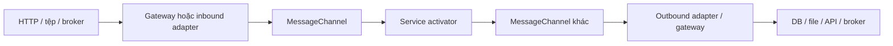
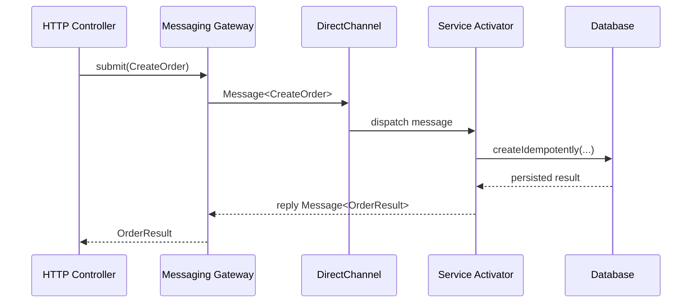
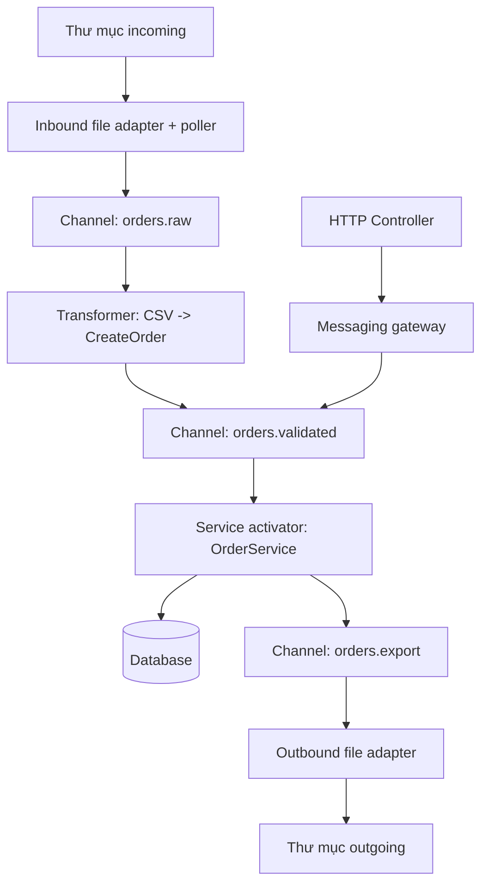

# Channel adapter, messaging gateway và service activator trong Spring Integration

Trong hệ thống Spring Boot, một yêu cầu có thể bắt đầu từ HTTP, được chuyển thành thông điệp nội bộ, gọi dịch vụ nghiệp vụ, truy cập cơ sở dữ liệu, ghi cache Redis và cuối cùng phát sự kiện đến broker. Khi mỗi thành phần tự gọi trực tiếp thành phần tiếp theo, việc thay đổi giao thức, xử lý lỗi hoặc thêm nhánh xử lý thường tạo ra nhiều phụ thuộc. **Spring Integration** cung cấp các mẫu tích hợp theo *Enterprise Integration Patterns* để nối các bước ấy bằng thông điệp và kênh truyền.

Bài học tập trung vào ba loại endpoint hay gặp:

- **Channel adapter:** đưa dữ liệu từ hệ thống bên ngoài vào một `MessageChannel`, hoặc lấy message từ channel để gửi ra ngoài, thường không cần phản hồi tương ứng với từng message.
- **Messaging gateway:** cung cấp cách gọi có dạng request/reply giữa lời gọi Java hoặc một hệ thống bên ngoài với luồng message; có thể chuyển lời gọi phương thức thành message và ánh xạ reply trở lại kết quả phương thức.
- **Service activator:** tiêu thụ message trên một channel để gọi một phương thức Java xử lý nghiệp vụ; có thể trả message kết quả cho bước tiếp theo.

Ba khái niệm liên hệ chặt chẽ nhưng có trách nhiệm khác nhau. Hiểu ranh giới của chúng giúp thiết kế các luồng tích hợp HTTP client, database, cache, message broker và adapter mà vẫn kiểm soát được lỗi, giao dịch, xử lý lặp, kiểm thử và khả năng quan sát.

## 1. Nền tảng: Message, Channel và Endpoint

Một message trong Spring Integration gồm **payload** và **headers**:

```text
Message<CreateOrder>
  payload: CreateOrder(orderId="o-123", customerId="c-456")
  headers:
    id: ...
    timestamp: ...
    correlationId: ...
    replyChannel: ... (nếu có luồng request/reply)
    errorChannel: ... (nếu được cấu hình)
```

- **Payload** chứa dữ liệu nghiệp vụ, ví dụ bản ghi đơn hàng, byte của tệp hoặc đối tượng sự kiện.
- **Header** chứa metadata dùng để định tuyến, liên kết request/reply, truyền thông tin truy vết, hạn xử lý hoặc thông tin giao thức. Header không phải nơi lưu bí mật tùy tiện.
- **Message channel** chuyển message từ producer đến consumer. Channel là trừu tượng truyền thông điệp; nó không mặc nhiên là hàng đợi bền vững.
- **Endpoint** kết nối một thành phần xử lý với channel. Channel adapter, gateway và service activator đều nằm trong nhóm thành phần endpoint theo nghĩa rộng.

Luồng cơ bản:



Sơ đồ diễn tả một khả năng ghép các endpoint, không có nghĩa mọi ứng dụng đều cần đầy đủ sáu bước. Một service activator có thể trả kết quả trực tiếp về gateway thông qua reply channel mà không cần khai báo thêm kênh ra; một adapter có thể kết thúc luồng sau khi ghi tệp.

### 1.1. Các channel thường dùng

| Channel | Cách chuyển message | Khi phù hợp | Điểm cần chú ý |
| --- | --- | --- | --- |
| `DirectChannel` | Gọi handler ngay trên luồng gửi hiện tại | Xử lý đồng bộ, request/reply đơn giản | Handler chậm làm người gửi chậm; exception có thể truyền ngược |
| `ExecutorChannel` | Giao việc cho `TaskExecutor` | Tách thread của producer và consumer | Thread context và transaction không tự truyền theo; cần xử lý timeout, error |
| `QueueChannel` | Lưu message trong hàng đợi nội bộ cho poller lấy | Cần đệm trong một tiến trình | Hàng đợi mặc định nằm trong bộ nhớ, không thay thế broker bền vững |
| `PublishSubscribeChannel` | Phân phối đến các subscriber | Nhiều bước cùng quan tâm một sự kiện nội bộ | Không mặc nhiên có durability, retry hay replay |

Với `DirectChannel`, cần tránh hiểu “dùng message” là “đã chạy bất đồng bộ”. Lệnh `send` có thể thực thi toàn bộ handler trước khi quay về. Với channel có executor hoặc queue, chiều ngược lại cũng đúng: phương thức gửi thành công không chứng minh công việc nghiệp vụ đã hoàn tất.

### 1.2. Chọn endpoint theo hướng và kiểu tương tác

| Nhu cầu | Thành phần khởi đầu | Kiểu phản hồi |
| --- | --- | --- |
| Định kỳ quét thư mục và đưa tệp vào flow | **Inbound channel adapter** | Không có reply cho từng lần đọc |
| Nhận một sự kiện từ broker để xử lý | Inbound adapter có cơ chế listener hoặc message-driven | Thường một chiều; ack theo adapter/broker |
| Phát một message ra file hoặc broker | **Outbound channel adapter** | Không chờ phản hồi nghiệp vụ từ hệ thống đích |
| Gọi API ngoài và cần dữ liệu trả về | **Outbound gateway** | Request/reply từ hệ thống đích |
| Cho controller gọi flow như gọi một Java service | **Messaging gateway** trên interface | Kết quả/exception trở lại caller nếu có reply |
| Chạy phương thức nghiệp vụ trong flow | **Service activator** | Có thể tạo reply hoặc kết thúc flow |

Một inbound gateway khác inbound adapter ở hợp đồng giao tiếp: inbound gateway nhận yêu cầu và gửi kết quả trở lại phía gọi; inbound adapter chỉ cung cấp dữ liệu vào flow. Tương tự, outbound gateway gửi yêu cầu ra ngoài rồi chờ phản hồi; outbound adapter chỉ đẩy dữ liệu đi. “Gateway” vì thế không đồng nghĩa riêng với HTTP API gateway hoặc Spring Cloud Gateway.

## 2. Channel adapter: cầu nối với hệ thống bên ngoài

**Inbound channel adapter** là producer của message nội bộ. Nó biến dữ liệu nhận được từ file, database, mail, hoặc nguồn tích hợp thành message đẩy vào channel.

**Outbound channel adapter** là consumer của message nội bộ. Nó nhận message rồi thực hiện hành động gửi đi: ghi file, gửi mail, publish broker hoặc ghi ra một hệ thống khác.

Hai hướng này khác với việc một service activator gọi Java service thuần túy: adapter thường hiểu giao thức và metadata của nguồn/đích; service activator chủ yếu gọi logic Java được ứng dụng cung cấp.

### 2.1. Inbound: polling và message-driven

Có hai mô hình nhận dữ liệu quan trọng:

1. **Polling:** hệ thống tích hợp chủ động hỏi nguồn theo lịch. File inbound adapter hoặc JDBC polling adapter là ví dụ phổ biến. Cần cấu hình poller, tần suất, số message tối đa mỗi lượt và xử lý khi lỗi.
2. **Message-driven:** nguồn chủ động thông báo cho listener khi có dữ liệu, ví dụ broker gửi message đến consumer. Thông thường không cấu hình poller cho endpoint kiểu này; giới hạn tải và acknowledge phụ thuộc adapter/broker.

Polling không có nghĩa dữ liệu được xử lý đúng một lần. Nếu file vẫn nằm trong thư mục, bộ lọc nhớ tên file bị reset, hoặc DB query không đánh dấu bản ghi đã xử lý, cùng dữ liệu có thể được nhập lại. Cần cơ chế idempotency hoặc checkpoint phù hợp.

#### Ví dụ: nhập CSV từ thư mục bằng Java DSL

Với dependency `spring-boot-starter-integration` và module `spring-integration-file`, có thể xây dựng flow:

```java
@Configuration
public class CsvImportFlowConfig {

    @Bean
    IntegrationFlow csvImportFlow(CsvImportService csvService) {
        return IntegrationFlow
                .from(
                        Files.inboundAdapter(new File("./incoming"))
                                .patternFilter("*.csv"),
                        endpoint -> endpoint.poller(
                                Pollers.fixedDelay(Duration.ofSeconds(5))))
                .handle(File.class, (file, headers) -> {
                    csvService.importFile(file);
                    return null;
                })
                .get();
    }
}
```

Các import chính: `org.springframework.integration.dsl.IntegrationFlow`, `org.springframework.integration.dsl.Pollers`, `org.springframework.integration.file.dsl.Files`, `java.io.File` và `java.time.Duration`. Ứng dụng cần có `CsvImportService` do mình triển khai; mã chỉ mô tả luồng tích hợp, không tự tạo nghiệp vụ đọc CSV.

Ở đây:

- `Files.inboundAdapter(...)` đọc danh sách file theo bộ lọc; nó là **inbound channel adapter**.
- `poller(...)` quyết định khi nào hỏi nguồn. Thời gian năm giây là ví dụ, cần điều chỉnh theo tải và SLA.
- `handle(File.class, ...)` là **service activator** dạng DSL: gọi xử lý Java với payload kiểu `File`, không tạo reply khi trả `null`.

Trong production, file có thể vẫn đang được ghi khi poller nhìn thấy nó. Nên dùng quy ước ghi vào tên tạm rồi **đổi tên nguyên tử** khi hoàn tất (nếu filesystem hỗ trợ), hoặc dùng bộ lọc ổn định kích thước/thời gian và cơ chế claim riêng. Cũng cần chuyển file thành công sang thư mục lưu trữ, đưa file lỗi sang vùng cách ly, và lưu dấu vết nhận diện file (tên, checksum, ID bên nguồn) để tránh xử lý lại sau khi khởi động. Bộ lọc trùng lặp chỉ nhớ trong bộ nhớ không bảo đảm tính nhất quán xuyên restart.

### 2.2. Outbound: ghi dữ liệu ra hệ thống đích

Ví dụ một flow ghi báo cáo văn bản vào thư mục xuất:

```java
@Configuration
public class ReportExportFlowConfig {

    @Bean
    IntegrationFlow reportExportFlow() {
        return IntegrationFlow.from("reports.out")
                .handle(Files.outboundAdapter(new File("./outgoing"))
                        .fileNameGenerator(message -> {
                            Object exportId = message.getHeaders().get("exportId");
                            if (exportId == null) {
                                throw new IllegalArgumentException("Missing exportId");
                            }
                            return "report-" + exportId + ".txt";
                        }))
                .get();
    }
}
```

Flow này giả định payload là kiểu được file-writing adapter hỗ trợ, chẳng hạn `String`, và header `exportId` đã được tạo từ một ID an toàn, không chứa đường dẫn tùy ý. Cần kiểm soát cách ứng xử khi file đã tồn tại: ghi đè, append, từ chối hoặc tạo tên mới theo idempotency key. Không dùng input từ HTTP để ghép trực tiếp tên đường dẫn vì có thể gây path traversal hoặc va chạm tên file.

Đối với broker, outbound adapter có vai trò tương tự nhưng các khái niệm quan trọng bổ sung gồm partition/routing key, xác nhận publish, retry, thứ tự message và khả năng mất kết nối. Câu lệnh gửi message vào adapter chưa chắc đồng nghĩa broker đã lưu bền thành công; phải đọc hợp đồng xác nhận cụ thể của adapter được chọn.

### 2.3. Điểm dừng trách nhiệm của adapter

Channel adapter chuyển đổi giữa giao thức bên ngoài và message nội bộ; nó **không tự động bảo đảm**:

- Dữ liệu được xử lý đúng một lần xuyên nhiều lần restart.
- Việc ghi DB và gửi broker được commit chung một transaction.
- Tự khôi phục được message sau khi một process hoặc một in-memory channel mất dữ liệu.
- Metadata định tuyến, correlation ID hoặc nội dung lỗi luôn giống nhau ở mọi adapter.

Những bảo đảm này phải được quyết định theo giao thức, hệ thống lưu trữ và cấu hình giao dịch thực tế.

## 3. Messaging gateway: giao diện Java và hợp đồng request/reply

Khi mã HTTP controller hoặc business service cần tương tác với flow mà không muốn trực tiếp xây dựng `Message<?>`, có thể khai báo **messaging gateway** trên Java interface. Spring Integration tạo proxy: gọi phương thức → tạo message → gửi qua request channel → nhận reply (nếu phương thức yêu cầu) → chuyển thành kết quả Java.



Đây là request/reply đồng bộ khi dùng `DirectChannel`. Proxy chỉ làm việc nối giao diện Java với hệ thống message; phần nghiệp vụ vẫn nằm trong service activator hoặc service do handler gọi.

### 3.1. Ví dụ chạy theo kiểu Spring Boot

Khai báo dependency Gradle tối thiểu cho luồng Java nội bộ:

```gradle
dependencies {
    implementation 'org.springframework.boot:spring-boot-starter-integration'
}
```

Trong ứng dụng ví dụ, bật xử lý Integration và quét interface gateway:

```java
@SpringBootApplication
@EnableIntegration
@IntegrationComponentScan
public class OrderApplication {
    public static void main(String[] args) {
        SpringApplication.run(OrderApplication.class, args);
    }
}
```

Trong dự án Spring Boot thực tế, một số cấu hình Integration đã được auto-configure. Ví dụ chủ động khai báo annotation để thể hiện điều kiện tạo gateway; cần đặt package hoặc `basePackages` sao cho component scan thấy interface.

Định nghĩa hợp đồng dữ liệu và Java gateway:

```java
public record CreateOrder(
        String requestId,
        String customerId,
        BigDecimal total) {
}

public record OrderResult(
        String orderId,
        String status) {
}

@MessagingGateway
public interface OrderMessagingGateway {
    @Gateway(
            requestChannel = "orders.in",
            requestTimeout = 1_000,
            replyTimeout = 5_000)
    OrderResult submit(CreateOrder command);
}
```

Các import cho gateway là `org.springframework.integration.annotation.MessagingGateway` và `org.springframework.integration.annotation.Gateway`; record cần `java.math.BigDecimal`. Hai giá trị timeout trên tính bằng mili giây. Gateway gửi request đến channel `orders.in`, sau đó nhận reply từ endpoint downstream và chuyển payload về kiểu `OrderResult`.

Định nghĩa channel và service activator:

```java
@Configuration
public class OrderChannelsConfig {
    @Bean("orders.in")
    MessageChannel ordersInputChannel() {
        return new DirectChannel();
    }
}

@Component
public class OrderMessageHandler {
    private final OrderService orderService;

    public OrderMessageHandler(OrderService orderService) {
        this.orderService = orderService;
    }

    @ServiceActivator(inputChannel = "orders.in")
    public OrderResult create(CreateOrder command) {
        return orderService.createIdempotently(command);
    }
}
```

`OrderService` là service nghiệp vụ do ứng dụng cung cấp. Nó kiểm tra dữ liệu, thực hiện transaction DB, giữ unique constraint theo `requestId` hoặc một idempotency key phù hợp và trả `OrderResult`. Handler ở trên không cấu hình `outputChannel`, vì khi gateway gửi request nó kèm thông tin reply để endpoint trả kết quả về đúng lời gọi đang chờ.

Các import liên quan: `org.springframework.messaging.MessageChannel`, `org.springframework.integration.channel.DirectChannel` và `org.springframework.integration.annotation.ServiceActivator`, cùng các annotation Spring.

HTTP controller có thể sử dụng interface như một dependency thông thường:

```java
@RestController
@RequestMapping("/orders")
public class OrderController {
    private final OrderMessagingGateway gateway;

    public OrderController(OrderMessagingGateway gateway) {
        this.gateway = gateway;
    }

    @PostMapping
    public ResponseEntity<OrderResult> create(
            @RequestBody CreateOrder command) {
        OrderResult result = gateway.submit(command);
        return ResponseEntity.status(HttpStatus.CREATED).body(result);
    }
}
```

Ví dụ gồm các lớp/record đặt cùng dự án, giả định bean `OrderService` tồn tại và có `createIdempotently(CreateOrder)` trả về `OrderResult`. Spring MVC, nếu cần, phải có dependency web tương ứng. Việc chuyển exception sang HTTP 4xx/5xx và xử lý request trùng được đặt ở service/controller advice, không tự phát sinh từ annotation gateway.

### 3.2. Request timeout và reply timeout có giới hạn

- **Request timeout:** liên quan đến thời gian thử gửi message khi channel có thể chặn việc gửi, chẳng hạn channel có hàng đợi đầy. Không phải “kill switch” cho bất kỳ xử lý HTTP/DB nào vượt quá thời gian đó.
- **Reply timeout:** thời gian gateway đợi reply trong mô hình thực sự phải chờ message phản hồi. Với `DirectChannel` gọi handler đồng bộ trên thread hiện tại, một handler đang chặn ở DB/HTTP có thể làm cả lời gọi chặn lâu hơn giá trị cấu hình.
- **Timeout ở bên ngoài:** HTTP client, JDBC query, broker client và thread pool cần timeout riêng. Timeout của gateway không mặc nhiên hủy thao tác từ xa đã bắt đầu.

Phải định nghĩa kết quả khi không nhận được reply, khi reply có payload sai kiểu và khi handler ném exception. Phương thức trả kiểu `void` phù hợp một chiều hơn; nếu API cần xác nhận nghiệp vụ đã commit, không nên trả thành công chỉ vì đã gửi message vào channel async.

### 3.3. Mapping payload và header

Gateway và service activator có thể nhận object payload hoặc message với metadata:

```java
@ServiceActivator(inputChannel = "orders.in")
public OrderResult create(
        CreateOrder command,
        @Header(name = "correlationId", required = false)
        String correlationId) {
    return orderService.createIdempotently(command, correlationId);
}
```

Đây là **biến thể** của handler phía trên, không khai báo đồng thời cả hai phương thức cùng tiêu thụ `orders.in` trong một ví dụ ứng dụng. Muốn header `correlationId` tồn tại, producer/gateway phải thiết lập nó rõ ràng hoặc dùng cơ chế truyền metadata thích hợp. Đừng kỳ vọng mọi header HTTP được chuyển tự động thành header Spring Integration; cần quy tắc mapping và lọc các header không đáng tin cậy.

Header `replyChannel` và `errorChannel` có thể là đối tượng channel nội bộ thay vì chuỗi có ý nghĩa với hệ thống bên ngoài. Khi serialize message qua broker hay hệ thống khác, phải thiết kế cách mang correlation ID và reply destination có thể trao đổi an toàn giữa các process.

## 4. Service activator: nơi thực thi hành động nghiệp vụ

**Service activator** lắng nghe một input channel, nhận message, chuyển payload/headers thành tham số phương thức và gọi một POJO. Nếu phương thức trả về giá trị, Spring Integration có thể biến giá trị đó thành reply message để gửi đến `outputChannel` được cấu hình hoặc đến `replyChannel` của request.

Về khái niệm:

```text
inputChannel -> service activator -> POJO method
                                   |-- trả object -> reply
                                   |-- trả Message<?> -> reply gồm payload/headers
                                   |-- void/null -> không tạo reply
                                   |-- throws -> luồng xử lý lỗi
```

Service activator có thể khai báo bằng `@ServiceActivator` như ví dụ trên, hoặc qua Java DSL `.handle(...)`. Hình thức DSL hữu ích khi cần nhìn thấy một flow liên tục:

```java
@Bean
IntegrationFlow orderBusinessFlow(OrderService orderService) {
    return IntegrationFlow.from("orders.in")
            .handle(CreateOrder.class,
                    (command, headers) ->
                            orderService.createIdempotently(command))
            .get();
}
```

Đây là **cách thay thế** cho handler `@ServiceActivator(inputChannel = "orders.in")` trong ví dụ trước. Khi chạy thực tế, chỉ chọn **một** endpoint có trách nhiệm xử lý một yêu cầu nếu không chủ đích tạo nhiều consumer cạnh tranh. Việc đăng ký cả hai lên một `DirectChannel` có thể khiến các message được phân phối cho những subscriber khác nhau thay vì chạy cả hai bước theo thứ tự mong đợi.

### 4.1. Khi nào service activator tạo reply?

| Chữ ký xử lý | Hành vi thường gặp | Tình huống |
| --- | --- | --- |
| `OrderResult handle(CreateOrder order)` | Trả kết quả để Integration đóng gói thành reply | Gateway cần kết quả |
| `Message<OrderResult> handle(CreateOrder order)` | Trả payload và headers do ứng dụng định nghĩa | Muốn truyền thêm metadata |
| `void handle(CreateOrder order)` | Hoàn tất mà không tạo reply | Log, gửi tác vụ một chiều |
| `OrderResult handle(Message<CreateOrder> msg)` | Đọc payload và headers | Cần correlation, tenant hoặc tracing |
| Handler ném exception | Không tạo reply thành công; áp dụng đường xử lý lỗi của endpoint | Retry, chuyển lỗi về caller hoặc error channel |

Nếu method trả `null` cho một gateway có kiểu trả về cần dữ liệu, caller có thể hết thời gian chờ hoặc gặp tình huống không có reply tùy cấu hình. Hãy ghi rõ hợp đồng của từng flow: đầu vào, kiểu trả về, timeout và lỗi dự kiến.

### 4.2. Không trộn điều phối message với nghiệp vụ cốt lõi

Một service activator gọn thường:

1. Nhận command/event đã có hợp đồng dữ liệu.
2. Xác minh metadata bắt buộc như tenant, source ID, idempotency key.
3. Gọi service nghiệp vụ hoặc cổng truy cập hạ tầng có timeout rõ ràng.
4. Trả kết quả hoặc ném lỗi được phân loại để tầng tích hợp xử lý.

Business service nên giữ kiểm tra invariant và transaction DB, thay vì phụ thuộc sâu vào các kiểu `Message<?>` của Spring Integration. Nhờ đó có thể unit test nghiệp vụ độc lập và integration test riêng cách kênh, handler, reply, retry hoạt động.

## 5. Ghép ba thành phần thành luồng tích hợp thực tế

Giả sử hệ thống thương mại nhận một file CSV chứa đơn hàng từ đối tác, kiểm tra dữ liệu, lưu DB và xuất kết quả sang thư mục cho đối tác tải xuống:



Sơ đồ là kiến trúc tham khảo; các nhánh bắt đầu từ file và từ HTTP có thể khác nhau về yêu cầu phản hồi, giao dịch và cách nạp dữ liệu. Một gateway đồng bộ cần kết quả từ service activator, trong khi một file inbound adapter có thể chỉ cần ghi báo cáo cuối cùng. Nếu cả hai tuyến dùng chung service xử lý đơn hàng, idempotency ở DB cần che chắn việc cùng một đơn hàng đến từ nhiều nguồn.

### 5.1. Chọn rõ kiểu xử lý ở từng ranh giới

- **HTTP → gateway → DirectChannel → service activator:** thích hợp khi controller phải trả kết quả ngay và công việc có thời gian thực thi nằm trong SLA HTTP.
- **HTTP → enqueue bền vững → consumer → service activator:** thích hợp khi công việc có thể kéo dài; HTTP trả `202 Accepted` kèm operation ID, client theo dõi trạng thái qua endpoint khác.
- **Poller → inbound adapter → service activator:** thích hợp để nhập file hoặc quét dữ liệu ngoài; phải tính đến shutdown, restart, duplicate và lỗi từng bản ghi.
- **Service activator → outbound adapter:** thích hợp để ghi/phát dữ liệu một chiều. Nếu phải chờ kết quả từ API ngoài, cân nhắc outbound gateway tương ứng.

Trong một flow có thể phối hợp transformer, filter, router, splitter, aggregator và nhiều channel. Service activator làm công việc bên trong từng bước; adapter và gateway xác định cách giao tiếp ở biên hệ thống.

### 5.2. Trường hợp chọn gateway ra ngoài thay vì outbound adapter

Một service cần gọi HTTP đối tác để kiểm tra số dư và **phải biết** đối tác trả kết quả gì. Khi ấy outbound HTTP gateway là mẫu phù hợp hơn outbound adapter gửi không chờ reply:

```text
Service Activator -> request channel
                  -> HTTP Outbound Gateway
                  -> HTTP response -> reply channel -> handler tiếp theo
```

HTTP outbound gateway vẫn cần cấu hình URI, HTTP method, serializer, các mã trạng thái được chấp nhận, connect/read timeout và chính sách retry. Với POST không idempotent, retry tự động sau timeout có thể tạo tác dụng phụ hai lần, nên phải phối hợp idempotency key và trạng thái đã commit bên phía đối tác.

## 6. Lỗi và timeout: khác nhau giữa flow đồng bộ và bất đồng bộ

Hành vi lỗi phụ thuộc rất nhiều vào channel và loại endpoint.

| Luồng | Khi handler lỗi | Ai có thể nhận biết? | Cần quyết định |
| --- | --- | --- | --- |
| Gateway + `DirectChannel` | Exception thường truyền về lời gọi gửi/gateway | Caller, ví dụ HTTP controller | Mapping lỗi HTTP, retry, transaction |
| Polling inbound adapter | Lỗi xuất hiện trong chu kỳ poll | Poller/error handler, hệ thống giám sát | Retry file/record, quarantine, tránh lặp vô hạn |
| `ExecutorChannel` hoặc async handler | Lỗi nằm trên thread xử lý | Error flow/`errorChannel` hoặc callback được cấu hình | Không báo HTTP thành công như thể đã commit |
| Broker inbound adapter | Lỗi khi xử lý message | Adapter/broker listener | Ack/nack, redelivery, DLQ, retry budget |
| Outbound adapter | Gửi/ghi có thể thất bại hoặc chưa xác nhận | Endpoint gửi và cơ chế callback/ack | Publish confirmation, retry, outbox |

Spring Integration hỗ trợ **error message** và **error channel** để điều phối các lỗi bất đồng bộ. Tuy nhiên, khai báo một `errorChannel` không có nghĩa hệ thống tự retry thành công hay giữ được message sau process crash. Cần phân biệt:

- **Lỗi nghiệp vụ không nên retry:** dữ liệu sai schema, đơn hàng không hợp lệ, thiếu quyền.
- **Lỗi tạm thời có thể retry:** HTTP 503, DB deadlock, broker tạm ngắt; có backoff, jitter, giới hạn số lần.
- **Kết quả không xác định:** timeout sau khi gọi API tạo đơn hàng hoặc sau khi gửi broker; phải tra trạng thái bằng idempotency key thay vì gửi lại mù quáng.
- **Lỗi hệ thống kéo dài:** có cảnh báo, DLQ/quarantine hoặc dừng nguồn nhận để tránh tích lũy và quá tải.

Một số endpoint hỗ trợ retry advice như `RequestHandlerRetryAdvice`. Nếu retry đặt ở handler có side effect, cần chắc chắn một lần thử thất bại không để lại tác động đã commit rồi bị lặp. Retry chỉ là cơ chế thử lại; nó không tự cung cấp exactly-once.

### 6.1. Giao dịch DB không bao trùm mọi channel

Với `DirectChannel`, handler chạy trên cùng thread nên có thể cùng tham gia transaction do tầng gọi thiết lập, tùy nơi đặt `@Transactional`. Khi chuyển sang `ExecutorChannel`, việc thực thi chuyển thread và transaction context của Spring thông thường không truyền sang thread mới. Với poller hoặc broker listener, ranh giới transaction được khởi tạo theo cấu hình nguồn và handler, không tự lan sang các hệ thống bên ngoài.

Nếu cần lưu đơn hàng vào DB và phát message broker nhất quán, mẫu **transactional outbox** thường phù hợp: ghi đơn hàng và bản ghi sự kiện vào cùng transaction DB; tác vụ riêng phát outbox ra broker, đánh dấu trạng thái sau khi nhận xác nhận và retry có kiểm soát. Consumer dùng event ID để xử lý trùng. Không có một annotation Integration nào tự tạo giao dịch nguyên tử giữa SQL và mọi API/broker.

## 7. Correlation, idempotency và hợp đồng dữ liệu

Khi luồng đi qua nhiều adapter hoặc gateway, cần thống nhất hợp đồng dữ liệu:

| Thành phần hợp đồng | Ví dụ | Mục đích |
| --- | --- | --- |
| Message type/schema | `CreateOrderV1` với field và validation | Phát hiện dữ liệu không tương thích |
| Message identity | Event ID hoặc source record ID | Chống xử lý trùng, audit |
| Correlation ID | Request ID truyền theo cả hành trình | Nối log/trace của các bước |
| Causation ID | ID message dẫn đến sự kiện tiếp theo | Hiểu chuỗi nguyên nhân |
| Idempotency key | Tenant + operation + client request ID | Xử lý retry an toàn |
| Timeout/deadline | Thời hạn xử lý nghiệp vụ | Chặn công việc quá SLA |
| Source/tenant | Định danh nguồn tin cậy sau xác thực | Định tuyến và cách ly dữ liệu |

Message header `id` do framework tạo cho mỗi message không mặc nhiên là định danh nghiệp vụ bền vững. Khi gửi qua broker, chuyển đổi payload hoặc retry, message mới có thể nhận ID khác. Muốn chống trùng xuyên các ranh giới, cần một **business ID/event ID ổn định** do nguồn tạo hoặc được lưu bền ở hệ thống nhận.

Service activator nên xác thực những trường ảnh hưởng đến nghiệp vụ; không tin một header do bên ngoài tùy ý gửi vào chỉ vì nó mang tên `tenantId` hoặc `authenticatedUser`. Metadata về danh tính/ủy quyền cần được tạo hoặc kiểm tra tại biên đã xác thực.

Với request/reply qua nhiều hệ thống, phải gắn correlation ID để ghép kết quả về đúng request. Nếu reply có thể đến muộn sau timeout, cần cơ chế bỏ qua, lưu trạng thái hoặc lưu kết quả để truy vấn sau. Không nên giữ một HTTP request mở vô thời hạn chỉ để chờ luồng xử lý kéo dài.

## 8. Capacity, backpressure và vận hành

Thông điệp chạy qua Spring Integration không loại bỏ giới hạn tài nguyên. Một flow nhận file nhanh hơn khả năng ghi DB có thể làm tăng hàng đợi, giữ nhiều thread hoặc quá tải downstream.

Các thông số cần kiểm soát tùy mô hình:

- **Poller:** chu kỳ, số message mỗi lượt, số poller chạy đồng thời, tốc độ ingest và cách pause khi downstream quá tải.
- **Executor channel:** kích thước thread pool, hàng đợi chờ, chính sách khi hàng đợi đầy; không dùng thread pool không giới hạn.
- **Broker consumer:** concurrency, prefetch/batch size, ack, visibility/lock timeout, retry và dead-letter.
- **HTTP gateway:** connect timeout, read/response timeout, pool kết nối, giới hạn retry và circuit breaker.
- **Downstream:** connection pool DB, timeout query, hạn ngạch Redis/broker và bảo vệ các dependency chia sẻ.

Nếu một luồng xử lý 100 message/giây trong khi nguồn gửi 1.000 message/giây, độ trễ và lượng message chờ sẽ tăng liên tục nếu không giới hạn tốc độ hoặc mở rộng năng lực xử lý. Một `QueueChannel` nằm trong bộ nhớ chỉ trì hoãn vấn đề và có thể mất dữ liệu khi tiến trình dừng.

Về quan sát, nên ghi nhận:

1. Lưu lượng và latency từng endpoint/channel quan trọng, phân biệt độ trễ chờ với độ trễ xử lý.
2. Tỷ lệ lỗi theo loại, số lần retry, độ tuổi message tồn và số phần tử trong hàng đợi.
3. Độ trễ, timeout, tình trạng pool kết nối của DB/HTTP/Redis/broker.
4. Correlation ID, operation ID, endpoint name trong log/trace; loại bỏ bí mật và payload nhạy cảm.
5. Số file/bản ghi thành công, thất bại, đưa vào quarantine hoặc DLQ và thời gian khôi phục.

Spring Integration có thành phần thu thập metrics/management và có thể kết hợp Micrometer, Actuator và tracing theo phiên bản/dự án; tên metric, cách bật và mức chi tiết cần xác minh với cấu hình runtime đang dùng. Không mặc định tất cả message đều được trace hoặc tất cả handler tự phát sinh cảnh báo.

## 9. Chiến lược kiểm thử có ý nghĩa

Tách kiểm thử thành hai lớp: kiểm tra logic nghiệp vụ của `OrderService` và kiểm tra **wiring thực** giữa gateway, channel, handler, adapter.

| Bài kiểm thử | Kết quả cần chứng minh |
| --- | --- |
| Gọi `OrderMessagingGateway.submit(...)` với service hợp lệ | Payload được chuyển đúng vào `orders.in`; handler trả `OrderResult` đúng kiểu |
| Service activator ném lỗi domain | Gateway/HTTP caller nhận lỗi theo hợp đồng, không biến lỗi thành kết quả thành công |
| Handler trả `null` nhưng gateway đòi reply | Phát hiện hành vi không có reply, cấu hình timeout phù hợp |
| Handler chặn ở HTTP/DB | Không giả định gateway timeout sẽ ngắt được thao tác đang chạy |
| Hai request cùng `requestId` | DB chỉ tạo một hiệu ứng nghiệp vụ, retry nhận kết quả hợp lệ |
| File inbound được phát hiện khi đang ghi | Không đọc file dở dang; bộ lọc/rename hoạt động |
| File đã xử lý, ứng dụng restart | Idempotency/checkpoint ngăn import trùng |
| Outbound adapter gặp lỗi I/O | Có retry giới hạn, quarantine hoặc cơ chế khôi phục; không báo đã xuất thành công |
| Consumer broker bị redelivery | Side effect vẫn idempotent; ack chỉ khi đạt điều kiện đã định |
| Executor/poller bị quá tải | Không tăng queue vô hạn; thấy được lỗi và chỉ số backlog |

Với luồng thuần Java, integration test có thể khởi động Spring context rồi gọi interface gateway thật, dùng service phụ thuộc được kiểm soát để xác nhận input/output. Với file adapter nên dùng thư mục tạm, file mẫu và thời gian poller có giới hạn; dọn dữ liệu sau test. Với DB/Redis/broker nên ưu tiên Testcontainers hoặc môi trường tích hợp tương đương để kiểm chứng transaction, retry và duplicate trên hạ tầng thực.

Khi dùng các tiện ích kiểm thử riêng của Spring Integration (ví dụ mô-đun `spring-integration-test`), cần xác định chính xác phiên bản, class và annotation có sẵn; không nên viết test chỉ dựa trên việc mock `MessageChannel` rồi kết luận gateway/adapter đã kết nối đúng.

## 10. Những nhầm lẫn thường gặp

| Nhầm lẫn | Cách hiểu đúng |
| --- | --- |
| “Dùng Spring Integration thì xử lý luôn async.” | `DirectChannel` chạy đồng bộ; async chỉ xảy ra khi chọn channel/endpoint và executor phù hợp. |
| “Channel adapter cũng nhận reply như gateway.” | Adapter thường xử lý một chiều; gateway có hợp đồng request/reply. |
| “Service activator chỉ là một Java service thông thường.” | Nó là endpoint có trách nhiệm nhận message từ channel, chọn phương thức và chuyển kết quả/lỗi trở lại flow. |
| “Gọi gateway return thành công nghĩa broker đã nhận message bền vững.” | Còn phụ thuộc loại channel, handler, adapter và xác nhận của hệ thống đích. |
| “`replyTimeout` giới hạn cứng thời gian chạy handler.” | Không hủy được handler/HTTP/DB đang chặn trên `DirectChannel`. |
| “`QueueChannel` tương đương Kafka/RabbitMQ.” | Hàng đợi nội bộ mặc định không cung cấp durability, consumer group hay khả năng replay như broker. |
| “Có `@Transactional` thì DB + HTTP + broker cùng rollback.” | Ranh giới transaction riêng; cần outbox, idempotency và cơ chế đối soát thích hợp. |
| “Mỗi message có ID duy nhất nên không bị xử lý lặp.” | ID framework không thay thế business event ID ổn định qua retry và adapter. |
| “Gắn hai handler vào `DirectChannel` thì cả hai đều chạy.” | `DirectChannel` có dispatching tới một subscriber phù hợp, không phải broadcast; dùng flow tuần tự hoặc publish-subscribe nếu cần nhiều nhánh. |

## 11. Checklist thiết kế một luồng integration

Trước khi triển khai, hãy trả lời đầy đủ các câu hỏi:

1. **Nguồn và đích:** dữ liệu đến từ HTTP, file, database hay broker? Cần inbound/outbound adapter hay gateway request/reply?
2. **Hợp đồng:** payload/schema/version nào? Correlation ID, idempotency key, tenant và deadline được tạo, xác thực và truyền như thế nào?
3. **Kênh:** xử lý đồng bộ hay bất đồng bộ? Channel nào phù hợp với thông lượng, thread, transaction và mức bền vững cần đạt?
4. **Endpoint nghiệp vụ:** service activator gọi service nào, trả reply gì, và hành vi khi thiếu reply hoặc ném exception ra sao?
5. **Độ tin cậy:** ack, retry, backoff, DLQ/quarantine, outbox, unique constraint và phương án khôi phục sau restart ở đâu?
6. **Hiệu năng và quan sát:** timeout theo từng dependency, giới hạn concurrency, backlog, metrics, tracing và cảnh báo đã được xác định chưa?
7. **Kiểm thử:** đã chứng minh wiring thực, request/reply, lỗi, duplicate, timeout và các trạng thái hệ thống ngoài không sẵn sàng chưa?

**Ghi nhớ vai trò:** channel adapter đưa dữ liệu **vào/ra hệ thống**, messaging gateway cung cấp **lời gọi và phản hồi có hợp đồng**, service activator thực thi **hành động Java trên message**. Spring Integration giúp ghép các phần này thành luồng rõ ràng; các bảo đảm về giao dịch, chống trùng, độ bền dữ liệu và khôi phục vẫn phải được thiết kế trên toàn bộ hành trình giữa HTTP, DB, cache và broker.
