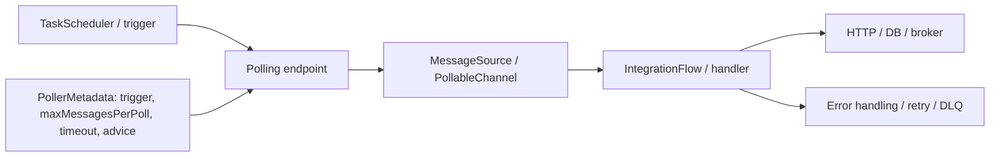
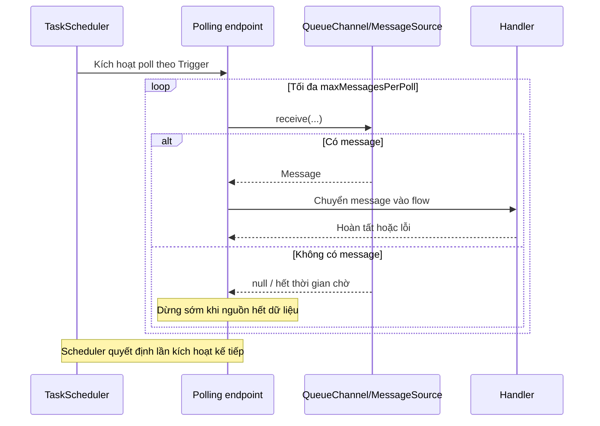
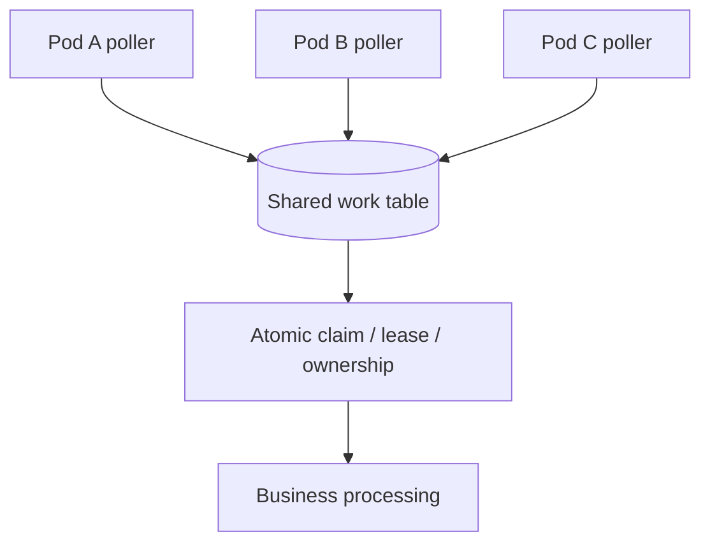

# PollerMetadata, TaskScheduler và spring.integration.poller.*

## 1. Vì sao Spring Integration cần poller?

Trong **Spring Boot Integration**, một hệ thống có thể chủ động nhận HTTP request hoặc message từ broker, nhưng cũng có những nguồn dữ liệu **không chủ động đẩy sự kiện**. Ví dụ: truy vấn bảng outbox còn chờ gửi, lấy phần tử từ `QueueChannel`, đọc file trong thư mục, hỏi một API định kỳ hoặc lấy công việc đang chờ từ một kho dữ liệu. Những trường hợp này cần một thành phần chủ động **kiểm tra nguồn theo lịch**.

**Poller** của Spring Integration trả lời ba nhóm câu hỏi: *khi nào* thử lấy dữ liệu, *mỗi đợt thử lấy bao nhiêu phần tử* và *cách xử lý khi nhận được dữ liệu hoặc gặp lỗi*. Poller xuất hiện ở các endpoint như `SourcePollingChannelAdapter` (lấy từ `MessageSource`) hoặc `PollingConsumer` (lấy từ `PollableChannel`). Poller không phải một message broker, không tự biến truy vấn thành giao dịch phân tán và cũng không đảm bảo exactly-once.

Một ví dụ: cứ hai giây kiểm tra một hàng outbox đã sẵn sàng, chuyển nó thành `Message<?>`, rồi gọi một HTTP gateway và cập nhật trạng thái gửi. Nếu poller chạy quá nhanh, database và HTTP API bị quá tải; nếu quá chậm, backlog tăng. Nếu có nhiều instance cùng poll, phải bảo đảm mỗi hàng được **claim/lease một cách nguyên tử** và mọi lần retry đều an toàn.



### 1.1. Polling khác với event-driven consumer

| Cơ chế | Ai chủ động kích hoạt? | Ví dụ | Cần poller riêng? |
| --- | --- | --- | --- |
| `MessageSource` kiểu pull | Endpoint gọi `receive()` theo lịch | File-reading source, JDBC polling source, nguồn công việc tùy biến | Thường có |
| `PollableChannel` | Endpoint gọi `receive(...)` trên channel | `QueueChannel` | Có khi dùng làm đầu vào endpoint |
| `SubscribableChannel` | Publisher gửi message tới subscriber | `DirectChannel`, `PublishSubscribeChannel` | Không cần chỉ để nhận từ channel |
| HTTP inbound gateway | Web server nhận request | REST endpoint | Không |
| Kafka/Rabbit listener | Listener/container của broker điều phối nhận message | `@KafkaListener`, `@RabbitListener` | Không dùng poller Spring Integration kiểu này chỉ để nhận broker |
| Scheduler chạy job | Lịch kích hoạt logic nghiệp vụ | Quartz Job, `@Scheduled` | Là khái niệm lịch khác, không thay thế poller metadata của SI |

Không phải mọi thao tác có chữ “poll” đều thuộc cùng API. Một Kafka consumer có lệnh `poll()` trong client library nhưng vòng đời và cấu hình của nó **khác** `PollerMetadata` của Spring Integration. Tương tự, Quartz điều phối job theo trigger nhưng không tự thay thế cơ chế nhận message từ `MessageSource`.

## 2. Ba thành phần dễ nhầm lẫn

### 2.1. `PollerMetadata`: chính sách của một polling endpoint

`org.springframework.integration.scheduling.PollerMetadata` chứa cấu hình mà endpoint polling sử dụng. Các thành phần đáng quan tâm:

| Thành phần | Công dụng | Cần lưu ý |
| --- | --- | --- |
| `Trigger` | Xác định lịch kích hoạt: fixed delay, fixed rate, cron hoặc trigger tùy biến | Có thể bị chậm khi scheduler thiếu thread |
| `maxMessagesPerPoll` | Giới hạn số lần nhận message trong mỗi phiên poll | Không phải số thread hay tổng message/giây |
| `receiveTimeout` | Thời gian chờ nhận ở các nguồn/channel hỗ trợ thao tác chờ | Không áp dụng giống nhau cho mọi `MessageSource` |
| `TaskExecutor` tùy chọn | Có thể tách phần xử lý khỏi thread được scheduler dùng | Cần giới hạn concurrency, tài nguyên và in-flight |
| `Advice` / transaction | Bao quanh thao tác poll bằng retry, transaction hoặc logic điều khiển | Ranh giới transaction khác nhau tùy endpoint, advice và nguồn |
| `Error handling` | Tùy đường chạy, chuyển lỗi tới error flow hoặc error handler phù hợp | Không được giả định mọi exception tự đi đến cùng một `errorChannel` |

**PollerMetadata không phải bộ lập lịch tự chạy.** Nó mô tả chính sách; một polling endpoint sử dụng thông tin đó và đăng ký công việc với scheduler.

### 2.2. `TaskScheduler`: bộ phận quyết định khi nào chạy

`org.springframework.scheduling.TaskScheduler` là abstraction lên lịch task của Spring Framework. Trong tích hợp, scheduler tính thời điểm chạy tiếp theo dựa vào `Trigger`, sắp xếp nhiệm vụ lên các thread của scheduler và gọi thao tác poll.

Một `ThreadPoolTaskScheduler` có pool size giới hạn. Nếu tất cả thread bị chiếm bởi các thao tác receive/handler chậm, **những poller khác có thể chạy trễ**, ngay cả khi cấu hình cron hoặc fixed delay của chúng không đổi. Vì vậy, “poller chạy mỗi 1 giây” là **ý định lịch**, không phải cam kết latency chính xác đến từng giây dưới tải nặng.

### 2.3. `TaskExecutor`: xử lý đồng thời không đồng nhất với lịch

`TaskExecutor` quyết định cách chạy công việc được giao cho nó, có thể nằm trên thread khác và có hàng đợi/giới hạn riêng. Nếu poller được cấu hình executor, polling và xử lý message có thể có đặc tính concurrency khác khi chạy đồng bộ trên scheduler thread.

**Không đánh đồng:**

- `TaskScheduler` quyết định *khi nào* một tác vụ poll được lên lịch.
- `PollerMetadata` quyết định *chính sách poll* của endpoint.
- `TaskExecutor` quyết định *cách thực thi* khi endpoint/poller được cấu hình để dùng executor.

Thêm executor không tự bảo đảm thứ tự message, transaction trên cùng thread hoặc giới hạn số request tới API ngoài. Nếu gửi quá nhiều nhiệm vụ vào executor có hàng đợi không giới hạn, hệ thống chỉ chuyển điểm nghẽn từ poller sang bộ nhớ/connection pool.



Sơ đồ là mô hình **poller xử lý đồng bộ** để dễ hiểu; nếu cấu hình executor, hành vi bàn giao tác vụ và độ đồng thời thay đổi. Thời gian xử lý downstream có thể ảnh hưởng trực tiếp tới thời điểm kết thúc một poll.

## 3. Toàn cục: cấu hình `spring.integration.poller.*` trong Spring Boot

Khi dùng Spring Boot với Spring Integration auto-configuration tương ứng, có thể thiết lập **default poller** cho những polling endpoint không tự khai báo poller:

```yaml
spring:
  integration:
    poller:
      fixed-delay: 2s
      max-messages-per-poll: 5
      receive-timeout: 200ms
```

Các thuộc tính nêu trên thường được hỗ trợ trong các dòng Spring Boot hiện đại có tích hợp Spring Integration. Đọc chính xác tên thuộc tính, giá trị mặc định và phạm vi áp dụng trong metadata cấu hình **của phiên bản Spring Boot đang chạy**. Các tùy chọn của `PollerMetadata` phong phú hơn những thuộc tính mà Boot cung cấp trực tiếp dưới prefix này.

| Thuộc tính | Ý nghĩa | Không có nghĩa |
| --- | --- | --- |
| `spring.integration.poller.fixed-delay` | Độ trễ giữa lúc một lần poll kết thúc và lần poll tiếp theo bắt đầu theo trigger fixed-delay | Không cam kết có một message mới mỗi khoảng đó |
| `spring.integration.poller.max-messages-per-poll` | Số message tối đa được poller thử xử lý trong một đợt | Không phải kích thước thread pool |
| `spring.integration.poller.receive-timeout` | Thời gian có thể chờ lấy một message ở nguồn nhận có hỗ trợ timeout | Không phải HTTP read timeout hoặc JDBC query timeout |

Ví dụ trên là **chính sách mặc định**. Một endpoint đã gắn poller riêng bằng Java DSL, XML hoặc annotation có thể dùng cấu hình endpoint đó thay vì mặc định. Vì vậy, nếu thay `spring.integration.poller.fixed-delay` mà một luồng không đổi nhịp, phải kiểm tra xem luồng có khai báo poller riêng không.

### 3.1. Default poller không áp dụng cho mọi luồng

`spring.integration.poller.*` **không phải** cấu hình chung cho tất cả consumer:

- Không quyết định `@KafkaListener` fetch size, consumer group hay `max.poll.records`.
- Không thay thế RabbitMQ prefetch/ack mode của listener container.
- Không quyết định timeout của `RestClient`, `WebClient`, R2DBC hoặc Redis client.
- Không thiết lập trigger của Quartz.
- Không thay đổi tốc độ của một `DirectChannel` vốn được kích hoạt khi producer gửi message.

Phải xác định endpoint nào thực sự dùng **default PollerMetadata** trước khi thay đổi các thuộc tính toàn cục. Trong hệ thống có nhiều nguồn cùng polling, tăng max messages cho mọi endpoint có thể làm một nguồn áp đảo tài nguyên và kéo trễ nguồn khác.

### 3.2. Tránh cấu hình nhầm các lựa chọn trigger

Ở mức framework, `Pollers.fixedDelay(...)`, `Pollers.fixedRate(...)` và `Pollers.cron(...)` diễn tả những kiểu lịch khác nhau. Không nên suy đoán mọi lựa chọn Java DSL đều có property cùng tên dưới `spring.integration.poller.*` của tất cả phiên bản Spring Boot. Khi cần cron, fixed-rate phức tạp, advice hoặc scheduler riêng, hãy **khai báo poller tường minh** và kiểm thử hành vi thực tế.

## 4. Khai báo default `PollerMetadata` bằng bean Java

Một cách thay thế cấu hình property của Boot là chủ động khai báo default poller ở mức Spring Integration:

```java
import java.time.Duration;
import org.springframework.context.annotation.Bean;
import org.springframework.context.annotation.Configuration;
import org.springframework.integration.dsl.Pollers;
import org.springframework.integration.scheduling.PollerMetadata;

@Configuration
public class IntegrationPollerConfiguration {

    @Bean(name = PollerMetadata.DEFAULT_POLLER)
    public PollerMetadata defaultPoller() {
        return Pollers.fixedDelay(Duration.ofSeconds(2))
                .maxMessagesPerPoll(5)
                .getObject();
    }
}
```

`PollerMetadata.DEFAULT_POLLER` là tên bean đặc biệt mà Spring Integration tra cứu khi một endpoint polling cần cấu hình mặc định. Trong ứng dụng Boot, có thể có cơ chế tự cấu hình default poller; **không khai báo hai bean trùng tên** và đừng trộn bean tùy biến với property toàn cục mà chưa xác định cách auto-configuration lùi lại theo bean hiện có.

Quy tắc chọn:

1. Muốn chỉnh một tập thông số đơn giản cho **default poller** và không cần advice/trigger đặc thù: ưu tiên cấu hình property của Boot phù hợp phiên bản.
2. Muốn default poller phức tạp hoặc quy tắc dùng bean riêng: khai báo `PollerMetadata` có tên mặc định.
3. Muốn chỉ một luồng khác nhịp/giới hạn: gắn poller **trực tiếp vào endpoint đó**, không thay default toàn ứng dụng.

Trường hợp có nhiều scheduler cũng cần biết **scheduler nào mà polling endpoint thực sự đang dùng**, không chỉ nhìn số lượng bean `TaskScheduler` có trong context.

## 5. Poller riêng cho một `IntegrationFlow`

Giả sử ứng dụng có một `QueueChannel` chứa các sự kiện cần xử lý lại. Endpoint đọc queue theo nhịp 500 mili giây, mỗi đợt tối đa 10 message, không làm thay đổi default poller của những luồng khác.

```java
import java.time.Duration;
import org.springframework.beans.factory.annotation.Qualifier;
import org.springframework.context.annotation.Bean;
import org.springframework.context.annotation.Configuration;
import org.springframework.integration.channel.QueueChannel;
import org.springframework.integration.dsl.IntegrationFlow;
import org.springframework.integration.dsl.Pollers;

@Configuration
public class RetryFlowConfiguration {

    @Bean("retryQueue")
    QueueChannel retryQueue() {
        return new QueueChannel(500);
    }

    @Bean
    IntegrationFlow retryFlow(
            @Qualifier("retryQueue") QueueChannel retryQueue,
            RetryMessageHandler handler) {
        return IntegrationFlow
                .from(retryQueue, endpoint -> endpoint.poller(
                        Pollers.fixedDelay(Duration.ofMillis(500))
                                .maxMessagesPerPoll(10)))
                .handle(message -> handler.process(message))
                .get();
    }
}
```

`RetryMessageHandler` là một dependency minh họa của ứng dụng; có thể khai báo như sau:

```java
import org.springframework.messaging.Message;

public interface RetryMessageHandler {
    void process(Message<?> message);
}
```

Mẫu này phù hợp với luồng thử nghiệm hoặc hàng đợi trong JVM. **`QueueChannel` không phải hàng đợi bền vững như RabbitMQ/Kafka**: khi ứng dụng restart, message trong memory có thể mất nếu không có `MessageStore` bền vững được cấu hình. Với nghiệp vụ yêu cầu không mất việc, cần broker hoặc nguồn persistence phù hợp và kiểm soát ACK/idempotency.

### 5.1. Trường hợp nguồn là `MessageSource`

Với source tùy biến, một `receive()` có thể lấy một đơn vị công việc:

```java
import org.springframework.integration.core.MessageSource;
import org.springframework.messaging.support.MessageBuilder;

@Bean
MessageSource<String> pendingWorkSource(WorkClaimRepository repository) {
    return () -> repository.claimOne()
            .map(id -> MessageBuilder.withPayload(id).build())
            .orElse(null);
}
```

`WorkClaimRepository` là thành phần giả định:

```java
import java.util.Optional;

public interface WorkClaimRepository {
    Optional<String> claimOne();
}
```

`claimOne()` phải được hiện thực bằng **claim/lease nguyên tử**, ví dụ cập nhật trạng thái với khóa phù hợp hoặc `SELECT ... FOR UPDATE SKIP LOCKED` ở DBMS hỗ trợ, để nhiều pod không lấy cùng một công việc. Không chỉ `SELECT` hàng đầu tiên rồi ghi trạng thái trong hai lệnh thiếu đồng bộ. `MessageSource.receive()` trả `null` khi chưa có message; endpoint có thể kết thúc vòng poll hiện tại sớm.

Nếu `claimOne()` làm JDBC blocking trên thread của scheduler, thời gian query/lock/timeout có thể làm nhiều poller khác bị trễ. Cần giới hạn thời gian chờ, pool kết nối và đặt scheduler/executor phù hợp với kiểu nguồn. Nếu tích hợp R2DBC reactive, không nên dùng `block()` tùy tiện trong polling endpoint rồi coi đó là luồng hoàn toàn non-blocking.

### 5.2. Default poller và endpoint poller áp dụng thế nào?

```text
Ứng dụng
├── Default PollerMetadata (property spring.integration.poller.* hoặc bean)
│   ├── Endpoint A không khai báo poller -> dùng mặc định
│   └── Endpoint B không khai báo poller -> dùng mặc định
└── Endpoint C có .poller(Pollers.fixedDelay(...))
    └── Dùng chính sách của C, không dùng nhịp mặc định
```

Lưu ý một số adapter/channels yêu cầu poller tường minh hoặc default poller hợp lệ trước khi context có thể khởi động. Nếu thấy lỗi kiểu “không có poller được định nghĩa”, phải kiểm tra endpoint đó là `PollableChannel` hay `MessageSource`, cấu hình poller hiện có và auto-configuration Spring Integration, thay vì thêm `@Scheduled` bên ngoài một cách tùy tiện.

## 6. Fixed delay, fixed rate và cron: chọn nhịp đúng mục tiêu

Ba cách đặt lịch có mục tiêu khác nhau:

| Trigger | Thời điểm lần kế tiếp | Thường hợp áp dụng | Rủi ro |
| --- | --- | --- | --- |
| **Fixed delay** | Chờ khoảng delay sau khi lần chạy trước hoàn tất | Query nguồn theo tải, đơn giản và tránh chạy dồn | Nếu handler chậm, throughput giảm và backlog tăng |
| **Fixed rate** | Lịch theo các mốc cách nhau một khoảng cố định | Muốn tốc độ kiểm tra tương đối đều dưới tải nhẹ | Scheduler thiếu thread làm chậm; không đảm bảo mỗi mốc đều được chạy đúng hạn |
| **Cron** | Những mốc thời gian theo biểu thức cron và timezone | Đồng bộ dữ liệu lúc mở/đóng ngày hoặc theo giờ nghiệp vụ | Cần xử lý DST, timezone, misfire và mốc bị bỏ lỡ |

Ví dụ Java DSL:

```java
Pollers.fixedDelay(Duration.ofSeconds(2));
Pollers.fixedRate(Duration.ofSeconds(2));
Pollers.cron("0 */5 * * * *"); // Minh họa định kỳ mỗi 5 phút
```

Lưu ý cron trong Spring Integration thường dùng cú pháp cron của Spring. Đừng trộn lẫn cron sáu trường của Spring với cron bảy trường/biểu thức có dấu `?` của Quartz mà không kiểm tra parser và timezone.

**Fixed rate không đồng nghĩa với tự động chạy nhiều lần xử lý đồng thời.** Độ đồng thời còn do scheduler, executor, downstream handlers và khả năng poll source; không suy ra “mỗi 2 giây là luôn có thêm một luồng song song”.

### 6.1. Tính gần đúng thông lượng khi xử lý tuần tự

Giả sử:

- `maxMessagesPerPoll = 10`.
- Mỗi message mất khoảng **40 ms** để xử lý đồng bộ.
- `fixedDelay = 1 s`.
- Nguồn luôn có message, không tính thời gian `receive()`/DB lock.

Một đợt có thể tốn khoảng `10 × 40 ms = 400 ms` xử lý. Chu kỳ đầy đủ xấp xỉ `400 ms + 1.000 ms = 1.400 ms`, nghĩa là thông lượng lý tưởng khoảng `10 / 1,4 ≈ 7,1 message/giây` cho endpoint này. Đây chỉ là **ước lượng minh họa**, không phải SLA: phải tính receive timeout, query latency, network, transaction, scheduler contention, concurrency và tốc độ sinh message thực.

Tăng `maxMessagesPerPoll` không luôn làm tăng tuyến tính throughput. Nếu thời gian xử lý từng message lớn, batch poll dài có thể chiếm thread scheduler, gây mất công bằng giữa các poller. Nếu downstream có rate limit, tăng số message mỗi poll có thể chỉ làm 429, retry và backlog tăng.

### 6.2. Các giá trị đặc biệt của `maxMessagesPerPoll`

Trong Spring Integration, giá trị dương giới hạn số message trong một poll; giá trị `-1` thường được hiểu là không giới hạn cố định trong vòng poll và xử lý tới khi nguồn hết dữ liệu (`receive()` trả `null`). **Không nên đặt `-1` với nguồn luôn có dữ liệu** khi chưa có kiểm soát, vì một poll có thể kéo dài, giữ tài nguyên và làm những poller khác bị đói.

Một số API phiên bản hỗ trợ giá trị `0` như cách tạm dừng nhận message mà không gỡ toàn bộ endpoint; hành vi này phụ thuộc API/cấu hình runtime cụ thể. Để vận hành dừng/hồi phục endpoint có chủ đích, thường rõ ràng hơn khi dùng cơ chế lifecycle của endpoint và quan sát trạng thái tương ứng.

### 6.3. Receive timeout không phải poll interval

Với `QueueChannel` rỗng, gọi `receive(timeout)` có thể chờ đến khi có message hoặc hết timeout. Khi `maxMessagesPerPoll` lớn và nguồn luôn rỗng, một lần poll có thể kết thúc sau thời gian chờ nhận rồi mới tính fixed delay. Với nguồn không hỗ trợ timeout, `receiveTimeout` có thể không có tác dụng mong muốn; phải hiểu contract của `MessageSource` cụ thể.

Nếu nhiều endpoint có thời gian chờ nhận dài nhưng TaskScheduler chỉ có rất ít thread, chúng có thể cạnh tranh thread ngay cả khi không có message. Đừng giải quyết bằng cách chỉ tăng thread pool mà bỏ qua timeout, số endpoint và cách nguồn chặn.

## 7. Cấu hình `TaskScheduler` và thread pool

Khi nhiều polling endpoint chạy trong cùng ứng dụng, scheduler là tài nguyên dùng chung đáng theo dõi. Có thể cung cấp `ThreadPoolTaskScheduler` riêng với kích thước được xác định theo tải:

```java
import org.springframework.context.annotation.Bean;
import org.springframework.context.annotation.Configuration;
import org.springframework.scheduling.concurrent.ThreadPoolTaskScheduler;

@Configuration
public class PollerSchedulerConfiguration {

    @Bean(name = "taskScheduler")
    ThreadPoolTaskScheduler taskScheduler() {
        ThreadPoolTaskScheduler scheduler = new ThreadPoolTaskScheduler();
        scheduler.setPoolSize(8);
        scheduler.setThreadNamePrefix("integration-poll-");
        scheduler.setRemoveOnCancelPolicy(true);
        return scheduler;
    }
}
```

Ví dụ này cố ý dùng tên `taskScheduler` thường được hạ tầng Spring Integration tra cứu cho scheduler mặc định. **Trước khi đưa vào project thật, phải xác nhận cơ chế auto-configuration của phiên bản Spring Boot/Spring Integration và các bean đã tồn tại**, tránh xung đột tên hoặc nghĩ rằng tạo một `TaskScheduler` bất kỳ sẽ tự được mọi endpoint sử dụng. Nếu ứng dụng đã có `taskScheduler` do framework hoặc cấu hình khác cung cấp, hãy chọn **một chủ sở hữu rõ ràng** cho scheduler thay vì bật bean overriding để che xung đột.

Một số dự án dùng `spring.task.scheduling.pool.size` để cấu hình scheduler do **Spring Boot TaskSchedulingAutoConfiguration** tạo. Thuộc tính đó không đảm bảo điều chỉnh mọi scheduler do Spring Integration hoặc code riêng xây dựng. Phải kiểm tra loại bean thật, thread name và cách polling endpoint được wire trong context.

### 7.1. Scheduler pool quá nhỏ hoặc quá lớn

| Tình trạng | Dấu hiệu | Hướng xử lý |
| --- | --- | --- |
| Quá ít thread | Poll bị trễ, nhiều tác vụ chờ, handler chậm ảnh hưởng poller khác | Tách nguồn blocking, điều chỉnh timeout, cân nhắc pool phù hợp |
| Quá nhiều thread | DB/HTTP pool bị quá tải, CPU context switching, tăng concurrent side effects | Giới hạn concurrency theo năng lực downstream |
| Một poller chạy mãi | Poll khác đói tài nguyên, shutdown lâu | Xem `maxMessagesPerPoll`, nguồn không bao giờ trả `null`, timeout và giới hạn batch |
| Scheduler còn thread nhưng vẫn chậm | Handler/DB/broker đã bão hòa, backlog tăng | Đo end-to-end latency, queue depth, retry và kết nối đích |

**Kích thước pool không phải thông số độc lập.** Cần tính số polling endpoint, thời gian một poll giữ thread, số replica, connection pool của các hệ thống và giới hạn tốc độ của partner API.

## 8. Poller, transaction và xử lý lỗi

Một poller thường nối một trong các thành phần sau vào flow: nguồn DB cần claim row, `QueueChannel` có message, outbound handler gửi API hoặc adapter phát broker message. Muốn an toàn phải xác định ranh giới transaction và kiểu lỗi.

### 8.1. Transaction bao quanh một lần poll

Spring Integration có cơ chế advice/transaction trên poller. Ví dụ Java DSL (giả định `PlatformTransactionManager` đã được cấu hình đúng cho datasource cần giao dịch):

```java
import java.time.Duration;
import org.springframework.integration.dsl.Pollers;
import org.springframework.transaction.PlatformTransactionManager;

// Phần cấu hình endpoint, minh họa PollerSpec:
Pollers.fixedDelay(Duration.ofSeconds(1))
        .maxMessagesPerPoll(5)
        .transactional(transactionManager);
```

Đoạn minh họa không phải một bean hoàn chỉnh và biến `transactionManager` là dependency có sẵn của ứng dụng. Trong một flow thật, việc đặt transaction advice trên poller có thể bao phủ hoạt động nhận và xử lý đồng bộ trong lần poll tùy cấu hình endpoint. Nếu đẩy message sang thread khác bằng executor, hoặc gọi HTTP/broker nằm ngoài tài nguyên của manager, **không được giả định một transaction DB sẽ bao phủ mọi hiệu ứng bên ngoài**.

Với nguồn outbox, thiết kế thường gồm:

1. Claim một nhóm row đủ điều kiện trong database bằng thao tác nguyên tử/lease.
2. Chuyển row thành message và gọi bên ngoài hoặc ghi vào một kênh gửi riêng.
3. Đánh dấu thành công/thất bại theo giao dịch và trạng thái rõ ràng.
4. Khi timeout hoặc crash, phục hồi lease quá hạn và dùng idempotency key để gửi lại an toàn.

**Transactional outbox** bảo đảm cập nhật dữ liệu nghiệp vụ và ghi outbox trong cùng một database transaction; bước publish phía ngoài thường vẫn mang đặc tính *at-least-once*. Poller không tự biến publish thành exactly-once khi đi qua HTTP hoặc message broker.

### 8.2. Polling error khác với lỗi message bị từ chối

Các lớp lỗi cần phân biệt:

| Lỗi | Ví dụ | Hướng xử lý |
| --- | --- | --- |
| Poll source | DB connection timeout, không lấy được file | Retry có giới hạn, cảnh báo và chặn hot loop |
| Transform/validation | Payload sai hợp đồng, thiếu field | Phân loại lỗi vĩnh viễn, DLQ/parking lot, không retry vô hạn |
| Handler downstream | HTTP 503, broker timeout | Retry có backoff, circuit breaker, idempotency |
| Transaction/commit | DB deadlock, không commit trạng thái đã gửi | Retry an toàn dựa trên khóa nghiệp vụ hoặc reconcile |
| Shutdown/cancellation | Pod dừng giữa lúc đang xử lý | Đảm bảo message/lease có thể lấy lại, không mất dữ liệu |

Spring Integration có `errorChannel`, `ErrorMessage`, advice chain và các cơ chế retry, nhưng đường đi của exception phụ thuộc endpoint **đồng bộ/bất đồng bộ**, handler và error handler của scheduler. Không được cho rằng mọi lỗi từ một poller đồng bộ sẽ tự xuất hiện trên `errorChannel` rồi được lưu bền vững. Test cụ thể trường hợp poll source ném exception, handler ném exception, scheduler shutdown và message cần được xử lý lại.

### 8.3. Tránh retry nhân đôi ở nhiều tầng

Nếu poller có retry advice, HTTP client có retry và broker cũng redeliver, một tác vụ lỗi có thể bị chạy rất nhiều lần. Thiết kế retry budget theo một chính sách quan sát được, ví dụ retry ngắn đối với lỗi tạm thời, sau đó đưa vào DLQ/backoff queue hoặc đổi trạng thái outbox để kiểm tra sau. Đối với thanh toán và cập nhật trạng thái đơn hàng, cần `eventId`/`idempotencyKey` độc lập với số lần poll.

## 9. Nhiều instance Spring Boot: poller không tự trở thành leader

Khi có ba pod cùng triển khai một IntegrationFlow chứa poller, **mỗi pod thường có một polling endpoint của chính mình**. Default `PollerMetadata` và `TaskScheduler` không phải distributed lock:



Nếu các pod chỉ chạy `SELECT * FROM outbox WHERE status='NEW' LIMIT 1` rồi xử lý, chúng có thể cùng lấy một row. Các phương án đúng tùy nguồn:

- Claim/lease theo transaction, optimistic update hoặc `SELECT ... FOR UPDATE SKIP LOCKED` nếu DBMS hỗ trợ và thiết kế phù hợp.
- Lưu trạng thái xử lý cùng hạn lease để phục hồi sau khi pod chết.
- Dùng distributed lock nếu chỉ một instance được poll một nguồn tại một thời điểm, đồng thời thiết kế gia hạn lock và khôi phục khi lease hết hạn.
- Có khóa idempotency ở nghiệp vụ, vì failover ngay sau side effect có thể tạo xử lý lặp.

Nếu thật sự cần lịch cluster và cơ chế recovery của job, cân nhắc Quartz hoặc scheduler phân tán phù hợp. Tuy nhiên, thay Quartz cho poller không tự giải quyết tính idempotent của một HTTP call hay broker publish.

### 9.1. Không nhân throughput theo số pod một cách máy móc

Ba pod có thể tăng năng lực poll đồng thời, nhưng tổng throughput còn bị giới hạn bởi row lock, connection pool, API rate limit, CPU và tổng lượng công việc. Nhiều poller tăng cạnh tranh database, nên phải quan sát số row claimed thành công, số transaction rollback, lag và thời gian xử lý, không chỉ số lần trigger được gọi.

## 10. Điều khiển vòng đời poller trong vận hành

Polling endpoint là thành phần có lifecycle; tùy cấu hình, có thể start/stop theo `SmartLifecycle` hoặc cơ chế quản lý endpoint. Trong Spring Integration, endpoint có thể được gán ID và điều khiển qua bean tương ứng hoặc Control Bus khi được cấu hình an toàn.

Ứng dụng có thể cần **dừng riêng poller** trước migration schema, luân chuyển credential hoặc bảo trì downstream trong khi các HTTP endpoint và flow khác vẫn hoạt động. Quy trình nên:

1. Ngừng khởi động những poll mới ở endpoint liên quan.
2. Chờ/quan sát các lần xử lý đang chạy, transaction và lease đang giữ.
3. Thay schema/secret hoặc cập nhật dependency.
4. Kiểm tra bằng kết nối và thao tác nghiệp vụ thật, không chỉ ping.
5. Khởi động lại poller, theo dõi backlog, retry và độ trễ.

**Dừng poller không tự hủy mọi tác vụ đang chạy** và không tự rollback một side effect đã xảy ra. Nếu dùng executor, cần nắm cách shutdown/drain của executor và handling cho work in-flight. Những nguồn durable cần có cơ chế phát lại được kiểm soát.

### 10.1. Readiness không phải công tắc tắt poller

Trong Kubernetes, một pod **NotReady** có thể bị loại khỏi HTTP Service nhưng vẫn chạy poller và truy vấn database hoặc gửi message. Khi migration hoặc sự cố credential yêu cầu ngừng nguồn, phải điều khiển **chính lifecycle của poller/consumer**, không chỉ hạ readiness HTTP.

Tương tự, đổi `spring.integration.poller.fixed-delay` trong cấu hình triển khai không bảo đảm một bean poller đang chạy tự hot reload. Với cấu hình được bind khi startup, một rolling restart hoặc cơ chế cập nhật động được kiểm chứng có thể là lựa chọn an toàn.

## 11. Quan sát, chẩn đoán và kiểm thử

### 11.1. Các chỉ số cần theo dõi

| Chỉ số | Giúp trả lời | Triệu chứng bất thường |
| --- | --- | --- |
| Poll attempts / success / empty | Scheduler có thật sự kích hoạt endpoint? | Không poll dù có dữ liệu |
| Delay thực tế giữa các poll | Lịch có bị trễ do scheduler/handler chậm? | Nhịp tăng vượt cấu hình |
| Messages received/processed mỗi poll | `maxMessagesPerPoll` có phù hợp? | Batch luôn đầy nhưng backlog không giảm |
| Duration của poll và handler | Thread bị chiếm bao lâu? | Một poll kéo dài bất thường |
| TaskScheduler pool active/queued khi có hỗ trợ metric | Có thiếu năng lực điều phối? | Poller này chặn poller khác |
| DB connection wait, row lock, claim success | Nguồn có cạnh tranh/tranh chấp? | Query chậm, nhiều claim thất bại |
| Retry, duplicate, DLQ / outbox pending | Side effect và recovery có an toàn? | Trùng tác vụ, backlog tăng |
| Endpoint running status | Poller có vô tình dừng sau rollout? | Không xử lý dù app Ready |

Micrometer/Actuator và các bộ đo của Spring Integration có thể hỗ trợ theo dõi message channel/handler khi được cấu hình. Tuy nhiên, các metric tên sẵn có phụ thuộc phiên bản, actuator và hệ đo được kích hoạt; **không giả định một metric cụ thể tồn tại** nếu chưa kiểm tra runtime. Đặt logical name ổn định cho endpoint, source, destination và hạn chế dùng ID/message payload làm metric tag có cardinality cao.

### 11.2. Kiểm thử poller không chỉ là gọi handler

Đề xuất một bộ test phù hợp với bài học:

1. **Empty source:** source trả `null`; không tạo message giả hoặc busy loop. Kiểm tra số lần gọi `receive()` theo thời gian có giới hạn.
2. **Batch limit:** cung cấp nhiều hơn `maxMessagesPerPoll` message; xác minh mỗi đợt không lấy quá giới hạn được cấu hình trong kịch bản đồng bộ.
3. **Delay/trigger:** dùng scheduler controllable/test clock khi khả thi thay vì dựa vào `Thread.sleep` với mốc thời gian quá ngắn.
4. **Error path:** làm nguồn và handler ném exception; kiểm tra error handler, retry budget, trạng thái message và recovery.
5. **Transaction:** cố ý rollback, đảm bảo row/lease có thể được claim lại mà không trùng side effect.
6. **Cluster:** cho hai instance lấy dữ liệu chung, xác minh atomic claim và deduplication.
7. **Shutdown:** dừng endpoint khi đang xử lý, kiểm tra drain, lease expiry hoặc redelivery.
8. **Configuration:** kiểm tra flow dùng default poller hay poller riêng, TaskScheduler thực tế và property bind đúng theo phiên bản.

Ví dụ unit test đơn giản cho nguồn `MessageSource` giúp kiểm tra trạng thái không có việc:

```java
import static org.junit.jupiter.api.Assertions.assertNull;
import static org.mockito.Mockito.when;
import java.util.Optional;
import org.junit.jupiter.api.Test;
import org.mockito.Mockito;
import org.springframework.integration.core.MessageSource;
import org.springframework.messaging.support.MessageBuilder;

class PendingWorkSourceTest {
    @Test
    void returnsNullWhenNoWorkAvailable() {
        WorkClaimRepository repository = Mockito.mock(WorkClaimRepository.class);
        when(repository.claimOne()).thenReturn(Optional.empty());

        MessageSource<String> source = () -> repository.claimOne()
                .map(id -> MessageBuilder.withPayload(id).build())
                .orElse(null);

        assertNull(source.receive());
    }
}
```

Test trên chỉ xác minh **contract nhận từ nguồn**, không xác minh trigger hay scheduler có chạy đúng. Với test tích hợp, dùng `ApplicationContextRunner` hoặc context Spring Integration có endpoint thật, đồng thời cho phép kiểm thử độ trễ trong khoảng hợp lý; nếu nguồn là JDBC, dùng database test có transaction/locking tương tự production.

## 12. Bảng lỗi thường gặp

| Hiện tượng | Nguyên nhân khả dĩ | Cách khắc phục |
| --- | --- | --- |
| Endpoint báo không có poller | Pollable source/channel chưa được gắn poller và không có default hợp lệ | Khai báo poller endpoint hoặc default `PollerMetadata` |
| Đổi `spring.integration.poller.*` mà flow không đổi nhịp | Flow có poller riêng; app chưa reload config | Kiểm tra endpoint spec và vòng đời bean |
| Poller chậm dù fixed delay nhỏ | Handler/DB chậm, receive timeout lớn, scheduler thiếu thread | Đo duration từng tầng, tối ưu source và pool |
| Một flow khiến flow khác trễ | Dùng chung scheduler ít thread hoặc vòng poll chạy quá dài | Giới hạn batch, tách blocking và điều chỉnh scheduler |
| Vô tình poll quá nhiều message | `maxMessagesPerPoll` cao hoặc không giới hạn | Đặt giới hạn theo tải và backpressure của downstream |
| Nhiều instance xử lý cùng row | Poller của mỗi pod chạy độc lập, claim không nguyên tử | Dùng lease/lock, unique key và idempotency |
| Retry tạo nhiều HTTP POST | Retry đa tầng, thiếu idempotency key | Giới hạn retry, phân loại lỗi và dedup |
| Không thấy lỗi trên `errorChannel` | Exception xử lý bởi scheduler/advice hoặc nhánh đồng bộ khác | Kiểm thử đường error thực tế, cấu hình error handler/flow đúng |
| Pod NotReady vẫn xử lý outbox | Readiness HTTP không stop polling endpoint | Điều khiển lifecycle poller riêng |
| Sau rollout message bị mất | Dùng `QueueChannel` in-memory không có persistence | Dùng durable store/broker và kiểm tra recovery |
| Chỉnh pool scheduler nhưng không thay đổi | Endpoint không dùng bean scheduler vừa chỉnh | Kiểm tra bean `taskScheduler` thực tế và auto-configuration |

## 13. Runbook ví dụ: outbox backlog tăng khi API đối tác chậm

**Bối cảnh:** ứng dụng Spring Boot có ba replica; mỗi replica poll bảng outbox và gửi dữ liệu sang partner API. Dashboard cho thấy số row `NEW` tăng, HTTP latency tăng, còn những poller khác cũng bắt đầu chạy trễ.

1. **Tách điểm nghẽn:** đo độ trễ claim DB, thời gian handler gửi HTTP, scheduler thread active và số request đang chạy. Không vội tăng `maxMessagesPerPoll`.
2. **Kiểm tra an toàn:** mỗi row có `eventId`, claim/lease nguyên tử và HTTP idempotency key không? Nếu không, tăng concurrency có thể tăng trùng tác vụ.
3. **Giới hạn tải:** giảm batch hoặc concurrency đối với luồng partner API, dùng timeout và backoff; giữ lại năng lực cho các poller quan trọng khác.
4. **Điều chỉnh scheduler:** nếu scheduler thực sự thiếu thread do nhiều poller blocking, có thể tăng pool trong giới hạn hợp lý hoặc tách công việc blocking theo thiết kế; không bỏ qua pool DB/HTTP.
5. **Quan sát sau đổi:** theo dõi số message thực sự hoàn tất, backlog giảm, retry, DLQ, lỗi `429/503` và thời gian end-to-end.
6. **Thử failover:** dừng một replica khi một số row đang được xử lý; xác minh lease được phục hồi và side effect không bị lặp sai.

Mục tiêu là giữ **thông lượng hữu ích**, không chỉ tăng số lần poll hoặc số thread. Một lần poll thêm nhưng downstream không đáp ứng chỉ làm tăng timeout và số lần retry.

## 14. Checklist trước khi vận hành

1. Endpoint lấy dữ liệu từ `MessageSource`, `PollableChannel` hay listener event-driven? Có thật sự cần Spring Integration poller không?
2. Mỗi polling endpoint có policy rõ ràng: fixed delay/rate/cron, max messages, receive timeout và ranh giới xử lý không?
3. Cấu hình toàn cục `spring.integration.poller.*` có thực sự được endpoint sử dụng, hay endpoint có poller riêng?
4. Có biết `TaskScheduler` nào được inject, pool size bao nhiêu và các endpoint có tranh thread không?
5. Nếu dùng executor, concurrency, queue capacity, shutdown và thứ tự xử lý đã được thiết kế chưa?
6. Có giới hạn khối lượng công việc một poll, tránh nguồn luôn có message làm một vòng poll kéo dài vô hạn không?
7. Với DB outbox, các instance có claim/lease nguyên tử và cơ chế hồi phục khi crash không?
8. Transaction, retry, error channel, ACK/DLQ và idempotency có phù hợp với downstream không?
9. Khi triển khai nhiều replica, số poller toàn cụm có làm quá tải database, cache, broker hoặc HTTP API không?
10. Khi migration, luân chuyển credential hoặc sự cố downstream, có cách stop/restart **riêng polling endpoint** mà không dừng mọi luồng không?
11. Đã kiểm thử nguồn rỗng, batch limit, exception, shutdown và nhiều instance chưa?
12. Log, metric và tracing có phân biệt poll attempt, nhận message, thời gian xử lý, retry, backlog và kết quả nghiệp vụ không?

**Kết luận:** `PollerMetadata` quyết định **chính sách mỗi lần polling**, `TaskScheduler` cung cấp **năng lực và thời điểm kích hoạt**, còn `spring.integration.poller.*` là cách Spring Boot cấu hình **default poller** cho những endpoint không đặt cấu hình riêng. Muốn vận hành tích hợp ổn định phải xét cả ba cùng với transaction, giới hạn tài nguyên, xử lý lỗi, idempotency và khả năng phục hồi trong môi trường nhiều instance.
