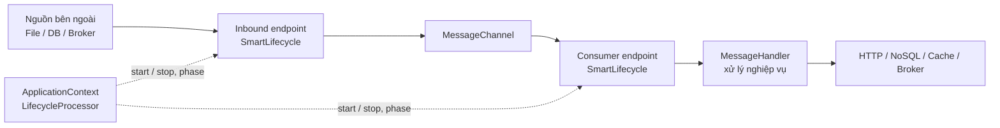
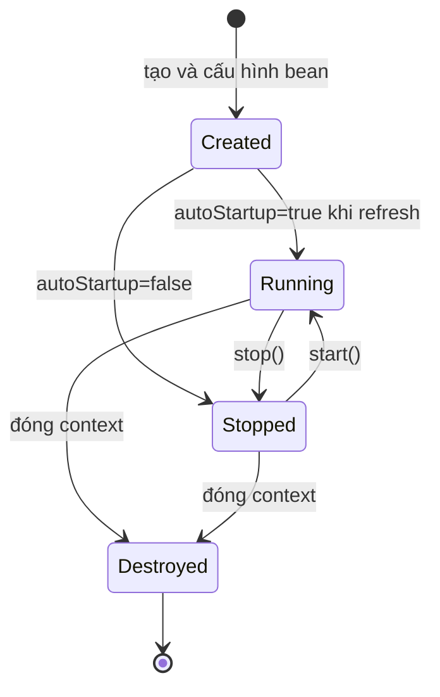
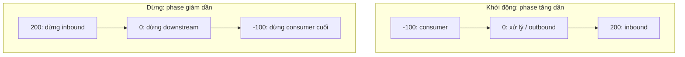
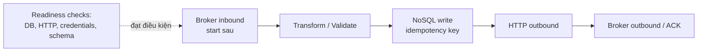

# Vòng đời endpoint, autoStartup và thứ tự khởi động luồng

Trong một ứng dụng Spring Boot, một luồng tích hợp có thể nhận dữ liệu từ HTTP, polling cơ sở dữ liệu, đọc file, lấy thông điệp từ broker, chuyển đổi payload rồi gửi sang dịch vụ khác. Các thành phần ấy không nhất thiết sẵn sàng cùng một thời điểm. Nếu adapter nhận dữ liệu quá sớm, nó có thể đưa thông điệp vào một kênh chưa có consumer, gọi tới cơ sở dữ liệu chưa kết nối được, hoặc gây retry và xử lý trùng lặp ngay lúc triển khai.

Trong module **SPRING_BOOT_INTEGRATION**, **Spring Integration** là công cụ tổ chức các luồng bằng message, channel, endpoint và adapter. Bài học này tập trung vào ba câu hỏi thực tế:

1. **Vòng đời endpoint** được Spring quản lý như thế nào và khác gì với vòng đời bean?
2. **`autoStartup`** quyết định điều gì khi ứng dụng khởi động, và có thể điều khiển luồng sau đó ra sao?
3. **`phase`** giúp sắp thứ tự khởi động và dừng các endpoint như thế nào, đặc biệt khi có adapter, broker, cache hoặc cơ sở dữ liệu ở hai đầu luồng?

Kết quả mong muốn là một cách thiết kế để **bật luồng đúng lúc, dừng nhận dữ liệu an toàn, quan sát lỗi và kiểm thử trạng thái**. Các ví dụ dùng Java DSL của Spring Integration trong Spring Boot; API cụ thể cần được đối chiếu theo phiên bản thư viện của dự án.

## 1. Bean, channel, handler và endpoint có vòng đời khác nhau

Một **bean** được Spring container tạo, cấu hình và hủy theo vòng đời `ApplicationContext`. Một **endpoint** của Spring Integration là thành phần nối message producer/consumer với channel hoặc nối channel với handler; nhiều endpoint có khả năng được bật/tắt trong khi context vẫn chạy.



| Thành phần | Vai trò | Điểm cần nhớ về lifecycle |
| --- | --- | --- |
| `ApplicationContext` | Tạo bean, tiêm dependency, chạy lifecycle processor. | Bean được tạo không đồng nghĩa endpoint đã bắt đầu nhận message. |
| `MessageChannel` | Vận chuyển message giữa các bước. | Một `DirectChannel` thông thường không phải là endpoint mà bạn bật/tắt để điều khiển polling. |
| `MessageHandler` | Xử lý một message. | Bản thân handler có thể là bean bình thường; **consumer endpoint** gắn nó với channel mới là thành phần lifecycle cần chú ý. |
| `SourcePollingChannelAdapter` | Chủ động gọi `MessageSource.receive()` theo trigger/poller để lấy dữ liệu. | Khởi động sẽ kích hoạt lịch polling; dừng sẽ ngừng tạo các lần poll mới. |
| `PollingConsumer` | Poll một `PollableChannel` như `QueueChannel` rồi gọi handler. | Có trigger riêng và có thể bật/tắt độc lập với nguồn gửi vào queue. |
| `EventDrivenConsumer` | Đăng ký handler với `SubscribableChannel` như `DirectChannel`. | Khi chưa start hoặc đã stop, handler có thể chưa được đăng ký làm subscriber. |
| Adapter message-driven | Nhận sự kiện từ listener/container của JMS, Kafka hoặc hệ thống ngoài. | Cần xét cả lifecycle của adapter **và** listener container; API điều khiển tùy adapter. |

Một `IntegrationFlow` là mô tả cách lắp ghép các thành phần. Đừng mặc định rằng gọi `start()` trên một bean tên là flow sẽ tự động điều khiển mọi endpoint con. Trong cấu hình tĩnh, Spring Integration thường tạo các endpoint riêng; muốn điều khiển chính xác cần định danh và tìm **endpoint** tương ứng. Với luồng đăng ký động, còn có vòng đời của registration do `IntegrationFlowContext` quản lý.

## 2. Hợp đồng `Lifecycle` và `SmartLifecycle`

Spring Framework định nghĩa `Lifecycle` với ba thao tác cơ bản:

```java
public interface Lifecycle {
    void start();
    void stop();
    boolean isRunning();
}
```

`SmartLifecycle` mở rộng hợp đồng này, hỗ trợ tự khởi động khi context được refresh, thứ tự chạy theo pha và callback dừng bất đồng bộ:

| API / thuộc tính | Ý nghĩa thực tế |
| --- | --- |
| `start()` | Yêu cầu thành phần hoạt động; với poller có thể bắt đầu scheduling, với listener có thể bắt đầu nhận message. |
| `stop()` | Yêu cầu dừng thành phần, nhưng không mặc nhiên chờ toàn bộ message đang xử lý kết thúc hoặc làm rỗng queue. |
| `isRunning()` | Cho biết trạng thái lifecycle mà thành phần báo cáo; không chứng minh phụ thuộc bên ngoài đã sẵn sàng. |
| `isAutoStartup()` | Cho biết có được khởi động tự động ở giai đoạn context refresh không. |
| `getPhase()` | Số nguyên quy định thứ tự giữa các nhóm `SmartLifecycle`. |
| `stop(Runnable callback)` | Cho phép lifecycle processor nhận tín hiệu khi dừng thực sự hoàn tất; implementation phải gọi callback sau khi hoàn thành. |

Khi `ApplicationContext` được refresh, `LifecycleProcessor` xem xét các bean lifecycle, khởi động các thành phần thuộc diện auto-start và áp dụng thứ tự `phase`. Khi context đóng, processor dừng các thành phần theo thứ tự ngược lại. Việc **start/stop** này khác với việc **tạo/hủy bean** và khác với trạng thái của server HTTP hoặc một hệ thống ngoài.



Sơ đồ là mô hình khái niệm, không phải state machine API duy nhất của mọi adapter. Một lần `start()` có thể thất bại do kết nối hoặc cấu hình; một lần `stop()` có thể để lại tác vụ đang chạy dở. Do đó, `isRunning()` phải đi cùng metric xử lý, lỗi và trạng thái của hệ thống ngoài.

### Điều gì xảy ra khi ứng dụng Spring Boot khởi động?

1. Spring tạo và cấu hình các bean, gồm channel, handler, adapter, scheduler và endpoint.
2. Context được refresh; `LifecycleProcessor` xử lý các `SmartLifecycle` có `isAutoStartup()` cho phép.
3. Spring Boot hoàn tất các bước startup, chạy `ApplicationRunner`/`CommandLineRunner` nếu có, rồi phát `ApplicationReadyEvent`.
4. Một endpoint đã auto-start có thể bắt đầu poll hoặc nhận message **trước** `ApplicationReadyEvent`; trạng thái ready của HTTP/Actuator cũng không tự động đảm bảo downstream đã sẵn sàng.

**Không dùng `@PostConstruct` để kích hoạt một endpoint phụ thuộc toàn bộ luồng đã chạy.** Lúc này nhiều bean khác có thể mới được tạo nhưng chưa start. Nếu cần đợi điều kiện nghiệp vụ hoặc tài nguyên bên ngoài, hãy đặt `autoStartup(false)` rồi gọi `start()` sau bước kiểm tra readiness thực sự. `ApplicationReadyEvent` là một mốc thuận tiện cho ứng dụng đã khởi động, nhưng không thay cho probe kết nối tới broker, database hay API downstream.

## 3. `autoStartup`: chủ động quyết định thời điểm nhận dữ liệu

Ở các endpoint Spring Integration có hỗ trợ lifecycle, `autoStartup` điều khiển việc **tự start trong quá trình khởi động context**. Nhiều endpoint được cấu hình mặc định là tự khởi động, song cần kiểm tra loại adapter và phiên bản đang dùng; đặt giá trị tường minh cho những luồng nhạy cảm.

| Cấu hình | Khi context refresh | Sau khi ứng dụng chạy |
| --- | --- | --- |
| `autoStartup(true)` | Lifecycle processor tự start endpoint theo pha nếu đáp ứng điều kiện khởi động. | Có thể gọi `stop()` và `start()` để quản trị. |
| `autoStartup(false)` | Endpoint được tạo nhưng không tự hoạt động do bước auto-start. | Chỉ bắt đầu hoạt động khi có lời gọi start phù hợp hoặc cơ chế khác kích hoạt nó. |

Các tình huống nên cân nhắc `autoStartup(false)`:

- Một inbound polling adapter chỉ được đọc dữ liệu sau khi hoàn tất migration bảng, tải khóa cấu hình hoặc kiểm tra đường kết nối.
- Consumer JMS/Kafka chỉ nhận thông điệp sau khi hệ thống ghi NoSQL và dịch vụ đích đã đạt readiness cần thiết.
- Luồng nhập dữ liệu theo lô cần thao tác bật/tắt có kiểm soát, tránh nhập lặp trong thời gian bảo trì.
- Canary deployment cần bật một nhóm adapter trước khi mở rộng sang toàn bộ instance.

**Lưu ý phạm vi:** tắt một endpoint inbound không làm ngừng mọi thành phần trong ứng dụng. Một HTTP controller, gateway hoặc producer khác vẫn có thể gửi message vào cùng channel. Nếu có nhiều nguồn, cần kiểm soát toàn bộ các đường vào. Ngược lại, tắt consumer của `DirectChannel` có thể khiến gửi message thất bại vì không có subscriber; tắt consumer của `QueueChannel` có thể khiến message tồn lại trong bộ đệm.

## 4. `phase`: thứ tự start tăng dần, thứ tự stop giảm dần

`SmartLifecycle.getPhase()` là số nguyên. Với các thành phần lifecycle được processor điều phối:

- **Khởi động:** phase **nhỏ hơn** được start **trước** phase lớn hơn.
- **Dừng:** phase **lớn hơn** được stop **trước** phase nhỏ hơn.
- **Cùng phase:** không dựa vào thứ tự ngẫu nhiên giữa các bean để bảo đảm nghiệp vụ. Hãy gán phase khác nhau nếu có quan hệ phụ thuộc.

Giả sử ba endpoint cần thứ tự minh họa dưới đây:

| Phase | Endpoint minh họa | Mục đích |
| ---: | --- | --- |
| `-100` | Consumer/handler nhận message từ `DirectChannel` | Đăng ký xử lý trước khi upstream gửi vào. |
| `0` | Consumer trung gian hoặc outbound endpoint có lifecycle | Chuẩn bị bước gửi dữ liệu tiếp theo. |
| `200` | Inbound polling adapter/producer | Bắt đầu đẩy dữ liệu sau khi các consumer trước đó chạy. |



Cách chọn phase như trên thể hiện nguyên tắc **consumer sẵn sàng trước producer** và **producer ngừng phát trước khi consumer ngừng nhận**. Các số là giá trị minh họa thuộc ứng dụng, không phải bộ hằng số được Spring Integration yêu cầu. Nếu endpoint không hỗ trợ `SmartLifecycle`, hoặc phụ thuộc được khởi động bên ngoài context, gán phase cho các endpoint khác **không** tự động quản lý được phụ thuộc ấy.

### Những giới hạn dễ bị hiểu nhầm

1. `phase` định thứ tự gọi `start()/stop()` cho thành phần lifecycle; nó **không** sắp thứ tự thực thi từng message trong các kênh song song như `ExecutorChannel`.
2. Phase **không** chứng minh một cơ sở dữ liệu, broker hoặc HTTP service bên ngoài đã khỏe. Endpoint có thể được start và `isRunning()` là `true` nhưng lệnh đọc/ghi vẫn lỗi.
3. Phase không tự tạo giao dịch liên hệ giữa database và broker, không đảm bảo exactly-once hay retry không sinh dữ liệu trùng.
4. Khi dừng, message đang xử lý hoặc đã nằm trong queue vẫn cần chính sách **drain, ACK, retry, idempotency và timeout** riêng.
5. `@DependsOn` có thể hữu ích với khởi tạo bean, nhưng không thay thế thiết kế thứ tự vận hành của endpoint và kiểm tra readiness. `@Order` cũng không phải cơ chế thay thế `SmartLifecycle.getPhase()`.

## 5. Ví dụ Java DSL: handler chạy trước, inbound chờ lệnh bật

Giả sử ứng dụng có một nguồn lấy đơn hàng theo chu kỳ, đẩy qua `DirectChannel` rồi xử lý. Đoạn demo tạo thông điệp trong bộ nhớ để thấy rõ lifecycle mà không yêu cầu hạ tầng ngoài. Trong hệ thống thật, thay nguồn mẫu bằng `MessageSource` đọc file, database hoặc API; với adapter message-driven (JMS/Kafka), cấu hình theo API adapter tương ứng.

Ứng dụng cần `spring-boot-starter-integration` và Spring Integration Java DSL tương ứng với phiên bản Spring Boot đang dùng. Cấu hình:

```java
import java.util.concurrent.atomic.AtomicLong;

import org.springframework.context.annotation.Bean;
import org.springframework.context.annotation.Configuration;
import org.springframework.integration.config.EnableIntegration;
import org.springframework.integration.core.MessageSource;
import org.springframework.integration.dsl.IntegrationFlow;
import org.springframework.integration.dsl.Pollers;
import org.springframework.messaging.support.GenericMessage;

@Configuration(proxyBeanMethods = false)
@EnableIntegration
public class OrderPipelineConfig {

    @Bean
    IntegrationFlow orderPipeline() {
        AtomicLong sequence = new AtomicLong();
        MessageSource<String> source = () ->
                new GenericMessage<>("order-" + sequence.incrementAndGet());

        return IntegrationFlow.from(source, endpoint -> endpoint
                        .id("orderInboundEndpoint")
                        .autoStartup(false)
                        .phase(200)
                        .poller(Pollers.fixedDelay(1_000)))
                .channel("orderMessages")
                .handle(message -> System.out.println(
                                "Processed: " + message.getPayload()),
                        endpoint -> endpoint
                                .id("orderHandlerEndpoint")
                                .phase(-100))
                .get();
    }
}
```

Ở đây:

- `orderInboundEndpoint` là endpoint có poller. `autoStartup(false)` khiến nó chưa phát thông điệp khi context vừa refresh. `phase(200)` biểu thị producer nên khởi động sau consumer nếu được auto-start.
- `orderMessages` là channel nối hai bước. `handle(...)` tạo endpoint consumer có id `orderHandlerEndpoint` và phase `-100`.
- Consumer thông thường được auto-start, đăng ký handler với channel trước; nguồn mẫu vẫn im lặng vì inbound chưa được start.
- Khi thay `autoStartup(false)` bằng `autoStartup(true)`, lifecycle processor có thể tự động start hai endpoint theo thứ tự phase: consumer trước, inbound sau.

**Vì sao cần đặt id?** Java DSL có thể sinh tên endpoint tự động. Với thao tác quản trị, kiểm thử hoặc xem log, tên ổn định giúp tìm chính xác endpoint; tên của bean `IntegrationFlow`, tên channel và tên endpoint không nhất thiết giống nhau. Trong ví dụ, `orderPipeline` là tên bean khai báo flow, còn `orderInboundEndpoint` là id endpoint cần điều khiển.

### Bật và tắt endpoint ở runtime

Đối tượng được điều khiển là bean endpoint triển khai `SmartLifecycle`:

```java
import org.springframework.context.ApplicationContext;
import org.springframework.context.SmartLifecycle;
import org.springframework.stereotype.Component;

@Component
public class OrderIngestionControl {
    private final ApplicationContext context;

    public OrderIngestionControl(ApplicationContext context) {
        this.context = context;
    }

    private SmartLifecycle inbound() {
        return context.getBean("orderInboundEndpoint", SmartLifecycle.class);
    }

    public void startAfterDependenciesAreReady() {
        inbound().start();
    }

    public void pauseIntake() {
        inbound().stop();
    }

    public boolean isIntakeRunning() {
        return inbound().isRunning();
    }
}
```

Trong hệ thống thật, chỉ gọi `startAfterDependenciesAreReady()` **sau khi** xác nhận điều kiện cần: cấu hình đã tải xong, cơ sở dữ liệu có schema/index yêu cầu, consumer phía sau sẵn sàng, credentials hợp lệ và các thành phần hạ tầng đã qua kiểm tra. Có thể kích hoạt từ một listener `ApplicationReadyEvent` **kèm kiểm tra phụ thuộc** hoặc từ một cơ chế điều phối nội bộ được kiểm soát. Không để URL quản trị công khai tùy ý gọi các thao tác này.

Khi `pauseIntake()` được gọi, các lần poll mới ngừng được lập lịch, nhưng một lần poll đang chạy hoặc message đã chuyển sang consumer có thể vẫn hoàn thành. Để bảo trì an toàn, cần chờ lượng công việc đang xử lý về mức chấp nhận được rồi mới dừng downstream.

## 6. Điều phối nhiều endpoint trong luồng tích hợp thực tế

Với luồng **broker → transformer → NoSQL → HTTP → broker trả lời**, thứ tự hợp lý thường là chuẩn bị consumer phía trong trước và mở nguồn nhận bên ngoài sau:



Nếu adapter nhận message được mở trước khi phần còn lại ổn định, có thể xuất hiện retry liên tục, timeout, mất ACK hoặc xử lý lặp. Tùy transport, cơ chế redelivery của broker có thể khiến cùng business event được nhận lại. Vì vậy **phase và `autoStartup` chỉ là một lớp** trong thiết kế độ tin cậy:

| Tình huống | Cách tổ chức lifecycle | Biện pháp bổ sung |
| --- | --- | --- |
| Poll từ DB rồi đẩy sang broker | Start phần gửi/handler trước; polling adapter có phase cao hơn hoặc được bật sau readiness. | Outbox/idempotency key; timeout, retry và kiểm tra broker connectivity. |
| Consumer nhận từ broker rồi ghi vào NoSQL | Chỉ bật inbound khi repository/schema/index sẵn sàng. | Quy tắc ACK, retry/backoff, dead-letter và chống ghi trùng. |
| File inbound adapter quét thư mục | Có thể đặt `autoStartup(false)` cho nguồn rồi bật sau lúc mount/đồng bộ dữ liệu. | Bộ lọc chống đọc lại file, xử lý file lỗi và di chuyển file atomically nếu cần. |
| `QueueChannel` làm vùng đệm | Dừng producer trước; để consumer tiếp tục xử lý các message đang chờ trong giới hạn thời gian. | Giới hạn dung lượng queue, chính sách backpressure; cân nhắc queue bền vững nếu cần không mất dữ liệu. |
| `DirectChannel` giữa các handler | Start endpoint nhận trước khi upstream gửi; stop upstream trước khi unsubscribing handler. | Quyết định xử lý lỗi `MessageDeliveryException` khi không có subscriber. |
| Luồng có `ExecutorChannel` | Start handler trước, dừng nguồn trước khi drain executor. | Theo dõi active tasks, queue depth, graceful shutdown và tính idempotent của handler. |

**Đặc thù của kênh:** `DirectChannel` thường chuyển giao đồng bộ trên thread gửi; khi không có subscriber, lệnh send có thể thất bại. `QueueChannel` có thể tích lũy message khi poller/consumer chưa hoạt động, nhưng vùng đệm hữu hạn có thể đầy và vùng đệm trong bộ nhớ có thể mất khi tiến trình chết. `ExecutorChannel` chuyển sang thực thi bất đồng bộ, nên callback trả về không đồng nghĩa công việc phía sau đã hoàn tất.

### Lưu ý với JMS, Kafka và adapter message-driven

Một số adapter tạo hoặc sử dụng listener container có lifecycle và quy tắc khởi động riêng. Khi đặt `autoStartup(false)` trên endpoint, cần xác minh thuộc tính đó được áp vào **đúng adapter/container** đang nhận message. Khi dùng một container được chia sẻ giữa nhiều luồng, dừng container có thể ảnh hưởng luồng khác. Một listener đã chạy có thể nhận message trước khi toàn bộ downstream healthy; do đó kiểm tra thực tế trên broker test và xác nhận cơ chế ACK/retry quan trọng hơn chỉ nhìn `isRunning()`.

Phân biệt `start()/stop()` của endpoint Spring Integration với thao tác dừng toàn bộ ứng dụng, thay đổi consumer group hay vô hiệu hóa partition. Các hành vi này phụ thuộc adapter và thư viện cụ thể, cần đọc tài liệu của đúng phiên bản.

## 7. Dừng an toàn: stop source, drain và xác nhận kết quả

Trong hệ thống xử lý sự kiện, `stop()` **không đồng nghĩa** tất cả event đã được commit vào database hoặc đã được ACK lên broker. Một quy trình tạm dừng có kiểm soát:

1. **Chặn dữ liệu mới** ở inbound endpoint/consumer đầu nguồn; với nhiều nguồn, dừng lần lượt tất cả đường vào cần bảo trì.
2. **Quan sát công việc đang chạy**: inflight requests, queue depth, số event chưa ACK, tác vụ trong executor, số callback HTTP chưa hoàn tất.
3. **Drain downstream** trong ngưỡng thời gian thỏa thuận; có phương án replay/retry cho message còn lại. Không giả định `phase` tự đợi queue về 0.
4. **Dừng các endpoint downstream** sau khi xử lý hoặc chuyển giao an toàn công việc còn tồn.
5. **Khởi động lại theo thứ tự ngược**: hoàn thiện downstream, xác minh phụ thuộc, rồi mở inbound và theo dõi tình trạng message mới.

Nếu tự viết một `SmartLifecycle` có dừng bất đồng bộ, phải gọi `callback.run()` khi dừng xong trong `stop(Runnable)`. Không gọi callback có thể khiến quá trình đóng context phải chờ tới timeout của lifecycle processor. Spring Boot có cấu hình thời gian chờ khi shutdown theo phase (ví dụ `spring.lifecycle.timeout-per-shutdown-phase` ở các bản hỗ trợ); timeout đó chỉ hạn chế thời gian chờ, không thay thế chiến lược đảm bảo dữ liệu.

## 8. Kiểm thử đúng trạng thái trước và sau `start()`

Bên cạnh test xử lý message, cần test cấu hình vòng đời mà ứng dụng phụ thuộc. Với flow ví dụ ở mục 5, có thể dùng test Spring Boot:

```java
import static org.assertj.core.api.Assertions.assertThat;

import org.junit.jupiter.api.Test;
import org.springframework.beans.factory.annotation.Autowired;
import org.springframework.boot.test.context.SpringBootTest;
import org.springframework.context.ApplicationContext;
import org.springframework.context.SmartLifecycle;

@SpringBootTest(classes = OrderPipelineConfig.class)
class OrderPipelineLifecycleTest {

    @Autowired
    ApplicationContext context;

    @Test
    void inboundStaysOffUntilStartedExplicitly() {
        SmartLifecycle inbound =
                context.getBean("orderInboundEndpoint", SmartLifecycle.class);
        SmartLifecycle handler =
                context.getBean("orderHandlerEndpoint", SmartLifecycle.class);

        assertThat(inbound.isAutoStartup()).isFalse();
        assertThat(inbound.isRunning()).isFalse();
        assertThat(handler.isRunning()).isTrue();
        assertThat(handler.getPhase()).isLessThan(inbound.getPhase());

        try {
            inbound.start();
            assertThat(inbound.isRunning()).isTrue();
        } finally {
            inbound.stop();
        }
        assertThat(inbound.isRunning()).isFalse();
    }
}
```

Test trên xác nhận **trạng thái và cấu hình phase**. Nó chưa chứng minh đã xử lý message thành công. Để kiểm tra luồng thực, thay handler in ra console bằng một consumer có thể quan sát được (ví dụ ghi nhận message vào queue test hoặc bộ đếm thread-safe), rồi xác nhận:

- Không phát sinh message trước khi inbound được start, ngoại trừ dữ liệu do đường vào khác gửi.
- Khi start, message hợp lệ được nhận, chuyển đổi, ghi dữ liệu và xử lý đúng business key.
- Sau khi stop, không có lần poll **mới** được khởi tạo; nếu còn message đang chạy, test phải cho phép chúng hoàn thành theo contract.
- Khi start lại sau stop, message không bị mất hoặc xử lý trùng ngoài chính sách đã công bố.
- Khi downstream bị ngắt kết nối, kiểm tra log lỗi, error channel, retry/backoff, dead-letter/rollback và trạng thái hoạt động sau khi phục hồi.
- Khi đóng context, các thành phần đã cấu hình phase được dừng theo mục tiêu, đồng thời dữ liệu đang xử lý được drain hoặc bảo toàn theo thiết kế.

Với nguồn polling chạy theo lịch, test thời gian thực dễ chập chờn. Ưu tiên điều khiển trigger/test scheduler hoặc dùng đồng bộ có giới hạn thời gian rõ ràng; tránh dựa vào `Thread.sleep()` cố định để suy ra rằng không còn xử lý bất đồng bộ.

## 9. Quan sát và chẩn đoán lỗi khởi động luồng

Khi một ứng dụng báo **ready** nhưng vẫn không xử lý message, kiểm tra theo thứ tự:

| Triệu chứng | Khả năng cần kiểm tra | Hướng xử lý |
| --- | --- | --- |
| Bean tồn tại nhưng không poll | `autoStartup(false)`, chưa gọi `start()`, poller chưa được cấu hình hoặc trigger chưa đến hạn. | Xem tên endpoint, `isRunning()`, trigger và log startup. |
| Lỗi `Dispatcher has no subscribers` hoặc `MessageDeliveryException` | Upstream gửi vào `DirectChannel` trong lúc consumer endpoint chưa chạy. | Điều chỉnh phase, kiểm tra trạng thái consumer và giới hạn đường gửi đầu vào. |
| Endpoint `isRunning() == true` nhưng không có dữ liệu | Source không có message, filter loại hết, broker chưa giao message hoặc kết nối ngoài có vấn đề. | Kiểm tra source, filter, connector, auth, partition, queue depth và metric nhận/xử lý. |
| Poller liên tục báo lỗi | Lỗi query, timeout, mapper, downstream hoặc cơ chế retry tạo vòng lặp. | Đọc exception gốc, cấu hình error channel, giảm tốc độ poll/backoff và kiểm tra dữ liệu lỗi. |
| Stop không giải phóng hết tác vụ | Executor còn inflight, listener chưa ACK, callback shutdown chưa gọi. | Dừng upstream trước, quan sát drain, rà soát `stop(Runnable)` và timeout shutdown. |
| Môi trường chạy khác nhau | Biến cấu hình, profile, số replica, lệnh start thủ công hoặc thứ tự khởi động khác. | Ghi nhận cấu hình `autoStartup`, phase, tên endpoint và chính sách rollout trên từng môi trường. |

Nên thu thập tối thiểu: tên endpoint, phase, `isAutoStartup()`, `isRunning()`, thời điểm start/stop, số message nhận và xử lý thành công, lỗi, retry, độ trễ, backlog và số lượng message đang xử lý. Có thể dùng log Spring Integration, Micrometer/Actuator nếu đã cấu hình; tính khả dụng và tên metric phụ thuộc phiên bản. Với Actuator và Spring Integration, `integrationgraph` (nếu được hỗ trợ, bật và cấp quyền truy cập phù hợp) có thể giúp nhìn cấu trúc flow.

Spring Integration cũng có **Control Bus** để gửi lệnh quản trị đến các thành phần được phép điều khiển. Đây là khả năng vận hành mạnh; chỉ bật trên channel/quyền truy cập nội bộ, ghi audit và hạn chế thao tác được phép. Đừng mở một control channel nhận biểu thức điều khiển tùy ý từ client không tin cậy.

## 10. Những lỗi thiết kế phổ biến

**Nhầm startup của bean với startup của endpoint.** Bean `MessageSource` đã được tạo không có nghĩa scheduled polling đã chạy. Kiểm tra endpoint chứa nguồn, không chỉ bean nguồn.

**Chỉ dùng phase để chờ hệ thống ngoài.** Phase quyết định thứ tự startup của các endpoint trong context, không chờ server NoSQL hoàn thành cluster recovery hay HTTP service trả lời. Phối hợp readiness, retry có giới hạn và idempotency.

**Dừng handler trước producer.** Nếu producer còn phát vào `DirectChannel` sau khi handler bị unsubscribe, message có thể fail. Ưu tiên dừng inbound trước, drain, rồi mới dừng consumer.

**Tin rằng stop sẽ hủy sạch tác vụ đang chạy.** Polling, listener và executor có những ranh giới bất đồng bộ riêng; đừng dùng `stop()` thay cho ACK, transaction, checkpoint hoặc graceful drain.

**Đặt cùng phase rồi suy luận từ thứ tự log.** Tương quan log của một lần deploy không phải đảm bảo thứ tự lâu dài. Nếu quan hệ start/stop có ý nghĩa nghiệp vụ, đặt phase rõ ràng và kiểm thử trên cấu hình thật.

**Dùng `autoStartup(false)` nhưng không có chủ sở hữu bật lại.** Quy định ai hoặc thành phần nào kiểm tra readiness và gọi start, khi nào gọi lại sau lỗi, cách quan sát trạng thái và cách phục hồi sau restart.

## 11. Checklist trước khi đưa luồng vào vận hành

- [ ] Xác định rõ endpoint nào phát/nhận message và endpoint nào chỉ xử lý downstream; đặt tên ổn định cho endpoint cần quản trị.
- [ ] Chỉ định `autoStartup` tường minh ở những inbound nhạy cảm; có cơ chế kích hoạt sau khi kiểm tra điều kiện nghiệp vụ.
- [ ] Gán `phase` để consumer được start trước producer và dừng sau producer, nếu các endpoint đều tham gia lifecycle.
- [ ] Với adapter JMS/Kafka/HTTP hoặc scheduler ngoài, xác minh lifecycle thực sự của adapter và container phụ thuộc.
- [ ] Có chính sách xử lý khi channel chưa có subscriber, queue đầy, downstream lỗi và message bị giao lại.
- [ ] Thiết kế stop → drain → stop downstream; bảo toàn message và kiểm tra idempotency khi khởi động lại.
- [ ] Test cả trạng thái lifecycle lẫn xử lý message đầu cuối, bao gồm lỗi và retry.
- [ ] Quan sát được tên endpoint, trạng thái, số message, lỗi, backlog và thời gian drain khi shutdown.

### Tài liệu tham khảo chính thức

- [Spring Framework — `SmartLifecycle`](https://docs.spring.io/spring-framework/docs/current/javadoc-api/org/springframework/context/SmartLifecycle.html): hợp đồng auto-start, phase và callback khi dừng.
- [Spring Framework — `LifecycleProcessor`](https://docs.spring.io/spring-framework/docs/current/javadoc-api/org/springframework/context/LifecycleProcessor.html): cơ chế start/stop khi context refresh/close.
- [Spring Integration — Reference](https://docs.spring.io/spring-integration/reference/): endpoint, channel, poller, Java DSL và quản trị luồng.
- [Spring Integration — Endpoint Roles](https://docs.spring.io/spring-integration/reference/endpoint.html): phân biệt endpoint với message handler, polling và event-driven consumer.
- [Spring Boot — Application Events and Listeners](https://docs.spring.io/spring-boot/reference/features/spring-application.html#features.spring-application.application-events-and-listeners): vị trí `ApplicationReadyEvent` trong quá trình khởi động ứng dụng.

**Ý chính:** `autoStartup` trả lời *endpoint có tự chạy khi context khởi động không*; `phase` trả lời *các endpoint lifecycle chạy và dừng theo thứ tự nào*; `start()/stop()` cho phép điều khiển trong thời gian vận hành. Cả ba cần kết hợp với kiểm tra readiness, hợp đồng dữ liệu, xử lý lỗi, idempotency và quan sát để luồng tích hợp thực sự an toàn.
