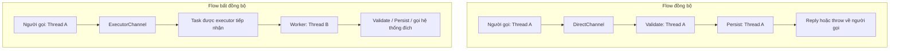
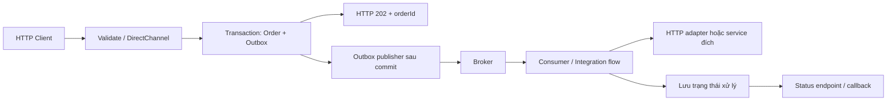

# Phân biệt lời gọi đồng bộ với xử lý bất đồng bộ trong một flow

## 1. Một flow Spring Integration có thể đổi cách thực thi tại từng bước

Trong module **SPRING_BOOT_INTEGRATION**, các luồng kết nối HTTP client, cơ sở dữ liệu, cache, broker thông điệp và adapter của Spring Integration thường chứa nhiều bước: nhận yêu cầu, kiểm tra dữ liệu, ghi đơn hàng, gọi hệ thống ngoài và phát sự kiện. Một flow nhìn trên sơ đồ là một chuỗi xử lý, nhưng **không nhất thiết toàn bộ chuỗi chạy trên cùng thread, cùng thời điểm hoặc cùng transaction**.

Ví dụ, API tiếp nhận đơn hàng:

1. Nhận yêu cầu HTTP và xác thực dữ liệu.
2. Ghi đơn hàng và sự kiện outbox vào database.
3. Gửi thông điệp sang hệ thống xử lý vận chuyển.
4. Trả kết quả cho người gọi.

Có ít nhất hai cách tổ chức:

- **Đồng bộ:** bước sau được gọi trực tiếp và người gọi chờ kết quả hoặc ngoại lệ. API có thể cần chờ toàn bộ công việc hoàn thành.
- **Bất đồng bộ:** một bước bàn giao thông điệp cho hàng đợi/executor/broker để thành phần khác xử lý về sau. API có thể chỉ xác nhận đã tiếp nhận yêu cầu; kết quả nghiệp vụ xuất hiện sau.

Trong Spring Integration, thay đổi loại **MessageChannel** ở giữa flow thường làm thay đổi cách các endpoint được kích hoạt. Tuy nhiên, phải phân biệt bốn câu hỏi khác nhau:

| Câu hỏi | Nội dung cần kiểm tra |
|---|---|
| Handler chạy ở thread nào? | Cùng thread gọi `send()` hay một thread khác? |
| Người gọi đợi đến đâu? | Đợi handler hoàn thành, đợi được xếp lịch, đợi reply hay chỉ đợi broker xác nhận? |
| Thông điệp được giữ ở đâu? | Trong call stack, bộ nhớ ứng dụng, kho lưu trữ bền vững hay broker? |
| Transaction nào bao phủ bước xử lý? | Transaction hiện tại, transaction mới ở worker, hoặc không có transaction? |

**Điểm quan trọng:** “xử lý trên thread khác” và “trả kết quả bất đồng bộ cho người gọi” là hai thuộc tính riêng. Một HTTP request vẫn có thể bị chặn để chờ reply từ flow chạy trên executor; ngược lại, một API có thể trả ngay dù phía sau sử dụng adapter đồng bộ với một hệ thống khác.

## 2. Vị trí thay đổi ranh giới thực thi

Spring Integration chuyển dữ liệu dưới dạng `Message<?>`, gồm **payload** và **headers**. Các endpoint (transformer, filter, router, service activator, adapter...) thường kết nối qua `MessageChannel`.



Với flow đồng bộ, khi handler thực thi ngay trên thread gửi, lệnh `send()` thường chỉ kết thúc sau khi chuỗi xử lý đồng bộ hoàn tất; nếu handler lỗi, ngoại lệ có thể truyền ngược qua call stack, đôi khi được bao trong ngoại lệ của Spring Messaging.

Với flow bất đồng bộ qua executor, lệnh `send()` có thể kết thúc khi executor **chấp nhận công việc**, trong khi handler vẫn chưa chạy hoặc đang chạy. Việc `send()` trả về thành công không chứng minh thao tác database, HTTP hay broker phía sau đã thành công. Nếu executor từ chối công việc do quá tải, việc bàn giao vẫn có thể thất bại ngay tại phía gửi.

### 2.1. So sánh các loại channel thường dùng

| Channel | Cách kích hoạt consumer | Thread xử lý | Người gửi thường chờ gì? | Lưu ý |
|---|---|---|---|---|
| `DirectChannel` | Gọi subscriber trực tiếp | Cùng thread gửi | Handler xử lý xong hoặc ném lỗi | Dễ giữ transaction context trên cùng thread |
| `ExecutorChannel` | Giao handler cho `TaskExecutor` | Thường là worker thread | Executor chấp nhận task | Phụ thuộc chính sách executor; mất ranh giới transaction theo thread |
| `QueueChannel` | Đưa message vào queue; consumer lấy bằng poller hoặc `receive()` | Thread của poller/consumer | Queue nhận được message, có thể phải đợi chỗ trống | Queue mặc định ở bộ nhớ; chưa có bảo đảm bền vững |
| `PublishSubscribeChannel` không cấu hình executor | Phát lần lượt tới các subscriber | Thường cùng thread gửi | Các subscriber đồng bộ hoàn tất theo cơ chế dispatch | Có nhiều subscriber không tự động đồng nghĩa chạy song song |
| `PublishSubscribeChannel` có executor | Dispatch tới subscriber qua executor | Thường là worker threads | Executor tiếp nhận dispatch | Thứ tự và lỗi của từng subscriber cần xem riêng |

Các từ “thường” ở bảng có chủ đích: ví dụ, nếu executor sử dụng chính sách `CallerRunsPolicy`, công việc bị từ chối xếp hàng có thể quay lại chạy trên **thread của người gửi**. Do đó, ranh giới thread cần kiểm tra dựa trên cấu hình runtime, không chỉ dựa trên tên channel.

### 2.2. `DirectChannel`: chuyển tiếp đồng bộ trong cùng call stack

Giả sử một handler gọi `orderService.placeOrder()` qua Spring proxy và service có `@Transactional`. Nếu handler phía trước dùng `DirectChannel`, các bước đang chạy trên cùng thread có thể tham gia transaction hiện tại khi cùng transaction manager và propagation phù hợp.

Tuy nhiên, “cùng thread” **không tự tạo ra transaction**. Transaction chỉ tồn tại nếu được mở bởi cơ chế như `@Transactional`. Hơn nữa, một handler gọi HTTP hoặc Redis trực tiếp vẫn tạo side effect bên ngoài database transaction: rollback JPA không tự hoàn tác HTTP đã được hệ thống đích xử lý.

### 2.3. `ExecutorChannel`: chuyển giao cho executor

`ExecutorChannel` là kênh point-to-point với subscriber được thực thi qua `TaskExecutor`. Khi task được chấp nhận, caller có thể tiếp tục, còn các bước từ subscriber trở đi chạy trên worker khác.

Điều này hữu ích khi cần tách việc tiếp nhận đơn khỏi xử lý dài, nhưng không đồng nghĩa với lưu hàng đợi bền vững. Task còn trong executor queue có thể mất nếu tiến trình chết; retry khi handler lỗi và quan sát công việc thất bại cũng phải được thiết kế. Với workflow yêu cầu không mất việc, có thể cần **transactional outbox** hoặc broker bền vững.

### 2.4. `QueueChannel`: điểm lưu thông điệp và consumer chủ động lấy

`QueueChannel` là `PollableChannel`. Bên gửi đưa message vào queue; bên nhận chỉ xử lý khi poller hoặc code gọi `receive()` lấy message ra. Queue có thể có capacity giới hạn, khiến lời gửi phải chờ hoặc bị từ chối khi đầy.

Mặc định, `QueueChannel` lưu message trong bộ nhớ. Nếu muốn sống sót qua restart, cần cấu hình `MessageStore` bền vững phù hợp và kiểm thử lại semantics, chứ không suy ra tính bền vững chỉ từ việc channel có chữ “queue”. Queue cục bộ cũng khác broker: việc ack, retry, chia tải nhiều instance và khả năng khôi phục do cơ chế triển khai quyết định.

## 3. Ví dụ Java DSL: cùng nghiệp vụ, hai kiểu gọi

Ví dụ sau dùng Spring Boot với Spring Integration Java DSL. Giả sử `OrderProcessor` là service nghiệp vụ đã được triển khai và có phương thức `OrderResult create(OrderCommand command)`. Đối với việc lưu database, service này có thể gắn `@Transactional` trên phương thức public được gọi qua Spring proxy.

Định nghĩa hợp đồng dữ liệu đơn giản:

```java
public record OrderCommand(UUID orderId, long amountInCents) {}

public record OrderResult(UUID orderId, String status) {}

public interface OrderProcessor {
    OrderResult create(OrderCommand command);
}
```

Hai gateway thể hiện **hợp đồng đối với người gọi**:

```java
@MessagingGateway(defaultRequestChannel = "orderSyncInput")
public interface SyncOrderGateway {
    OrderResult place(OrderCommand command);
}

@MessagingGateway(defaultRequestChannel = "orderAsyncInput")
public interface AsyncOrderGateway {
    void submit(OrderCommand command);
}
```

Và cấu hình các flow:

```java
@Configuration
@EnableIntegration
@IntegrationComponentScan
class OrderIntegrationConfiguration {

    @Bean
    IntegrationFlow synchronousOrders(OrderProcessor processor) {
        return IntegrationFlow.from("orderSyncInput")
            .handle(OrderCommand.class,
                (command, headers) -> processor.create(command))
            .get();
    }

    @Bean
    ThreadPoolTaskExecutor orderExecutor() {
        var executor = new ThreadPoolTaskExecutor();
        executor.setCorePoolSize(4);
        executor.setMaxPoolSize(8);
        executor.setQueueCapacity(100);
        executor.setThreadNamePrefix("order-flow-");
        executor.initialize();
        return executor;
    }

    @Bean
    MessageChannel orderAsyncInput(
            @Qualifier("orderExecutor") Executor executor) {
        return new ExecutorChannel(executor);
    }

    @Bean
    IntegrationFlow asynchronousOrders(OrderProcessor processor) {
        return IntegrationFlow.from("orderAsyncInput")
            .handle(OrderCommand.class, (command, headers) -> {
                processor.create(command);
                return null; // one-way: không phát reply từ handler
            })
            .get();
    }
}
```

Cần khai báo các dependency `spring-boot-starter-integration` và dependency thích hợp cho adapter/DB được dùng trong ứng dụng. Các đoạn mã lược bỏ import và phần triển khai `OrderProcessor` để tập trung vào ranh giới flow. `@IntegrationComponentScan` cho phép phát hiện các interface gateway có annotation `@MessagingGateway` trong phạm vi quét.

### 3.1. Diễn giải đường đồng bộ

```java
OrderResult result = syncGateway.place(
    new OrderCommand(orderId, 250_000L));

// Chỉ đến đây sau khi handler đã trả reply cho gateway.
```

`SyncOrderGateway.place()` chờ `OrderResult` do service activator trả về. Với input channel là `DirectChannel` được tạo/định tuyến mặc định cho flow trực tiếp, handler chạy trên thread gửi; ngoại lệ từ xử lý có thể đến phía caller. Đây là lựa chọn phù hợp khi request phải biết ngay kết quả kiểm tra và lưu dữ liệu.

Một API đồng bộ không nên giữ thread chờ quá lâu cho các hệ thống ngoài chậm hoặc không ổn định. HTTP timeout, quy tắc retry và cách trả mã lỗi cần được thiết kế độc lập với loại channel.

### 3.2. Diễn giải đường bất đồng bộ

```java
asyncGateway.submit(new OrderCommand(orderId, 250_000L));

// Gateway kiểu void không đợi business reply từ handler.
// Việc nhận task không chứng minh đơn hàng đã được tạo thành công.
```

Gateway này gửi message tới `ExecutorChannel`. Nếu executor chấp nhận task, caller có thể tiếp tục mà không chờ `processor.create()`. Tuy vậy, lời gửi vẫn có thể tốn thời gian khi hệ thống quá tải hoặc executor áp dụng chính sách chặn/chạy tại caller. Do đó, không nên hứa “trả ngay trong mọi trường hợp”.

Trong API thực tế, nếu chỉ tiếp nhận một yêu cầu để xử lý sau, hợp đồng phản hồi nên diễn đạt trạng thái **accepted/pending** (chẳng hạn HTTP `202 Accepted`) kèm `requestId` hoặc `orderId` để tra cứu; không trả “order created” khi thao tác tạo đơn còn đang chờ.

### 3.3. Thay executor bằng pollable queue khi nào?

Có thể tạo queue giới hạn và xử lý bằng poller:

```java
@Bean
QueueChannel orderQueue() {
    return new QueueChannel(200);
}

@ServiceActivator(
    inputChannel = "orderQueue",
    poller = @Poller(fixedDelay = "500", maxMessagesPerPoll = "10")
)
public void consumeQueuedOrder(OrderCommand command) {
    processor.create(command);
}
```

Đoạn ví dụ trên minh họa handler có field `processor` được tiêm vào bean chứa method. Bên gửi dùng `orderQueue.send(message)`; poller sẽ chủ động lấy và xử lý tối đa số message cấu hình mỗi lần poll. Queue có thể đầy, và nếu process chết khi message chưa được đưa vào lưu trữ bền vững, message có thể mất. Với hệ thống sản xuất, hãy xác định rõ capacity, concurrency, retry, xử lý poison message và cơ chế phục hồi.

## 4. Có thread khác chưa chắc người gọi không phải đợi

Nhầm lẫn phổ biến nhất là thấy `ExecutorChannel` rồi kết luận mọi lời gọi tới flow đều bất đồng bộ từ góc nhìn API. Xét gateway sau:

```java
@MessagingGateway(defaultRequestChannel = "orderAsyncInput")
interface WaitingGateway {
    @Gateway(replyTimeout = 3000)
    OrderResult placeAndWait(OrderCommand command);
}
```

Nếu handler phía sau executor **có tạo reply** gửi về gateway, lời gọi vẫn đợi tối đa khoảng thời gian reply timeout đã cấu hình. Thread thực thi handler có thể khác thread HTTP, nhưng HTTP thread vẫn đang chờ để nhận `OrderResult`. Trái lại, trong mẫu `AsyncOrderGateway.submit()` kiểu `void`, gateway không chờ business reply.

Để minh họa `WaitingGateway`, cần một handler trả `OrderResult` như flow đồng bộ; handler `return null` ở mục 3.2 là **one-way** nên không tạo reply cho gateway chờ. Nếu handler không trả kết quả đúng hạn, gateway có thể gặp timeout ngay cả khi công việc vẫn tiếp tục ở worker. Một timeout chờ reply **không khẳng định nghiệp vụ đã bị hủy**.

Các giá trị cần phân biệt:

- `requestTimeout`: thời gian tối đa gateway sẵn sàng đợi để **gửi message vào request channel** trong trường hợp thao tác gửi có thể bị chặn.
- `replyTimeout`: thời gian tối đa gateway đợi **reply** khi hợp đồng yêu cầu kết quả.
- HTTP client/read timeout: thời gian chờ **một dịch vụ HTTP bên ngoài**.
- Broker publish acknowledgment: tín hiệu broker đã xử lý ở một mức xác nhận xác định, **không** mặc nhiên là consumer đã hoàn thành nghiệp vụ.

Việc dùng `CompletableFuture` hoặc kiểu phản hồi reactive ở gateway (nếu phiên bản/cấu hình hỗ trợ) có thể giúp caller nhận kết quả theo cách bất đồng bộ. Điều đó vẫn cần thiết kế correlation, timeout, hủy/chuyển trạng thái và xử lý exception.

## 5. Transaction, lỗi và độ tin cậy khi chuyển sang bất đồng bộ

### 5.1. Thread boundary cũng là một điểm cần xem lại transaction

Transaction Spring thông thường gắn với thread hiện hành. Nếu một bước đang ở transaction DB chuyển sang `ExecutorChannel`, worker **không tự động thừa hưởng** transaction phía gửi. Đối với `QueueChannel`/poller, consumer cũng xử lý ở transaction riêng nếu được cấu hình.

```mermaid
sequenceDiagram
    participant API as API Thread
    participant DB as Database
    participant EX as ExecutorChannel
    participant W as Worker Thread
    API->>DB: BEGIN TX-A; save Order
    API->>EX: send message
    EX-->>API: Task accepted
    API->>DB: COMMIT TX-A
    EX->>W: Dispatch handler
    W->>DB: BEGIN TX-B; update status
    W->>DB: COMMIT/ROLLBACK TX-B
```

Sơ đồ biểu diễn hai transaction độc lập, **không bảo đảm worker bắt đầu sau khi TX-A commit**. Nếu executor chạy nhanh, worker có thể truy vấn dữ liệu trong lúc TX-A chưa commit và không nhìn thấy bản ghi. Đồng thời, nếu TX-A rollback sau khi task đã được tiếp nhận, task có thể vẫn thực hiện. Đây là rủi ro thiết kế quan trọng khi đưa việc publish hoặc thao tác phụ sang executor **ngay trong transaction**.

Cách khắc phục tùy yêu cầu: chỉ kích hoạt xử lý sau commit nếu việc mất tín hiệu là chấp nhận được; dùng **transactional outbox** nếu phải bảo đảm phục hồi qua crash; hoặc thiết kế xử lý độc lập, retry/idempotent theo khóa nghiệp vụ.

### 5.2. Đồng bộ và bất đồng bộ báo lỗi khác nhau

| Tình huống | Đường đồng bộ | Đường bất đồng bộ |
|---|---|---|
| Validation thất bại trong handler | Ngoại lệ có thể về trực tiếp caller | Caller có thể đã rời khỏi hàm; cần ghi trạng thái lỗi, phát sự kiện hoặc dùng error channel |
| Database rollback | Caller thường biết lỗi nếu transaction chạy cùng lời gọi | Worker rollback transaction riêng; request ban đầu có thể vẫn đã được accept |
| Executor/queue không nhận message | Không áp dụng nếu gọi trực tiếp bằng `DirectChannel` | Gửi có thể thất bại hoặc timeout ngay; phải xử lý việc từ chối tại ingress |
| HTTP bên ngoài timeout | Caller có thể bị kéo dài thời gian chờ | Worker gặp timeout; cần retry có giới hạn và chống xử lý trùng |
| Process chết sau khi nhận task | Lời gọi còn đang chạy thường bị ngắt | Task trong memory channel/queue có thể mất; cần durable handoff nếu yêu cầu phục hồi |
| Cần thông báo kết quả cuối | Có thể trả response trực tiếp | Dùng status endpoint, callback/webhook, event hoặc một kênh phản hồi khác |

Khi lỗi xảy ra trong xử lý bất đồng bộ, không thể mặc định `try/catch` xung quanh lời gọi `asyncGateway.submit()` sẽ bắt được ngoại lệ ở worker. Spring Integration có cơ chế `errorChannel`/error flow và các error handler tùy loại endpoint; cách lỗi được đưa đến đó phụ thuộc vào đường dispatch và cấu hình. Hãy cấu hình riêng đường lỗi, retry, dead-letter hoặc trạng thái `FAILED`, rồi **kiểm thử thực tế** rằng lỗi không chỉ bị ghi log rồi mất.

### 5.3. Idempotency quan trọng ở cả hai kiểu

Một bước đồng bộ vẫn có thể bị caller retry khi HTTP timeout. Bước bất đồng bộ còn có thể được xử lý lại sau khi worker hoặc broker khởi động lại. Vì vậy, thiết kế nên có:

- **Message ID/request ID** dùng để theo dõi, và **idempotency key** ổn định do nghiệp vụ quy định để chống xử lý trùng. Không sử dụng một UUID ngẫu nhiên mới cho mỗi lần retry nếu muốn nhận diện cùng một yêu cầu.
- **Ràng buộc duy nhất trong database** hoặc cơ chế tương đương cho side effect cần thực hiện đúng một lần về mặt nghiệp vụ.
- **Retry có giới hạn** với backoff và cách phân biệt lỗi tạm thời với lỗi dữ liệu không thể phục hồi.
- **Trạng thái bền vững** như `PENDING / PROCESSING / COMPLETED / FAILED` khi API trả accepted trước kết quả cuối.

“At-least-once” mô tả khả năng được phát lại; nó không tự bảo đảm thao tác nghiệp vụ chỉ xảy ra một lần. Cần kiểm tra hệ quả thực tế trên database, HTTP destination và consumer.

## 6. Kiểm thử để chứng minh synchronous/asynchronous bằng quan sát

Không nên dựa vào tên hàm `submitAsync()` hoặc một lần chạy “nhanh”. Kiểm thử cần xác minh **thread**, **thời điểm hoàn tất**, **lỗi** và **trạng thái sau transaction**. Hai phép thử đơn vị sau kiểm tra riêng cơ chế dispatch, không cần khởi động Spring context:

```java
@Test
void directChannelExecutesInCallingThread() {
    DirectChannel channel = new DirectChannel();
    AtomicReference<Thread> handledBy = new AtomicReference<>();
    channel.subscribe(message -> handledBy.set(Thread.currentThread()));

    Thread caller = Thread.currentThread();
    boolean accepted = channel.send(
        MessageBuilder.withPayload("order-1").build());

    assertTrue(accepted);
    assertSame(caller, handledBy.get());
}

@Test
void executorChannelCanReturnBeforeHandlerFinishes() throws Exception {
    ExecutorService executor = Executors.newSingleThreadExecutor();
    CountDownLatch started = new CountDownLatch(1);
    CountDownLatch release = new CountDownLatch(1);
    CountDownLatch completed = new CountDownLatch(1);
    AtomicReference<Thread> handledBy = new AtomicReference<>();

    try {
        ExecutorChannel channel = new ExecutorChannel(executor);
        channel.subscribe(message -> {
            handledBy.set(Thread.currentThread());
            started.countDown();
            try {
                if (!release.await(5, TimeUnit.SECONDS)) {
                    throw new IllegalStateException("Handler not released");
                }
            } catch (InterruptedException e) {
                Thread.currentThread().interrupt();
                throw new IllegalStateException(e);
            } finally {
                completed.countDown();
            }
        });

        assertTrue(channel.send(
            MessageBuilder.withPayload("order-2").build()));

        // Handler đã bắt đầu nhưng bị khóa chưa cho hoàn thành.
        assertTrue(started.await(5, TimeUnit.SECONDS));
        assertNotSame(Thread.currentThread(), handledBy.get());
        assertEquals(1L, completed.getCount());

        release.countDown();
        assertTrue(completed.await(5, TimeUnit.SECONDS));
    } finally {
        release.countDown();
        executor.shutdownNow();
    }
}
```

Các import JUnit 5, `AtomicReference`, `CountDownLatch`, `ExecutorService` và Spring Integration được lược bỏ. Test thứ hai dùng latch để **giữ handler chưa hoàn thành** và chứng minh caller đã đi qua lệnh `send()`; cách này đáng tin hơn việc đo vài mili giây hay gọi `Thread.sleep()`.

Để kiểm thử một flow Spring Boot hoàn chỉnh, nên bổ sung:

1. **Đường đồng bộ thành công:** gọi gateway trả `OrderResult`; truy vấn database sau khi method kết thúc để xác nhận giao dịch đã commit.
2. **Đường đồng bộ thất bại:** cố ý ném exception ở handler, xác nhận caller quan sát được lỗi và transaction rollback theo chính sách.
3. **Đường bất đồng bộ chậm:** chặn worker bằng latch/stub, xác nhận request được accept trước khi nghiệp vụ kết thúc và kết quả sau cùng được lưu đúng.
4. **Đường bất đồng bộ lỗi:** làm service/HTTP đích thất bại, xác nhận nơi nhận lỗi (error channel, trạng thái `FAILED`, retry/DLQ) và cách người gọi tra cứu được kết quả.
5. **Quá tải:** cấu hình executor/queue capacity nhỏ, cho nhiều message đồng thời, xác nhận việc từ chối/chờ đúng chính sách; đừng chỉ kiểm thử khi tải nhẹ.
6. **Ranh giới commit:** tạo transaction ngoài, gửi message rồi rollback; xác nhận worker không được giả định thấy dữ liệu chưa commit. Nếu cần giao hàng bền vững, dùng database và broker thật trong integration test để kiểm tra outbox, restart và redelivery.

Với xử lý bất đồng bộ, dùng điều kiện chờ có timeout rõ ràng (chẳng hạn `Awaitility`) và assertion trên trạng thái cuối; tránh chỉ xác nhận số lần gọi mock rồi tuyên bố flow hoạt động đúng.

## 7. Chọn mô hình theo hợp đồng nghiệp vụ và vận hành

### 7.1. Khi nên ưu tiên đồng bộ

Phù hợp cho các bước ngắn, có kết quả cần trả ngay: validate dữ liệu, kiểm tra hợp đồng request, truy vấn cần thiết, tạo bản ghi trong transaction DB và trả định danh nghiệp vụ. Ưu điểm là đường lỗi đơn giản hơn và có thể dễ theo dõi cùng một call stack. Hạn chế là caller phải chờ và tài nguyên bị giữ khi dịch vụ bên ngoài chậm.

### 7.2. Khi nên ưu tiên bất đồng bộ

Phù hợp cho việc có thể hoàn thành sau: phát sự kiện tích hợp, xử lý ảnh/tài liệu, lập báo cáo, đồng bộ dữ liệu sang hệ thống khác hoặc tác vụ có latency khó dự đoán. Cần bổ sung cách biết tiến độ, retry, timeout, giới hạn tải, khử trùng lặp và phục hồi.

Đặc biệt với tích hợp broker hoặc HTTP callback, việc chọn `ExecutorChannel` chỉ giải quyết **bàn giao trong tiến trình Spring Boot**; nếu cam kết không mất công việc khi restart, cần cơ chế bền vững như outbox/broker.

### 7.3. Tổ chức một flow hỗn hợp thực tế

Một thiết kế thường dùng:



Trong thiết kế này, bước validate và ghi DB vẫn đồng bộ để bảo đảm một ranh giới giao dịch rõ ràng. Phần tích hợp bên ngoài được tách khỏi request, phát bằng outbox rồi xử lý qua broker. HTTP client nhận một mã theo dõi; API trạng thái cho biết kết quả cuối cùng. Nếu cần trả ngay kết quả đã hoàn tất thay vì accepted, phải thiết kế luồng và timeout theo hợp đồng tương ứng.

### 7.4. Những điểm phải quan sát trên production

| Chỉ số/tín hiệu | Ý nghĩa khi đánh giá flow |
|---|---|
| Thời gian từ HTTP nhận đến phản hồi | Chỉ đo latency caller nhìn thấy; không nhất thiết là thời gian xử lý toàn nghiệp vụ |
| Queue depth / số task đang chờ | Phát hiện backlog và nguy cơ mất khả năng tiếp nhận |
| Executor active threads và task rejection | Biết worker bị bão hòa, policy có đẩy việc về thread caller hay không |
| Thời gian xử lý handler / end-to-end completion | Phân biệt nhanh khi accept và nhanh khi hoàn thành |
| Retry attempts, failed messages, DLQ | Chỉ ra lỗi sau khi request gốc đã trả về |
| Order ID, message ID, correlation ID, trace ID | Nối được log/trace qua thread, broker và HTTP adapter |

Khi chuyển thread, `ThreadLocal` (bao gồm context giao dịch và một số context logging) không tự truyền sang worker theo cách tùy ý. Dùng khả năng context propagation phù hợp của framework/instrumentation; không copy transaction context thủ công. Với Spring Integration, quan sát qua Spring Boot Actuator, Micrometer/Tracing và log có correlation giúp phân biệt thời điểm enqueue, dispatch, xử lý và hoàn tất.

## 8. Những nhận định dễ sai

**“Flow có `PublishSubscribeChannel` nên các subscriber chạy song song.”** Chỉ có nhiều subscriber chưa đủ; khi không cấu hình executor, việc dispatch thường vẫn đồng bộ.

**“`ExecutorChannel` làm cả gateway bất đồng bộ.”** Gateway có kiểu trả `OrderResult` vẫn có thể chờ reply; chỉ cách dispatch đã đổi. Hãy xem return type, `replyTimeout` và handler có phát reply hay không.

**“`send()` trả về `true` là xử lý thành công.”** Giá trị đó phản ánh việc gửi được chấp nhận theo semantics của channel; xử lý ở worker có thể vẫn chưa bắt đầu hoặc thất bại sau đó.

**“QueueChannel là hàng đợi bền vững.”** Queue mặc định ở bộ nhớ. Cần `MessageStore` phù hợp hoặc broker nếu phải phục hồi sau restart và chia tải nhiều instance.

**“Bước async vẫn nằm trong `@Transactional` của người gửi.”** Transaction Spring thường gắn với thread; worker chạy transaction riêng nếu được cấu hình. Việc worker chạy trước database commit của người gửi còn có thể gây race condition.

**“Đổi từ DirectChannel sang ExecutorChannel chỉ là tối ưu hiệu năng.”** Đó còn là thay đổi **hợp đồng phản hồi, thời điểm phát sinh lỗi, ranh giới transaction, yêu cầu quan sát và phục hồi**. Các thay đổi này phải được kiểm thử trước khi đưa vào production.

## 9. Tiêu chí đánh giá một flow được thiết kế đúng

Trước khi chốt một flow, nhóm phát triển cần trả lời rõ: handler chạy trên thread nào; caller đợi đến mốc nào; nếu handler lỗi thì ai nhận và theo dõi lỗi; message đã được lưu bền vững chưa; transaction kết thúc ở đâu; retry có gây trùng side effect hay không; và mức backlog tối đa được xử lý thế nào.

**Đồng bộ** phù hợp khi người gọi cần kết quả trực tiếp và công việc có giới hạn thời gian rõ ràng. **Bất đồng bộ** phù hợp khi chấp nhận xử lý về sau và đã thiết kế cơ chế theo dõi, phục hồi, giới hạn tải. Với Spring Integration, câu trả lời đúng không nằm ở một annotation hay tên channel riêng lẻ mà ở **toàn bộ đường đi của message, reply, transaction và lỗi** qua các bước của flow.
