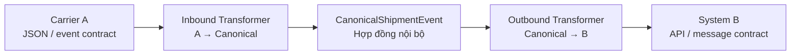
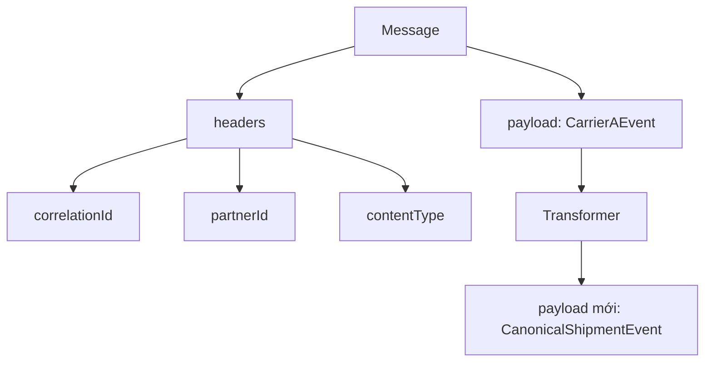
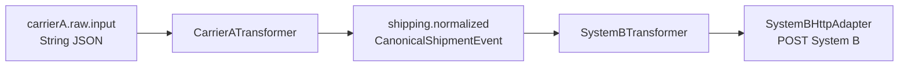
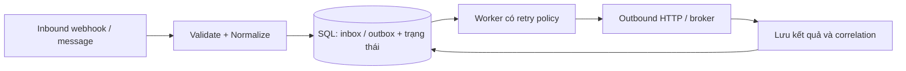

# Transformer và chuẩn hóa payload giữa hai hệ thống

Trong tích hợp hệ thống, hai ứng dụng có thể cùng nói về một sự kiện nhưng dùng **cấu trúc và ngữ nghĩa dữ liệu khác nhau**. Hệ thống vận chuyển gửi `{"state":"WITH_COURIER"}`, còn hệ thống quản lý đơn hàng chờ `{"deliveryState":"ON_THE_WAY"}`. Đổi tên thuộc tính chỉ là bước đầu: ta còn phải thống nhất mã trạng thái, định dạng thời gian, kiểu dữ liệu, khóa định danh và cách xử lý trường không hợp lệ.

**Transformer** là thành phần chuyển một payload từ biểu diễn đầu vào sang biểu diễn đầu ra phù hợp với hợp đồng của phía tiếp nhận. Trong chương **Định tuyến và biến đổi** thuộc module **SPRING_BOOT_INTEGRATION**, transformer góp phần tổ chức các luồng qua HTTP client, cơ sở dữ liệu, cache, message broker và adapter của Spring Integration. Khi transformer được thiết kế rõ ràng, việc xử lý lỗi, retry, trùng lặp, kiểm thử và quan sát sẽ nhất quán hơn giữa các hệ thống.

Bài học tập trung vào **Transformer và chuẩn hóa payload giữa hai hệ thống**, sử dụng Spring Boot và Spring Integration với ví dụ sự kiện trạng thái vận chuyển. Những mẫu thiết kế có thể áp dụng cả khi nguồn/đích là HTTP, SQL, Kafka, RabbitMQ hay tệp dữ liệu.

## 1. Mục tiêu học tập

Sau bài này, bạn có thể:

1. Phân biệt **Transformer**, **message converter**, **Router**, **Filter**, **Enricher** và adapter giao tiếp.
2. Xây dựng hợp đồng dữ liệu trung gian (canonical payload) để tách hai bên tích hợp.
3. Định nghĩa quy tắc mapping cho tên trường, trạng thái, thời gian, số tiền, định danh, null và phiên bản schema.
4. Viết transformer Java có thể kiểm thử độc lập, nối các transformer bằng **Spring Integration DSL**.
5. Thiết kế đường xử lý dành cho payload không hợp lệ, retry an toàn và các lỗi trong một luồng tích hợp thực tế.
6. Đo lường chất lượng dữ liệu sau chuẩn hóa mà không làm lộ thông tin nhạy cảm.

## 2. Transformer giải quyết vấn đề gì?

### 2.1. Sự khác nhau giữa dữ liệu của hai hệ thống

Giả sử hệ thống **Carrier A** gửi sự kiện:

```json
{
  "event_id": "evt-7851",
  "parcel_code": "PKG-0037",
  "state": "WITH_COURIER",
  "occurred_at": "2026-11-21T09:15:40+07:00",
  "rev": 6
}
```

Trong khi đó, hệ thống quản lý vận chuyển **System B** chấp nhận:

```json
{
  "trackingNumber": "PKG-0037",
  "deliveryState": "ON_THE_WAY",
  "eventTimeUtc": "2026-11-21T02:15:40Z",
  "externalEventKey": "carrier-a:evt-7851",
  "revision": 6
}
```

Các thay đổi cần thực hiện:

- `parcel_code` thành `trackingNumber`.
- `state: WITH_COURIER` thành `deliveryState: ON_THE_WAY` theo **bảng chuyển trạng thái đã thỏa thuận**.
- Thời điểm có offset `+07:00` được chuyển thành cùng một thời điểm ở UTC.
- `event_id` được đặt trong phạm vi tên nguồn để tạo **khóa sự kiện ổn định**.
- `rev` được giữ làm version để hệ thống đích phát hiện sự kiện cũ hoặc sai thứ tự.
- Các trường không cần thiết ở đích được loại khỏi hợp đồng gửi đi.

Nếu bỏ qua bước chuẩn hóa và chuyển thẳng JSON từ A sang B, mỗi lần A thay đổi tên trường hoặc cách đặt mã trạng thái có thể buộc B sửa theo.

### 2.2. Canonical payload và ranh giới chống phụ thuộc

Một thiết kế hữu ích là chuyển qua một mô hình chuẩn do **ứng dụng tích hợp** sở hữu:



Dữ liệu chuẩn hóa ở giữa ví dụ là:

```json
{
  "sourceSystem": "carrier-a",
  "eventId": "evt-7851",
  "shipmentId": "PKG-0037",
  "status": "OUT_FOR_DELIVERY",
  "occurredAt": "2026-11-21T02:15:40Z",
  "revision": 6
}
```

Hợp đồng trung gian giúp cô lập ngôn ngữ và định dạng riêng của từng đối tác. Nếu thêm Carrier C, ta tạo mapper từ C vào canonical; nếu thay System B bằng đích D, ta tạo mapper từ canonical sang D.

**Không có nghĩa luôn phải xây dựng một canonical schema lớn cho toàn doanh nghiệp.** Với một kết nối một lần có hai hệ thống ổn định, mapper trực tiếp `A → B` có thể đơn giản hơn. Canonical model có giá trị khi có nhiều adapter, nhiều phiên bản hợp đồng hoặc nghiệp vụ cần mô hình hóa độc lập với đối tác. Nó phải đủ nhỏ, có quyền sở hữu và được quản lý phiên bản.

## 3. Transformer, Router và các thành phần thường bị nhầm lẫn

Trong **Enterprise Integration Patterns**, transformer đảm nhiệm biến đổi nội dung thông điệp. Các thành phần khác giải quyết những quyết định khác nhau:

| Thành phần | Câu hỏi nó trả lời | Ví dụ |
| --- | --- | --- |
| **Transformer** | Payload phải đổi thành dạng nào? | JSON Carrier A → `CanonicalShipmentEvent` |
| **Message converter** | Byte/string/object được serialize hoặc deserialize thế nào? | JSON text → Java object bằng Jackson |
| **Router** | Message phải đi tới channel/đích nào? | `DELIVERED` → channel giao hàng hoàn tất |
| **Filter** | Message nào được tiếp tục xử lý? | Bỏ sự kiện không thuộc loại hệ thống quan tâm |
| **Header Enricher** | Bổ sung metadata nào cho message? | `partnerId`, `correlationId`, `schemaVersion` |
| **Splitter / Aggregator** | Chia một message thành nhiều phần hoặc gom nhiều phần? | Tách file chứa 1.000 sự kiện |
| **Inbound/Outbound Adapter** | Giao tiếp với hệ thống/transport nào? | Nhận HTTP webhook, publish Kafka, ghi SQL |

Một transformer **có thể** đồng thời parse JSON và mapping nghiệp vụ, nhưng trong hệ thống lớn thường tốt hơn nếu tách thành hai phép biến đổi dễ kiểm thử: `JSON → DTO đầu vào → DTO chuẩn hóa`.

### 3.1. Message trong Spring Integration có gì?

Một `Message<T>` có hai phần:

- **Payload**: dữ liệu nghiệp vụ, chẳng hạn `String` JSON, `CarrierAEvent` hoặc `CanonicalShipmentEvent`.
- **Headers**: metadata như `id`, `timestamp`, correlation ID, tên nguồn, content type hoặc các thông tin bổ sung của adapter.



Với transformer kiểu **payload-to-payload** trong một endpoint Spring Integration, framework thường xây message phản hồi với payload mới và xử lý việc chuyển tiếp header theo cơ chế message-handling của nó. Tuy nhiên, **không được giả định mọi header luôn được giữ nguyên trong mọi adapter, converter hoặc bước tạo message mới**. Hãy kiểm tra contract header và chủ động bảo toàn các metadata cần thiết.

Đặc biệt:

- `partnerId`, tenant ID và danh tính nguồn phải được suy ra từ **thành phần đã xác thực**, không tin trực tiếp vào header HTTP do bên gọi tự đặt.
- Không biến token, chữ ký, password thành trường payload chuẩn hóa.
- Khi dùng header làm routing key hay correlation key, phải định nghĩa hành vi nếu header thiếu hoặc bị đổi.
- Một transformer không nên tự tạo correlation ID mới trên mỗi retry nếu muốn theo dõi cùng một sự kiện qua nhiều lần xử lý.

## 4. Định nghĩa hợp đồng chuẩn hóa trước khi viết code

### 4.1. Bảng mapping có quy tắc và ví dụ cụ thể

| Nguồn Carrier A | Canonical | Đích System B | Quy tắc |
| --- | --- | --- | --- |
| `event_id` | `eventId` | Một phần `externalEventKey` | Bắt buộc; giữ ổn định giữa các lần gửi lại |
| Nguồn adapter đã xác thực | `sourceSystem` | Một phần `externalEventKey` | Gắn tên nguồn `carrier-a`; không lấy từ JSON thiếu tin cậy |
| `parcel_code` | `shipmentId` | `trackingNumber` | Chuỗi định danh; không ép thành số làm mất số 0 đầu |
| `state` | `status` | `deliveryState` | Chuyển qua bảng mã rõ ràng |
| `occurred_at` | `occurredAt` kiểu `Instant` | `eventTimeUtc` | Parse ISO 8601 có offset, chuyển UTC |
| `rev` | `revision` | `revision` | Số nguyên dương, bảo toàn ý nghĩa version |

Bảng chuyển trạng thái:

| Carrier A | Canonical | System B |
| --- | --- | --- |
| `WITH_COURIER` | `OUT_FOR_DELIVERY` | `ON_THE_WAY` |
| `DELIVERED` | `DELIVERED` | `COMPLETED` |
| `DELIVERY_ISSUE` | `DELIVERY_FAILED` | `EXCEPTION` |

**Bảng mapping là một phần của hợp đồng nghiệp vụ.** Không tự coi `DELIVERY_ISSUE` tương đương "đã giao thất bại vĩnh viễn" nếu đối tác định nghĩa đó chỉ là sự cố tạm thời. Khi không rõ ý nghĩa, cần làm rõ với chủ sở hữu tích hợp trước khi thay đổi trạng thái.

### 4.2. Phân biệt biến đổi cú pháp và biến đổi ngữ nghĩa

**Biến đổi cú pháp**: đổi `snake_case` thành `camelCase`, chuyển JSON text thành object, xuất timestamp theo chuẩn ISO 8601.

**Biến đổi ngữ nghĩa**: quyết định rằng trạng thái `WITH_COURIER` của A tương ứng `OUT_FOR_DELIVERY` của miền nghiệp vụ; điều này không thể suy ra chắc chắn chỉ bằng thư viện JSON.

**Chuẩn hóa miền dữ liệu** còn gồm:

- **Định danh**: giữ ID dưới dạng chuỗi, xác định phạm vi uniqueness theo nguồn và tenant.
- **Thời gian**: dùng `Instant` cho thời điểm tuyệt đối; chỉ dùng `LocalDate` hoặc `LocalDateTime` khi hợp đồng thật sự mang ý nghĩa ngày/giờ địa phương và có quy tắc timezone riêng.
- **Số tiền**: dùng `BigDecimal` và mã tiền tệ; làm rõ đơn vị nhỏ nhất và quy tắc làm tròn, không dùng `double` cho giá trị tài chính.
- **Đơn vị đo**: chuyển kg ↔ gram hoặc cm ↔ mm theo quy tắc đã xác nhận, kiểm tra tràn số và độ chính xác.
- **Null và trường thiếu**: phân biệt "không gửi", "gửi null" và "gửi giá trị rỗng" nếu có ý nghĩa cập nhật khác nhau.
- **Enum**: quy định rõ mã chưa biết sẽ bị từ chối, cách ly hay chuyển thành `UNKNOWN`; tránh silently mapping thành trạng thái thành công.
- **Thông tin nhạy cảm**: giảm tối đa dữ liệu mang sang hệ thống đích, không ghi log toàn bộ payload khi báo lỗi.

### 4.3. Schema evolution

Hợp đồng cần có chính sách tiến hóa:

1. **Trường mới tùy chọn**: có thể cho phép phía nhận bỏ qua nếu không ảnh hưởng ý nghĩa.
2. **Trường bắt buộc mới**: có thể làm consumer cũ thất bại; cần version và kế hoạch chuyển tiếp.
3. **Đổi kiểu hoặc ý nghĩa trường**: thường là thay đổi không tương thích dù tên trường giữ nguyên.
4. **Thêm mã trạng thái**: phải kiểm tra bảng mapping, workflow nghiệp vụ và hành vi khi chưa nhận biết mã.
5. **Đổi phiên bản**: theo dõi version gốc và version canonical, kiểm thử nhiều phiên bản đang hoạt động.

Cho phép bỏ qua JSON field không biết **khác** với chấp nhận mã enum mới không biết. Thêm `trackingColor` thường có thể bỏ qua; thêm `CANCELLED_BY_CUSTOMS` có thể đòi hỏi quyết định nghiệp vụ mới.

## 5. Chuẩn bị dự án Spring Boot

Ví dụ triển khai sau giả định Spring Boot dùng Java 17+, Spring Integration Java DSL và Jackson 2 (như trong các dự án Spring Boot 3.x). Với stack có phiên bản API Jackson khác, điều chỉnh phần import và mapper theo thư viện thực tế. Bài tập trung vào nguyên tắc transformer và có thể áp dụng tương tự cho các phiên bản khác.

**Gradle (Groovy DSL):**

```groovy
dependencies {
    implementation 'org.springframework.boot:spring-boot-starter-integration'
    implementation 'org.springframework.boot:spring-boot-starter-json'

    testImplementation 'org.springframework.boot:spring-boot-starter-test'
}
```

Nếu ứng dụng đã có starter web cung cấp Jackson, dependency JSON riêng có thể không cần; kiểm tra dependency management của phiên bản Spring Boot bạn đang dùng. Khi gửi ra API B qua HTTP, thêm starter web nếu cần `RestClient` và hạ tầng HTTP tương ứng.

**Spring Integration DSL** dùng `IntegrationFlow` khai báo pipeline nhận message, biến đổi và gửi đến adapter đầu ra. Nó không bắt buộc nghiệp vụ phải phụ thuộc Spring Integration: các mapper Java được thiết kế như hàm chuyển đổi thuần có thể tái sử dụng ở các chỗ khác.

## 6. Cài đặt mô hình dữ liệu

Các lớp sau thuộc package ví dụ `com.example.integration.shipping`. Mỗi `public` record/enum được lưu ở **tệp Java trùng tên**, theo quy tắc Java.

### 6.1. DTO nhận từ Carrier A

**`CarrierAEvent.java`**

```java
package com.example.integration.shipping;

import com.fasterxml.jackson.annotation.JsonIgnoreProperties;
import com.fasterxml.jackson.annotation.JsonProperty;

@JsonIgnoreProperties(ignoreUnknown = true)
public record CarrierAEvent(
        @JsonProperty("event_id") String eventId,
        @JsonProperty("parcel_code") String parcelCode,
        @JsonProperty("state") String state,
        @JsonProperty("occurred_at") String occurredAt,
        @JsonProperty("rev") Integer revision
) {}
```

Chọn `Integer` thay vì primitive `int` cho `revision` để nhận biết trường thiếu (null), tránh nhầm trường thiếu với giá trị 0. `ignoreUnknown = true` hỗ trợ phía A thêm trường ngoài hợp đồng mà không làm parse thất bại. Tuy nhiên, các trường quan trọng vẫn phải được kiểm tra rõ ràng ở bước chuẩn hóa.

### 6.2. Mô hình chuẩn và enum nội bộ

**`ShipmentStatus.java`**

```java
package com.example.integration.shipping;

public enum ShipmentStatus {
    OUT_FOR_DELIVERY,
    DELIVERED,
    DELIVERY_FAILED
}
```

**`CanonicalShipmentEvent.java`**

```java
package com.example.integration.shipping;

import java.time.Instant;

public record CanonicalShipmentEvent(
        String sourceSystem,
        String eventId,
        String shipmentId,
        ShipmentStatus status,
        Instant occurredAt,
        int revision
) {}
```

Record bất biến sau khi khởi tạo phù hợp cho việc chuyển payload qua các bước xử lý. Mô hình chuẩn hóa không chứa `ObjectMapper`, SQL entity hoặc HTTP client; do đó các tầng nghiệp vụ có thể dùng nó mà không phụ thuộc transport của Carrier A.

### 6.3. DTO của System B

**`SystemBStatusUpdate.java`**

```java
package com.example.integration.shipping;

public record SystemBStatusUpdate(
        String trackingNumber,
        String deliveryState,
        String eventTimeUtc,
        String externalEventKey,
        int revision
) {}
```

System B không cần hiểu mã trạng thái riêng của Carrier A và không cần phụ thuộc vào Java record. Adapter đầu ra sẽ serialize record thành JSON theo contract của B.

## 7. Xây dựng inbound transformer: Carrier A → Canonical

### 7.1. Ngoại lệ dữ liệu đầu vào

**`InvalidCarrierEventException.java`**

```java
package com.example.integration.shipping;

public class InvalidCarrierEventException extends RuntimeException {
    public InvalidCarrierEventException(String message) {
        super(message);
    }

    public InvalidCarrierEventException(
            String message, Throwable cause) {
        super(message, cause);
    }
}
```

Đây là ngoại lệ **dữ liệu/contract không hợp lệ**, thường không thể khắc phục bằng cách retry y nguyên request. Không kèm raw JSON vào message của exception vì có thể chứa dữ liệu nhạy cảm.

### 7.2. Transformer từ JSON sang record chuẩn hóa

**`CarrierATransformer.java`**

```java
package com.example.integration.shipping;

import java.time.Instant;
import java.time.OffsetDateTime;
import java.time.format.DateTimeParseException;
import java.util.Map;

import com.fasterxml.jackson.core.JsonProcessingException;
import com.fasterxml.jackson.databind.ObjectMapper;

import org.springframework.integration.transformer.GenericTransformer;
import org.springframework.stereotype.Component;

@Component
public class CarrierATransformer
        implements GenericTransformer<String, CanonicalShipmentEvent> {

    private static final String SOURCE = "carrier-a";

    private static final Map<String, ShipmentStatus> STATUS_MAPPING =
            Map.of(
                    "WITH_COURIER", ShipmentStatus.OUT_FOR_DELIVERY,
                    "DELIVERED", ShipmentStatus.DELIVERED,
                    "DELIVERY_ISSUE", ShipmentStatus.DELIVERY_FAILED
            );

    private final ObjectMapper objectMapper;

    public CarrierATransformer(ObjectMapper objectMapper) {
        this.objectMapper = objectMapper;
    }

    @Override
    public CanonicalShipmentEvent transform(String json) {
        if (json == null || json.isBlank()) {
            throw new InvalidCarrierEventException("Payload rỗng");
        }

        CarrierAEvent incoming;
        try {
            incoming = objectMapper.readValue(json, CarrierAEvent.class);
        } catch (JsonProcessingException ex) {
            throw new InvalidCarrierEventException("JSON không hợp lệ", ex);
        }

        if (incoming == null) {
            throw new InvalidCarrierEventException("Payload không phải object");
        }

        String eventId = required(incoming.eventId(), "event_id");
        String shipmentId = required(incoming.parcelCode(), "parcel_code");
        String stateCode = required(incoming.state(), "state");

        ShipmentStatus status = STATUS_MAPPING.get(stateCode);
        if (status == null) {
            throw new InvalidCarrierEventException(
                    "Mã trạng thái chưa được hỗ trợ: " + stateCode);
        }

        if (incoming.revision() == null || incoming.revision() <= 0) {
            throw new InvalidCarrierEventException(
                    "rev phải là số nguyên dương");
        }

        Instant occurredAt;
        try {
            occurredAt = OffsetDateTime.parse(
                    required(incoming.occurredAt(), "occurred_at")
            ).toInstant();
        } catch (DateTimeParseException ex) {
            throw new InvalidCarrierEventException(
                    "occurred_at phải là thời điểm ISO-8601 có offset", ex);
        }

        return new CanonicalShipmentEvent(
                SOURCE,
                eventId,
                shipmentId,
                status,
                occurredAt,
                incoming.revision()
        );
    }

    private static String required(String value, String name) {
        if (value == null || value.isBlank()) {
            throw new InvalidCarrierEventException(
                    "Thiếu trường bắt buộc: " + name);
        }
        return value.trim();
    }
}
```

**Điểm đáng chú ý:**

1. Không lấy `sourceSystem` từ JSON bên ngoài; transformer này gắn nguồn cố định vì nó thuộc adapter **đã xác thực riêng cho Carrier A**. Nếu một channel dùng chung nhiều đối tác, hãy cung cấp nguồn qua header/context đáng tin cậy.
2. JSON hợp lệ vẫn có thể chứa giá trị sai nghiệp vụ: thiếu `event_id`, `rev <= 0` hoặc mã trạng thái không được hỗ trợ.
3. Thời điểm `2026-11-21T09:15:40+07:00` chuyển thành `2026-11-21T02:15:40Z` mà vẫn là cùng một thời điểm tuyệt đối.
4. Transformer không tự gọi SQL, HTTP hay message broker. Với đầu vào như nhau, nó tạo kết quả như nhau hoặc ném lỗi xác định, nhờ đó dễ unit test.
5. Transformer giữ `eventId` và `revision` từ nguồn. Không tự sinh UUID hoặc `Instant.now()` thay thế, vì điều đó có thể làm mất khả năng chống trùng và so thứ tự trong retry.

**Giới hạn của ví dụ:** Mã nguồn dùng `Map` cho tập trạng thái nhỏ. Với nhiều đối tác/trạng thái, bảng mapping cần có chủ sở hữu, version, tài liệu ý nghĩa và kiểm thử đầy đủ. Các quy tắc về length, schema version, enum bổ sung và quyền truy cập vẫn cần xác định theo hợp đồng thật.

## 8. Xây dựng outbound transformer: Canonical → System B

**`SystemBTransformer.java`**

```java
package com.example.integration.shipping;

import java.time.format.DateTimeFormatter;

import org.springframework.integration.transformer.GenericTransformer;
import org.springframework.stereotype.Component;

@Component
public class SystemBTransformer
        implements GenericTransformer<
                CanonicalShipmentEvent, SystemBStatusUpdate> {

    @Override
    public SystemBStatusUpdate transform(CanonicalShipmentEvent event) {
        String destinationStatus = switch (event.status()) {
            case OUT_FOR_DELIVERY -> "ON_THE_WAY";
            case DELIVERED -> "COMPLETED";
            case DELIVERY_FAILED -> "EXCEPTION";
        };

        return new SystemBStatusUpdate(
                event.shipmentId(),
                destinationStatus,
                DateTimeFormatter.ISO_INSTANT.format(event.occurredAt()),
                event.sourceSystem() + ":" + event.eventId(),
                event.revision()
        );
    }
}
```

Mapper đầu ra chỉ biết **mô hình chuẩn** và **hợp đồng System B**. Nếu Carrier A đổi `state` thành `delivery_stage` nhưng vẫn có cùng ý nghĩa, mapper đầu ra không cần sửa. Ngược lại, nếu B yêu cầu thêm trường có ý nghĩa mà canonical chưa có, phải cập nhật thiết kế dữ liệu và xem xét ảnh hưởng đến tất cả nguồn.

Không nhất thiết mọi mã trạng thái nội bộ đều có bản dịch một-một sang B. Nếu B chỉ hỗ trợ một nhóm trạng thái, phải quy định rõ cách gom nhóm, bỏ qua hoặc báo lỗi; đừng mặc nhiên chọn giá trị gần giống chỉ vì tên trông tương tự.

## 9. Gắn transformer vào Spring Integration DSL

### 9.1. IntegrationFlow

**`ShippingIntegrationConfig.java`**

```java
package com.example.integration.shipping;

import org.springframework.context.annotation.Bean;
import org.springframework.context.annotation.Configuration;
import org.springframework.integration.dsl.IntegrationFlow;

@Configuration
public class ShippingIntegrationConfig {

    @Bean
    IntegrationFlow carrierAToSystemBFlow(
            CarrierATransformer inboundTransformer,
            SystemBTransformer outboundTransformer,
            SystemBHttpAdapter outboundAdapter) {

        return IntegrationFlow
                .from("carrierA.raw.input")
                .transform(inboundTransformer)
                .channel("shipping.normalized")
                .transform(outboundTransformer)
                .handle(outboundAdapter, "send")
                .get();
    }
}
```

Sơ đồ:



- Channel đầu vào `carrierA.raw.input` nhận message có payload là **JSON string** từ inbound adapter được xác thực, chẳng hạn HTTP webhook adapter.
- Transformer thứ nhất chuẩn hóa thành `CanonicalShipmentEvent`.
- Channel trung gian giúp kiểm soát ranh giới dữ liệu và có thể gắn wiretap/monitoring nếu thực sự cần.
- Transformer thứ hai tạo DTO đích.
- `handle(...)` gọi adapter HTTP; truyền tải không thuộc trách nhiệm của transformer.

Đây là **pipeline đồng bộ minh họa**. Với các channel mặc định sử dụng luồng gọi trực tiếp, lỗi trong mapper hoặc outbound handler có thể truyền ngược về phía gửi. Thêm channel bất đồng bộ, queue hoặc broker làm thay đổi cách lỗi được chuyển đến error flow và ý nghĩa acknowledgment; phải thiết kế theo yêu cầu giao nhận thay vì giả định hệ thống tự bảo đảm delivery.

### 9.2. Adapter HTTP minh họa

**`SystemBHttpAdapter.java`**

```java
package com.example.integration.shipping;

import org.springframework.beans.factory.annotation.Value;
import org.springframework.http.MediaType;
import org.springframework.stereotype.Component;
import org.springframework.web.client.RestClient;

@Component
public class SystemBHttpAdapter {

    private final RestClient client;

    public SystemBHttpAdapter(
            RestClient.Builder builder,
            @Value("${integration.system-b.base-url}") String baseUrl) {
        this.client = builder.baseUrl(baseUrl).build();
    }

    public void send(SystemBStatusUpdate update) {
        client.post()
                .uri("/api/v1/shipping/status")
                .contentType(MediaType.APPLICATION_JSON)
                // Chỉ dùng header này nếu API B có hợp đồng hỗ trợ.
                .header("Idempotency-Key", update.externalEventKey())
                .body(update)
                .retrieve()
                .toBodilessEntity();
    }
}
```

**`application.yml`** (minh họa):

```yaml
integration:
  system-b:
    base-url: ${SYSTEM_B_BASE_URL}
```

Adapter thật còn cần authentication, TLS, connect/read timeout, phân loại HTTP status, giới hạn retry và quan sát. Không đặt password/token trong source code. Việc System B chấp nhận header `Idempotency-Key` là một **giả định hợp đồng cụ thể của ví dụ**: không tự động có hiệu lực với mọi API.

### 9.3. Khi nào dùng converter hoặc transformer chuyên biệt?

Nếu inbound adapter đã deserialize JSON thành `CarrierAEvent`, hãy đổi transformer đầu vào thành `GenericTransformer<CarrierAEvent, CanonicalShipmentEvent>` và bỏ bước `ObjectMapper.readValue`. Cách này tách rõ:

```text
HTTP/broker bytes
  -> JSON message converter
  -> CarrierAEvent (contract bên ngoài)
  -> domain transformer
  -> CanonicalShipmentEvent
```

Với transformation thuần như format ngày tháng, chuyển JSON/XML, thêm header, Spring Integration có các transformer/converter sẵn có phù hợp theo module dependency. Không nên tạo class lớn chỉ để thay thao tác chuẩn có sẵn; ngược lại, **quy tắc ý nghĩa nghiệp vụ** cần ở mã rõ ràng và có test.

## 10. Thiết kế lỗi, retry và idempotency cho luồng biến đổi

### 10.1. Lỗi không phải tất cả đều giống nhau

| Lỗi | Ví dụ | Hành vi đề xuất |
| --- | --- | --- |
| **Parsing / format** | JSON hỏng, timestamp thiếu offset | Từ chối/cách ly, báo lỗi hợp đồng; không retry nguyên payload |
| **Validation / semantic** | Trạng thái chưa được mapping, `rev` âm | Quarantine, ghi reason code, xem xét cập nhật hợp đồng |
| **Schema incompatibility** | Đối tác đổi ý nghĩa trường | Chặn phiên bản không được hỗ trợ; cập nhật mapping và contract test |
| **Lỗi HTTP đích tạm thời** | Timeout, 429, 502, 503 | Retry có giới hạn và backoff nếu thao tác an toàn khi gửi lại |
| **Lỗi quyền/cấu hình** | 401, 403, URL sai | Sửa cấu hình hoặc credential; tránh retry vô hạn |
| **Lỗi nghiệp vụ của đích** | 422 do trạng thái không hợp lệ | Phân loại lỗi, đối soát mapping, không che giấu dưới giá trị mặc định |

Khi một transformer ném exception:

- Với **DirectChannel** và luồng xử lý đồng bộ, exception thường truyền lên bên gửi; caller quyết định response HTTP hoặc rollback transaction.
- Với **poller/async executor/broker consumer**, error handling phụ thuộc endpoint, acknowledgment, retry advice và `errorChannel` được cấu hình. Không mặc nhiên kết luận message tự vào dead-letter queue.
- Cần xác định trường hợp nào đủ điều kiện retry và trường hợp nào cần đưa vào quarantine/DLQ cùng lý do; tránh nhốt message lỗi dữ liệu trong vòng lặp retry vô hạn.

### 10.2. Chuẩn hóa không tự làm một thao tác thành idempotent

Trong ví dụ, `externalEventKey = sourceSystem + ":" + eventId` giữ ổn định giữa các lần gửi. Tuy nhiên, **việc tạo ra key chưa ngăn xử lý trùng**. Cần có cơ chế mà phía nhận hoặc tầng lưu trạng thái áp dụng:

- Unique constraint trên `(source_system, event_id)` nếu lưu inbox vào SQL.
- Trạng thái xử lý/phiên bản để tránh side effect lặp lại khi consumer retry.
- Cơ chế idempotency của API B nếu B có hỗ trợ, hoặc quy trình tra cứu kết quả trước khi gửi lại.
- Quy tắc xử lý khi hai lần gửi có cùng event key nhưng payload khác nhau.

Không dùng thời điểm nhận message hay UUID mới mỗi lần để tạo idempotency key. Đối với thao tác không idempotent và khi timeout khiến kết quả phía xa không rõ, phải thiết kế cách đối soát hoặc thỏa thuận endpoint hỗ trợ idempotency.

### 10.3. Giao dịch và tính bền vững

Ví dụ đồng bộ ở trên dùng HTTP client ở cuối flow; nếu B xử lý thành công rồi đường truyền đứt trước khi trả response, hệ thống A có thể không biết kết quả. `@Transactional` trên database nội bộ **không rollback** được HTTP side effect ở B.

Với nghiệp vụ quan trọng, cân nhắc:



Ghi bền vững sự kiện cần xử lý trong transaction SQL có thể giúp khôi phục sau sự cố. Worker vẫn phải xử lý việc gửi lại an toàn; việc lưu bền vững và phát HTTP/broker không có bảo đảm nguyên tử xuyên ranh giới chỉ vì cùng một flow.

## 11. Kiểm thử transformer và hợp đồng dữ liệu

Transformer thuần là phần có thể unit test nhanh và đầy đủ. Phải test **ý nghĩa** của dữ liệu đầu ra, không chỉ xác nhận code chạy mà không exception.

### 11.1. Unit test inbound transformer

Ví dụ JUnit 5 cho Jackson 2:

```java
package com.example.integration.shipping;

import static org.junit.jupiter.api.Assertions.*;

import java.time.Instant;

import com.fasterxml.jackson.databind.ObjectMapper;
import org.junit.jupiter.api.Test;

class CarrierATransformerTest {

    private final CarrierATransformer transformer =
            new CarrierATransformer(new ObjectMapper());

    @Test
    void normalizesStateAndUtcInstant() {
        var json = """
                {
                  "event_id": "evt-7851",
                  "parcel_code": "PKG-0037",
                  "state": "WITH_COURIER",
                  "occurred_at": "2026-11-21T09:15:40+07:00",
                  "rev": 6
                }
                """;

        CanonicalShipmentEvent result = transformer.transform(json);

        assertEquals("carrier-a", result.sourceSystem());
        assertEquals("evt-7851", result.eventId());
        assertEquals("PKG-0037", result.shipmentId());
        assertEquals(ShipmentStatus.OUT_FOR_DELIVERY, result.status());
        assertEquals(Instant.parse("2026-11-21T02:15:40Z"),
                result.occurredAt());
        assertEquals(6, result.revision());
    }

    @Test
    void rejectsUnknownStatus() {
        String json = """
                {
                  "event_id": "evt-2",
                  "parcel_code": "PKG-0038",
                  "state": "REVERSE_PICKUP",
                  "occurred_at": "2026-11-21T09:15:40+07:00",
                  "rev": 1
                }
                """;

        assertThrows(InvalidCarrierEventException.class,
                () -> transformer.transform(json));
    }
}
```

### 11.2. Ma trận trường hợp cần bao phủ

| Nhóm test | Dữ liệu đầu vào | Kết quả mong đợi |
| --- | --- | --- |
| Mapping thông thường | `WITH_COURIER`, timestamp có offset | `OUT_FOR_DELIVERY`, cùng thời điểm ở UTC |
| Tất cả trạng thái hợp lệ | `DELIVERED`, `DELIVERY_ISSUE` | Mapping đúng bảng, không rơi vào nhánh mặc định |
| Field thiếu | Không có `event_id` hoặc `rev` | Ngoại lệ validation có reason rõ |
| Field rỗng | `parcel_code: " "` | Từ chối thay vì tạo ID rỗng |
| Kiểu sai | `rev: "abc"` | Lỗi parse/contract |
| Timestamp không offset | `2026-11-21T09:15:40` | Từ chối theo hợp đồng đã đặt |
| Timestamp đổi offset | `+07:00`, `Z` cùng một instant | Kết quả `Instant` tương đương |
| Enum mới | `REVERSE_PICKUP` | Từ chối/cách ly có thể quan sát |
| Thêm field tùy chọn | `tracking_color` | Bỏ qua nếu hợp đồng tương thích |
| Định danh | `parcel_code: "00042"` | Không mất các số 0 đầu |
| Retry cùng event | Payload/ID như cũ | Mapping giữ nguyên ID, status, thời điểm |
| Outbound mapper | `OUT_FOR_DELIVERY` | `ON_THE_WAY`, `externalEventKey` ổn định |

Ngoài unit test, cần **contract test** với mẫu payload thật đã ẩn dữ liệu nhạy cảm và **integration test** với flow/adapter thật hoặc fake HTTP server. Ví dụ, dùng WireMock hoặc HTTP mock server để xác nhận JSON System B, header được gửi đúng, lỗi HTTP được phân loại và timeout không khiến retry vô hạn.

### 11.3. Những lỗi kiểm thử dễ bỏ sót

- Chỉ test một trạng thái, bỏ qua những trạng thái khác trong mapping.
- Test timestamp ở UTC nhưng không test offset khác để phát hiện lỗi timezone.
- Không test field null, field sai kiểu, enum lạ, payload quá lớn hoặc schema version mới.
- Dùng test mock thành công cho adapter mà không xác nhận body thực tế khi serialize ra JSON.
- Kiểm tra thứ tự message chỉ trong luồng đơn, trong khi môi trường thật có nhiều consumer và retry.

Một contract test nên cho biết **phiên bản payload nào** được hỗ trợ, ai sở hữu fixture và lỗi nào chứng tỏ thay đổi phá vỡ hợp đồng.

## 12. Quan sát dữ liệu sau chuẩn hóa

Một transformer lỗi có thể biểu hiện dưới nhiều dạng: thông điệp bị cách ly, mã trạng thái không được mapping, thời gian bị lệch hoặc dữ liệu bị gắn nhầm đối tác. Bổ sung tín hiệu quan sát theo từng ranh giới:

- **Số message nhận và chuẩn hóa thành công** theo tên adapter, phiên bản schema và loại sự kiện.
- **Tỷ lệ không hợp lệ** theo reason code (`invalid_json`, `missing_field`, `unknown_status`, `invalid_timestamp`).
- **Độ trễ** từ lúc nhận đến lúc chuẩn hóa và từ lúc sự kiện xảy ra đến khi xử lý.
- **Số sự kiện duplicate/retry** theo nguồn; số message chờ hoặc nằm trong quarantine/DLQ.
- **Số lần gọi System B thành công/thất bại**, thời gian phản hồi, timeout và HTTP status.
- **Correlation ID/event ID** trong log/tracing để đối soát từng sự kiện xuyên HTTP, SQL, message broker và adapter.

Dùng metric tag có số giá trị **hữu hạn** như tên đối tác, version, reason code; tránh đưa `eventId`, `shipmentId` vào label metric vì có cardinality rất cao. Những ID này phù hợp với log/traces có kiểm soát. Không log toàn bộ payload nhạy cảm hoặc token để tìm nguyên nhân lỗi; dùng reason code và mẫu dữ liệu đã loại bỏ PII khi cần.

### 12.1. Ví dụ theo dõi một message

```text
correlationId: corr-2c95
sourceSystem: carrier-a
eventId: evt-7851
contractVersion: carrier-a-v1
receivedAt: 2026-11-21T02:15:41Z
normalizeResult: OK
normalizedStatus: OUT_FOR_DELIVERY
destination: system-b
deliveryResult: ACCEPTED
```

Giữ correlation ID xuyên các bước (hoặc quan hệ trace/span) giúp xác định lỗi nằm ở parse, mapping, queue hay API System B. Khi retry, giữ khóa sự kiện nghiệp vụ ổn định và ghi attempt count riêng.

## 13. Mẫu thiết kế nên chọn và các sai lầm cần tránh

### 13.1. Nên làm

1. Định nghĩa **mapping table và hợp đồng dữ liệu** trước khi viết transformer.
2. Tách **DTO của đối tác**, **canonical DTO** và **DTO của hệ thống đích**.
3. Giữ transformer gần với **pure function**: nhận payload, kiểm tra, tạo payload mới; để side effect trong adapter/service.
4. Xác định **quy tắc xử lý mã chưa biết**, trường thiếu và thay đổi schema.
5. Bảo toàn ID, revision, timestamp và metadata cần thiết cho replay/idempotency.
6. Kiểm thử mapping, timezone, field null, lỗi hợp đồng và serialization bên ra.
7. Giám sát lỗi dữ liệu riêng với lỗi hạ tầng để có quyết định retry phù hợp.

### 13.2. Tránh làm

- Nối chuỗi JSON bằng tay hoặc dùng string replacement để đổi tên trường.
- Mapping mọi enum lạ thành `UNKNOWN` rồi cho luồng tiếp tục âm thầm khi trạng thái ảnh hưởng nghiệp vụ.
- Xem `String.replace("WITH_COURIER", "ON_THE_WAY")` là mapping hợp lệ cho toàn bộ JSON.
- Dùng cùng DTO cho cả database entity, request đối tác và payload broker.
- Gọi HTTP/SQL trong một transformer và trộn với logic đổi định dạng, khiến việc retry và unit test khó tách biệt.
- Sinh event ID mới mỗi lần transform hoặc dựa vào thời điểm hiện tại để suy ra thứ tự nguồn.
- Bỏ qua vấn đề security headers, correlation và message acknowledgment khi thay kiểu channel.
- Cho rằng đã có transformer thì không cần quản lý hợp đồng hoặc end-to-end tests.

## 14. Câu hỏi tự kiểm tra và bài tập

1. **Transformer khác Router thế nào?** Nếu cần chuyển `WITH_COURIER` thành `OUT_FOR_DELIVERY` rồi chuyển sự kiện `DELIVERED` sang một channel riêng, thứ tự các bước nên là gì?
2. Vì sao nên giữ `parcel_code` ở dạng chuỗi nếu nó có thể là `00042`?
3. Tại sao `2026-11-21T09:15:40+07:00` và `2026-11-21T02:15:40Z` là cùng một thời điểm?
4. Điều gì có thể xảy ra nếu một enum mới từ đối tác được tự động đổi thành trạng thái `DELIVERED`?
5. Vì sao canonical model không nên dùng trực tiếp các annotation persistence và trường nội bộ của một đối tác?
6. Nếu API System B timeout sau khi nhận sự kiện, việc transformer tạo `externalEventKey` ổn định đã đủ bảo đảm không gửi trùng chưa?
7. Khác nhau giữa lỗi JSON không hợp lệ và lỗi HTTP 503 ở System B về chính sách retry là gì?
8. Khi thêm Carrier C, cần sửa những lớp nào để giữ nguyên contract gửi sang System B?
9. Nếu message đi qua một channel bất đồng bộ, luồng xử lý lỗi khác gì so với `DirectChannel` đồng bộ?
10. Chọn ít nhất 5 trường hợp kiểm thử để bảo vệ một mapper xử lý ngày giờ và ba mã trạng thái.

**Bài tập thực hành:** Mở rộng ví dụ để Carrier A có thêm trạng thái `RETURNED_TO_SENDER`. Hãy xác nhận ý nghĩa nghiệp vụ của trạng thái đó, cập nhật bảng mapping và contract, bổ sung mã canonical và System B tương ứng nếu được hỗ trợ, viết test cho cả trường hợp hợp lệ lẫn trường hợp System B không nhận biết trạng thái mới. Sau đó xây một test cho hai lần nhận cùng `eventId` để chứng minh lớp lưu trạng thái/adapter thực sự chống trùng, ngoài việc transformer tạo dữ liệu nhất quán.

## 15. Ghi nhớ

- **Transformer** chuyển payload giữa các biểu diễn và ngữ nghĩa; **Router** chọn đường đi; **adapter** giao tiếp với nguồn/đích; **converter** xử lý biểu diễn wire format.
- Chuẩn hóa tốt cần kiểm soát **schema, enum, null, timezone, định danh, version và ý nghĩa nghiệp vụ**, không chỉ đổi tên field.
- Mô hình **A → canonical → B** giúp giảm phụ thuộc giữa đối tác và hệ thống đích khi có nhiều adapter; chỉ dùng khi lợi ích xứng với độ phức tạp.
- Mapper nên không có side effect, có lỗi xác định và được kiểm thử độc lập. Lỗi mapping dữ liệu và lỗi hạ tầng cần các chính sách xử lý khác nhau.
- Bảo toàn **khóa sự kiện, revision, thời điểm và correlation** là tiền đề cho idempotency, quan sát, replay và xử lý sai thứ tự. Transformer không tự tạo ra bảo đảm giao dịch hay exactly-once delivery.

Khi xây dựng một luồng tích hợp Spring Boot thực tế, hãy xem transformer là **ranh giới bảo vệ hợp đồng dữ liệu** giữa các hệ thống độc lập. Từ đó, các bước định tuyến, ghi SQL, cache, gửi broker hoặc gọi HTTP sẽ sử dụng dữ liệu nhất quán, dễ kiểm thử và dễ vận hành hơn.
