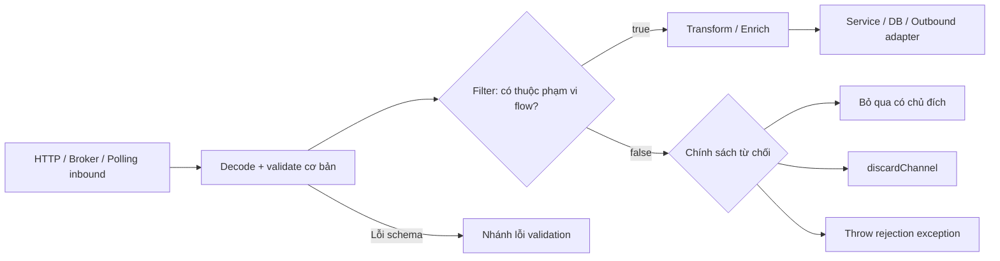
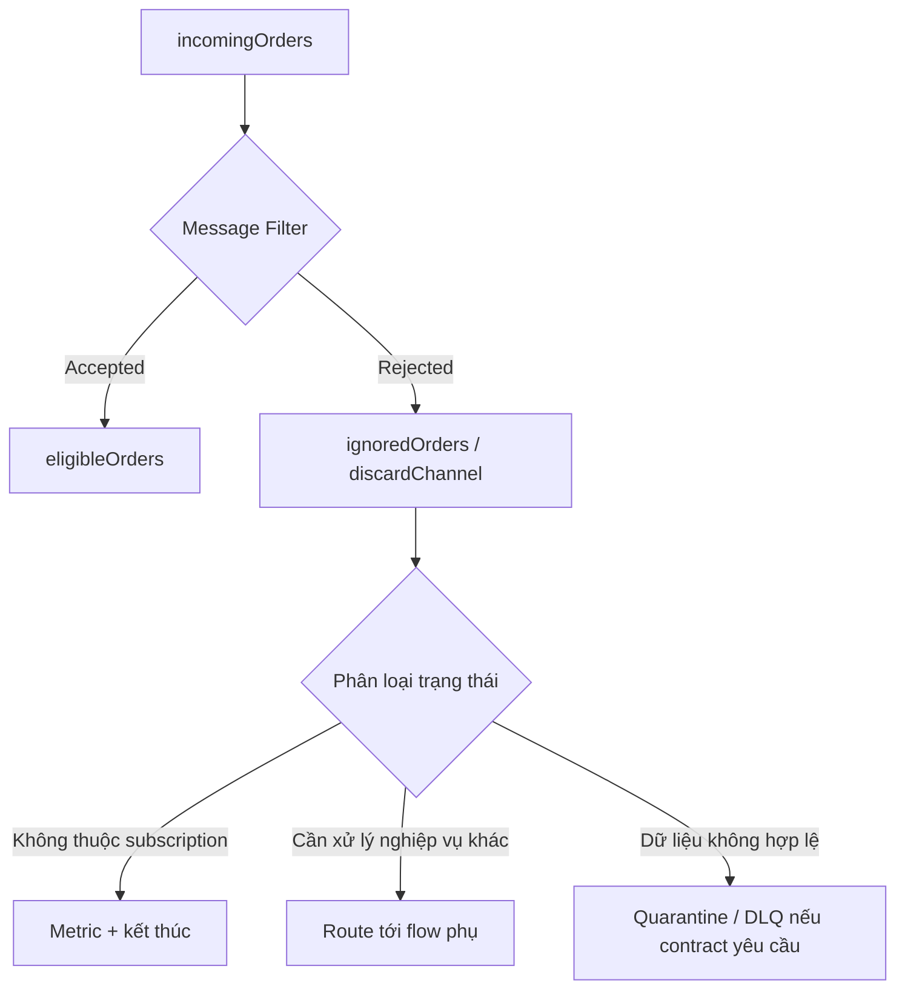
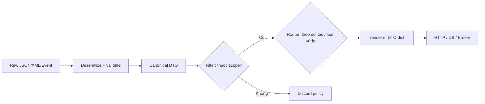

# Filter và loại bỏ thông điệp không đáp ứng điều kiện

> **Chương:** Định tuyến và biến đổi  
> **Phạm vi:** Trong module **SPRING_BOOT_INTEGRATION**, một dịch vụ Spring Boot có thể nhận thông điệp từ HTTP, cơ sở dữ liệu, cache hoặc broker rồi xử lý bằng các adapter của Spring Integration. Bài viết tập trung vào **Filter** trong Spring Integration: quyết định thông điệp nào được tiếp tục, xử lý thông điệp bị loại qua `discardChannel` hay exception, và lựa chọn chính sách phù hợp với hợp đồng dữ liệu, giao dịch, lỗi, xử lý trùng lặp, kiểm thử và quan sát.

## 1. Filter giải quyết vấn đề gì?

Giả sử một dịch vụ đồng bộ đơn hàng nhận nhiều loại sự kiện từ đối tác: `order.created`, `order.updated`, `order.cancelled`. Luồng đích chỉ phụ trách khởi tạo đơn mới, nên các sự kiện khác **không thuộc phạm vi xử lý của luồng đó**. Nếu đưa mọi sự kiện qua transform, gọi HTTP đối tác và ghi cơ sở dữ liệu, hệ thống vừa tốn tài nguyên vừa có nguy cơ tạo tác dụng phụ ngoài ý muốn.

**Message Filter** trong Spring Integration áp dụng một điều kiện lên thông điệp:

- Điều kiện **đúng** (`true`): thông điệp được chuyển tiếp sang bước kế tiếp của flow.
- Điều kiện **sai** (`false`): thông điệp bị **từ chối tại filter**. Tùy cấu hình, nó có thể bị bỏ qua, gửi sang kênh discard hoặc gây exception.
- Quá trình đánh giá điều kiện **ném exception**: đây là **lỗi xử lý filter**, không phải kết quả từ chối thông thường; cách phát lỗi còn phụ thuộc điểm thực thi và error-handling của flow.

Điểm cần phân biệt: **loại bỏ tại filter không đồng nghĩa xóa message gốc khỏi broker, rollback transaction hay phát thông báo lỗi**. Filter là một endpoint xử lý thông điệp trong ứng dụng; chính sách lưu trữ, acknowledgement và retry thuộc về những thành phần liên quan.

### Sơ đồ luồng



**Ví dụ:** Bộ lọc cho phép `eventType = "order.created"` và `partnerStatus = "ENABLED"`. Nó không có nhiệm vụ sửa cấu trúc payload, khôi phục HTTP timeout hay kiểm chứng một đơn đã từng được ghi ở database hay chưa.

## 2. Vị trí của Filter trong các Enterprise Integration Patterns

Filter là một **Message Filter pattern**: quyết định chấp nhận hay loại bỏ một thông điệp, thông thường theo predicate. Nó thường được đặt trước các bước đắt đỏ hoặc có side effect.

| Thành phần trong Spring Integration | Câu hỏi giải quyết | Kết quả điển hình |
| --- | --- | --- |
| **Filter** | Thông điệp này có được đi tiếp trên flow này không? | Tiếp tục hoặc bị từ chối |
| **Router** | Thông điệp này phải đi đến nhánh nào? | Một hoặc nhiều kênh đích theo cấu hình |
| **Transformer** | Cần đổi payload/định dạng thành gì? | Thông điệp với payload đã biến đổi |
| **Header enricher** | Cần bổ sung metadata nào? | Thông điệp có header bổ sung |
| **Validator** | Payload có tuân thủ schema và quy tắc dữ liệu không? | Hợp lệ hoặc lỗi validation |
| **Idempotent receiver** | Business key này đã được xử lý trước đó chưa? | Xử lý một lần theo hợp đồng, bỏ/đánh dấu trùng |
| **Service activator** | Thực hiện thao tác nghiệp vụ nào? | Side effect, reply hoặc lỗi |

**Filter và Router khác nhau:** nếu chỉ có hai lựa chọn “đi tiếp / không đi tiếp”, Filter thường rõ ràng hơn. Nếu cần chọn giữa `urgentOrders`, `normalOrders`, `partnerAOrders` và `partnerBOrders`, Router biểu đạt mục đích tốt hơn. Nếu một message cần đến **nhiều** downstream độc lập, cần thiết kế pub-sub hoặc router phù hợp thay vì cố gắng dùng filter như cơ chế nhân bản thông điệp.

**Filter và validation khác nhau:** một message sai schema hoặc bị thiếu ID bắt buộc thường cần được từ chối có mã lỗi, đưa sang DLQ/quarantine hoặc phản hồi 4xx. Một message hợp lệ nhưng có `eventType` không thuộc subscription có thể được bỏ qua bình thường. Trộn hai trường hợp gây khó quan sát và khiến message hỏng bị xử lý như “không cần quan tâm”.

## 3. Cơ chế xử lý trong Spring Integration

Các endpoint filter của Spring Integration dựa trên khả năng đánh giá một thông điệp. Bạn có thể cung cấp `MessageSelector`, predicate trên payload, expression hoặc phương thức được đánh dấu `@Filter` tùy cách cấu hình.

Ở mức khái niệm:

```java
boolean accept(Message<?> message) {
    // Chỉ ví dụ nguyên lý, không phải một interface cụ thể phải triển khai.
    return "order.created".equals(message.getHeaders().get("eventType"));
}
```

Một predicate nên:

1. **Nhanh và dễ hiểu:** kiểm tra loại sự kiện, trạng thái, tenant/đối tác hoặc metadata đã có.
2. **Không gây side effect:** không tạo đơn, cập nhật số dư hay gọi API chỉ để biết có nên tiếp tục không.
3. **Có quy tắc rõ với `null` hoặc field lạ:** đừng để `NullPointerException` biến một trường hợp có thể phân loại thành lỗi khó đoán.
4. **Dễ kiểm thử độc lập:** cùng đầu vào và cùng policy snapshot thì cho cùng quyết định.

Không bắt buộc filter luôn thuần túy: có thể tra cứu policy bên ngoài. Nhưng nếu predicate gọi Redis/HTTP/DB, mỗi lần retry hoặc broker redelivery có thể đánh giá trên trạng thái đã thay đổi. Khi đó cần định nghĩa policy version, timeout, hành vi khi dependency lỗi và việc ra quyết định có cần lưu bền vững hay không.

### 3.1. Đường đi khi kết quả là false

| Thiết lập | Hành vi mong đợi | Khi phù hợp |
| --- | --- | --- |
| Không khai báo discard, `throwExceptionOnRejection = false` | Thông điệp bị từ chối và không đi tiếp; không có business reply tự động | Bỏ qua dữ liệu không thuộc subscription và được phép mất ở nhánh này |
| Cấu hình `discardChannel` | Thông điệp bị từ chối được gửi sang kênh xử lý discard | Ghi metric, audit, routing sang nhánh xử lý dữ liệu không phù hợp |
| `throwExceptionOnRejection = true` | Rejection trở thành exception như `MessageRejectedException` | Hợp đồng yêu cầu rejection phải được xem là lỗi, caller/error flow xử lý |

**`discardChannel` nhận thông điệp bị từ chối**, không phải tự động một `ErrorMessage`. Nếu cần biết vì sao bị loại, predicate/flow phải có quy ước lưu lý do (ví dụ header hoặc metadata ở bước trước) hay phân loại lại một cách an toàn. Chỉ gửi message tới discard channel không tự động biến nó thành DLQ bền vững.

Khi sử dụng đồng thời `discardChannel` và chế độ ném exception, hành vi/ưu tiên cần được xác nhận theo phiên bản Spring Integration của ứng dụng. Để ý đồ rõ ràng, bài này lựa chọn **một chính sách chính cho mỗi filter** và kiểm thử đường đi tương ứng.

### 3.2. Đường đi khi selector ném exception

Khác với `return false`, lỗi như NPE, lỗi kết nối Redis hoặc exception từ dịch vụ phân quyền khiến endpoint **thất bại trong khi đánh giá điều kiện**. Với `DirectChannel` đồng bộ, lỗi thường lan về sender; với điểm thực thi bất đồng bộ và error handler phù hợp, lỗi có thể được đóng gói thành `ErrorMessage` tới kênh lỗi. Header `errorChannel` không tự bảo đảm mọi exception đồng bộ đều được chuyển thành message lỗi.

**Không dùng `catch (Exception e) { return false; }` cho mọi lỗi**: làm vậy có thể vô tình nuốt lỗi cấu hình, sự cố mạng hoặc bug và khiến broker coi thông điệp đã xử lý thành công.

## 4. Ví dụ thực tế: chỉ xử lý sự kiện order.created của đối tác đang bật

Ứng dụng nhận sự kiện từ một inbound adapter (Kafka, AMQP hoặc HTTP gateway), nhưng flow tạo đơn chỉ xử lý các sự kiện `order.created` của đối tác được cấu hình hoạt động. Ta thiết kế hai kênh:

- `eligibleOrders`: sự kiện được chấp nhận; service nghiệp vụ có thể lưu database hoặc gọi downstream.
- `ignoredOrders`: sự kiện không thuộc flow; chỉ ghi nhận metadata/metric hoặc chuyển sang cơ chế theo dõi khác nếu hợp đồng yêu cầu.

Ví dụ dùng Spring Integration Java DSL trên Spring Boot 3.x, Java 17+:

```xml
<dependency>
    <groupId>org.springframework.boot</groupId>
    <artifactId>spring-boot-starter-integration</artifactId>
</dependency>
```

```java
package com.example.integration.orders;

import org.slf4j.Logger;
import org.slf4j.LoggerFactory;
import org.springframework.context.annotation.Bean;
import org.springframework.context.annotation.Configuration;
import org.springframework.integration.annotation.ServiceActivator;
import org.springframework.integration.channel.DirectChannel;
import org.springframework.integration.config.EnableIntegration;
import org.springframework.integration.dsl.IntegrationFlow;
import org.springframework.messaging.Message;
import org.springframework.messaging.MessageChannel;

@Configuration
@EnableIntegration
public class OrderFilteringConfiguration {

    private static final Logger log =
            LoggerFactory.getLogger(OrderFilteringConfiguration.class);

    @Bean
    public MessageChannel inboundOrders() {
        return new DirectChannel();
    }

    @Bean
    public MessageChannel eligibleOrders() {
        return new DirectChannel();
    }

    @Bean
    public MessageChannel ignoredOrders() {
        return new DirectChannel();
    }

    @Bean
    public IntegrationFlow orderFilterFlow() {
        return IntegrationFlow.from("inboundOrders")
                .filter(OrderEvent.class,
                        event -> "order.created".equals(event.eventType())
                                && event.partnerEnabled(),
                        spec -> spec
                                .discardChannel("ignoredOrders")
                                .throwExceptionOnRejection(false))
                .channel("eligibleOrders")
                .get();
    }

    @ServiceActivator(inputChannel = "eligibleOrders")
    public void onAccepted(OrderEvent order) {
        // Demo: gọi service nghiệp vụ; production cần transaction,
        // validation và idempotency cho externalId/eventId.
        log.info("Accepted eventId={}", order.eventId());
    }

    @ServiceActivator(inputChannel = "ignoredOrders")
    public void onIgnored(Message<OrderEvent> originalMessage) {
        OrderEvent event = originalMessage.getPayload();
        log.info("Ignored eventId={}, eventType={}",
                event.eventId(), event.eventType());
    }

    public record OrderEvent(
            String eventId,
            String eventType,
            boolean partnerEnabled,
            String externalId
    ) {}
}
```

Flow trên có chủ đích **không bỏ sự kiện hợp lệ vì ID đã tồn tại**: việc chống trùng dựa vào `eventId`/`externalId` nên được service xử lý cùng trạng thái bền vững. Cũng nên xác thực không rỗng của các field cần thiết trước filter; ví dụ dùng bản ghi Java để đơn giản hóa phần định tuyến.

### 4.1. Gửi message vào flow

Một producer, adapter hoặc test có thể gửi:

```java
import org.springframework.beans.factory.annotation.Qualifier;
import org.springframework.messaging.MessageChannel;
import org.springframework.messaging.support.MessageBuilder;
import org.springframework.stereotype.Component;
import com.example.integration.orders.OrderFilteringConfiguration.OrderEvent;

@Component
class OrderEventSender {
    private final MessageChannel inboundOrders;

    OrderEventSender(
            @Qualifier("inboundOrders") MessageChannel inboundOrders) {
        this.inboundOrders = inboundOrders;
    }

    public void submit(OrderEvent event, String correlationId) {
        inboundOrders.send(
                MessageBuilder.withPayload(event)
                        .setHeader("correlationId", correlationId)
                        .build()
        );
    }
}
```

Nếu gửi `OrderEvent("evt-1", "order.created", true, "ORD-1")`, message đi tới `eligibleOrders`. Nếu `eventType = "order.cancelled"` hoặc `partnerEnabled = false`, message đi sang `ignoredOrders`. Kênh discard nhận original message và header của nó; filter không tự chuyển event thành một DTO mới.

**Không đồng nhất kết quả `send()` với thành công nghiệp vụ.** Nó thể hiện việc gửi vào kênh theo semantics của `MessageChannel`. Trong flow bất đồng bộ, service có thể xử lý và lỗi sau khi sender đã trở về; trong flow đồng bộ, exception từ handler có thể lan ngược về sender.

### 4.2. Điều gì xảy ra khi không có subscriber ở discardChannel?

Một channel không có endpoint nhận có thể khiến gửi thông điệp thất bại tùy loại channel và cấu hình. Ở ví dụ, `ignoredOrders` có service activator để tiếp nhận. Trong production, nhánh discard phải có **đích cuối được kiểm soát**, ví dụ metric/audit handler hoặc adapter lưu trữ có chủ đích; không để discard channel trỏ vào một vòng lặp vô hạn rồi lại quay về `inboundOrders`.

## 5. Ba chính sách từ chối và cách chọn

### 5.1. Drop có chủ đích

Không cần cấu hình discard khi một sự kiện hoàn toàn không liên quan tới service, ví dụ consumer đã đăng ký topic dùng chung nhưng chỉ quan tâm một loại event. Cần xác nhận việc bỏ qua này đúng với **hợp đồng của consumer**, và ghi metric đếm số bị loại để phát hiện producer vô tình gửi lệch loại.

Rủi ro của drop im lặng là che giấu lỗi: nếu producer bất ngờ đổi tên `order.created` thành `order.v2.created`, tất cả thông điệp có thể bị filter bỏ mà không có exception. Đặt cảnh báo khi tỷ lệ discard tăng đột biến.

### 5.2. Đưa sang discardChannel

Kênh discard hữu ích nếu hệ thống cần audit, kiểm tra hoặc xử lý các trường hợp “không nằm trong scope của flow hiện tại”. Ví dụ:



Kênh discard là một **MessageChannel trong ứng dụng**, không phải một dead-letter queue bền vững. Nếu dữ liệu bị loại cần replay sau restart, phải bổ sung kho lưu lỗi, broker queue hoặc message store có cơ chế persistence phù hợp. Đồng thời cần lưu lý do, thời điểm, schema version, correlation ID và owner để có thể điều tra.

### 5.3. Ném exception khi rejection là lỗi thật

Nếu business contract quy định rằng một loại dữ liệu không được phép xuất hiện tại endpoint này, có thể bật `throwExceptionOnRejection(true)` để reject được nhìn nhận như lỗi.

```java
// Phần cấu hình bên trong IntegrationFlow:
.filter(OrderEvent.class,
        event -> "order.created".equals(event.eventType()),
        spec -> spec.throwExceptionOnRejection(true))
```

Trong flow đồng bộ, exception có thể lan tới caller/gateway; trong flow bất đồng bộ, cần error publishing handler phù hợp để gửi tới `errorChannel`. Chọn chiến lược này khi thật sự cần **hành vi lỗi**, ví dụ trả response thất bại hoặc kích hoạt error flow. Đừng dùng nó cho mọi sự kiện hợp lệ nhưng không thuộc subscription, vì dễ gây retry vô nghĩa và làm đầy DLQ.

## 6. Bộ lọc theo payload, header và expression

### 6.1. Payload predicate

Cách ở ví dụ dùng `OrderEvent.class` để Spring Integration chuyển payload đã được deserialize sang loại phù hợp trước khi đánh giá `event -> ...`. Đây là lựa chọn dễ kiểm thử khi DTO nội bộ ổn định.

Với thông điệp từ HTTP, XML, JSON, Kafka hoặc AMQP, **deserialize và validate** nên diễn ra ở adapter/transformer thích hợp trước khi filter đọc các field nghiệp vụ.

### 6.2. Header-based filter

Một số điều kiện mang tính vận hành không cần giải mã payload: tenant, destination, event version hoặc tên loại message có thể nằm trong header. Có thể dùng selector dựa trên toàn bộ `Message<?>` để đọc header.

Ví dụ minh họa predicate:

```java
import org.springframework.messaging.Message;

static boolean isSupportedVersion(Message<?> message) {
    Object version = message.getHeaders().get("schemaVersion");
    return Integer.valueOf(1).equals(version);
}
```

Khi các hệ thống gửi header với kiểu khác nhau (ví dụ `"1"` là String hoặc `1` là Integer), cần **chuẩn hóa/validate** trước khi so sánh. Header do nguồn không tin cậy gửi không được xem là bằng chứng xác thực hoặc phân quyền.

### 6.3. SpEL và `@Filter`

Spring Integration còn có cách khai báo bằng Spring Expression Language (SpEL) hoặc annotation `@Filter` trên phương thức, thuận tiện cho trường hợp ngắn. Tuy nhiên với predicate phức tạp, code Java đặt tên rõ ràng thường dễ kiểm thử và review hơn biểu thức dài trong YAML/DSL.

Ví dụ phương thức dùng annotation:

```java
import org.springframework.integration.annotation.Filter;
import org.springframework.stereotype.Component;

@Component
class SupportedEventTypeFilter {

    @Filter(inputChannel = "eventsToCheck",
            outputChannel = "supportedEvents",
            discardChannel = "unsupportedEvents")
    public boolean accept(OrderEvent event) {
        return "order.created".equals(event.eventType());
    }
}
```

Ví dụ này giả định các channel được cấu hình và `OrderEvent` là DTO thuộc scope/import phù hợp. Chỉ dùng **một** trong các kiểu định nghĩa flow trên cùng channel đầu vào khi muốn một đường lọc duy nhất; nếu vô tình đăng ký nhiều subscriber vào `DirectChannel`, thông điệp có thể được phân phối theo cơ chế cân bằng giữa subscriber thay vì qua tất cả filter.

## 7. Filter theo nhiều điều kiện mà không tạo code khó hiểu

Mỗi điều kiện nên phản ánh một quy tắc có tên:

```java
boolean shouldProcess(OrderEvent event) {
    return acceptsType(event)
            && isPartnerEnabled(event)
            && isInServiceScope(event);
}

boolean acceptsType(OrderEvent event) {
    return "order.created".equals(event.eventType());
}

boolean isPartnerEnabled(OrderEvent event) {
    return event.partnerEnabled();
}

boolean isInServiceScope(OrderEvent event) {
    return event.externalId() != null
            && event.externalId().startsWith("ORD-");
}
```

Đoạn này minh họa ý tưởng tách predicate, giả định các method được đặt trong cùng một class có quyền truy cập `OrderEvent`. **Cẩn thận với quy tắc “externalId bắt đầu bằng ORD-”:** nếu đây là yêu cầu hợp đồng dữ liệu, nó có thể thuộc validation thay vì filter; việc đưa vào predicate là quyết định thiết kế cần được thống nhất với nguồn gửi.

Nếu cần biết chính xác vì sao message bị loại, cân nhắc:

1. Đánh giá thành một **decision object** (`ACCEPTED`, `IGNORED_TYPE`, `PARTNER_DISABLED`, `INVALID_CONTRACT`), rồi route theo quyết định.
2. Tách các filter liên tiếp với discard channel riêng khi cần thống kê theo từng tiêu chí.
3. Chuẩn hóa và bổ sung metadata phân loại ở bước trước filter (không sửa thông điệp sau khi đã bị discard chỉ để “tìm lý do”).

Tránh nhồi validation, tra cứu DB, kiểm tra idempotency, audit và side effect vào một lambda filter vì khó kiểm soát transaction và retry.

## 8. Quy tắc đúng khi kết hợp Filter với Transformer và Router

Một luồng tích hợp thường đi qua các ranh giới dữ liệu như sau:



- Đặt filter **sớm** nếu tiêu chí đã có sau decode và rõ ràng, nhằm tránh thao tác tốn tài nguyên không cần thiết.
- Đặt filter **sau bước enrich** nếu nó phụ thuộc policy metadata được bổ sung hợp lệ.
- Dùng **router** để tách thành nhiều nhánh nghiệp vụ; dùng **transformer** để đổi cấu trúc payload mà downstream mong đợi.
- Khi một message thất bại validation, không mặc định chuyển vào discard giống sự kiện “không quan tâm”.
- Nếu flow chỉ có một hướng gửi, filter thường phù hợp hơn router có default channel dẫn tới việc bỏ thông điệp; nhưng tính quan sát và hợp đồng phải được cân nhắc.

## 9. Tác động tới HTTP gateway, broker và transaction

### 9.1. HTTP request-reply: drop có thể làm caller không nhận reply

Giả sử inbound HTTP gateway nhận một request rồi đẩy vào flow cần trả response. Nếu filter trả `false` và im lặng bỏ thông điệp, gateway có thể **không nhận được reply** và đi đến timeout hoặc lỗi phụ thuộc cấu hình. Đó thường là trải nghiệm API không đúng kỳ vọng.

Với HTTP synchronous contract, nên chọn một trong những cách:

- Nếu không đáp ứng điều kiện là lỗi đầu vào, trả **4xx có cấu trúc** bằng validation/exception mapping.
- Nếu request hợp lệ nhưng bị bỏ qua có chủ đích, trả reply rõ (ví dụ kết quả `IGNORED` hoặc `202 Accepted` nếu thật sự chấp nhận xử lý bất đồng bộ), thông qua flow có cơ chế tạo reply.
- Nếu điều kiện là chọn cách xử lý, dùng router để đi đến nhánh tạo response thích hợp.

**Không suy ra `throwExceptionOnRejection(true)` sẽ tự chuyển thành đúng mã HTTP**; cần cấu hình gateway, error handler và hợp đồng error response.

### 9.2. Broker consumer: bỏ qua không tương đương giữ message lại

Khi message từ Kafka/RabbitMQ/JMS đi vào filter và bị drop bình thường, phần xử lý downstream có thể coi flow đã **xử lý xong**. Broker listener/container có thể ack/commit offset theo cấu hình tương ứng, khiến message không được giao lại. Cần xác minh behavior trên adapter thực tế.

| Tình huống | Chính sách phù hợp |
| --- | --- |
| Topic chứa nhiều event type, consumer chỉ phụ trách một type | Filter/drop có chủ đích, metric loại bỏ |
| Event type thuộc hợp đồng nhưng payload sai schema | Validation error, quarantine/DLQ, tránh retry vô hạn |
| Consumer chưa xử lý được do HTTP đối tác down | Retry/backoff hoặc retry topic/queue, không dùng `false` để nuốt lỗi |
| Event trùng `eventId` | Idempotent receiver/durable inbox, quyết định ack theo trạng thái đã xử lý |
| Sự kiện đến không đúng thứ tự | Kiểm tra version/state transition hoặc reordering policy, không lọc im lặng nếu gây sai trạng thái |

Sự kiện đã discard khỏi flow **không còn mặc nhiên có trong broker sau commit offset/ack**. Nếu audit/replay là yêu cầu, ghi lại ở nơi có durability và xác định việc lưu thành công liên quan như thế nào tới acknowledgement nguồn.

### 9.3. Transaction DB và lỗi cross-system

`@Transactional` của Spring với `JpaTransactionManager` chỉ bảo vệ các thao tác DB thuộc transaction đó. Filter không tự bắt đầu hay rollback một transaction phân tán giữa DB, cache, HTTP và broker.

Nếu filter được chạy trên cùng thread với một transaction đang mở, việc drop thông điệp không tự rollback. Nếu tách flow sang `ExecutorChannel`, transaction context ở thread trước **không tự truyền** sang thread mới. Đặt transaction ở service thực hiện thay đổi dữ liệu, không giữ transaction lâu chỉ để đợi filter hoặc HTTP bên ngoài.

Đối với “ghi DB rồi phát event”, cân nhắc **transactional outbox** nếu yêu cầu độ tin cậy: ghi nghiệp vụ và outbox trong cùng DB transaction, publisher sau đó phát message. Người nhận vẫn cần idempotency do event có thể bị giao lặp.

## 10. Filter có thay thế idempotent receiver không?

**Không.** Filter trả `false` theo điều kiện một message ở một thời điểm; chống trùng lặp trong hệ thống phân tán cần xác định **một thao tác nghiệp vụ đã được thực hiện hay chưa**, ngay cả khi broker giao lại, ứng dụng restart hoặc nhiều instance cùng xử lý.

Ví dụ không an toàn:

```java
// Không nên dựa vào check-then-act thiếu atomicity:
if (!repository.existsByExternalId(event.externalId())) {
    repository.save(new OrderEntity(event.externalId()));
}
```

Hai worker có thể cùng đọc “chưa tồn tại” rồi cùng insert. Giải pháp bền vững là **unique constraint** trên business key, kèm transaction và xử lý duplicate theo hợp đồng. Với event riêng biệt, có thể dùng bảng inbox keyed theo `eventId` hoặc `sourceSystem + eventId`. Spring Integration có `IdempotentReceiverInterceptor` và `MetadataStoreSelector` cho trường hợp phù hợp, nhưng phải hiểu tính nguyên tử và durability của metadata store được chọn.

Redis `SET NX` có thể hỗ trợ claim chống chạy song song; TTL hoặc Redis failover vẫn có thể khiến claim mất trước khi transaction DB hoàn tất. Đối với nghiệp vụ quan trọng, Redis claim **không thay** khóa duy nhất và trạng thái đã commit ở nơi lưu bền vững.

## 11. Quan sát các thông điệp bị loại

Một filter có tỷ lệ reject tăng bất thường thường là dấu hiệu sớm của sai schema, sai cấu hình đối tác hoặc producer đổi contract.

Các chỉ số cần theo dõi:

| Chỉ số | Ý nghĩa |
| --- | --- |
| `integration_filter_accepted_total` | Số message đi qua filter |
| `integration_filter_discarded_total` | Số message bị loại hợp lệ theo policy |
| `integration_filter_evaluation_errors_total` | Số lần predicate thực thi lỗi |
| `integration_filter_discard_ratio` | Tỷ lệ loại bỏ trong cửa sổ đo cụ thể |
| `integration_flow_processing_latency` | Độ trễ sau filter của từng flow |
| `integration_discard_store_failures_total` | Lỗi khi ghi audit/DLQ ở nhánh discard có lưu bền vững |

Các tên trên là **đề xuất metric của ứng dụng**, không phải tên mặc định Spring Integration cam kết xuất bản. Có thể triển khai bằng Micrometer/Actuator hoặc instrumentation phù hợp; cần xác nhận metric thực tế theo dependency/phiên bản đang dùng.

Tag nên có cardinality thấp như `flowName`, `eventType`, `reasonCode`, `partnerGroup`. Không đưa `eventId`, `orderId`, email hoặc dữ liệu không kiểm soát làm metric label. Trong trace/log, correlation ID có thể được dùng để nối inbound message với nhánh discard hoặc downstream.

**Khi discardChannel chỉ nhận original message**, nếu muốn hiển thị `reasonCode` chính xác thì lý do phải được tính và lưu một cách rõ ràng. Đừng khẳng định framework tự cung cấp lý do cụ thể chỉ vì predicate trả `false`.

## 12. Bảo mật và giới hạn tài nguyên

- **Không dùng Filter làm biên bảo mật duy nhất.** Authentication và authorization phải thực hiện bằng cơ chế phù hợp tại HTTP/broker/endpoint; header như `tenantId` hoặc `role` của message chưa được xác thực có thể bị giả mạo.
- **Không ghi toàn bộ payload vào log discard.** Payload có thể chứa token, PII, đơn hàng hoặc thông tin giao dịch. Log metadata có chọn lọc, đặt retention và quyền truy cập audit.
- **Đặt giới hạn kích thước trước khi decode/filter.** Nếu message JSON/XML khổng lồ đã parse toàn bộ trước khi filter, filter không thể ngăn chi phí CPU/memory đã phát sinh.
- **Tránh gọi HTTP/DB blocking trong predicate trên event-loop.** Nếu cần truy vấn ngoài, tổ chức ranh giới thực thi, timeout và concurrency; cân nhắc enrich trước khi filter.
- **Quy định tiêu chí drop theo hợp đồng.** Một thay đổi trạng thái cấu hình có thể khiến thông điệp mới bị loại; nên có audit version của chính sách nếu hệ thống cần truy cứu.

## 13. Kiểm thử hành vi Filter

### 13.1. Unit test predicate

Predicate càng thuần càng dễ kiểm tra:

```java
@Test
void acceptsCreatedEventFromEnabledPartner() {
    OrderEvent event = new OrderEvent(
            "evt-1", "order.created", true, "ORD-1");
    assertTrue(shouldProcess(event));
}

@Test
void rejectsOtherType() {
    OrderEvent event = new OrderEvent(
            "evt-2", "order.cancelled", true, "ORD-2");
    assertFalse(shouldProcess(event));
}
```

Đoạn trên là ý tưởng test (giả định import JUnit, record `OrderEvent` và helper `shouldProcess` có cùng phạm vi truy cập phù hợp). Với bài test sản phẩm, nên chuyển predicate vào component riêng hoặc dùng hàm phân loại có thể gọi độc lập.

### 13.2. Integration test qua channel thật

Một bộ test Spring Integration thực tế nên dùng `@SpringBootTest` hoặc cấu hình test context tương ứng và gửi message vào `inboundOrders`. Đặt test subscriber/`QueueChannel` phù hợp để khẳng định **đúng channel đã nhận message**, không chỉ gọi predicate rồi kết luận cả flow đúng.

| Ca kiểm thử | Kết quả mong đợi |
| --- | --- |
| `order.created` + đối tác enabled | Đi tới `eligibleOrders` đúng một lần |
| `order.cancelled` | Đi tới `ignoredOrders`, không gọi service ghi DB |
| Đối tác disabled | Bị loại với kết quả audit/metric đúng policy |
| Schema thiếu `eventId` | Validation error; không bị nhầm với discard hợp lệ |
| Filter ném exception khi đọc policy | Đi theo error flow/caller đúng cấu hình, không bị nuốt thành false |
| `throwExceptionOnRejection(true)` | Có exception rejection ở đường thực thi kỳ vọng |
| discard channel không có subscriber hoặc lỗi ghi audit | Hành vi fail/alert được phát hiện, không im lặng mất thông tin quan trọng |
| Gateway cần reply nhưng message bị loại | Có response được quy định hoặc timeout/error đúng hợp đồng |
| Broker redelivery cùng eventId | Không tạo side effect duplicate nhờ idempotency/DB constraint |
| Tốc độ message tăng đột biến | Channel/worker/metric không làm backlog vô hạn |

Ở integration test với broker, cần dùng broker/database gần với cấu hình thật (có thể qua Testcontainers) để xác minh ack, redelivery, transaction và DLQ; mock channel không chứng minh những thuộc tính đó. Với flow bất đồng bộ, test cần timeout hữu hạn và cơ chế quan sát kết quả để tránh flaky test.

## 14. Các lỗi thiết kế thường gặp

1. **“Predicate trả false nên hệ thống sẽ retry.”** Sai: đây thường là quyết định loại bỏ thành công ở endpoint filter; retry phụ thuộc error/broker policy.
2. **“Mọi message không hợp lệ nên bị filter silently.”** Sai: cần phân biệt dữ liệu ngoài scope với schema/business invariant bị vi phạm.
3. **“discardChannel là errorChannel.”** Sai: discard nhận message bị từ chối, còn error flow thường xử lý exception được đóng gói dưới dạng `ErrorMessage`.
4. **“Filter có thể thay thế Router.”** Sai: filter chỉ quyết định tiếp tục hoặc không; route nhiều nhánh cần router hoặc những thành phần tương ứng.
5. **“Filter ngăn được trùng khi hai consumer cùng kiểm tra DB.”** Sai: nếu dùng check-then-act không atomic, vẫn có race condition.
6. **“HTTP gateway drop message sẽ tự trả HTTP 204.”** Sai: không có reply có thể dẫn đến timeout/lỗi theo cấu hình gateway.
7. **“Một message bị loại có nghĩa message đã xóa khỏi broker.”** Sai: ack/commit, redelivery và retention thuộc adapter/broker.
8. **“Bật `throwExceptionOnRejection` là đủ để trả đúng HTTP status.”** Sai: cần error mapping ở ranh giới inbound.
9. **“Thêm metrics vào filter là không ảnh hưởng hiệu năng.”** Sai: log/IO đồng bộ trong predicate có thể trở thành bottleneck; metric tags cardinality cao cũng gây quá tải.

## 15. Checklist trước khi triển khai

1. **Định nghĩa điều kiện chấp nhận:** dựa trên field/header nào, ai sở hữu policy và khi nào thay đổi?
2. **Phân biệt invalid với ignored:** message sai hợp đồng có error response/DLQ riêng hay không?
3. **Chọn chính sách rejection:** drop, `discardChannel` hay exception; mỗi lựa chọn có nguồn quan sát nào?
4. **Xác minh downstream:** khi filter trả false, gateway có cần reply? Broker có ack? Transaction nào đang hoạt động?
5. **Thiết kế chống trùng:** business key, event ID, durable inbox/unique constraint và quy tắc redelivery.
6. **Kiểm soát lỗi predicate:** timeout, phụ thuộc Redis/DB/HTTP, hành vi khi policy store unavailable.
7. **Đo và cảnh báo:** accepted/discarded/error ratio, rủi ro drop toàn bộ khi schema đổi.
8. **Kiểm thử đầu-cuối:** dữ liệu hợp lệ, dữ liệu ngoài scope, dữ liệu hỏng, broker redelivery và gateway reply.

### Câu hỏi tự kiểm tra

1. Message Filter khác Router và Transformer ở những điểm nào?
2. Khi selector trả `false`, tại sao không nhất thiết có một `ErrorMessage`?
3. `discardChannel` nhận loại message nào? Nó có tự biến thành DLQ bền vững không?
4. Khi nào nên bật `throwExceptionOnRejection(true)`?
5. Nếu một HTTP gateway chờ reply nhưng message bị filter loại bỏ, điều gì có thể xảy ra?
6. Vì sao kiểm tra `repository.existsByExternalId()` trong filter chưa đủ bảo đảm chống trùng?
7. Tại sao không nên biến mọi exception của predicate thành `false`?
8. Những metric nào giúp phát hiện producer đổi schema làm filter từ chối gần như toàn bộ thông điệp?

**Ghi nhớ:** **Filter** quyết định thông điệp có được đi tiếp trên một flow hay không. Khi điều kiện sai, ứng dụng phải chủ động chọn **bỏ qua**, gửi tới **`discardChannel`** hoặc **ném exception** theo hợp đồng, đồng thời phân biệt rõ rejection với lỗi xử lý và dữ liệu không hợp lệ. Trong hệ tích hợp Spring Boot, độ tin cậy còn phụ thuộc vào validation, idempotency, transaction, broker acknowledgement, kiểm thử và khả năng quan sát những message bị loại.

### Tài liệu tham khảo

- [Spring Integration Reference](https://docs.spring.io/spring-integration/reference/) — kiến trúc channel, endpoint, Java DSL và các Enterprise Integration Patterns.
- [Spring Integration API](https://docs.spring.io/spring-integration/api/) — các kiểu `MessageFilter`, `MessageSelector`, `MessageRejectedException` và annotation liên quan.
