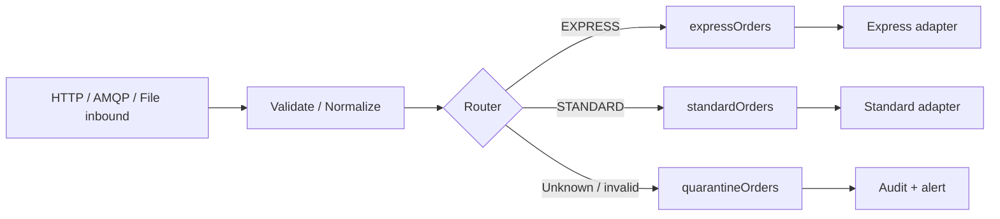
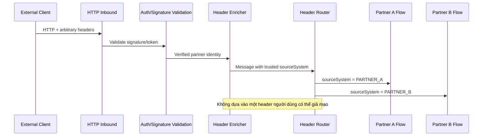
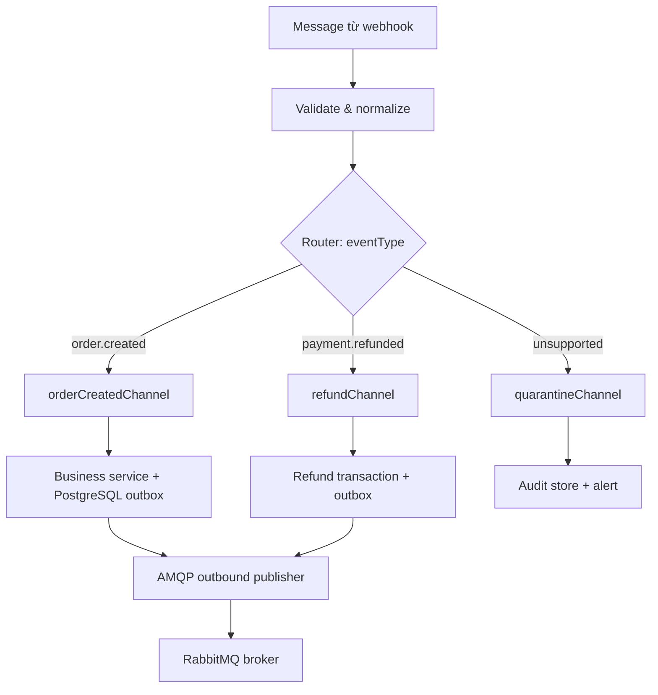
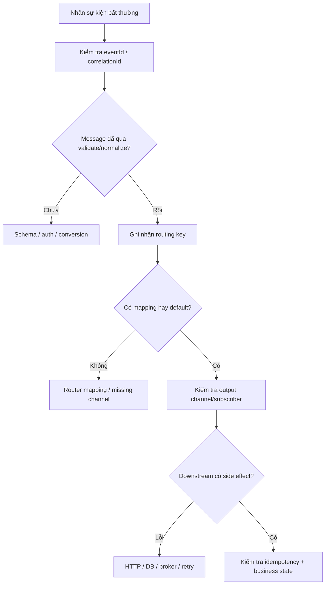
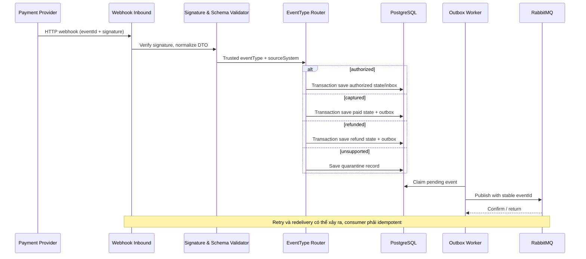

# Router và chọn nhánh theo nội dung hoặc header

## 1. Bối cảnh: cùng một thông điệp có thể cần nhiều cách xử lý

Trong module **SPRING_BOOT_INTEGRATION**, một ứng dụng Spring Boot có thể nhận sự kiện qua HTTP, cơ sở dữ liệu, cache, broker thông điệp hoặc adapter của Spring Integration. Sau khi nhận, ứng dụng thường cần chọn đúng luồng nghiệp vụ:

- Đơn hàng giao nhanh được chuyển tới hệ thống vận chuyển ưu tiên.
- Đơn hàng tiêu chuẩn được chuyển tới hệ thống giao hàng thông thường.
- Sự kiện thanh toán được chuyển tới bước đối soát, sự kiện hoàn tiền tới bước hoàn tiền.
- Một tenant hoặc đối tác cụ thể được đưa vào pipeline riêng theo hợp đồng.
- Thông điệp không nhận diện được bị đưa vào kênh cách ly để điều tra thay vì lặng lẽ biến mất.

Trong **Spring Integration**, thành phần thực hiện việc đó là **router**: nó xem một `Message` và quyết định gửi message tới một hoặc nhiều `MessageChannel` đích. Router có thể dựa trên **payload**, **header**, biểu thức hoặc một thuật toán tùy chỉnh.

Đây là bài **“Router và chọn nhánh theo nội dung hoặc header”**, thuộc chương **Định tuyến và biến đổi**. Trọng tâm không chỉ là cú pháp Java DSL: một route sai có thể dẫn tới gửi nhầm đối tác, xử lý trùng lặp, rò rỉ dữ liệu giữa tenant hoặc bỏ sót thông điệp. Vì vậy bài cũng bàn về validation, fallback, transaction, retry, kiểm thử và khả năng quan sát.

### Sau bài học, bạn cần làm được

1. Phân biệt router với filter, transformer, splitter, service activator và publisher/subscriber.
2. Chọn cách định tuyến theo nội dung payload hay metadata header phù hợp với hợp đồng.
3. Viết `IntegrationFlow.route(...)` và `@Router` với channel mapping rõ ràng.
4. Xử lý route không có nhánh, lỗi gửi message, channel đồng bộ/bất đồng bộ và kiểm soát kết quả.
5. Kiểm thử từng quyết định định tuyến và kiểm thử tích hợp tới HTTP, database hoặc broker khi cần.

> Ví dụ dùng Java 17+, Spring Boot và Spring Integration DSL phổ biến trong các phiên bản hiện đại. Tên module, API chi tiết và đặc biệt cơ chế lỗi có thể khác theo version và channel type. Hãy đối chiếu tài liệu với BOM/phiên bản Spring Integration đang chạy trước khi đưa vào production.

## 2. Router làm gì trong một message flow?

Một thông điệp trong Spring Messaging có hai phần chính: **payload** (nội dung) và **headers** (metadata).

```java
import org.springframework.messaging.Message;
import org.springframework.messaging.support.MessageBuilder;

Message<String> message = MessageBuilder
    .withPayload("{\"eventType\":\"order.created\",\"orderId\":\"ORD-501\"}")
    .setHeader("sourceSystem", "ERP")
    .setHeader("schemaVersion", 2)
    .setHeader("correlationId", "trace-abc")
    .build();
```

Payload ở ví dụ là JSON string. Header mang nguồn sự kiện, phiên bản schema và mã tương quan. Để router truy cập field `eventType` bên trong JSON, trước tiên thường cần decode/validate JSON thành DTO có cấu trúc; router không tự hiểu mọi định dạng binary hoặc JSON string.

Một luồng minh họa:



**Router chọn đường đi**, không phải nơi lưu message. Nếu đầu ra là `DirectChannel`, lời gọi gửi thường chuyển message ngay tới subscriber cùng tiến trình. Nếu đầu ra là outbound AMQP adapter, message có thể đi tiếp tới broker. Đừng suy ra chỉ vì có một “channel” là dữ liệu đã được lưu bền vững.

### Định tuyến bao nhiêu nhánh?

Một router có thể chọn **một** hoặc **nhiều** đích tùy loại router và kết quả quyết định. Cần phân biệt rõ hợp đồng:

- **Exclusive routing:** một message nghiệp vụ chỉ đi tới một nhánh chuyên trách.
- **Recipient-list routing:** một message có thể đi đến nhiều nhánh độc lập, như audit và nghiệp vụ.
- **Broadcast:** phát tới nhiều subscriber, thường được biểu diễn bằng `PublishSubscribeChannel` hoặc cơ chế tương đương.
- **Discard/filter:** loại message theo điều kiện, không phải tự động chọn một nhánh thay thế.

Khi một lệnh đặt hàng có side effect cần **chỉ một** đối tác xử lý, hãy đặt quyết định duy nhất và kiểm tra không có nhân đôi đích.

## 3. Phân biệt router với transformer, filter, splitter và aggregator

| Thành phần | Câu hỏi nó trả lời | Kết quả chính | Ví dụ |
| --- | --- | --- | --- |
| **Router** | Message phải đi theo nhánh nào? | Chọn channel đích | `EXPRESS` → luồng giao nhanh |
| **Transformer** | Payload/headers cần đổi thành hình dạng nào? | Message với dữ liệu đã đổi | JSON đối tác → `OrderEvent` |
| **Filter** | Message có được tiếp tục không? | Giữ hoặc loại một message | Bỏ event test không cần xử lý |
| **Splitter** | Một payload có cần tách thành nhiều message? | Một tập message thành phần | Batch 100 đơn → từng đơn |
| **Aggregator** | Nhiều message khi nào gộp lại? | Kết quả tổng hợp theo nhóm | Đủ từng dòng của hóa đơn |
| **Service Activator** | Gọi logic nghiệp vụ nào? | Thực hiện handler | Ghi database, tính phí |
| **Gateway** | Ứng dụng gọi vào/ra flow ra sao? | Giao diện lời gọi sang message | `@MessagingGateway` |
| **Outbound Adapter** | Gửi message ra hệ thống nào? | Tác động qua HTTP, AMQP, file... | Publish RabbitMQ |

Một pipeline phổ biến là:

```text
HTTP webhook
   -> Validate signature
   -> JSON decoder / transformer
   -> Normalize headers
   -> Router by eventType
        -> paymentAuthorizedChannel
        -> paymentRefundedChannel
        -> unsupportedEventChannel
   -> Transactional business handler / outbox
```

Router nằm **sau bước xác thực và chuẩn hóa**. Nếu router quyết định dựa trên dữ liệu thô chưa được kiểm tra, một payload không đúng schema hoặc một header do người ngoài gửi có thể khiến message vào nhánh không được phép.

### Routing không thay thế validation

Ví dụ `eventType="payment.refunded"` không có nghĩa message thực sự là sự kiện refund đã được ký/ủy quyền. Router chỉ đưa message đến nhánh; service của nhánh đó vẫn cần kiểm tra hợp đồng, quyền và các điều kiện nghiệp vụ.

## 4. Định tuyến theo payload hay theo header?

Có hai lựa chọn nền tảng:

| Tiêu chí | Payload-based routing | Header-based routing |
| --- | --- | --- |
| Nguồn quyết định | Trường nghiệp vụ trong payload đã parse | Metadata của `MessageHeaders` |
| Ví dụ | `order.deliveryMode`, `event.type` | `sourceSystem`, `tenantTier`, `schemaVersion` |
| Phù hợp khi | Nhánh thay đổi theo **nội dung nghiệp vụ** | Nhánh thay đổi theo **nguồn, tuyến, chính sách hoặc metadata** |
| Cần kiểm tra | Schema, null, enum, semantic và quyền | Header có tồn tại, kiểu đúng, nguồn tin cậy hay không |
| Rủi ro | Payload chưa được decode/normalize | Header bên ngoài giả mạo hoặc routing trực tiếp tới tên channel |
| Phương pháp giảm rủi ro | DTO có validation, mapping explicit, nhánh mặc định | Xác thực/ghi đè metadata tin cậy, allowlist, mapping explicit |

Ví dụ đơn hàng có payload:

```json
{
  "eventId": "evt-2026-001",
  "orderId": "ORD-501",
  "deliveryMode": "EXPRESS",
  "amount": 120000
}
```

Nếu lựa chọn dịch vụ vận chuyển theo `deliveryMode` thì đây là **quy tắc nghiệp vụ**, nên có thể dựa trên payload. Ngược lại, nếu mọi message từ một đối tác đã xác thực phải qua adapter có định dạng riêng thì có thể dựa trên header **`sourceSystem` đã được gắn bởi inbound adapter tin cậy**.

**Không dùng header do khách HTTP tự truyền làm bằng chứng danh tính tenant.** Cần xác thực bearer token, mTLS, signature hoặc phương pháp tương ứng rồi gắn header nội bộ mới từ kết quả xác thực.

## 5. Dependency cần thiết và vai trò auto-configuration

Khi muốn dùng Spring Integration DSL với Spring Boot, thêm starter Integration theo BOM quản lý:

```xml
<dependency>
    <groupId>org.springframework.boot</groupId>
    <artifactId>spring-boot-starter-integration</artifactId>
</dependency>
```

Hoặc Gradle:

```groovy
dependencies {
    implementation 'org.springframework.boot:spring-boot-starter-integration'
}
```

Starter cung cấp hạ tầng Spring Integration core và tích hợp với auto-configuration của Spring Boot khi classpath/conditions đáp ứng. Nếu route tới AMQP, HTTP, JDBC, SFTP hoặc adapter chuyên dụng, **cần dependency protocol tương ứng**; starter Integration không tự thêm mọi adapter.

Ví dụ ghép với RabbitMQ:

```groovy
dependencies {
    implementation 'org.springframework.boot:spring-boot-starter-integration'
    implementation 'org.springframework.boot:spring-boot-starter-amqp'
    implementation 'org.springframework.integration:spring-integration-amqp'
}
```

Đoạn dependency minh họa việc **phân biệt Spring AMQP với Spring Integration AMQP adapter**, không có nghĩa mọi router phải dùng broker. Để viết và test router nội bộ, Spring Integration core thường đã đủ. Các channel trong DSL không tự được sao lưu thành queue RabbitMQ.

### Các bean liên quan

| Bean/loại | Vai trò |
| --- | --- |
| `IntegrationFlow` | Định nghĩa chuỗi xử lý có router |
| `MessageChannel` | Đường vào/ra của router |
| `DirectChannel` | Channel đồng bộ thường dùng khi test/flow đơn giản |
| `QueueChannel` | Pollable channel có buffer nội bộ |
| `MessageHandler` | Handler phía sau một nhánh |
| `Message<?>` | Payload + headers đến router |
| `@Router` | Khai báo method quyết định route theo annotation |

Nếu Spring không thấy `IntegrationFlow` hoặc bean channel đã khai báo, kiểm tra dependency, package scan, configuration class và tên bean trước khi suy ra broker có lỗi.

## 6. Thiết kế message contract trước khi viết router

Trong một hệ thống tích hợp, route phải dựa vào thông tin có **định nghĩa ổn định**. Ví dụ hợp đồng sự kiện đơn hàng:

```json
{
  "eventId": "evt-1001",
  "eventType": "order.created",
  "schemaVersion": 2,
  "orderId": "ORD-501",
  "deliveryMode": "EXPRESS",
  "occurredAt": "2026-11-21T04:00:00Z"
}
```

Và metadata đi kèm, được inbound adapter gắn **sau xác thực**:

```text
sourceSystem = ERP
correlationId = req-8f90
contentType   = application/json
```

Trong `MessageHeaders` của Spring Messaging, các header như `id` và `timestamp` do framework quản lý. Nếu cần khóa idempotency bền vững xuyên HTTP, database và broker, hãy dùng `eventId` do hợp đồng nghiệp vụ quy định; **đừng dùng một message ID được framework tạo lại sau mỗi bước làm khóa dedup duy nhất**.

Các quy tắc nên được xác định rõ:

1. Tập giá trị hợp lệ của `deliveryMode` là `EXPRESS`, `STANDARD` hoặc kiểu khác theo version.
2. `null`, chuỗi rỗng hoặc giá trị không hỗ trợ sẽ đi đâu?
3. Có cho phép đổi routing trong lúc vận hành khi message cùng `eventId` được retry?
4. Route có thể gây side effect không đảo ngược hay chỉ chuyển nội bộ?
5. Khi thiếu header tin cậy, message phải bị cách ly hay dùng fallback an toàn?
6. Sự kiện thuộc phiên bản schema chưa hỗ trợ có được xử lý bởi một nhánh tương thích không?

Nếu quyết định này không được viết thành hợp đồng, hai instance triển khai khác version có thể định tuyến cùng message khác nhau.

## 7. Java DSL: router theo nội dung payload

Ví dụ dùng kiểu dữ liệu đã parse và validate:

```java
public record OrderEvent(
    String eventId,
    String orderId,
    String deliveryMode
) {}
```

Ta cấu hình một channel vào, ba channel ra và một `IntegrationFlow` định tuyến theo `deliveryMode`:

```java
import org.springframework.beans.factory.annotation.Qualifier;
import org.springframework.context.annotation.Bean;
import org.springframework.context.annotation.Configuration;
import org.springframework.integration.channel.DirectChannel;
import org.springframework.integration.dsl.IntegrationFlow;
import org.springframework.messaging.MessageChannel;

@Configuration(proxyBeanMethods = false)
public class OrderRoutingConfiguration {

    @Bean("orderInput")
    MessageChannel orderInput() {
        return new DirectChannel();
    }

    @Bean("expressOrders")
    MessageChannel expressOrders() {
        return new DirectChannel();
    }

    @Bean("standardOrders")
    MessageChannel standardOrders() {
        return new DirectChannel();
    }

    @Bean("unsupportedOrders")
    MessageChannel unsupportedOrders() {
        return new DirectChannel();
    }

    @Bean
    IntegrationFlow orderRoutingFlow(
            @Qualifier("orderInput") MessageChannel input) {

        return IntegrationFlow.from(input)
            .route(
                OrderEvent.class,
                OrderEvent::deliveryMode,
                mapping -> mapping
                    .channelMapping("EXPRESS", "expressOrders")
                    .channelMapping("STANDARD", "standardOrders")
                    .defaultOutputChannel("unsupportedOrders")
            )
            .get();
    }
}
```

**Cơ chế chính:**

- `IntegrationFlow.from(input)` bắt đầu từ channel bean `orderInput`.
- Router gọi `OrderEvent::deliveryMode` để lấy **routing key** từ payload.
- `channelMapping("EXPRESS", "expressOrders")` ánh xạ giá trị nghiệp vụ sang **tên channel bean**.
- `defaultOutputChannel("unsupportedOrders")` là nơi nhận các giá trị không khớp mapping khi router dùng fallback.
- Message đi tiếp trên channel đã chọn; router không tự gọi HTTP hoặc lưu vào DB nếu chưa có downstream handler/adapter.

**Điều kiện cần để chạy:** ba output channel phải có subscriber/consumer phù hợp. `DirectChannel` không phải một queue tự giữ message khi chưa có handler. Gửi tới output channel không có subscriber có thể gây `MessageDeliveryException` dù quyết định routing đã đúng.

Trong code production, tránh tạo một `OrderEvent` từ JSON thô chưa kiểm tra `deliveryMode` hoặc `eventId`. Nên tách bước schema validation/normalization khỏi router để lỗi hợp đồng không lẫn với lỗi thiếu nhánh.

## 8. Gắn handler riêng cho mỗi nhánh

Một cách minh họa các subscriber:

```java
import org.springframework.context.annotation.Bean;
import org.springframework.context.annotation.Configuration;
import org.springframework.integration.dsl.IntegrationFlow;

@Configuration(proxyBeanMethods = false)
public class OrderBranchConfiguration {

    @Bean
    IntegrationFlow expressOrderFlow(OrderDispatchService dispatch) {
        return IntegrationFlow.from("expressOrders")
            .handle((payload, headers) -> {
                dispatch.sendExpress((OrderEvent) payload);
                return null;
            })
            .get();
    }

    @Bean
    IntegrationFlow standardOrderFlow(OrderDispatchService dispatch) {
        return IntegrationFlow.from("standardOrders")
            .handle((payload, headers) -> {
                dispatch.sendStandard((OrderEvent) payload);
                return null;
            })
            .get();
    }

    @Bean
    IntegrationFlow unsupportedOrderFlow(OrderReviewService review) {
        return IntegrationFlow.from("unsupportedOrders")
            .handle((payload, headers) -> {
                review.recordUnsupported((OrderEvent) payload);
                return null;
            })
            .get();
    }
}
```

`OrderDispatchService` và `OrderReviewService` là **interfaces/services do dự án triển khai**, không phải class Spring Integration có sẵn. Các method `sendExpress`, `sendStandard` và `recordUnsupported` phải được định nghĩa và đăng ký bean trong ứng dụng thật.

Lý do trả `null` từ handler lambda: đây là xử lý một chiều, **không phát một reply payload mới**. Với flow có request/reply, phải thiết kế reply channel, timeout và loại dữ liệu kết quả riêng.

Ở ví dụ này, các channel là `DirectChannel`, nên route và handler thông thường được gọi đồng bộ trong luồng gửi, trừ khi một endpoint khác chuyển sang async. Nếu `dispatch.sendExpress` gọi broker hoặc HTTP rồi lỗi, exception có thể lan ngược tới sender qua channel đồng bộ. Đừng mặc định mọi router là asynchronous.

## 9. Gửi message vào flow và giữ correlation ID

Một service tạo message sau khi đã có DTO hợp lệ:

```java
import org.springframework.beans.factory.annotation.Qualifier;
import org.springframework.messaging.MessageChannel;
import org.springframework.messaging.support.MessageBuilder;
import org.springframework.stereotype.Service;

@Service
public class OrderRoutingGateway {

    private final MessageChannel orderInput;

    public OrderRoutingGateway(
            @Qualifier("orderInput") MessageChannel orderInput) {
        this.orderInput = orderInput;
    }

    public void route(OrderEvent event, String correlationId) {
        boolean accepted = orderInput.send(
            MessageBuilder.withPayload(event)
                .setHeader("correlationId", correlationId)
                .setHeader("schemaVersion", 2)
                .build()
        );

        if (!accepted) {
            throw new IllegalStateException(
                "Order integration channel did not accept message"
            );
        }
    }
}
```

`MessageChannel.send()` trả về boolean theo API, nhưng khi dùng `DirectChannel` một failure của subscriber có thể ném exception trước khi method return. **Accepted=true không có nghĩa HTTP đối tác đã phản hồi thành công hoặc RabbitMQ consumer đã commit**.

Thông tin `correlationId` phục vụ truy vết qua nhiều adapter. Khi gửi sang RabbitMQ/HTTP, cần cấu hình mapping phù hợp để truyền nó vào header/protocol đúng cách. Không giả định mọi header Spring Message tự động được chuyển nguyên vẹn qua ranh giới hệ thống ngoài.

## 10. Java DSL: router theo header

Khi decision đến từ metadata đã được xác thực, có thể dùng biểu thức SpEL trên headers:

```java
import org.springframework.context.annotation.Bean;
import org.springframework.context.annotation.Configuration;
import org.springframework.integration.dsl.IntegrationFlow;

@Configuration(proxyBeanMethods = false)
class SourceSystemRoutingConfiguration {

    @Bean
    IntegrationFlow partnerSourceRoutingFlow() {
        return IntegrationFlow
            .from("partnerInbound")
            .route(
                "headers['sourceSystem']",
                mapping -> mapping
                    .channelMapping("ERP", "erpOrders")
                    .channelMapping("CRM", "crmOrders")
                    .defaultOutputChannel("unrecognizedSource")
            )
            .get();
    }
}
```

Đoạn cấu hình giả định các channel bean tên `partnerInbound`, `erpOrders`, `crmOrders` và `unrecognizedSource` được tạo bởi cấu hình khác. Biểu thức `headers['sourceSystem']` đọc một header làm routing key.

Khác với payload router ở mục 7:

- Không cần biết cấu trúc payload để chọn nhánh, miễn metadata tin cậy.
- Nếu header không được đặt, giá trị route có thể là `null`; chính sách fallback phải được xác định và kiểm thử.
- Nếu header mang sai kiểu, chẳng hạn một object thay vì chuỗi chuẩn hóa, mapping có thể không match.
- Nếu header đến từ HTTP header trực tiếp do người dùng gửi, nó **chưa đáng tin cậy**. Inbound gateway nên gán lại header dựa trên thông tin đã xác thực.

### Không gắn trực tiếp tên channel từ input bên ngoài

Một thiết kế nguy hiểm là để giá trị `headers['destination']` chứa trực tiếp một tên bean channel tùy ý rồi router cố gửi vào channel đó. Trong hệ thống nhiều tenant, điều này có thể thành **routing injection**: người gọi bên ngoài ép message sang handler của tenant hoặc nghiệp vụ khác.

Ưu tiên ánh xạ **allowlist** rõ ràng:

```text
sourceSystem = ERP  -> erpOrders
sourceSystem = CRM  -> crmOrders
other / null         -> unrecognizedSource
```

Ngay cả khi router hỗ trợ phân giải tên channel động, không nên dùng cơ chế ấy với dữ liệu chưa tin cậy.

## 11. HeaderValueRouter và PayloadTypeRouter

Ngoài DSL, Spring Integration có những implementation router phục vụ nhu cầu phổ biến:

| Router | Quyết định dựa vào | Dùng khi nào |
| --- | --- | --- |
| `HeaderValueRouter` | Giá trị một message header cụ thể | Route theo nguồn hệ thống, loại tenant, schema version |
| `PayloadTypeRouter` | Java class của payload | Phân biệt DTO/event class sau bước decode |
| `MethodInvokingRouter` | Method/functional logic được gọi | Quy tắc nghiệp vụ đơn giản hoặc điều kiện tùy biến |
| `ExpressionEvaluatingRouter` | Biểu thức SpEL trên message | Route theo field hoặc header có cấu trúc |
| `RecipientListRouter` | Danh sách recipient cố định/động theo điều kiện | Một message cần đi tới nhiều nhánh |
| `ErrorMessageExceptionTypeRouter` | Loại exception trong error message | Phân nhánh xử lý lỗi |
| `AbstractMessageRouter` tùy biến | Logic router do ứng dụng viết | Trường hợp cần xử lý chuyên biệt hơn DSL |

Ví dụ dùng `PayloadTypeRouter` khi inbound adapter đã chuyển message thành các DTO khác nhau: `OrderCreatedEvent` có thể đi tới nhánh tạo đơn, `RefundRequestedEvent` sang nhánh hoàn tiền. Cần cảnh giác với phân cấp class, proxy, subtype và default route; **Java class không nhất thiết trùng semantic eventType** qua các phiên bản schema.

**HeaderValueRouter** thường hữu ích cho việc chọn nhánh theo `MessageHeaders`. Tuy nhiên, hãy thiết kế trước việc header bị thiếu hoặc có giá trị không hỗ trợ. Việc chỉ khai báo mapping mà không xử lý giá trị ngoài tập cho phép khiến message có nguy cơ lỗi hoặc bị loại theo behavior mà đội phát triển không chủ ý.

## 12. Router theo method với @Router

Java DSL không phải cách khai báo duy nhất. Spring Integration cho phép đánh dấu method quyết định tuyến bằng `@Router`:

```java
import org.springframework.integration.annotation.MessageEndpoint;
import org.springframework.integration.annotation.Router;
import org.springframework.messaging.Message;

@MessageEndpoint
public class OrderPriorityRouter {

    @Router(
        inputChannel = "validatedOrders",
        defaultOutputChannel = "unsupportedOrders"
    )
    public String selectChannel(Message<OrderEvent> message) {
        OrderEvent order = message.getPayload();
        String mode = order.deliveryMode();

        return switch (mode == null ? "" : mode) {
            case "EXPRESS" -> "expressOrders";
            case "STANDARD" -> "standardOrders";
            default -> "unsupportedOrders";
        };
    }
}
```

Ở đây method trả **tên channel đích**. Các tên channel đó phải tồn tại, có subscriber/endpoint và thuộc phạm vi cho phép. `@MessageEndpoint` giúp Spring tìm bean khi class được component scan đúng phạm vi.

Lưu ý:

- `defaultOutputChannel` hữu ích khi router không chọn được channel, nhưng nếu chính method trả tên channel hợp lệ thì router sẽ dùng tên đó.
- Mẫu trên lựa chọn kênh bằng `switch` tường minh. Nếu input chứa string không kiểm chứng, không trả trực tiếp string đó làm bean name.
- Khi cùng một nghiệp vụ vừa có `IntegrationFlow.route(...)` vừa có `@Router` tiêu thụ cùng input, phải xem liệu bạn đang tạo **hai subscriber** hay hai chính sách route chồng chéo. Chỉ chọn một implementation làm chủ sở hữu luồng hoặc phân tách channel rõ ràng.
- Với một `DirectChannel` có nhiều subscriber, hành vi không phải “broadcast đến mọi router”. Nếu muốn fan-out, dùng pattern/channels phù hợp.

### Khi nào chọn @Router, khi nào chọn DSL?

Dùng `@Router` khi quyết định tuyến cần một method Java dễ unit test và tái sử dụng. Dùng `IntegrationFlow.route(...)` khi route là một bước trong pipeline DSL và muốn thấy đầy đủ channel, transformer, filter, handler trong một cấu hình.

Cả hai đều là Spring Integration, không tạo độ bền giao nhận ngoài tiến trình tự động.

## 13. Mapping, defaultOutputChannel và nhánh không xác định

Một router tốt phải có **chính sách cho mọi input**, kể cả trường hợp không mong đợi.

Giả sử có ba giá trị `deliveryMode`:

| Routing key | Kênh được chọn | Hành động |
| --- | --- | --- |
| `EXPRESS` | `expressOrders` | Xử lý dịch vụ giao nhanh |
| `STANDARD` | `standardOrders` | Xử lý giao chuẩn |
| `SAME_DAY` | `unsupportedOrders` khi chưa được triển khai | Cách ly/cảnh báo/hợp đồng phiên bản mới |
| `null`, blank hoặc dữ liệu sai | `unsupportedOrders` hoặc lỗi validation trước router | Không tự chuyển sang giao chuẩn nếu sai hợp đồng |

**Default route không phải nơi âm thầm thành công.** Nếu message không khớp mapping nhưng đang chứa lệnh quan trọng, nhánh mặc định cần ghi lý do, event ID, source và schema version, có retention/alert và khả năng xử lý lại có kiểm soát.

Một số router có cấu hình liên quan tới việc **có bắt buộc tìm được channel hay không** hoặc có thể chuyển tới một default/discard channel. Các flag như `resolutionRequired` và default output channel có behavior phụ thuộc router/phiên bản. Không giả định mọi message không match đều tự động được gửi vào `errorChannel`; hãy khai báo và test trường hợp không match.

### Khi nào dùng nullChannel?

Spring Integration có `nullChannel` để cố ý **loại message**. Đây là một sink nội bộ, không phải DLQ. Chỉ route tới nó khi việc bỏ message là **quyết định nghiệp vụ được công nhận**, chẳng hạn bỏ một heartbeat vô hại đã thống kê.

Đối với event liên quan giao dịch, thanh toán hoặc tồn kho, không dùng `nullChannel` để che dữ liệu không hợp lệ. Hãy đưa tới quarantine/DLQ hoặc lỗi có chủ sở hữu để tránh mất sự kiện không quan sát.

## 14. Chọn nhánh bằng nhiều điều kiện

Một route theo payload có thể cần dựa trên nhiều trường:

- `deliveryMode` là `EXPRESS`.
- `destinationCountry` thuộc tập quốc gia được hỗ trợ.
- `tenantTier` cho phép sử dụng dịch vụ nhanh.
- `paymentStatus` đã được xác thực là `PAID`.

Thay vì dồn tất cả vào một biểu thức SpEL dài, tạo một **route selector** có thể unit test:

```java
public record ShippingCommand(
    String orderId,
    String deliveryMode,
    String destinationCountry,
    boolean expressEntitled
) {}

public enum ShippingRoute {
    EXPRESS,
    STANDARD,
    MANUAL_REVIEW
}

public final class ShippingRouteSelector {

    public ShippingRoute select(ShippingCommand command) {
        if (command == null || command.orderId() == null) {
            return ShippingRoute.MANUAL_REVIEW;
        }

        if ("EXPRESS".equals(command.deliveryMode())
                && command.expressEntitled()
                && "VN".equals(command.destinationCountry())) {
            return ShippingRoute.EXPRESS;
        }

        if ("STANDARD".equals(command.deliveryMode())) {
            return ShippingRoute.STANDARD;
        }

        return ShippingRoute.MANUAL_REVIEW;
    }
}
```

Selector không gọi database/HTTP; quyết định tuyến của nó là **hàm thuần** trên dữ liệu đã chuẩn hóa. Có thể unit test toàn bộ bảng trường hợp, rồi dùng nó trong DSL:

```java
@Bean
IntegrationFlow shippingRoutingFlow(ShippingRouteSelector selector) {
    return IntegrationFlow.from("validatedShippingCommands")
        .route(
            ShippingCommand.class,
            command -> selector.select(command).name(),
            mapping -> mapping
                .channelMapping("EXPRESS", "expressShipping")
                .channelMapping("STANDARD", "standardShipping")
                .channelMapping("MANUAL_REVIEW", "manualReview")
        )
        .get();
}
```

Ví dụ `ShippingRouteSelector` cần được đăng ký thành bean, còn các channel input/output cần được định nghĩa. Khi route có quyền truy cập dữ liệu khác (ví dụ lookup tenant entitlement từ DB), cân nhắc **enrichment trước router** thay vì làm một lệnh HTTP blocking trong chính hàm chọn route.

### Vì sao hạn chế I/O trong router?

Routing một message thường nằm trên đường đi nóng của flow. Nếu nó gọi HTTP/DB đồng bộ để quyết định nhánh, latency và sự cố downstream có thể làm tắc toàn bộ channel. Phân tách:

1. Validate và enrich metadata bằng adapter có timeout/circuit breaker.
2. Route thuần, nhanh, nhất quán.
3. Handler của nhánh thực hiện side effect theo transaction/retry policy.

Cách chia này tăng khả năng kiểm thử và quan sát từng lớp.

## 15. Phân biệt single-route với recipient-list và publish-subscribe

Một đơn hàng cần được gửi tới **một** nhà vận chuyển nhưng cũng phải phát event audit. Cách hiểu sai là “router chỉ nên có một đích, vậy không thể gửi audit” hoặc “phát tới cả hai nhánh bằng router thì chắc chắn không xử lý trùng”.

| Cơ chế | Mục tiêu | Cần thận trọng |
| --- | --- | --- |
| Router một nhánh | Chọn handler chính cho message | Mapping chính xác, fallback rõ |
| `RecipientListRouter` | Gửi một message tới nhiều recipient theo điều kiện | Một recipient lỗi, thứ tự gửi và side effect từng nhánh |
| `PublishSubscribeChannel` | Phát tới nhiều subscriber trong một flow | Lỗi/async delivery, không mặc nhiên durable |
| Splitter | Chia một payload thành nhiều message mới | Sequence/correlation để tổng hợp khi cần |
| Broker fan-out/topic | Phân phối ngoài tiến trình | Queue/subscription, ack, redelivery, reliability |

Đối với yêu cầu “gửi nghiệp vụ và audit”, không nhất thiết dùng chung một flow đồng bộ tới hai hệ thống ngoài. Nếu nghiệp vụ cần audit bền vững, có thể lưu trạng thái audit trong transaction database hoặc dùng outbox, sau đó publish event riêng.

Một RecipientListRouter có thể trả nhiều channel đích; hãy xem thứ tự xử lý, chính sách dừng khi một nhánh lỗi và yêu cầu idempotency của từng bên. **Fan-out tới hai handler cùng gây một business effect là nhân đôi nghiệp vụ**, không phải một biến thể vô hại của routing.

## 16. Header enrichment và độ tin cậy của metadata

Header thường được dùng cho router vì nó tách metadata khỏi payload nghiệp vụ. Tuy nhiên, các adapter bên ngoài có thể ánh xạ những header khác nhau vào Spring `MessageHeaders`, và không phải header nào cũng đáng tin.

Một thiết kế đúng cho webhook:



Thực tế nên phân biệt `X-Source-System` từ external HTTP request với một header nội bộ như `verifiedSourceSystem` do authentication layer gắn. Nếu router sử dụng cả hai mà không xác định nguồn tin cậy, có thể tạo nhánh lỗi bảo mật.

### Những header nên nghĩ tới

| Header | Mục đích | Khuyến nghị |
| --- | --- | --- |
| `verifiedSourceSystem` | Danh tính nguồn đã xác thực | Chỉ do trusted adapter/security layer tạo |
| `tenantId` | Phân vùng dữ liệu | Kiểm tra quan hệ tenant với identity và quyền |
| `schemaVersion` | Đọc payload tương thích version | Giá trị cần kiểm chứng, không chỉ tin do người gửi công bố |
| `correlationId` | Truy vết xuyên flow | Tái sử dụng khi chuyển protocol, không coi là khóa idempotency duy nhất |
| `eventId` | Khóa sự kiện nghiệp vụ nếu contract quy định | Nên nằm trong payload hoặc metadata chuẩn hóa rõ ràng |
| `replyChannel` | Điểm trả reply trong message flow | Header hạ tầng, không để client ngoài tùy tiện điều khiển |
| `errorChannel` | Điểm nhận lỗi trong một số ngữ cảnh async | Không xem là cơ chế toàn cục cho mọi exception |

Header của Spring `MessageHeaders` về nguyên tắc được biểu diễn không cho sửa trực tiếp. Nếu cần thêm hoặc thay metadata ở một bước, dùng `MessageBuilder`, header enricher hoặc API tạo message mới; không cố mutate Map headers của message đã tồn tại.

## 17. Lỗi trong router khác với lỗi trong nhánh đã được chọn

Có ít nhất bốn loại lỗi:

1. **Lỗi quyết định routing:** payload sai type, biểu thức lỗi, enum chưa hỗ trợ, null trong logic không xử lý.
2. **Lỗi ánh xạ channel:** không tìm được channel tương ứng, sai bean name hoặc nhánh chưa đăng ký.
3. **Lỗi gửi vào channel:** channel không có subscriber, queue channel đầy, send timeout hoặc channel reject.
4. **Lỗi handler phía sau:** gọi DB/HTTP/broker thất bại, mất quyền hoặc validate nghiệp vụ không đạt.

Ví dụ:

```text
Input: deliveryMode = EXPRESS
      |
      v
Router chọn "expressOrders"   <- routing decision thành công
      |
      v
DirectChannel không có subscriber
      |
      v
MessageDeliveryException     <- lỗi downstream channel, không phải enum sai
```

Cần log/metric rõ **tầng lỗi** để tránh điều tra sai. Nếu handler outbound RabbitMQ ném exception vì kết nối broker mất, không nên đổi `EXPRESS` thành `STANDARD` như một cách retry; đó là thay đổi nghiệp vụ, không phải phục hồi transport.

### errorChannel và sync/async

Trong nhiều luồng đồng bộ dùng `DirectChannel`, exception từ handler có thể ném về thread gửi và thuộc trách nhiệm của caller/transaction. Với những endpoint bất đồng bộ hoặc poller, lỗi có thể được đóng vào `ErrorMessage` và chuyển qua một `errorChannel` được cấu hình.

Vì vậy:

- **Không mặc định mọi lỗi router tự đến `errorChannel`**.
- Không bắt mọi exception rồi trả về thành công, vì sẽ làm mất tín hiệu retry/rollback.
- Nếu muốn chuyển lỗi tới DLQ hoặc quarantine, phải thiết kế một flow lỗi rõ ràng, bảo đảm metadata đủ để khôi phục.
- Khi dùng error routing theo exception type, phân biệt lỗi cố định (schema, authorization) với lỗi tạm thời (network, DB lock).
- Kiểm thử lỗi bằng đúng loại channel, executor và poller của production.

## 18. DirectChannel, QueueChannel và ranh giới thread

| Kiểu channel | Đặc điểm chính | Tác động đến routing |
| --- | --- | --- |
| `DirectChannel` | Gửi tới subscriber thường chạy trên thread người gửi | Exception/transaction có thể lan theo call stack |
| `ExecutorChannel` | Chuyển xử lý sang executor | Mất ranh giới transaction/thread context trực tiếp, cần cơ chế lỗi async |
| `QueueChannel` | Buffer message cho poller/receiver lấy sau | Phải có poller/consumer, quản lý capacity và lifecycle |
| `PublishSubscribeChannel` | Gửi tới nhiều subscriber | Broadcast khác single-route |
| Message store-backed channel | Có thể dùng storage phù hợp để bền vững hóa message | Phải cấu hình transaction/retention/lock/recovery rõ |

Đừng suy ra cứ route tới `QueueChannel` là đã có một hàng đợi bền vững. `QueueChannel` mặc định là queue nội bộ; khi process chết, những message chỉ nằm trong bộ nhớ sẽ mất. Nếu cần đảm bảo sau crash, dùng broker/outbox hoặc cấu hình persistent message store phù hợp.

### Ảnh hưởng tới transaction

Ví dụ một service `@Transactional` gửi message vào `DirectChannel` rồi handler cùng thread ghi repository: các thao tác có thể tham gia cùng transaction tùy cấu hình. Nếu đổi channel sang `ExecutorChannel`, xử lý diễn ra trên thread khác và **transaction context ban đầu không tự lan qua**. Test chỉ kiểm tra message đã đến nhánh sẽ không phát hiện việc mất atomicity nếu không kiểm tra commit/rollback trong DB thật.

## 19. Định tuyến qua ranh giới HTTP, broker và database

Router trong Spring Integration thường chỉ quyết định **handler hoặc channel**, còn adapter phía sau mới thực hiện I/O:



Ranh giới cần được xử lý riêng:

- **HTTP inbound:** xác thực signature, giới hạn payload và bảo vệ chống replay.
- **DB:** transaction cục bộ, unique constraint, schema migrations, consistency.
- **Cache:** key/TTL/invalidation; không dùng cache như chứng cứ transaction đã commit.
- **Broker:** publisher confirm, return/unroutable, ack/redelivery, DLQ.
- **Spring Integration:** mapping, channel subscription, error channel, poller/executor, message conversion.
- **HTTP outbound:** timeout, circuit breaker, retry, idempotency key khi gọi đối tác.

Nếu một nhánh router dùng `RabbitTemplate` gửi message trực tiếp trong transaction DB, **JPA transaction không làm broker publish atomically cùng commit SQL**. Chọn transactional outbox nếu cần giữ ý định gửi khi process crash.

## 20. Idempotency khi message được định tuyến lại hoặc redeliver

Một event có thể vào router nhiều lần:

- RabbitMQ redeliver vì consumer chết trước ack.
- HTTP caller retry webhook sau timeout.
- Outbox worker gửi lại sau khi mất confirm.
- Operator phát lại message từ DLQ/quarantine.
- Pipeline mới deploy và route mapping đã thay đổi khi event đang chờ xử lý.

Do đó, router nên **quyết định nhất quán trên message đã chuẩn hóa**; còn handler của nhánh có side effect nên kiểm tra event ID trước khi cập nhật business state.

Ví dụ bảng inbox PostgreSQL:

```sql
CREATE TABLE processed_event (
    source_system VARCHAR(80) NOT NULL,
    event_id      VARCHAR(120) NOT NULL,
    handler_type  VARCHAR(60) NOT NULL,
    processed_at  TIMESTAMPTZ NOT NULL DEFAULT CURRENT_TIMESTAMP,
    PRIMARY KEY (source_system, event_id, handler_type)
);
```

Ở đây khóa gồm `handler_type` khi **mỗi event được phép tạo một tác động riêng ở nhiều handler**. Nếu hợp đồng chỉ cho một xử lý nghiệp vụ duy nhất cho event, có thể cần unique key chặt hơn như `(source_system, event_id)`. **Thiết kế khóa tùy semantic nghiệp vụ**, không lấy schema mẫu làm đáp án mặc định.

Trong handler, ghi dấu đã xử lý và thay đổi nghiệp vụ trong **cùng database transaction** nếu có thể. Không đánh dấu event là “đã xử lý” trước một lời gọi HTTP ngoài transaction mà chưa có kế hoạch khôi phục khi lời gọi thất bại. Nếu có side effect ngoài DB, dùng outbox/saga và idempotency của đối tác khi được hỗ trợ.

### Khi routing rule thay đổi giữa các lần retry

Giả sử `EXPRESS` ngày hôm qua đi qua carrier A, hôm nay chuyển sang carrier B. Một message đã xử lý dở có thể bị gửi sang **cả hai** nếu replay không nhớ nhánh được chọn ban đầu. Với tác vụ quan trọng, có thể lưu `routingDecision` hoặc `routingPolicyVersion` vào record outbox/dispatch; khi retry, dùng lại quyết định hoặc migration theo chính sách rõ ràng.

Điều này đặc biệt quan trọng cho thanh toán, logistics và hoàn tiền, nơi thay đổi nhánh giữa các attempt có thể tạo hai side effect không tương đương.

## 21. Routing theo schema version và nội dung không tương thích

Một hệ thống tích hợp thường có nhiều producer/consumer version đang cùng hoạt động. Router có thể dựa trên `schemaVersion` nhưng không nên dùng version header như bằng chứng duy nhất rằng payload tuân thủ schema.

Ví dụ chính sách:

| Phiên bản | Điều kiện | Hướng xử lý |
| --- | --- | --- |
| v1 | Được hỗ trợ, thiếu một số field mới | Transformer v1 → model chuẩn |
| v2 | Được hỗ trợ | Transformer v2 → model chuẩn |
| v3 | Chưa hỗ trợ | Quarantine và cảnh báo |
| Không có version | Chỉ chấp nhận nếu có hợp đồng fallback rõ | Reject hoặc legacy adapter có kiểm soát |

Đôi khi nên dùng router **trước transformer** để chọn decoder v1/v2, sau đó mới đưa cả hai về một DTO chuẩn. Ở kiến trúc khác, inbound adapter decode vào một envelope có `schemaVersion` rồi route theo trường đó. Chọn cách nào cũng cần giới hạn tập version được chấp nhận và kiểm thử dữ liệu cũ còn tồn trong queue.

Không để một nhánh `defaultOutputChannel` âm thầm xử lý payload v3 theo logic v2 nếu đã có thay đổi ngữ nghĩa không tương thích.

## 22. Tối ưu hiệu năng router mà không hi sinh tính đúng đắn

Routing thường rất nhanh khi quyết định dựa trên enum hoặc một vài header chuẩn hóa. Khi latency tăng, cần xác định chính xác đâu là nút thắt:

- Biểu thức SpEL quá phức tạp hoặc parse lại dữ liệu lớn mỗi message.
- Trong router có lookup database/HTTP blocking.
- Nhánh output là `DirectChannel` nhưng handler phía sau thực hiện I/O lâu.
- Dùng `QueueChannel` quá nhỏ gây send timeout, hoặc quá lớn gây memory pressure.
- Backlog từ broker consumer concurrency hoặc downstream rate limit.
- Nhiều nhánh được subscribe không đúng, dẫn đến load balancing/broadcast ngoài ý muốn.

Tối ưu tốt thường là:

1. Decode và validate payload **một lần** trước router.
2. Chọn route bằng kiểu dữ liệu ổn định hoặc enum, không dùng chuỗi tùy tiện.
3. Tách I/O ra service/adapter có timeout, retry và metrics.
4. Dùng channel kiểu phù hợp với yêu cầu đồng bộ, throughput và durability.
5. Đo latency từng stage và queue backlog, không chỉ tổng request time.
6. Giới hạn concurrency và công việc tồn đọng khi downstream chậm.

Không tăng số thread một cách vô hạn để giải quyết lỗi DB connection pool cạn; router có thể chỉ đang chuyển nhiều message hơn sang một dependency đã quá tải.

## 23. Kiểm thử quyết định routing độc lập

Một selector thuần như `ShippingRouteSelector` ở mục 14 nên được unit test trước khi kéo Spring context hoặc broker vào:

```java
import static org.assertj.core.api.Assertions.assertThat;

import org.junit.jupiter.api.Test;

class ShippingRouteSelectorTest {

    private final ShippingRouteSelector selector =
        new ShippingRouteSelector();

    @Test
    void eligibleExpressOrderUsesExpressBranch() {
        ShippingCommand command =
            new ShippingCommand("ORD-1", "EXPRESS", "VN", true);

        assertThat(selector.select(command))
            .isEqualTo(ShippingRoute.EXPRESS);
    }

    @Test
    void expressWithoutEntitlementGoesToReview() {
        ShippingCommand command =
            new ShippingCommand("ORD-2", "EXPRESS", "VN", false);

        assertThat(selector.select(command))
            .isEqualTo(ShippingRoute.MANUAL_REVIEW);
    }

    @Test
    void standardOrderUsesStandardBranch() {
        ShippingCommand command =
            new ShippingCommand("ORD-3", "STANDARD", "VN", false);

        assertThat(selector.select(command))
            .isEqualTo(ShippingRoute.STANDARD);
    }
}
```

Nên bổ sung trường hợp `null`, blank, chữ hoa/chữ thường, quốc gia ngoài tập cho phép và các tổ hợp không hợp lệ. Nếu policy có thời hạn hiệu lực, inject `Clock` để test deterministic và lưu policy version cho replay.

Unit test như vậy **không chứng minh** bean `MessageChannel`, mapping hay adapter external được nối đúng. Cần bước kiểm thử tiếp theo.

## 24. Component test: chứng minh message đi đúng output channel

Một component test có thể dùng `QueueChannel` **chỉ trong test** để quan sát message của từng nhánh. Không cần RabbitMQ để kiểm tra quyết định router.

```java
import static org.assertj.core.api.Assertions.assertThat;

import org.junit.jupiter.api.Test;
import org.springframework.beans.factory.annotation.Autowired;
import org.springframework.beans.factory.annotation.Qualifier;
import org.springframework.context.annotation.Bean;
import org.springframework.context.annotation.Configuration;
import org.springframework.integration.channel.DirectChannel;
import org.springframework.integration.channel.QueueChannel;
import org.springframework.integration.config.EnableIntegration;
import org.springframework.integration.dsl.IntegrationFlow;
import org.springframework.messaging.Message;
import org.springframework.messaging.MessageChannel;
import org.springframework.messaging.PollableChannel;
import org.springframework.messaging.support.MessageBuilder;
import org.springframework.test.context.junit.jupiter.SpringJUnitConfig;

@SpringJUnitConfig(classes = OrderRouterComponentTest.RouterTestConfig.class)
class OrderRouterComponentTest {

    @Autowired
    @Qualifier("orderInput")
    MessageChannel input;

    @Autowired
    @Qualifier("expressOrders")
    PollableChannel express;

    @Autowired
    @Qualifier("unsupportedOrders")
    PollableChannel unsupported;

    @Test
    void routesExpressPayload() {
        OrderEvent event =
            new OrderEvent("evt-1", "ORD-1", "EXPRESS");

        input.send(MessageBuilder.withPayload(event).build());

        Message<?> routed = express.receive(1000);
        assertThat(routed).isNotNull();
        assertThat(routed.getPayload()).isEqualTo(event);
        assertThat(unsupported.receive(0)).isNull();
    }

    @Test
    void unknownValueGoesToFallbackChannel() {
        OrderEvent event =
            new OrderEvent("evt-2", "ORD-2", "SAME_DAY");

        input.send(MessageBuilder.withPayload(event).build());

        Message<?> routed = unsupported.receive(1000);
        assertThat(routed).isNotNull();
        assertThat(routed.getPayload()).isEqualTo(event);
        assertThat(express.receive(0)).isNull();
    }

    @Configuration(proxyBeanMethods = false)
    @EnableIntegration
    static class RouterTestConfig {

        @Bean("orderInput")
        MessageChannel input() {
            return new DirectChannel();
        }

        @Bean("expressOrders")
        PollableChannel express() {
            return new QueueChannel();
        }

        @Bean("standardOrders")
        PollableChannel standard() {
            return new QueueChannel();
        }

        @Bean("unsupportedOrders")
        PollableChannel unsupported() {
            return new QueueChannel();
        }

        @Bean
        IntegrationFlow routerFlow() {
            return IntegrationFlow.from("orderInput")
                .route(
                    OrderEvent.class,
                    OrderEvent::deliveryMode,
                    mapping -> mapping
                        .channelMapping("EXPRESS", "expressOrders")
                        .channelMapping("STANDARD", "standardOrders")
                        .defaultOutputChannel("unsupportedOrders")
                )
                .get();
        }
    }
}
```

Ví dụ dùng `SpringJUnitConfig`, JUnit Jupiter, AssertJ và Spring Integration core/test dependencies tương ứng. `OrderEvent` là record đã khai báo ở mục 7. Đây là **cấu hình test riêng**, không phải thêm các bean `QueueChannel` test vào production.

**Điều test chứng minh:** với input đã chọn, router đưa message vào đúng output channel và nhánh không được chọn không nhận message. **Điều test chưa chứng minh:** HTTP endpoint, database transaction, RabbitMQ routing/ack, retry hoặc idempotency ngoài tiến trình.

Để tránh flaky test, dùng dữ liệu và context được cô lập. Khi test flow với executor/poller bất đồng bộ, dùng eventual assertion có timeout và kiểm tra cả các nhánh không mong đợi.

## 25. Kiểm thử header routing và độ tin cậy nguồn

Với router theo `sourceSystem`, lập một bảng test theo ma trận:

| Header đầu vào | Kỳ vọng | Ghi chú |
| --- | --- | --- |
| `sourceSystem=ERP` | `erpOrders` | Source được xác thực |
| `sourceSystem=CRM` | `crmOrders` | Source được xác thực |
| `sourceSystem=UNKNOWN` | `unrecognizedSource` | Tập giá trị mở rộng phải được kiểm soát |
| Thiếu header | Fallback/reject có lý do | Không chấp nhận chuyển nhánh mặc định có side effect |
| Header là số/list | Fallback hoặc validation failure | Kiểu không đúng hợp đồng |
| Header ngoài giả mạo ERP | Không được cấp quyền chuyển nhánh ERP | Security/inbound adapter phải xác thực và ghi đè |

Quan trọng: một unit test gán trực tiếp header `sourceSystem=ERP` vào `MessageBuilder` chỉ chứng minh router đọc đúng header. Để chứng minh **bảo mật**, cần integration test của HTTP/broker inbound adapter, xác nhận thông tin identity được lấy từ nguồn tin cậy chứ không từ raw header.

### Header và payload mâu thuẫn

Ví dụ một message có header `sourceSystem=ERP` nhưng payload khai `origin="CRM"`. Không nên để router chọn tùy tiện theo một nguồn. Xác định **source of truth** và policy xử lý mismatch: reject, quarantine, hoặc normalize dựa trên identity đã xác thực. Đây là trường hợp nên có contract test.

## 26. Integration test với broker hoặc HTTP adapter

Khi nhánh cuối của router xuất sự kiện qua RabbitMQ, một test với broker thật/cô lập nên kiểm tra:

1. Inbound message được deserialize với DTO/headers đúng.
2. Router chọn channel chính xác theo payload hoặc header đã chuẩn hóa.
3. Outbound AMQP adapter publish tới exchange và routing key mong đợi.
4. Broker có binding/queue thực sự nhận message.
5. Lỗi không định tuyến được được quan sát bằng publisher return/confirm nếu policy yêu cầu.
6. Consumer xử lý và ghi business state đúng một lần khi message bị redeliver.
7. Khi nhánh không hợp lệ, message tới quarantine/DLQ hoặc record điều tra, không mất dấu.

Đối với HTTP outbound adapter, dùng một HTTP stub server **qua socket** để kiểm tra URL, method, auth, serialization, status mapping và timeout. Test chỉ thay `OrderDispatchService` bằng mock sẽ không phát hiện lỗi HTTP header hoặc payload sai trên wire.

### Bảng bằng chứng kiểm thử

| Loại test | Có thể chứng minh | Chưa chứng minh |
| --- | --- | --- |
| Pure unit test selector | Quy tắc chọn nhánh, giá trị ngoài tập cho phép | Spring channel wiring |
| Component test router + channel | Mapping, default route, payload/header được chuyển | Broker/HTTP/database thật |
| Contract test | Schema, field semantics, header names, phiên bản | Tài nguyên network/ACL |
| RabbitMQ integration test | Exchange/binding/queue, publisher/consumer | Toàn bộ hành trình đa dịch vụ production |
| PostgreSQL integration test | Transaction, unique constraint, idempotency, outbox | Remote HTTP provider thực |
| End-to-end test | Business journey qua nhiều service | Mọi failure mode trong tải cao |

Một test `@SpringBootTest` chỉ assert context khởi động **không đủ để chứng minh** router đã route đúng dưới lỗi, trùng lặp hoặc thay đổi schema.

## 27. Quan sát router và downstream branches

Một hệ thống vận hành thực cần đo cả **quyết định tuyến** lẫn **kết quả xử lý**:

- **Route count:** số message vào từng nhánh, phân theo event type/route policy version.
- **Fallback/quarantine count:** số message không nhận diện được, lý do validation failure.
- **Route latency:** thời gian tại router và chênh lệch giữa các bước; không gộp thời gian HTTP/DB vào “router CPU” khi điều tra.
- **Downstream outcome:** thành công/thất bại/retry/DLQ của từng handler.
- **Backlog:** số message chờ trong broker, pollable channel hoặc outbox.
- **Correlation:** `eventId`, `correlationId`, nguồn hệ thống, schema version và routing decision.
- **Security:** số message bị từ chối vì source/tenant identity không hợp lệ.

Spring Boot Actuator/Micrometer và các khả năng observability của Spring Integration có thể hỗ trợ tùy dependencies/phiên bản/cấu hình. Không giả định mọi route automatically tạo metric có label như mong muốn.

**Chú ý cardinality:** không dùng `eventId`, `orderId`, `tenantId` hàng triệu giá trị làm metric label, vì làm nổ số lượng time series. Đặt những ID đó trong trace/log có kiểm soát; metric label nên thuộc tập nhỏ như route name, event type và outcome.

### Correlation xuyên protocol

Khi HTTP → Spring Message → RabbitMQ → consumer → database, mỗi adapter có cơ chế headers riêng. Phải có bước map `correlationId`, `eventId` và trace context theo hợp đồng, đồng thời tránh chuyển tiếp headers nhạy cảm. Đoạn code route đúng trong JVM chưa bảo đảm metadata vẫn có sau một broker hop.

## 28. Troubleshooting: router sai nhánh hoặc mất message

| Triệu chứng | Khả năng gây lỗi | Bước kiểm tra đầu tiên |
| --- | --- | --- |
| Luôn vào default route | Routing key không khớp mapping, khác chữ hoa/thường, thiếu header | Log key đã chuẩn hóa, mapping keys, schema version |
| Không tìm thấy channel | Bean name sai, channel chưa tạo, scan/config lỗi | `/actuator/beans`, channel names, context |
| `MessageDeliveryException` | Đích là `DirectChannel` chưa có subscriber, hoặc handler ném lỗi | Stack trace và subscribers của channel |
| Message vào hai nghiệp vụ cùng lúc | Nhầm recipient-list/publish-subscribe hoặc đăng ký nhiều handler | Graph flow và subscribers/recipient lists |
| Message biến mất ở nhánh lạ | Đưa vào `nullChannel`/discard hoặc default route không được giám sát | Kiểm tra default/discard flow và metrics |
| HTTP 403 ở một nhánh | Router đúng nhưng downstream auth fail | Credential, service identity, token audience |
| Broker có message nhưng consumer không nhận | Exchange/routing key/binding/queue hoặc consumer policy | Broker topology, ready/unacked, DLQ |
| DB đã commit nhưng event không đến broker | Transaction boundary và không có outbox | Outbox state, publisher confirm/return |
| Một event tạo hai shipment | Retry/redelivery, routing policy đổi, không có dedup | Event ID, routing decision version, unique constraints |
| Header route không đúng tenant | Tin raw external header hoặc sai header mapper | Inbound authentication và trusted enrichment |
| Route xử lý chậm | I/O trong selector hoặc downstream blocking | Stage timing, thread dump, pool metrics |
| Lỗi không tới errorChannel | Flow đồng bộ ném exception trực tiếp | Channel type, caller error handling, async error publication |

Một quy trình điều tra:



Hãy sửa **đúng tầng**: route sai vì payload chưa chuẩn hóa cần sửa validator/transformer; route đúng nhưng broker unavailable cần sửa độ tin cậy của outbound adapter, không viết lại routing logic.

## 29. Các anti-pattern cần tránh

1. **Dùng raw header từ HTTP làm channel name:** nguy cơ bypass tenant/role isolation.
2. **Không có default route hoặc chính sách lỗi:** giá trị enum mới có thể làm hỏng flow hoặc biến mất message tùy cấu hình.
3. **Đưa mọi lỗi vào `nullChannel`:** che sự kiện nghiệp vụ bị mất.
4. **Nhồi database/HTTP call vào selector:** tăng latency, coupling và gây lỗi khó phân loại.
5. **Nhầm một router với broadcast:** nhiều subscriber `DirectChannel` không đồng nghĩa mỗi người đều nhận message.
6. **Nhầm QueueChannel với broker bền vững:** mất message khi process crash nếu chỉ cache in-memory.
7. **Dựa vào message ID tạm của framework để chống trùng xuyên hệ thống:** ID có thể đổi khi message được tái tạo.
8. **Thay route trong lúc retry mà không lưu quyết định:** cùng event có thể tạo side effect ở hai nhánh.
9. **Chỉ test selector rồi tuyên bố luồng tích hợp an toàn:** còn thiếu adapter, transaction, routing/binding và error propagation.
10. **Tự retry tất cả exception:** validation fail hoặc authorization fail không thành công chỉ vì gửi thêm lần nữa.
11. **Log nguyên payload/header chứa PII/token:** tăng nguy cơ rò rỉ dữ liệu.
12. **Dùng metric label là eventId hoặc tenantId không giới hạn:** gây cardinality explosion.
13. **Mặc định `send()` trả true là nghiệp vụ hoàn tất:** không chứng minh remote commit hay consumer ack.
14. **Bỏ qua route mismatch của schema version:** thay đổi producer có thể âm thầm làm message tới nhánh sai.
15. **Không test concurrent/replay:** lỗi trùng thường chỉ xuất hiện khi nhiều instance hoặc retry sau timeout.

## 30. Bảng quyết định chọn cách routing

| Nhu cầu | Phương án phù hợp |
| --- | --- |
| Một enum trong DTO quyết định một nhánh | `IntegrationFlow.route(PayloadType.class, selector, channelMapping)` |
| Giá trị header do inbound adapter xác thực | Header router/SpEL trên `headers['...']` với allowlist |
| Một quy tắc cần unit test và tái sử dụng | Method `@Router` hoặc selector bean độc lập |
| Phân nhánh dựa trên Java type đã decode | `PayloadTypeRouter` khi semantic type phù hợp |
| Một event phải gửi tới audit và nghiệp vụ | Recipient-list/publish-subscribe hoặc outbox fan-out có chủ đích |
| Event không nhận diện được | Default route tới quarantine với audit/replay hoặc báo lỗi rõ |
| Chuyển payload JSON từ phiên bản cũ | Transformer/decoder trước hoặc sau router version phù hợp |
| Muốn xử lý bất đồng bộ và durable | Broker hoặc persistent message store/outbox; router chỉ chọn đường |
| Quyết định dựa trên state remote | Enricher/service với timeout → selector thuần → downstream |
| Nhiều tenant có điều kiện an ninh | Verify identity → trusted metadata → allowlisted route; kiểm tra permission ở handler |

**Tiêu chí chính:** dễ hiểu, kiểm thử được, không mất message, không gửi nhầm bên và có cách xử lý khi quy tắc thay đổi.

## 31. Tình huống áp dụng: webhook thanh toán có nhiều loại sự kiện

Một dịch vụ Spring Boot nhận webhook có các `eventType`:

- `payment.authorized` → ghi trạng thái ủy quyền.
- `payment.captured` → xác nhận thu tiền và tạo outbox `order.paid`.
- `payment.refunded` → hoàn tiền và tạo event đối soát.
- Kiểu khác → lưu quarantine, thông báo người phụ trách hợp đồng.

Provider gửi `X-Partner-Code` và payload ký số. Cùng event có thể tới nhiều lần, và đôi khi phía client HTTP timeout dù server đã commit.

Thiết kế được khuyến nghị:



### Câu hỏi kiểm tra thiết kế

**1. Có nên route trước khi xác minh chữ ký không?** Không. Raw payload/header từ request chưa xác thực không được dùng để chọn tenant-specific handler có quyền truy cập dữ liệu.

**2. Dùng header `X-Partner-Code` trực tiếp được không?** Không như bằng chứng danh tính. Verify signature/identity trước, sau đó ghi header nội bộ `verifiedPartnerCode` với allowlist.

**3. Một route `payment.captured` có nên gọi RabbitTemplate trong cùng DB transaction rồi coi đã commit đồng thời?** Không. Ghi outbox cùng transaction, publisher gửi bất đồng bộ với confirm và trạng thái retry.

**4. Khi nhận `payment.disputed` chưa hỗ trợ, có nên tự chuyển tới `payment.refunded`?** Không, trừ khi hợp đồng nghiệp vụ quy định rõ; thông thường cần quarantine và cập nhật schema/router có kiểm soát.

**5. Nếu provider gửi lại cùng `eventId`, router có tự loại trùng không?** Router chủ yếu quyết định nhánh. Dedup cần database unique constraint, inbox và transaction nghiệp vụ; cache tạm hoặc message header ID không đủ.

**6. Nếu một handler lỗi mạng khi đã chọn nhánh, có nên route sang nhánh khác?** Chỉ khi đây là fallback nghiệp vụ có định nghĩa rõ. Đa số trường hợp nên retry cùng nhánh với key ổn định và timeout/backoff, không tùy tiện đổi người xử lý.

**7. Test nào chứng minh đúng?** Unit test bảng route; component test output channels; contract test webhook; integration test PostgreSQL inbox/outbox và RabbitMQ publish; test replay/timeout/crash ở những mốc quan trọng.

## 32. Checklist trước khi triển khai

- [ ] Nêu rõ **routing key** đến từ payload hay header; xác định nguồn dữ liệu tin cậy.
- [ ] Payload đã parse/validate; header đã normalize theo một hợp đồng schema/version.
- [ ] Mapping route explicit và được quản lý version; không dùng tên channel tùy ý từ user input.
- [ ] Có nhánh fallback, reject/quarantine hoặc chiến lược lỗi cho missing/unknown key.
- [ ] Các channel đích tồn tại và có subscriber/poller; test không có message bị bỏ âm thầm.
- [ ] Chọn Direct/Executor/Queue/PubSub theo yêu cầu thread, transaction, concurrency và durability.
- [ ] Không nhầm router với filter, transformer, splitter hoặc fan-out; mỗi nhánh có ownership rõ ràng.
- [ ] Handler có timeout/retry theo loại lỗi và có idempotency đối với side effect.
- [ ] Transaction database, outbox/broker và remote calls có ranh giới nhất quán được định nghĩa.
- [ ] Với replay, biết route policy version hoặc quyết định đã lưu khi nghiệp vụ yêu cầu.
- [ ] Unit test selector, component test channels, contract test và integration test với DB/broker/HTTP khi cần.
- [ ] Quan sát route counts, fallback, errors, latency, backlog và business outcome theo correlation ID.
- [ ] Không log raw token, PII hoặc headers nhạy cảm; metric labels có cardinality được kiểm soát.
- [ ] Khi nâng Spring Integration, đối chiếu DSL/annotation/router behaviors của đúng version và chạy lại test sai nhánh/không nhánh.

**Ghi nhớ:** Router trong Spring Integration là thành phần **quyết định đích đến của một `Message`** theo payload, header hoặc rule. `channelMapping`, default route và xử lý lỗi phải được thiết kế tường minh. Router không thay thế validation, transaction, broker durability, idempotency hay kiểm thử tích hợp. Một flow **SPRING_BOOT_INTEGRATION** đáng tin cậy phải đưa message **đúng nhánh**, **đúng người nhận**, **đúng một tác động nghiệp vụ theo hợp đồng**, và có chứng cứ để phục hồi khi lỗi.

## Tài liệu tham khảo

- [Spring Integration Reference – Routers](https://docs.spring.io/spring-integration/reference/router.html): các EIP routers, header/payload routing, recipient list và cấu hình routing.
- [Spring Integration Reference – Java DSL](https://docs.spring.io/spring-integration/reference/dsl.html): định nghĩa `IntegrationFlow`, channel và endpoint bằng DSL.
- [Spring Integration Reference – Error Handling](https://docs.spring.io/spring-integration/reference/error-handling.html): phân biệt lỗi sync/async và `errorChannel`.
- [Spring Framework Reference – Integration](https://docs.spring.io/spring-framework/reference/integration.html): messaging abstraction và liên quan tới hệ sinh thái Spring.
- [Enterprise Integration Patterns – Content-Based Router](https://www.enterpriseintegrationpatterns.com/patterns/messaging/ContentBasedRouter.html): ý nghĩa thiết kế của content-based routing.

Các ví dụ mang tính hướng dẫn. Trước khi sử dụng trên dự án thực, cần kiểm tra đúng phiên bản Spring Boot/Spring Integration, chữ ký API, cách chuyển header qua adapter và chính sách lỗi/transaction của từng channel.
