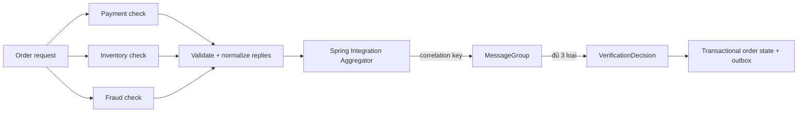
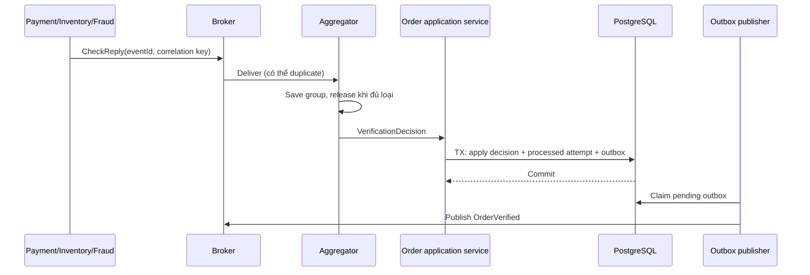

# Aggregator và ghép kết quả theo correlation key

## 1. Vấn đề: nhiều kết quả đến không cùng lúc nhưng cần một quyết định

Trong các hệ thống tích hợp, một sự kiện nghiệp vụ có thể sinh ra **nhiều yêu cầu độc lập** tới các hệ thống khác nhau. Ví dụ, trước khi xác nhận đơn hàng, Order Service cần nhận kết quả từ ba bước:

1. **Payment** kiểm tra trạng thái thanh toán.
2. **Inventory** kiểm tra khả năng giữ hàng.
3. **Fraud** kiểm tra rủi ro giao dịch.

Ba hệ thống xử lý ở tốc độ khác nhau. Kết quả có thể đến theo thứ tự `FRAUD → PAYMENT → INVENTORY`, được gửi lại sau timeout hoặc thậm chí đến **sau khi** luồng đã đóng. Không thể dựa vào thứ tự message tới broker, cũng không thể chỉ đếm ba message rồi kết luận đã có đủ ba loại: một kết quả `PAYMENT` bị gửi lại hai lần vẫn không thay thế kết quả `INVENTORY`.

**Aggregator** của Spring Integration giải quyết phần **gom các message có liên hệ**, quyết định **khi nào một nhóm đủ điều kiện phát kết quả**, rồi **biến nhóm thành một message đầu ra**. Điểm then chốt là **correlation key**, không phải chỉ là số message.

Bài học thuộc chương **Định tuyến và biến đổi** của module **SPRING_BOOT_INTEGRATION**. Module hướng dẫn tích hợp Spring Boot qua HTTP client, cơ sở dữ liệu, cache, broker thông điệp và các adapter Spring Integration; chú trọng quản lý cấu hình, hợp đồng dữ liệu, giao dịch, lỗi, xử lý trùng lặp, kiểm thử và quan sát. Vì vậy, ví dụ sẽ đi xa hơn cấu hình `aggregate()`: còn có timeout, idempotency, dữ liệu bền vững, lỗi trễ, khả năng mở rộng và transaction boundary.

Sau bài học, bạn có thể:

- Phân biệt **correlation strategy**, **release strategy**, **output processor** và **message group store**.
- Thiết kế correlation key tránh trộn kết quả của hai tenant, hai đơn hoặc hai lần chạy workflow.
- Dùng Spring Integration Java DSL để tạo aggregator có quy tắc đợi đủ **các loại kết quả phân biệt**.
- Giải thích tác động của out-of-order delivery, duplicate, timeout, late arrival và quá tải.
- Lựa chọn memory store hay persistent store, dọn nhóm hết hạn và xử lý sau restart.
- Kết hợp aggregator với HTTP, JDBC/JPA, RabbitMQ/Kafka, Redis và transactional outbox theo ranh giới đúng.
- Kiểm thử integration flow, concurrency và cơ chế phục hồi bằng dữ liệu thật.

> **Ngữ cảnh phiên bản:** Ví dụ dùng Java 17+, Spring Boot 3.2+, Spring Integration 6.x và các API Java DSL thuộc `org.springframework.integration.dsl`. Cấu hình theo BOM Spring Boot để tránh trộn thư viện khác major version. Đoạn mã rút gọn các import thông dụng; tên method và chi tiết mặc định cần đối chiếu phiên bản Spring Integration triển khai khi đưa vào dự án thực.

## 2. Một luồng thực tế để thấy vai trò correlation

### 2.1. Mỗi bước trả về một fragment có danh tính

Giả sử ba hệ thống nhận cùng một `orderId` nhưng trả về một fragment riêng:

```json
{
  "schemaVersion": 1,
  "tenantId": "TENANT-A",
  "orderId": "O-1001",
  "attemptId": "verify-2026-11-21-001",
  "type": "PAYMENT",
  "approved": true,
  "revision": 7
}
```

Các fragment từ `INVENTORY` và `FRAUD` có cùng `tenantId`, `orderId`, `attemptId` nhưng `type` khác.

| Field | Vai trò | Vì sao quan trọng? |
|---|---|---|
| `schemaVersion` | Phiên bản hợp đồng message | Tránh đọc payload từ phiên bản chưa hỗ trợ |
| `tenantId` | Phân vùng khách hàng/tổ chức | Tránh ghép nhầm dữ liệu các tenant |
| `orderId` | Định danh nghiệp vụ | Liên kết kết quả với đơn |
| `attemptId` | Định danh **một lần xác minh** | Không trộn kết quả của lần thử lại sau khi workflow đã hết hạn |
| `type` | `PAYMENT`, `INVENTORY`, `FRAUD` | Phân biệt những kết quả bắt buộc |
| `approved` | Quyết định của từng hệ thống | Chỉ phát quyết định tổng sau khi nhóm hợp lệ |
| `revision` | Phiên bản kết quả của cùng một nguồn | Giúp xử lý duplicate hoặc bản trả lời đến ngược thứ tự |

Trường `attemptId` phải được **tái sử dụng nhất quán cho cùng một workflow attempt**, nhưng thay đổi khi một lần xác minh mới có ý nghĩa khác với lần cũ. Nó không phải message ID do broker cấp và không phải một giá trị ngẫu nhiên được tạo lại mỗi lần redelivery.

### 2.2. Luồng định tuyến và ghép



Một nhóm được đặt theo khóa logic:

```text
verification:v1:TENANT-A:O-1001:verify-2026-11-21-001
```

Nếu một phản hồi của `O-1002` đến xen vào, nó phải vào **nhóm khác**. Nếu `O-1001` bắt đầu một workflow attempt mới, kết quả attempt cũ không được tự động coi là thành phần của nhóm mới.

### 2.3. Aggregator không phải router, splitter hay resequencer

| Thành phần Spring Integration | Nhiệm vụ | Ví dụ |
|---|---|---|
| Router | Chọn channel/nhánh theo header/payload | Chuyển `PAYMENT` sang queue thanh toán |
| Transformer | Đổi biểu diễn một message | JSON → `CheckReply` có schema hợp lệ |
| Splitter | Chia một message thành nhiều phần | Một danh sách line items → N message |
| Filter | Chặn hoặc cho phép message | Bỏ payload schema không hỗ trợ |
| **Aggregator** | Gom nhiều message thành một kết quả khi thỏa release condition | Ba loại kiểm tra → một quyết định |
| Resequencer | Sắp xếp lại thứ tự message theo sequence | Trả các phần theo thứ tự đã định |
| Scatter-gather | Phát yêu cầu tới nhiều nơi rồi gom reply | Gọi song song ba dịch vụ để tổng hợp |

Một splitter có thể tự tạo các header `correlationId`, `sequenceNumber`, `sequenceSize`; aggregator mặc định có thể tận dụng các header ấy. Nhưng một bài toán **nhiều hệ thống trả kết quả** cần biết chính xác các loại kết quả bắt buộc, không thể suy rằng việc có đủ một `sequenceSize` sẽ tự giải quyết duplicate/out-of-order.

## 3. Bốn quyết định cấu thành một Aggregator

### 3.1. Correlation strategy: message thuộc nhóm nào?

`CorrelationStrategy` ánh xạ một message tới **group ID**. Trong ví dụ:

```text
correlationKey =
    tenantId + ":" + orderId + ":" + attemptId
```

Định danh này phải **ổn định**, nhất quán giữa các producers và đủ phân biệt các workflow. Không dùng timestamp khi message vừa tới để dựng key, vì các message liên quan sẽ không thể tìm thấy nhau. Không dùng chỉ `orderId` nếu một đơn được xử lý nhiều attempt hoặc ở nhiều tenant.

Nếu các phần của khóa có thể chứa `:`, phải encode/escape hoặc dùng format định danh canonical không nhập nhằng; ví dụ ở mục 5 sẽ validate một tập ký tự an toàn. Với persistent group store, khóa phải bền qua serialization/restart và thay đổi schema.

### 3.2. Release strategy: khi nào nhóm được phép phát?

Một số quy tắc:

- **Số lượng cố định:** đủ `N` message. Dễ dùng nhưng **không an toàn nếu duplicate được tính như kết quả mới**.
- **Theo sequence metadata:** nhận đủ các phần của một sequence; thích hợp khi splitter bảo đảm metadata và source đã kiểm soát duplicate.
- **Theo loại nghiệp vụ:** có đủ tập `PAYMENT`, `INVENTORY`, `FRAUD`, bất kể thứ tự.
- **Theo deadline:** quá thời gian thì phát kết quả **PARTIAL/TIMED_OUT** hoặc hủy nhóm theo hợp đồng.
- **Theo điều kiện fail-fast:** nếu một hệ thống từ chối, có thể kết luận sớm trong một số use case, nhưng cần quản lý message còn tới sau.

Quy tắc của bài:

```text
required = {PAYMENT, INVENTORY, FRAUD}
observed = set(type của các reply hợp lệ trong group)
release nếu observed chứa đầy đủ required
```

Một duplicate `PAYMENT` chỉ làm số message tăng, **không** làm nhóm đủ điều kiện khi thiếu `FRAUD`.

### 3.3. MessageGroupStore: nhóm được giữ ở đâu?

Aggregator là **stateful component**. Nó phải giữ các reply trong khi chờ phần còn thiếu. `MessageGroupStore` trừu tượng hóa việc lưu các message group:

- **Memory store:** nhanh, dễ test; thường mất nhóm khi process restart và phải quản lý giới hạn số nhóm chờ.
- **Persistent store** (ví dụ JDBC hoặc Redis implementation phù hợp): có thể giữ message qua restart, nhưng cần schema, serialization, locking, expiry và quy tắc sử dụng nhiều instance.

Một persistent store **không tự biến** luồng thành exactly-once và không tự đồng bộ nghiệp vụ với database/broker. Việc group được ghi vào store có thể xảy ra ở thời điểm khác với broker ack hoặc database commit.

### 3.4. Output processor: tạo kết quả tổng hợp gì?

`MessageGroupProcessor` xây **một payload đầu ra** từ các phần của nhóm. Ví dụ:

```json
{
  "tenantId": "TENANT-A",
  "orderId": "O-1001",
  "attemptId": "verify-2026-11-21-001",
  "approved": true,
  "resultsReceived": ["PAYMENT", "INVENTORY", "FRAUD"]
}
```

Output processor cần:

1. Kiểm tra group chứa các phần cùng `tenantId`/`orderId`/`attemptId`.
2. Kiểm tra từng `type` là giá trị hợp lệ và quy tắc chọn khi có duplicate.
3. Không dựa vào thứ tự collection của group (có thể thay đổi).
4. Không biến một reply lỗi hoặc vắng mặt thành `approved=true`.
5. Tạo kết quả có correlation/operation ID để downstream ghi trạng thái một cách idempotent.

**Phân biệt release với output:** release strategy trả một điều kiện Boolean (có phát hay không); output processor tạo nội dung của message mới. Việc đặt mọi logic vào một đoạn code khó kiểm thử khiến timeout/duplicate trở nên khó xử lý.

## 4. Chuẩn bị Spring Boot và cấu trúc message

### 4.1. Maven dependency

Dự án dùng Spring Boot parent/BOM:

```xml
<dependencies>
  <dependency>
    <groupId>org.springframework.boot</groupId>
    <artifactId>spring-boot-starter-integration</artifactId>
  </dependency>
  <!-- Chỉ thêm nếu adapter HTTP, RabbitMQ, JDBC, Redis cần thiết. -->
  <dependency>
    <groupId>org.springframework.integration</groupId>
    <artifactId>spring-integration-http</artifactId>
  </dependency>
  <dependency>
    <groupId>org.springframework.integration</groupId>
    <artifactId>spring-integration-jdbc</artifactId>
  </dependency>
  <dependency>
    <groupId>org.springframework.boot</groupId>
    <artifactId>spring-boot-starter-test</artifactId>
    <scope>test</scope>
  </dependency>
  <dependency>
    <groupId>org.springframework.integration</groupId>
    <artifactId>spring-integration-test</artifactId>
    <scope>test</scope>
  </dependency>
</dependencies>
```

Core flow có thể chạy chỉ với Spring Integration starter; module HTTP/JDBC bổ sung khi thực sự dùng adapter/store tương ứng. RabbitMQ/Kafka/Redis adapters cần dependency riêng phù hợp cùng BOM. Không trộn Spring Integration 5.x với Spring Framework 6.x.

### 4.2. Payload contract tối giản

```java
// CheckType.java
public enum CheckType {
    PAYMENT,
    INVENTORY,
    FRAUD
}

// CheckReply.java — record dùng cho message payload.
public record CheckReply(
        int schemaVersion,
        String tenantId,
        String orderId,
        String attemptId,
        CheckType type,
        boolean approved,
        long revision
) {}

// VerificationDecision.java
public record VerificationDecision(
        String tenantId,
        String orderId,
        String attemptId,
        boolean approved
) {}
```

Các record chỉ minh họa Java contract; hệ thống thực cần validate các field, giới hạn length, schema version và xác minh producer có quyền gửi kết quả cho `tenantId`/`orderId`. Nếu lưu nhóm bằng serializer nhị phân/JSON trong persistent store, phải chốt format tương thích và schema migration.

### 4.3. Nơi nào đặt correlation metadata?

Spring Integration message có hai phần: **payload** và **headers**. Có thể để business keys trong payload, đặt thêm một correlation key trong headers:

```java
Message<CheckReply> message = MessageBuilder
        .withPayload(reply)
        .setHeader(
                "verificationCorrelation",
                reply.tenantId() + ":" + reply.orderId()
                        + ":" + reply.attemptId())
        .build();
```

Trong ví dụ này, **payload là nguồn thông tin nghiệp vụ**; header giúp routing/diagnostics. Không tin header do untrusted HTTP request cung cấp mà không đối chiếu payload và authorization. Nếu producer dùng chuẩn splitter/aggregator mặc định, Spring Integration có các headers `correlationId`, `sequenceNumber`, `sequenceSize`; nhưng chúng có semantics của **sequence**, không thay thế yêu cầu validate đủ ba loại nghiệp vụ.

## 5. Xây dựng aggregator với Java DSL

### 5.1. Correlation key có kiểm tra hợp đồng

Tạo một hàm thuần dùng được cả trong unit test, adapter đầu vào và aggregator:

```java
// VerificationKeys.java — imports rút gọn
public final class VerificationKeys {
    private VerificationKeys() {}

    public static String of(CheckReply reply) {
        if (reply == null || reply.schemaVersion() != 1
                || reply.type() == null
                || reply.revision() < 0) {
            throw new IllegalArgumentException(
                    "CheckReply có schema/type/revision không hợp lệ");
        }
        validateId(reply.tenantId(), "tenantId");
        validateId(reply.orderId(), "orderId");
        validateId(reply.attemptId(), "attemptId");

        return "verification:v1:"
                + reply.tenantId() + ":"
                + reply.orderId() + ":"
                + reply.attemptId();
    }

    private static void validateId(String value, String name) {
        if (value == null
                || !value.matches("[A-Za-z0-9_-]{1,100}")) {
            throw new IllegalArgumentException(
                    name + " có ký tự/độ dài không hợp lệ");
        }
    }
}
```

Việc chỉ cho phép chữ, số, gạch dưới và gạch ngang giúp delimiter `:` không thể xuất hiện bên trong từng ID. Đây là cách **minh họa**; hệ thống có định danh quốc tế/UUID có ký tự khác nên dùng một encoding canonical và giới hạn độ dài phù hợp, không âm thầm cắt/đổi giá trị khiến hai ID khác nhau trở thành một key.

**Phân vùng bảo mật:** kiểm tra key syntax chưa đủ để xác thực một nguồn message được phép đưa kết quả vào nhóm của tenant đó. Adapter đầu vào phải xác minh danh tính source, mối liên hệ với order và workflow, schema version, chữ ký/token khi cần, tránh attacker gửi một `FRAUD approved=true` giả để tác động quyết định.

### 5.2. Release strategy theo tập loại kết quả

```java
// AllChecksReleaseStrategy.java
public final class AllChecksReleaseStrategy
        implements ReleaseStrategy {

    private static final Set<CheckType> REQUIRED =
            EnumSet.allOf(CheckType.class);

    @Override
    public boolean canRelease(MessageGroup group) {
        EnumSet<CheckType> seen =
                EnumSet.noneOf(CheckType.class);

        for (Message<?> message : group.getMessages()) {
            if (!(message.getPayload() instanceof CheckReply reply)
                    || reply.type() == null) {
                // Lỗi hợp đồng: không phát quyết định từ payload sai.
                throw new IllegalArgumentException(
                        "Message trong group không phải CheckReply");
            }
            seen.add(reply.type());
        }
        return seen.containsAll(REQUIRED);
    }
}
```

Nếu một nhóm nhận `PAYMENT, PAYMENT, INVENTORY`, tập `seen` chỉ có hai giá trị, nên aggregator **tiếp tục chờ FRAUD**. Điều này giải quyết lỗi giải phóng nhóm sớm do duplicate, nhưng **chưa giải quyết** duplicate có payload mâu thuẫn: cùng `PAYMENT` nhưng revision/kết quả khác nhau phải có chính sách rõ ràng.

### 5.3. Output processor kiểm tra tính nhất quán

```java
// VerificationGroupProcessor.java
public final class VerificationGroupProcessor
        implements MessageGroupProcessor {

    @Override
    public Object processMessageGroup(MessageGroup group) {
        EnumMap<CheckType, CheckReply> parts =
                new EnumMap<>(CheckType.class);

        for (Message<?> message : group.getMessages()) {
            if (!(message.getPayload() instanceof CheckReply reply)) {
                throw new IllegalArgumentException(
                        "Payload không hợp lệ trong group");
            }
            CheckReply prior =
                    parts.putIfAbsent(reply.type(), reply);
            if (prior != null && !prior.equals(reply)) {
                throw new IllegalStateException(
                        "Hai kết quả cùng type nhưng nội dung khác nhau");
            }
        }

        if (!parts.keySet().containsAll(
                EnumSet.allOf(CheckType.class))) {
            throw new IllegalStateException(
                    "Chưa đủ ba loại kiểm tra bắt buộc");
        }

        CheckReply payment = parts.get(CheckType.PAYMENT);
        for (CheckReply part : parts.values()) {
            if (!payment.tenantId().equals(part.tenantId())
                    || !payment.orderId().equals(part.orderId())
                    || !payment.attemptId().equals(part.attemptId())) {
                throw new IllegalStateException(
                        "Group chứa message khác workflow");
            }
        }

        boolean approved = parts.values().stream()
                .allMatch(CheckReply::approved);

        return new VerificationDecision(
                payment.tenantId(),
                payment.orderId(),
                payment.attemptId(),
                approved);
    }
}
```

Đây là chính sách **không chấp nhận các duplicate mâu thuẫn**: báo lỗi để xử lý hoặc đối soát ngoài flow, không âm thầm chọn “kết quả cuối cùng đến”. Nó cho phép **duplicate hoàn toàn giống nhau** vì phép `equals` của record so sánh các field. Trong production, nếu một source hợp lệ có thể phát revision mới hơn trong **cùng attempt**, phải đặc tả cơ chế chọn revision/version và xử lý race atomically. Thường tốt hơn là normalize/deduplicate tại boundary rồi mới đưa message vào aggregator.

### 5.4. Khai báo channel, store và IntegrationFlow

```java
// VerificationAggregationConfiguration.java — imports rút gọn
@Configuration(proxyBeanMethods = false)
public class VerificationAggregationConfiguration {

    @Bean("verificationReplies")
    MessageChannel verificationReplies() {
        return new DirectChannel();
    }

    @Bean("verificationDecisions")
    PollableChannel verificationDecisions() {
        return new QueueChannel(128);
    }

    @Bean("verificationGroupStore")
    MessageGroupStore verificationGroupStore() {
        // Chỉ để local/test; restart sẽ mất nhóm đang chờ.
        return new SimpleMessageStore();
    }

    @Bean
    IntegrationFlow verificationAggregatorFlow(
            @Qualifier("verificationReplies")
            MessageChannel input,
            @Qualifier("verificationDecisions")
            PollableChannel output,
            @Qualifier("verificationGroupStore")
            MessageGroupStore store
    ) {
        return IntegrationFlow.from(input)
                .aggregate(a -> a
                        .correlationStrategy(message ->
                                VerificationKeys.of(
                                    (CheckReply) message.getPayload()))
                        .releaseStrategy(
                                new AllChecksReleaseStrategy())
                        .outputProcessor(
                                new VerificationGroupProcessor())
                        .messageStore(store)
                        .groupTimeout(30_000L)
                        .sendPartialResultOnExpiry(false)
                        .expireGroupsUponCompletion(true))
                .channel(output)
                .get();
    }
}
```

Những bean minh họa dùng Spring Messaging `MessageChannel`/`PollableChannel`, Spring Integration `DirectChannel`/`QueueChannel`, `SimpleMessageStore`, `IntegrationFlow` và các strategy của aggregator. `QueueChannel(128)` chỉ là một kênh đầu ra bounded trong **một JVM**, không phải durable broker queue. Nếu ứng dụng production chỉ publish quyết định tới HTTP/DB/broker, hãy đưa output vào handler/adapter thật và quản lý retry tương ứng.

**Vì sao inject channel/store vào flow method?** Với `@Configuration(proxyBeanMethods=false)`, tự gọi một `@Bean` method từ method khác như hàm Java thường có thể tạo **object mới** thay vì lấy singleton đã quản lý. Inject theo `@Qualifier` làm flow dùng đúng bean mà test/inbound adapter sẽ gửi message tới.

**Điều kiện đầu vào:** flow ví dụ giả định adapter **đã xác thực và validate payload** là `CheckReply`. Cast trực tiếp sang `CheckReply` có thể tạo lỗi cho message sai kiểu; tại ingress production phải đặt validator/filter/error-channel và chính sách quarantine/DLQ thay vì cho dữ liệu không tin cậy đi vào store.

### 5.5. Giải thích từng tùy chọn

| Cấu hình | Ý nghĩa |
|---|---|
| `correlationStrategy` | Tính group ID từ `tenantId + orderId + attemptId` |
| `releaseStrategy` | Chỉ release khi đủ `PAYMENT`, `INVENTORY`, `FRAUD` |
| `outputProcessor` | Tạo `VerificationDecision` có tính nhất quán |
| `messageStore` | Lưu các fragment trong lúc đợi nhóm đủ |
| `groupTimeout(30_000L)` | Đặt chính sách xét timeout sau một khoảng tính bằng millisecond theo cơ chế scheduler của aggregator |
| `sendPartialResultOnExpiry(false)` | Không phát một kết quả thiếu thành phần qua luồng quyết định bình thường |
| `expireGroupsUponCompletion(true)` | Dọn trạng thái nhóm sau completion theo chính sách cấu hình |
| `channel(output)` | Chuyển kết quả tổng hợp tới kênh tiếp theo |

**Cảnh báo về timeout:** khi `sendPartialResultOnExpiry(false)`, một nhóm có thể bị expire mà **không có `VerificationDecision`**. Nguồn sinh workflow vẫn phải có **deadline và trạng thái TIMEOUT được lưu bền** để không chờ vô hạn. Cơ chế timeout của aggregator không thay thế toàn bộ SLA/process manager của workflow; chi tiết scheduler, expiry và xử lý group cần test theo bản Spring Integration thực tế.

### 5.6. Một ví dụ gửi ba message

```java
// Ví dụ trong test hoặc inbound adapter đã validate.
CheckReply payment = new CheckReply(
        1, "TENANT-A", "O-1001", "attempt-1",
        CheckType.PAYMENT, true, 7);
CheckReply inventory = new CheckReply(
        1, "TENANT-A", "O-1001", "attempt-1",
        CheckType.INVENTORY, true, 4);
CheckReply fraud = new CheckReply(
        1, "TENANT-A", "O-1001", "attempt-1",
        CheckType.FRAUD, false, 2);

input.send(MessageBuilder.withPayload(fraud).build());
input.send(MessageBuilder.withPayload(payment).build());
input.send(MessageBuilder.withPayload(inventory).build());

Message<?> outputMessage = decisions.receive(1_000);
VerificationDecision decision =
        (VerificationDecision) outputMessage.getPayload();

assertEquals("O-1001", decision.orderId());
assertFalse(decision.approved()); // FRAUD từ chối
```

`input` là `MessageChannel` được inject bean `verificationReplies`, `decisions` là `PollableChannel` được inject bean `verificationDecisions`, và test phải xác nhận `outputMessage != null` trước khi lấy payload. Trong một flow đồng bộ `DirectChannel`, callback aggregator có thể xử lý trên thread đang gửi; khi dùng broker/`ExecutorChannel`, thứ tự, thread, lỗi và thời gian chờ sẽ khác. Vì thế test cần kiểm tra **kết quả**, không dựa vào thứ tự tới.

## 6. Correlation key: thiết kế chống ghép sai

### 6.1. Những khóa không đủ phân biệt

| Correlation key | Rủi ro |
|---|---|
| Chỉ `orderId` | Trộn attempt cũ và mới; có thể trộn tenant |
| Chỉ `customerId` | Nhiều đơn của cùng người bị ghép |
| Tên service `PAYMENT` | Mọi đơn cùng tập trung vào một group |
| Message UUID từ broker | Mỗi reply thành một nhóm riêng, không ghép được |
| Timestamp lúc nhận message | Mỗi nguồn nhận thời điểm khác nhau |
| `tenantId + orderId + attemptId` có encoding rõ | Phân biệt đúng phạm vi workflow khi ID được xác thực |

Không phải use case nào cũng cần `attemptId`: một splitter tạo N phần của **một payload duy nhất** có thể sử dụng correlation ID được splitter tạo tự động. Nhưng trong saga/workflow bất đồng bộ, attempt/version rõ ràng giúp phân biệt response đến muộn và xử lý lại.

### 6.2. Correlation ID khác idempotency ID

Hai loại định danh giải quyết hai câu hỏi:

- **Correlation key:** “Những message nào thuộc cùng một nhóm chờ?”
- **Idempotency key:** “Tác động nghiệp vụ này đã được áp dụng chưa?”

Ví dụ mọi `CheckReply` cùng attempt có một correlation key, nhưng một reply từ PAYMENT có thể được redeliver nhiều lần với message ID mới; cần deduplicate theo `tenantId + orderId + attemptId + type + revision` hoặc một `sourceEventId` bền từ producer. Sau khi aggregator phát `VerificationDecision`, application service còn cần idempotency key theo `tenantId + orderId + attemptId` để tránh update order hai lần nếu output bị phát lại.

### 6.3. Header correlation có thể bị mất khi chuyển đổi

Nếu sử dụng default correlation/release dựa trên Spring Integration sequence headers, một custom transformer, HTTP gateway, serialization adapter hoặc broker consumer có thể vô tình làm rơi headers. Khi đó các fragment có thể bị tách thành group mới, nằm chờ hết hạn hoặc bị phát sai.

Hướng kiểm tra:

1. Quy định metadata nào là **business contract trong payload** và metadata nào chỉ nằm trong message header.
2. Với các chặng qua HTTP/broker, xác định mapping cụ thể từ payload/headers sang external protocol và trở lại.
3. Không giả định Java Message headers được truyền nguyên vẹn qua JMS, AMQP, Kafka hoặc REST API.
4. Dùng explicit correlation strategy từ payload cho các workflow quan trọng để giảm coupling với headers, hoặc bảo đảm header mapping/contract có test.
5. Giữ `correlationId` trong log/tracing theo giới hạn bảo mật, nhưng không dùng giá trị unique này làm metric label.

## 7. Duplicate, out-of-order, conflicting reply và late arrival

### 7.1. Out-of-order là tình huống bình thường

Aggregator được thiết kế để nhóm message theo correlation key, **không phụ thuộc thứ tự đến**. Với cùng `attempt-1`:

```text
T+00ms  FRAUD    approved=true
T+12ms  INVENTORY approved=true
T+45ms  PAYMENT  approved=true

Observed types:
T+00  {FRAUD}                       -> chờ
T+12  {FRAUD, INVENTORY}            -> chờ
T+45  {FRAUD, INVENTORY, PAYMENT}   -> release
```

Output processor phải đọc theo `type` thay vì lấy `group.getMessages().toArray()[0]` làm PAYMENT. Nếu business cần thứ tự xác định cho một workflow khác (ví dụ tính lại sổ cái theo sequence), dùng resequencer/sequence policy riêng; aggregator không tự sắp xếp business events theo timeline.

### 7.2. Duplicate do broker redelivery hoặc HTTP retry

```text
T+00  PAYMENT messageId=uuid-1  revision=7
T+05  PAYMENT messageId=uuid-2  revision=7  (redelivery)
T+10  FRAUD   messageId=uuid-3  revision=2
T+20  INVENTORY messageId=uuid-4 revision=4
```

Default MessageStore/group có thể lưu cả `uuid-1` và `uuid-2` vì chúng là **hai Spring Message ID khác nhau**. `AllChecksReleaseStrategy` vẫn chờ đúng tập type nên không release sai lúc chỉ có hai PAYMENT và một FRAUD. Nhưng group vẫn có **bốn messages**, làm tăng memory/store size, và output processor phải quyết định duplicate có chấp nhận không.

**Khuyến nghị production:** deduplicate ở **ingress trước aggregator** theo một event ID đáng tin hoặc khóa nghiệp vụ có revision; nếu yêu cầu bền, lưu khóa đã xử lý với unique constraint/transaction thích hợp, không chỉ giữ một `ConcurrentHashMap` trong JVM. Message ID do framework tự tạo khi deserialize/rebuild không phải idempotency ID đáng tin xuyên broker redelivery.

### 7.3. Hai reply cùng loại nhưng khác quyết định

Ví dụ `PAYMENT revision=7, approved=false` và sau đó `PAYMENT revision=8, approved=true` đều mang cùng `attemptId`. Cần trả lời **trước khi code**:

1. Đây là hai snapshot hợp lệ của cùng attempt hay lỗi producer?
2. Revision tăng đơn điệu trong **cùng nguồn** hay trên toàn workflow?
3. Có được thay kết quả đã dùng để quyết định final không?
4. Nếu kết quả cũ đã xuất hiện sau kết quả mới, làm sao không ghi đè?
5. Khi source đổi trạng thái sau timeout, có tạo attempt mới hay compensation?

Processor ở mục 5 **ném lỗi khi duplicate khác payload** để không âm thầm chọn. Một policy khác có thể chỉ chấp nhận revision cao nhất, nhưng phải cập nhật từng type bằng cơ chế atomic và quy định điều gì xảy ra nếu revision cao hơn đến **sau khi group đã release**. Khi cần biến trạng thái liên tục, một **process manager/state table trong PostgreSQL** có thể phù hợp hơn một aggregator đơn thuần.

### 7.4. Late message sau khi nhóm đã hoàn tất

Một race nguy hiểm:

```text
T1 PAYMENT, INVENTORY, FRAUD đến -> group release.
T2 Consumer cập nhật Order=CONFIRMED.
T3 Group đã bị xóa để giải phóng store.
T4 Broker redeliver PAYMENT từ attempt cũ.
T5 Aggregator nhìn thấy key nhưng không còn group cũ
   -> có thể tạo một group mới với cùng correlation key.
```

`expireGroupsUponCompletion(true)` giải phóng trạng thái nhóm, **không tạo vĩnh viễn một tombstone bền** rằng attempt đã được xử lý. Ngay cả khi cấu hình store giữ nhóm completed một thời gian, bạn vẫn cần quy tắc rõ cho TTL, restart và late arrivals.

Lớp ứng dụng nên lưu trạng thái workflow theo `(tenantId, orderId, attemptId)` với các giá trị `PENDING/COMPLETED/TIMED_OUT/CANCELLED`, kèm unique constraint hoặc optimistic locking. Ingress kiểm tra attempt có còn nhận reply không; consumer quyết định chỉ commit khi attempt ở trạng thái cho phép, và bỏ qua/ghi log kiểm toán đối với reply trễ.

### 7.5. Các kiểu lỗi cần phân biệt

| Tình huống | Trạng thái group | Cách xử lý phù hợp |
|---|---|---|
| Reply đến đảo thứ tự | Tiếp tục tích lũy | Release theo tập loại, không theo thứ tự |
| Duplicate giống hệt | Có thể tăng message count | Dedup trước aggregator hoặc processor nhận diện |
| Duplicate mâu thuẫn | Nhóm có dữ liệu không nhất quán | Quarantine/đối soát; không chọn tùy tiện |
| Reply schema sai | Không nên được đưa vào group | Validate trước ingress, error channel/DLQ |
| Reply sai tenant/attempt | Group sai hoặc key bị giả | Auth + cross-check payload, reject |
| Reply quá hạn | Group có thể đã expire | Kiểm tra trạng thái attempt bền trước khi nhận |
| Reply sau completion | Có thể tạo group mới nếu store đã dọn | Tombstone/dedup business state, bỏ qua |
| Reply bị mất vĩnh viễn | Group không bao giờ đủ | Deadline, timeout event, compensation |
| Consumer output lỗi | Group có thể đã release nhưng business commit fail | Reliable handoff + idempotent retry; kiểm thử cụ thể |

**Quan trọng:** giải phóng group và commit kết quả nghiệp vụ là **hai hành động khác nhau**. Nếu output processor phát payload nhưng handler downstream rollback, group state không tự trở về đúng trạng thái mong đợi trong mọi cấu hình store/channel/transaction.

## 8. Timeout, partial result và hết hạn group

### 8.1. Mỗi workflow cần một deadline nghiệp vụ

Giả sử Order phải được quyết định trong tối đa 30 giây:

```text
Attempt createdAt       = 10:00:00
Business deadline       = 10:00:30
PAYMENT arrives         = 10:00:05
FRAUD arrives           = 10:00:10
INVENTORY never arrives
```

Ở thời điểm deadline, **không được mặc định approved=true**. Có ba chính sách thường gặp:

1. **Fail closed:** ghi `TIMED_OUT`/`REJECTED`, không xác nhận order.
2. **Wait/retry có giới hạn:** đặt lại lịch xử lý, gửi request tới nguồn bị thiếu theo operation ID, không làm dài workflow vô hạn.
3. **Partial result:** phát payload ghi rõ thiếu `INVENTORY`, downstream quyết định theo rule nghiệp vụ đã công bố; không biến partial thành complete.

`groupTimeout(30_000L)` trong aggregator liên quan đến **lifecycle của một message group** theo scheduler/version; **không nên dùng nó như đồng hồ deadline tuyệt đối tính từ khi Order được tạo** nếu việc trì hoãn message đầu tiên hoặc các lần cập nhật group có thể làm thời điểm xét timeout khác dự kiến. Để bảo đảm SLA, lưu `createdAt/deadlineAt` trong database/workflow state và dùng một scheduler/process manager có khả năng khôi phục.

### 8.2. `sendPartialResultOnExpiry(false)`: không tạo kết quả giả

Trong cấu hình bài, khi một group timeout và bị expire, aggregator **không gửi một `VerificationDecision` thiếu thành phần** theo luồng thành công. Đây là lựa chọn an toàn nếu consumer chỉ nhận quyết định đầy đủ.

Tuy vậy, producer/Order Service vẫn cần biết attempt thất bại do thiếu reply. Có thể dùng một **deadline worker độc lập**:

```text
UPDATE verification_attempt
   SET status = 'TIMED_OUT'
 WHERE attempt_id = ?
   AND status = 'PENDING'
   AND deadline_at <= CURRENT_TIMESTAMP;
```

Đặt điều kiện `status='PENDING'` giúp hai worker không cùng chuyển trạng thái sau khi attempt đã complete, nhưng trong production còn cần tenant/order ownership, optimistic locking, event/outbox cho timeout và xử lý đúng timezone. Group timeout là cơ chế vệ sinh aggregator; timeout nghiệp vụ là thay đổi trạng thái được lưu bền.

### 8.3. Khi được phép gửi partial result

Nếu mục tiêu là một báo cáo thống kê (không quyết định thanh toán/giữ hàng), có thể chấp nhận tổng hợp không đầy đủ. Khi ấy có thể bật `sendPartialResultOnExpiry(true)` và cho output processor **nhận biết phần còn thiếu**:

```java
// DTO minh họa cho một bài toán cho phép kết quả thiếu
public record PartialVerification(
        String tenantId,
        String orderId,
        String attemptId,
        Set<CheckType> receivedTypes,
        Set<CheckType> missingTypes,
        boolean complete
) {}
```

Output processor khi ấy phải **không ném lỗi chỉ vì thiếu type** và không dùng `allMatch` trên collection rỗng để kết luận approved. Với workflow xác nhận đơn hiện tại, ví dụ processor mục 5 cố ý yêu cầu đủ ba loại, nên **không đổi độc lập `sendPartialResultOnExpiry(true)` mà giữ nguyên processor ấy**: có thể phát sinh exception khi expiry.

Một cách tách rõ contract là định nghĩa sealed/enum outcome `COMPLETE`, `PARTIAL`, `TIMED_OUT` và route từng loại tới channel riêng với policy khác nhau. `PARTIAL` chỉ chứa các dữ kiện quan sát được, không bao giờ được coi là xác nhận giữ hàng/thanh toán.

### 8.4. Group timeout khác các timeout khác

| Timeout | Phạm vi | Điều không làm |
|---|---|---|
| HTTP connect timeout | Thời gian thiết lập TCP/TLS | Không xóa các reply đã lưu trong aggregator |
| HTTP response timeout | Thời gian chờ phản hồi downstream | Không khẳng định server chưa xử lý command |
| Broker redelivery/visibility | Lịch giao lại message | Không thay business deadline của order |
| Aggregator group timeout | Thời điểm xét expire/release của group | Không tự tạo durable `TIMED_OUT` trong DB |
| MessageGroupStoreReaper | Dọn các nhóm cũ theo policy | Không đồng nghĩa message nghiệp vụ được xử lý/ack |
| Workflow deadline | SLA của một attempt trên dữ liệu bền | Cần worker/transaction/compensation để thực thi |

Phối hợp các timeout cần ngân sách chung. Nếu Inventory HTTP timeout 3 giây, retry 5 lần rồi aggregator deadline 4 giây, hệ thống có thể tiếp tục sinh reply sau khi attempt đã đóng. Hãy thiết kế deadline đến từng adapter và bỏ/đối soát reply trễ.

### 8.5. Dọn nhóm không phải xóa dữ liệu tùy tiện

Group tồn tại lâu do reply thiếu có thể làm Redis/JDBC/message store tăng không giới hạn. `MessageGroupStoreReaper` và các tùy chọn expire của aggregator hỗ trợ dọn nhóm không còn được dùng, nhưng cần quản lý:

- Khi nào group được coi là quá hạn, kể cả group chưa bao giờ đủ.
- Partial result được gửi hay discard, và consumer nào nhận thông báo?
- Có giữ trạng thái completed tối thiểu để loại late message không?
- Hệ thống restart có khôi phục/schedule lại cleanup không?
- Việc dọn group có giải phóng dữ liệu đang cần phục hồi không?
- Retention của group store khác retention business attempt/outbox ra sao?

Không đặt TTL ngắn tùy ý rồi xóa mọi group đang chờ chỉ vì bộ nhớ tăng. Trước tiên xác minh nguồn reply bị lỗi, timeout cấu hình và backlog.

## 9. MessageGroupStore: RAM, JDBC, Redis và khả năng phục hồi

### 9.1. Memory store dùng cho tình huống nào?

`SimpleMessageStore` dễ sử dụng cho **unit/integration test nhỏ, demo và luồng có thể tái tạo khi restart**. Ưu điểm là cấu hình ngắn và ít I/O. Nhưng với workload thật:

- Restart làm mất các message chưa tạo thành nhóm đầy đủ.
- Không tự chia sẻ state giữa nhiều JVM/pod.
- Số nhóm chờ có thể tăng theo số attempt pending; memory footprint phụ thuộc payload.
- Java object references trong process có thể bị thay đổi nếu payload mutable, gây khó chẩn đoán.

Nếu bắt buộc dùng memory store, ứng dụng phải có **nguồn event/command có thể replay an toàn**, giới hạn pending groups, thời hạn nhóm và test restart. Đừng coi chỉ cần thêm `ConcurrentHashMap` là đạt durability.

### 9.2. Lưu group bền bằng JDBC

Spring Integration JDBC cung cấp implementation persistent store như `JdbcMessageStore`, yêu cầu có database schema tương thích module/version và serializer thích hợp. Đoạn cấu hình khung:

```java
// Ví dụ thay SimpleMessageStore trong cấu hình JDBC persistence.
@Bean("verificationGroupStore")
MessageGroupStore verificationGroupStore(DataSource dataSource) {
    return new JdbcMessageStore(dataSource);
}
```

**Chọn một bean cùng tên**, không đăng ký song song cả bean memory và JDBC trong cùng profile mà không dùng condition/qualifier. Cần chạy schema migration tương ứng với **Spring Integration JDBC và database vendor đang dùng**, không tự đoán tên bảng/cột rồi để production chạy `ddl-auto=create`.

Lưu group message xuống JDBC đặt ra các yêu cầu:

1. Serializer lưu/đọc được message headers và `CheckReply` theo hợp đồng bền, không dùng Java serialization của object không đáng tin.
2. Group ID stable và key format có version migration plan.
3. Có giới hạn pending groups, dọn nhóm expire và indexes cho queries của store.
4. Có cơ chế xử lý **multi-instance concurrent updates** với lock/coordinator phù hợp; chia sẻ một table chưa đủ để bảo đảm không race.
5. Có chiến lược chuyển/khôi phục group khi deploy version mới, DB failover và schema migration.
6. Không mặc định transaction của group store và transaction ứng dụng Order/outbox **commit nguyên tử cùng nhau** nếu chưa có thiết kế/kiểm thử transaction manager thực.

### 9.3. RedisMessageStore: cần phân biệt tốc độ và durability

Spring Integration có thể sử dụng Redis-backed message group store khi module/phiên bản phù hợp. Redis có ưu điểm truy cập nhanh, chia sẻ state giữa instances và TTL/lifecycle riêng, nhưng:

- Redis persistence/replication/failover có thể không bảo đảm giữ mọi write dưới mọi tình huống.
- Eviction policy có thể xóa group đang chờ nếu không được quản lý.
- Key serialization, namespace, TTL và cross-slot behavior cần kiểm tra trên Redis Cluster.
- Việc state aggregator nằm trong Redis **không tự commit atomic** với Order PostgreSQL hoặc broker ack.

Với business effect quan trọng, **database workflow state và outbox** vẫn là nguồn kiểm soát trạng thái; Redis group store có thể dùng khi chấp nhận/replay được các cửa sổ mất state đã phân tích.

### 9.4. Nhiều replicas và lock theo correlation key

Một yêu cầu dễ bị bỏ sót: các message cùng group có thể đến **hai pod khác nhau đồng thời**. Nếu mỗi pod dùng `SimpleMessageStore` riêng, mỗi bên chỉ thấy một phần và không bao giờ release. Nếu cùng chia sẻ JDBC/Redis store, vẫn cần kiểm tra việc hai aggregator instances đồng thời:

- Cùng đọc group hiện tại;
- Cùng thêm message và tính release strategy;
- Cùng quyết định phát output;
- Cùng cleanup group;
- Một bên crash giữa ghi store, phát output và ack broker.

Các phương án gồm **partition theo correlation key** để một worker xử lý một group tại một thời điểm, lock registry/distributed coordination được hỗ trợ bởi store và framework, hoặc chọn một stateful process manager có optimistic locking trong database. Lock trong một JVM không đủ cho nhiều replicas. Cần tính lease expiration, fencing/ownership và test crash/restart để tránh duplicate output.

**Không suy rằng dùng JDBC store là exactly-once:** database transaction cho store và side effect ở consumer có thể là hai transaction khác nhau. Ngay cả một lock phân tán cũng có thể hết hạn khi worker chậm; consumer cuối phải idempotent.

### 9.5. Ước lượng bộ nhớ và kích thước nhóm

Giả sử có 50.000 attempts đang chờ, mỗi attempt đã nhận trung bình 2 fragment, mỗi message serialized trung bình 2 KiB:

```text
50.000 groups × 2 messages/group × 2 KiB
≈ 200.000 KiB ≈ 195 MiB payload bytes
```

Đây chỉ là **ước lượng payload**, chưa tính Java object/header metadata, cấu trúc index, JDBC row overhead, Redis internal memory, replication và số bản copy trong buffers. Thực tế có thể lớn hơn nhiều. Đo group count/age, store size, latency và thiết lập quota theo tenant/attempt, thay vì chỉ dựa vào heap max.

Nếu mỗi message mang toàn bộ PDF hoặc JSON rất lớn, nên lưu **reference** ở object storage/database theo quyền và chỉ truyền metadata/ID cần tổng hợp. Aggregator không phù hợp để giữ hàng GB nội dung trong RAM chỉ vì API cho phép.

## 10. Ranh giới transaction khi ghép kết quả từ HTTP, database và broker

### 10.1. Spring Integration message flow không phải distributed transaction

Một luồng có thể bắt đầu từ `@RabbitListener`, HTTP inbound gateway hoặc JDBC polling adapter, sau đó qua router/aggregator và cuối cùng ghi Order:



Có ít nhất ba **ranh giới độc lập**:

1. Broker delivery/ack và transaction của message source.
2. Message group store (RAM/JDBC/Redis) với transaction/locking của chính nó.
3. Order database transaction và outbox.

Việc cả ba cùng chạy trong một Spring Boot process không làm chúng commit atomically. Nếu aggregator đã xóa nhóm sau release nhưng `OrderApplicationService` chưa commit, cần biết ai có thể **replay quyết định**. Nếu Order commit rồi broker message được redeliver, consumer phải **bỏ qua tác động trùng**.

### 10.2. Đưa quyết định vào application service có idempotency

Consumer nên xử lý `VerificationDecision` bằng một use case SQL ngắn, ví dụ:

```java
// Phác thảo application service; cần entities/repos tương ứng.
@Service
public class VerificationDecisionService {
    private final VerificationAttemptRepository attempts;
    private final OutboxRepository outbox;

    public VerificationDecisionService(
            VerificationAttemptRepository attempts,
            OutboxRepository outbox
    ) {
        this.attempts = attempts;
        this.outbox = outbox;
    }

    @Transactional
    public void apply(VerificationDecision decision) {
        VerificationAttempt attempt = attempts
                .findForUpdate(
                        decision.tenantId(),
                        decision.orderId(),
                        decision.attemptId())
                .orElseThrow();

        if (attempt.isTerminal()) {
            // Đã COMPLETE/TIMED_OUT/CANCELLED:
            // duplicate hoặc reply quá hạn không tạo effect mới.
            return;
        }
        if (attempt.isExpired()) {
            attempt.markTimedOut();
            outbox.save(VerificationEvent.timedOut(attempt));
            return;
        }

        attempt.complete(decision.approved());
        outbox.save(VerificationEvent.completed(attempt));
    }
}
```

Đây là **khung kiến trúc**: `VerificationAttempt`, `VerificationAttemptRepository`, `OutboxRepository` và `VerificationEvent` là các abstraction cần triển khai theo schema thực. `findForUpdate` hàm ý **row lock hoặc optimistic CAS** được triển khai trong repository và đúng transaction manager; không phải method tự có sẵn của Spring Data. Cần unique constraint theo `(tenantId, orderId, attemptId)` và event ID ổn định.

Điểm cốt lõi: cùng một decision có thể đến nhiều lần mà không gây thêm side effect khi attempt đã terminal. Một kết quả partial hoặc reply đến sau deadline không được chuyển lại trạng thái đã hoàn tất một cách âm thầm.

### 10.3. Lỗi khi cập nhật database sau aggregator release

Giả sử aggregator đã phát một `VerificationDecision` nhưng PostgreSQL tạm unavailable. Nếu output đi qua **QueueChannel trong RAM**, restart có thể làm mất kết quả. Nếu upstream broker đã ack, cũng có thể không còn message để redeliver.

Những lựa chọn an toàn hơn theo độ quan trọng:

- Dùng **durable handoff**: output phải được ghi bền vào queue hoặc database với operation ID **trước khi** coi bước giao dữ liệu hoàn tất.
- Dùng **database state machine/process manager** lưu từng reply và quyết định cùng database transaction; Spring Integration chỉ điều phối transformation/routing.
- Thiết kế replay từ nguồn replies có thể phát lại, tái tạo group rồi apply idempotent.
- Phối hợp transaction manager/ack/store nếu được support và kiểm thử crash windows cụ thể; đừng suy rằng chỉ bật `@Transactional` cho aggregator là đã có distributed exactly-once.

Với nghiệp vụ đặt hàng/thanh toán, nếu hệ thống không có phương án bảo đảm khi state aggregator đã release nhưng Order commit fail, **không nên deploy memory QueueChannel làm đường duy nhất giữa hai bước**.

### 10.4. Vai trò của transactional outbox

Outbox có hai hướng cần cân nhắc:

**Khi phát yêu cầu kiểm tra:** Order Service ghi `VerificationRequested` với attempt ID vào outbox cùng transaction tạo attempt. Worker gửi ba command `PAYMENT/INVENTORY/FRAUD` ra broker/HTTP theo policy. Producer phải tái sử dụng operation ID qua retry.

**Khi xử lý kết quả:** Consumer ghi trạng thái attempt/order cùng `VerificationCompleted` vào outbox trong một SQL transaction; publisher tiếp tục chuyển sự kiện sau commit. Nếu publisher crash sau broker confirm nhưng trước khi đánh dấu SENT, duplicate event vẫn có thể xuất hiện; consumer cuối phải idempotent.

Outbox không tự giúp aggregator giữ group qua restart nếu group store vẫn ở RAM. Mỗi bước có điểm lưu bền riêng và phải có policy replay/expiry.

### 10.5. Nguồn là HTTP fan-out thay vì broker thì sao?

Khi Order Service gọi ba HTTP endpoint bằng `WebClient` đồng thời, có hai cách:

1. **Một request-response composite**: dùng Reactor `Mono.zip`/`Flux` với giới hạn concurrency và deadline rồi tạo quyết định trong **một luồng ngắn**; không nhất thiết cần stateful Spring Integration Aggregator.
2. **Workflow bất đồng bộ**: các source trả reply qua callback/queue trong nhiều giây hoặc phút; cần correlation, state store, timeout và recovery. Khi đó aggregator phù hợp.

Không dùng Aggregator chỉ để thay thế một `Mono.zip` đơn giản nếu toàn bộ kết quả đã nằm trong một reactive request ngắn. Ngược lại, `Mono.zip` của một HTTP request không bền qua process restart, không thay thế một process manager dài hạn.

### 10.6. Redis cache và dữ liệu stale

Nếu kết quả `INVENTORY` được lấy từ Redis cache, phải biết snapshot đó có đủ mới để quyết định giữ hàng không. Aggregator chỉ tổng hợp những gì nó nhận; nó không chứng minh dữ liệu bên trong reply còn đúng. Đặt `revision`, `observedAt` hoặc lease/status theo contract; quyết định giữ hàng cuối cùng vẫn nên dựa trên transaction/atomic reservation ở Inventory, không chỉ số lượng hiển thị từ cache.

Tương tự, nếu một reply được lấy qua JPA transaction, việc đã commit một bảng ở database A không bảo đảm reply đã được gửi tới Aggregator. Dùng transactional outbox/CDC khi sự kiện cần bền; đừng publish message trực tiếp trong transaction SQL rồi kỳ vọng rollback sẽ thu hồi message.

## 11. Kiểm thử aggregator từ unit strategy đến integration flow

### 11.1. Unit test correlation strategy và key format

Không cần khởi động Spring để test một pure function:

```java
@Test
void keysIncludeTenantOrderAndAttempt() {
    CheckReply first = new CheckReply(
            1, "TENANT-A", "O-1001", "attempt-1",
            CheckType.PAYMENT, true, 7);
    CheckReply second = new CheckReply(
            1, "TENANT-A", "O-1001", "attempt-2",
            CheckType.PAYMENT, true, 7);

    assertNotEquals(
            VerificationKeys.of(first),
            VerificationKeys.of(second));
    assertEquals(
            "verification:v1:TENANT-A:O-1001:attempt-1",
            VerificationKeys.of(first));
}
```

Cần thêm test `tenantId` khác, `orderId` khác, chứa dấu `:`/ký tự không hợp lệ, ID quá dài, `schemaVersion != 1` và `type=null`. Những test này ngăn lỗi ghép sai từ sớm.

### 11.2. Unit test group strategy/processor

Có thể dựng `MessageGroup` test với các `Message<CheckReply>` để kiểm tra:

| Input types | Release? | Output mong đợi |
|---|---|---|
| `PAYMENT` | Không | Chưa có |
| `PAYMENT, INVENTORY` | Không | Chưa có |
| `PAYMENT, INVENTORY, FRAUD` | Có | `approved=true/false` theo các reply |
| `FRAUD, PAYMENT, INVENTORY` | Có | Cùng kết quả, không phụ thuộc thứ tự |
| `PAYMENT, PAYMENT, FRAUD` | Không | Chờ INVENTORY |
| `PAYMENT, PAYMENT, INVENTORY, FRAUD` (identical duplicate) | Có | Một decision |
| Hai `PAYMENT` khác nội dung rồi đủ ba loại | Release strategy thấy đủ; processor phát hiện conflict | Báo lỗi/đối soát, không tự chọn |
| Payload không phải `CheckReply` | Không hợp lệ | Lỗi validation, không đưa vào store |

Test riêng release strategy và output processor khiến một lỗi logic không bị che bởi adapter HTTP, broker hoặc database.

### 11.3. Integration test đầy đủ trên Spring Integration flow

Với cấu hình `VerificationAggregationConfiguration` của mục 5 đã được import và Spring Integration được bật, test có thể inject hai channel:

```java
// VerificationAggregatorIT.java — imports/static imports rút gọn
@SpringBootTest(
        classes = VerificationTestApplication.class,
        webEnvironment = SpringBootTest.WebEnvironment.NONE
)
class VerificationAggregatorIT {
    @Autowired
    @Qualifier("verificationReplies")
    MessageChannel input;

    @Autowired
    @Qualifier("verificationDecisions")
    PollableChannel decisions;

    @Test
    void releasesOnlyAfterThreeDistinctReplyTypes() {
        String attempt = "attempt-" + UUID.randomUUID();
        CheckReply fraud = reply(
                attempt, CheckType.FRAUD, true);
        CheckReply payment = reply(
                attempt, CheckType.PAYMENT, true);
        CheckReply inventory = reply(
                attempt, CheckType.INVENTORY, true);

        assertTrue(input.send(
                MessageBuilder.withPayload(fraud).build()));
        assertTrue(input.send(
                MessageBuilder.withPayload(payment).build()));

        assertNull(decisions.receive(0));

        // Duplicate PAYMENT không được tính thành INVENTORY.
        assertTrue(input.send(
                MessageBuilder.withPayload(payment).build()));
        assertNull(decisions.receive(0));

        assertTrue(input.send(
                MessageBuilder.withPayload(inventory).build()));

        Message<?> result = decisions.receive(1_000);
        assertNotNull(result);
        VerificationDecision decision =
                (VerificationDecision) result.getPayload();
        assertEquals(attempt, decision.attemptId());
        assertTrue(decision.approved());
        assertNull(decisions.receive(0));
    }

    private static CheckReply reply(
            String attempt, CheckType type, boolean approved) {
        return new CheckReply(
                1, "TENANT-A", "O-1001", attempt,
                type, approved, 1L);
    }
}
```

`VerificationTestApplication` trong ví dụ là một bootstrap class **cần tạo riêng** với `@SpringBootConfiguration`, `@EnableAutoConfiguration` và `@Import(VerificationAggregationConfiguration.class)` (hoặc dùng ứng dụng Boot chính nếu muốn full context). Không nên để test tự khởi động mọi JDBC/broker adapter production không liên quan. Dùng attempt ID duy nhất vì group store có state; nếu test chạy song song chia một `QueueChannel` đầu ra, message của test này có thể bị test khác nhận nhầm—cần cô lập context/channel hoặc serialize các test.

`QueueChannel.receive(0)` là polling ngay, phù hợp xác minh “chưa phát quyết định”; trong flow bất đồng bộ hoặc scheduler-driven, dùng deadline/polling hữu hạn để tránh test flaky. Nếu kiểm tra decision thuộc đúng attempt, phải assert `tenantId/orderId/attemptId` đầy đủ; kết quả thứ tự không được coi là cam kết.

### 11.4. Test timeout phải dùng đồng hồ và ranh giới rõ

Với group timeout 30 giây của cấu hình minh họa, một test ngủ `Thread.sleep(31_000)` vừa chậm vừa không ổn định. Khi test:

1. Cho `groupTimeout` thành **cấu hình có thể thay thế** ở test profile (ví dụ 200–500 ms), chứ đừng hardcode 30 giây trong cả production/test.
2. Gửi hai reply khác loại, không gửi loại thứ ba.
3. Xác minh **không có `VerificationDecision` approved** khi hết hạn.
4. Dùng một workflow deadline test riêng để chuyển `PENDING → TIMED_OUT` trong database.
5. Gửi reply thứ ba đến muộn; ingress phải từ chối hoặc process manager bỏ qua attempt đã terminal.
6. Không chỉ assert group memory count bằng 0 rồi suy rằng Order đã được xử lý timeout.

Thời điểm thực thi task scheduler và CPU CI có jitter. Dùng polling/await với deadline rộng vừa đủ, không assert timeout đúng từng millisecond. Khi bật `sendPartialResultOnExpiry(true)` trong một bài toán khác, cần test output status `PARTIAL` với các type bị thiếu.

### 11.5. Test persistent store và restart

Một integration test store nghiêm túc cần:

- PostgreSQL Testcontainers (nếu dùng `JdbcMessageStore`), schema Spring Integration được tạo bằng migration tương thích.
- Tạo context A, gửi `PAYMENT`/`FRAUD` nhưng chưa `INVENTORY`.
- Dừng context A mà **không xóa database**.
- Tạo context B với **cùng store/region/schema** và group key.
- Gửi `INVENTORY`, xác minh có đúng một `VerificationDecision`.
- Kiểm tra group cleanup và late duplicate sau completion.

Đây là scenario **restart thật**; test chỉ gọi `new JdbcMessageStore(dataSource)` trong cùng context không chứng minh durability qua process death. Ngoài ra, phải test serializer khi thay phiên bản contract, DB downtime, transaction/lock failure và nhiều aggregator instances đồng thời.

### 11.6. Test concurrency và duplicate output

Khi có hai threads hoặc hai service instances, tạo interleaving:

```text
Worker A nhận PAYMENT
Worker B nhận INVENTORY
Worker A nhận FRAUD
Worker B redeliver PAYMENT

Mục tiêu: một business attempt có đúng một state
transition hợp lệ, dù group hoặc output bị xử lý lại.
```

Kiểm tra thêm unique constraint/optimistic version trong `VerificationDecisionService`: hai decision giống nhau đến đồng thời phải không tạo hai outbox event/ghi đơn hai lần. Đừng chỉ assert số message aggregator phát trong **một JVM** rồi kết luận multi-instance exactly-once đã được giải quyết.

## 12. Khả năng quan sát, hiệu năng và bảo mật

### 12.1. Các chỉ số phải theo dõi

| Nhóm | Metric/sự kiện đề xuất | Ý nghĩa |
|---|---|---|
| Ingress | Reply received theo `sourceType`, accepted/rejected, schema invalid | Adapter có nhận đủ các loại kết quả? |
| Correlation | Pending group count, new groups, groups by trạng thái | Có bị tạo nhóm sai key hoặc tăng không giới hạn? |
| Release | Completed group count, thời gian từ first reply đến release | Aggregator có đáp ứng SLA? |
| Timeout | Expired groups, deadline exceeded, partial/discarded count | Nhóm nào không có đủ dữ liệu? |
| Duplicate | Duplicate identical, conflicting duplicate, late arrivals | Redelivery/retry có gây tác động sai? |
| Store | Read/write latency, DB connection pool/Redis memory, serialization errors | Store có nghẽn/hỏng không? |
| Output | Decision delivered, persisted, retry count, downstream failure | Group release có dẫn tới business commit? |
| Broker | Delivery lag, unacked, consumer retries, DLQ depth | Message có bị tắc ở boundary broker? |
| Business | PENDING/COMPLETED/TIMED_OUT attempts, oldest pending age | Có workflow bị treo ngoài bộ nhớ aggregator? |

Spring Integration có framework metrics/observability tích hợp với Micrometer theo cấu hình/phiên bản phù hợp, nhưng **không mặc định** mọi chỉ số business ở bảng trên xuất hiện chỉ vì thêm starter. Cần instrumentation ở ingress, group lifecycle, state table và downstream transaction. Nên định nghĩa dashboard chung theo **số nhóm đang chờ + tuổi nhóm + backlog nguồn reply + kết quả đã commit**.

### 12.2. Metric cardinality và dữ liệu nhạy cảm

Không đặt `tenantId`, `orderId`, `attemptId`, message UUID hoặc raw correlation key vào metric tag; mỗi attempt sẽ tạo một time series mới. Dùng label hữu hạn:

```text
integration_flow=verification
source_type=PAYMENT|INVENTORY|FRAUD
outcome=accepted|duplicate|expired|completed|error
store=memory|jdbc|redis
```

Khi cần điều tra một đơn cụ thể, có thể dùng **log/traces được kiểm soát quyền truy cập** chứa correlation ID đã được chính sách dữ liệu cho phép. Không log access token, dữ liệu thanh toán, điểm gian lận hoặc payload nhạy cảm nguyên văn. Correlation key không phải bí mật xác thực và không đủ làm bằng chứng một message thật sự đến từ source đáng tin.

### 12.3. Monitoring một group không có nghĩa được phép đọc tất cả payload

Với các hệ thống đa tenant, cần giới hạn quyền quan sát store/group theo service/tenant. Trạng thái group có thể chứa thông tin thanh toán và tồn kho; quyền truy cập Redis/JDBC tables, logs, tracing và admin endpoints phải theo least privilege. Nếu expose một endpoint diagnostic `GET /internal/aggregator/groups/{id}`, nó cần authentication/authorization, giới hạn dữ liệu trả về và audit. Thông thường chỉ cần hiển thị group ID đã rút gọn, tuổi, số loại đã nhận và trạng thái, không trả full fragments.

### 12.4. Backpressure, channel capacity và workload

Một aggregator không giải quyết tự động giới hạn tốc độ nhập. Nếu mỗi giây có 10.000 attempts mới, nhưng reply `FRAUD` mất hàng phút hoặc không đến, số nhóm pending sẽ tăng nhanh. Cần kiểm soát **ở nhiều lớp**:

1. Rate limit/admission control ở nơi tạo workflow.
2. Consumer concurrency/prefetch/ack policy của broker.
3. Channel type/capacity và executor queue trong Spring Integration.
4. Số group pending, kích thước message, store quota, retention/expiry.
5. Khả năng ghi của JDBC/Redis store và số connection/latency.
6. Throughput của processor/handler sau release và durable handoff.

`DirectChannel` thường dispatch đồng bộ qua thread gửi; `ExecutorChannel` chuyển sang executor nhưng cần queue/capacity/backpressure riêng; `QueueChannel` giữ message trong queue với capacity được cấu hình. Đổi channel không tự làm event có thể replay qua restart. Cần hiểu cách **exception propagation và broker ack** thay đổi khi chuyển từ đường đồng bộ sang bất đồng bộ.

Không dùng `QueueChannel` không giới hạn hoặc in-memory store không giới hạn cho các attempt có số lượng không kiểm soát. Nếu upstream mạnh hơn downstream, hãy trả lỗi/rate limit hoặc giữ message trong broker có cấu hình phù hợp, thay vì âm thầm tăng heap cho tới OOM.

### 12.5. Alert nên phản ánh SLA nghiệp vụ

Một alert `pending_group_count > 1000` có thể hữu ích nhưng không đủ nếu workload dao động mạnh. Kết hợp:

- `oldest_pending_attempt_age` vượt deadline theo loại nghiệp vụ.
- Tỷ lệ `TIMED_OUT` tăng đột biến.
- Một loại reply (ví dụ FRAUD) giảm mạnh so với PAYMENT.
- Lỗi serialize/store hoặc database lock wait tăng.
- Group completed nhưng decision không commit lâu hơn SLA.
- DLQ depth hoặc broker redelivery tăng mạnh.

Mỗi cảnh báo cần có runbook: xác minh source nào ngừng trả lời, group store còn hoạt động không, có thể replay an toàn không và tránh phát lại những attempt đã terminal.

## 13. Những lỗi thường gặp và cách xử lý

| Dấu hiệu | Nguyên nhân khả dĩ | Cách xác minh/khắc phục |
|---|---|---|
| Không có group nào release | Correlation key khác nhau, thiếu reply, release strategy sai | Log key an toàn, kiểm tra types/reply contract |
| Có 3 message nhưng vẫn chờ | 3 message không đủ 3 type phân biệt | Xem tập `seen`, dedup từ source |
| Release sớm khi thiếu type | Dùng count `group.size() >= 3` | Chuyển sang release theo tập type |
| Một Order nhận kết quả của Order khác | Chỉ dùng customer/order ID không đủ, key collision | Đặt tenant+order+attempt và validate |
| Reply lần 2 làm phát decision khác | Group bị xóa, late reply tạo group mới | Workflow tombstone/terminal state và idempotent consumer |
| Một source gửi reply mâu thuẫn | Revision/attempt không rõ, retry tạo snapshot mới | Contract version, conflict policy và quarantine |
| Memory tăng sau outage | Nhiều group thiếu reply, không có timeout/cleanup/quota | Đo pending age, deadline worker, retention và store capacity |
| Restart làm mất 2/3 replies | `SimpleMessageStore` dùng RAM | Persistent store hoặc replay bền |
| JDBC group store khởi động lỗi | Chưa có schema/serializer/version tương thích | Migration store đúng vendor/version, test restart |
| Hai pods xử lý group không đúng | Local memory store hoặc thiếu coordination | Partition theo key, shared store + distributed lock/ownership |
| Có decision nhưng Order chưa cập nhật | Output handler fail, QueueChannel RAM mất state, transaction rollback | Durable handoff, retry và DB idempotency |
| Timeout không tạo kết quả | `sendPartialResultOnExpiry(false)` đang cấu hình | Deadline DB/timeout flow riêng, không dùng success decision |
| Partial gây exception | Output processor bắt buộc đủ ba loại | DTO partial riêng và processor có branch rõ |
| Aggregator xử lý dữ liệu sai kiểu | Adapter không validate `CheckReply` | Ingress validation, error channel/DLQ |
| Broker redelivery tạo 2 replies | Dựa vào Spring Message ID thay vì source event ID | Dedup theo ID nghiệp vụ bền |
| Khi chuyển QueueChannel sang ExecutorChannel số lỗi tăng | Thay ranh giới async/error/ack | Thiết kế backpressure và error flow |
| Test pass nhưng production mất event | Chỉ test một JVM, không test crash/restart | Test store, broker ack, publish confirm và business commit |

### 13.1. Runbook khi group “kẹt”

**Bước 1 — Xác định nhóm và phạm vi.** Từ business attempt đã được xác thực, lấy tenant/order/attempt, tránh tìm chỉ theo một user ID có thể chứa nhiều đơn.

**Bước 2 — Kiểm tra trạng thái bền của workflow.** Nếu attempt đã `COMPLETED` hoặc `TIMED_OUT`, không nên kích hoạt tiếp group như còn mới. Nếu `PENDING`, xem deadline và danh sách loại reply đã nhận.

**Bước 3 — Kiểm tra nguồn message.** Broker DLQ/unacked, HTTP callback failure, serialization/version và rate limit; không tự kết luận aggregator lỗi.

**Bước 4 — Kiểm tra group store.** Group ID, số message, type set, tuổi, serialization error, memory/DB/Redis health, lock wait và message có thể được lưu nhiều lần do redelivery.

**Bước 5 — Kiểm tra release/output.** Strategy có chờ đúng loại không, processor có throw vì duplicate mâu thuẫn không, output channel/handler có fail không?

**Bước 6 — Kiểm tra transaction downstream.** Một `VerificationDecision` đã được tạo chưa chắc Order đã commit; kiểm tra state table/outbox và unique constraint.

**Bước 7 — Khôi phục có kiểm soát.** Nếu workflow còn pending, replay fragment thiếu **theo operation ID đã có**, không tạo attempt mới tùy ý. Nếu attempt terminal, bỏ qua late replies. Mọi replay phải idempotent.

### 13.2. Sự cố “3 reply, 2 groups”

Giả sử logs ghi:

```text
PAYMENT   key=TENANT-A:O-1001:attempt-1
INVENTORY key=TENANT-A:O-1001:attempt-1
FRAUD     key=TENANT-A:O-1001:attempt-2
```

Aggregator hoạt động **đúng** khi tạo hai groups. Lỗi là nguồn FRAUD mang attempt ID khác; không sửa bằng cách bỏ attemptId khỏi correlation key vì có thể ghép nhầm hai lần chạy. Sửa producer/contract propagation và test mapping headers/payload qua broker/HTTP.

### 13.3. Sự cố “đã đủ reply nhưng không có quyết định”

Nguyên nhân khác nhau tạo triệu chứng giống nhau:

- Release strategy xác nhận đủ type nhưng output processor throw do duplicate mâu thuẫn.
- Group store phát sinh lỗi tại thời điểm cập nhật/cleanup.
- Output channel không có subscriber hoặc QueueChannel đầy.
- Processor tạo decision nhưng downstream handler lỗi và không có durable retry.
- Workflow state đã terminal nên consumer **cố ý bỏ qua** decision trễ.

Hãy đo separate metrics: `group_released`, `decision_emitted`, `decision_persisted` và `business_committed` thay vì chỉ một biến `success=true`.

## 14. Chọn Aggregator đúng lúc và checklist triển khai

### 14.1. Aggregator, Mono.zip và database process manager

| Đặc điểm | Spring Integration Aggregator | Reactor `Mono.zip` | Database workflow/process manager |
|---|---|---|---|
| Nhiều reply có correlation key | Phù hợp | Phù hợp nếu các publisher trong một request | Phù hợp |
| Reply đến trong nhiều phút, khác kênh | Phù hợp khi có durable store/lifecycle | Không bền qua process restart | Phù hợp |
| Thứ tự đến tùy ý | Hỗ trợ qua grouping | Phụ thuộc publishers nhưng không theo ordering nghiệp vụ | Có thể quản lý |
| Timeout/partial | Có group timeout/expiry policy | Có Reactor timeout/error operators | Chủ động định nghĩa deadline/state |
| Duplicate/late reply | Cần thêm policy/idempotency | Cần policy ở source/consumer | Có thể áp unique constraints/version |
| Recovery restart | Cần persistent store/replay | Không tự bền | Có thể bền theo DB transaction |
| Complex long-running saga | Cần kết hợp process state/outbox | Không đủ | Thường phù hợp nhất |
| Một request HTTP chờ 3 GET đơn giản | Có thể quá phức tạp | Thường đơn giản hơn | Thường không cần |

**Tiêu chí chọn:** nếu phần kết quả đến từ **những message độc lập theo thời gian** và cần ghép bằng correlation key, aggregator hữu ích. Nếu cần **workflow bền qua nhiều giờ, compensation, manual review và trạng thái terminal**, một process manager có database thường phải là nguồn sự thật, aggregator chỉ là một thành phần điều phối.

### 14.2. Checklist 16 điểm

- [ ] Xác định rõ ai tạo workflow attempt, deadline và số/loại replies bắt buộc.
- [ ] Correlation key bao gồm tenant/order/attempt hoặc một định danh đủ phân biệt; định dạng canonical có version.
- [ ] Validate schema, source authorization và payload/header consistency **trước** aggregator.
- [ ] Release strategy dựa trên **loại kết quả phân biệt**, không đếm duplicate.
- [ ] Có policy cho duplicate giống nhau, duplicate mâu thuẫn và revision đến ngược thứ tự.
- [ ] Output processor không phụ thuộc thứ tự group messages và không tự thực hiện side effects khó retry.
- [ ] Có trạng thái workflow terminal bền để xử lý late arrivals và group recreation.
- [ ] Business deadline độc lập với cơ chế dọn group; partial result không thể bị hiểu là thành công.
- [ ] MessageGroupStore phù hợp yêu cầu restart/durability; migration/serializer/version đã kiểm thử.
- [ ] Multi-instance cùng key có partition/lock/ownership; không chỉ dùng in-memory lock.
- [ ] Có giới hạn pending groups, message size, channel capacity, broker prefetch và TTL/retention.
- [ ] Output decision có durable handoff hoặc process manager bền; downstream idempotent.
- [ ] Broker ack/SQL transaction/outbox được phân tích theo các cửa sổ crash và duplicate.
- [ ] Có test out-of-order, duplicate, timeout, late arrival, restart, concurrency và DB commit failure.
- [ ] Metrics phân biệt group released với business committed, không dùng key có cardinality cao làm tags.
- [ ] Có runbook replay/cleanup/quarantine và quyền truy cập dữ liệu theo tenant.

### 14.3. Bài tập mở rộng

**Bài tập A — Correlation key sai:** chỉ dùng `orderId`, gửi reply cho hai tenants có cùng mã đơn và hai workflow attempts. Viết test chứng minh chúng có thể bị ghép nhầm, sau đó chuyển sang key canonical gồm tenant/order/attempt.

**Bài tập B — Duplicate và conflict:** gửi `PAYMENT, PAYMENT, FRAUD` rồi xác minh chưa release. Bổ sung `INVENTORY` để release một decision. Tiếp theo gửi hai PAYMENT cùng attempt nhưng khác revision và quyết định; đề xuất conflict policy và test quarantine.

**Bài tập C — Restart:** thay `SimpleMessageStore` bằng JDBC persistent store trên PostgreSQL Testcontainers với migration tương ứng. Gửi hai reply ở context A, restart context, gửi reply thứ ba ở context B và xác minh kết quả. Gửi late duplicate sau completion và chứng minh workflow state không bị ghi thêm.

**Bài tập D — Timeout:** đặt deadline 3 giây trong bảng workflow test, chỉ gửi PAYMENT/FRAUD, để timeout worker chuyển `PENDING → TIMED_OUT`. Sau deadline gửi INVENTORY; consumer phải không chuyển lại thành `COMPLETED`.

**Bài tập E — Transaction boundary:** sau khi aggregator release, giả lập PostgreSQL unavailable. So sánh phương án QueueChannel RAM với durable handoff/outbox; thiết kế test crash window để chứng minh luồng có thể replay mà không tạo OrderConfirmed hai lần.

### 14.4. Câu hỏi tự kiểm tra

1. Correlation strategy, release strategy, output processor và MessageGroupStore giải quyết bốn vấn đề khác nhau nào?
2. Vì sao correlation key chỉ dùng `orderId` có thể nguy hiểm trong hệ thống đa tenant và retry workflow?
3. `group.size() >= 3` sai ở tình huống duplicate nào? Làm sao viết release strategy theo tập type?
4. Vì sao aggregator không bảo đảm message đến đúng thứ tự, và khi nào nên dùng resequencer?
5. Vì sao `@ServiceActivator`/handler nhận decision vẫn cần idempotency ngay cả khi aggregator chỉ release một lần trong test?
6. `expireGroupsUponCompletion(true)` có ngăn mọi late duplicate sau restart hay không?
7. Group timeout và business deadline khác nhau như thế nào?
8. Khi nào `sendPartialResultOnExpiry(true)` là hợp lý, và cần thay đổi output processor ra sao?
9. `SimpleMessageStore` và `JdbcMessageStore` khác nhau gì khi JVM restart?
10. Dùng shared JDBC/Redis group store có tự bảo đảm hai pods không phát duplicate output không?
11. Broker ack và transaction JPA có tự atomic với group store không?
12. Vì sao một `VerificationDecision` đã được tạo không chứng minh Order đã commit?
13. Khi Payment reply có revision mới hơn nhưng đến muộn, cần chính sách nguồn dữ liệu và trạng thái nào?
14. Vì sao metric không nên chứa raw correlation key làm label?
15. Khi nào `Mono.zip` phù hợp hơn Spring Integration Aggregator?
16. Bạn sẽ kiểm thử crash sau release nhưng trước commit Order như thế nào?

**Ghi nhớ:** Spring Integration **Aggregator** là stateful integration pattern để **ghép những message có cùng correlation key** thành một kết quả. Chất lượng thiết kế phụ thuộc vào **key đủ phân biệt, release strategy đúng loại dữ liệu, output processor an toàn, store có lifecycle/durability, timeout, deduplication và xử lý late reply**. Trong tích hợp HTTP–database–broker–cache, việc nhóm đã đủ không đồng nghĩa nghiệp vụ đã commit: hãy đặt transaction/idempotency ở **application service**, dùng outbox/durable handoff khi cần, kiểm thử các cửa sổ lỗi và theo dõi cả group lifecycle lẫn kết quả nghiệp vụ.
