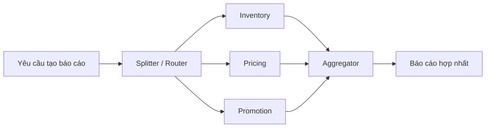
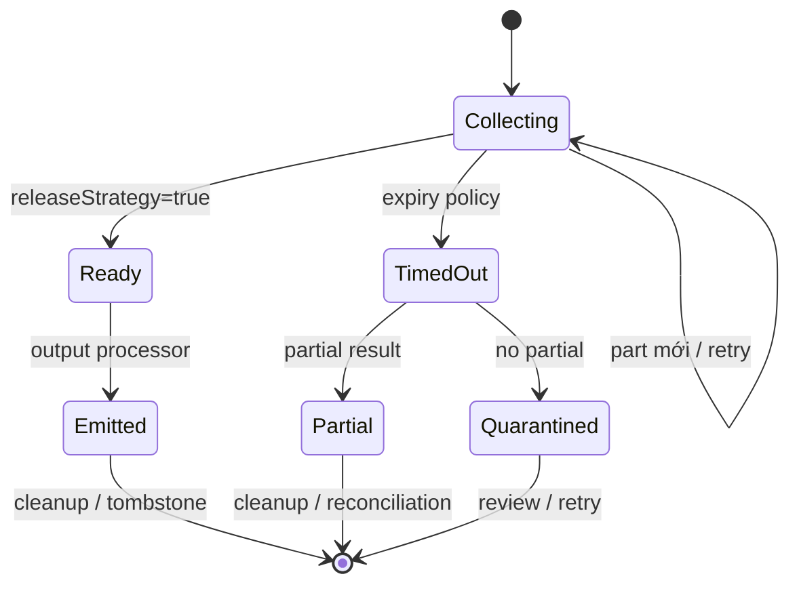
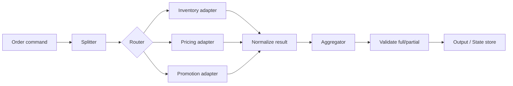
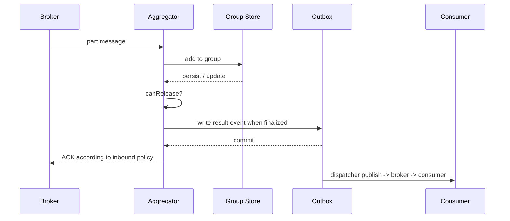
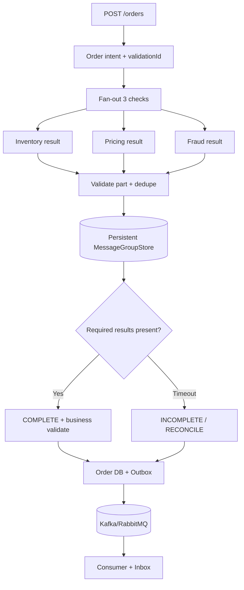

# Release strategy, timeout và nhóm thông điệp chưa hoàn tất

## 1. Vì sao một nhóm message có thể không hoàn tất?

Trong mô-đun **SPRING_BOOT_INTEGRATION**, Spring Boot tổ chức các luồng tích hợp qua HTTP client, cơ sở dữ liệu, Redis, broker thông điệp và adapter của Spring Integration. Một flow có thể **tách** một yêu cầu thành nhiều phần, xử lý song song rồi **gom** các kết quả qua Aggregator.



Trong happy path, ba nguồn trả ba kết quả; aggregator có đủ dữ liệu. Nhưng khi một nguồn không phản hồi, broker redeliver một message, HTTP timeout, service restart, hoặc message đến sau khi kết quả đã phát, ta phải biết **nhóm nào được xem là hoàn tất**, **khi nào ngừng chờ** và **xử lý thông tin thiếu thế nào**.

Ba khái niệm:

- **CorrelationStrategy**: xác định những messages nào cùng một logical group.
- **ReleaseStrategy**: trả lời khi nào group **đủ điều kiện phát output**.
- **Group timeout/expiry**: sau một khoảng chờ, nếu group chưa được release thì áp một chính sách: partial result, discard, quarantine hoặc recovery.

Chủ đề bài học **“Release strategy, timeout và nhóm thông điệp chưa hoàn tất”** thuộc chương **Định tuyến và biến đổi**, được trình bày với Java 17+, Spring Boot 3.x và Spring Integration 6.x. Các API và default behaviors có thể đổi theo phiên bản; kiểm thử trên stack thực tế là bắt buộc trước production.

Một release thành công **không** bảo đảm downstream DB đã commit, broker đã nhận output hoặc consumer đã xử lý. Nếu output vượt process boundary, phải tiếp tục thiết kế transaction, retry, idempotency và observability.

## 2. Message headers: correlation, sequence và business ID

`org.springframework.messaging.Message<T>` chứa payload và `MessageHeaders`. Aggregator thường sử dụng:

| Header / ID | Ý nghĩa | Ví dụ |
| --- | --- | --- |
| `MessageHeaders.CORRELATION_ID` | Khóa của group | `report:req-8021` |
| `MessageHeaders.SEQUENCE_NUMBER` | Thứ tự part trong chuỗi | 1, 2, 3 |
| `MessageHeaders.SEQUENCE_SIZE` | Số part dự kiến | 3 |
| `MessageHeaders.ID` | ID của Spring message instance | UUID |
| `partId` custom header | ID business của một part | `req-8021:pricing` |
| `source` custom header | Nguồn đóng góp kết quả | inventory/pricing/promotion |
| `tenantId` | Phạm vi tenant đã xác minh | tenant-17 |
| `traceparent` | Trace context | W3C trace metadata |

Ví dụ tạo message:

```java
import org.springframework.messaging.Message;
import org.springframework.integration.support.MessageBuilder;

Message<String> inventory = MessageBuilder
    .withPayload("inventory-ok")
    .setCorrelationId("report:req-8021")
    .setSequenceNumber(1)
    .setSequenceSize(3)
    .setHeader("partId", "req-8021:inventory")
    .setHeader("source", "inventory")
    .build();
```

Pricing và Promotion phải dùng **cùng correlation ID**, các sequence numbers khác nhau và một group contract cùng `sequenceSize`. Splitter của Spring Integration có thể tạo các sequence headers tự động, nhưng **không phải mọi broker/HTTP adapter đều phát sẵn metadata đúng**.

### 2.1. Correlation key không được trộn tenants

Nếu hai tenants có cùng request ID nhưng group key chỉ là request ID, aggregator có thể trộn dữ liệu. Tạo stable group ID gắn với owner/tenant, không nhận raw header `tenantId` từ caller không xác thực. Correlation ID khác trace ID và khác business event ID.

### 2.2. Duplicate có thể có MessageHeaders.ID khác

Broker redelivery có thể tạo một Spring Message mới với UUID mới, dù đó là **cùng logical part**. Dedupe theo `MessageHeaders.ID` không đủ để chống tính trùng một nguồn. Sử dụng `partId`/event ID ổn định và unique key tại nơi cần durability.

## 3. Vòng đời MessageGroup và trạng thái chưa hoàn tất

Aggregator dùng `MessageGroupStore` để gom messages theo correlation key:

1. Nhận message từ input channel.
2. Xác định group key.
3. Lấy hoặc tạo group trong store, áp lock/concurrency policy.
4. Thêm message vào group.
5. Đánh giá `ReleaseStrategy.canRelease(group)`.
6. Nếu đủ, output processor hợp nhất thành một message/result.
7. Chuyển output đến downstream và dọn trạng thái theo expiry policy.
8. Nếu chưa đủ, đợi message mới hoặc timeout/reaper.



Sơ đồ là business model khái niệm, **không phải enum nội bộ**. Group có thể được giữ dưới dạng empty group hoặc metadata sau release để phát hiện late messages theo cấu hình; tránh khẳng định việc release luôn xóa hoàn toàn mọi dấu vết của group.

### 3.1. Dừng chờ không có nghĩa là “đủ dữ liệu”

Nếu request cần `inventory`, `pricing` và `promotion` nhưng chỉ có hai source, việc group timeout kích hoạt xử lý chỉ kết luận **không chờ thêm nữa theo policy**. Kết quả không thể tự được gắn `complete=true`.

### 3.2. Mối liên hệ với routing và transformation

Một `Router` chọn channel/worker đích; một `Transformer` đổi payload/headers; `Splitter` tạo parts; `Aggregator` ghép parts. Nếu router bỏ một message, transformer làm mất header hoặc filter loại một part mà không cập nhật expected count, aggregator sẽ kẹt. Vì vậy lỗi incomplete group thường bắt nguồn từ **hợp đồng của toàn flow**, không chỉ từ aggregator.

## 4. ReleaseStrategy và mặc định dựa trên sequence

Spring Integration định nghĩa `ReleaseStrategy`:

```java
package org.springframework.integration.aggregator;

public interface ReleaseStrategy {
    boolean canRelease(
        org.springframework.integration.store.MessageGroup group
    );
}
```

Phần trên minh họa chữ ký API, không phải class cần tự triển khai lại. Một `ReleaseStrategy` nên **nhanh, deterministic và không có side effects**. Framework có thể đánh giá group nhiều lần; nếu strategy tự gọi HTTP hoặc cập nhật DB, kết quả phụ thuộc trạng thái ngoài có thể không ổn định.

### 4.1. SequenceSizeReleaseStrategy

Aggregator mặc định thường dựa vào `SequenceSizeReleaseStrategy` và sequence headers do Splitter tạo. Khi nhận đủ chuỗi theo `SEQUENCE_SIZE`, group được xem là sẵn sàng.

```text
correlationId = report:req-8021
  inventory: sequenceNumber=1, sequenceSize=3
  pricing:   sequenceNumber=2, sequenceSize=3
  promotion: sequenceNumber=3, sequenceSize=3

=> release theo hợp đồng 3 parts
```

**Không mặc định** một group có ba messages tương đương đủ ba business sources: nếu duplicate Pricing tới hai lần và Promotion không tới, `group.size()` có thể là 3 nhưng dữ liệu vẫn thiếu. Xác minh version cụ thể của default sequence strategy về duplicate sequences, đồng thời dùng business `partId` và validation.

Một default strategy cũng không thể cứu một upstream gửi `sequenceSize=3` nhưng chỉ phát hai parts. Đó là lỗi contract upstream; timeout chỉ giúp nhóm được xử lý sau khi chờ quá lâu.

### 4.2. Tự định nghĩa điều kiện release

Ví dụ chỉ release khi đủ đúng ba nguồn:

```java
package example.integration.report;

import java.util.Set;
import java.util.stream.Collectors;

import org.springframework.integration.aggregator.ReleaseStrategy;
import org.springframework.messaging.Message;

public final class RequiredSourcesReleaseStrategy
        implements ReleaseStrategy {

    private static final Set<String> REQUIRED =
        Set.of("inventory", "pricing", "promotion");

    @Override
    public boolean canRelease(
            org.springframework.integration.store.MessageGroup group) {

        Set<String> present = group.getMessages().stream()
            .map(Message::getHeaders)
            .map(h -> h.get("source", String.class))
            .filter(source -> source != null)
            .collect(Collectors.toSet());

        return present.containsAll(REQUIRED);
    }
}
```

Strategy này dùng **tập source** thay vì chỉ đếm messages nên ít nhạy với duplicate source, nhưng không tự đảm bảo payload hợp lệ hoặc nguồn đã được xác thực. Input phải được validate; processor cuối còn phải kiểm tra dữ liệu đúng semantic contract.

## 5. Count, quorum, completion marker và hybrid strategies

| Release strategy | Điều kiện | Khi nào phù hợp | Cạm bẫy |
| --- | --- | --- | --- |
| Sequence size | Đủ chuỗi theo metadata | Splitter–aggregator chuẩn | Thiếu/sai headers |
| Count threshold | `group.size() >= N` | Parts có uniqueness bảo đảm | Duplicate làm đủ sớm |
| Required sources | Đủ tập source ID | Fan-out API theo nguồn | Source giả hoặc payload invalid |
| Quorum | Đủ K/N nguồn tin cậy | Một số decision workflows | Nguồn bắt buộc vẫn có thể thiếu |
| Completion marker | `endOfBatch=true` đã tới | Producer có boundary rõ | Marker có thể đến trước data |
| Content predicate | Payload đáp ứng rule | Domain aggregation chuyên biệt | Strategy thành business service phức tạp |
| Timeout-driven | Hết cửa sổ chờ | Analytics best-effort | Không tự đảm bảo completeness |
| Hybrid | Đủ part **hoặc** timeout | Bounded waiting | Phải phân biệt FULL/PARTIAL |

Count-based lambda:

```java
ReleaseStrategy afterThree =
    group -> group.size() >= 3;
```

Dùng chỉ khi các messages đã có policy chống trùng hoặc việc tính trùng không thay đổi business outcome.

### 5.1. Quorum phải có invariant rõ

Một risk assessment có thể chấp nhận ít nhất 2 trong 3 tín hiệu, **nhưng** vẫn bắt buộc tín hiệu compliance. Khi đó release condition là `compliancePresent && distinctTrustedSources >= 2`, không phải `group.size() >= 2`.

### 5.2. Completion marker cần ordering contract

Marker `endOfBatch` đi qua nhiều Kafka partitions hoặc nhiều queues có thể đến **trước** data messages. Khi ấy release ngay theo marker là sai. Producer phải dùng sequence IDs, watermark hoặc protocol đủ sức chứng minh đã phát và đã nhận đủ các parts cần thiết.

### 5.3. Không gọi external service trong canRelease()

Vì ReleaseStrategy có thể chạy khi message đến và khi state được quét, đừng để nó gọi database khác, RestClient hoặc một Redis service không có timeout. Đưa thông tin cần thiết vào validated group contract và giữ strategy rẻ/deterministic.

## 6. Output processor: giải thích đầy đủ hay một phần

Khi release strategy cho phép xuất, **MessageGroupProcessor** biến group thành một output message/payload. Nó không chỉ nối chuỗi. Nếu output là report, nên chứa **completeness metadata**.

```java
package example.integration.report;

import java.time.Instant;
import java.util.Map;
import java.util.Set;

public record ReportAggregate(
    String reportId,
    boolean complete,
    Set<String> missingSources,
    Map<String, Object> results,
    String completionReason,
    Instant emittedAt
) {}
```

Một processor production phải:

- Xác minh các parts thuộc cùng request và tenant.
- Kiểm tra schema/version của mỗi payload.
- Dedupe theo stable business `partId` hoặc source key.
- Xác định nguồn nào bắt buộc, nguồn nào optional.
- Khi incomplete, gắn `complete=false` và `missingSources`.
- Không lấy một value mặc định như zero cho nguồn thiếu nếu business không cho phép.
- Không coi `List<Message<?>>` có thứ tự ổn định khi chưa sort theo sequence.

Ví dụ sắp thứ tự:

```java
import java.util.Comparator;
import java.util.List;
import org.springframework.messaging.Message;
import org.springframework.messaging.MessageHeaders;

List<Message<?>> ordered = group.getMessages().stream()
    .sorted(Comparator.comparingInt(message ->
        message.getHeaders().get(
            MessageHeaders.SEQUENCE_NUMBER,
            Integer.class
        )
    ))
    .toList();
```

Snippet giả định mọi message có `SEQUENCE_NUMBER` hợp lệ. Với dữ liệu không tin cậy, validate trước khi sort, nếu không missing/null sẽ gây lỗi và nhóm có thể mắc kẹt trong quá trình release.

## 7. Timeout của group: dừng chờ có kiểm soát

Spring Integration aggregator DSL có cấu hình `groupTimeout` và `sendPartialResultOnExpiry`:

```java
.aggregate(spec -> spec
    .groupTimeout(5_000L)
    .sendPartialResultOnExpiry(true)
)
```

Đây là đoạn nằm trong cấu hình `IntegrationFlow`. Ý nghĩa là nếu một group chưa đủ điều kiện release sau ngưỡng thời gian được framework đánh giá, một expiry action sẽ được kích hoạt.

| Timeout | Giới hạn cái gì? | Không thay thế |
| --- | --- | --- |
| HTTP response timeout | Chờ dịch vụ downstream | Group expiry |
| Broker retry delay | Khoảng cách giữa attempts | Business deadline |
| Group timeout | Thời gian chờ parts | SLA end-to-end |
| Message TTL | Đời sống message trong broker/store | Group decision |
| Store reaper interval | Chu kỳ kiểm tra nhóm cũ | Đồng hồ real-time chính xác |
| Database transaction timeout | Local transaction duration | HTTP/broker timeout |
| Business request deadline | Thời điểm phải kết luận một request | Cleanup của group store |

**Group timeout không bảo đảm chạy đúng millisecond:** scheduler load, JVM pause, store I/O và locks có thể làm trễ. Và cách đặt lại timer/hạn bắt đầu đếm có thể phụ thuộc `groupTimeoutExpression` cùng version/configuration; **không tự coi timeout là hard deadline tính từ message đầu tiên**. Với nghiệp vụ cần deadline tuyệt đối, lưu `requestedAt/deadlineAt` trong durable job state rồi kiểm tra ở bước commit result.

### 7.1. Ví dụ kết quả một phần

```json
{
  "reportId": "report:req-8021",
  "status": "PARTIAL",
  "receivedSources": ["inventory", "pricing"],
  "missingSources": ["promotion"],
  "completionReason": "GROUP_TIMEOUT",
  "emittedAt": "2026-11-21T04:00:05Z"
}
```

Report như vậy có thể chấp nhận với dashboard, nhưng **không được** biến thành `OrderCompleted` nếu đang chờ `PaymentCaptured`. Với payment/inventory workflows, một result `UNKNOWN/RECONCILIATION_REQUIRED` an toàn hơn output “thành công” giả.

### 7.2. Group timeout không phải countLimit

Nếu upstream có `sequenceSize=5` nhưng chỉ nhận 4, việc giảm timeout không sửa được lý do part thứ năm thiếu. Timeout policy chỉ quyết định cách xử lý nhóm chưa đầy đủ; producer contract và message delivery phải được điều tra riêng.

## 8. Chính sách xử lý nhóm chưa đủ

| Chính sách | Phù hợp | Yêu cầu kèm theo |
| --- | --- | --- |
| Emit partial | Analytics/báo cáo best-effort | Explicit status + missingParts |
| Discard | Group không còn giá trị | Error/expired event, không silent success |
| Quarantine | Payload sai/nguồn không tin | Durable record + operator review |
| Retain và chờ tiếp | Workflow lâu dài | Durable store + quota + retention |
| Compensate | Saga có side effect đã chạy | State machine, idempotent compensation |
| Escalate | Quyết định high-risk | Alert, manual case, audit |

**Lỗi phổ biến:** cấu hình `sendPartialResultOnExpiry(true)` nhưng output processor luôn trả `complete=true`. Framework làm đúng cấu hình, còn business logic tạo sai nghĩa kết quả.

Khi chọn không phát partial, nhóm bị expired vẫn cần **visibility** (metrics, logs, job state, discard channel hoặc event). Nếu không có gì được phát, HTTP caller khó phân biệt “không có yêu cầu” và “mất một phần dữ liệu”.

## 9. Vì sao một MessageGroup bị kẹt?

Một group chờ quá lâu thường là **triệu chứng của vấn đề ở upstream**, chứ không nhất thiết do aggregator bị hỏng.

| Nguyên nhân | Triệu chứng | Hướng điều tra |
| --- | --- | --- |
| Splitter tạo ít parts hơn `SEQUENCE_SIZE` | Nhóm luôn thiếu một part | So producer count/sequence headers |
| Router gửi một part sang nhầm channel | Group thiếu source cố định | Kiểm tra routing decision và channel mapping |
| Filter loại message | Có output từ source nhưng aggregator không nhận | Kiểm tra filter discard channel và business policy |
| Transformer làm mất correlation header | Parts bị chia thành nhiều groups | Kiểm tra header propagation |
| Consumer lỗi và message vào DLQ | Một part không tới aggregator | DLQ, retry policy, ack order |
| HTTP timeout | Một source không tạo response part | Timeout/error flow và fallback contract |
| Đổi correlation algorithm sau deploy | Old/new messages vào nhóm khác nhau | Version/migration group key |
| Sequence numbers trùng hoặc mất | Release strategy không đủ điều kiện | Validate producer metadata |
| Consumer nhận duplicate | Group size sai nếu count-based | Stable partId và dedupe |
| MessageGroupStore lỗi | Group bị mất/không cập nhật | Store exception, durability, connection |
| TaskScheduler/expiry không chạy | Group tồn tại mãi dù đã hết hạn | Scheduler config, thread pool, logs |
| Quá nhiều groups cùng chờ | Memory/pool/store cạn | Metrics, quotas, backpressure |

### 9.1. Hai trường hợp “thiếu message” khác nhau

**Trường hợp A — Source chưa từng phát:** Promotion Service timeout và workflow chưa sinh `promotionResult`. Việc replay queue không tạo được part chưa từng tồn tại. Cần retry upstream hoặc explicit failure part.

**Trường hợp B — Source đã phát nhưng chưa đến aggregator:** Message đang ở broker ready/unacked, bị định tuyến sai, hoặc consumer đang retry. Cần kiểm tra transport delivery, queue/DLQ, consumer group offsets và routing keys.

Cùng một group chỉ có 2/3 parts, nhưng recovery khác nhau. Quan sát theo source/part ID và progress mới giúp chọn hướng xử lý.

### 9.2. Một cách tránh kẹt: phát failure result có contract

Nếu một source đã thất bại vĩnh viễn, thay vì im lặng không phát gì, worker có thể phát một **typed part**:

```json
{
  "reportId": "report:req-8021",
  "partId": "req-8021:promotion",
  "source": "promotion",
  "outcome": "FAILED",
  "errorCode": "PROMOTION_PROVIDER_UNAVAILABLE"
}
```

Aggregator có thể nhận đủ ba **terminal outcomes** nhưng business result là `FAILED/PARTIAL`. Điều này làm rõ rằng “mọi nhánh đã kết thúc” **khác** “mọi nhánh đã thành công”.

Nhớ rằng thông điệp lỗi cũng cần event ID, auth/schema/version và dedupe. Nếu failure có thể hồi phục, workflow phải xác định việc gửi lại success result sau failure có được phép hay không.

## 10. Message đến muộn: late arrivals sau release hoặc timeout

Giả sử group có correlation `report:req-8021`, deadline là 10 giây:

```text
t=0.0s  inventory đến
t=0.5s  pricing đến
t=10s   group timeout -> PARTIAL
t=10.3s promotion đến muộn
```

Bây giờ xử lý Promotion thế nào? Các lựa chọn:

1. **Discard/quarantine late part:** giữ snapshot partial là kết quả cuối, ghi audit.
2. **Correction event:** phát `ReportCorrected(version=2)`, cập nhật result khi được phép.
3. **Reopen group:** chỉ nếu contract hỗ trợ, có durable state/version và policy rõ.
4. **Delay finalization:** nếu thời gian cho phép, giữ một grace period, nhưng vẫn cần hard deadline.
5. **Manual review:** với business decisions quan trọng.

### 10.1. expireGroupsUponCompletion cần được hiểu như policy

Spring Integration có cấu hình `expireGroupsUponCompletion(...)`. Khi group đã release, framework có thể xóa group state, hoặc giữ metadata/empty group theo cấu hình/phiên bản nhằm phát hiện messages đến muộn.

Nếu **xóa hoàn toàn group sau release**, một late message với cùng correlation key có thể tạo **một nhóm mới**. Nhóm “zombie” này có thể chờ tới timeout, hoặc thậm chí phát output lần hai nếu release condition sai.

Nếu giữ group metadata để hạn chế late arrivals, lại cần retention/cleanup và tránh store phình to. Không mặc định metadata đó là một **durable tombstone** được chia sẻ giữa mọi workers và mọi lần restart; kiểm thử implementation.

### 10.2. Tombstone/application registry cho kết quả quan trọng

Với workflow không được phép phát trùng:

```text
aggregation_registry
  group_key        = tenant-17:report:req-8021
  status           = COMPLETE | PARTIAL | FAILED
  result_version   = 1
  emitted_at       = 2026-11-21T04:00:10Z
  expires_at       = 2026-11-28T04:00:10Z
```

Khi late part tới, handler tra trạng thái bền vững và quyết định discard/correction theo policy. Dùng unique key/conditional update để không có hai instances cùng phát version giống nhau. Registry có thể là SQL/MongoDB table/collection, còn event publish theo outbox.

**Tombstone lifetime** phải dài ít nhất theo window của redelivery/replay/business reconciliation được công bố. Quá ngắn, late message sau hết retention có thể tạo side effect lần hai.

### 10.3. Race giữa last part và timeout

Một thread thêm part cuối đúng lúc scheduler expire group. Không thể dựa vào millisecond logging để kết luận tự động ai thắng; kết quả phụ thuộc locks, state transitions, scheduling và transaction.

Một ứng dụng yêu cầu đúng một final result nên dùng:
- Atomic state transition (PENDING → COMPLETE/PARTIAL) theo group key.
- Output event ID và result version ổn định.
- Durable outbox để publish sau commit.
- Dedupe ở consumer theo aggregate result ID/version.
- Test race trên store/lock thực, không chỉ unit test release lambda.

## 11. Lưu trạng thái nhóm: SimpleMessageStore hay persistent store?

`MessageGroupStore` quyết định messages đã nhận được giữ ở đâu. Một aggregator nhận 2/3 parts cần có chỗ lưu trước khi nhận part cuối.

| Store | Ưu điểm | Rủi ro/giới hạn |
| --- | --- | --- |
| `SimpleMessageStore` | Đơn giản, trong memory | Mất group khi JVM restart; không chia sẻ giữa nodes |
| `JdbcMessageStore` | Durable DB-backed message groups | Schema, index, transactions, serialization và contention |
| `RedisMessageStore` | State chia sẻ ở Redis theo hỗ trợ adapter | Durability/eviction/TTL, atomicity, network |
| `MongoDbMessageStore` | Lưu group trong MongoDB | Schema/index, transaction/locking, driver semantics |
| Custom `MessageGroupStore` | Thiết kế riêng theo workflow | Phải tự kiểm soát concurrency/cleanup/serialization |

Tên implementation và yêu cầu dependency/config cần đối chiếu Spring Integration version và module cụ thể. Một persistent store **không mặc nhiên** bảo đảm mọi transaction giữa input broker, store và output broker cùng commit.

### 11.1. In-memory store cho môi trường đơn giản

```java
import org.springframework.context.annotation.Bean;
import org.springframework.integration.store.MessageGroupStore;
import org.springframework.integration.store.SimpleMessageStore;

@Bean
MessageGroupStore reportMessageStore() {
    return new SimpleMessageStore();
}
```

Dùng tốt cho prototype hoặc test, nhưng nếu node chết trước đủ parts, group bị mất. Với HTTP retry hoặc Kafka replay, phải xem có cách tạo lại toàn bộ group hay không. Nhiều replicas với mỗi node một `SimpleMessageStore` dễ chia group thành các mảnh khác nhau khi load-balancing không giữ group affinity.

### 11.2. Persistent store và schema/version

Khi chuyển từ memory sang JDBC/Redis/MongoDB, câu hỏi không chỉ là “lưu ở đâu”:

- Mỗi message object có serialize/deserialize ổn định không?
- Java class names/type headers có làm group cũ không đọc được sau deploy?
- Group timeout metadata có được lưu/khôi phục đúng không?
- Expiry/reaper và transaction manager dùng cùng store semantics không?
- Có indexing theo group key/last modified/expiry để không scan quá rộng không?
- Khi database unavailable, inbound message được NACK/retry hay bị ACK rồi mất?
- Khi một instance crash, node khác có resume group không?
- Có cơ chế lock phân tán để tránh hai nodes release cùng group?

**Redis không đồng nghĩa durable** nếu eviction/persistence policy có thể làm mất state. Với thông điệp mang tính tài chính, store durability phải được xác minh theo topology, backup/restore và contract, không dựa vào tên Redis.

### 11.3. Bản ghi payload cũ có thể không deserialize sau upgrade

Nếu group store giữ serialized Java Message payload v1, sau deploy class v2 đổi package hoặc xóa field, state cũ có thể đọc lỗi. Chọn schema/version có lifecycle riêng và test rolling deployments khi nhóm có thể tồn tại lâu. Không lưu raw JPA entities/lazy proxies vào group store.

## 12. MessageGroupStoreReaper và groupTimeout khác nhau ở đâu?

Spring Integration có `MessageGroupStoreReaper` để giúp quản lý những groups tồn đọng trong store. Tùy cấu hình, reaper quét nhóm đã quá hạn và kích hoạt expiry logic/cleanup theo cơ chế được framework hỗ trợ.

**Khác biệt khái niệm:**

- `groupTimeout` trên aggregator thường giúp scheduling expiry cho những groups đang được aggregator quản lý.
- `MessageGroupStoreReaper` là cơ chế quét store để tìm groups cũ theo timeout/age policy, hữu ích khi cần cleanup/resume.
- Cả hai **không phải hai đồng hồ luôn giống nhau**. Cách xác định tuổi nhóm, lịch quét và callback xử lý expired groups có thể khác.
- Nếu cấu hình cả hai trên cùng store mà không có thiết kế, chúng có thể cạnh tranh xử lý expiry, tạo partial output lặp hoặc race.

### 12.1. Những quyết định khi vận hành reaper

1. **Quét group nào?** Chỉ các group của aggregator này hay cả nhóm của các endpoints khác cùng dùng store?
2. **Bao nhiêu lâu quét?** Mỗi vài giây/phút tùy SLA, số lượng groups và store load.
3. **Age reference là gì?** Last modification, creation time hay business deadline?
4. **Expiry action:** partial output, discard hoặc đánh dấu job failed?
5. **Cluster leadership/lock:** node nào thực hiện reaping, nhiều nodes có tranh chấp không?
6. **Retention:** incomplete group giữ bao lâu để audit/replay?
7. **Khôi phục:** nếu reaper chết giữa chừng, scan sau có tiếp tục an toàn không?

Nếu chỉ cần cleanup dữ liệu cũ, một cron job xóa group store entries **mà không phát kết quả/ghi trạng thái business** có thể làm mất yêu cầu khách hàng đang chờ. Hãy định nghĩa expiry như một state transition có kết quả rõ, không chỉ delete storage row.

### 12.2. Ví dụ cấu hình khái niệm

```text
Aggregator:
  groupTimeout = 10 s
  partialOnExpiry = true
  MessageGroupStore = persistent

Reaper:
  scan interval = 1 min
  expiry policy = explicit
  lock/leadership = defined
  no duplicate final emission
```

Đây là *sơ đồ cấu hình*, không phải YAML properties được Spring Boot tự hiểu. Việc khởi tạo bean reaper, scheduler và store cần dùng API đúng phiên bản, rồi test nhóm tồn tại khi restart. Không để một reaper vô tình xử lý groups của flow không sở hữu.

## 13. Đa instance, group locks và concurrency

Một Spring Boot service có thể chạy nhiều replicas cùng consume các parts có cùng correlation ID. Ví dụ:

```text
part #1 -> instance A
part #2 -> instance B
part #3 -> instance A
```

Nếu mỗi node có memory store riêng, A chỉ thấy #1/#3, B chỉ thấy #2: không node nào đủ group. Một shared store là điều kiện cần khi muốn group được chia sẻ; **vẫn cần concurrency coordination**.

### 13.1. Race khi hai nodes nhận parts đồng thời

Giả sử A và B đều:

1. Đọc group 2 parts.
2. Cùng thêm part mới.
3. Cùng kiểm tra release.
4. Cùng phát output.

Nếu store/lock/update protocol không đảm bảo đúng, một nhóm có thể có state bị ghi đè hoặc output trùng. Spring Integration hỗ trợ các cơ chế `LockRegistry`/lock theo correlation key, có thể cần `JdbcLockRegistry`, Redis lock registry hoặc một giải pháp phân tán phù hợp.

**Không coi `DefaultLockRegistry` trong JVM là distributed lock cho toàn cluster.** Nó chỉ phối hợp trong phạm vi process nếu dùng implementation in-memory. Với nhiều instances, cần lock registry/durable state và test race cụ thể.

### 13.2. Kết nối transaction manager và group store

Nếu group store nằm trong PostgreSQL, một DB transaction có thể bảo vệ các thao tác cập nhật group theo cách store hỗ trợ. Nhưng output publish sang broker là bước khác. Một message có thể được ACK upstream trước khi output được persist/delivered nếu flow/transaction boundary không được thiết kế phù hợp.

Với reliability cao, một phương án là:
- Durable incoming event/part ID để dedupe.
- Durable group state, atomic finalization theo group key.
- Outbox event cho result release.
- Producer retry + publisher confirms.
- Consumer inbox để chống xử lý trùng result.

Đừng dùng `@Transactional` và assume tất cả JDBC store + Kafka + RabbitMQ có chung atomic commit.

### 13.3. Group affinity là một tối ưu, không phải thay thế durability

Kafka partition theo group key có thể đưa phần lớn messages của cùng key tới một consumer instance trong cùng group tại một thời điểm, giảm concurrency contention. Nhưng rebalance/restart khiến owner đổi; durable state và idempotency vẫn cần. RabbitMQ nhiều queues/consumers cũng không tự bảo đảm tất cả parts cùng node nếu routing không chủ đích.

## 14. Duplicate, out-of-order và missing parts: phân biệt rõ

| Sự kiện | Dấu hiệu | Cách xử lý |
| --- | --- | --- |
| Duplicate logical part | Cùng `partId`/source xuất hiện nhiều lần | Inbox/unique key hoặc dedupe policy |
| Out-of-order | Sequence #3 đến trước #1 | Không dựa vào arrival order |
| Missing part | Sequence #2 không bao giờ tới | Timeout + recovery |
| Conflicting duplicates | Cùng `partId` nhưng payload khác | Quarantine/version conflict, không chọn ngẫu nhiên |
| Late part | Đến sau finalization | Tombstone/correction policy |
| Mis-correlated part | Tenant/request khác vào cùng group | Validate group key và reject |
| Invalid sequence | Number âm/lớn hơn size, size không nhất quán | Fail contract, không wait mãi |
| Unknown schema | Consumer không deserialize | DLQ/compatibility path |
| Unroutable output | Aggregator release nhưng outbound route sai | Error/return handling + outbox |

### 14.1. Không dùng số lượng message như một bằng chứng uniqueness

Một trong các rủi ro lớn nhất của count-based release là duplicate delivery:

```text
Expected sources: Inventory, Pricing, Promotion
Messages arrived:
  Inventory  (partId=i-1)
  Pricing    (partId=p-1)
  Pricing    (partId=p-1)  <- duplicate
Count = 3, distinct source count = 2
```

ReleaseStrategy `group.size() >= 3` có thể cho phép release sai. Count phải gắn với **business unit** thay vì transport delivery. Tùy message store, duplicate Spring message ID có thể được xử lý khác nhau, nhưng broker event được tái tạo thành message mới vẫn cần stable dedupe.

### 14.2. Sorting chỉ giải quyết thứ tự, không khôi phục part mất

Sort theo `SEQUENCE_NUMBER` cho một list nhận được không làm source #2 tự xuất hiện. Nếu downstream cần đủ chuỗi, strategy vẫn phải kiểm tra tập sequence IDs, expected size và payload validity.

### 14.3. Unbounded streams cần chia window/group có giới hạn

Một stream Kafka không có end marker hoặc expected count mà aggregator chờ vô hạn sẽ tích lũy không giới hạn. Định nghĩa **window (event time/processing time)**, business session, batch ID, watermark hoặc completion protocol. Với window theo event time, cần clock skew/late event policy; `groupTimeout` thông thường không tự là event-time watermark.

## 15. Timeout policy khi dùng dữ liệu event-time

Có hai loại thời gian:

- **Processing time:** thời điểm message thực sự tới instance/aggregator.
- **Event time:** thời điểm sự kiện xảy ra tại producer (ví dụ `occurredAt`).

Một message có `occurredAt=10:00` có thể tới lúc 10:02 vì broker lag. Nếu group timeout tính theo processing activity, nó không nói rằng các events của minute 10:00 đã đầy đủ.

```text
Event-time window: 10:00:00 – 10:00:59
  e1 occurred 10:00:10, arrived 10:00:11
  e2 occurred 10:00:30, arrived 10:02:00
  e3 occurred 10:00:50, arrived 10:00:51
```

Nếu cần aggregation theo event-time, ứng dụng phải thiết kế **watermark/allowed lateness** hoặc chọn stream processing engine hỗ trợ những semantics đó. Spring Integration aggregator theo correlation group/timeout có thể thực hiện một số use cases, nhưng không tự cung cấp đầy đủ event-time window guarantees khi producer clocks và delivery không đồng nhất.

### 15.1. Chọn policy theo mục đích nghiệp vụ

| Mục tiêu | Tín hiệu hoàn tất phù hợp |
| --- | --- |
| Báo cáo trên request đã fan-out tới 3 HTTP APIs | Đủ source outcomes hoặc deadline |
| Batch import có manifest 500 records | Đếm đúng 500 distinct record IDs |
| File complete đã có checksum | Completion marker + checksum |
| Fraud quorum | Mandatory signals + minimum distinct sources |
| Time-window analytics | Watermark/window + allowed lateness |
| Payment saga | Explicit state machine, không chỉ timeout aggregator |
| Order fulfillment | Business milestones/event IDs, reconciliation |

**Không “chọn 10 giây” chỉ vì test chạy nhanh.** Tính từ SLO, p99/p99.9 latency của các nguồn, retry budget, broker lag và chi phí giữ group state.

## 16. Routing, filtering, transformation ảnh hưởng trực tiếp release

Trong chương **Định tuyến và biến đổi**, Aggregator không đứng độc lập. Một Router/Transformer/Filter trước aggregator có thể quyết định có bao nhiêu messages sẽ tồn tại.



### 16.1. Filter discard phải được tính trong expectedParts

Giả sử splitter tạo 3 parts và `sequenceSize=3`, nhưng filter bỏ Promotion vì order không áp dụng khuyến mãi. Nếu `sequenceSize` vẫn là 3, default aggregator có thể đợi mãi. Giải pháp:
- Tính danh sách expected sources **trước** khi phát/split.
- Hoặc phát một `SKIPPED` terminal outcome cho Promotion nếu contract xem đó là một part.
- Hoặc dùng ReleaseStrategy dựa trên dynamic expected sources/manifest đã validate.
- Không tự tăng count bằng duplicate để làm đủ size.

### 16.2. Transformer không được làm mất metadata quan trọng

Nếu transform từ `Message<PartnerResponse>` thành một object payload mới, cần bảo toàn/đặt lại correlation, sequence, source/partId theo chủ đích. Dùng message builder từ original message khi phù hợp:

```java
import org.springframework.integration.support.MessageBuilder;
import org.springframework.messaging.Message;

Message<NormalizedPart> normalized = MessageBuilder
    .withPayload(normalize(original.getPayload()))
    .copyHeadersIfAbsent(original.getHeaders())
    .setHeader("schemaVersion", 1)
    .build();
```

`original` là `Message<PartnerResponse>` và `normalize` trả `NormalizedPart` do ứng dụng định nghĩa. **Không copy toàn bộ untrusted headers** từ external boundary vào mọi downstream; allowlist correlation/sequence/tenant data đã xác minh. `copyHeadersIfAbsent` minh họa việc giữ metadata trong nội bộ một trusted flow, không thay security filtering.

### 16.3. Router cần explicit default route hoặc failure

Một message không match route có thể bị reject, bị gửi default channel hoặc mất tùy cấu hình. Nếu aggregator đang chờ part đó, thiếu route phải trở thành một **error signal có thể quan sát**, không silent disappearance.

## 17. Ví dụ DSL: aggregator chờ đủ nguồn hoặc phát partial lúc timeout

Một `IntegrationFlow` có thể sử dụng release strategy tường minh:

```java
package example.integration.report;

import org.springframework.context.annotation.Bean;
import org.springframework.context.annotation.Configuration;
import org.springframework.integration.dsl.IntegrationFlow;
import org.springframework.integration.store.MessageGroupStore;

@Configuration
class ReportAggregationConfiguration {

    @Bean
    IntegrationFlow reportAggregationFlow(
            MessageGroupStore reportMessageStore,
            RequiredSourcesReleaseStrategy releaseStrategy) {

        return IntegrationFlow
            .from("reportPartsInput")
            .aggregate(spec -> spec
                .correlationStrategy(message -> {
                    String tenant = message.getHeaders()
                        .get("tenantId", String.class);
                    String report = message.getHeaders()
                        .get("reportId", String.class);

                    if (tenant == null || report == null) {
                        throw new IllegalArgumentException(
                            "Missing group identity"
                        );
                    }

                    return tenant + ":" + report;
                })
                .releaseStrategy(releaseStrategy)
                .messageStore(reportMessageStore)
                .groupTimeout(10_000L)
                .sendPartialResultOnExpiry(true)
                .expireGroupsUponCompletion(true)
            )
            .channel("reportAggregationOutput")
            .get();
    }

    @Bean
    RequiredSourcesReleaseStrategy releaseStrategy() {
        return new RequiredSourcesReleaseStrategy();
    }
}
```

**Lưu ý code:** đây là một cấu hình DSL minh họa Spring Integration 6.x. `reportMessageStore` là bean được inject, có thể dùng `SimpleMessageStore` cho test và persistent store cho production. Output mặc định của aggregator phải được consumer xử lý đúng với loại payload mà aggregator tạo; nếu cần domain DTO `ReportAggregate` có partial flag, hãy thêm custom `MessageGroupProcessor`/transformer có validation.

### 17.1. Output processor phải biết partial hay full

Nếu dùng default output processor cho aggregator, output thường là một dạng collection/messages tổng hợp tùy configuration. Một downstream `Transformer` cần:

1. Lấy source/partId của từng member.
2. Dedupe/validate.
3. So sánh với expected sources của request.
4. Gắn `COMPLETE` hoặc `PARTIAL/TIMED_OUT` đúng business contract.
5. Thêm missing sources, event ID và finalization reason.
6. Chặn việc phát kết quả trùng qua durable result registry nếu quan trọng.

Không giả định chỉ cần `.sendPartialResultOnExpiry(true)` thì framework tự gắn `"status":"PARTIAL"` vào một Java DTO business.

### 17.2. Những điểm phải cấu hình/test riêng

- `TaskScheduler` để chạy group timeout và lifecycle của scheduler khi app restart.
- Message store và serialization có bền qua restart không.
- Group lock/lock registry khi nhiều consumers/nodes.
- `expireGroupsUponCompletion`/timeout retention và late arrivals.
- Output error/discard channel hoặc policy khi processor ném exception.
- Business result registry/idempotent outbox nếu output mang side effect.
- Group size/timeout quotas và metrics.

## 18. Domain output processor: chuyển MessageGroup thành kết quả có trạng thái

Thay vì để downstream tự diễn dịch một collection messages, ta có thể tạo một **MessageGroupProcessor** chuyên biệt. Nó giữ contract cho full/partial result và làm rõ nguồn nào thiếu.

Định nghĩa payload và result (hai `public record` dưới đây cần nằm ở hai tệp Java riêng `ReportPart.java` và `ReportResult.java` trong cùng package):

```java
package example.integration.report;

import java.util.Map;
import java.util.Set;

public record ReportPart(
    String reportId,
    String source,
    String value
) {}

public record ReportResult(
    String groupId,
    String status,
    Set<String> missingSources,
    Map<String, String> values
) {}
```

Processor:

```java
package example.integration.report;

import java.util.HashMap;
import java.util.HashSet;
import java.util.Map;
import java.util.Set;

import org.springframework.integration.aggregator.MessageGroupProcessor;
import org.springframework.integration.store.MessageGroup;
import org.springframework.messaging.Message;

public final class ReportGroupProcessor
        implements MessageGroupProcessor {

    private static final Set<String> REQUIRED =
        Set.of("inventory", "pricing", "promotion");

    @Override
    public Object processMessageGroup(MessageGroup group) {
        Map<String, String> values = new HashMap<>();

        for (Message<?> message : group.getMessages()) {
            if (!(message.getPayload() instanceof ReportPart part)) {
                throw new IllegalArgumentException(
                    "Unsupported report part payload"
                );
            }

            String source = part.source();
            if (!REQUIRED.contains(source)) {
                throw new IllegalArgumentException(
                    "Unexpected report source"
                );
            }

            if (part.value() == null) {
                throw new IllegalArgumentException(
                    "Missing report value"
                );
            }

            String previous =
                values.putIfAbsent(source, part.value());

            if (previous != null
                    && !previous.equals(part.value())) {
                throw new IllegalStateException(
                    "Conflicting duplicate report part"
                );
            }
        }

        Set<String> missing = new HashSet<>(REQUIRED);
        missing.removeAll(values.keySet());

        return new ReportResult(
            String.valueOf(group.getGroupId()),
            missing.isEmpty() ? "COMPLETE" : "PARTIAL",
            Set.copyOf(missing),
            Map.copyOf(values)
        );
    }
}
```

Ở đây một `source` đại diện cho đúng một logical part. Nếu cùng source có nhiều parts hợp lệ, phải đổi khóa uniqueness thành `partId`/sequence và mô hình `Map<String,List<...>>`. Logic trên đang reject unexpected source và conflicting duplicates thay vì chọn data tùy iteration order.

**Không khẳng định processor tự biết lý do timeout.** Nó có thể xác định `complete/partial` từ group members, nhưng không phải mọi partial group đều đến từ timeout (có thể admin/operator force release). Nếu cần `completionReason=GROUP_TIMEOUT/MANUAL_RELEASE`, phải cấp metadata/event riêng từ lifecycle handler/job state, hoặc cấu hình output path phân biệt các trường hợp.

### 18.1. Gắn processor vào aggregation flow

Trong DSL ở mục 17, bổ sung:

```java
.aggregate(spec -> spec
    .correlationStrategy(message ->
        message.getHeaders().get("reportId", String.class)
    )
    .releaseStrategy(new RequiredSourcesReleaseStrategy())
    .outputProcessor(new ReportGroupProcessor())
    .groupTimeout(10_000L)
    .sendPartialResultOnExpiry(true)
)
```

Snippet minh họa **một phương án cấu hình**, không đặt đồng thời với một `aggregate(...)` khác trong cùng flow. Correlation strategy rút gọn trên chỉ dùng reportId, phù hợp ví dụ single tenant; khi triển khai multi-tenant phải kết hợp identity đã xác thực như mục 2.

### 18.2. Không để lỗi output processor làm mất business context

Nếu processor ném exception do payload invalid, framework có thể đẩy vào error flow/exception path theo channel/endpoint configuration. Phải có **error-channel/quarantine policy**, không để group bị retry vô hạn mà không biết tại sao. Lỗi schema có thể permanent; lỗi store/network có thể transient. Những retries phải sử dụng cùng business event ID để tránh kết quả bị phát nhiều lần.

## 19. Transaction, acknowledgment và không phát trùng kết quả aggregate

Một aggregator có thể dùng JDBC store để ghi các parts, nhưng kết quả được gửi qua HTTP hoặc broker. Ví dụ:



Điểm quan trọng:

- Lưu group state xong không có nghĩa consumer được ACK nếu business contract còn yêu cầu durable finalization.
- Release strategy true không phải proof rằng broker nhận output.
- Nếu phát result vào broker rồi instance crash trước khi lưu trạng thái `RELEASED`, retry có thể phát result lần nữa.
- Nếu mark `RELEASED` trước khi publish rồi crash, output có thể bị mất.
- Cần **outbox/inbox**, idempotent result ID hoặc job state để thu hẹp các failure windows nếu outcome quan trọng.

### 19.1. ACK sau durable outcome

Một AMQP/Kafka inbound adapter có ack mode và lifecycle riêng. Với xử lý group:

- Nếu mỗi part được **persist bền vững vào group store**, có thể ACK part sau persistence theo policy được thiết kế.
- Nếu store chỉ là in-memory và inbound broker message bị ACK, instance crash có thể làm mất part không thể khôi phục.
- Khi group được release, output event cần một durable handoff riêng.
- Không giả định listener container tự chờ một reactive operation hoàn tất nếu handler tự `subscribe()` hoặc dispatch async.
- Cần xác định error channel, backoff, DLQ và ack/retry semantics theo transport/version thực tế.

### 19.2. Group finalization không tự atomic với broker

Một local transaction của `JdbcMessageStore` không thể bao trùm RabbitMQ/Kafka chỉ vì cùng Java method. Nếu dùng `@Transactional` quanh aggregator, hiểu transaction manager nào thực sự tham gia và kiểm tra behavior trong failure injection tests.

### 19.3. Result ID và version

Một result có thể đặt khóa:

```text
aggregateResultId = report:req-8021
resultVersion = 1
eventId = aggregate:report:req-8021:v1
```

Khi late part được phép sửa kết quả, phát `v2` với event ID khác nhưng cùng aggregate ID. Consumers có thể chỉ áp version mới hơn. Khi replay `v1`, dedupe theo event ID không gây side effect trùng. Nếu business không chấp nhận correction, phát event điều tra/quarantine thay vì v2.

## 20. Kiểm thử release strategy, group timeout và late arrivals

Có thể kiểm thử release lambda đơn giản bằng unit test, nhưng behavior timeout, scheduler, store/lock và output channel cần integration test Spring Integration thực.

### 20.1. Test mapping sources bằng MessageGroup

Với `RequiredSourcesReleaseStrategy`, những case cần xác minh:

| Test input | Kỳ vọng |
| --- | --- |
| Inventory + Pricing | Chưa release |
| Inventory + Pricing + Promotion | Release |
| Inventory + Pricing + Pricing duplicate | Chưa release |
| Thiếu `source` | Chưa release/validate reject theo policy |
| Một source không thuộc allowlist | Chưa release/invalid |
| Đủ ba sources nhưng payload sai schema | Strategy có thể true, processor phải reject |
| Group khác tenant với cùng reportId | Không được trộn nếu correlation key đúng |

Một test chỉ `assert group.size()==3` **không** kiểm tra tính đúng đắn của source.

### 20.2. Kiểm thử qua input/output channels

Tạo flow test với `DirectChannel` đầu vào và `QueueChannel` đầu ra. Ví dụ configuration:

```java
package example.integration.report;

import org.springframework.boot.autoconfigure.EnableAutoConfiguration;
import org.springframework.context.annotation.Bean;
import org.springframework.context.annotation.Configuration;
import org.springframework.integration.channel.DirectChannel;
import org.springframework.integration.channel.QueueChannel;
import org.springframework.integration.config.EnableIntegration;
import org.springframework.integration.dsl.IntegrationFlow;

@Configuration
@EnableIntegration
@EnableAutoConfiguration
class AggregatorTestConfiguration {

    @Bean
    DirectChannel reportPartsInput() {
        return new DirectChannel();
    }

    @Bean
    QueueChannel reportAggregationOutput() {
        return new QueueChannel();
    }

    @Bean
    IntegrationFlow testReportFlow() {
        return IntegrationFlow
            .from("reportPartsInput")
            .aggregate(spec -> spec
                .correlationStrategy(msg ->
                    msg.getHeaders().get("reportId", String.class)
                )
                .releaseStrategy(
                    new RequiredSourcesReleaseStrategy()
                )
                .outputProcessor(
                    new ReportGroupProcessor()
                )
                .groupTimeout(200L)
                .sendPartialResultOnExpiry(true)
                .expireGroupsUponCompletion(true)
            )
            .channel("reportAggregationOutput")
            .get();
    }
}
```

Đây là **test-only configuration**; không dùng cùng bean names với một production flow ở cùng ApplicationContext nếu dẫn tới duplicate endpoints. `groupTimeout(200L)` được đặt thấp chỉ để test, production timeout phải theo SLO và tải thực. Cần Spring Integration DSL starter/dependencies, `TaskScheduler` phù hợp trong test context.

Test happy path (JUnit 5, AssertJ; test context nạp `AggregatorTestConfiguration`):

```java
package example.integration.report;

import static org.assertj.core.api.Assertions.assertThat;

import org.junit.jupiter.api.Test;
import org.springframework.beans.factory.annotation.Autowired;
import org.springframework.boot.test.context.SpringBootTest;
import org.springframework.integration.channel.DirectChannel;
import org.springframework.integration.channel.QueueChannel;
import org.springframework.integration.support.MessageBuilder;
import org.springframework.messaging.Message;

@SpringBootTest(classes = AggregatorTestConfiguration.class)
class ReportAggregatorIntegrationTest {

    @Autowired DirectChannel reportPartsInput;
    @Autowired QueueChannel reportAggregationOutput;

    private void send(String reportId, String source) {
        reportPartsInput.send(
            MessageBuilder.withPayload(
                new ReportPart(reportId, source, "ok-" + source)
            )
            .setHeader("reportId", reportId)
            .setHeader("source", source)
            .build()
        );
    }

    @Test
    void releasesWhenAllRequiredSourcesArrive() {
        send("report:one", "inventory");
        send("report:one", "pricing");

        // Không blocking chờ timeout; chưa có full result.
        assertThat(reportAggregationOutput.receive(0)).isNull();

        send("report:one", "promotion");

        Message<?> out =
            reportAggregationOutput.receive(1_000);

        assertThat(out).isNotNull();
        ReportResult result =
            (ReportResult) out.getPayload();

        assertThat(result.status()).isEqualTo("COMPLETE");
        assertThat(result.missingSources()).isEmpty();
        assertThat(result.values())
            .containsKeys("inventory", "pricing", "promotion");
    }
}
```

**Điều kiện test:** timeout 200 ms có thể quá ngắn trên CI cực chậm và dẫn tới flaky tests nếu bị pause giữa ba lần send. Trong test suite nghiêm túc, dùng timeout dài cho happy path và một flow/test context riêng timeout ngắn cho expiry, hoặc scheduler được điều khiển.

### 20.3. Test expiry/partial bằng chờ bounded

Test bổ sung trong một class/context có timeout ngắn:

```java
@Test
void emitsPartialWhenOneSourceIsMissing() {
    send("report:partial", "inventory");
    send("report:partial", "pricing");

    Message<?> out =
        reportAggregationOutput.receive(3_000);

    assertThat(out).isNotNull();

    ReportResult result =
        (ReportResult) out.getPayload();

    assertThat(result.status()).isEqualTo("PARTIAL");
    assertThat(result.missingSources())
        .containsExactly("promotion");
}
```

Test này **không dùng `Thread.sleep`**, nhưng vẫn dựa vào scheduler thật; chạy trên CI có thể trễ nếu queue threads/scheduler bị thiếu. Cần isolate store/group IDs giữa tests và dọn group state. Một test tích hợp tốt còn phải test expiry khi app restart, lost scheduler task, persistent store resume và racing last part.

### 20.4. Matrix test cho các cạnh khó

| Kịch bản | Kỳ vọng |
| --- | --- |
| Ba parts đúng, đảo thứ tự đến | Một COMPLETE đúng |
| Pricing redelivery với ID kỹ thuật khác | Không coi duplicate là Promotion |
| Chỉ hai parts, deadline hết | Một PARTIAL hoặc explicit failure theo policy |
| Promotion đến sau partial | Discard/correction đúng, không zombie group |
| Last part đến đồng thời timeout | Một finalization, không hai results |
| Output processor ném exception | Error path/quarantine, không silent success |
| Store down khi nhận part | Inbound retry/ACK policy không làm mất message |
| JVM crash khi mới có 2/3 | Persistent store phục hồi đúng |
| Hai instances nhận parts cùng key | Shared lock/store, không double release |
| Group key thiếu tenant | Reject, không trộn dữ liệu |
| `SEQUENCE_SIZE` sai hoặc đổi trong group | Contract error, không chờ mãi |
| Một part vào DLQ | Job status incomplete và reconciliation |
| Broker publish thất bại sau release | Outbox retry và consumer dedupe |
| 10.000 nhóm chưa đủ | Group quotas, memory/store/scheduler ổn định |

**Không chỉ mock `ReleaseStrategy.canRelease`**: những lỗi khó nhất liên quan scheduling, message store, khóa group, transaction và message delivery thực tế.

## 21. Test group store persistence và recovery sau restart

Một integration test nâng cao có thể chạy hai application contexts nối tới **cùng JDBC message store** (chú ý schema/test isolation):

1. Context A nhận inventory + pricing cho group G, chưa release.
2. Đợi store xác nhận hai parts đã persist, rồi đóng A.
3. Context B khởi động cùng store và cấu hình aggregator/correlation.
4. B nhận promotion; group G phải release đúng một COMPLETE.
5. B hoặc reaper xử lý group cũ đã hết hạn theo expiry policy.
6. Kiểm tra không phát trùng khi chạy hai B instances cùng lúc.
7. Reprocess một part cũ, kết quả cuối không bị nhân đôi.

### 21.1. Tại sao chỉ bật JdbcMessageStore chưa đủ?

- Có thể chưa migrate đúng schema/index cho Spring Integration JDBC message store.
- Payload Java serialization có thể thay đổi giữa builds.
- Context B có thể không cùng group key algorithm.
- Timeout task đăng ký ở A có thể không còn khi A chết; B cần reschedule/reap.
- Một output được tạo trước crash nhưng chưa publish có thể bị mất nếu không có outbox.
- Dedupe registry có thể nằm ở memory và bị reset.

### 21.2. Fault injection có ý nghĩa

Thử kill worker đúng những điểm:

```text
A. Trước khi message được thêm vào group store
B. Sau khi store lưu part, trước inbound ACK
C. Sau khi release strategy true, trước output publish
D. Sau output publish, trước lưu trạng thái final
E. Giữa lần quét expiry và group cleanup
F. Sau partial result, trước late part đến
```

Mỗi điểm cần mô tả **state có thể quan sát** và recovery path. Không có một cờ DSL nào tự bảo đảm các side effects xuyên tất cả bước được thực hiện exactly once.

## 22. Observability: đo group health và SLA

Nếu chỉ đo số message đi qua input channel, một aggregator bị kẹt có thể bị bỏ sót. Cần metrics theo **số nhóm** và **tuổi nhóm**, không chỉ throughput.

| Metric/SLO | Ý nghĩa | Gợi ý cảnh báo |
| --- | --- | --- |
| `aggregation.groups.active` | Số groups đang chờ | Tăng liên tục |
| `aggregation.groups.oldest_age` | Tuổi group đang chờ lâu nhất | Vượt business deadline |
| `aggregation.groups.completed` | Full releases | Giảm bất thường |
| `aggregation.groups.partial` | Partial releases | Tăng sau dependency outage |
| `aggregation.groups.expired` | Expiry events | Không phù hợp expected rate |
| `aggregation.parts.duplicates` | Dedupe/conflicts | Broker redelivery hoặc producer bug |
| `aggregation.parts.late` | Message đến sau finalization | Delay/retry/clock issues |
| `aggregation.output.failures` | Output processor/publish lỗi | Cần outbox/retry |
| `aggregation.store.latency` | MessageGroupStore read/write delay | DB/Redis contention |
| `aggregation.group.size` | Parts/group khi finalize | Schema và source correctness |
| `aggregation.completion.latency` | Từ requestedAt tới final result | Business SLO |
| `integration.outbox.oldest_pending` | Result event chưa publish | Downstream problem |

**Không dùng groupId, tenantId, orderId hay partId làm metric tags** nếu cardinality không giới hạn. Dùng các tags có tập giá trị nhỏ như `flow=report`, `outcome=partial`, `source=inventory`, `failure=timeout`; nhóm ID cụ thể lưu ở structured logs/traces có quyền truy cập và masking.

### 22.1. Các mốc timestamp nên phân biệt

```text
requestedAt       request/business job được tạo
firstPartAt       aggregator nhận part đầu
lastPartAt        aggregator nhận part cuối
decisionAt        release hoặc timeout decision
outputPersistedAt result được commit bền vững
publishedAt       broker xác nhận publish theo policy
consumedAt        consumer hoàn tất durable effect
```

Một metric `group_timeout=5s` không tự chứng minh end-to-end 5s. Giữa firstPart và finalization còn có network, executor queue, store wait và scheduler delay.

### 22.2. Tracing và correlation

Sự kiện từ ba nguồn có thể mang **ba tracing spans** khác nhau nhưng cùng `reportId`. Reactor/MDC context, Spring Integration headers và broker properties không tự luôn được lan truyền qua mọi adapter; dùng allowlist metadata và observation/tracing instrumentation phù hợp. Không forward raw auth token hoặc HTTP cookies chỉ để nối trace.

### 22.3. Event đáng quan sát

Structured log có thể có:

```json
{
  "flow": "report-aggregate",
  "groupKeyHash": "short-safe-hash",
  "outcome": "PARTIAL",
  "receivedCount": 2,
  "expectedCount": 3,
  "missingSources": ["promotion"],
  "reason": "GROUP_TIMEOUT"
}
```

Không log raw payload của Pricing/Payment nếu chứa dữ liệu nhạy cảm. Mọi log/trace về nhóm phải tuân thủ retention và tenant isolation.

## 23. Runbook: chẩn đoán nhóm không hoàn tất

Một quy trình điều tra có thể lặp lại:

**Bước 1 — Xác minh contract của group.** Expected count là bao nhiêu, nguồn nào bắt buộc, correlation key được tạo từ đâu? Có thay đổi sau deploy không?

**Bước 2 — Kiểm tra upstream.** Splitter thực sự đã tạo đủ parts? Router/Filter có discard? HTTP adapter có timeout? Broker có pending/unacked/DLQ?

**Bước 3 — Kiểm tra store.** Group chứa những partId/source/sequence nào? Có duplicate/conflict? Payload có deserialize được không? Store có bị eviction/index/connection problem?

**Bước 4 — Kiểm tra release strategy.** Predicate có deterministic không? Có đòi một header bị mất sau transformation không? Có logic mismatch như `size==N` khi duplicate không?

**Bước 5 — Kiểm tra expiry scheduler/reaper.** Task scheduler có hoạt động? Timeout thực tế tính từ mốc nào? Reaper có quét đúng store và group không?

**Bước 6 — Kiểm tra late arrivals/concurrency.** Có node khác đang xử lý cùng group? Tombstone có còn không? Có phát result version 1/2 trùng?

**Bước 7 — Kiểm tra output.** Aggregator đã release nhưng downstream message channel/broker/DB update lỗi? Outbox pending age và producer confirms thế nào?

**Bước 8 — Phục hồi có kiểm soát.** Replay source cụ thể, re-run group theo operation ID hoặc manual correction; không xóa group và gửi toàn bộ side effects lại một cách mù quáng.

### 23.1. Bảng triệu chứng nhanh

| Triệu chứng | Khả năng cao | Cách xử lý |
| --- | --- | --- |
| Groups tăng liên tục, không full release | Thiếu part/header sai | So sequence/required sources |
| CPU cao ở aggregator | canRelease gọi I/O, group quá lớn | Làm strategy pure, giới hạn group size |
| Memory tăng | SimpleMessageStore groups không hết hạn | Timeout/reaper/quota |
| Partial releases tăng đột ngột | Dependency down/broker lag | Kiểm tra source failure và SLA |
| Không thấy output sau timeout | Scheduler không chạy hoặc partial policy tắt | Xem expiry config/error channels |
| Hai outputs cho một group | Late messages/release race | Tombstone, distributed lock, result ID |
| Restart làm mất nhóm | In-memory store | Persistent group store |
| JDBC store error sau deploy | Schema/serialization mismatch | Migration, compatible decoder |
| Đủ group nhưng output processor fail | Payload/schema conflict | Quarantine, error mapping |
| Chỉ gặp lỗi trên multi-instance | Group split giữa nodes/lock registry | Shared store, cluster-safe coordination |
| Kafka lag thấp nhưng groups kẹt | Producer thiếu parts hoặc filter discard | Điều tra theo business group, không chỉ lag |
| Partial đã phát nhưng user thấy COMPLETE | Output contract không mang completeness | Thêm status/missing sources |

## 24. Case study: hợp nhất kết quả kiểm tra đơn hàng

Một Order Service cần ba kiểm tra trước khi đưa đơn vào xử lý:

1. Inventory cho biết khả năng giữ hàng.
2. Pricing tính giá và currency.
3. Fraud Engine kiểm tra rủi ro.

Order Service tạo `validationId` và ba expected parts. Luồng:



### 24.1. Hợp đồng cho từng part

```json
{
  "validationId": "val-1024",
  "partId": "val-1024:inventory",
  "tenantId": "tenant-17",
  "source": "inventory",
  "schemaVersion": 1,
  "outcome": "SUCCESS",
  "producedAt": "2026-11-21T04:00:01Z",
  "data": {
    "reservationId": "rsv-6701"
  }
}
```

Pricing và Fraud có `partId`/`source` khác, cùng `validationId`. Part bị retry phải giữ stable `partId`; không dùng delivery attempt làm uniqueness.

### 24.2. Release strategy theo business, không chỉ group size

Đơn chỉ được `READY_FOR_FULFILLMENT` khi:

- Inventory thành công, reservation hợp lệ.
- Pricing thành công với currency/precision đúng.
- Fraud có decision cho phép.
- Tất cả thuộc đúng tenant và validation version hiện tại.
- Không có conflicting duplicate hoặc stale result.

Aggregator có thể release khi đủ ba **terminal outcomes**, sau đó domain validator quyết định `APPROVED/REJECTED`. Nếu một outcome là `FAILED`, đủ ba messages không có nghĩa đơn đã được chấp thuận.

### 24.3. Timeout không được biến thành đơn đã xác nhận

Nếu Fraud chưa về sau 10 giây:

```json
{
  "validationId": "val-1024",
  "status": "RECONCILIATION_REQUIRED",
  "missingSources": ["fraud"],
  "nextAction": "RETRY_FRAUD_OR_MANUAL_REVIEW"
}
```

Không gửi `OrderConfirmed` vì chưa có risk decision. Nếu Inventory đã giữ hàng, cần lease expiry hoặc compensation khi workflow không thể hoàn tất.

### 24.4. Failure windows cần bảo vệ

| Sự cố | Hệ quả | Bảo vệ |
| --- | --- | --- |
| Pricing retry hai lần | Duplicate source | Stable partId + dedupe |
| Fraud trả sau timeout | Late result | Durable status + correction policy |
| Instance restart sau 2/3 | Mất state nếu memory | Persistent store/replay |
| Hai nodes nhận part cuối | Double release race | Lock + finalization CAS |
| Result output broker down | Order state đã đổi, event chưa tới | Transactional outbox |
| Broker redeliver completed result | Consumer xử lý trùng | Inbox/event ID |
| Group expired nhưng chưa release output | Job treo | Reaper + reconciliation |
| Correlation ID thiếu tenant | Cross-tenant merge | Trusted composite identity |
| Schema v2 tới consumer v1 | Conversion fail | Versioned contracts, DLQ |
| Client HTTP timeout | Không rõ order state | Operation status endpoint |

### 24.5. Định nghĩa mức độ hoàn tất

Một workflow có thể có nhiều trạng thái:

```text
PENDING_CHECKS
  -> ALL_CHECKS_RECEIVED
  -> APPROVED
  -> READY_FOR_FULFILLMENT

PENDING_CHECKS
  -> TIMED_OUT
  -> RECONCILIATION_REQUIRED
  -> RETRYING / MANUAL_REVIEW / REJECTED
```

**Group release** tương ứng một quyết định kỹ thuật về việc đã có đủ messages để tổng hợp. **Business approval** là quyết định domain, có thể yêu cầu nhiều rule khác. Không dùng cùng một biến Boolean cho hai khái niệm này.

## 25. Checklist thiết kế và kết luận

### 25.1. Trước khi đưa flow vào production

- [ ] Correlation key độc nhất đúng tenant/request/workflow, được xác thực?
- [ ] Upstream có contract `SEQUENCE_NUMBER`/`SEQUENCE_SIZE` hoặc expected sources rõ?
- [ ] Router/Filter có thể bỏ part không, và có terminal outcome thay thế?
- [ ] ReleaseStrategy deterministic, không I/O/side effect, test duplicate/out-of-order?
- [ ] Count-based release có bảo đảm business uniqueness không?
- [ ] Output processor có validate schema, payload, currency và required sources?
- [ ] Full/partial/failed là **các outcomes tường minh**, không chung success DTO?
- [ ] Group timeout dựa trên SLA hợp lý, có scheduler/expiry behavior được test?
- [ ] Hard business deadline được quản lý ngoài timer khi cần?
- [ ] `sendPartialResultOnExpiry` và discard/error policy được chọn theo domain?
- [ ] Có xử lý late arrivals, tombstone/correction và result version?
- [ ] Persistent store cần thiết cho restart/multi-instance đã được cấu hình?
- [ ] LockRegistry phù hợp cluster và có test race last-part vs timeout?
- [ ] Reaper có ownership, cadence, group selection và cleanup policy?
- [ ] Store schema/serialization có thể đọc qua rolling deployment không?
- [ ] Inbound broker ACK chỉ diễn ra theo durable handling policy?
- [ ] Outbound result qua broker có outbox/idempotency khi cần?
- [ ] Consumers dùng event ID/version để chống trùng output?
- [ ] Có test full, partial, duplicate, late, restart, store down và race?
- [ ] Metrics bao gồm active/oldest groups, partial rate, duplicate và group completion latency?
- [ ] Có runbook/reconciliation, không xóa nhóm chưa hoàn tất trong im lặng?

### 25.2. Thực hành gợi ý

**Bài 1 — Đủ nguồn:** gửi Inventory, Pricing, Promotion theo thứ tự 3–1–2; xác minh một COMPLETE với cả ba values.

**Bài 2 — Duplicate:** gửi Inventory, Pricing, Pricing nhưng không có Promotion; chứng minh group **không release chỉ vì count=3**.

**Bài 3 — Timeout:** thiếu Promotion, kiểm tra result `PARTIAL` và `missingSources=["promotion"]`; với business yêu cầu đầy đủ, thay policy thành `RECONCILIATION_REQUIRED`.

**Bài 4 — Late message:** gửi Promotion sau khi partial đã phát; kiểm tra tombstone/correction policy và không tạo zombie group.

**Bài 5 — Restart:** persist hai parts, restart instance, gửi part thứ ba và xác minh release một lần.

**Bài 6 — Concurrency:** hai consumers/nodes cùng nhận part cuối, tạo race với timeout; kiểm tra atomic finalization và outbox event dedupe.

**Bài 7 — Contract drift:** thay `sequenceSize` hoặc correlation format giữa producer và consumer; kiểm tra validation/quarantine thay vì group chờ vô hạn.

### 25.3. Kết luận

Trong Spring Integration, **ReleaseStrategy** quyết định **điều kiện nhóm đủ để phát output**, còn **timeout/expiry** cho phép workflow **ngừng chờ và xử lý nhóm chưa đủ** theo một chính sách đã công bố. `CorrelationStrategy`, sequence headers, MessageGroupStore, scheduler, group locks và output processor cùng quyết định độ chính xác của kết quả.

Hệ thống tin cậy không chỉ hỏi “đã nhận bao nhiêu message?” mà hỏi: **“Đã nhận đúng những logical parts nào, các part có hợp lệ và duy nhất không, deadline của workflow là gì, late parts được xử lý thế nào, và kết quả FULL/PARTIAL/FAILED có được lưu/phát đúng một lần về mặt nghiệp vụ không?”**

Với Spring Boot Integration qua HTTP, database, Redis và Kafka/RabbitMQ, nên sử dụng **persistent state, idempotency, outbox/inbox, bounded retries, reconciliation và observability** ở các ranh giới cần thiết. Một nhóm được release đúng lúc là yêu cầu kỹ thuật; một **kết quả nghiệp vụ có thể tin cậy và phục hồi** mới là mục tiêu cuối cùng.
