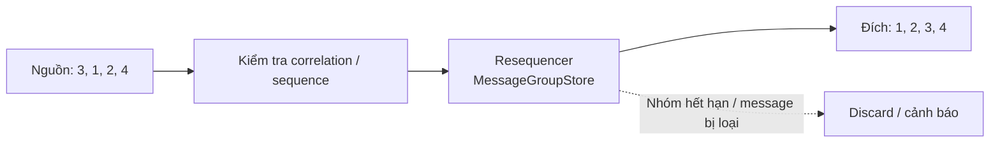

# Resequencer và xử lý dữ liệu đến không đúng thứ tự

## 1. Bài toán: đúng dữ liệu nhưng sai thứ tự

Trong các luồng tích hợp của Spring Boot, dữ liệu thường đi qua HTTP client, cơ sở dữ liệu, hàng đợi, broker thông điệp hoặc các adapter của Spring Integration. Các bước xử lý bất đồng bộ, retry, phân vùng, nhiều consumer và chênh lệch thời gian phản hồi có thể làm **thứ tự nhận được** khác **thứ tự nghiệp vụ**.

Ví dụ, hệ thống xử lý một đơn hàng `O-42` theo các bước:

1. `1 - ORDER_CREATED`
2. `2 - PAYMENT_CONFIRMED`
3. `3 - INVENTORY_RESERVED`
4. `4 - ORDER_PACKED`

Do thông điệp `3` được xử lý nhanh hơn `2`, consumer nhận `3, 1, 2, 4`. Nếu cập nhật trạng thái ngay khi nhận, hệ thống có thể đóng gói đơn trước khi xác nhận thanh toán. Ta cần một thành phần giữ tạm và phát thông điệp theo thứ tự đã định: **Resequencer**.

Đây là một phần của mẫu *Enterprise Integration Patterns* (EIP). Trong Spring Integration, resequencer được đặt giữa đầu vào có khả năng đảo thứ tự và bước xử lý yêu cầu đúng thứ tự. Nó hoạt động với các **message group** (nhóm thông điệp liên quan), không tự suy diễn thứ tự từ payload.

## 2. Cơ chế của Resequencer

Resequencer gom các thông điệp theo `CORRELATION_ID`, đọc `SEQUENCE_NUMBER` để sắp thứ tự, và thường dùng `SEQUENCE_SIZE` để biết khi nào đã đủ nhóm. Khi điều kiện phát thỏa mãn, nó đẩy **từng thông điệp** ra theo thứ tự. Payload của các thông điệp không bị gộp thành một kết quả.

| Thông tin | Mục đích | Ví dụ |
| --- | --- | --- |
| `CORRELATION_ID` | Xác định các message thuộc cùng một chuỗi độc lập. | `O-42:fulfillment:v7` |
| `SEQUENCE_NUMBER` | Vị trí trong chuỗi, thường bắt đầu từ `1`. | `3` |
| `SEQUENCE_SIZE` | Tổng số message được mong đợi trong chuỗi hữu hạn. | `4` |
| `Message ID` / event ID | Nhận diện bản tin cho truy vết và khử trùng lặp. | `evt-83d` |

Tên các header được Spring Integration cung cấp qua `IntegrationMessageHeaderAccessor.CORRELATION_ID`, `SEQUENCE_NUMBER` và `SEQUENCE_SIZE`. **Chúng là metadata mà phía phát thông điệp phải thiết lập chính xác**, hoặc được tạo bởi một thành phần như `Splitter`; resequencer không tự tạo ra sequence number dựa trên thời điểm nhận.



### Hai chế độ phát thông điệp

Giả sử cùng một nhóm có `SEQUENCE_SIZE = 5` và thứ tự đến là `3 → 1 → 2 → 5 → 4`:

| Thời điểm nhận | Chờ đủ nhóm: `releasePartialSequences(false)` | Phát tiền tố liên tiếp: `releasePartialSequences(true)` |
| --- | --- | --- |
| Nhận `3` | Chưa phát | Chưa phát vì thiếu `1` |
| Nhận `1` | Chưa phát | Phát `1` |
| Nhận `2` | Chưa phát | Phát `2, 3` |
| Nhận `5` | Chưa phát | Chưa phát `5` vì thiếu `4` |
| Nhận `4` | Phát `1, 2, 3, 4, 5` | Phát `4, 5` |

- **Chờ đủ nhóm (mặc định)** phù hợp với công việc chỉ được bắt đầu khi đã nhận đầy đủ mọi bước của chuỗi. Độ trễ có thể bằng thời gian đến của message cuối cùng.
- **Phát từng tiền tố liên tiếp** phù hợp khi các bước đã được xác nhận có thể xử lý sớm. Nếu `1, 2, 3` đã được phát, một bản tin `5` đến trước `4` vẫn phải chờ; mode này không cho phép nhảy qua lỗ hổng.

Các nhóm với `CORRELATION_ID` khác nhau hoạt động độc lập. Resequencer đảm bảo thứ tự **trong phạm vi từng nhóm tại đầu ra của nó**, không đảm bảo thứ tự toàn cục giữa mọi đơn hàng và không bảo vệ khỏi một bước xử lý song song phía sau tiếp tục đảo thứ tự.

## 3. Phân biệt với các thành phần tích hợp khác

| Thành phần | Chức năng | Đầu ra điển hình |
| --- | --- | --- |
| `Router` | Chọn nhánh xử lý dựa trên nội dung hoặc header. | Một/nhiều kênh đích. |
| `Transformer` | Đổi biểu diễn dữ liệu. | Message có payload đã biến đổi. |
| `Splitter` | Chia một thông điệp thành các phần, thường tạo correlation/sequence header. | Nhiều message con. |
| `Aggregator` | Gom các message liên quan thành kết quả tổng hợp. | Thường là một message chứa danh sách/kết quả. |
| **`Resequencer`** | Chờ và phát lại theo trình tự sequence. | Các message riêng lẻ, đúng thứ tự. |

Một luồng thường gặp: `Splitter → xử lý song song → Resequencer → Aggregator`. Resequencer cần thiết khi bước phía sau cần *quan sát thứ tự* của các message con; nếu chỉ cần tập kết quả và phép gộp không phụ thuộc thứ tự, có thể chỉ cần aggregator. Ngược lại, nếu vấn đề là chọn API/queue đích, dùng router thay vì resequencer.

## 4. Cài đặt trong Spring Boot với Java DSL

Thêm `spring-boot-starter-integration` cùng các starter cần thiết cho HTTP, JDBC, Redis hoặc broker đang dùng. Ví dụ dưới đây giả định mỗi message đã có đầy đủ ba header sequence. `QueueChannel` tại đầu ra giúp quan sát kết quả trong ví dụ; trong ứng dụng thực tế có thể thay bằng handler hoặc adapter tương ứng.

```java
import org.springframework.context.annotation.Bean;
import org.springframework.context.annotation.Configuration;
import org.springframework.integration.channel.DirectChannel;
import org.springframework.integration.channel.QueueChannel;
import org.springframework.integration.dsl.IntegrationFlow;
import org.springframework.messaging.MessageChannel;
import org.springframework.messaging.PollableChannel;

@Configuration
public class OrderResequencingConfiguration {

    @Bean
    public MessageChannel incomingOrderEvents() {
        return new DirectChannel();
    }

    @Bean
    public PollableChannel orderedOrderEvents() {
        return new QueueChannel();
    }

    @Bean
    public PollableChannel discardedOrderEvents() {
        return new QueueChannel();
    }

    @Bean
    public IntegrationFlow orderResequencingFlow() {
        return IntegrationFlow.from("incomingOrderEvents")
                .resequence(spec -> spec
                        .releasePartialSequences(false)
                        .groupTimeout(30_000L)
                        .sendPartialResultOnExpiry(false)
                        .discardChannel("discardedOrderEvents"))
                .channel("orderedOrderEvents")
                .get();
    }
}
```

Ý nghĩa những cấu hình chính:

| Cấu hình | Tác động |
| --- | --- |
| `releasePartialSequences(false)` | Chỉ phát khi nhóm đáp ứng điều kiện hoàn tất. |
| `groupTimeout(30_000L)` | Thiết lập thời gian chờ xử lý nhóm (mili giây); khi hết hạn, cơ chế expiration được kích hoạt. |
| `sendPartialResultOnExpiry(false)` | Không coi nhóm thiếu message là kết quả thành công để gửi sang luồng chính. |
| `discardChannel("discardedOrderEvents")` | Có kênh riêng để tiếp nhận thông điệp bị loại/hết hạn theo cấu hình. |

Không nhầm `groupTimeout` với `sendTimeout`: `groupTimeout` liên quan đến **tuổi/chờ đợi của nhóm**, còn `sendTimeout` liên quan đến **thời gian cố gửi** sang kênh đầu ra có giới hạn dung lượng.

Tùy phiên bản Spring Integration, cấu hình timeout có thể sử dụng `TaskScheduler`, đồng thời còn các lựa chọn về expire, reaper và giữ metadata của nhóm. Vì vậy cần kiểm tra chính xác phiên bản thư viện khi cấu hình hành vi timeout trong môi trường triển khai.

### Tạo message có sequence header

```java
import org.springframework.integration.IntegrationMessageHeaderAccessor;
import org.springframework.messaging.Message;
import org.springframework.messaging.support.MessageBuilder;

public Message<String> orderEvent(
        String batchId, int position, int total, String eventName) {

    if (batchId == null || batchId.isBlank()
            || total <= 0 || position < 1 || position > total) {
        throw new IllegalArgumentException("Invalid sequence metadata");
    }

    return MessageBuilder.withPayload(eventName)
            .setHeader(IntegrationMessageHeaderAccessor.CORRELATION_ID, batchId)
            .setHeader(IntegrationMessageHeaderAccessor.SEQUENCE_NUMBER, position)
            .setHeader(IntegrationMessageHeaderAccessor.SEQUENCE_SIZE, total)
            .build();
}
```

Ví dụ gửi lần lượt `(O-42:v1, 3, 4)`, `(O-42:v1, 1, 4)`, `(O-42:v1, 2, 4)`, `(O-42:v1, 4, 4)` vào kênh `incomingOrderEvents`. Luồng `orderedOrderEvents` sẽ nhận các payload theo vị trí `1 → 2 → 3 → 4`. Với một `batchId` khác, bộ đệm và thứ tự được quản lý độc lập.

**Quy tắc quan trọng:** cùng một correlation ID phải mô tả **một chuỗi hữu hạn nhất quán**. Không tái sử dụng `O-42` cho nhiều đợt xử lý khác nhau; hãy thêm phiên bản/đợt như `O-42:v1`, `O-42:v2` để tránh message của các đợt bị trộn.

## 5. Cần làm gì khi thiếu, muộn hoặc trùng message?

### Mất một vị trí trong chuỗi

Với `SEQUENCE_SIZE = 4`, nếu chỉ nhận `1, 3, 4` thì chế độ chờ đủ nhóm sẽ không phát thành công. Nếu bật phát tiền tố liên tiếp, chỉ `1` được phát; `3, 4` chờ `2`. Trường hợp `2` bị mất vĩnh viễn cần có giới hạn chờ, cảnh báo và quy trình xử lý:

1. Lưu dấu vết `correlationId`, các vị trí đã nhận và vị trí thiếu.
2. Hết hạn sau ngưỡng hợp lý dựa trên SLO của nguồn phát và thời gian retry.
3. Chuyển nhóm/message có vấn đề sang luồng xử lý sự cố để phát lại, tra soát hoặc hủy nghiệp vụ có kiểm soát.
4. Chỉ tiếp tục xử lý thiếu bước nếu nghiệp vụ **cho phép rõ ràng**.

Có thể bật `sendPartialResultOnExpiry(true)` để phát các thông điệp hiện có khi nhóm hết hạn. Tuy nhiên, kết quả đó **không còn bảo đảm chuỗi đầy đủ**; chẳng hạn `1, 3, 4` được phát dù thiếu `2`. Lựa chọn này thích hợp cho dữ liệu best effort, nhưng thường nguy hiểm với thanh toán, tồn kho hoặc chuyển trạng thái đòi hỏi đúng thứ tự.

### Bản tin đến sau khi nhóm đã hoàn tất hoặc hết hạn

Một nhóm đã hoàn tất có thể giữ metadata để nhận diện message đến trễ và chuyển chúng tới `discardChannel`. Cấu hình hết hạn và xóa metadata ảnh hưởng trực tiếp đến hành vi này: **nếu xóa cả metadata quá sớm, bản tin trễ có thể tạo nhóm mới với cùng correlation ID**. Vì vậy cần chính sách retention và xử lý late arrival phù hợp với thời gian retry tối đa của hệ thống.

### Trùng thông điệp do retry

Resequencer giải quyết bài toán **thứ tự**, không phải bảo đảm *exactly once*. Broker giao ít nhất một lần, retry HTTP hoặc consumer khởi động lại có thể tạo nhiều bản sao mang cùng `correlationId` và `sequenceNumber`. Không dựa vào resequencer để tự loại mọi duplicate:

- Gắn `eventId` hoặc khóa idempotency bền vững, ví dụ `sourceId + entityId + eventVersion`.
- Khử trùng lặp tại cổng nhận hoặc trước thao tác có side effect; ghi nhận message đã xử lý trong kho có tính bền vững.
- Khi cập nhật dữ liệu, cân nhắc ràng buộc unique/version và giao dịch để retry không trừ tồn kho hoặc thu tiền lần thứ hai.
- Định nghĩa rõ ứng xử khi hai message có cùng vị trí nhưng payload khác nhau: coi là **xung đột dữ liệu**, đưa vào quy trình tra soát.

## 6. MessageStore, trạng thái và triển khai nhiều instance

Resequencer cần bộ đệm cho các message đang chờ. Mặc định, nó có thể sử dụng bộ nhớ tiến trình; nếu ứng dụng khởi động lại khi nhóm chưa hoàn tất, trạng thái đang chờ có nguy cơ mất. Trong production, cân nhắc một `MessageGroupStore` bền vững như triển khai JDBC hoặc Redis tương ứng với stack và phiên bản đang sử dụng:

```java
// messageStore là bean MessageGroupStore đã cấu hình riêng.
@Bean
public IntegrationFlow durableResequencingFlow(
        org.springframework.integration.store.MessageGroupStore messageStore) {
    return IntegrationFlow.from("durableInput")
            .resequence(spec -> spec
                    .messageStore(messageStore)
                    .releasePartialSequences(false)
                    .groupTimeout(30_000L))
            .channel("durableOutput")
            .get();
}
```

Đoạn trên minh họa việc **tiêm một store đã tồn tại**; khi dùng cần tạo `durableInput`, `durableOutput` và bean store thực tế. Không nên khai báo đồng thời hai flow cùng xử lý một đầu vào nếu không chủ ý thiết kế việc phân phối message.

Một kho dùng chung **chưa đủ** để có thứ tự đúng trong cụm nhiều node. Cần thiết kế khóa đồng bộ theo nhóm (ví dụ `LockRegistry` thích hợp), tránh hai instance cùng xử lý/cấp phát trạng thái cho một correlation ID và đánh giá hành vi khi node chết giữa ghi state với phát message. Ngoài ra:

- `MessageGroupStore` giải quyết việc giữ nhóm; việc xác nhận message với Kafka/RabbitMQ/JMS và side effect của consumer đòi hỏi cơ chế giao dịch/retry riêng.
- Retention của nhóm đã hoàn tất và nhóm hết hạn cần đủ lâu để phát hiện bản tin trễ, nhưng có giới hạn để không tăng vô hạn.
- Số lượng nhóm chờ, tổng số message tồn, kích thước payload và độ dài các lỗ hổng quyết định bộ nhớ, dung lượng store và độ trễ.
- Nếu phía sau sử dụng thread pool hoặc nhiều consumer cùng một khóa nghiệp vụ, thứ tự **hoàn thành xử lý** vẫn có thể khác thứ tự resequencer đã phát; cần serial hóa xử lý theo khóa khi có yêu cầu.

Tài liệu Spring Integration cũng lưu ý resequencer được thiết kế chủ yếu cho **chuỗi tương đối ngắn, ít khoảng trống**. Với số lượng lớn các chuỗi kéo dài và rất nhiều số thứ tự bị thiếu, nên xem xét cơ chế reorder chuyên biệt hoặc thiết kế lại việc phân vùng và thu thập sự kiện.

## 7. Ranh giới với bảo đảm thứ tự của broker

Ví dụ ở Kafka, các record trong **cùng một partition** có thứ tự offset, nhưng record của **nhiều partition** không có một thứ tự toàn cục. Nếu nhiều message thuộc cùng entity bị đưa vào các partition khác nhau, resequencer chỉ hoạt động đúng khi chúng đến cùng hệ thống resequencer với correlation/sequence hợp lệ và việc phát ra được kiểm soát. Với RabbitMQ hoặc một queue có nhiều consumer, thời điểm xử lý hoàn tất cũng có thể khác thứ tự nhận.

Hãy quyết định tại đâu cần thứ tự:

| Yêu cầu | Cách tiếp cận |
| --- | --- |
| Một entity xử lý theo trình tự, nguồn cho phép phân vùng theo entity ID | Cùng routing key/partition key và xử lý tuần tự theo key thường đơn giản hơn. |
| Tác vụ fan-out/fan-in khiến các nhánh hoàn tất khác nhau | Dùng sequence headers và `Resequencer` trước bước yêu cầu thứ tự. |
| Event đến sai theo *event time*, số bản tin cuối cùng không xác định | Cần chiến lược window/watermark và chính sách late event của hệ thống stream processing; resequencer không tự giải quyết. |
| Cần kết quả tổng hợp, không cần phát từng message | Dùng `Aggregator` hoặc cách gom kết quả phù hợp. |

**Không dùng timestamp làm thay thế mặc nhiên cho sequence number**: đồng hồ các hệ thống có thể lệch, nhiều sự kiện có cùng thời điểm, và thứ tự thời gian tạo không nhất thiết là thứ tự nghiệp vụ. Nếu `SEQUENCE_SIZE` không biết trước, hãy định nghĩa một sự kiện kết thúc đợt hoặc chiến lược hoàn tất rõ ràng thay vì mong resequencer tự đoán.

## 8. Kiểm thử đầu cuối tại ranh giới resequencer

Với cấu hình ở mục 4, có thể kiểm thử bằng cách cố tình gửi sai thứ tự. Đầu ra là `PollableChannel` nên có thể quan sát các message một cách xác định.

```java
import static org.junit.jupiter.api.Assertions.assertEquals;
import static org.junit.jupiter.api.Assertions.assertNull;

import org.junit.jupiter.api.Test;
import org.springframework.beans.factory.annotation.Autowired;
import org.springframework.beans.factory.annotation.Qualifier;
import org.springframework.boot.test.context.SpringBootTest;
import org.springframework.integration.IntegrationMessageHeaderAccessor;
import org.springframework.messaging.Message;
import org.springframework.messaging.MessageChannel;
import org.springframework.messaging.PollableChannel;
import org.springframework.messaging.support.MessageBuilder;

@SpringBootTest
class OrderResequencingTest {

    @Autowired
    @Qualifier("incomingOrderEvents")
    MessageChannel input;

    @Autowired
    @Qualifier("orderedOrderEvents")
    PollableChannel output;

    @Test
    void releasesOnlyWhenGroupIsCompleteAndInOrder() {
        String group = "test-order-42:attempt-1";

        input.send(event(group, 3, 3, "RESERVED"));
        input.send(event(group, 1, 3, "CREATED"));
        assertNull(output.receive(100)); // Chưa đủ 1, 2, 3

        input.send(event(group, 2, 3, "PAID"));

        assertEquals("CREATED", output.receive(1_000).getPayload());
        assertEquals("PAID", output.receive(1_000).getPayload());
        assertEquals("RESERVED", output.receive(1_000).getPayload());
    }

    private static Message<String> event(
            String group, int number, int total, String payload) {
        return MessageBuilder.withPayload(payload)
                .setHeader(IntegrationMessageHeaderAccessor.CORRELATION_ID, group)
                .setHeader(IntegrationMessageHeaderAccessor.SEQUENCE_NUMBER, number)
                .setHeader(IntegrationMessageHeaderAccessor.SEQUENCE_SIZE, total)
                .build();
    }
}
```

Đây là kiểm thử tích hợp tối thiểu, cần có `spring-boot-starter-test` và Spring Integration trong classpath. Với hệ thống thật, nên mở rộng theo **hành vi**:

| Tình huống thử | Kỳ vọng |
| --- | --- |
| Nhận `3, 1, 2` của một nhóm có size `3` | Không phát khi thiếu; phát `1, 2, 3` sau khi đủ. |
| Hai correlation ID xen kẽ | Không trộn message giữa hai nhóm. |
| `releasePartialSequences(true)` và nhận `3, 1, 2` | Phát `1` rồi `2, 3`; không nhảy qua khoảng trống. |
| Thiếu `2` đến hết timeout | Thực hiện đúng chính sách expiry/discard/partial đã cấu hình. |
| Duplicate, message tới quá trễ, sequence sai | Được xử lý theo chính sách idempotency, validation, retention và lỗi nghiệp vụ. |
| Restart/multiple instance | Xác minh store/lock giữ đúng trạng thái và không phát trùng khi recovery. |

Trong kiểm thử timeout, không dùng `Thread.sleep` cố định để suy đoán thời điểm hết hạn; ưu tiên quan sát kênh kết quả, timeout có kiểm soát và kiểm tra cả trạng thái nhóm sau expiry.

## 9. Vận hành và quan sát luồng thông điệp

Khi một nhóm bị kẹt, chỉ ghi nhận số message nhận được là chưa đủ. Nên có metric và log cho:

- **Số nhóm đang chờ**, số message tồn, tuổi của nhóm cũ nhất và lượng nhóm hết hạn.
- **Độ trễ từ nhận đến phát**, phân phối theo correlation ID/loại luồng; số nhóm phát thành công và phát thiếu.
- **Số bản tin bị loại, trùng, đến muộn**, lỗi gửi kênh đầu ra và retry.
- **Khoảng trống sequence** (`expectedNextSequence` so với danh sách `receivedSequences`), để truy được bản tin đang thiếu.

Log và trace nên mang `correlationId`, `sequenceNumber`, `sequenceSize`, `eventId`, tên flow và nguyên nhân discard. Không log toàn bộ payload chứa dữ liệu cá nhân hoặc thông tin thanh toán. Đặt cảnh báo khi nhóm chờ lâu hơn SLA, tỷ lệ expiry tăng hoặc MessageStore có xu hướng đầy.

Một quy trình xử lý sự cố hợp lý là: xem correlation ID đang bị kẹt → xác định số thứ tự thiếu → kiểm tra nguồn/broker/retry → quyết định phát lại, hủy hay xử lý bù → xác minh idempotency và trạng thái đơn hàng sau khi khôi phục.

## 10. Những sai lầm thường gặp

1. **Thiếu sequence header hoặc dùng chung correlation ID cho nhiều đợt:** các message không thể được sắp đúng hay bị gom nhầm.
2. **Nhầm “đã đến đủ số lượng” với “đã nhận đúng toàn bộ vị trí”:** duplicate có thể khiến số lượng đánh lừa các release strategy tùy chọn; phải kiểm soát tính hợp lệ và trùng lặp ngay từ đầu.
3. **Bật phát partial trong quy trình có phụ thuộc chặt:** xử lý bước sau khi còn thiếu bước trước phá vỡ bất biến nghiệp vụ.
4. **Không có timeout hoặc quản lý retention:** một message bị mất có thể khiến nhóm nằm trong store vô hạn.
5. **Tưởng store chia sẻ là đủ cho nhiều node:** còn phải xem khóa, giao dịch, tính tuần tự downstream và tình huống crash/retry.
6. **Giả định resequencer tạo ra exactly once:** vẫn cần idempotency ở điểm gây side effect.
7. **Dùng resequencer cho stream vô hạn với khoảng trống lớn:** gây tốn bộ nhớ và tăng chi phí tìm kiếm/phát chuỗi.

## 11. Checklist thiết kế trước khi đưa vào production

Trả lời được những câu hỏi này trước khi bật xử lý thật:

- Khóa correlation có bao gồm tenant, entity và phiên bản đợt xử lý không?
- Ai cấp `SEQUENCE_NUMBER` và `SEQUENCE_SIZE`; chúng có nhất quán qua retry và nhiều producer không?
- Khi thiếu một vị trí, được chờ tối đa bao lâu; cần retry, dead-letter, bù nghiệp vụ hay chấp nhận mất dữ liệu?
- Nhóm đã hoàn tất/hết hạn được lưu metadata bao lâu để phát hiện message trễ?
- Store và lock có đáp ứng restart, scale-out và giới hạn dung lượng không?
- Điểm gây side effect có bảo đảm idempotency và giữ thứ tự theo entity không?
- Có test cho sai thứ tự, duplicate, thiếu message, timeout, late arrival và recovery không?
- Có metric/cảnh báo để nhận ra nhóm bị kẹt trước khi khách hàng thấy lỗi không?

## Tóm tắt kiến thức cần nhớ

Resequencer là **cổng khôi phục thứ tự** cho các chuỗi thông điệp đã có metadata chính xác. Nó gom theo `CORRELATION_ID`, sắp theo `SEQUENCE_NUMBER`, và quyết định thời điểm phát dựa trên `SEQUENCE_SIZE` cùng release strategy. Dùng chế độ chờ đủ nhóm khi cần tính toàn vẹn; chỉ bật phát partial khi có thể xử lý an toàn các tiền tố liên tiếp. Trong hệ thống Spring Boot tích hợp thực tế, phải thiết kế thêm timeout, MessageStore, xử lý late event, idempotency, khóa khi triển khai phân tán và observability.

### Tài liệu tham khảo

- [Spring Integration Reference — Resequencer](https://docs.spring.io/spring-integration/reference/resequencer.html)
- [Spring Integration Reference — Aggregators and Resequencers (Java DSL)](https://docs.spring.io/spring-integration/reference/dsl/java-aggregators.html)
- [Spring Integration Reference — Aggregator và quản lý MessageGroup](https://docs.spring.io/spring-integration/reference/aggregator.html)
