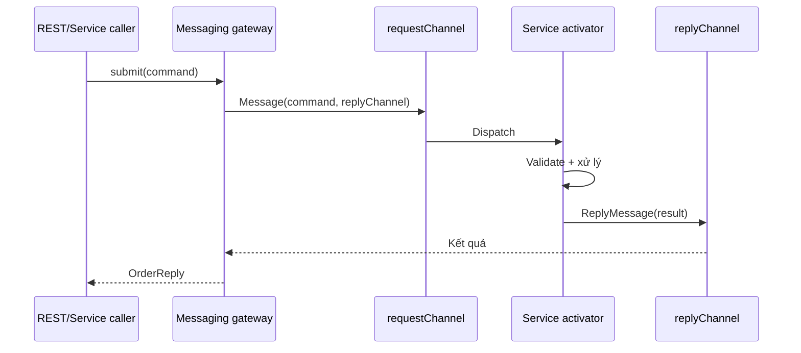
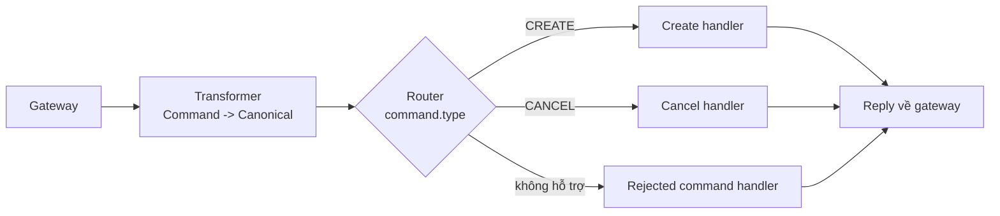
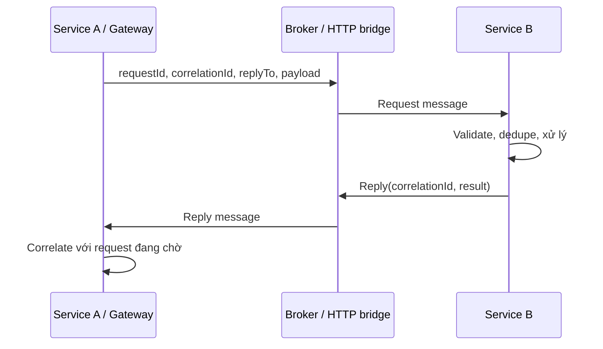

# Gateway request-reply, replyChannel và thời gian chờ

## 1. Gateway kết nối lời gọi Java với một luồng thông điệp như thế nào?

Trong module `SPRING_BOOT_INTEGRATION`, một request từ REST API có thể cần kiểm tra hợp đồng dữ liệu, biến đổi payload, định tuyến theo loại đơn hàng, gọi HTTP API hoặc ghi database, rồi trả một kết quả cho người gọi. Spring Integration cho phép xây dựng đường xử lý đó từ **message**, **channel** và **endpoint** thay vì gắn chặt controller với mọi bước.

Một **messaging gateway** giúp mã Java gọi luồng tích hợp như gọi một phương thức thông thường:

```java
OrderReply reply = orderGateway.submit(
        new OrderCommand("order-4711", "CREATE"));
```

Ở phía sau, gateway biến lời gọi thành request message, gửi vào channel, đợi reply theo hợp đồng, chuyển reply thành kiểu trả về của phương thức và báo lỗi khi không thể thực hiện đúng yêu cầu.

Khó khăn là lời gọi trông có vẻ đồng bộ nhưng luồng tích hợp có thể sử dụng nhiều mô hình xử lý khác nhau:

- `DirectChannel`: handler chạy trực tiếp trên thread gửi trong trường hợp đồng bộ thông thường.
- `ExecutorChannel`: gửi công việc sang một thread khác.
- `QueueChannel`: giữ message cho một poller/worker xử lý sau.
- Router, transformer, service activator: biến đổi hoặc chuyển message giữa nhiều bước.
- HTTP, AMQP, JMS, Kafka hoặc adapter khác: tạo ranh giới mạng và có thể chuyển thành giao tiếp bất đồng bộ.

Vì vậy, bài học **“Gateway request-reply, replyChannel và thời gian chờ”** tập trung vào bốn câu hỏi: reply quay về đúng người gọi bằng cách nào, timeout thực sự giới hạn giai đoạn nào, điều gì xảy ra khi reply đến muộn và cách phối hợp retry/idempotency để bảo vệ dữ liệu nghiệp vụ.

## 2. Các thành phần của mẫu request-reply

| Thành phần | Vai trò | Điều cần nhớ |
| --- | --- | --- |
| **Gateway proxy** | Chuyển lời gọi interface Java thành message request | Không tự biến mọi flow thành đồng bộ từ đầu đến cuối |
| **Request channel** | Đường mà gateway gửi request vào | Channel type ảnh hưởng khả năng blocking và throughput |
| **Message handler** | Transformer, router, service activator hoặc outbound gateway xử lý request | Phải tạo reply khi hợp đồng yêu cầu reply |
| **`replyChannel` header** | Địa chỉ phản hồi của message trong Spring Integration | Phải được giữ qua các bước bất đồng bộ cần trả lời |
| **`errorChannel` header** | Đường chuyển lỗi khi cơ chế xử lý hỗ trợ | Không thay thế hợp đồng xử lý exception/timeout |
| **`requestTimeout`** | Thời gian chờ thao tác **gửi** request khi channel có thể blocking | Không phải deadline cho toàn bộ nghiệp vụ |
| **`replyTimeout`** | Thời gian gateway đợi **nhận reply** khi có bước chờ | Không mặc nhiên dừng handler đang chạy |
| **Correlation ID** | Nối request với reply, log và giao dịch nghiệp vụ | Cần thiết khi qua broker hoặc nhiều nhánh song song |
| **Message ID** | Định danh message do framework tạo | Không nên mặc định dùng thay idempotency key nghiệp vụ |

Sơ đồ cơ bản:



Sơ đồ cho thấy reply được trả về một địa chỉ cụ thể, không chỉ là “message tiếp theo trong topic”. Với luồng chạy trong cùng ứng dụng, gateway có thể sử dụng một reply channel tạm gắn với lần gọi. Khi qua broker hoặc ranh giới process, cần thiết kế địa chỉ reply và correlation khác; không thể gửi nguyên object `MessageChannel` qua mạng rồi mong process bên kia sử dụng được.

## 3. Ví dụ tối thiểu: @MessagingGateway và DirectChannel

### 3.1. Dependency và kích hoạt Integration

Ví dụ Maven khi sử dụng Spring Boot dependency management:

```xml
<dependency>
    <groupId>org.springframework.boot</groupId>
    <artifactId>spring-boot-starter-integration</artifactId>
</dependency>
```

Trong một ứng dụng sử dụng Spring Integration, có thể khai báo cấu hình minh bạch:

```java
import org.springframework.context.annotation.Bean;
import org.springframework.context.annotation.Configuration;
import org.springframework.integration.annotation.IntegrationComponentScan;
import org.springframework.integration.config.EnableIntegration;
import org.springframework.integration.channel.DirectChannel;
import org.springframework.messaging.MessageChannel;

@Configuration(proxyBeanMethods = false)
@EnableIntegration
@IntegrationComponentScan
public class OrderIntegrationConfiguration {

    @Bean("orderRequests")
    MessageChannel orderRequests() {
        return new DirectChannel();
    }
}
```

`@IntegrationComponentScan` giúp phát hiện interface `@MessagingGateway` trong phạm vi quét component thích hợp. Tùy ứng dụng và cấu hình Spring Boot, một phần Integration infrastructure đã được auto-configure; ví dụ đặt rõ annotation để thấy nơi gateway được đăng ký.

### 3.2. Khai báo gateway interface

```java
import org.springframework.integration.annotation.MessagingGateway;
import org.springframework.integration.annotation.Gateway;

@MessagingGateway(
        defaultRequestChannel = "orderRequests",
        defaultRequestTimeout = "200",
        defaultReplyTimeout = "3000")
public interface OrderGateway {

    @Gateway
    OrderReply submit(OrderCommand command);
}
```

Ví dụ định nghĩa hợp đồng dữ liệu:

```java
public record OrderCommand(String orderId, String action) {}

public record OrderReply(String orderId, String status) {}
```

Các giá trị timeout trong annotation là mili giây ở API này. `defaultRequestChannel` là tên channel bean sẽ nhận message từ gateway. Hai thuộc tính timeout đang được khai báo rõ ràng để diễn giải, **không** phải bảo đảm rằng handler phải hoàn thành trong ba giây khi chạy đồng bộ.

### 3.3. Handler trả lời qua replyChannel

```java
import org.springframework.integration.annotation.ServiceActivator;
import org.springframework.stereotype.Component;

@Component
public class OrderRequestHandler {

    private final OrderApplicationService orderService;

    public OrderRequestHandler(OrderApplicationService orderService) {
        this.orderService = orderService;
    }

    @ServiceActivator(inputChannel = "orderRequests")
    public OrderReply handle(OrderCommand command) {
        return orderService.process(command);
    }
}
```

`OrderApplicationService` là service nghiệp vụ do project định nghĩa. Nó có thể ghi PostgreSQL, gọi HTTP hoặc tương tác với một adapter khác. `@ServiceActivator` là endpoint request-reply: khi method trả một giá trị, framework tạo reply message và dùng cơ chế reply routing của luồng.

Một controller có thể chỉ gọi:

```java
@RestController
@RequestMapping("/api/orders")
public class OrderController {

    private final OrderGateway gateway;

    public OrderController(OrderGateway gateway) {
        this.gateway = gateway;
    }

    @PostMapping("/process")
    public OrderReply process(@RequestBody OrderCommand command) {
        return gateway.submit(command);
    }
}
```

Ví dụ này giả định đã có Spring MVC dependency và các import controller thông thường. Cần thêm validation, authorization và hợp đồng HTTP khi triển khai thực tế.

**Điểm quan trọng:** vì `DirectChannel` gọi handler trực tiếp trong thread gửi, lời gọi `gateway.submit(...)` có thể bị chặn cho tới khi `orderService.process(...)` trả về. Con số `defaultReplyTimeout="3000"` không tự ngắt service đang gọi HTTP trong mười giây.

## 4. replyChannel là địa chỉ phản hồi, không phải ID của sự kiện

Spring Messaging dùng header có tên `replyChannel`, có thể truy cập bằng hằng số `MessageHeaders.REPLY_CHANNEL`. Một gateway request-reply có thể gắn channel nhận kết quả của lần gọi vào header để các endpoint sau biết reply phải gửi về đâu.

Minh họa một message nội bộ:

```text
Message<OrderCommand>
  payload = OrderCommand("order-4711", "CREATE")
  headers:
    id             = <message id>
    replyChannel   = <gateway-managed reply channel>
    errorChannel   = <error destination, nếu có>
    correlationId  = "checkout-abc"
```

Trong ví dụ, giá trị `<gateway-managed reply channel>` là ký hiệu minh họa, không phải chuỗi cần đặt literal trong payload. Ở luồng local, header có thể chứa trực tiếp đối tượng channel hoặc tên channel mà framework phân giải.

Các quy tắc thực hành:

1. **Đừng xóa `replyChannel` một cách vô ý** trong transformer, router, header filter hoặc bước tạo message mới.
2. **Đừng thay `replyChannel` bằng một tên topic Kafka** chỉ vì cả hai đều là “địa chỉ”. MessageChannel nội bộ và broker reply destination là hai cơ chế khác nhau.
3. **Đừng dùng `replyChannel` làm ID để dedupe.** Nó xác định đường trả lời của một lời gọi, có thể được tạo lại ở lần retry.
4. **Đừng coi `correlationId` thay thế `replyChannel`.** Correlation giúp ghép request/reply; channel chỉ ra nơi gửi reply.
5. **Đừng log object channel hoặc toàn bộ headers chứa bí mật** khi muốn chẩn đoán lỗi. Ghi correlation ID và tên bước xử lý là đủ trong đa số tình huống.

### 4.1. Khi handler trả về một giá trị

Một endpoint request-reply như `@ServiceActivator` thường chuyển giá trị trả về thành reply và định tuyến theo output channel được cấu hình, hoặc dùng `replyChannel` của request nếu không có output channel cụ thể. Điều này giúp ví dụ ở mục 3 hoạt động mà không cần tự gọi `replyChannel.send(...)`.

Nhưng nếu một handler được thiết kế là **one-way** và trả `void`/không có reply, gateway đang chờ kết quả có thể đến hạn mà không nhận được message nào. Đó là lỗi hợp đồng luồng, không phải “framework làm mất reply” một cách ngẫu nhiên.

### 4.2. Transformer cần giữ đường trả lời

Giả sử input là một DTO nhưng handler kế tiếp cần một dạng khác:

```java
import org.springframework.integration.annotation.Transformer;

@Component
public class OrderCommandTransformer {

    @Transformer(inputChannel = "rawOrderRequests",
                 outputChannel = "validatedOrderRequests")
    public ValidatedOrderCommand transform(OrderCommand command) {
        return new ValidatedOrderCommand(command.orderId(),
                command.action());
    }
}
```

Đoạn code là mẫu transform payload, chưa bao gồm lớp `ValidatedOrderCommand` và bước validation. Khi framework tạo reply message từ payload transformation thông thường, nó có thể giữ các headers cần thiết theo semantics endpoint. Nếu code thay bằng một `Message<?>` hoàn toàn mới, dùng custom adapter hoặc lọc header, phải **kiểm thử trực tiếp** rằng `replyChannel`, `errorChannel` và correlation có đi tới handler cuối cùng.

Không nên dựa vào một header filter xóa mọi header ngoài business fields trong đoạn flow có gateway đang đợi reply.

## 5. Reply channel tạm và reply channel đặt tên

### 5.1. Lựa chọn mặc định: reply gắn với từng lời gọi

Với một gateway request-reply nội bộ, việc để gateway quản lý reply destination cho mỗi invocation thường đơn giản và an toàn hơn:

```java
@MessagingGateway(
        defaultRequestChannel = "orders.inbound",
        defaultReplyTimeout = "3000")
public interface SubmitOrderGateway {
    OrderReply submit(OrderCommand command);
}
```

Gateway tạo ngữ cảnh chờ reply và đưa thông tin cần thiết vào request message. Khi handler hoàn thành, reply được chuyển đúng về lời gọi tương ứng. Với nhiều request đồng thời, đây là lý do không cần tạo thủ công một hàng đợi reply chung rồi tự lấy message kế tiếp.

### 5.2. Khi đặt một replyChannel riêng

Spring Integration hỗ trợ khai báo reply channel trên gateway hoặc operation khi có yêu cầu cụ thể:

```java
@MessagingGateway(
        defaultRequestChannel = "orders.requests",
        defaultReplyChannel = "orders.replies")
public interface CustomReplyGateway {
    OrderReply submit(OrderCommand command);
}
```

Tuy nhiên, **không nên biến mọi request đồng thời thành consumer tùy ý của một `QueueChannel` reply dùng chung** rồi giả định response đầu tiên luôn thuộc request đang chờ đầu tiên. Cần hiểu cách gateway cụ thể đang correlate/nhận reply và kiểm thử khi nhiều request hoàn tất trái thứ tự. Một shared reply channel không có cơ chế tương quan rõ có thể gây nhận nhầm phản hồi hoặc reply thất lạc.

Đặt tên reply channel phù hợp khi kiến trúc thực sự cần một channel có routing/lifecycle rõ. Với mô hình RPC local đơn giản, ưu tiên đường reply do gateway tự quản lý; đừng thêm channel chung chỉ để “nhìn thấy nó trong cấu hình”.

### 5.3. replyChannel có thể bị ghi đè ở điểm routing

Nếu flow có endpoint khai báo `outputChannel`, reply của endpoint có thể đi sang output channel đó thay vì quay ngay về gateway. Đây là hợp lệ **nếu flow tiếp tục định tuyến đến bước gửi reply cuối cùng**.

Ví dụ:

```text
gateway
  -> requestChannel
  -> transformer
  -> router
      -> channelA -> serviceActivator A
      -> channelB -> serviceActivator B
  -> reply back to original replyChannel
```

Một router đưa message vào một nhánh không có reply-producing handler sẽ làm caller chờ tới timeout. Một filter loại message mà không có discard/rejection response cũng có thể khiến giao thức request-reply bị thiếu phản hồi. Cần quyết định rõ mỗi nhánh trả **success, failure hay timeout** và cách biểu diễn kết quả.

## 6. Request timeout và reply timeout khác nhau như thế nào?

### 6.1. requestTimeout: chờ gửi được request

`requestTimeout` liên quan tới thao tác gửi message vào request channel khi cơ chế gửi có thể chặn, ví dụ một `QueueChannel` có dung lượng hữu hạn đã đầy.

```text
Gateway thread:
  send(request, requestTimeout)
    |
    +-- channel còn dung lượng -> gửi được -> tiếp tục đợi reply
    |
    +-- channel đầy/quá tải -> có thể hết thời hạn gửi
```

Với `DirectChannel`, thao tác gửi thường gọi handler đồng bộ; `requestTimeout` **không phải timeout chạy code của handler**. Nếu handler gọi HTTP chậm, thread gửi vẫn có thể bị giữ lâu hơn `requestTimeout`. Với `ExecutorChannel`, thao tác gửi thường là submit vào executor; pool/queue đầy có thể tạo lỗi từ chối công việc, không nhất thiết chỉ là một timeout chờ.

### 6.2. replyTimeout: chờ nhận kết quả

`replyTimeout` là thời gian gateway chờ reply khi đã gửi request và có một giai đoạn nhận reply. Với luồng bất đồng bộ, nó giúp ngăn người gọi chờ vô thời hạn.

```text
Caller ------ request sent -----> async worker
  |                                 |
  +-- wait up to replyTimeout       +-- process...
  |
  +-- timed out                      +-- reply arrives later
```

Điểm quan trọng là **timeout của người chờ không phải tín hiệu hủy chắc chắn của worker**. Worker có thể vẫn đang gọi HTTP, ghi DB hoặc phát broker message sau khi gateway đã ngừng chờ.

Kết quả khi không nhận reply đúng hạn có thể phụ thuộc loại gateway, kiểu trả về, xử lý lỗi và phiên bản framework; ứng dụng phải xác định cách biểu diễn timeout và kiểm thử. Không nên xây API mặc định hiểu `null` là “đã hoàn tất thành công”. Nên bọc gateway bằng một adapter ánh xạ timeout/không có reply thành domain outcome rõ ràng.

### 6.3. Những loại timeout không thay thế nhau

| Giới hạn | Tầng áp dụng | Có tự dừng handler đã bắt đầu không? |
| --- | --- | --- |
| Gateway `requestTimeout` | Gửi message vào channel | Không |
| Gateway `replyTimeout` | Chờ reply về gateway | Không chắc; không phải cơ chế cancellation end-to-end |
| HTTP connect timeout | Tạo kết nối HTTP outbound | Chỉ giới hạn giai đoạn tương ứng |
| HTTP response/read timeout | Chờ phản hồi từ HTTP server | Không bảo đảm phía server đã ngừng xử lý |
| JDBC query timeout | Chờ câu truy vấn theo driver/DB hỗ trợ | Phụ thuộc driver, DB và khả năng hủy truy vấn |
| Broker request/reply timeout | Chờ phản hồi từ broker/RPC adapter | Có thể đã phát request, không tự rollback side effect |
| Application deadline | Tổng ngân sách thời gian của operation | Cần phối hợp hủy, rollback, idempotency và quan sát riêng |

Với luồng xử lý đồng bộ và có I/O, hãy đặt **timeout ở chính HTTP/JDBC/broker client**. Khi có bước async, mới tính thêm gateway reply timeout để ngăn caller chờ quá SLA.

## 7. Vì sao replyTimeout không chặn một DirectChannel xử lý quá lâu?

Xét luồng:

```java
@MessagingGateway(
        defaultRequestChannel = "slowOrderRequests",
        defaultReplyTimeout = "1000")
public interface SlowOrderGateway {
    OrderReply submit(OrderCommand command);
}
```

Nếu `slowOrderRequests` là `DirectChannel` và handler chờ một HTTP call tám giây, thread gọi gateway vẫn đang ở trong chuỗi `send(...)` đồng bộ. Nó chưa đến bước chờ độc lập ở reply channel theo cách nhiều người hình dung, nên **không thể coi 1.000 ms là deadline tổng**.

Các cách sửa hợp lệ:

1. Gắn timeout cho HTTP client ở downstream, không cho phép request giữ thread vô hạn.
2. Chuyển sang một asynchronous channel có executor/bounded queue khi hợp đồng cho phép, và để gateway chờ reply với thời hạn rõ.
3. Xác định tổng deadline và chính sách trả kết quả `PENDING` hoặc job ID nếu công việc vốn mất lâu.
4. Tránh gửi tác vụ có side effect không idempotent sang worker rồi coi reply timeout là dấu hiệu “đã hủy xử lý”.
5. Giám sát cả thời gian gửi, thời gian chờ reply và thời gian thực thi thực tế của handler.

Một request API kéo dài nhiều phút có thể phù hợp hơn với **asynchronous workflow**: nhận lệnh, ghi trạng thái `ACCEPTED`/outbox, trả HTTP 202 kèm correlation/job ID và để client tra cứu kết quả về sau, thay vì cưỡng ép gateway RPC.

## 8. ExecutorChannel: ranh giới bất đồng bộ cho reply timeout

Khi muốn gateway không giữ thread trong code handler, có thể dùng `ExecutorChannel` để xử lý request ở một thread pool giới hạn.

### 8.1. Channel và executor

```java
import org.springframework.beans.factory.annotation.Qualifier;
import org.springframework.context.annotation.Bean;
import org.springframework.context.annotation.Configuration;
import org.springframework.integration.channel.ExecutorChannel;
import org.springframework.messaging.MessageChannel;
import org.springframework.scheduling.concurrent.ThreadPoolTaskExecutor;

@Configuration(proxyBeanMethods = false)
public class AsyncOrderChannelsConfiguration {

    @Bean("orderWorkerExecutor")
    ThreadPoolTaskExecutor orderWorkerExecutor() {
        ThreadPoolTaskExecutor executor = new ThreadPoolTaskExecutor();
        executor.setCorePoolSize(4);
        executor.setMaxPoolSize(8);
        executor.setQueueCapacity(100);
        executor.setThreadNamePrefix("order-worker-");
        return executor;
    }

    @Bean("asyncOrderRequests")
    MessageChannel asyncOrderRequests(
            @Qualifier("orderWorkerExecutor")
            ThreadPoolTaskExecutor executor) {
        return new ExecutorChannel(executor);
    }
}
```

Đây là cấu hình tài nguyên **minh họa**. Số worker/queue phải được chọn theo năng lực DB và HTTP downstream; không tự đặt hàng đợi rất lớn để che tình trạng xử lý chậm. Việc task executor từ chối submit khi queue đầy cần được xử lý như tín hiệu quá tải; `requestTimeout` không tự biến executor thành hàng đợi có backpressure đúng SLA.

### 8.2. Gateway chờ reply từ worker

```java
@MessagingGateway(
        defaultRequestChannel = "asyncOrderRequests",
        defaultRequestTimeout = "200",
        defaultReplyTimeout = "3000")
public interface AsyncOrderGateway {
    OrderReply submit(OrderCommand command);
}
```

Handler:

```java
@Component
public class AsyncOrderHandler {

    private final OrderApplicationService service;

    public AsyncOrderHandler(OrderApplicationService service) {
        this.service = service;
    }

    @ServiceActivator(inputChannel = "asyncOrderRequests")
    public OrderReply handle(OrderCommand command) {
        return service.process(command);
    }
}
```

Giả sử request được submit nhanh vào executor, gateway có thể bắt đầu chờ reply; nếu worker xử lý dưới thời hạn, caller nhận `OrderReply`. Nếu worker xử lý quá thời hạn, caller có thể hết thời gian chờ trong khi task vẫn còn chạy. Reply đến muộn có thể bị từ chối hoặc không có người nhận theo cơ chế reply channel; phải giám sát thay vì mặc định nó sẽ được giao ở lần gọi sau.

**Lưu ý transaction:** `ExecutorChannel` chuyển thread và thông thường làm mất sự liên tục của transaction context dạng ThreadLocal. Transaction được mở ở thread REST caller không tự bao bọc DB update trong worker. Nếu handler cần transaction, đặt ranh giới `@Transactional` ở service được thực thi trong worker và kiểm thử thời điểm commit/ack thật.

### 8.3. Không sử dụng ExecutorChannel như công cụ hủy tự động

Một gateway hết hạn **không tự xóa công việc khỏi executor**, không rollback một HTTP request đã gửi, và không bảo đảm thread worker dừng. Nếu việc tiếp tục xử lý sau reply timeout là không chấp nhận được, cần thiết kế thêm cancellation/deadline propagation hoặc đổi mô hình nghiệp vụ; cancellation tự nó cũng cần phân biệt công việc chưa bắt đầu với side effect đã commit.

## 9. QueueChannel: requestTimeout và hàng đợi có dung lượng

`QueueChannel` là một `PollableChannel`. Nó thường phù hợp với luồng có worker/poller chủ động lấy message.

```java
import org.springframework.context.annotation.Bean;
import org.springframework.integration.channel.QueueChannel;

@Bean("boundedOrderQueue")
QueueChannel boundedOrderQueue() {
    return new QueueChannel(100);
}
```

Khi hàng đợi đủ 100 message chưa được lấy, lần gửi tiếp có thể chờ theo `requestTimeout` trước khi thất bại. Một poller có thể xử lý:

```java
import org.springframework.integration.annotation.Poller;
import org.springframework.integration.annotation.ServiceActivator;

@ServiceActivator(
        inputChannel = "boundedOrderQueue",
        poller = @Poller(fixedDelay = "100", maxMessagesPerPoll = "5"))
public OrderReply processQueuedOrder(OrderCommand command) {
    return orderService.process(command);
}
```

Đây là phác thảo; code thực tế cần nằm trong bean/component có `orderService` và có cấu hình poller/thread pool phù hợp. Nếu không có poller nhận message, gateway có thể gửi thành công nhưng **không bao giờ nhận reply** dù QueueChannel còn dung lượng.

Điểm thiết kế:

- `requestTimeout` giải quyết trường hợp không thể đưa request vào hàng đợi đúng hạn.
- `replyTimeout` giải quyết trường hợp request đã được xếp hàng nhưng kết quả chưa về.
- Không nên dùng QueueChannel trong RAM làm cơ chế giữ công việc **bền vững** qua process crash. Khi cần giao việc đáng tin cậy dài hạn, dùng database/outbox hoặc broker phù hợp.
- Nếu 100 message được xếp hàng nhưng mỗi message cần một giây để xử lý trên một poller, reply timeout ba giây là không thực tế cho message ở cuối hàng đợi.
- Cần giới hạn backlog, theo dõi tuổi message, kiểm tra receiver/poller và thiết kế cách báo quá tải.

## 10. Router và transformer tác động thế nào tới replyChannel?

Một luồng Spring Integration có thể định tuyến theo loại nghiệp vụ:



Với một gateway request-reply, **mọi nhánh hợp lệ phải có hành vi trả lời được định nghĩa**. Ví dụ một transformer tạo `CanonicalOrderCommand`, router chọn `CreateOrderHandler` hoặc `CancelOrderHandler` và service activator cuối trả một `OrderReply`. Nhánh loại bỏ lệnh không hợp lệ phải trả kết quả từ chối hoặc kích hoạt error policy, không âm thầm nuốt message.

Các lỗi thường gặp:

- Custom transformer dựng message mới nhưng không giữ `replyChannel`.
- Router gửi sang channel không có subscriber hoặc không có poller.
- Filter trả `false` và discard message mà không tạo reply phù hợp.
- `PublishSubscribeChannel` gửi một request tới nhiều handler cùng sinh reply, tạo nhiều kết quả không tương thích với một gateway gọi một lần.
- Splitter tách một request thành nhiều message nhưng chưa có aggregator để ghép về **một** kết quả cuối.
- Một nhánh gọi outbound adapter one-way; bước cuối không tạo reply cho gateway.
- Có `outputChannel` trỏ sang channel khác và quên đường trả reply về caller.

Không có một cách sửa chung bằng cách tăng `replyTimeout`. Phải vẽ rõ flow, xác định nhánh nào sinh reply và thử nghiệm bằng cả success, rejection, error và timeout.

## 11. Tương quan request-reply khi splitter, aggregator và nhiều nhánh song song

Khi một request chứa danh sách dòng đơn hàng, một splitter có thể tạo nhiều message con để xử lý song song:

```text
Gateway: SubmitOrder(order-4711, lines=[L1, L2, L3])
        |
        v
     Splitter
       / | \
     L1 L2 L3
       \ | /
     Aggregator
        |
        v
 Reply: OrderResult(order-4711, processed=3)
```

Một số cơ chế splitter/aggregator của Spring Integration dùng các header như `correlationId`, `sequenceNumber` và `sequenceSize` để nhóm và biết khi nào đủ message. Điều kiện release, timeout và lưu trữ state của aggregator cần được xác định rõ.

**Có hai loại correlation khác nhau:**

1. **Correlation nội bộ của nhóm message** để aggregator gom các phần tử của cùng một request.
2. **Correlation request-reply** để trả kết quả cuối cùng về đúng gateway invocation.

Khi cần bảo vệ business outcome, còn có **business correlation/idempotency key** như `orderId` hoặc `requestId`. Các ID này có thể liên quan nhưng không nên dùng lẫn nếu semantics khác nhau.

Nếu aggregator chờ đủ ba reply nhưng một nhánh lỗi và không có kết quả, gateway có thể timeout dù các nhánh còn lại đã thành công. Cần chính sách cho partial result, expire group, dead-letter, cleanup state và đối soát tác dụng phụ. Nếu dùng `MessageGroupStore` bền vững để giữ state, cần quản lý kích thước/TTL/transaction cùng luồng xử lý thực tế.

## 12. errorChannel và lỗi trong gateway request-reply

Một luồng request-reply có thể thất bại ở nhiều tầng:

| Loại lỗi | Ví dụ | Phản ứng mong đợi |
| --- | --- | --- |
| Không gửi được request | Queue đầy, channel không có subscriber, executor từ chối | Báo quá tải/lỗi routing, không coi là business success |
| Handler ném exception đồng bộ | Validation thất bại, DB lỗi | Map sang lỗi nghiệp vụ/kỹ thuật |
| Handler async thất bại | Exception trong worker sau khi gửi request thành công | Chuyển lỗi qua error handling được cấu hình; đánh thức/báo kết quả cho caller nếu còn chờ |
| Không có reply | Router/filter mất nhánh, handler one-way | Timeout/không có reply; cần xử lý rõ |
| Reply sai kiểu | Handler trả payload khác contract gateway | Sửa mapping/transformer, không retry vô hạn |
| Reply đến sau timeout | Worker quá chậm | Ghi late reply; đối soát side effect, không tự áp dụng lại |
| HTTP/broker timeout | Đối tác chưa phản hồi | Có thể là kết quả chưa rõ; dùng idempotency/reconciliation |

`MessageHeaders.ERROR_CHANNEL` mô tả địa chỉ nhận lỗi khi luồng hỗ trợ. Spring Integration có `ErrorMessage` và các error flow. Gateway cũng có thuộc tính `errorChannel` hoặc chính sách error mapping tùy cấu hình.

Tuy nhiên, đặt một `errorChannel` không có nghĩa tự động có domain reply hoặc mọi exception sẽ thành lỗi có cấu trúc. Một error handler chỉ log rồi nuốt exception có thể khiến gateway chờ hết `replyTimeout` mà không biết nguyên nhân; một error flow trả payload không đúng loại có thể gây lỗi conversion ở gateway.

Một lựa chọn thiết kế là chuẩn hóa **một trong hai hợp đồng**:

- **Return-value contract:** gateway trả `OrderReply` có `status=ACCEPTED/REJECTED/PENDING` cùng thông tin nguyên nhân đã kiểm soát.
- **Exception contract:** gateway trả DTO khi thành công và ném một số exception đã chuẩn hóa cho lỗi vận hành/nghiệp vụ.

Không nên trộn cả hai tùy nhánh mà thiếu tài liệu và test. Các exception chứa stack trace, SQL, URL nội bộ hoặc token không nên được chuyển nguyên ra REST response.

## 13. Request timeout, reply timeout và deadline nghiệp vụ

Một lời gọi có thể cần các ngân sách thời gian:

```text
HTTP API caller            tổng SLA mong muốn: 4.0 s
    |
    +-- Validate / auth                   0.2 s
    |
    +-- Send/enqueue request              0.1 s
    |
    +-- Worker queue + processing         0.3 s
    |
    +-- HTTP downstream                   2.5 s
    |
    +-- Reply / serialization             0.2 s
    |
    +-- Buffer vận hành                   0.7 s
```

Các con số chỉ minh họa. Nếu downstream HTTP client có response timeout 15 giây nhưng gateway chỉ đợi 3 giây, rất nhiều worker có thể tiếp tục chạy vô ích theo quan điểm caller. Ngược lại, nếu HTTP timeout 1 giây nhưng gateway replyTimeout 30 giây, người gọi sẽ chờ lâu nếu error flow không sinh reply.

Một chính sách hợp lý cần:

1. Chọn **deadline tổng** theo SLA và loại operation.
2. Đặt timeout của outbound HTTP/JDBC/broker nhỏ hơn deadline còn lại, có xét số lần retry và buffer.
3. Cấu hình `requestTimeout` theo dung lượng kênh và chấp nhận quá tải.
4. Cấu hình `replyTimeout` hợp lý cho cả thời gian chờ queue và xử lý async.
5. Gắn một metadata thời hạn, ví dụ `deadlineAt`, để worker có thể từ chối xử lý một request quá hạn **trước khi tạo side effect**, nếu semantics cho phép.
6. Có idempotency/reconciliation cho trường hợp request đã được xử lý một phần hoặc kết quả không rõ.
7. Theo dõi thực tế các percentile latency và số lần quá hạn để điều chỉnh.

**Không chỉ lấy `replyTimeout` bằng tổng các timeout dưới** rồi kết luận mọi operation có thời gian tối đa tương ứng. Timeout có thể không áp vào phần xử lý đồng bộ, DNS, pool acquisition, retry và quá trình hoàn tất transaction.

## 14. Băng qua HTTP client hoặc broker: replyChannel không tự đi qua mạng

Gateway trong cùng Spring ApplicationContext có thể giữ một reply channel tạm làm object trong message header. Nhưng nếu flow gửi payload qua RabbitMQ, Kafka, JMS hay HTTP đến một service khác, process bên kia **không thể sử dụng trực tiếp object đó**.

Cần biến request-reply thành một hợp đồng transport:



Những thành phần cần thiết thường gồm:

- **Correlation ID duy nhất** cho mỗi request/reply exchange, phân biệt với ID nghiệp vụ khi cần.
- **Reply destination** như broker queue/topic cụ thể, không phải Java object của `replyChannel`.
- **Timeout và retention** cho request đang chờ, reply không có người nhận và reply trễ.
- **Idempotency key** để chống duplicate khi request/reply được gửi lại.
- **Security/ACL** cho reply destination, tránh cho client khác gửi kết quả giả.
- **State/correlation store** khi cần survive restart của process chờ phản hồi.

Spring Integration có các inbound/outbound gateway và adapter cho các transport khác nhau; cơ chế request-reply qua broker cần cấu hình correlation/reply-to theo công nghệ được chọn. Không nên tự serialize toàn bộ Spring `MessageHeaders` sang JSON hoặc gửi tên `replyChannel` ngẫu nhiên qua Kafka rồi xem đó là RPC hoàn chỉnh.

### 14.1. Reply muộn sau khi gateway đã timeout

Ví dụ, REST caller đã nhận HTTP 504 vì gateway đợi quá hạn nhưng Service B vẫn xử lý thành công và gửi reply sau đó. Lúc này:

- Caller cũ có thể không còn chờ reply.
- Reply có thể không được correlate với một invocation còn sống.
- Đơn hàng hoặc thanh toán thực tế **có thể đã hoàn tất**.
- Client có thể retry và tạo lại cùng lệnh nếu không có idempotency.

Vì vậy, ứng dụng cần endpoint/query tra cứu trạng thái bằng request ID hoặc tài liệu rõ về trạng thái `PENDING/UNKNOWN`, không tự coi timeout là rollback. Với thao tác nhạy cảm, chọn async command + status tracking thay vì bắt caller chờ mạng nhiều tầng.

## 15. Giao dịch và idempotency khi gateway tạo side effect

Một service activator có thể cập nhật DB rồi gửi HTTP hoặc publish broker trước khi trả reply. Nếu DB đã commit nhưng reply thất lạc, caller có thể retry và ghi trùng.

Ví dụ đơn giản:

```text
Gateway receives order requestId=req-774
  -> DB inserts order O-774: COMMITTED
  -> worker prepares OrderReply
  -> caller replyTimeout / network error
  -> caller retries req-774
```

Để tránh xử lý hai lần, cần một định danh logic bền vững:

```java
public record OrderCommand(
        String requestId,
        String orderId,
        String action) {}
```

Trong database:

```sql
CREATE TABLE processed_command (
    consumer_name VARCHAR(80) NOT NULL,
    request_id VARCHAR(120) NOT NULL,
    result_json TEXT,
    processed_at TIMESTAMPTZ NOT NULL DEFAULT CURRENT_TIMESTAMP,
    PRIMARY KEY (consumer_name, request_id)
);
```

Một service có thể transactionally ghi marker và trạng thái đơn hàng, đồng thời lưu kết quả cần trả về. Khi request lặp với cùng `requestId`, nó đọc kết quả đã commit thay vì thực hiện lại side effect. Marker và thay đổi dữ liệu phải nằm trong **cùng transaction phù hợp**; nếu marker commit riêng trước nghiệp vụ thì retry có thể bị skip sai.

Khi gọi HTTP bên ngoài:

- Truyền idempotency key nếu API đích hỗ trợ.
- Nếu HTTP timeout sau khi đã gửi request, tra trạng thái trước khi retry.
- Nếu vừa ghi DB vừa cần publish event, cân nhắc transactional outbox.
- Không giữ transaction DB mở lâu trong lúc chờ HTTP nếu thiết kế có thể tách thành trạng thái/outbox mà vẫn bảo vệ consistency.

**Spring Integration gateway không tạo distributed transaction.** Nó cung cấp mô hình định tuyến message và return value. Transaction giữa DB, HTTP, broker vẫn cần được thiết kế theo từng hệ thống.

## 16. Backpressure và số lượng lời gọi đang đợi reply

Request-reply có thể gây áp lực lên cả caller và worker. Mỗi invocation đang chờ thường chiếm thread hoặc state; nếu không đặt giới hạn, vài nghìn lời gọi đồng thời có thể làm cạn thread HTTP và tăng heap.

Các biện pháp:

| Nguy cơ | Biện pháp |
| --- | --- |
| Executor queue tăng vô hạn | Dùng queue capacity và rejection policy rõ |
| Nhiều caller đồng thời chờ 30 giây | Giới hạn concurrency, chọn deadline phù hợp |
| Downstream HTTP chậm | Connect/read timeout, circuit breaker, bulkhead |
| QueueChannel lưu message quá lâu | Giám sát backlog age, giảm tải hoặc dùng bền vững |
| Retry storm | Backoff + jitter, retry budget tổng |
| Reply muộn hàng loạt | Quan sát late reply và đối soát business outcome |
| Gateway trả lỗi nhưng side effect đã commit | Idempotency và trạng thái kết quả bền vững |
| Hệ thống chỉ cần nhận lệnh | Dùng one-way/async command, không ép request-reply |

Nếu dùng `ThreadPoolTaskExecutor` với queueCapacity lớn, worker có thể nhận lệnh nhanh nhưng mất rất lâu trước khi xử lý; gateway `replyTimeout` không biến tác vụ đang chờ thành “đã hủy”. Cần kiểm soát vòng đời tác vụ quá hạn và phương án lưu kết quả để caller tra lại.

## 17. Kiểm thử request-reply, replyChannel và timeout

Không chỉ cần unit test handler; cần kiểm thử **đường gateway → channel → transformer/router → handler → reply**, đặc biệt qua ranh giới async.

| Kịch bản | Kết quả cần chứng minh |
| --- | --- |
| DirectChannel và handler trả reply ngay | Gateway nhận đúng kiểu payload, đúng correlation |
| DirectChannel handler chậm | Timeout gateway không được hiểu sai là deadline hủy handler |
| ExecutorChannel handler trả trong thời hạn | Gateway nhận reply đúng invocation |
| ExecutorChannel handler trả muộn | Caller không chờ vô hạn, worker tiếp tục/được kiểm soát theo thiết kế |
| QueueChannel có poller | Message được lấy ra và reply đúng |
| QueueChannel đầy | Gửi request không thể chờ vô hạn; báo quá tải đúng |
| Router có nhánh không hỗ trợ | Trả lỗi/rejection hoặc policy xác định, không mất reply bí ẩn |
| Transformer lọc mất header | Test phát hiện replyChannel/correlation bị mất |
| Splitter + aggregator | Chỉ một reply cuối, không trộn nhóm |
| Nhiều gateway calls song song | Response không bị trả nhầm giữa các caller |
| Outbound HTTP timeout | Exception và trạng thái kết quả không rõ được phân loại |
| DB commit rồi reply mất | Retry cùng request ID không tạo side effect lần hai |
| Error channel trong async flow | Exception được quan sát và trả outcome/timeout đúng contract |
| Broker request-reply | Correlation ID, reply destination và xử lý late reply đúng |

### 17.1. Kiểm thử tích hợp tối thiểu bằng SpringBootTest

Ví dụ minh họa cấu trúc test cho luồng đồng bộ:

```java
import static org.junit.jupiter.api.Assertions.assertEquals;
import org.junit.jupiter.api.Test;
import org.springframework.beans.factory.annotation.Autowired;
import org.springframework.boot.test.context.SpringBootTest;

@SpringBootTest
class OrderGatewayIntegrationTest {

    @Autowired
    OrderGateway orderGateway;

    @Test
    void receivesReplyFromServiceActivator() {
        OrderReply reply = orderGateway.submit(
                new OrderCommand("order-4711", "CREATE"));

        assertEquals("order-4711", reply.orderId());
        assertEquals("ACCEPTED", reply.status());
    }
}
```

Test thực tế cần một `OrderApplicationService` test implementation hoặc DB fixture để xác định response là `ACCEPTED`. Với async timeout, nên dùng `CountDownLatch`/cơ chế đồng bộ có kiểm soát để giữ handler, rồi thả sau khi caller hết hạn; tránh test phụ thuộc đơn thuần vào `Thread.sleep` và thời gian máy CI.

Để kiểm tra mất reply, hãy tạo flow có chủ đích không phát reply trong một test riêng và xác nhận cách gateway biểu diễn timeout trên phiên bản đang dùng. Với gateway gọi HTTP/broker, dùng Testcontainers hoặc mock/stub transport có thể điều khiển delay, error và duplicate; assert **trạng thái nghiệp vụ cuối**, không chỉ elapsed time.

### 17.2. Tránh kiểm thử chỉ dựa trên lời gọi phương thức

Nếu gọi thẳng `OrderApplicationService.process(...)`, test sẽ bỏ qua gateway, channel, header, timeout và error routing. Nó hữu ích cho unit test business logic nhưng không xác minh hợp đồng request-reply. Bài test tích hợp phải đi qua gateway proxy thực.

## 18. Observability: nhìn ra chỗ đang chờ

Các metric và log nên phân biệt:

- **Gateway invocation count** theo operation và kết quả.
- **Send latency** vào request channel và số lần không gửi được.
- **Reply latency** và số lần chờ reply quá hạn.
- **Queue depth / executor active threads / rejected tasks** nếu dùng async.
- **Handler processing duration** gồm HTTP/DB/broker calls bên trong.
- **Reply missing/late**, lỗi type conversion và error flow.
- **Request ID và correlation ID** đi qua các bước, không gắn ID cardinality cao vào metric label.
- **Business outcome**: đã commit DB, đã phát event, đã đối soát hay đang ở trạng thái không rõ.

Một trace nên thể hiện được:

```text
HTTP POST /orders
  -> Gateway.submit(requestId=req-774)
     -> send orders.requests [12ms]
     -> worker.queue.wait [40ms]
     -> ERP SOAP request [1.8s]
     -> DB commit [35ms]
     -> reply received [1ms]
  <- HTTP 200: OrderReply(ACCEPTED)
```

Đây là timeline minh họa, không phải metric mặc định của Spring Integration. Thông tin quan sát cần được gắn bởi tracing/Micrometer và code theo stack đang dùng. Tránh log nguyên payload chứa PII, password, access token, SOAP XML nhạy cảm hoặc object `replyChannel`.

Khi gateway timeout tăng, cần xem **nó chậm ở đâu**: gửi vào channel, xếp hàng, handler, outbound HTTP hay đường reply. Tăng `replyTimeout` mà không đo queue và handler thường chỉ chuyển lỗi timeout thành cạn thread.

## 19. Troubleshooting các lỗi phổ biến

| Triệu chứng | Nguyên nhân thường gặp | Cách kiểm tra |
| --- | --- | --- |
| Gateway gọi nhưng không có handler | Channel không subscriber hoặc tên channel sai | Kiểm tra bean name, endpoint registration, routing |
| Có handler nhưng không có reply | Handler trả `void`, filter discard, router sai nhánh | Kiểm tra outputChannel và đường reply |
| Reply của người này đến người khác | Dùng shared reply queue/channel thiếu correlation | Dùng per-call reply hoặc thiết kế correlation đúng |
| Đặt `replyTimeout=1000` nhưng call mất 10 s | DirectChannel handler đồng bộ chạy 10 s | Thêm timeout downstream/async boundary và test |
| Gateway hết hạn nhưng DB vẫn cập nhật | Worker async vẫn tiếp tục sau timeout | Idempotency, cancellation/deadline hoặc async API |
| Request send timeout | QueueChannel đầy hoặc channel không tiếp nhận | Đo queue depth, poller/consumer, backpressure |
| Không có phản hồi từ QueueChannel | Chưa có poller hoặc poller bị lỗi | Kiểm tra polling endpoint và error channel |
| Lỗi xuất hiện trên global errorChannel, gateway cứ chờ | Async exception không được ánh xạ thành reply | Thiết kế error flow/trả lỗi rõ |
| Splitter xử lý xong nhưng gateway timeout | Aggregator chưa release hoặc thiếu một nhánh | Kiểm tra correlation/sequence/group expiry |
| HTTP client timeout dù gateway timeout lớn | Outbound client có giới hạn riêng | Kiểm tra connect/read/pool timeout |
| Replay từ broker gây ghi trùng | Gateway caller retry sau kết quả không rõ | Request ID bền vững và idempotent consumer |
| Tăng executor workers nhưng lỗi càng nhiều | DB/API saturation, reply đến muộn | Bulkhead, queue size, timeout budget và metrics |

Checklist điều tra theo thứ tự:

1. Xác nhận gateway proxy và channel name đúng.
2. Xem kiểu channel: `DirectChannel`, `ExecutorChannel` hay `QueueChannel`.
3. Tìm endpoint cuối cùng có trách nhiệm sinh reply và bảo toàn `replyChannel`.
4. Đo thời gian gửi, chờ queue, xử lý và nhận reply.
5. Kiểm tra error channel và exception handling.
6. Đối chiếu transaction/side effect đã commit trước khi timeout chưa.
7. Kiểm tra nhiều invocation đồng thời và correlation.
8. Nếu qua broker, xác minh reply-to, correlation ID và expired request cleanup.

## 20. Tình huống tổng hợp: xử lý yêu cầu xác nhận đơn hàng

Một REST API nhận yêu cầu `ConfirmOrder` rồi chuyển thành message cho Spring Integration. Flow cần kiểm tra dữ liệu, ghi trạng thái PostgreSQL, gọi một SOAP API của ERP và trả kết quả.

**Thiết kế dễ gặp sự cố:**

- Gateway đặt `replyTimeout=2000` và dùng `DirectChannel`.
- ERP SOAP call có read timeout 30 giây.
- Khi người dùng hết kiên nhẫn hoặc reverse proxy timeout, frontend gửi lại cùng lệnh.
- Database và ERP có thể đã nhận hai lệnh vì không có idempotency.
- Một transformer tùy biến bỏ header `replyChannel` khiến request đã xử lý nhưng không có reply.

**Thiết kế có kiểm soát:**

1. Gateway có contract nhận `ConfirmOrderCommand(requestId, orderId)` và trả `ConfirmOrderResult`.
2. Validation, authorization và dedupe theo `requestId` diễn ra trước side effect.
3. Dùng channel đồng bộ nếu mọi downstream có SLA ngắn **và timeout tại client thực sự bảo vệ thời gian**; dùng async boundary/command workflow nếu xử lý lâu.
4. Transformer/router giữ reply path và định nghĩa kết quả cho mọi nhánh.
5. HTTP/SOAP client có connect/read timeout, retry budget phù hợp operation; timeout không đồng nghĩa ERP chưa nhận.
6. DB transaction và outbox giữ trạng thái nghiệp vụ, có thể lưu kết quả để trả lại khi request trùng.
7. Nếu reply không đến đúng hạn, caller có request ID để hỏi trạng thái; không tự phát lại mù lệnh có side effect.
8. Metric ghi queue wait, gateway reply latency, ERP latency, error/timeout và số idempotent duplicate.
9. Integration test mô phỏng ERP chậm, DB commit trước reply timeout, gateway gọi song song và late reply.

Với quy trình cần nhiều phút hoặc nhiều dịch vụ ngoài, một lựa chọn thường tốt hơn là **HTTP 202 Accepted + request ID + status query/webhook**, thay vì giữ hàng nghìn request-reply gateway đang chờ. Gateway vẫn hữu ích cho các đoạn request-reply ngắn bên trong hệ thống, nhưng không nên kéo dài thành giao dịch phân tán giả.

## 21. Checklist thiết kế gateway request-reply

- [ ] Định nghĩa rõ caller cần reply ngay hay có thể nhận trạng thái bất đồng bộ.
- [ ] Chọn đúng loại request channel theo blocking/backpressure yêu cầu.
- [ ] Gateway interface khai báo kiểu payload và reply rõ ràng.
- [ ] Handler/flow có reply-producing endpoint cho mọi nhánh hợp lệ.
- [ ] `replyChannel` và error/correlation headers được bảo toàn qua transform/router.
- [ ] Không dùng shared reply channel thiếu cơ chế correlate khi có nhiều caller.
- [ ] `requestTimeout` được hiểu là timeout gửi, không phải deadline thực thi.
- [ ] `replyTimeout` được hiểu là thời gian chờ reply, không tự hủy worker.
- [ ] Có timeout HTTP/JDBC/broker, tổng deadline và retry budget phù hợp.
- [ ] Có kế hoạch xử lý reply muộn, không có reply và reply sai contract.
- [ ] Async boundary không mặc định giữ transaction context của caller.
- [ ] Side effect được bảo vệ bằng idempotency key, transaction/outbox và reconciliation.
- [ ] Có giới hạn executor queue/concurrency và quan sát backlog/late reply.
- [ ] Có test concurrent calls, timeout, errorChannel, missing reply và crash/retry.
- [ ] Nếu request-reply vượt process/broker, có reply destination và correlation độc lập.

**Kết luận:** Spring Integration gateway giúp biểu diễn luồng thông điệp bằng một lời gọi Java có kiểu dữ liệu rõ ràng. `replyChannel` giúp đưa kết quả quay về nơi đang chờ; `requestTimeout` và `replyTimeout` giúp giới hạn những giai đoạn nhất định của việc gửi và nhận. Tuy nhiên, sự đúng đắn của hệ thống phụ thuộc vào channel type, đường reply qua router/transformer, deadline thật ở downstream, error handling, transaction và idempotency khi phản hồi đến muộn hoặc thất lạc.
