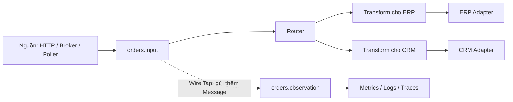
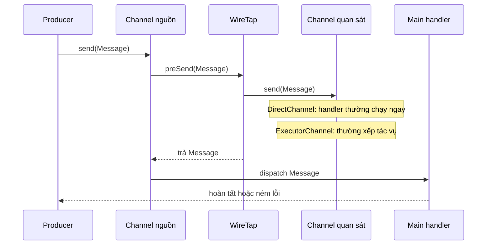
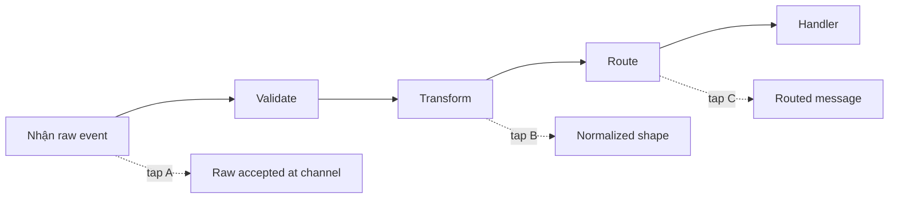

# Wire tap và quan sát luồng mà không thay đổi xử lý chính

Một luồng tích hợp Spring Boot thường phải nhận sự kiện từ HTTP, database, cache, message broker hoặc adapter của Spring Integration, sau đó định tuyến và biến đổi dữ liệu để phục vụ nghiệp vụ. Khi vận hành, nhóm phát triển cần biết thông điệp đi qua kênh nào, có đúng loại dữ liệu không, xử lý mất bao lâu và điểm nào bị nghẽn. Nhưng nếu nhúng câu lệnh ghi log, gửi metric hoặc gọi hệ thống audit trực tiếp vào handler nghiệp vụ, việc quan sát có thể làm logic chính chậm hoặc thay đổi kết quả.

**Wire Tap** là một mẫu tích hợp (Enterprise Integration Pattern) cho phép **quan sát bản tin đang đi qua một channel bằng cách gửi thêm nó đến một channel phụ**. Trong Spring Integration, `WireTap` là một `ChannelInterceptor`: nó tham gia vào quá trình gửi thông điệp, chuyển thông điệp tới nhánh phụ, rồi để luồng chính tiếp tục. Đây là công cụ hữu ích để gắn logging, diagnostics, metrics và một số nhu cầu audit **tại ranh giới message channel**.

Bài thuộc chương **Định tuyến và biến đổi** trong mô-đun **SPRING_BOOT_INTEGRATION**: tích hợp hệ thống Spring Boot qua HTTP client, cơ sở dữ liệu, cache, broker thông điệp và Spring Integration, chú trọng cấu hình, hợp đồng dữ liệu, giao dịch, lỗi, xử lý trùng lặp, kiểm thử và quan sát luồng thực tế. Phạm vi bài là thiết kế nhánh quan sát bằng Wire Tap **mà không chủ ý can thiệp business routing, transformer và handler**; đồng thời làm rõ những điều kiện kỹ thuật cần thiết để đạt mức cô lập mong muốn.

Sau bài này, người học có thể:

- Mô tả chính xác Wire Tap can thiệp ở đâu và nó khác `router`, `transformer`, `filter`, `publish-subscribe`, `ChannelInterceptor` tùy biến như thế nào.
- Cấu hình Wire Tap bằng Spring Integration Java DSL và bằng global channel interceptor, chọn channel đích đồng bộ hoặc bất đồng bộ.
- Thu thập log/metric/trace một cách có kiểm soát mà không sửa nội dung message hoặc làm lộ dữ liệu nhạy cảm.
- Thiết kế chính sách khi nhánh quan sát lỗi, nghẽn, bị từ chối tác vụ hoặc xử lý bản tin trùng.
- Kiểm thử rằng kết quả và số lần gọi handler chính không thay đổi khi bật/tắt quan sát.

> **Phạm vi phiên bản:** ví dụ sử dụng Spring Boot hiện đại và Java DSL của Spring Integration, tương thích về mặt ý tưởng với dòng Spring Integration 6.x/7.x. Các overload, phiên bản Java yêu cầu và tên metric phụ thuộc dependency đang triển khai; cần kiểm tra API của phiên bản thực tế. Các tên channel, interface nghiệp vụ và giới hạn thread pool trong ví dụ đều mang tính minh họa.

## 1. Wire Tap nằm ở đâu trong luồng tích hợp?

### 1.1. Luồng chính và nhánh quan sát



Điều cần phân biệt:

1. Luồng chính vẫn gửi message từ `orders.input` sang router như cũ.
2. Wire Tap **gửi thêm** message đó sang `orders.observation`; nó không tự chia load hoặc chọn nhánh nghiệp vụ.
3. Nhánh quan sát có consumer riêng; việc nó chạy cùng thread hay thread khác do **loại MessageChannel đích** quyết định.
4. Nếu nhánh quan sát chỉ đọc metadata, không sửa payload/headers và xử lý lỗi đúng, handler nghiệp vụ có thể giữ nguyên hành vi mong đợi.

Đường chấm trong sơ đồ biểu diễn nhánh phụ về mặt logic, **không bảo đảm bất đồng bộ, không bảo đảm được nhận, cũng không bảo đảm lưu bền**.

### 1.2. Hành vi cốt lõi của Wire Tap

Ở mức đơn giản, `WireTap` gắn với một `InterceptableChannel` và thực hiện tương đương:

```text
người gửi → preSend(message, sourceChannel)
                   |
                   +---- tapChannel.send(message)
                   |
                   +---- trả lại message để sourceChannel gửi tiếp
                                         |
                                         v
                                  handler chính
```

Điểm mấu chốt: Spring Integration `WireTap` thường thực hiện việc gửi nhánh phụ tại `preSend` của channel nguồn. Việc quan sát được bản tin tại đây có ý nghĩa **"đã đến điểm gửi vào channel"**, không tự đồng nghĩa với **"đã xử lý thành công, đã commit database, đã publish ra broker"**. Nếu handler chính thất bại sau đó, nhánh tap có thể đã nhận và ghi lại sự kiện.

Không nên dùng dấu vết từ Wire Tap ở đầu flow làm bằng chứng cho việc nghiệp vụ hoàn thành. Nếu muốn ghi nhận trạng thái `COMPLETED` hoặc `FAILED`, cần quan sát tại điểm kết thúc phù hợp, qua error flow hoặc qua sự kiện được sinh **sau commit** tùy cam kết nghiệp vụ.

### 1.3. Message có thật sự được “nhân bản”?

`WireTap` truyền tiếp một `Message<?>` sang channel quan sát. Bản tin Spring Messaging thông thường có header map bất biến và không cho thay payload qua setter; **tính bất biến của vỏ Message không kéo theo tính bất biến của đối tượng payload**.

Ví dụ hai nhánh cùng thấy một `Message<OrderCommand>` mà `OrderCommand` chứa `ArrayList` có thể thay đổi. Nếu handler quan sát thêm phần tử vào list, dữ liệu mà handler chính đọc có thể thay đổi. Ngay cả khi một nhánh tạo Message mới, hai Message vẫn có thể giữ **tham chiếu đến cùng payload mutable**.

Quy tắc:

- Ưu tiên payload bất biến, như `record` chứa các giá trị bất biến.
- Không gọi setter trên DTO/collection mà Wire Tap nhận; không mutate object nằm trong header.
- Nếu audit cần thao tác độc lập với dữ liệu, chuyển thành **snapshot DTO bất biến** bằng cách sao chép có chủ đích, thay vì dựa vào giả định Wire Tap deep-copy.
- Không đưa thẳng `InputStream`, file stream, iterator/cursor dùng một lần vào nhánh đọc riêng: việc tiêu thụ stream ở nhánh tap có thể làm main handler không đọc được. Quan sát metadata trước hoặc materialize dữ liệu có giới hạn ở vị trí hợp lệ.

## 2. So sánh Wire Tap với các cách chia luồng khác

| Thành phần | Chức năng chính | Tác động lên luồng nghiệp vụ |
|---|---|---|
| `WireTap` | Gửi thêm message từ một channel sang channel quan sát | Luồng chính vẫn nhận message, nhưng thời gian và lỗi của thao tác tap **có thể** ảnh hưởng nếu không cô lập |
| `Router` | Chọn một hoặc nhiều đích theo điều kiện nghiệp vụ | Quyết định tuyến nhận message; bản chất là xử lý chính |
| `Transformer` | Tạo payload/header ở dạng mới | Cố ý thay đổi dạng dữ liệu được truyền tiếp |
| `Filter` | Chấp nhận hoặc loại message theo điều kiện | Có thể ngăn message đi tiếp |
| `PublishSubscribeChannel` | Phát tới nhiều subscriber | Mỗi subscriber là một nhánh nhận; thứ tự, lỗi và đồng bộ phụ thuộc cấu hình |
| `ChannelInterceptor` tùy biến | Hook trước/sau send/receive để kiểm soát/quan sát | Có quyền đổi, chặn hoặc làm lỗi việc gửi; phải chủ động giữ nguyên message |
| `MessageHistory`, trace, Micrometer | Theo dõi đường đi/thời lượng theo cấu hình | Công cụ observability riêng; không thay thế mọi nhu cầu phân nhánh dữ liệu |
| Outbox/event audit bền vững | Ghi bản ghi nghiệp vụ cùng giao dịch để chuyển phát sau | Phù hợp nghĩa vụ ghi nhận tin cậy hơn một tap trong bộ nhớ |

**Khi nào dùng Wire Tap?** Khi muốn thêm một nhánh logging, chẩn đoán, thống kê, sampling hoặc kiểm tra thông điệp ở điểm channel rõ ràng mà không viết lại router/transformer. Với nghiệp vụ bắt buộc lưu audit và có yêu cầu delivery guarantee, một Wire Tap đơn lẻ thường không đủ.

### 2.1. Phân biệt “quan sát” và “nghĩa vụ nghiệp vụ”

Một sự kiện `orderReceived` gửi tới Grafana/OTel để đếm là **telemetry**: có thể lấy mẫu hoặc mất một phần khi hệ thống quá tải theo chính sách đã định. Bản ghi `paymentAuthorized` phục vụ đối soát hoặc kiểm toán là **dữ liệu nghiệp vụ**: phải có hợp đồng về transaction, retry, retention, idempotency, phân quyền và khả năng phục hồi.

Không dùng cách đặt tên `auditChannel` để mặc định rằng message đã được persist. Tên kênh không tạo ra durability.

## 3. Cấu hình tối thiểu bằng Spring Integration Java DSL

### 3.1. Dependency và ranh giới trách nhiệm

Với dự án Gradle dùng Spring Boot tương thích, ví dụ:

```kotlin
dependencies {
    implementation("org.springframework.boot:spring-boot-starter-integration")
    implementation("org.springframework.boot:spring-boot-starter-actuator")
}
```

Bài sử dụng ba nhóm thành phần:

- **Nguồn và main flow**: nhận `OrderCommand`, xử lý theo logic hiện có.
- **Wire Tap trên channel nguồn**: gửi cùng message sang nhánh quan sát.
- **Observation flow**: trích metadata an toàn để ghi log/metric; không sửa payload và không gọi lại main flow.

Trong ví dụ này, handler nghiệp vụ và sink quan sát được biểu diễn bằng interface; trong hệ thống thực tế, chúng là các service/adapter mà ứng dụng tự cài đặt.

### 3.2. Ví dụ hoàn chỉnh về cách nối các thành phần

```java
package example.integration;

import java.math.BigDecimal;
import java.time.Instant;
import java.util.UUID;
import java.util.concurrent.Executor;

import org.springframework.beans.factory.annotation.Qualifier;
import org.springframework.context.annotation.Bean;
import org.springframework.context.annotation.Configuration;
import org.springframework.integration.channel.ExecutorChannel;
import org.springframework.integration.config.EnableIntegration;
import org.springframework.integration.dsl.IntegrationFlow;
import org.springframework.integration.dsl.MessageChannels;
import org.springframework.messaging.MessageChannel;
import org.springframework.scheduling.concurrent.ThreadPoolTaskExecutor;

@Configuration
@EnableIntegration
public class OrderWireTapConfiguration {

    // Các kiểu nghiệp vụ minh họa; triển khai thực tế do ứng dụng cung cấp.
    public record OrderCommand(String orderId, BigDecimal amount) { }

    public interface OrderService {
        void process(OrderCommand command);
    }

    public record ObservationRecord(
            UUID messageId,
            String observedStage,
            String payloadType,
            Instant recordedAt) { }

    public interface ObservationSink {
        void record(ObservationRecord record);
    }

    // Channel nguồn có gắn Wire Tap: main flow vẫn là subscriber bình thường.
    @Bean("orders.input")
    public MessageChannel ordersInput() {
        return MessageChannels.direct()
                .wireTap("orders.observation")
                .get();
    }

    // Nhánh quan sát có thread pool riêng.
    @Bean("orders.observation")
    public MessageChannel observationInput(
            @Qualifier("observationExecutor") Executor executor) {
        return new ExecutorChannel(executor);
    }

    @Bean("observationExecutor")
    public ThreadPoolTaskExecutor observationExecutor() {
        ThreadPoolTaskExecutor executor = new ThreadPoolTaskExecutor();
        executor.setCorePoolSize(2);
        executor.setMaxPoolSize(4);
        executor.setQueueCapacity(200);
        executor.setThreadNamePrefix("obs-");
        return executor;
    }

    // Luồng nghiệp vụ: không phải thêm lời gọi logger vào business handler.
    @Bean
    public IntegrationFlow orderFlow(OrderService orderService) {
        return IntegrationFlow.from("orders.input")
                .handle(message ->
                        orderService.process((OrderCommand) message.getPayload()))
                .get();
    }

    // Chỉ chuyển một số metadata đã được cho phép ra hệ thống quan sát.
    @Bean
    public IntegrationFlow observationFlow(ObservationSink sink) {
        return IntegrationFlow.from("orders.observation")
                .handle(message -> sink.record(
                        new ObservationRecord(
                                message.getHeaders().getId(),
                                "orders.input",
                                message.getPayload().getClass().getSimpleName(),
                                Instant.now())))
                .get();
    }
}
```

*Lưu ý về mã:* Đây là ví dụ cấu hình dễ tích hợp vào ứng dụng dùng Java hiện đại; cần tự cung cấp các bean `OrderService`, `ObservationSink` và điều chỉnh version theo Spring Boot đang dùng. `@EnableIntegration` được viết tường minh để dễ học; một số cấu hình Spring Boot với starter tương ứng đã bật Spring Integration bằng auto-configuration. Không cần `@IntegrationComponentScan` khi không khai báo integration gateway bằng annotation.

Giả sử REST adapter hoặc consumer tạo message đầu vào:

```java
Message<OrderWireTapConfiguration.OrderCommand> message =
        MessageBuilder.withPayload(
                new OrderWireTapConfiguration.OrderCommand(
                        "ORD-1042", new BigDecimal("89.00")))
            .setHeader("correlationId", "request-8f3")
            .build();

ordersInput.send(message);
```

Ở đây `ordersInput` là bean `MessageChannel` đã được inject theo tên `orders.input`; `MessageBuilder` thuộc `org.springframework.integration.support.MessageBuilder` hoặc `org.springframework.messaging.support.MessageBuilder` tùy lựa chọn API. Ví dụ không đưa thông tin khách hàng, thẻ hay access token vào sink quan sát.

**Điều kiện bất đồng bộ:** `ExecutorChannel` gửi công việc xử lý sang executor, nên handler quan sát thường chạy ngoài thread của người gửi và không chia sẻ ngữ cảnh transaction ở thread main. Tuy nhiên thao tác **đưa tác vụ vào executor** vẫn nằm trên đường gửi; khi pool/queue đầy, executor có thể từ chối công việc và phát sinh lỗi ngay từ bước tap.

### 3.3. Chọn channel cho nhánh quan sát

| Channel đích | Thread thực thi observer | Đặc điểm cần kiểm soát |
|---|---|---|
| `DirectChannel` | Thường cùng thread gửi message | Observer chậm/lỗi có thể làm sender chậm/lỗi; dễ dùng khi cần quan sát cùng transaction |
| `ExecutorChannel` | Thường thread từ `Executor` | Tách thời gian xử lý handler, nhưng phải kiểm soát queue, executor rejection, ngữ cảnh trace/transaction |
| `QueueChannel` | Consumer lấy message ở một thời điểm khác bằng poller | Có buffer, cần poller/capacity/timeout; in-memory queue không tự bảo đảm durable |
| `PublishSubscribeChannel` | Tùy có executor hay không | Phù hợp nhiều subscriber nhưng cần xác định cách fan-out, lỗi và thứ tự |
| Channel dẫn tới broker bền vững | Phụ thuộc adapter và mode gửi | Cần kiểm tra lúc nào broker xác nhận nhận bản tin, transaction/retry và failure handling |

Trong Spring Integration, **Wire Tap không tự bất đồng bộ**. Không nên chỉ nhìn sơ đồ nhánh phụ và khẳng định “main flow chắc chắn không chờ”. Việc chọn `DirectChannel` có thể là chủ đích khi nhánh audit phải tham gia cùng transaction; điều đó cần được đánh đổi bằng hợp đồng lỗi và độ trễ rõ ràng.

### 3.4. Tính đồng bộ và biên giao dịch



Với `ExecutorChannel`, transaction local gắn với thread gửi không tự lan sang thread xử lý observer; cũng không có bảo đảm observer chạy xong trước hay sau main handler. Nếu cần thông tin về commit, không được suy ra từ việc đã nhận bản sao tại Wire Tap.

## 4. Gắn Wire Tap ở vị trí nào?

### 4.1. Trên channel đã khai báo

Khi sở hữu cấu hình channel, cách rõ ràng nhất là gắn vào builder:

```java
@Bean("orders.input")
public MessageChannel ordersInput() {
    return MessageChannels.direct()
            .wireTap("orders.observation")
            .get();
}
```

Cách này làm điểm quan sát hiển thị ở nơi tạo channel, phù hợp khi mỗi channel có một mục đích ổn định. Chỉ nên dùng tên/bean của channel có nghĩa rõ ràng, tránh Wire Tap vô tình trỏ ngược vào nguồn và tạo vòng phản hồi.

### 4.2. Global Wire Tap theo tên channel

Nếu cần bật logging cho một nhóm channel mà không sửa từng builder, có thể dùng global interceptor:

```java
import org.springframework.context.annotation.Bean;
import org.springframework.integration.channel.interceptor.WireTap;
import org.springframework.integration.config.GlobalChannelInterceptor;

@Bean
@GlobalChannelInterceptor(patterns = "orders.input", order = 100)
public WireTap globalOrdersTap() {
    return new WireTap("orders.observation");
}
```

Ví dụ chỉ định đúng `orders.input`, không phải `orders.*`. Dùng wildcard phù hợp có thể giúp quan sát nhiều channel, nhưng cần rà soát **mọi channel khớp pattern**, nhất là channel của chính nhánh quan sát và error flow. Tránh gắn đồng thời một Wire Tap inline và một Wire Tap global tới cùng đích trừ khi cố ý tạo hai sự kiện; cách đó làm metric/log bị đếm trùng.

Một interceptor áp dụng toàn cục cũng có thứ tự tương đối với interceptor khác. Không phụ thuộc vào thứ tự để suy ra nghiệp vụ đã hoàn thành; thứ tự xử lý `preSend` vẫn nằm trước lần dispatch chính.

### 4.3. Wire Tap có điều kiện

Không phải tất cả thông điệp đều cần log chi tiết. Spring Integration cho phép chỉ tap các message qua `MessageSelector`:

```java
import org.springframework.context.annotation.Bean;
import org.springframework.integration.channel.interceptor.WireTap;
import org.springframework.integration.config.GlobalChannelInterceptor;

@Bean
@GlobalChannelInterceptor(patterns = "orders.input")
public WireTap importantOrdersTap() {
    return new WireTap(
            "orders.observation",
            message -> "HIGH".equals(message.getHeaders().get("priority")));
}
```

Với ví dụ này, chỉ message có header `priority=HIGH` được gửi sang nhánh phụ; tất cả message vẫn tiếp tục vào luồng chính như cấu hình ban đầu. Điều kiện chọn phải nhẹ, tránh truy vấn database, gọi API hoặc xử lý payload lớn ngay trong `preSend`.

Nếu nghiệp vụ cần lấy mẫu 1% sự kiện, thiết kế **sampling có chủ đích** ở nhánh quan sát; có thể dùng hash ổn định của correlation ID để các bước cùng một luồng có xác suất được chọn nhất quán. Ghi lại sampling rate để metric được diễn giải đúng. Không dùng random sampling cho audit bắt buộc đầy đủ.

## 5. Quan sát cái gì để vẫn bảo vệ dữ liệu?

### 5.1. Thiết kế bản ghi quan sát tối thiểu

Một observation record hữu ích thường có:

| Trường | Ví dụ | Cách sử dụng |
|---|---|---|
| `messageId` | UUID của Message | Phân biệt message tại điểm quan sát; không nhất thiết ổn định qua mọi phép biến đổi |
| `correlationId` | `req-8f3` | Nối các bước thuộc cùng một yêu cầu/flow nếu ứng dụng truyền header nhất quán |
| `stage/channel` | `orders.input` | Biết điểm quan sát, tránh nhầm ingress với success |
| `payloadType` | `OrderCommand` | Kiểm tra hợp đồng dữ liệu mà không cần log body |
| `payloadSize` | Số byte/ký tự đã đo an toàn | Theo dõi bất thường kích thước, cần tránh serialize toàn bộ payload chỉ để đo |
| `observedAt` | Timestamp | Phân biệt lúc nhận tại tap và lúc xử lý trong observer |
| `outcome` | Chỉ có khi đo đúng điểm kết thúc | Không tự đặt `SUCCESS` khi mới tap đầu vào |

Các metadata trên có thể hợp thành log sự kiện có cấu trúc hoặc metric. **Không** đưa full body HTTP, JWT, Authorization, cookie, mật khẩu, token kết nối DB hay dữ liệu cá nhân vào log chỉ vì “tap cho tiện”.

Nếu cần mã đơn hàng để hỗ trợ nghiệp vụ, quyết định đó phải đi qua phân loại dữ liệu và chính sách truy cập; không mặc định mọi order ID đều được phép xuất sang hệ thống quan sát. Khi cần ghép trace, dùng correlation ID hoặc span context đáng tin cậy thay cho việc log nguyên payload.

### 5.2. Log có cấu trúc và chi phí

Một sink minh họa:

```java
@Component
public class LoggingObservationSink
        implements OrderWireTapConfiguration.ObservationSink {

    private static final Logger log =
            LoggerFactory.getLogger(LoggingObservationSink.class);

    @Override
    public void record(OrderWireTapConfiguration.ObservationRecord event) {
        log.info(
                "integration_observed stage={} messageId={} payloadType={} recordedAt={}",
                event.observedStage(),
                event.messageId(),
                event.payloadType(),
                event.recordedAt());
    }
}
```

Đoạn trên dùng `org.slf4j.Logger`, `org.slf4j.LoggerFactory` và `org.springframework.stereotype.Component`; lược bỏ import cho dễ đọc. Mức `INFO` chỉ là ví dụ; khi lưu lượng cao, mỗi message một log có thể làm tăng đáng kể CPU, IO, chi phí lưu trữ và nhiễu khi điều tra. Có thể chọn sampling, mức `DEBUG` có thời hạn, hoặc dùng counter/histogram với nhãn có số giá trị hữu hạn.

**Không gắn `messageId` hoặc `correlationId` làm tag cho metric time series**: số giá trị khác nhau lớn sẽ làm bùng nổ cardinality. Hai trường này phù hợp với log/trace. Với metric, dùng những tag hữu hạn như `flow=orders`, `stage=ingress`, `result=accepted/rejected`, `adapter=erp/crm`.

### 5.3. Dùng metric và trace đúng chỗ

Wire Tap hữu ích khi muốn:

- Đếm message đi tới một stage.
- Thống kê phân phối `payloadType` hoặc luồng qua router, với tập label giới hạn.
- Phát hiện message có header định tuyến thiếu/sai hợp đồng.
- Gắn correlation ID vào log để đi từ HTTP → channel → adapter → broker.

Nhưng để đo **thời gian xử lý main handler**, nên instrument handler hoặc endpoint chính bằng timer/observation. Một Wire Tap chỉ nhìn thấy bản tin trước dispatch không đo được chính xác duration của handler. Để biết **lỗi** phải quan sát exception, error channel hoặc sự kiện thất bại tại boundary tương ứng. Để biết **đã commit** phải quan sát sau commit hoặc bản ghi bền vững ở DB.

Với Spring Boot Actuator, Micrometer/Observation và Spring Integration management, có thể có metric send/receive, timer/counter và integration graph tùy phiên bản/cấu hình. Kiểm tra danh mục metric thực tế qua hệ thống giám sát; không suy diễn rằng bật Wire Tap tự tạo trace span hoặc KPI nghiệp vụ mong muốn.

### 5.4. Correlation ID khi chuyển thread

Ví dụ có một request HTTP mang `traceId` trong MDC. Khi Wire Tap gửi sang `ExecutorChannel`, handler observer chạy trên thread pool khác; **MDC/ThreadLocal của thread người gửi không tự bảo đảm được truyền sang đó**.

Giải pháp tùy stack:

- Đọc correlation ID từ message header đã được kiểm soát thay vì dựa hoàn toàn vào ThreadLocal.
- Nếu có distributed tracing/Observation, cấu hình propagation theo thư viện, phiên bản và executor thực tế; có thể dùng task decorator hỗ trợ context propagation khi phù hợp.
- Không cho client tự khai báo mọi ID làm dữ liệu tin cậy; normalize/giới hạn độ dài và che dữ liệu nhạy cảm.
- Phân biệt event time ở stage main với processing time trong nhánh observer khi đánh giá độ trễ.

## 6. Bảo đảm “không làm thay đổi xử lý chính” trong thực tế

Tên Wire Tap gợi ý việc nghe lén không xâm lấn, nhưng mức cô lập đạt được phụ thuộc thiết kế. Ba loại tương tác cần được kiểm soát riêng:

1. **Tương tác dữ liệu:** observer mutate payload/header hoặc consume stream.
2. **Tương tác thời gian/tài nguyên:** observer chậm, queue đầy, CPU/heap và executor bị tranh chấp.
3. **Tương tác lỗi/transaction:** gửi sang tap bị exception, audit handler lỗi trong cùng thread, hoặc bản ghi quan sát được phát trước rollback.

### 6.1. Nhánh đồng bộ có thể chặn hoặc ném lỗi

Nếu target là `DirectChannel`, handler quan sát chạy trong luồng gửi thông thường. Trường hợp:

```java
@Bean("orders.observation")
public MessageChannel observationInput() {
    return new DirectChannel();
}
```

Một adapter audit ghi chậm hoặc ném exception có thể làm `send()` tại nguồn chậm/lỗi **trước khi handler chính được dispatch**. Đây không phải lỗi của business handler, nhưng là tác động trực tiếp lên đường xử lý chính. Chỉ chọn cách này khi chủ ý cần ngữ cảnh cùng thread/transaction và đã xác định rõ chính sách thất bại.

### 6.2. Nhánh bất đồng bộ vẫn có điểm chung

Với `ExecutorChannel`, observer thường chạy thread khác. Tuy nhiên:

- Phần enqueue/scheduling vẫn diễn ra trong đường gửi của main.
- Khi thread pool và hàng đợi đầy, executor có thể reject; ngoại lệ từ lúc gửi sang tap có thể chảy ngược lên sender.
- `CallerRunsPolicy` có thể buộc chính thread gửi chạy observation handler, khiến latencies tăng đột ngột.
- Observer chiếm CPU, memory, kết nối DB hoặc network chung vẫn có thể kéo chậm hệ thống.
- Nếu tiến trình crash sau khi tap được chấp nhận nhưng trước khi observer hoàn tất, dữ liệu quan sát trong bộ nhớ có thể mất.

Do đó, “có ExecutorChannel” chỉ là **một bước tách thời gian thực thi**, không phải cam kết không ảnh hưởng tuyệt đối.

### 6.3. Thiết kế chính sách mất dữ liệu quan sát

Với telemetry không thiết yếu, nên thống nhất một chính sách:

- **Giới hạn tải**: pool và queue bounded, cùng ngân sách CPU/memory.
- **Khi đầy**: có thể bỏ có đếm, lấy mẫu mạnh hơn, hoặc tạm dừng chức năng quan sát theo cấu hình. Cơ chế bỏ message **phải được triển khai có chủ đích**; một `WireTap` gắn thẳng `ExecutorChannel` với reject mặc định không tự làm điều này.
- **Cô lập lỗi**: lỗi của observer được ghi vào sink/error flow phù hợp; phân biệt lỗi lúc gửi/enqueue với lỗi trong handler chạy async.
- **Quan sát chính observer**: metric cho số nhận, số được gửi vào channel phụ, số xử lý thành công, số drop, rejection, lỗi và backlog.
- **Không làm main handler retry vì lỗi telemetry** nếu business contract không yêu cầu; kiểm tra lỗi/retry ở boundary phát message vào channel nguồn.
- **Không bỏ qua lỗi thật của main handler** khi thêm fallback cho nhánh phụ.

Có thể viết một adapter/channel chuyên dụng cho **best-effort observation**: nó bắt và phân loại lỗi gửi của nhánh quan sát, tăng counter `observation_dropped_total` rồi trả về kết quả phù hợp để main đi tiếp. Cách này cần test riêng, vì sai thiết kế exception handling có thể nuốt cả lỗi nghiệp vụ hoặc che khuất sự cố quan sát kéo dài. Không thể coi một Wire Tap mặc định đã có sẵn hợp đồng đó.

### 6.4. Trường hợp audit không được mất

Nếu yêu cầu “mọi lệnh chuyển tiền phải có audit record và có thể đối soát”, cần cân nhắc:

1. Ghi outbox/audit row **trong cùng transaction** với thay đổi dữ liệu nghiệp vụ.
2. Một worker chuyển tiếp từ outbox sang broker hoặc audit store theo cơ chế retry.
3. Sử dụng message key/idempotency key để consumer xử lý trùng an toàn.
4. Theo dõi độ trễ chuyển tiếp, số lần retry, dead-letter, retention và công cụ replay.

Wire Tap vẫn hữu ích để **quan sát hiệu năng và luồng đi**, nhưng không thay thế transactional outbox hoặc cơ chế audit có bảo đảm thích hợp. Một bản ghi tạo lúc tap ở ingress cũng không chứng tỏ giao dịch nghiệp vụ đã commit.

## 7. Giữ hợp đồng dữ liệu và ngữ nghĩa định tuyến

### 7.1. Không sửa headers dùng cho router

Giả sử main router dựa vào header:

```java
// Trong main flow minh họa:
.route(message -> message.getHeaders().get("destination"),
       mapping -> mapping
           .channelMapping("ERP", "erp.input")
           .channelMapping("CRM", "crm.input"))
```

Nếu observer thay đổi header `destination` hoặc chỉnh sửa DTO mà router đọc, đường đi nghiệp vụ có thể thay đổi. Wire Tap nên đối xử với message như dữ liệu chỉ đọc. Nếu nhánh quan sát cần header `observationStage`, hãy tạo một observation DTO riêng trong nhánh observer, không sửa message nguồn.

Các thông tin như `replyChannel` và `errorChannel` cũng là một phần của cơ chế messaging. Không đổi chúng ở nhánh tap; việc gửi response qua channel được chia sẻ hoặc gọi handler trả lời không chủ ý dễ gây tín hiệu lặp hoặc lỗi định tuyến.

### 7.2. Điểm quan sát quyết định ý nghĩa dữ liệu



Ba tap có ý nghĩa khác nhau:

- **Tap A**: biết raw event tới trước validate; có thể gồm event sẽ bị từ chối sau đó.
- **Tap B**: thấy hình dạng đã chuẩn hóa nếu đặt sau bước transform thành công; phù hợp phát hiện hợp đồng dữ liệu sau chuyển đổi.
- **Tap C**: thấy message tại kênh sau router; giúp xác nhận nhánh được chọn, nhưng chưa chứng minh handler đích đã xử lý thành công.

Không dùng chung tên metric `processed_total` cho cả ba stage. Nên dùng `received_total`, `validated_total`, `routed_total` hoặc tên khác thể hiện rõ ý nghĩa, đồng thời phân biệt “attempted”, “accepted”, “completed” khi thiết kế telemetry.

### 7.3. Dữ liệu bị gửi lại và xử lý trùng

Những đường có Kafka, RabbitMQ, HTTP retry, DB poller hoặc transactional redelivery có thể phát sinh nhiều lần chuyển cùng sự kiện. Wire Tap sẽ thấy message mỗi lần đi qua channel phù hợp; **một business event có thể tạo nhiều observation**.

Nên xác định rõ:

- `messageId` của Spring Message không mặc định là id nghiệp vụ xuyên mọi lần retry/reconstruction.
- `eventId` hoặc idempotency key do nguồn cung cấp nên được lưu và truyền nhất quán nếu cần đối soát.
- Metric số lần thử chuyển và số event nghiệp vụ duy nhất không phải cùng một đại lượng.
- Nếu tạo observation record đưa vào broker/audit store, consumer phải xử lý duplicate theo khóa và retention phù hợp.

Đừng loại bỏ duplicate của hệ thống quan sát bằng cách bỏ luôn message ở main flow. Việc dedup nghiệp vụ thuộc vị trí và hợp đồng xử lý riêng.

## 8. Giám sát chính nhánh quan sát

Một nhánh quan sát bị nghẽn cũng cần runbook. Tối thiểu nên theo dõi:

| Nhóm tín hiệu | Ví dụ | Khi nào điều tra |
|---|---|---|
| Lưu lượng nguồn | Tổng message vào `orders.input` | Thay đổi bất thường so với request/job/broker ingress |
| Nhánh tap | Số được chọn và cố gửi sang tap | Chênh lệch với số message theo điều kiện chọn |
| Executor/queue | Active threads, queue depth, remaining capacity | Backlog tăng kéo dài, queue gần đầy |
| Rejection/drop | Số tác vụ bị từ chối, telemetry bị bỏ theo chính sách | > 0 kéo dài hoặc vượt ngân sách mất dữ liệu |
| Handler quan sát | Duration, error rate, timeout | Sink log/metric/broker bị chậm hoặc lỗi |
| Hệ thống chính | Main handler latency, throughput, error rate | Có tương quan xấu khi bật tap hoặc lúc observer nghẽn |

Chỉ so sánh count nếu hiểu rõ **filter/sampling, retry, message fan-out và async delay**. Ví dụ, trong cửa sổ một phút, số message xử lý bởi observer có thể nhỏ hơn số message vào tap vì backlog đang tăng, chưa chắc là mất dữ liệu.

### 8.1. Không tự tạo vòng lặp

Nếu cấu hình global Wire Tap quá rộng, một sự kiện đi vào `orders.observation` có thể bị tap thêm lần nữa. Kết quả là log đệ quy, duplicate vô hạn hoặc queue tăng bất thường. Tránh bằng tên channel/namespace rõ ràng, pattern chỉ áp vào các stage cụ thể, và kiểm thử không lặp. Với global interceptor, phải kiểm tra toàn bộ danh sách channel khớp sau khi ứng dụng khởi động và cả những channel được tạo động.

### 8.2. Không để observation trở thành nguồn làm nghẽn DB

Một lỗi vận hành thường gặp: mỗi message sang tap lại ghi audit bằng SQL transaction mới, cùng database connection pool với main handler. Nếu observer tăng tải cùng luồng chính, nó có thể tiêu thụ hết pool, làm hoạt động nghiệp vụ chậm đúng vào lúc cần quan sát nhất.

Cần ước lượng số truy vấn phụ, connection pool riêng khi thực sự cần, và độ bền dữ liệu audit. Nếu chỉ cần telemetry, ưu tiên sink chuyên dụng/batching với giới hạn tải. Nếu cần outbox/audit nghiệp vụ, xác định transaction và ngân sách kết nối thay vì gửi mọi sự kiện qua một handler JDBC không giới hạn.

### 8.3. Tạm tắt quan sát khi sự cố

Khi có feature flag/bật tắt tap động, phải xác định liệu nó chỉ ảnh hưởng phát sự kiện phụ hay có ảnh hưởng đến cấu hình kênh và transaction. Lệnh dừng `WireTap` theo lifecycle API có thể được dùng trong vận hành nếu đã thiết kế/cấp quyền phù hợp; không dùng thao tác hot toggle ngẫu hứng khi hệ thống yêu cầu audit đầy đủ. Việc bật/tắt nên có log thay đổi cấu hình và dashboard xác nhận số message được tap thay đổi như dự kiến.

## 9. Kiểm thử sao cho chứng minh được luồng chính vẫn đúng

### 9.1. Kiểm thử hành vi cơ bản không cần Spring Boot context

Ví dụ JUnit 5 + AssertJ dùng trực tiếp các channel của Spring Integration:

```java
import static org.assertj.core.api.Assertions.assertThat;

import java.util.concurrent.atomic.AtomicInteger;
import java.util.concurrent.atomic.AtomicReference;

import org.junit.jupiter.api.Test;
import org.springframework.integration.channel.DirectChannel;
import org.springframework.integration.channel.QueueChannel;
import org.springframework.integration.channel.interceptor.WireTap;
import org.springframework.messaging.Message;
import org.springframework.messaging.support.MessageBuilder;

class WireTapBehaviorTest {

    @Test
    void tapObservesWithoutChangingMainMessage() {
        DirectChannel main = new DirectChannel();
        QueueChannel observed = new QueueChannel(4);
        main.addInterceptor(new WireTap(observed));

        AtomicInteger businessInvocations = new AtomicInteger();
        AtomicReference<Message<?>> businessMessage = new AtomicReference<>();

        main.subscribe(message -> {
            businessInvocations.incrementAndGet();
            businessMessage.set(message);
        });

        Message<String> original =
                MessageBuilder.withPayload("ORD-1042")
                    .setHeader("destination", "ERP")
                    .build();

        assertThat(main.send(original)).isTrue();

        Message<?> tapped = observed.receive(1000);

        assertThat(tapped).isSameAs(original);
        assertThat(businessMessage.get()).isSameAs(original);
        assertThat(businessInvocations.get()).isEqualTo(1);
        assertThat(original.getHeaders().get("destination")).isEqualTo("ERP");
    }
}
```

Ở đây `WireTap` nhận trực tiếp instance `QueueChannel` nên không cần BeanFactory để resolve tên channel. Kiểm thử dùng `QueueChannel` làm **probe** nhằm đọc bản tin; nó không biểu diễn đầy đủ ứng xử của cấu hình `ExecutorChannel` trong production. Việc `tapped` và `original` có thể cùng tham chiếu chính là lời nhắc phải giữ payload bất biến.

Điều kiểm thử xác nhận: nguồn gửi đúng một lần; handler chính nhận đúng một message; tap có bản tin để quan sát; header dùng cho route không bị chỉnh sửa. Một phép kiểm thử tương tự ở integration level nên xác nhận output cuối/side effects nghiệp vụ trước và sau khi bật tap.

### 9.2. Ma trận kiểm thử failure isolation

| Kịch bản | Thiết lập | Điều cần chứng minh |
|---|---|---|
| Đường bình thường | Gửi message qua channel có tap | Main handler chạy đúng một lần; observer thấy event hợp lệ |
| Observer chậm | Delay sink quan sát có kiểm soát | Với async target, main latency không tăng tỷ lệ thuận với duration observer khi queue chưa đầy |
| Observer ném lỗi | Cho sink lỗi sau khi nhận message | Lỗi được ghi nhận theo async error policy; không che mất lỗi main |
| Executor đầy | Pool/queue nhỏ, gửi tải có giới hạn | Hành vi rejection đúng hợp đồng; nếu best-effort thì có counter drop và main vẫn đạt yêu cầu |
| Payload mutable | Dùng DTO có collection mutable | Observer không sửa state; cân nhắc bất biến/snapshot |
| Payload nhạy cảm | Message có header secret giả lập | Log/metric/sink không chứa secret hoặc full body |
| Duplicate/retry | Phát cùng eventId nhiều lần | Metric phân biệt attempts và unique events theo thiết kế |
| Global interceptor wildcard | Khởi động đầy đủ các channel | Không tap nhầm observation/error channel, không vòng lặp |
| Cấu hình on/off | Bật/tắt tap có kiểm soát | Business routing/output giữ nguyên; chỉ telemetry thay đổi |

Đối với `ExecutorChannel`, không dùng `Thread.sleep` và kỳ vọng thứ tự cố định giữa main handler và observer. Dùng `CountDownLatch`, `Awaitility` hoặc cơ chế đồng bộ có timeout để đợi tín hiệu riêng của observer. Kiểm thử ở môi trường có thread pool riêng, giới hạn tài nguyên và mô phỏng đầy queue; không thử nghẽn nhân tạo trên production.

### 9.3. Contract test cho điểm quan sát

Nên có ít nhất một trường hợp trong đó business handler ném lỗi sau khi message đi qua tap. Kỳ vọng: observation tại ingress có thể vẫn được phát, nhưng hệ thống **không được gán** bản tin đó thành `SUCCESS`. Nếu có observation sau commit, kiểm tra nó chỉ xuất hiện khi giao dịch thực sự hoàn tất.

Việc này phát hiện lỗi rất phổ biến: dashboard đếm mỗi ingress message như một đơn hàng đã xử lý xong.

## 10. Tình huống thực tế trong hệ thống tích hợp

### Tình huống A — quan sát route qua ERP/CRM

**Bối cảnh:** một service nhận `CustomerUpdated`, transform từ hợp đồng HTTP thành schema nội bộ, sau đó router gửi sang ERP hoặc CRM. Đội vận hành muốn biết message bị rẽ nhánh sai ở đâu.

**Thiết kế:** đặt tap ở channel sau bước normalize và trước router để xem `schemaVersion`/`destination`; đặt tap riêng ở output channel của từng route nếu cần đếm lưu lượng theo nhánh. Giữ payload bất biến; dùng metric label `destination` với tập giá trị hữu hạn.

**Cách đọc kết quả:** tap trước router cho biết điều kiện đầu vào; tap ở `erp.input` cho biết đã gửi tới kênh ERP; muốn biết ERP xác nhận thành công thì cần instrumentation tại adapter/response hay sự kiện kết thúc tương ứng.

### Tình huống B — logging làm tăng độ trễ HTTP

**Bối cảnh:** Wire Tap nối vào `DirectChannel`, handler phụ gửi log sang một REST endpoint. Khi endpoint chậm 4 giây, API chính cũng chậm.

**Nguyên nhân:** `DirectChannel` gọi handler trong thread gửi; tap ở `preSend` nên sender chờ sink phụ.

**Giải pháp:** chuyển sang nhánh async có pool/queue giới hạn, ưu tiên xuất log qua hệ thống logging/telemetry chuyên dụng, cấu hình timeout và chính sách từ chối tác vụ phù hợp. Đo độ trễ API trước/sau dưới cùng tải và bắt buộc kiểm thử khi queue đầy.

### Tình huống C — bật async nhưng vẫn lỗi lúc tải tăng

**Bối cảnh:** handler quan sát chạy trên `ExecutorChannel`. Khi tải đột biến, log cho thấy `TaskRejectedException` và một số request chính thất bại.

**Nguyên nhân:** task submission vào executor xảy ra trên đường tap; async không loại bỏ sự cố enqueue/reject.

**Giải pháp:** xác định telemetry có được phép mất không. Nếu có, triển khai đường gửi **best-effort có đếm drop**, giới hạn lượng telemetry và không retry vô hạn. Nếu không được mất, thiết kế lại đường lưu trữ bền vững với ngân sách đủ. Kiểm tra sự tăng trưởng queue, CPU và trạng thái application trên hệ thống giám sát.

### Tình huống D — audit ghi nhận “thành công” dù transaction rollback

**Bối cảnh:** Wire Tap ở `orders.input` ghi `ORDER_COMPLETED`, nhưng handler cập nhật SQL sau đó ném exception và rollback.

**Nguyên nhân:** tap tại ingress chạy trước handler chính; thông điệp đến tap không mang nghĩa đã commit.

**Giải pháp:** đổi tên sự kiện thành `ORDER_RECEIVED` khi đặt tap ingress. Nếu cần `ORDER_COMPLETED`, phát từ điểm sau commit hoặc qua outbox cùng transaction nghiệp vụ; bổ sung kiểm thử rollback và retry/idempotency.

### Tình huống E — logger gây sai lệch payload

**Bối cảnh:** payload chứa một `List<Item>` mutable, handler quan sát chuẩn hóa list trực tiếp trước khi log. Một số đơn hàng bên chính mất mục dữ liệu.

**Nguyên nhân:** hai nhánh giữ tham chiếu tới cùng payload. Wire Tap không deep-copy.

**Giải pháp:** dùng payload immutable, dựng observation projection từ dữ liệu được phép đọc, không mutate đối tượng gốc. Kiểm thử cùng một message đi qua observer và main handler khi xử lý đồng thời.

## 11. Runbook điều tra sự cố Wire Tap

Khi xuất hiện lỗi sau khi bật quan sát, kiểm tra theo thứ tự:

1. **Xác định điểm gắn:** kênh nguồn, channel đích, loại channel, pattern global, selector và thứ tự interceptor.
2. **Đối chiếu thời điểm:** latency/error của main trước và sau khi bật tap; có tăng đồng thời với backlog observer không?
3. **Xem executor/queue:** số thread, queue capacity, rejection policy, task duration, số lần bị drop và lỗi.
4. **Phân biệt lỗi lúc send và lỗi trong handler:** lỗi enqueue có thể ảnh hưởng sender; lỗi trong async handler cần đi vào error handling đã cấu hình.
5. **Đối chiếu dữ liệu:** payload có mutable/stream không? Có header nghiệp vụ bị đổi hoặc message phụ quay ngược vào kênh nguồn không?
6. **Đối chiếu nghĩa của event:** tap ở ingress hay post-transform/post-route? Có đang đếm event đầu vào thành kết quả đã hoàn tất?
7. **Xác nhận khi giảm/bật lại tap có kiểm soát:** business output, side effect, error rate và p95/p99 không lệch; đồng thời telemetry đúng chính sách.

Một checklist ngắn để review cấu hình trước khi deploy:

- [ ] Tap gắn ở channel cần quan sát; global pattern loại trừ observer/error channel và tránh double tap.
- [ ] Nhánh phụ chỉ đọc Message, header và payload; stream dùng một lần được xử lý đặc biệt.
- [ ] Mức độ cách ly (direct/executor/queue) khớp mục tiêu về latency và transaction.
- [ ] Có ngân sách queue/thread và chính sách rõ khi observer chậm, lỗi hoặc bị reject.
- [ ] Không log secret, thông tin cá nhân, full body mặc định; metric labels có cardinality hữu hạn.
- [ ] Correlation ID, event ID và tên stage thể hiện đúng ý nghĩa; không ngộ nhận ingress là completed.
- [ ] Có test main flow, exception, queue full, mutable payload, retry và duplicate.
- [ ] Nếu audit bắt buộc, đã có cơ chế bền vững/idempotency độc lập với telemetry best-effort.

## 12. Ghi nhớ và tài liệu tham khảo

**Wire Tap giúp thấy thông điệp đi qua một ranh giới channel mà không phải chèn logic quan sát vào từng router/transformer/handler.** Nó có thể gửi cùng Message sang luồng phụ và giữ logic nghiệp vụ ở tuyến chính. Nhưng muốn nhánh quan sát *thực sự ít ảnh hưởng*, cần kiểm soát dữ liệu chia sẻ, chọn channel, xử lý lỗi và giới hạn tài nguyên. Một tap ở đầu vào chỉ chứng minh có message **đi tới điểm tap**, không chứng minh xử lý nghiệp vụ đã thành công.

Tài liệu chính thức để đối chiếu theo version:

- [Spring Integration — Configuring Message Channels / Wire Tap](https://docs.spring.io/spring-integration/reference/channel/configuration.html).
- [Spring Integration — Java DSL `MessageChannelSpec.wireTap()`](https://docs.spring.io/spring-integration/reference/dsl/java-wiretap.html).
- [Spring Integration — Message Channel Implementations](https://docs.spring.io/spring-integration/reference/channel/implementations.html).
- [Spring Integration — Message and Payload Immutability](https://docs.spring.io/spring-integration/reference/message.html).

Những tài liệu này giải thích chức năng `WireTap`, cách gắn vào channel, sự khác nhau giữa channel đồng bộ/bất đồng bộ và giới hạn bất biến của Message. Khi hiện thực hóa cho production, đối chiếu trực tiếp với tài liệu Spring Integration của **phiên bản đang dùng** và yêu cầu nghiệp vụ đối với log, audit, transaction, retry và dữ liệu nhạy cảm.
