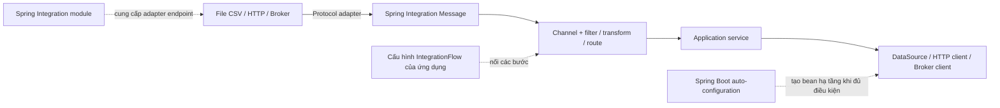
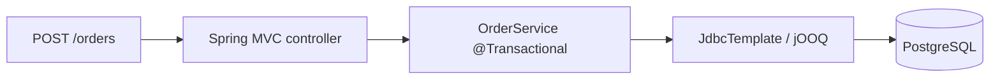
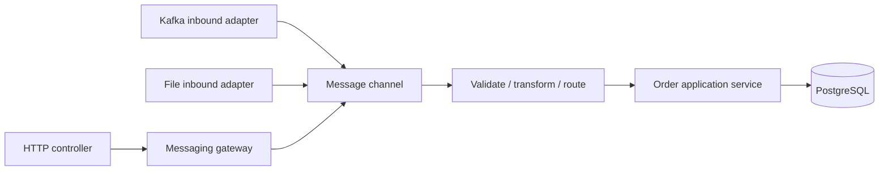
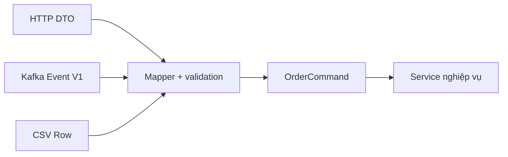

# Lựa chọn module adapter và phân biệt phần Boot tự cấu hình

Trong **SPRING_BOOT_INTEGRATION**, ứng dụng Spring Boot thường kết nối nhiều kiểu hệ thống: HTTP API, cơ sở dữ liệu, cache, broker thông điệp, file và hệ thống của đối tác. Spring Integration cung cấp các **adapter** để đưa dữ liệu từ hệ thống bên ngoài vào luồng `Message` hoặc gửi dữ liệu từ luồng đó ra ngoài. Spring Boot, mặt khác, giúp tạo và cấu hình một số **hạ tầng** dựa trên dependency, property và điều kiện của ứng dụng. Hai khả năng này bổ sung cho nhau nhưng không đồng nghĩa.

Bài thuộc chương **Adapter tích hợp** tập trung trả lời hai câu hỏi thực hành: **khi nào nên thêm module adapter nào** và **những gì Boot thực sự tự cấu hình thay cho lập trình viên**. Các ví dụ làm rõ ranh giới giữa hợp đồng dữ liệu, giao dịch, xử lý lỗi, chống trùng lặp, kiểm thử và quan sát một luồng tích hợp. Cú pháp minh họa dựa trên mô hình Spring Boot 3.x / Spring Integration 6.x; khi dùng phiên bản khác, cần đối chiếu dependency và API theo BOM của dự án.

## 1. Mục tiêu học tập

Sau bài này, bạn có thể:

1. Phân biệt **starter**, **module Spring Integration**, **bean do Boot tự cấu hình** và **endpoint/flow do ứng dụng khai báo**.
2. Chọn đúng module cho HTTP, JDBC, AMQP, Kafka, JMS, Redis, file, SFTP và các kết nối thường gặp.
3. Nhận diện inbound/outbound, adapter/gateway, cơ chế đẩy/sử dụng poller và ý nghĩa của từng lựa chọn.
4. Cấu hình một flow dùng adapter, quản lý thuộc tính môi trường và xác minh thành phần nào thực sự được tạo.
5. Xác định ranh giới transaction, retry, idempotency và tín hiệu quan sát khi adapter làm việc với hệ thống bên ngoài.
6. Thiết kế kiểm thử đủ để chứng minh flow hoạt động, thay vì chỉ kiểm tra ứng dụng đã khởi động.

## 2. Bốn lớp thường bị nhầm lẫn

Giả sử dịch vụ nhận file CSV định kỳ, đọc dữ liệu và ghi xuống PostgreSQL. Có bốn lớp khác nhau:

| Lớp | Vai trò | Ví dụ |
| --- | --- | --- |
| Thư viện giao tiếp/hạ tầng | Cung cấp API kết nối, driver, client, pool | JDBC driver PostgreSQL, `DataSource`, Spring JDBC, Kafka client |
| Spring Boot starter/auto-configuration | Kéo các dependency tiện dụng và, khi điều kiện phù hợp, tạo bean hạ tầng | `spring-boot-starter-jdbc` + thuộc tính `spring.datasource.*` |
| Module Spring Integration | Cung cấp các loại message endpoint và adapter cho giao thức hoặc nguồn dữ liệu | `spring-integration-file`, `spring-integration-jdbc` |
| Flow do ứng dụng khai báo | Quy định luồng nào chạy, poll khi nào, nhận message nào, chuyển đổi và xử lý ở đâu | `@Bean IntegrationFlow`, file inbound adapter, filter, service activator |



**Dependency không tự xác định nghiệp vụ.** Thêm `spring-integration-file` vào classpath không khiến ứng dụng tự quét một thư mục bất kỳ. Thêm `spring-integration-kafka` không khiến ứng dụng tự subscribe mọi topic. Boot có thể tạo connection factory hoặc client template phù hợp, nhưng tên topic, thư mục, lịch poll, cách ánh xạ DTO và hành vi khi gặp lỗi là những quyết định ứng dụng phải đưa ra.

Điều ngược lại cũng quan trọng: **không phải kết nối nào cũng cần Spring Integration**. Một controller gọi `RestClient` rồi lưu dữ liệu bằng `JdbcTemplate` có thể đủ rõ ràng. Spring Integration phù hợp hơn khi bài toán cần phối hợp các message endpoint, kênh, chuyển đổi, lọc, định tuyến, polling hoặc xử lý message từ nhiều nguồn theo một mô hình luồng thống nhất.

## 3. Adapter và gateway: chiều đi và kiểu trao đổi

Trong Spring Integration, **message** mang payload, headers và ngữ cảnh định tuyến. Adapter nối message với giao thức bên ngoài; gateway biểu diễn trao đổi **yêu cầu–phản hồi**. Một số adapter nhận sự kiện chủ động (message-driven); số khác phải lấy dữ liệu định kỳ bằng poller.

| Thành phần | Chiều dữ liệu | Đặc điểm | Ví dụ |
| --- | --- | --- | --- |
| Inbound channel adapter | Hệ ngoài → channel | Nhận hoặc lấy dữ liệu và phát `Message`, thường không chờ reply nghiệp vụ | Đọc file mới, đọc hàng đợi rồi phát message |
| Inbound gateway | Hệ ngoài → flow → hệ ngoài | Nhận request và trả response trong hợp đồng của giao thức | HTTP inbound gateway trả kết quả đồng bộ |
| Outbound channel adapter | Channel → hệ ngoài | Gửi dữ liệu, thường theo kiểu một chiều | Gửi thông báo ra broker hoặc ghi file |
| Outbound gateway | Channel → hệ ngoài → flow | Gọi bên ngoài và đưa phản hồi trở lại flow | HTTP outbound gateway gọi REST API đối tác |

Tên **inbound/outbound** được nhìn từ phía ứng dụng Spring Integration: *inbound* là đi vào flow; *outbound* là đi ra hệ thống khác. Không suy ra request/reply chỉ từ tên giao thức: HTTP có inbound gateway và outbound gateway, còn AMQP/JMS có cả thành phần một chiều lẫn request–reply.

`@MessagingGateway` là một kiểu **giao diện Java** để gọi vào/nhận kết quả từ Spring Integration flow qua channel. Nó không tự biến ứng dụng thành HTTP server hay broker consumer. Endpoint giao thức thực tế vẫn cần một adapter/gateway thích hợp hoặc một controller/consumer bên ngoài gọi vào gateway Java đó.

### Message-driven và polling

- **Message-driven**: nguồn đẩy sự kiện, adapter hoặc listener nhận callback/message rồi đưa vào channel. Ví dụ: listener AMQP hoặc Kafka consumer container. Phải xử lý ack, concurrency và redelivery theo giao thức.
- **Polling**: ứng dụng chủ động hỏi nguồn theo nhịp. Ví dụ: thư mục file, bảng database cần quét, endpoint mà chỉ hỗ trợ lấy dữ liệu định kỳ. Phải chọn `fixedDelay`/`fixedRate`, batch size, khóa cạnh tranh và cách lưu tiến độ.

Poller không phải timer chỉ để "đánh thức" flow. Một lần poll có thể lấy 0, 1 hoặc nhiều message, tùy adapter và cấu hình. Nếu poll quá nhanh, có thể làm đầy pool kết nối hoặc phát trùng; nếu quá chậm, tăng độ trễ của tích hợp. Với nhiều instance cùng poll một nguồn, cần cơ chế phối hợp và khóa/claim dữ liệu phù hợp.

## 4. Bản đồ chọn module Spring Integration

Các module sau là **thành phần Spring Integration**. Tên module dùng để chọn adapter cần thêm vào dependency; chúng khác với dependency chỉ cung cấp client hoặc hỗ trợ Boot tự cấu hình kết nối.

| Bài toán | Module adapter thường dùng | Phần hạ tầng liên quan và lưu ý |
| --- | --- | --- |
| Nhận hoặc gọi HTTP qua flow | `spring-integration-http` | Có inbound/outbound HTTP gateway; có thể cần Spring MVC/HTTP client tương ứng. Nếu chỉ có vài endpoint, `@RestController` và `RestClient`/`WebClient` thường đơn giản hơn. |
| Đọc/ghi bảng theo cơ chế message | `spring-integration-jdbc` | Dùng `DataSource` và JDBC; khác với việc repository gọi `JdbcTemplate` trực tiếp. |
| Đẩy/nhận message với RabbitMQ/AMQP | `spring-integration-amqp` | Tận dụng connection factory, template/listener từ hệ sinh thái Spring AMQP; cần topology, ack, retry, DLQ riêng. |
| Đọc/ghi Kafka topic trong flow | `spring-integration-kafka` | Tận dụng Spring Kafka `ConsumerFactory`/`ProducerFactory`; cần group ID, offset/ack và semantics xử lý trùng. |
| Tích hợp broker JMS | `spring-integration-jms` | Cần JMS `ConnectionFactory`, broker cụ thể và cấu hình transaction/ack. |
| Redis pub/sub, stream hoặc message endpoint phù hợp | `spring-integration-redis` | Dựa trên Spring Data Redis và connection factory; khác với `CacheManager` dùng Redis làm cache. |
| Theo dõi/thao tác file cục bộ | `spring-integration-file` | File inbound/outbound adapter; cần poller, filter, di chuyển hoặc archive file đã xử lý. |
| Truyền file từ máy chủ SFTP | `spring-integration-sftp` | Cần session factory, xác thực, kiểm soát kết nối và đồng bộ file; không phải chỉ bật một thuộc tính Boot. |
| Gửi/nhận email | `spring-integration-mail` | Cần tài khoản, giao thức, xác thực và cách quản lý trạng thái email. |
| MQTT message flow | `spring-integration-mqtt` | Cần MQTT client, broker, QoS và chính sách reconnect/duplicate. |

Danh sách không có nghĩa phải thêm tất cả. Chỉ khai báo module đang dùng và các dependency hỗ trợ giao thức tương ứng, dùng Spring Boot dependency management/BOM để giữ version tương thích. Phiên bản Spring Boot/Spring Integration khác nhau có thể tổ chức starter hoặc dependency bổ trợ khác nhau; hãy kiểm tra bộ phiên bản cụ thể khi bổ sung một adapter.

### Khi nào không cần module adapter riêng?

| Nhu cầu thực tế | Lựa chọn đủ dùng | Khi nào mới cân nhắc Spring Integration adapter? |
| --- | --- | --- |
| Controller gọi một REST API để lấy dữ liệu | Spring Web `RestClient` hoặc `WebClient` trong service | Khi gọi HTTP là một bước trong flow có routing, transform, retry và các channel. |
| Ghi/đọc SQL nghiệp vụ trong transaction | `JdbcTemplate`, `NamedParameterJdbcTemplate`, jOOQ hoặc JPA | Khi muốn biến bảng/luồng thay đổi thành nguồn message hoặc dùng JDBC như một message endpoint. |
| Dùng Redis để cache kết quả truy vấn | Spring Cache + Redis `CacheManager` | Khi muốn tích hợp message qua Redis thay vì chỉ cache. |
| Gửi một message Kafka từ service | `KafkaTemplate` với Spring Kafka | Khi cần adapter hòa vào pipeline `Message` của Spring Integration. |
| Một API HTTP chỉ nhận request rồi gọi service | `@RestController`/Spring MVC | Khi inbound endpoint cần được biểu diễn như gateway của flow tích hợp. |

Nguyên tắc lựa chọn là **bắt đầu từ đặc tính luồng**, không bắt đầu từ danh sách adapter có sẵn: hệ thống nào khởi phát dữ liệu, có cần reply hay không, xử lý đồng bộ hay bất đồng bộ, tốc độ dữ liệu, tính nhất quán cần đạt và cách hồi phục khi lỗi.

## 5. Boot tự cấu hình đến đâu?

**Spring Boot auto-configuration** là tập các cấu hình có điều kiện theo classpath, property, trạng thái bean sẵn có và một số điều kiện khác. Starter là gói dependency tiện dụng; starter tự nó không phải một flow tích hợp. Boot có thể giúp tạo bean hạ tầng và tích hợp cấu hình, nhưng không biết nghiệp vụ muốn lấy dữ liệu từ topic nào hay gọi đối tác nào.

| Khi có dependency và cấu hình phù hợp | Boot có thể cung cấp | Ứng dụng vẫn phải định nghĩa |
| --- | --- | --- |
| `spring-boot-starter-integration` / Spring Integration core | Hạ tầng Spring Integration và tích hợp với Spring Boot; hỗ trợ phát hiện/cấu hình các thành phần cần thiết theo điều kiện | `IntegrationFlow`, `MessageChannel` riêng khi cần, endpoint, luật xử lý message. |
| JDBC starter + driver + `spring.datasource.*` | `DataSource`, connection pool, `JdbcTemplate`, transaction manager phù hợp | SQL, mapping DTO, ranh giới nghiệp vụ và cách retry/idempotency. |
| Spring AMQP starter + `spring.rabbitmq.*` | Connection factory, template và hạ tầng Spring AMQP theo điều kiện | Queue/exchange/routing key cần dùng, consumer/flow, dead-letter và nghiệp vụ xử lý. |
| Spring Kafka + `spring.kafka.*` | Producer/consumer factory, `KafkaTemplate` và hạ tầng Kafka thích hợp theo classpath/bean | Topic, group, adapter/listener cụ thể, offset policy và hợp đồng event. |
| Spring Data Redis starter + `spring.data.redis.*` | Redis connection factory và một số bean truy cập Redis theo điều kiện | Cache policy, Redis message adapter nếu cần, phân quyền dữ liệu và TTL. |
| Spring Web / HTTP client | Dispatcher/HTTP client builder và hạ tầng web tương ứng theo điều kiện | Route HTTP, endpoint controller hoặc Spring Integration HTTP gateway, timeout và hợp đồng đối tác. |

Đây là **khả năng tự cấu hình có điều kiện**, không phải lời hứa tất cả bean trong cột giữa luôn xuất hiện. Chẳng hạn, nếu bạn khai báo một `DataSource` tùy chỉnh, Boot có thể không tạo bean mặc định tương ứng; nếu có nhiều nguồn dữ liệu hay nhiều transaction manager, cần `@Qualifier`/`@Primary` và cấu hình flow chính xác. Thuộc tính trong `application.yml` chỉ được sử dụng khi có auto-configuration hoặc bean của ứng dụng thật sự đọc nó.

Phân biệt thêm ba cơ chế:

1. **Auto-configuration**: Boot đánh giá điều kiện để tạo bean hạ tầng có tính phổ biến.
2. **Component scan / bean definition**: lớp `@Configuration`, `@Bean`, `@Service` hoặc các annotation liên quan thực sự khai báo thành phần ứng dụng.
3. **Binding property**: `@ConfigurationProperties` nhận giá trị cấu hình cho bean do Boot hoặc ứng dụng đăng ký; **binding không tự tạo nghiệp vụ**.

Vì vậy, thêm `spring-integration-file` cùng `app.import.inbox=/data/inbox` không làm Boot tự tạo file inbound adapter. Bạn phải khai báo `IntegrationFlow` hoặc endpoint file inbound và gắn poller. Tương tự, việc Boot đã có `KafkaTemplate` cũng không đồng nghĩa đã có `KafkaMessageDrivenChannelAdapter` cho topic của bạn.

### Làm sao kiểm tra Boot đã tạo gì?

Khi ứng dụng không có adapter như mong đợi hoặc có xung đột bean, hãy kiểm tra theo trình tự:

1. **Classpath/BOM:** module Spring Integration, client driver/starter và phiên bản có tương thích không?
2. **Property:** host, credential, bean name, `enabled` và cấu hình theo profile đã được nạp chưa?
3. **Bean thực tế:** adapter/flow có được khai báo, component scan có quét đến, `@ConditionalOnProperty` có thỏa không?
4. **Condition report:** bật `--debug` khi khởi động để xem báo cáo auto-configuration, hoặc dùng endpoint Actuator `conditions` khi đã cấu hình và bảo vệ truy cập thích hợp.
5. **Endpoint trạng thái:** poller/listener có thực sự chạy, channel có consumer và endpoint có được lifecycle manager khởi động không?

Không nên đoán rằng "Boot không nhận dependency" khi nguyên nhân thực sự là **chưa khai báo flow**, flow bị điều kiện tắt hoặc listener đang kết nối sai destination.

## 6. Ví dụ đầy đủ: chọn file adapter và khai báo flow

Bài toán: cứ 10 giây kiểm tra thư mục đầu vào, lấy file `*.csv` và giao cho dịch vụ nhập dữ liệu. Vì nguồn là **file hệ thống** và không chủ động gọi HTTP, chọn `spring-integration-file` với **inbound polling adapter**. Boot giúp quản lý context, lifecycle, property binding và các bean phụ trợ; ứng dụng tự định nghĩa thư mục, poller, handler và chính sách xử lý lặp.

### 6.1. Dependency Maven

```xml
<dependencies>
    <dependency>
        <groupId>org.springframework.boot</groupId>
        <artifactId>spring-boot-starter-integration</artifactId>
    </dependency>
    <dependency>
        <groupId>org.springframework.integration</groupId>
        <artifactId>spring-integration-file</artifactId>
    </dependency>
    <dependency>
        <groupId>org.springframework.boot</groupId>
        <artifactId>spring-boot-starter-validation</artifactId>
    </dependency>
</dependencies>
```

Không chỉ định version tùy tiện cho các module khi đã sử dụng Spring Boot BOM/parent quản lý version phù hợp. Nếu `CsvImportService` ghi PostgreSQL, bổ sung JDBC starter và driver tương ứng; chúng là dependency của **bước xử lý dữ liệu**, không phải điều kiện riêng để file inbound adapter hoạt động.

### 6.2. Cấu hình ngoài mã nguồn

```yaml
app:
  import:
    enabled: true
    inbox: ${IMPORT_INBOX:/var/app/inbox}
    poll-delay: 10s
```

`app.import.*` là namespace **tự đặt**. Spring Boot không biết nó có ý nghĩa nghiệp vụ gì nếu chưa có bean đăng ký và sử dụng các thuộc tính này.

```java
import jakarta.validation.constraints.NotNull;
import java.nio.file.Path;
import java.time.Duration;
import org.springframework.boot.context.properties.ConfigurationProperties;
import org.springframework.validation.annotation.Validated;

@Validated
@ConfigurationProperties(prefix = "app.import")
public record FileImportProperties(
        boolean enabled,
        @NotNull Path inbox,
        @NotNull Duration pollDelay
) {}
```

Với cấu hình chạy thực tế, nên kiểm tra thêm `pollDelay` dương, thư mục tồn tại, quyền đọc/di chuyển file và dung lượng còn trống. Bean validation kiểm tra kiểu và constraint đã khai báo, không tự kiểm tra rằng đường dẫn thực tế có thể truy cập.

### 6.3. Khai báo adapter qua Java DSL

Đoạn dưới dùng lớp `Files` của **Spring Integration DSL**, không phải `java.nio.file.Files`:

```java
import java.io.File;

import org.springframework.boot.autoconfigure.condition.ConditionalOnProperty;
import org.springframework.boot.context.properties.EnableConfigurationProperties;
import org.springframework.context.annotation.Bean;
import org.springframework.context.annotation.Configuration;
import org.springframework.integration.dsl.IntegrationFlow;
import org.springframework.integration.dsl.Pollers;
import org.springframework.integration.file.dsl.Files;

@Configuration(proxyBeanMethods = false)
@EnableConfigurationProperties(FileImportProperties.class)
public class FileImportFlowConfiguration {

    @Bean
    @ConditionalOnProperty(
            prefix = "app.import", name = "enabled", havingValue = "true")
    IntegrationFlow csvImportFlow(
            FileImportProperties properties,
            CsvImportService csvImportService) {

        return IntegrationFlow
                .from(
                        Files.inboundAdapter(properties.inbox().toFile())
                                .patternFilter("*.csv"),
                        endpoint -> endpoint.poller(
                                Pollers.fixedDelay(properties.pollDelay())))
                .handle(File.class, (file, headers) -> {
                    csvImportService.importCsv(file);
                    return null; // Handler một chiều; không cần gửi reply.
                })
                .get();
    }
}
```

`CsvImportService` là service nghiệp vụ do ứng dụng triển khai; nó kiểm tra nội dung CSV, chuyển sang DTO/command nội bộ, lưu dữ liệu và quyết định cách xử lý file sau khi thành công. `File` trong handler là payload do file inbound adapter cung cấp. Trong sơ đồ này:

| Thành phần | Ai cung cấp? |
| --- | --- |
| `IntegrationFlow`, `Pollers` và message infrastructure | Spring Integration core + các cấu hình hỗ trợ |
| `Files.inboundAdapter(...)` | Module `spring-integration-file` |
| `FileImportProperties` | Lớp ứng dụng; Boot bind property vì đã đăng ký `@EnableConfigurationProperties` |
| `csvImportFlow(...)`, thư mục, pattern, poller và handler | Chính ứng dụng quyết định |
| `CsvImportService.importCsv(...)` | Logic nghiệp vụ và truy cập database do ứng dụng triển khai |

**Một bản demo poll file chưa phải pipeline nhập file tin cậy.** Bộ lọc nhận file theo tên và trạng thái quan sát có thể không bảo đảm chống trùng qua restart hoặc nhiều instance. Thực tế nên cân nhắc đưa file thành công vào thư mục archive, chuyển file lỗi sang quarantine, dùng định danh file/checksum hoặc bảng trạng thái import với unique constraint, tránh xử lý file đang được ghi dở và xác định lại tiến trình khi ứng dụng dừng đột ngột.

Nếu import có ghi DB, transaction chỉ bảo vệ các thao tác DB trong cùng ranh giới Spring transaction; **di chuyển file trên filesystem không được rollback cùng database**. Để chịu được crash giữa commit DB và chuyển file, cần thiết kế import idempotent và quy trình reconcile/thử lại. Nên dùng thư mục vào có cách chuyển file nguyên tử (khi filesystem cho phép) hoặc cơ chế đánh dấu "file hoàn tất" từ bên cung cấp.

## 7. Ví dụ thay thế: chỉ cần HTTP và JDBC hay cần IntegrationFlow?

Giả sử một API nhận lệnh nhập đơn hàng, kiểm tra dữ liệu rồi ghi vào database.

**Phương án đơn giản:**



Chỉ cần Spring Web + JDBC/jOOQ, request DTO, service và repository. Thêm Spring Integration sẽ tăng số điểm cấu hình mà chưa chắc giải quyết một nhu cầu thực tế.

**Phương án dùng IntegrationFlow:** khi cùng một lệnh phải đến từ HTTP, broker và batch file, rồi qua các bước validate, transform, route và handler chung:



Ví dụ flow Java DSL cho bước xử lý **đã nhận message**:

```java
import org.springframework.context.annotation.Bean;
import org.springframework.context.annotation.Configuration;
import org.springframework.integration.dsl.IntegrationFlow;

@Configuration(proxyBeanMethods = false)
public class OrderFlowConfiguration {
    @Bean
    IntegrationFlow orderCommandFlow(OrderCommandHandler handler) {
        return IntegrationFlow.from("orders.commands")
                .handle(OrderCommand.class, (command, headers) -> {
                    handler.accept(command);
                    return null;
                })
                .get();
    }
}
```

Trong đó `OrderCommand` là command nội bộ có hợp đồng rõ ràng; `OrderCommandHandler.accept(...)` là method service hiện thực quy tắc nghiệp vụ, transaction và xử lý trùng lặp. Đoạn mã **chưa nhận Kafka hay HTTP**: cần controller/gateway hoặc adapter tương ứng đưa message vào channel `orders.commands`. Đây là minh họa trực tiếp ranh giới: Boot cấu hình hạ tầng nếu đủ điều kiện, Spring Integration cung cấp API flow, còn ứng dụng **tự nối nguồn** vào channel.

Nếu dùng `@MessagingGateway` để controller gửi tới flow, cần khai báo interface gateway, request channel phù hợp và bảo đảm interface được đăng ký trong Spring context (chẳng hạn qua `@IntegrationComponentScan`). `@MessagingGateway` không tự thay thế controller HTTP. Nếu dùng Kafka inbound adapter, phải thêm `spring-integration-kafka`, cấu hình consumer container, topic, group, error handling và nối adapter vào flow.

## 8. Ranh giới transaction, lỗi và xử lý trùng lặp

Một integration flow thường đi qua hai hay nhiều tài nguyên: database, HTTP service, cache, broker, filesystem. Việc các adapter nằm trong cùng Spring Boot application **không** làm các hệ thống đó tham gia cùng một transaction.

| Tình huống | Rủi ro | Thiết kế cần làm rõ |
| --- | --- | --- |
| Kafka/AMQP consumer ghi database | Database đã commit nhưng broker chưa ack, message được giao lại | ID sự kiện/khóa nghiệp vụ ổn định, inbox/unique constraint, thứ tự commit/ack và retry. |
| Database ghi xong rồi phát broker event | DB commit thành công nhưng publisher lỗi | Transactional outbox hoặc cơ chế bù/truyền lại phù hợp. |
| File import ghi database rồi chuyển file | DB và filesystem không cùng transaction | Idempotent import, archive/quarantine và reconcile sau crash. |
| HTTP outbound gateway gọi đối tác | Timeout nhưng đối tác có thể đã xử lý request | Idempotency key theo hợp đồng với đối tác, deadline, retry có giới hạn. |
| JDBC polling adapter chọn bản ghi chờ xử lý | Hai instance cùng lấy một hàng hoặc xử lý lại sau lỗi | Claim/lock/lease, trạng thái xử lý và transaction thích hợp. |
| Redis cache update sau thay đổi DB | Cache invalidation thất bại hoặc còn stale | Xác định source of truth, TTL, chiến lược invalidation/refresh và quyền truy cập. |

**Lỗi đồng bộ khác lỗi bất đồng bộ.** Với `DirectChannel`, exception từ handler thường truyền về lời gọi gửi message trong cùng thread, nếu không có cơ chế bắt lỗi khác. Với `ExecutorChannel`, poller hoặc listener hoạt động bất đồng bộ, exception được xử lý theo cơ chế của endpoint và error channel/handler được cấu hình. Không giả định mọi exception sẽ tự đi vào một `errorChannel` toàn cục, cũng không cho rằng retry sẽ tự xuất hiện chỉ vì đã thêm dependency.

Một chính sách xử lý lỗi có thể gồm:

1. **Validation:** payload sai schema hoặc vi phạm quy tắc bất biến thường không nên retry vô hạn; đưa vào luồng reject/dead-letter có thông tin chẩn đoán phù hợp.
2. **Lỗi transient:** timeouts, kết nối tạm thời, quá tải có thể retry với backoff, giới hạn lần và deadline phù hợp.
3. **Tác động trùng:** bảo vệ bằng khóa idempotency và unique constraint, không chỉ bằng bộ lọc nhớ trong RAM.
4. **Quarantine/dead-letter:** lưu dấu message/file thất bại để truy vết, phân loại và chạy lại có kiểm soát.
5. **Transaction/ack:** xác định chính xác lúc commit DB, lúc xác nhận broker và điều kiện nguồn được phép phát lại.

Việc xử lý retry ở HTTP, Kafka, AMQP và poller có các API và semantics khác nhau. Chính sách chọn phải theo **nguồn gửi và loại endpoint cụ thể**, sau đó kiểm thử bằng lỗi thực tế, thay vì copy một cấu hình retry dùng cho mọi adapter.

## 9. Thiết kế DTO và cấu hình ở biên adapter

Adapter nên **chuyển đổi hợp đồng giao tiếp sang mô hình ứng dụng** càng sớm càng hợp lý. Ví dụ, Kafka message chứa `OrderCreatedEventV1`, HTTP nhận `CreateOrderRequest`, CSV parser tạo `ImportedOrderRow`; cả ba có thể được validate và ánh xạ sang `CreateOrderCommand`. Không đưa nguyên Kafka record, servlet request, file parser object hoặc database row vào toàn bộ service nếu các lớp bên trong không thực sự cần biết giao thức.



Ở biên HTTP, kiểm tra `@Valid`, kiểu dữ liệu, mã phản hồi và timeout. Ở biên broker, kiểm tra `eventId`, `eventType`, `schemaVersion`, correlation ID và chính sách xử lý event không hỗ trợ. Với file, kiểm tra encoding, header, delimiter, kích thước và sơ đồ cột. Với JDBC, kiểm tra mapping và ràng buộc DB. Các lỗi này có thể dẫn tới những bước phản hồi khác nhau; không gom tất cả thành một `RuntimeException` không có ngữ cảnh.

Với cấu hình, ưu tiên:

- `@ConfigurationProperties` có validation cho thuộc tính do ứng dụng sở hữu; tách URL, topic, queue, directory, timeout, poll interval và cờ `enabled` theo adapter.
- Dùng biến môi trường/hệ quản lý bí mật cho credential, key và token; không commit bí mật vào `application.yml`.
- Dùng cấu hình theo profile/môi trường cho test và production; kiểm soát bean conditional để tránh adapter kết nối thật khi chạy test.
- Đặt timeout, pool/concurrency, batch size theo tải và giới hạn của hệ thống đích; tránh để nhiều instance cùng dùng cấu hình poller được thiết kế cho một instance.

Một `app.integration.partner.enabled=false` chỉ có tác dụng **nếu bean của ứng dụng có điều kiện sử dụng nó**. Tương tự, một thuộc tính `spring.kafka.*` cấu hình client cơ sở nhưng không tự khai báo business topic hoặc adapter Spring Integration.

## 10. Quan sát flow từ nguồn đến đích

Một luồng tích hợp đáng tin cậy cần truy vết được: dữ liệu vào từ đâu, được xử lý ở bước nào, có thử lại không, thất bại ở đâu và đã ghi/ack thành công chưa. Không nên chỉ theo dõi `HTTP 200` hoặc việc ứng dụng còn chạy.

| Tín hiệu | Ý nghĩa vận hành | Ví dụ |
| --- | --- | --- |
| Input rate/backlog | Có bao nhiêu message/file chưa xử lý, tốc độ vào và ra | Kafka consumer lag, số file chờ, số hàng DB chờ poll |
| Throughput/latency | Thời gian từ lúc nhận đến khi tác động nghiệp vụ hoàn tất | Processing time mỗi handler, độ trễ HTTP outbound |
| Retry/reject/dead-letter | Tỷ lệ lỗi transient và lỗi hợp đồng | Số lần retry, số message vào DLQ, file vào quarantine |
| Hạ tầng kết nối | Nghẽn hạ tầng làm flow không chạy | JDBC pool timeout, broker disconnect, HTTP connection timeout |
| Data consistency | Dữ liệu trùng, thiếu hoặc chưa đồng bộ | Unique conflict, outbox chưa publish, cache stale |

Spring Boot Actuator/Micrometer và cơ chế observability của Spring Integration có thể hỗ trợ metrics/tracing tùy phiên bản và cấu hình; **không giả định mọi endpoint tự có metric tùy chỉnh**. Đối với mục tiêu kinh doanh như "số file nhập thành công" hoặc "số order bị từ chối", ứng dụng nên xuất metric ở điểm hoàn tất nghiệp vụ. Propagate `correlationId`, `eventId`/`fileId`, adapter name và trạng thái qua log/trace; hạn chế log payload có dữ liệu cá nhân hoặc thông tin xác thực.

Nếu bật Actuator để xem bean/conditions hoặc metric nội bộ, cấu hình bảo mật và quyền truy cập phù hợp. Đặc biệt, không công khai thông tin cấu hình chi tiết chỉ để gỡ lỗi auto-configuration.

## 11. Kiểm thử: chứng minh adapter thực sự chạy

Kiểm thử adapter cần bao phủ cả **wiring** và **hành vi khi nguồn/đích gặp sự cố**. Một `@SpringBootTest` chỉ khởi động thành công không chứng minh file được poll, Kafka được ack đúng hoặc webhook được trả response hợp lệ.

| Cấp kiểm thử | Mục tiêu | Cách làm gợi ý |
| --- | --- | --- |
| Unit test mapper/handler | Chứng minh DTO mapping, validation, business rules và kết quả xử lý | JUnit; mock service/repository ở đúng ranh giới. |
| Context/wiring test | Kiểm tra điều kiện bean, dependency và channel có consumer | Khởi động context với profile/test property; xác minh flow được bật/tắt đúng. |
| File adapter integration test | Poll đúng file, không đọc file chưa hoàn tất, chuyển trạng thái đúng sau thành công/lỗi | Thư mục tạm riêng cho test, thời gian poll ngắn có giới hạn, kiểm tra kết quả và idempotency. |
| HTTP adapter test | Request/response mapping, status, timeout và retry | Mock HTTP server như WireMock/MockWebServer hoặc test web adapter tương ứng. |
| Broker adapter integration test | Topic/queue, serializer, ack, redelivery, DLQ và consumer concurrency | Kafka/RabbitMQ/JMS thật qua Testcontainers hoặc môi trường test tương ứng. |
| JDBC poller test | Transaction, locking/claim, xử lý song song và restart | CSDL cùng dialect production, migration thực và các tình huống crash/retry. |

Với ví dụ file inbound, tối thiểu nên kiểm thử:

1. Khi `app.import.enabled=false`, bean `csvImportFlow` không được tạo và không có thao tác quét thư mục.
2. Khi bật adapter, file `A.csv` đúng pattern được chuyển đến `CsvImportService` và dữ liệu được ghi chính xác.
3. File không đúng pattern không vào handler.
4. File lỗi được đánh dấu hoặc chuyển vào quarantine theo chính sách và không bị xử lý vô hạn.
5. Restart hoặc chạy nhiều instance không khiến tác động nghiệp vụ của cùng file bị lặp trái hợp đồng.

Với broker, phải kiểm thử **giao lại cùng message ID**, lỗi sau DB commit và trước ack, và consumer khởi động lại. Với outbound HTTP, kiểm thử timeout khi đối tác **đã** hoàn thành request nhưng response bị mất; việc chỉ thử trường hợp `500` là chưa đủ để chứng minh retry an toàn.

## 12. Cách quyết định nhanh qua ba kịch bản

### Kịch bản A: đồng bộ dữ liệu đối tác qua REST

Ứng dụng nhận một HTTP request và gọi một REST API đối tác, sau đó lưu database. Nếu chỉ có một luồng tuần tự, chọn Spring Web `RestClient`/`WebClient` và service có hợp đồng dữ liệu rõ ràng. Nếu cần định tuyến nhiều đối tác, transform, splitter/aggregator hoặc nhiều message source chia sẻ pipeline, cân nhắc `spring-integration-http` và `IntegrationFlow`. Boot giúp cấu hình HTTP/JDBC clients trong phạm vi auto-configuration; ứng dụng vẫn phải đặt timeout, error mapping và bảo đảm retry idempotent.

### Kịch bản B: nhận đơn hàng từ Kafka và ghi DB

Chọn Spring Kafka trực tiếp nếu listener đơn giản là đủ; chọn `spring-integration-kafka` khi Kafka cần làm một message endpoint của flow có filter, transform, route và nhiều handler. Boot có thể cấu hình Kafka infrastructure từ `spring.kafka.*`; ứng dụng phải khai báo topic/group, adapter hoặc listener, DTO event, transaction/ack và inbox/idempotency. Khi cần phát sự kiện tiếp theo sau commit DB, xem xét outbox.

### Kịch bản C: đọc file CSV mỗi 10 giây

Chọn `spring-integration-file` với inbound adapter và poller nếu cần lifecycle, filter, xử lý message và phối hợp với flow khác. Boot hỗ trợ property binding/lifecycle, nhưng code phải khai báo thư mục và poller. Cần thêm archive/quarantine, tránh file đang ghi dở và cơ chế idempotency bền vững qua restart.

## 13. Checklist khi review một adapter mới

- **Nguồn và kiểu trao đổi:** outbound/inbound? Adapter một chiều hay gateway request–reply? Message-driven hay polling?
- **Dependency:** đã thêm đúng module Integration và client/driver cần thiết, dùng BOM tương thích chưa?
- **Auto-configuration:** Boot đã tạo bean hạ tầng nào; bean nào ứng dụng phải tự khai báo; có xung đột `@Primary` hoặc `@Qualifier` không?
- **Hợp đồng dữ liệu:** DTO, mapper, schema version, validation và chính sách trường nhạy cảm đã rõ chưa?
- **Thực thi:** channel, endpoint, poller, timeout, concurrency, batch size, lifecycle và cờ bật/tắt đã rõ chưa?
- **Độ tin cậy:** retry có giới hạn, idempotency bền vững, xử lý trùng, transaction/ack, outbox/inbox và DLQ/quarantine đã phù hợp chưa?
- **Kiểm thử:** có test thực tế cho wiring, kết nối, payload sai, nguồn/đích lỗi, retry, duplicate và restart chưa?
- **Quan sát:** có correlation ID, metric backlog/latency/errors và log không tiết lộ bí mật chưa?

**Ghi nhớ:** Spring Boot giúp **tạo hạ tầng khi các điều kiện tự cấu hình thỏa mãn**; Spring Integration cung cấp **ngôn ngữ luồng và các module adapter**; còn ứng dụng chịu trách nhiệm **chọn giao thức, khai báo endpoint/flow và thiết kế tính đúng đắn nghiệp vụ**. Chọn đúng adapter dựa trên nhu cầu trao đổi dữ liệu và khả năng chịu lỗi sẽ làm hệ thống tích hợp HTTP, database, cache, broker và file rõ ràng, dễ kiểm thử và dễ vận hành hơn.
