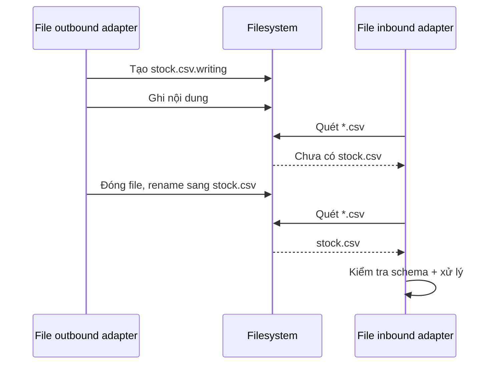
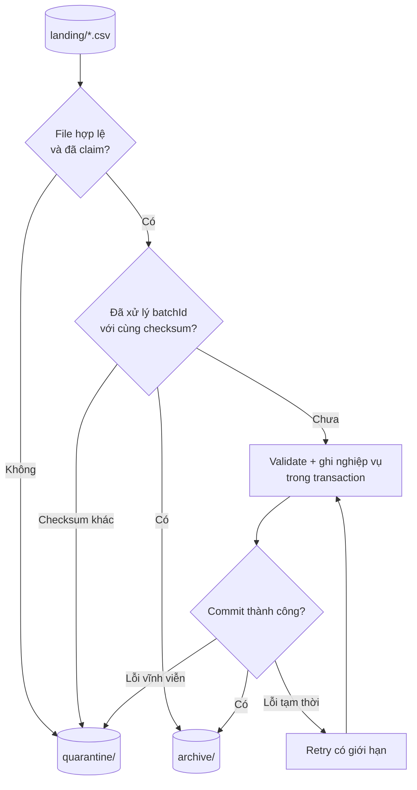

# Nhận và ghi tệp với file adapter, bộ lọc và tên tệp tạm

## 1. Bối cảnh và mục tiêu

Trong tích hợp doanh nghiệp, không phải đối tác nào cũng cung cấp HTTP API hay message broker. Nhiều hệ thống kế toán, ERP, đối soát thanh toán và kho hàng vẫn trao đổi dữ liệu bằng các tệp CSV, JSON, XML hoặc tệp nhị phân đặt trong một thư mục dùng chung. Ví dụ, hệ thống kho xuất `inventory-20261121.csv`; `order-service` đọc tệp, cập nhật tồn kho và tạo một báo cáo kết quả để đối tác nhận lại.

Spring Integration cung cấp **file adapters** để nối hệ thống tệp với mô hình message/channel/flow của Spring. Bài học thuộc module **SPRING_BOOT_INTEGRATION**, nơi các luồng tích hợp còn có HTTP client, database, cache và broker thông điệp. Trọng tâm là thiết kế một đường đi tệp đáng tin cậy: chọn đúng tệp đã ghi xong, tránh xử lý tệp ngoài ý muốn, ghi tệp đầu ra an toàn, xử lý retry/duplicate, kiểm thử và quan sát.

Sau bài học, bạn có thể:

1. Phân biệt file inbound channel adapter và file outbound channel adapter/gateway.
2. Cấu hình `FileReadingMessageSource`, poller, `IntegrationFlow` và `FileWritingMessageHandler`.
3. Kết hợp pattern filter, bộ lọc theo tuổi tệp và bộ lọc chống đọc lặp bằng đúng thứ tự.
4. Dùng hậu tố tạm `.writing` và quy trình **ghi tạm → đổi tên** để không công bố tệp chưa hoàn thành.
5. Chọn `FileExistsMode`, tên tệp, thư mục và chính sách archive/quarantine phù hợp.
6. Thiết kế xử lý lỗi, idempotency, nhiều instance, kiểm thử và metrics cho một luồng trao đổi tệp thực tế.

> **Phạm vi phiên bản:** Các ví dụ Java dùng Java 17+, Spring Boot 3.x và Spring Integration 6.x với Java DSL. Cần chọn version do Spring Boot BOM quản lý, đặc biệt khi dùng Boot 4.x/Spring Integration 7.x. API cụ thể được đối chiếu với Spring Integration 6.5; nội dung không giả định thư mục dùng chung tự cung cấp transaction phân tán hay cơ chế exactly-once.

## 2. File adapter nằm ở đâu trong một IntegrationFlow?

```mermaid
flowchart LR
    P["Đối tác ghi tệp<br/>inventory.csv.writing"] --> R["Đổi tên khi hoàn tất<br/>inventory.csv"]
    R --> DIR[("input/")]
    DIR --> IN["File inbound adapter<br/>poll + filter"]
    IN --> CH["Message channel"]
    CH --> PROC["Handler: kiểm tra, parse,<br/>lưu nghiệp vụ"]
    PROC --> DB[("Database<br/>+ inbox/outbox")]
    DB --> OUT["Export service"]
    OUT --> OC["Message channel"]
    OC --> WR["File outbound adapter<br/>ghi .writing"]
    WR --> FIN[("output/report.csv")]
```



**Inbound channel adapter** nhận dữ liệu từ hệ thống ngoài và đưa vào ứng dụng dưới dạng message. **Outbound channel adapter** nhận message trong flow và ghi ra hệ thống ngoài; nó là endpoint một chiều. Khi muốn nhận lại đường dẫn hoặc một thông tin trả lời sau thao tác ghi, cân nhắc **outbound gateway**, nhưng đừng đổi mô hình chỉ vì muốn log kết quả.

| Thành phần | Vai trò | Payload/đầu ra |
| --- | --- | --- |
| `FileReadingMessageSource` | Liệt kê và phát hiện tệp đủ điều kiện trong thư mục. | Message có payload là `java.io.File`. |
| Poller | Quyết định thời điểm và giới hạn số tệp được nhận mỗi lần quét. | Kích hoạt nguồn định kỳ. |
| `FileListFilter<File>` | Chọn file theo tên, trạng thái, tuổi hoặc lịch sử đã nhận. | Chỉ những `File` đạt điều kiện. |
| `MessageChannel` | Chuyển message đến handler/transformer/router. | `Message<?>` kèm headers. |
| Handler/transformer | Đọc CSV/XML/JSON, kiểm tra schema, chuyển thành lệnh nghiệp vụ. | Kết quả xử lý hoặc message mới. |
| `FileWritingMessageHandler` | Ghi payload ra file và xử lý trùng tên đầu ra. | Tệp trên đĩa; adapter một chiều. |
| `FileHeaders.FILENAME` | Tên gợi ý cho file đích. | Message header, phải được kiểm soát. |
| `FileHeaders.ORIGINAL_FILE` | Tham chiếu tệp nguồn qua các bước biến đổi. | Hỗ trợ archive/log; không phải ID nghiệp vụ duy nhất. |

Một thư mục bình thường **không phải hàng đợi thông điệp bền vững**: quét thấy file không chứng minh rằng nội dung đã được bên ghi hoàn tất; chuyển `File` vào channel không đồng nghĩa ghi database thành công; hai instance có thể cùng nhìn thấy một file. Vì vậy cần hợp đồng trao đổi tệp và các cơ chế bảo vệ ở từng chặng.

## 3. Dependency và cấu hình môi trường

Đối với Spring Boot 3.x, dùng Spring Integration starter và module file:

```xml
<!-- pom.xml: version kế thừa từ Spring Boot parent/BOM -->
<dependency>
    <groupId>org.springframework.boot</groupId>
    <artifactId>spring-boot-starter-integration</artifactId>
</dependency>
<dependency>
    <groupId>org.springframework.integration</groupId>
    <artifactId>spring-integration-file</artifactId>
</dependency>
<dependency>
    <groupId>org.springframework.boot</groupId>
    <artifactId>spring-boot-starter-test</artifactId>
    <scope>test</scope>
</dependency>
<dependency>
    <groupId>org.springframework.integration</groupId>
    <artifactId>spring-integration-test</artifactId>
    <scope>test</scope>
</dependency>
```

`IntegrationFlow` và `Pollers` nằm trong Java DSL của Spring Integration. Trong Spring Integration 6.x, DSL đã được tích hợp vào các module Spring Integration liên quan, không cần thêm artifact `spring-integration-java-dsl` đời cũ.

### 3.1. Externalize các đường dẫn

```yaml
# application.yml
app:
  file-exchange:
    input-dir: ${INBOUND_FILE_DIR:/var/app/exchange/input}
    output-dir: ${OUTBOUND_FILE_DIR:/var/app/exchange/output}
    poll-delay: 2s
```

Thay các đường dẫn mặc định theo hệ điều hành và môi trường triển khai. Trong Docker, `/var/app/exchange/input` là đường dẫn **bên trong container**, nên dữ liệu trao đổi phải được mount hoặc cung cấp qua storage tương ứng. Nếu container restart mà thư mục không nằm trên persistent volume, các file có thể biến mất. Không đồng nhất folder local với FTP/SFTP hoặc object storage: các giao thức khác dùng adapter riêng.

Khai báo cấu hình có kiểu:

```java
// FileExchangeProperties.java
import java.nio.file.Path;
import java.time.Duration;
import org.springframework.boot.context.properties.ConfigurationProperties;

@ConfigurationProperties(prefix = "app.file-exchange")
public record FileExchangeProperties(
    Path inputDir,
    Path outputDir,
    Duration pollDelay
) {}
```

Đường dẫn phải là thư mục được cấp quyền rõ ràng; nên kiểm tra tồn tại, quyền đọc/ghi và dung lượng lúc triển khai. Không dùng trực tiếp tên thư mục lấy từ header HTTP hay tên tenant chưa xác thực để tạo directory expression.

## 4. Nhận tệp với file inbound channel adapter

### 4.1. Polling và message payload

`FileReadingMessageSource` quét thư mục, đưa các tệp đủ điều kiện vào hàng đợi nội bộ rồi phát từng message. Poller kích hoạt việc gọi `receive()` theo lịch. Một message đầu ra có payload là `File`, không tự động đọc toàn bộ bytes vào bộ nhớ:

```text
input/
├── inventory-20261121.csv
├── inventory-20261122.csv.writing
└── readme.txt

poll -> filter "*.csv" -> java.io.File(inventory-20261121.csv)
```

File `inventory-20261122.csv.writing` chưa nên đi vào luồng xử lý, còn `readme.txt` không phải tài liệu đầu vào theo hợp đồng.

### 4.2. Cấu hình inbound flow đầy đủ

Ví dụ sau nhận file kết thúc bằng `.csv` và chuyển tới `CsvImportService`. Bộ lọc dùng `ChainFileListFilter` để chỉ đánh dấu “đã nhận” **sau khi** tên tệp vượt qua bộ lọc pattern và hidden file:

```java
// FileInboundConfiguration.java
import java.io.File;
import org.springframework.boot.context.properties.EnableConfigurationProperties;
import org.springframework.context.annotation.Bean;
import org.springframework.context.annotation.Configuration;
import org.springframework.integration.dsl.IntegrationFlow;
import org.springframework.integration.dsl.Pollers;
import org.springframework.integration.file.dsl.Files;
import org.springframework.integration.file.filters.AcceptOnceFileListFilter;
import org.springframework.integration.file.filters.ChainFileListFilter;
import org.springframework.integration.file.filters.IgnoreHiddenFileListFilter;
import org.springframework.integration.file.filters.SimplePatternFileListFilter;

@Configuration(proxyBeanMethods = false)
@EnableConfigurationProperties(FileExchangeProperties.class)
public class FileInboundConfiguration {

    @Bean
    IntegrationFlow importCsvFlow(
        FileExchangeProperties props,
        CsvImportService importer
    ) {
        ChainFileListFilter<File> filters = new ChainFileListFilter<>();
        filters.addFilter(new IgnoreHiddenFileListFilter());
        filters.addFilter(new SimplePatternFileListFilter("*.csv"));
        filters.addFilter(new AcceptOnceFileListFilter<>());

        return IntegrationFlow.from(
                Files.inboundAdapter(props.inputDir().toFile())
                    .filter(filters)
                    .autoCreateDirectory(false),
                endpoint -> endpoint.poller(
                    Pollers.fixedDelay(props.pollDelay())
                        .maxMessagesPerPoll(10)
                )
            )
            .handle(File.class, (file, headers) -> {
                importer.importFile(file);
                return null; // Đầu cuối một chiều, không tạo reply.
            })
            .get();
    }
}
```

Trong ví dụ:

- `Files.inboundAdapter(directory)` sinh cấu hình nguồn đọc file của Java DSL.
- `endpoint.poller(Pollers.fixedDelay(...).maxMessagesPerPoll(10))` nhận tối đa 10 message trong một lần kích hoạt poller; nếu còn hàng đợi thì lần sau tiếp tục, không biến 10 thành số thread song song.
- `autoCreateDirectory(false)` yêu cầu thư mục input đã được hạ tầng tạo sẵn; cấu hình sai path sẽ xuất hiện sớm.
- `.handle(File.class, ...)` chuyển message file tới tầng nghiệp vụ. Xử lý có thể fail; **lỗi handler không tự động hoàn tác dấu “đã nhận”** mà filter lưu trong bộ nhớ.
- `return null` ở handler này có nghĩa không sinh reply message, phù hợp với terminal handler một chiều.

Ví dụ `CsvImportService` minh họa việc đọc stream thay vì tải toàn bộ file lớn:

```java
// CsvImportService.java
import java.io.File;
import java.io.IOException;
import java.nio.charset.StandardCharsets;
import java.nio.file.Files;
import org.springframework.stereotype.Service;

@Service
public class CsvImportService {

    public void importFile(File file) {
        try (var reader = Files.newBufferedReader(
                file.toPath(),
                StandardCharsets.UTF_8)) {
            String header = reader.readLine();
            if (!"sku,quantity".equals(header)) {
                throw new IllegalArgumentException(
                    "Sai header của file: " + file.getName()
                );
            }

            for (String line; (line = reader.readLine()) != null;) {
                // Minh họa định dạng đơn giản: thực tế dùng thư viện CSV
                // hỗ trợ dấu nháy, dấu phẩy trong dữ liệu, escape và BOM.
                String[] cells = line.split(",", -1);
                if (cells.length != 2) {
                    throw new IllegalArgumentException("Sai số cột CSV");
                }
                String sku = cells[0];
                int quantity = Integer.parseInt(cells[1]);
                // Gọi application service có xử lý transaction/dedup.
                // Không tự quyết định thành công chỉ vì đã đọc một dòng.
            }
        } catch (IOException e) {
            throw new IllegalStateException(
                "Không đọc được file " + file.getName(), e
            );
        }
    }
}
```

Đây là ví dụ dạy cơ chế adapter, **chưa phải một import nghiệp vụ hoàn chỉnh**: cần thực thi validation, ghi kết quả vào DB, rollback/bù trừ và idempotency trước khi xác nhận thành công. Nếu file quá lớn, phải quyết định transaction theo chunk, trạng thái xử lý từng dòng và cách resume thay vì mặc định một DB transaction bao trùm cả file.

### 4.3. Đặc điểm của file headers

Inbound message có thể chứa các header:

| Header | Vai trò |
| --- | --- |
| `FileHeaders.FILENAME` | Tên tệp gốc, ví dụ `inventory-20261121.csv`. |
| `FileHeaders.ORIGINAL_FILE` | Đối tượng `File` trỏ đến tài nguyên nguồn. |
| `FileHeaders.RELATIVE_PATH` | Đường dẫn tương đối so với thư mục quét, hữu ích khi đọc cây thư mục. |

Không dùng `FileHeaders.FILENAME` làm business ID duy nhất nếu đối tác có thể ghi đè file cùng tên ở ngày khác. Hãy gắn một batch ID ổn định (từ manifest, tên file có quy ước, checksum hoặc metadata do đối tác cấp) và xác định chính sách khi cùng tên có nội dung khác.

## 5. Bộ lọc file: tên, trạng thái hoàn tất và chống đọc lặp

### 5.1. Các loại `FileListFilter`

| Filter | Tiêu chí chọn | Giới hạn |
| --- | --- | --- |
| `SimplePatternFileListFilter` | Mẫu tên file, ví dụ `*.csv`. | Không biết file có còn được ghi hay không. |
| `RegexPatternFileListFilter` | Biểu thức chính quy theo tên file. | Dễ sai pattern, không bảo đảm nội dung hoàn tất. |
| `IgnoreHiddenFileListFilter` | Bỏ file bị coi là hidden theo hệ điều hành. | Khái niệm hidden của Linux/Windows khác nhau. |
| `AcceptOnceFileListFilter` | Chỉ đưa một file qua một lần theo trạng thái nhớ trong process. | Không bền qua restart, không đánh dấu thành công nghiệp vụ. |
| `FileSystemPersistentAcceptOnceFileListFilter` | Lưu lịch sử tên/mtime vào `MetadataStore`. | Bảo đảm lịch sử phát hiện theo metadata, không thay business dedup. |
| `LastModifiedFileListFilter` | Chọn file đã đủ “già” theo thời gian sửa đổi. | Timestamp có thể sai, writer có thể tạm dừng rồi tiếp tục. |
| `ChainFileListFilter` | Lần lượt áp các filter trên kết quả của filter trước. | Thứ tự filter quan trọng. |
| `CompositeFileListFilter` | Kết hợp các điều kiện trên cùng danh sách. | Filter có state có thể đánh dấu file trước khi filter khác chấp nhận. |

Spring Integration file inbound mặc định có các thành phần lọc như `IgnoreHiddenFileListFilter` và `AcceptOnceFileListFilter`. Khi thay toàn bộ filter bằng custom chain, cần cấu hình lại những tiêu chí muốn giữ; không coi `.filter(customFilter)` tự động thêm mọi điều kiện mặc định theo cách bạn mong muốn.

### 5.2. Vì sao thứ tự filter quan trọng?

Giả sử lúc 10:00 producer bắt đầu ghi `a.csv`, đến 10:01 mới ghi xong. Nếu chain áp `AcceptOnce` **trước** bộ lọc đủ tuổi thì file có thể bị đánh dấu đã nhận lúc nó còn quá mới. Đến khi đủ tuổi, `AcceptOnce` chặn file và nó không bao giờ được xử lý.

Đặt bộ lọc điều kiện **trước**, chống trùng **sau**:

```text
Danh sách file -> IgnoreHidden -> "*.csv" -> LastModified(age) -> AcceptOnce
                                                    |
                                                    v
                                                Phát message
```

`ChainFileListFilter` phù hợp cho trường hợp này vì filter ở sau chỉ thấy file đã vượt qua filter trước. `CompositeFileListFilter` phù hợp một số bài toán khác, chẳng hạn filter cần biết sự hiện diện của cả `invoice.csv` và `invoice.done` khi đánh giá danh sách; chọn loại theo logic cụ thể, không tráo hai loại một cách vô thức.

### 5.3. Khi không thể đổi tên: lọc theo tuổi tệp

Nếu producer không thể triển khai quy trình “ghi tạm rồi rename”, có thể chỉ nhận những tệp không được sửa trong một khoảng thời gian:

```java
// Ví dụ bộ lọc cho nguồn FileReadingMessageSource.
import java.io.File;
import org.springframework.integration.file.filters.ChainFileListFilter;
import org.springframework.integration.file.filters.LastModifiedFileListFilter;
import org.springframework.integration.file.filters.SimplePatternFileListFilter;
import org.springframework.integration.file.filters.AcceptOnceFileListFilter;

ChainFileListFilter<File> filters = new ChainFileListFilter<>();
filters.addFilter(new SimplePatternFileListFilter("*.csv"));

LastModifiedFileListFilter ageFilter = new LastModifiedFileListFilter();
ageFilter.setAge(120); // Giây: đợi tệp ngừng sửa ít nhất 120 giây.
filters.addFilter(ageFilter);
filters.addFilter(new AcceptOnceFileListFilter<>());
```

**Đây là heuristic, không phải giao thức hoàn tất tuyệt đối.** Writer có thể ngừng 3 phút vì mạng, sau đó ghi tiếp; timestamp từ máy chủ khác cũng có thể lệch. Nếu có thể kiểm soát producer, marker `.done`/manifest hoặc rename đến tên cuối là cách rõ nghĩa hơn. Spring Integration 6.5 còn có `RecentFileListFilter` cho tiêu chí ngược lại (chỉ file không quá cũ), đừng nhầm với `LastModifiedFileListFilter` dùng để tránh file còn đang viết.

## 6. Tên tệp tạm: không để consumer đọc file đang ghi

### 6.1. Quy trình hoàn tất bằng rename

Khi export `stock-20261121.csv`, một publisher an toàn có thể:

1. Mở `stock-20261121.csv.writing` trong cùng thư mục đích và ghi bytes.
2. Flush/đóng stream; nếu yêu cầu độ bền sau mất điện, đánh giá thêm `fsync` và chính sách filesystem.
3. Đổi tên từ `stock-20261121.csv.writing` sang `stock-20261121.csv`.
4. Consumer chỉ nhận `*.csv`, nên không đọc bản đang ghi.



Spring Integration `FileWritingMessageHandler` có **temporary file suffix mặc định `.writing`** trong chế độ ghi file thông thường. Có thể đổi bằng `temporaryFileSuffix(".tmp")`; nên dùng một suffix mà inbound adapter **không** chấp nhận.

### 6.2. Rename atomic tới đâu?

Đổi tên trong **cùng một filesystem** thường cho phép consumer nhìn thấy tên cuối sau khi file hoàn tất, nhưng không nên hứa bảo đảm atomic trên mọi network share, object mount hoặc hệ điều hành. Java `Files.move(source, target, ATOMIC_MOVE)` có thể báo không hỗ trợ; không âm thầm fallback sang copy rồi xóa nếu hợp đồng yêu cầu không lộ file nửa chừng.

Hậu tố `.writing` giải quyết **tính hiển thị của file chưa hoàn tất**, không giải quyết:

- Hai producer cùng ghi một tên cuối.
- Server crash sau khi file đã hiện nhưng trước khi bên nhận lưu kết quả nghiệp vụ.
- File được tạo xong nhưng sai schema, trống, sai checksum hoặc không có quyền đọc.
- Mất dữ liệu do filesystem chưa đồng bộ vật lý xuống storage.
- Một producer ghi trực tiếp vào tên cuối, bỏ qua quy tắc staging.

Vì vậy, phải thống nhất hợp đồng với đối tác: suffix, danh sách extension cuối, encoding, checksum/manifest, tên duy nhất, thời gian giữ file và đường xử lý lỗi.

## 7. Ghi tệp với outbound adapter

### 7.1. Payload và cách chọn tên file

`FileWritingMessageHandler` hỗ trợ các payload thường gặp như `File`, `String`, `byte[]` và `InputStream`. Theo mặc định, tên file đầu ra được xác định theo thứ tự tương ứng:

1. Tên qua biểu thức/generator nếu được cấu hình.
2. Header `FileHeaders.FILENAME` nếu có và phù hợp.
3. Với payload `File`, tên file nguồn.
4. Nếu không có tên từ các nguồn trên, message ID kèm hậu tố `.msg`.

Thực tế nên **chọn tên file một cách tường minh** theo lô xuất, ví dụ `order-report-20261121-batch42.csv`. Nếu để message ID ngẫu nhiên làm tên, consumer thường không suy ra ngày, loại tệp hoặc batch nghiệp vụ.

### 7.2. Outbound flow có cấu hình tên tạm và tránh ghi đè

```java
// FileOutboundConfiguration.java
import org.springframework.context.annotation.Bean;
import org.springframework.context.annotation.Configuration;
import org.springframework.integration.dsl.IntegrationFlow;
import org.springframework.integration.file.dsl.Files;
import org.springframework.integration.file.support.FileExistsMode;

@Configuration(proxyBeanMethods = false)
public class FileOutboundConfiguration {

    @Bean
    IntegrationFlow exportCsvFlow(FileExchangeProperties props) {
        return IntegrationFlow.from("writeCsvFiles")
            .handle(
                Files.outboundAdapter(props.outputDir().toFile())
                    .fileExistsMode(FileExistsMode.FAIL)
                    .temporaryFileSuffix(".writing")
                    .autoCreateDirectory(true)
                    .charset("UTF-8")
            )
            .get();
    }
}
```

Ý nghĩa cấu hình:

- `Files.outboundAdapter(...)` tạo endpoint ghi file một chiều.
- `FileExistsMode.FAIL` ngăn ghi đè một output file đã tồn tại; adapter phát sinh exception để luồng lỗi được xử lý.
- `temporaryFileSuffix(".writing")` tránh công bố tên file cuối trong lúc ghi.
- `autoCreateDirectory(true)` có thể phù hợp local/test; production cần kiểm soát quyền tạo thư mục và đường dẫn mong đợi.
- `charset("UTF-8")` xác định encoding khi payload là `String`.

Chọn `FAIL` ở đây vì báo cáo xuất theo batch có tên duy nhất và việc ghi đè là bất thường. Với API cho phép sửa báo cáo theo phiên bản, có thể chọn chính sách khác, nhưng phải đặc tả trước.

### 7.3. Gửi message vào outbound flow

Ví dụ sender service tạo message với header tên file đã validate:

```java
// CsvExportService.java
import org.springframework.beans.factory.annotation.Qualifier;
import org.springframework.integration.file.FileHeaders;
import org.springframework.messaging.MessageChannel;
import org.springframework.messaging.support.MessageBuilder;
import org.springframework.stereotype.Service;

@Service
public class CsvExportService {
    private final MessageChannel channel;

    public CsvExportService(
        @Qualifier("writeCsvFiles") MessageChannel channel
    ) {
        this.channel = channel;
    }

    public void export(String batchId, String csvContent) {
        // Chỉ nhận batchId đã chuẩn hóa, không nhận path người dùng.
        if (batchId == null
            || !batchId.matches("[A-Za-z0-9_-]{1,64}")) {
            throw new IllegalArgumentException("batchId không hợp lệ");
        }

        String fileName = "order-report-" + batchId + ".csv";
        boolean accepted = channel.send(
            MessageBuilder.withPayload(csvContent)
                .setHeader(FileHeaders.FILENAME, fileName)
                .build()
        );

        if (!accepted) {
            throw new IllegalStateException("Không gửi được message ghi file");
        }
    }
}
```

Với `DirectChannel` đồng bộ do Java DSL tạo trong cấu hình điển hình trên, handler ghi file trên thread gửi và lỗi có thể đi ngược về sender. Nếu flow được thay bằng `QueueChannel`, `ExecutorChannel` hoặc broker, kết quả `channel.send(...) == true` chỉ thể hiện **message được nhận vào channel** theo contract đó; không chứng minh file đã được ghi thành công. Đừng dùng boolean send làm xác nhận nghiệp vụ khi dùng kênh bất đồng bộ.

### 7.4. Tránh path traversal khi đặt tên động

Tên file từ message header có thể bị lợi dụng để ghi tới vị trí khác thư mục quy định nếu ứng dụng cho phép dấu phân cách đường dẫn, `..` hoặc directory expression không được kiểm soát. Không truyền nguyên xi `originalFilename` từ HTTP upload tới `FileHeaders.FILENAME`. Hãy:

- Chuyển tên file bên ngoài thành một **business ID** đã validate và tự dựng tên mới.
- Giới hạn ký tự, độ dài, extension và các tên dành riêng của hệ điều hành.
- Nếu cho phép cấu trúc thư mục con, chuẩn hóa và xác minh path sau `normalize()` vẫn nằm dưới root tin cậy; kiểm tra symlink khi môi trường có đối thủ thao tác filesystem.
- Chạy ứng dụng với quyền ghi tối thiểu ở thư mục output; không cấp quyền ghi toàn filesystem.

## 8. Chính sách khi tệp đích đã tồn tại: `FileExistsMode`

File outbound adapter hỗ trợ các mode thường gặp:

| Mode | Hành vi | Dùng khi |
| --- | --- | --- |
| `REPLACE` | Ghi đè file đích; đây là mặc định. | Hợp đồng cho phép thay thế kết quả và có version/backup phù hợp. |
| `REPLACE_IF_MODIFIED` | Chỉ thay khi timestamp nguồn/header phù hợp cho thấy file thay đổi. | Có payload `File` và timestamp đáng tin; không phải kiểm tra nội dung. |
| `APPEND` | Ghi nối thêm rồi đóng sau mỗi message. | Nhật ký hoặc file tích lũy với đồng bộ ghi phù hợp. |
| `APPEND_NO_FLUSH` | Ghi nối tiếp không flush/close sau mỗi message theo cơ chế handler. | Cần throughput và chấp nhận độ trễ flush/rủi ro mất dữ liệu. |
| `FAIL` | Ném exception nếu file cuối đã tồn tại. | Không được ghi đè output theo batch. |
| `IGNORE` | Không ghi nếu file tồn tại, không coi là lỗi. | Bản sao đầu ra được bỏ qua theo hợp đồng. |

**Lưu ý:** Với `APPEND`/`APPEND_NO_FLUSH`, dữ liệu ghi trực tiếp vào file đích nên không có chu kỳ “ghi một file tạm hoàn chỉnh rồi rename” cho mỗi message như mode ghi file thường. Trên cùng một tên file, append lặp lại do retry có thể làm dòng dữ liệu nhân đôi. Muốn xuất dữ liệu có tính lũy đẳng, ưu tiên **mỗi batch một file bất biến** hơn là append bất kỳ.

Mode `IGNORE` cũng không phải cơ chế exactly-once: nó có thể bỏ qua một file đang tồn tại nhưng nội dung sai hoặc ghi dở. Mode `FAIL` phát hiện va chạm tên nhưng không tự giải quyết tranh chấp concurrent writers trên nhiều host/shared filesystem hoặc trạng thái sau crash.

## 9. Bộ lọc chống trùng: in-memory, persistent và nghiệp vụ

### 9.1. `AcceptOnceFileListFilter` chỉ nhớ trong process

Trong flow inbound đầu tiên, `AcceptOnceFileListFilter` giữ trạng thái trong bộ nhớ ứng dụng. Nó giúp giảm việc poll ra **cùng file** nhiều lần trong một lần chạy. Tuy nhiên:

1. Restart có thể xóa lịch sử đã thấy.
2. Hai instance khác nhau có bộ nhớ độc lập.
3. Việc file đã được **phát thành message** không chứng minh handler đã commit vào DB.
4. File đổi tên, đổi timestamp hoặc copy sang nơi khác có thể bị coi là file khác.

Nếu xử lý lỗi ở handler rồi không có recovery riêng, một file có thể đã bị `AcceptOnce` giữ lại và **không được nhận lại trong cùng process**. Không coi filter này là hàng đợi retry.

### 9.2. `FileSystemPersistentAcceptOnceFileListFilter`

Khi cần giữ lịch sử nhận file qua restart, dùng persistent filter cùng `ConcurrentMetadataStore`. Ví dụ minh họa cơ chế:

```java
import java.io.File;
import org.springframework.integration.file.filters.FileSystemPersistentAcceptOnceFileListFilter;
import org.springframework.integration.metadata.SimpleMetadataStore;

// SimpleMetadataStore vẫn chỉ ở bộ nhớ. Để bền qua restart,
// thay bằng MetadataStore thật sự bền/chia sẻ của hệ thống.
var metadata = new SimpleMetadataStore();
var persistentFilter =
    new FileSystemPersistentAcceptOnceFileListFilter(
        metadata, "inventory-import:"
    );
```

**Không nhầm tên class với độ bền mặc định.** `FileSystemPersistentAcceptOnceFileListFilter` lưu trạng thái vào `MetadataStore` **được truyền vào**. Với `SimpleMetadataStore` ở ví dụ, metadata vẫn chỉ nằm trong bộ nhớ. Muốn bền qua restart có thể dùng implementation lưu file/JDBC/Redis tương ứng; muốn nhiều instance phối hợp, metadata store phải chia sẻ và cung cấp atomic compare-and-set như yêu cầu của filter.

Filter dựa trên các metadata như path/tên và thời điểm sửa đổi. Nếu một file có cùng tên nhưng sửa nội dung/timestamp, filter có thể coi là bản mới theo chính sách. Với tài liệu cần phân biệt phiên bản nội dung, thêm checksum/manifest hoặc ID lô của đối tác, không dựa duy nhất vào mtime.

### 9.3. Idempotency là ranh giới cuối của xử lý nghiệp vụ

Giả sử file `inventory-20261121.csv` đã được phát message, handler ghi DB xong nhưng ứng dụng crash trước archive. Lúc restart, file vẫn nằm trong `input/` và có thể được nhận lại. Nếu handler thực hiện `stock = stock + quantity` thì stock sẽ bị cộng lần hai.

Giải pháp là tạo một **file/batch ID ổn định** và kiểm tra ở database trong cùng transaction với cập nhật nghiệp vụ:

```sql
CREATE TABLE imported_batches (
    partner_id VARCHAR(80) NOT NULL,
    batch_id VARCHAR(120) NOT NULL,
    checksum_sha256 CHAR(64) NOT NULL,
    imported_at TIMESTAMP NOT NULL DEFAULT CURRENT_TIMESTAMP,
    PRIMARY KEY (partner_id, batch_id)
);
```

Quy trình:

1. Xác định `partnerId`, `batchId` và checksum từ hợp đồng file/manifest.
2. Thử ghi khóa duy nhất `(partnerId, batchId)` trong transaction.
3. Nếu khóa mới, validate/ghi tất cả side effect thuộc transaction và commit.
4. Nếu khóa đã có và checksum khớp, không thực thi lại; nếu checksum khác, báo conflict và quarantine.
5. Chỉ sau commit mới chuyển file sang `archive/` hoặc ghi trạng thái thành công.

Nếu import theo chunk và không thể đặt toàn file trong một transaction, cần lưu trạng thái chunk/row có unique key và quy tắc resume; không “mark completed” ở đầu để rồi bỏ sót các dòng sau khi crash. Đây là **business idempotency**, độc lập với file list filter.

## 10. Quy trình input an toàn: landing, processing, archive, quarantine

Một kiến trúc production thường chia thư mục theo trạng thái:

```text
file-exchange/
├── landing/       # Đối tác hoàn tất việc ghi bằng rename.
├── processing/    # Worker đã claim và đang xử lý (nếu cần).
├── archive/       # File đã được xác nhận xử lý thành công.
├── quarantine/    # File lỗi schema hoặc không thể xử lý tự động.
└── outbound/      # File xuất cho đối tác nhận.
```

Hướng vận hành:

1. Producer ghi vào `landing/foo.csv.writing`, đổi tên thành `foo.csv` sau khi hoàn tất.
2. Inbound adapter poll `landing/*.csv`; filter chỉ cho phép file đã sẵn sàng.
3. Nếu nhiều worker dùng shared directory, **claim file** bằng một thao tác có tính loại trừ hoặc một cơ chế lock/metadata store được thiết kế cho môi trường đó. `Files.move(..., ATOMIC_MOVE)` cùng filesystem có thể dùng khi nền tảng hỗ trợ, nhưng phải xử lý trường hợp không hỗ trợ.
4. Validate kích thước, encoding, checksum, schema và tên file. Ghi ID lô và side effect theo transaction/idempotency.
5. Nếu thành công, archive và ghi metadata (thời gian, checksum, số dòng, status).
6. Nếu lỗi vĩnh viễn, chuyển quarantine kèm nguyên nhân đã được làm sạch dữ liệu nhạy cảm; nếu lỗi tạm thời, retry có giới hạn với lịch và chủ sở hữu rõ ràng.
7. Dọn `.writing` bỏ dở, archive và quarantine theo retention policy; không xóa trước khi bảo đảm có thể đối soát.



**Hai thao tác không atomically gộp được trong mọi hệ thống:** commit database và rename/archive file. Cần thiết kế cho tình huống DB đã commit nhưng archive thất bại. Khi file xuất hiện lại, ID lô bền vững giúp bỏ side effect trùng rồi tiếp tục archive; không coi file trong archive là bằng chứng duy nhất.

## 11. Xử lý lỗi, backpressure và vận hành nhiều instance

### 11.1. Lỗi thường xảy ra ở đâu?

| Bước | Ví dụ lỗi | Hướng xử lý |
| --- | --- | --- |
| Quét thư mục | Thư mục thiếu/quyền sai, network share bị ngắt. | Health check, cảnh báo, thử lại sau khi hạ tầng phục hồi. |
| Lọc file | Pattern sai hoặc filter đánh dấu file quá sớm. | Test danh sách đầu vào và thứ tự Chain; có công cụ reset metadata có kiểm soát. |
| Đọc file | File bị xóa/đổi tên, encoding sai, file chưa hoàn tất. | Hợp đồng staging/rename, validation, quarantine. |
| Parse | CSV có dấu phẩy trong chuỗi, XML/JSON không hợp lệ, schema đổi. | Parser đúng chuẩn và báo lỗi từng lô/dòng. |
| Ghi DB | Deadlock, unique conflict, timeout. | Retry transaction có giới hạn; idempotency và conflict classification. |
| Ghi file output | Disk full, permission denied, tên file trùng. | `FAIL`/policy phù hợp, dọn file tạm, retry có kiểm soát. |
| Archive | DB commit xong nhưng move thất bại. | Replay an toàn bằng batchId, retry archive riêng. |

Một poller không tự cung cấp dead-letter topic như message broker. Có thể dùng Spring Integration `errorChannel`, advice chain, retry advice, transaction advice hoặc routing để gửi lỗi tới handler riêng, nhưng phải xác định **file nào cần retry, trạng thái nghiệp vụ nào đã commit, và lúc nào được đánh dấu xong**. Exception chung nếu bị swallow có thể làm mất file mà không có cảnh báo.

### 11.2. Backpressure và throughput

`Pollers.fixedDelay(...).maxMessagesPerPoll(10)` giới hạn số message được lấy trong mỗi chu kỳ, không ngăn một handler đọc tệp 5 GB hoặc xử lý quá lâu. Hãy đo thời gian xử lý/tệp, backlog và dung lượng; cân nhắc:

- Điều chỉnh poll delay và max messages theo tốc độ nhận thực tế.
- Dùng channel bất đồng bộ có **bounded capacity**, thay vì queue vô hạn dẫn tới cạn bộ nhớ.
- Giới hạn số file được xử lý đồng thời và số kết nối DB/API dùng chung.
- Với file lớn, stream/parse theo chunk, cập nhật tiến độ và kiểm soát transaction.
- Nếu thứ tự file là quan trọng, dùng thông tin sequence và single-worker policy theo đối tác; tên file sắp xếp lexicographic không tự bảo đảm thứ tự nghiệp vụ.

### 11.3. Hai pod cùng poll một thư mục

File adapter và `AcceptOnceFileListFilter` mặc định **không bảo đảm chỉ một pod xử lý file** khi có shared volume. Hai pod có thể cùng scan thấy `foo.csv`.

Các biện pháp:

1. Chạy một active reader có leader election rõ ràng nếu hệ thống cho phép.
2. Dùng shared persistent metadata store có atomic claims và xác định chiến lược timeout/recovery.
3. Claim bằng rename/lock trên filesystem **chỉ khi** hạ tầng cho bảo đảm cần thiết (NFS/SMB/overlay có khác biệt).
4. Vẫn dùng unique business batchId trong database làm lớp chống xử lý trùng sau crash/restart.

Không dùng một Redis `SETNX` TTL ngắn làm bảo đảm duy nhất: khi TTL hết trong lúc xử lý, worker khác có thể xử lý lại. Nếu dùng lease, cần fencing/version và xử lý worker mất quyền.

## 12. Kiểm thử file adapter theo hợp đồng

Kiểm thử chỉ gọi trực tiếp `CsvImportService.importFile(...)` là **unit test cho parser**, chưa chứng minh inbound flow có đúng poller, filter và handler. Nên bổ sung test với thư mục tạm và Spring context để quan sát message thực tế được tạo.

### 12.1. Kiểm thử handler ghi file

Ví dụ JUnit 5 kiểm tra `FileWritingMessageHandler` ghi đúng tên cuối và xử lý hậu tố tạm:

```java
import static org.junit.jupiter.api.Assertions.assertFalse;
import static org.junit.jupiter.api.Assertions.assertTrue;

import java.nio.file.Files;
import java.nio.file.Path;
import org.junit.jupiter.api.Test;
import org.junit.jupiter.api.io.TempDir;
import org.springframework.integration.file.FileHeaders;
import org.springframework.integration.file.FileWritingMessageHandler;
import org.springframework.integration.file.support.FileExistsMode;
import org.springframework.messaging.support.MessageBuilder;

class FileWriterTest {

    @TempDir
    Path outputDir;

    @Test
    void publishesOnlyCompletedFile() {
        FileWritingMessageHandler writer =
            new FileWritingMessageHandler(outputDir.toFile());
        writer.setFileExistsMode(FileExistsMode.FAIL);
        writer.setTemporaryFileSuffix(".writing");
        writer.afterPropertiesSet();

        writer.handleMessage(
            MessageBuilder.withPayload("sku,quantity\nSKU-42,3\n")
                .setHeader(FileHeaders.FILENAME, "batch-42.csv")
                .build()
        );

        assertTrue(Files.exists(outputDir.resolve("batch-42.csv")));
        assertFalse(Files.exists(outputDir.resolve("batch-42.csv.writing")));
    }
}
```

Đây là test cho handler **đã ghi xong**, không khẳng định watcher bên ngoài không thể thấy file tạm khi handler đang ghi, không kiểm chứng mọi đặc tính atomic rename của filesystem và cũng không kiểm tra độ bền sau mất điện.

### 12.2. Bộ test integration cần có

| Bài kiểm tra | Kỳ vọng |
| --- | --- |
| File hợp lệ | Đặt `good.csv` vào input; poller phát một message và handler xử lý đúng. |
| File đang ghi | Đặt `good.csv.writing`; inbound không nhận. Sau rename thành `good.csv` thì nhận. |
| Sai extension | `readme.txt`, file hidden không được phát. |
| CSV malformed | Không commit business side effect; chuyển quarantine/cảnh báo theo policy. |
| Bản sao cùng tên | Trong một process, `AcceptOnce` không phát cùng file hai lần từ các lần poll. |
| Restart | Chọn đúng hành vi với in-memory/persistent metadata; file đã import không nhân đôi DB. |
| Race hai worker | Hai consumer/pod cùng claim; chỉ một business transaction thành công cho batchId. |
| Outbound tên trùng | `FAIL` phát sinh lỗi và không ghi đè báo cáo cũ. |
| Outbound đang ghi | Consumer không nhận file có suffix `.writing`. |
| Lỗi output | Disk full/permission denied được phát hiện; có retry/alarm, không báo publish thành công sai. |
| Crash sau DB commit | File còn ở landing; replay bỏ tác động nghiệp vụ và tiếp tục archive. |
| Tệp lớn | Dung lượng bộ nhớ và thời gian xử lý ở ngưỡng cho phép. |

Các bài kiểm thử thật về rename, NFS/SMB và quyền filesystem cần chạy trong môi trường gần production. Test trong `@TempDir` trên local disk không chứng minh behavior của network share hoặc volume driver trong Kubernetes. Đối với file inbound poller, test nên dùng deadline/polling để chờ kết quả, tránh `Thread.sleep(...)` cố định tạo flaky test.

## 13. Quan sát, bảo mật và vòng đời tệp

Những dữ liệu nên quan sát:

- **Input:** số file chờ trong landing, tuổi file cũ nhất, số file đang `.writing` quá lâu, số lần scan lỗi.
- **Process:** số batch thành công/trùng/lỗi, thời gian xử lý p95/p99, số dòng lỗi, throughput bytes/giây.
- **Output:** số report xuất, file ghi lỗi, tên xung đột, số file tạm bỏ dở, thời gian từ yêu cầu export đến khi tên cuối xuất hiện.
- **Recovery:** file bị quarantine, retry count, số batch chưa archive, số lô bị checksum conflict.
- **Tài nguyên:** dung lượng disk/inode, quyền mount, thời gian chờ DB và backlog khi HTTP/broker downstream bị lỗi.

Gắn `batchId`/correlationId trong structured log và audit record, nhưng tránh dùng từng file name/ID làm metric tag nhiều biến thể. File có thể chứa dữ liệu cá nhân, tài chính hoặc credential; hạn chế quyền đọc/ghi, mã hóa storage theo chính sách, có retention và quy trình xóa dữ liệu. Không ghi toàn bộ file vào log hoặc đẩy nội dung lỗi sang monitoring một cách mặc định.

### 13.1. Đặc tả tối thiểu với đối tác

Một hợp đồng trao đổi tệp rõ ràng nên có:

1. Tên file/extension, batch ID và quy tắc trùng tên.
2. Encoding (UTF-8), delimiter, quote/escape, header, schema/version và format ngày/giờ/số.
3. Cách công bố hoàn tất: temp suffix + rename, marker `.done` hoặc manifest/checksum.
4. Quyền thư mục, TLS nếu truyền file qua giao thức từ xa, kích thước tối đa và giới hạn tốc độ.
5. Chính sách xử lý file rỗng, sai dữ liệu, thiếu dòng và lô nạp lại.
6. Timeout, retry, thời gian giữ file, archive/quarantine và quy trình đối soát.
7. Cách phát hiện “đã nhận” so với “đã xử lý thành công”, kênh phản hồi lỗi và trách nhiệm replay.

## 14. Lỗi thường gặp

| Sai lầm | Hậu quả | Cách khắc phục |
| --- | --- | --- |
| Nhận mọi `*.csv` ngay khi file xuất hiện | Đọc file đang được producer ghi. | Ghi tạm, rename tên cuối, chỉ nhận file hoàn tất. |
| Tin `AcceptOnce` bảo đảm xử lý chính xác một lần | Mất trạng thái qua restart hoặc side effect trùng sau crash. | Persistent metadata + DB idempotency; phân biệt receive với commit. |
| Dùng `CompositeFileListFilter` khi cần “lọc tuổi trước rồi mới đánh dấu” | Filter có state có thể ghi nhận file quá sớm. | Dùng `ChainFileListFilter` với điều kiện trước, `AcceptOnce` sau. |
| Cho TTL/mtime làm dấu hoàn tất duy nhất | Writer chậm hoặc timestamp sai làm đọc file nửa chừng. | Hợp đồng .writing + rename/manifest. |
| Dùng mặc định `REPLACE` cho file xuất bất biến | Report cũ bị ghi đè âm thầm. | `FileExistsMode.FAIL` và tên theo batch/version. |
| Dùng `APPEND` rồi kỳ vọng file tạm hoàn tất | Consumer thấy nội dung đang nối thêm. | Thiết kế file bất biến hoặc giao thức kết thúc riêng. |
| Tin send vào async channel đồng nghĩa file đã ghi | Báo thành công trước khi handler xử lý. | Xác nhận ở cuối flow; dùng gateway/callback/audit phù hợp. |
| Đặt nguyên tên file từ HTTP header | Path traversal hoặc tên không hợp lệ. | Tự dựng tên từ ID đã validate, giới hạn output root. |
| Xóa nguồn ngay sau khi nhận message | Mất cơ hội retry khi DB/HTTP gặp lỗi. | Archive sau commit; quarantine có quyền replay. |
| Hai pod dùng chung folder và in-memory filter | Cùng batch bị xử lý hai lần. | Atomic claim/leader + unique business batchId. |
| Đọc toàn file lớn vào `byte[]` | Tăng heap và gây out-of-memory. | Stream/chunk, giới hạn file size, backpressure. |
| Không theo dõi file `.writing` tồn đọng | Writer fail không được phát hiện. | Cảnh báo age và cơ chế cleanup/đối soát. |

## 15. Quy trình triển khai thực tế

1. **Thống nhất hợp đồng file:** format, encoding, schema version, tên, batch ID, suffix tạm, checksum và cách xác nhận hoàn tất.
2. **Chuẩn bị thư mục/mount:** landing, processing, archive, quarantine, output; quyền tối thiểu, dung lượng và retention.
3. **Tạo inbound flow:** `Files.inboundAdapter`, poller phù hợp, filter đúng thứ tự, message payload `File`.
4. **Thiết kế xử lý bền vững:** validate rồi ghi transaction/inbox theo batchId; quy định retry và quarantine.
5. **Tạo outbound flow:** `Files.outboundAdapter`, tên đầu ra theo batch, `FileExistsMode` rõ ràng, suffix tạm.
6. **Kiểm thử lỗi:** đang ghi, sai format, restart, concurrent readers, output name conflict, DB commit xong nhưng archive fail.
7. **Giám sát:** backlog, tuổi file, lỗi parser, duplicate, file tạm tồn đọng, disk, thời gian processing và khả năng replay.

**Tự kiểm tra kiến thức**

1. `FileReadingMessageSource` phát ra `File` hay tự parse nội dung CSV?
2. Vì sao pattern `*.csv` và suffix `.writing` hỗ trợ tránh đọc file đang ghi?
3. Khi nào cần `ChainFileListFilter` thay vì `CompositeFileListFilter`?
4. Vì sao `AcceptOnceFileListFilter` không đủ chống cập nhật database hai lần sau crash?
5. Khác biệt giữa `FileExistsMode.FAIL` và `IGNORE` khi xuất file đã tồn tại?
6. Với `APPEND`, vì sao không thể dựa vào cơ chế rename file tạm mặc định?
7. Hai pod cùng poll NFS nên được bảo vệ bằng những lớp nào?
8. Nếu database đã commit nhưng rename vào archive thất bại, lần chạy sau phải xử lý thế nào?

## 16. Tài liệu tham khảo

- [Spring Integration 6.5 — Reading Files](https://docs.spring.io/spring-integration/reference/6.5/file/reading.html): `FileReadingMessageSource`, filters, polling, WatchService và file headers.
- [Spring Integration 6.5 — Writing Files](https://docs.spring.io/spring-integration/reference/6.5/file/writing.html): `FileWritingMessageHandler`, tên file, temporary file suffix và `FileExistsMode`.
- [Spring Integration 6.5 — FileInboundChannelAdapterSpec Javadoc](https://docs.spring.io/spring-integration/docs/6.5.0/api/org/springframework/integration/file/dsl/FileInboundChannelAdapterSpec.html): Java DSL cấu hình nguồn đọc file.
- [Spring Integration 6.5 — FileWritingMessageHandlerSpec Javadoc](https://docs.spring.io/spring-integration/docs/6.5.0/api/org/springframework/integration/file/dsl/FileWritingMessageHandlerSpec.html): Java DSL cấu hình file writer.
- [Spring Integration 6.5 — File Filters Javadoc](https://docs.spring.io/spring-integration/docs/6.5.0/api/org/springframework/integration/file/filters/package-summary.html): phân loại bộ lọc và persistent accept-once.
- [Spring Integration — Channel Adapter](https://docs.spring.io/spring-integration/reference/channel-adapter.html): inbound/outbound adapter, poller và tác động của `maxMessagesPerPoll`.
- [Spring Integration — Java DSL](https://docs.spring.io/spring-integration/reference/dsl.html): `IntegrationFlow` và tổ chức flow trong Spring.
