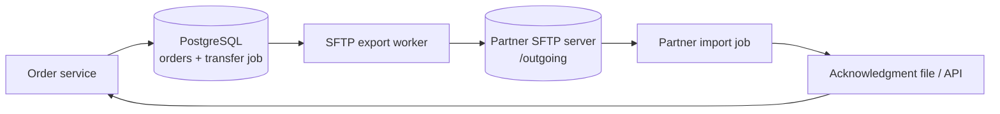
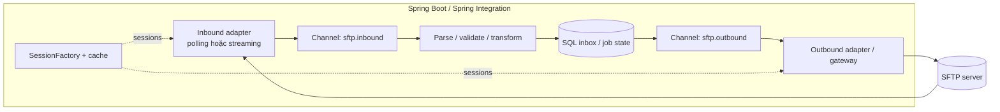
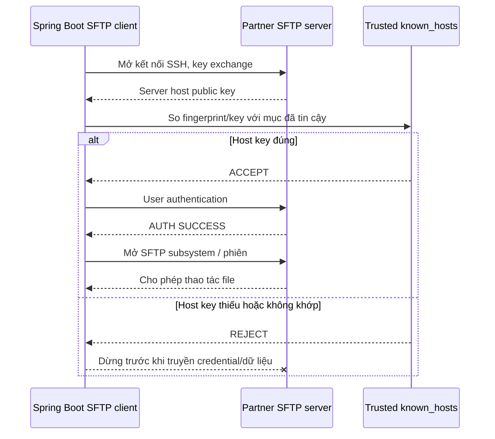
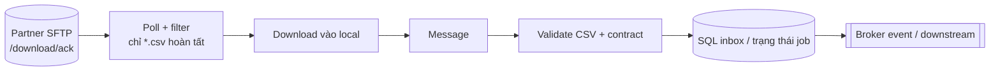
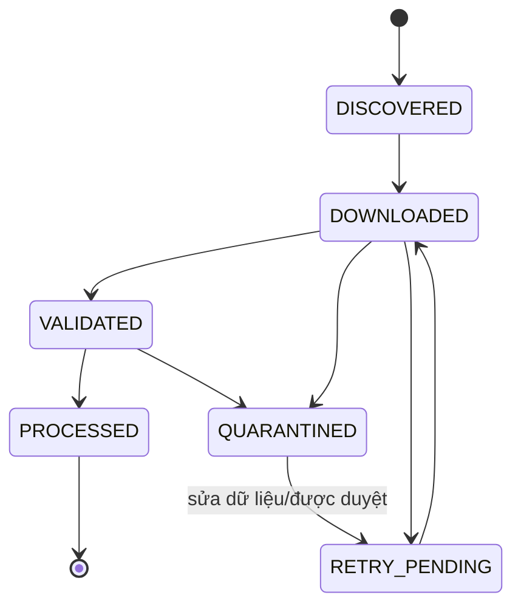
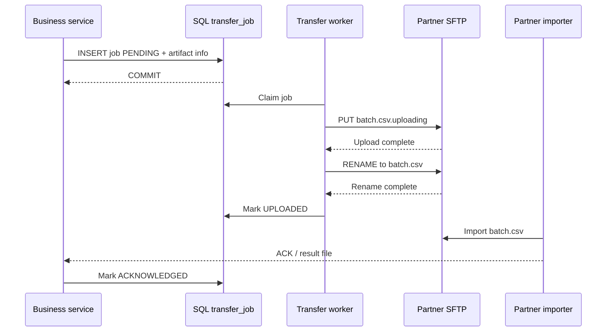

# SFTP adapter, xác minh host key và quản lý phiên kết nối

Một doanh nghiệp thường vẫn trao đổi dữ liệu bằng **tệp** dù các dịch vụ nội bộ đã chuyển sang REST, SQL và message broker. Hệ thống thanh toán xuất file đối soát mỗi đêm; đối tác vận chuyển nhận danh sách đơn hàng qua SFTP; hệ thống ERP đặt báo cáo CSV vào một thư mục để ứng dụng khác nhập liệu. Trong những trường hợp này, Spring Boot cần một adapter có thể **đưa tệp lên máy chủ, lấy tệp về, quản lý kết nối và khôi phục an toàn khi truyền lỗi**.

**Spring Integration SFTP** cung cấp inbound adapter, outbound adapter, outbound gateway và các thành phần thao tác file từ xa theo mô hình message-driven. SFTP chạy trên SSH: vì thế có hai lớp an toàn độc lập phải quản lý đúng là **xác thực máy chủ bằng host key** và **xác thực tài khoản ứng dụng bằng password/private key**.

Bài thuộc chương **Adapter tích hợp** của module **SPRING_BOOT_INTEGRATION**. Ngoài kết nối SFTP, chúng ta sẽ liên hệ thiết kế với HTTP client, SQL, cache, broker và các luồng Spring Integration, đặc biệt là cấu hình bí mật, hợp đồng dữ liệu, giao dịch, lỗi, idempotency, kiểm thử và khả năng quan sát.

> **Phạm vi phiên bản:** Ví dụ Java dùng **Spring Boot 3.x, Spring Integration 6.x, Java 17+** và triển khai SFTP dựa trên **Apache MINA SSHD**. Các ví dụ Spring Integration 5.x cũ có thể dùng JSch và những type khác; không sao chép nguyên import, host-key configuration hoặc cách tạo session factory từ ví dụ cũ. Với Spring Boot 4.x/Spring Integration mới hơn, cần đối chiếu API theo version mà dự án đang quản lý.

## 1. Mục tiêu học tập

Sau bài này, bạn có thể:

1. Phân biệt SFTP với FTP/FTPS và hiểu vì sao SSH **host key verification** phải được thực hiện trước khi truyền dữ liệu.
2. Phân biệt **inbound channel adapter**, **outbound channel adapter**, **outbound gateway** và `RemoteFileTemplate`.
3. Cấu hình `DefaultSftpSessionFactory` với known_hosts và private key, không tắt kiểm tra danh tính máy chủ.
4. Hiểu `CachingSessionFactory`, shared SSH connection, SFTP session, reconnect và giới hạn số kết nối.
5. Xây luồng upload có tên tệp tạm và đổi tên thành tệp chính thức sau khi truyền xong.
6. Xây luồng polling/download bằng bộ lọc file để không đọc tệp đang được đối tác ghi dở.
7. Thiết kế trạng thái xử lý bền vững, deduplication, retry và hành vi khi truyền thành công nhưng acknowledgment thất bại.
8. Kiểm thử với SFTP server thật trong môi trường cô lập, xác minh host key mismatch, session lifecycle và tính toàn vẹn file.
9. Theo dõi latency, backlog, session exhaustion, lỗi xác thực và sai lệch giữa tệp với bản ghi nghiệp vụ.

## 2. SFTP là gì và không phải là gì?

### 2.1. So sánh giao thức

| Giao thức | Cơ chế truyền | Bảo mật | Điều đáng chú ý |
| --- | --- | --- | --- |
| **FTP** | FTP control/data channels | Mặc định không bảo vệ nội dung hoặc credential | Không phù hợp cho dữ liệu nhạy cảm nếu không có biện pháp bổ sung |
| **FTPS** | FTP trên TLS | Dùng chứng chỉ TLS và cấu hình FTPS | Không giống SFTP; có thể cần nhiều kênh/port |
| **SFTP** | SSH File Transfer Protocol trên một kết nối SSH | SSH mã hóa, xác thực máy chủ và người dùng | Sử dụng SSH host key, không dùng chứng chỉ HTTPS để thay cho host key |
| **SCP** | Cơ chế sao chép qua SSH | SSH | Không đồng nghĩa SFTP dù thường cùng port 22 |

SFTP thường dùng **TCP port 22** nhưng đối tác có thể dùng port khác. Host, port, protocol, thuật toán và chính sách SSH phải là một phần của hợp đồng triển khai.

**Không nhầm:** File SFTP có thể truyền qua kết nối được mã hóa, nhưng **nội dung CSV/XML/JSON vẫn cần validation**. SFTP không tự kiểm tra schema, mã trạng thái, chữ ký nghiệp vụ hoặc tính hợp lệ của từng dòng dữ liệu.

### 2.2. Một lần truyền file không phải một transaction nghiệp vụ

Ví dụ trao đổi đơn hàng:



SFTP có thể xác nhận việc ghi file lên máy chủ hoàn tất ở tầng giao thức, nhưng **không xác nhận đối tác đã import file thành công vào hệ thống nghiệp vụ**. Việc đó cần acknowledgment riêng, ví dụ file `ACK`, response từ API, bản đối soát hoặc trạng thái xử lý được đối tác công bố.

## 3. Các thành phần Spring Integration SFTP

Trong Spring Integration, *adapter* nối hệ thống bên ngoài với **message channel**. Một tệp có thể được biểu diễn bằng `File`, byte array, stream hoặc một message có payload/headers tùy loại endpoint.

| Thành phần | Hướng dữ liệu | Vai trò |
| --- | --- | --- |
| **SFTP inbound channel adapter** | SFTP server → application | Poll và tải file từ máy chủ về local, sau đó phát message |
| **SFTP streaming inbound adapter** | SFTP server → application | Đọc file từ xa dưới dạng stream mà không nhất thiết tạo bản sao file local |
| **SFTP outbound channel adapter** | Application → SFTP server | Gửi file/payload lên máy chủ; thường dùng one-way flow |
| **SFTP outbound gateway** | Application ↔ SFTP server | Thực hiện lệnh như `ls`, `get`, `put`, `rm`, `mv` với response phù hợp |
| **SFTP session factory** | Cấu hình hạ tầng | Tạo SSH/SFTP session tới host đối tác |
| **Caching session factory** | Tối ưu tài nguyên | Cache session thay vì tạo kết nối/SSH handshake mới liên tục |
| **Remote file template** | API chương trình | Thực hiện thao tác file từ xa ngoài flow DSL khi cần |
| **Remote file filters** | Ở bước lấy file | Chọn file theo pattern, metadata hoặc dấu đã xử lý |

Sơ đồ khái niệm:



Một SFTP **inbound adapter** trong Spring Integration thường là **SFTP client chủ động polling máy chủ từ xa**, **không phải ứng dụng tự mở SFTP server để nhận kết nối SSH**. Nếu cần vận hành server SFTP của chính mình, cần phần mềm/hạ tầng server tương ứng.

## 4. Mô hình an toàn: host key và user authentication

### 4.1. Hai câu hỏi bảo mật khác nhau

Khi ứng dụng kết nối tới `sftp.partner.example:2222`:

1. **Ứng dụng đang nói chuyện với đúng máy chủ SFTP của đối tác không?** Trả lời bằng **SSH host key verification**.
2. **Ứng dụng được phép đăng nhập không?** Trả lời bằng password, SSH user private key, certificate hoặc cơ chế xác thực đã thỏa thuận.



Hai loại khóa này không thay thế nhau:

| Khóa | Thuộc về ai? | Công dụng |
| --- | --- | --- |
| **Server host public key** | SFTP server của đối tác | Xác minh **danh tính máy chủ** |
| **Server host private key** | Chỉ SFTP server giữ | Chứng minh máy chủ sở hữu host key |
| **User public key** | Đối tác cài vào authorized keys hoặc hạ tầng xác thực | Cho phép account ứng dụng đăng nhập |
| **User private key** | Ứng dụng hoặc secret storage giữ | Xác thực **client/user** trước server |

Ngay cả khi username/password hoặc SSH private key đúng, kết nối đến **máy chủ giả mạo** vẫn là rủi ro nếu bỏ qua host key verification.

### 4.2. known_hosts là gì?

Tệp `known_hosts` chứa những SSH host public key đã được tin cậy, gắn với host/port (hoặc các dạng nhận diện được SSH hỗ trợ). Ví dụ **cú pháp minh họa, không phải khóa hợp lệ để sử dụng**:

```text
[sftp.partner.example]:2222 ssh-ed25519 AAAAC3NzaC1lZDI1NTE5AAAAI...REPLACE_WITH_REAL_KEY
```

Với port SSH mặc định, định dạng thường là `hostname keytype base64-public-key`. Với port không mặc định, nhiều công cụ SSH dùng cú pháp `[hostname]:port`. Tùy thư viện và chính sách, known_hosts còn có hostname đã hash hoặc bản ghi đặc biệt; cần kiểm tra khả năng hỗ trợ của runtime.

**Không tạo tệp known_hosts bằng cách copy một public key chưa được xác minh rồi coi như an toàn.** Một kẻ tấn công ở giữa có thể trả chính host key của họ nếu quá trình thu thập ban đầu thiếu kênh tin cậy.

### 4.3. Quy trình xác nhận host key lần đầu

Quy trình nên có:

1. Yêu cầu đối tác cung cấp SSH **host key fingerprint** (thường SHA-256), host, port và thuật toán qua một **kênh tin cậy độc lập** đã được xác nhận danh tính.
2. Thu thập host public key từ hạ tầng đối tác theo quy trình vận hành đã phê duyệt.
3. Tính fingerprint của public key và so với giá trị do đối tác xác nhận **ngoài băng**.
4. Chỉ đưa key đã khớp vào known_hosts được triển khai cùng ứng dụng.
5. Thử kết nối với kiểm tra strict, thử cả tình huống known_hosts sai để xác nhận fail closed.
6. Ghi lại chủ sở hữu key, ngày xác minh, kênh xác minh và kế hoạch rotation.

Một công cụ SSH có thể hiển thị fingerprint của known_hosts:

```bash
ssh-keygen -lf ./known_hosts -E sha256
```

Lệnh lấy public key trực tiếp từ network như `ssh-keyscan` **không tự xác minh danh tính máy chủ**. Nó hữu ích để lấy key thô, nhưng phải đối chiếu fingerprint trên **kênh đáng tin cậy khác** trước khi chấp nhận. Không làm bước `ssh-keyscan ... > known_hosts` tự động trong mỗi lần deploy nếu không có xác minh.

### 4.4. Host key thay đổi phải xử lý như một sự kiện an ninh

Khi SFTP server đổi host key, ứng dụng có thể báo lỗi host key không khớp. Đừng ngay lập tức bật `allowUnknownKeys=true` để “chữa” kết nối.

Kiểm tra:

- Đối tác có thông báo rotation chính thức không?
- Hostname/port có thay đổi hoặc đang trỏ tới server mới không?
- Fingerprint mới có được xác nhận qua kênh ngoài băng không?
- Load balancer có nhiều backend SSH host key khác nhau không?
- DNS/IP có bị chuyển đến điểm không mong muốn không?
- Session cũ còn đang được cache/duy trì hay đã reconnect bằng host key mới?

Khi rotation hợp lệ, triển khai known_hosts theo thời gian chuyển tiếp được phối hợp, rồi loại bỏ key cũ khi hết hạn. Cần kế hoạch rollback và metric báo các đợt mismatch. Một mismatch không được xử lý như lỗi mạng tạm thời để retry vô hạn.

## 5. Dependency và cấu hình Spring Boot

### 5.1. Dependency cho Spring Integration SFTP

Ví dụ Gradle (Groovy DSL) cho Spring Boot 3.x và Spring Integration 6.x:

```groovy
dependencies {
    implementation 'org.springframework.boot:spring-boot-starter-integration'
    implementation 'org.springframework.integration:spring-integration-sftp'

    // Khi pipeline cần ghi SQL/inbox/outbox:
    implementation 'org.springframework.boot:spring-boot-starter-jdbc'

    testImplementation 'org.springframework.boot:spring-boot-starter-test'
    testImplementation 'org.springframework.integration:spring-integration-test'
}
```

Để Spring Boot dependency management chọn Spring Integration và Apache MINA SSHD phù hợp, **không ép JSch hoặc version Spring Integration cũ** vào classpath nếu chưa có lý do tương thích được kiểm chứng. Khi cần kiểm thử SFTP server thật bằng container, thêm Testcontainers dependency phù hợp với stack test của dự án.

### 5.2. Cấu hình kết nối không chứa secret trực tiếp

Ví dụ `application-local.yml`:

```yaml
integration:
  sftp:
    host: ${PARTNER_SFTP_HOST}
    port: ${PARTNER_SFTP_PORT:22}
    username: ${PARTNER_SFTP_USERNAME}
    private-key-path: ${PARTNER_SFTP_PRIVATE_KEY_PATH}
    private-key-passphrase: ${PARTNER_SFTP_PASSPHRASE:}
    known-hosts-path: ${PARTNER_SFTP_KNOWN_HOSTS_PATH}
    remote-outbound-directory: "/upload/orders"
    remote-inbound-directory: "/download/ack"
    local-inbound-directory: "./var/sftp/ack"
```

Các giá trị ở đây là biến môi trường/thiết lập được cung cấp khi triển khai:

- **Private key path** phải trỏ đến file key được mount an toàn, chỉ runtime account cần thiết được đọc; không commit private key vào source repository.
- **Passphrase** là bí mật, cần lưu trong secret manager, Kubernetes Secret hoặc cơ chế bảo vệ tương ứng. Không đưa nó vào log, trace hoặc message header.
- **known_hosts** chứa public key máy chủ đã tin cậy; tuy không phải secret, tệp cần được **bảo vệ tính toàn vẹn** để tránh bị người không có quyền thay đổi.
- Host/port, các remote directory và đường dẫn local cần kiểm soát theo đối tác; không nhận remote root tùy ý từ request người dùng.
- TLS certificate của HTTP client không thay cho xác minh SSH host key của SFTP.

**Lưu ý:** `./var/sftp/ack` là đường dẫn local minh họa. Production nên chọn thư mục phù hợp filesystem, quyền ghi, dung lượng, chiến lược cleanup và cơ chế backup/replay.

## 6. DefaultSftpSessionFactory: xác thực máy chủ và tài khoản

Trong Spring Integration 6.x, một cách thiết lập session factory cơ bản:

**`SftpSessionConfiguration.java`**

```java
package com.example.integration.sftp;

import org.apache.sshd.sftp.client.SftpClient;
import org.springframework.beans.factory.annotation.Value;
import org.springframework.context.annotation.Bean;
import org.springframework.context.annotation.Configuration;
import org.springframework.core.io.FileSystemResource;
import org.springframework.integration.file.remote.session.SessionFactory;
import org.springframework.integration.file.remote.session.CachingSessionFactory;
import org.springframework.integration.sftp.session.DefaultSftpSessionFactory;

@Configuration
public class SftpSessionConfiguration {

    @Bean
    SessionFactory<SftpClient.DirEntry> sftpSessionFactory(
            @Value("${integration.sftp.host}") String host,
            @Value("${integration.sftp.port}") int port,
            @Value("${integration.sftp.username}") String username,
            @Value("${integration.sftp.private-key-path}") String keyPath,
            @Value("${integration.sftp.private-key-passphrase:}") String passphrase,
            @Value("${integration.sftp.known-hosts-path}") String knownHostsPath) {

        // true: nhiều SFTP session có thể dùng một SSH connection.
        var delegate = new DefaultSftpSessionFactory(true);
        delegate.setHost(host);
        delegate.setPort(port);
        delegate.setUser(username);

        delegate.setPrivateKey(new FileSystemResource(keyPath));
        if (!passphrase.isBlank()) {
            delegate.setPrivateKeyPassphrase(passphrase);
        }

        // Không bỏ qua bước xác minh host key.
        delegate.setKnownHostsResource(new FileSystemResource(knownHostsPath));
        delegate.setAllowUnknownKeys(false);

        // Cache những session được adapter mượn và trả.
        var cache = new CachingSessionFactory<SftpClient.DirEntry>(
                delegate, 8);
        cache.setSessionWaitTimeout(10_000L);
        return cache;
    }
}
```

**Ý nghĩa của từng phần:**

1. `DefaultSftpSessionFactory` tạo khả năng kết nối và khởi tạo session SFTP qua SSH.
2. `setHost`, `setPort`, `setUser` định vị server và account ứng dụng.
3. `setPrivateKey` và `setPrivateKeyPassphrase` cấu hình **user authentication** bằng private key.
4. `setKnownHostsResource` và `setAllowUnknownKeys(false)` cấu hình **host key verification**. Nếu host key không được tin cậy hoặc thay đổi trái phép, kết nối phải thất bại.
5. `CachingSessionFactory` giới hạn/cache session được mượn trong quá trình poll và upload.
6. `setSessionWaitTimeout(10_000L)` là giới hạn chờ lấy session từ cache, **không phải timeout kết nối hoặc read timeout của SSH transport**.

**Lưu ý API:** Ví dụ dùng `SftpClient.DirEntry` theo Spring Integration 6.x dựa trên Apache MINA SSHD. Một số dự án hoặc tài liệu cũ dùng kiểu `ChannelSftp.LsEntry` của JSch; không dùng type đó để triển khai class trên với Spring Integration 6.x.

### 6.1. Nếu đối tác dùng password thay vì private key

Có thể cấu hình `delegate.setPassword(password)` trong một session factory dành riêng cho authentication bằng password, lấy mật khẩu từ secret provider an toàn. Không cần “thêm cả password và private key cho chắc” nếu hợp đồng server không yêu cầu nhiều phương thức xác thực.

Việc **dùng password thay private key** chỉ thay cách chứng minh danh tính **người dùng**; xác minh host key vẫn phải nghiêm ngặt.

### 6.2. Lỗi thiếu known_hosts khác lỗi sai credential

| Loại lỗi | Lúc xảy ra | Hướng xử lý |
| --- | --- | --- |
| Host key không có trong danh sách tin cậy | Sau key exchange, trước login thành công | Kiểm tra onboarding fingerprint và known_hosts |
| Host key khác giá trị đã tin | Khi SSH server trả key khác | Điều tra rotation/MITM/DNS, fail closed |
| Private key sai hoặc server không cấp quyền | User authentication | Kiểm tra account, public key đã cài ở server, quyền |
| SFTP folder bị từ chối | Sau khi SSH login và mở SFTP | Kiểm tra quyền đường dẫn và chroot |
| Remote path không tồn tại | Khi list/get/put | Kiểm tra contract thư mục và auto-create policy |

Không dùng `catch (Exception)` rồi chuyển mọi lỗi thành “không tìm thấy file”. Từng nhóm lỗi dẫn tới hành động khắc phục khác nhau.

## 7. Quản lý phiên kết nối: SSH connection, SFTP session và cache

### 7.1. Những lớp kết nối thường bị nhầm

Một ứng dụng có thể tạo:

- **TCP connection** tới host/port SFTP.
- **SSH connection/session** với key exchange, host-key verification và authentication.
- **SFTP subsystem/session/channel** để thực hiện thao tác list/read/write/rename trên file.

Tạo một SSH handshake mới cho **mỗi file** có thể tốn CPU và latency. Nhưng giữ session quá lâu có thể gặp socket chết, idle timeout hoặc server giới hạn concurrent channels. Vì vậy cần cân đối giữa **tái sử dụng** và **độ bền kết nối**.

### 7.2. Shared connection không đồng nghĩa chỉ có một tác vụ

Với `new DefaultSftpSessionFactory(true)`, triển khai có thể chia sẻ **một SSH connection nền** giữa nhiều SFTP session. Điều này giúp giảm chi phí kết nối nhưng không có nghĩa mọi SFTP operation trở thành tuần tự hoặc mọi server đều chấp nhận số lượng channel vô hạn.

Cấu hình này cần test với server đối tác:

- Server cho phép tối đa bao nhiêu session/channel trên một SSH connection?
- Nhiều upload/download đồng thời có ảnh hưởng băng thông, I/O và giới hạn server không?
- Một SSH connection mất mạng sẽ ảnh hưởng bao nhiêu operation đang dùng chung?
- Sau server restart, factory/cache có khôi phục session mới đúng cách không?

`new DefaultSftpSessionFactory(false)` thường tạo SSH connection riêng cho từng session theo cấu hình factory, tốn handshake hơn nhưng có đặc điểm cô lập kết nối khác. Không có lựa chọn đúng cho mọi tải.

### 7.3. Vai trò của CachingSessionFactory

`CachingSessionFactory` dùng session pool/cache:

1. Adapter mượn session.
2. Thực hiện SFTP operations.
3. Đóng session ở API caller để **trả về cache** (khi wrapper quản lý).
4. Adapter khác có thể tái sử dụng session nếu hợp lệ.

Nếu toàn bộ pool đang bận, caller có thể chờ tới `sessionWaitTimeout` hoặc gặp timeout theo chính sách. Đây là tín hiệu **saturation** chứ không phải bằng chứng SFTP server bị down.

Ví dụ cấu hình cache:

```java
var cache = new CachingSessionFactory<SftpClient.DirEntry>(delegate, 8);
cache.setSessionWaitTimeout(10_000L);
```

Con số 8 là ví dụ, không phải khuyến nghị cố định. Cần đo số luồng đồng thời, tốc độ tệp, thời gian upload/download và chính sách server.

Một số phiên bản `CachingSessionFactory` hỗ trợ **kiểm tra session khi mượn** (ví dụ `setTestSession(true)` theo API tương ứng). Nếu server thường đóng kết nối rảnh, cơ chế này có thể giúp phát hiện session không còn hợp lệ trước khi sử dụng, nhưng tốn thêm round trip. Kiểm tra tính năng theo phiên bản và benchmark trên môi trường thật.

### 7.4. Connection leak và nguyên tắc đóng session

Nếu dùng API `SessionFactory` trực tiếp, cần trả session trong `finally` hoặc try-with-resources khi interface hỗ trợ:

```java
Session<SftpClient.DirEntry> session = sessionFactory.getSession();
try {
    // session.exists(...), session.list(...), ...
} finally {
    session.close();
}
```

Với `CachingSessionFactory`, `close()` trên session wrapper thường nghĩa là **trả về pool**, không phải đóng tất cả TCP connections ngay lập tức. Ngược lại, quên close có thể làm pool cạn dù không có lỗi mạng.

**Ưu tiên dùng adapter/RemoteFileTemplate** vốn quản lý lifecycle của session thay vì mở session thủ công ở khắp business service. Nếu server reset hoặc thay host key, có thể cần reset/evict cache và tái kết nối có kiểm soát.

### 7.5. Timeout có nhiều loại

| Timeout | Mục đích |
| --- | --- |
| DNS/connect timeout | Giới hạn tạo kết nối ban đầu |
| SSH handshake/auth timeout | Giới hạn giai đoạn nhận diện máy chủ, xác thực người dùng |
| SFTP read/write timeout | Giới hạn chờ operation hoặc transport |
| Session pool wait timeout | Giới hạn chờ mượn session từ cache |
| Polling interval | Khoảng thời gian giữa các lần poll |
| Job deadline | Tổng thời gian cho một file/batch bao gồm retry và hậu xử lý |

Không xem `setSessionWaitTimeout` là “timeout cho upload file”. Khi cần giới hạn network/SSH operation, cấu hình timeout ở lớp SSH/SFTP factory/client thực tế hoặc ở lớp điều phối công việc với khả năng cancellation/cleanup phù hợp.

## 8. Upload với outbound channel adapter

### 8.1. Hợp đồng file gửi đi

Giả sử hệ thống tạo một CSV đơn hàng và upload tới thư mục `/upload/orders`. Đối tác quy định:

- Chỉ đọc file có đuôi `.csv`.
- Trong lúc upload, file phải có đuôi `.uploading`.
- Sau khi upload đầy đủ, tên file mới được đổi sang `.csv`.
- Tên file chứa batch ID ổn định, ví dụ `orders-20261121-batch-0042.csv`.
- File có encoding UTF-8 và header/column order đã thỏa thuận.

Đây là **hợp đồng tích hợp**, không chỉ là cấu hình đường dẫn. Việc đổi tên giúp giảm xác suất đối tác đọc một file đang ghi dở, nhưng chỉ hoạt động khi cả hai phía tôn trọng quy ước.

### 8.2. Spring Integration outbound handler

**`SftpOutboundConfiguration.java`**

```java
package com.example.integration.sftp;

import java.io.File;

import org.apache.sshd.sftp.client.SftpClient;
import org.springframework.context.annotation.Bean;
import org.springframework.context.annotation.Configuration;
import org.springframework.expression.common.LiteralExpression;
import org.springframework.integration.annotation.ServiceActivator;
import org.springframework.integration.file.remote.session.SessionFactory;
import org.springframework.integration.sftp.outbound.SftpMessageHandler;
import org.springframework.messaging.MessageHandler;

@Configuration
public class SftpOutboundConfiguration {

    @Bean
    @ServiceActivator(inputChannel = "sftpUploadRequests")
    MessageHandler sftpUploadHandler(
            SessionFactory<SftpClient.DirEntry> sessionFactory) {

        SftpMessageHandler handler = new SftpMessageHandler(sessionFactory);
        handler.setRemoteDirectoryExpression(
                new LiteralExpression("/upload/orders"));

        // Truyền tên file đã được xác thực ở phía ứng dụng.
        handler.setFileNameGenerator(message -> {
            File file = (File) message.getPayload();
            return file.getName();
        });

        handler.setUseTemporaryFileName(true);
        handler.setTemporaryFileSuffix(".uploading");
        return handler;
    }
}
```

Một message có payload là `File` được đưa vào channel `sftpUploadRequests`. Handler dùng session factory để upload file, trước hết sử dụng tên tạm rồi đổi tên sau khi hoàn tất theo khả năng server và cấu hình của adapter.

**Lưu ý thực thi:** Đoạn code chỉ minh họa outbound handler với payload `File`. Ở hệ thống thật, phải khai báo producer/message gateway hoặc flow đẩy message vào channel này. Cần kiểm tra version Spring Integration và chính sách server về đổi tên, thư mục, quyền ghi và hành vi khi file đích đã tồn tại.

### 8.3. Khi gửi message tới channel

Có thể dùng `MessageChannel` và `MessageBuilder` trong một adapter/application service:

```java
package com.example.integration.sftp;

import java.io.File;

import org.springframework.beans.factory.annotation.Qualifier;
import org.springframework.messaging.MessageChannel;
import org.springframework.messaging.support.MessageBuilder;
import org.springframework.stereotype.Component;

@Component
public class SftpExportPublisher {

    private final MessageChannel uploadChannel;

    public SftpExportPublisher(
            @Qualifier("sftpUploadRequests") MessageChannel uploadChannel) {
        this.uploadChannel = uploadChannel;
    }

    public void upload(File preparedCsv) {
        if (!preparedCsv.isFile() || !preparedCsv.canRead()) {
            throw new IllegalArgumentException("File CSV chưa sẵn sàng");
        }
        boolean accepted = uploadChannel.send(
                MessageBuilder.withPayload(preparedCsv).build());
        if (!accepted) {
            throw new IllegalStateException("Channel không nhận message");
        }
    }
}
```

Để minh họa đầy đủ, có thể khai báo channel tường minh:

```java
@Bean("sftpUploadRequests")
MessageChannel sftpUploadRequests() {
    return new DirectChannel();
}
```

Trong source thật cần import `org.springframework.integration.channel.DirectChannel` và `org.springframework.messaging.MessageChannel`. Khi dùng `DirectChannel`, handler thường thực hiện **đồng bộ trên luồng gọi** và exception có thể truyền về caller. Nếu đổi sang `ExecutorChannel` hoặc queue, việc `send(...)` trả `true` chỉ cho biết message được channel chấp nhận, **không chắc SFTP upload đã hoàn tất**.

### 8.4. Tên file ổn định và tránh ghi đè

`File.getName()` chỉ là một phần của filename policy, không tự bảo vệ mọi trường hợp:

- Chuẩn hóa batch ID, tenant/partner ID, ngày nghiệp vụ và extension.
- Chặn file name rỗng, ký tự điều khiển, path traversal, tên bắt đầu bằng dot không mong muốn.
- Không cho inbound HTTP request tự cung cấp remote directory tùy ý.
- Nếu file cùng tên đã tồn tại, quy định overwrite, fail, compare hash hoặc versioned filename.
- Không dùng `UUID.randomUUID()` mỗi lần retry cho cùng batch nếu đối tác dựa vào filename để chống trùng.
- Nên tính checksum/record count/manifest nếu tính toàn vẹn file là yêu cầu nghiệp vụ.

## 9. Inbound: polling/download file từ SFTP server

### 9.1. Phân biệt “tải về” và “xử lý xong”

Một inbound adapter thường:

1. Kết nối SFTP bằng session factory.
2. List thư mục từ xa.
3. Lọc file phù hợp theo tên/metadata.
4. Download về thư mục local.
5. Phát message chứa `File` local cho handler tiếp theo.
6. Handler parse, validate, ghi SQL/inbox và tạo event cần phát.



**Tải file xong chưa phải xử lý nghiệp vụ xong.** Nếu parser gặp lỗi ở dòng thứ 5.000, file vẫn đã được tải xuống, nhưng job phải được đánh dấu thất bại, quarantine hoặc có cơ chế retry/replay theo contract.

### 9.2. Ví dụ synchronizer và message source

**`SftpInboundConfiguration.java`**

```java
package com.example.integration.sftp;

import java.io.File;

import org.apache.sshd.sftp.client.SftpClient;
import org.springframework.context.annotation.Bean;
import org.springframework.context.annotation.Configuration;
import org.springframework.integration.annotation.InboundChannelAdapter;
import org.springframework.integration.annotation.Poller;
import org.springframework.integration.file.filters.FileSystemPersistentAcceptOnceFileListFilter;
import org.springframework.integration.file.remote.session.SessionFactory;
import org.springframework.integration.metadata.MetadataStore;
import org.springframework.integration.metadata.SimpleMetadataStore;
import org.springframework.integration.sftp.filters.SftpPersistentAcceptOnceFileListFilter;
import org.springframework.integration.sftp.filters.SftpSimplePatternFileListFilter;
import org.springframework.integration.sftp.inbound.SftpInboundFileSynchronizer;
import org.springframework.integration.sftp.inbound.SftpInboundFileSynchronizingMessageSource;
import org.springframework.integration.file.filters.CompositeFileListFilter;

@Configuration
public class SftpInboundConfiguration {

    @Bean
    MetadataStore sftpMetadataStore() {
        // Chỉ dành cho ví dụ: metadata mất khi ứng dụng restart.
        return new SimpleMetadataStore();
    }

    @Bean
    @InboundChannelAdapter(
            channel = "sftpInboundFiles",
            poller = @Poller(fixedDelay = "10000", maxMessagesPerPoll = "5"))
    SftpInboundFileSynchronizingMessageSource sftpInboundSource(
            SessionFactory<SftpClient.DirEntry> sessionFactory,
            MetadataStore sftpMetadataStore) {

        var synchronizer = new SftpInboundFileSynchronizer(sessionFactory);
        synchronizer.setRemoteDirectory("/download/ack");

        var remoteFilters =
                new CompositeFileListFilter<SftpClient.DirEntry>();
        remoteFilters.addFilter(
                new SftpSimplePatternFileListFilter("*.csv"));
        remoteFilters.addFilter(
                new SftpPersistentAcceptOnceFileListFilter(
                        sftpMetadataStore, "partner-ack:remote:"));
        synchronizer.setFilter(remoteFilters);

        synchronizer.setDeleteRemoteFiles(false);

        var source = new SftpInboundFileSynchronizingMessageSource(
                synchronizer);
        source.setLocalDirectory(new File("./var/sftp/ack"));
        source.setAutoCreateLocalDirectory(true);
        source.setLocalFilter(
                new FileSystemPersistentAcceptOnceFileListFilter(
                        sftpMetadataStore, "partner-ack:local:"));
        return source;
    }
}
```

Ý nghĩa:

- Poller chạy định kỳ, mỗi lần phát tối đa một số message theo cấu hình. Số file được đồng bộ từ xa mỗi chu kỳ còn liên quan giới hạn fetch và trạng thái thư mục local.
- `SftpSimplePatternFileListFilter("*.csv")` chỉ xem xét tên file đuôi `.csv` theo quy tắc ví dụ.
- `SftpPersistentAcceptOnceFileListFilter` hỗ trợ nhớ các file đã chấp nhận dựa trên metadata để hạn chế tải trùng. Nó **không tự tạo chứng minh nghiệp vụ exactly-once**.
- `FileSystemPersistentAcceptOnceFileListFilter` giúp kiểm soát phát lại file local; độ bền metadata phụ thuộc `MetadataStore` thực tế.
- `setDeleteRemoteFiles(false)` giữ file ở máy chủ trong ví dụ; việc xóa/archive từ xa cần chính sách riêng.
- `SimpleMetadataStore` chỉ giữ trạng thái trong bộ nhớ trong phạm vi ví dụ; production có thể dùng `JdbcMetadataStore` hoặc `RedisMetadataStore` phù hợp, xét cả concurrency và tính bền vững.

**Điểm cần lưu ý:** Với nhiều application instance cùng poll một thư mục, một bộ lọc local/in-memory không đủ bảo đảm chỉ một instance nhận file. Cần điều phối polling, metadata store chung có khả năng cập nhật nguyên tử theo contract hoặc cơ chế server-side claim/rename đáng tin cậy.

### 9.3. Handler xử lý file local

Một bean có thể xử lý message được phát vào channel:

```java
package com.example.integration.sftp;

import java.io.File;

import org.springframework.integration.annotation.ServiceActivator;
import org.springframework.stereotype.Component;

@Component
public class SftpAckFileHandler {

    private final AckIngestionService ingestionService;

    public SftpAckFileHandler(AckIngestionService ingestionService) {
        this.ingestionService = ingestionService;
    }

    @ServiceActivator(inputChannel = "sftpInboundFiles")
    public void handle(File file) {
        ingestionService.ingest(file);
    }
}
```

`AckIngestionService` là contract nghiệp vụ của ứng dụng do bạn triển khai: parse/validate CSV, ghi inbox/trạng thái job, xử lý trùng và phân loại file lỗi. Không nên nhét toàn bộ business mapping vào session factory hoặc adapter configuration.

### 9.4. Remote filter không thay thế file-readiness protocol

File `orders.csv` có thể tồn tại trên SFTP server trong lúc đối tác đang upload. Nếu ta poll theo `*.csv`, có nguy cơ đọc file chưa hoàn tất.

Các cách giảm rủi ro:

- **Quy ước tên tạm**: đối tác upload `.uploading`, sau đó rename thành `.csv`; inbound chỉ nhận `*.csv`.
- **Marker/manifest file**: chỉ xử lý `orders.csv` khi `orders.csv.done` hoặc manifest hợp lệ đã xuất hiện.
- **Kiểm tra size/mtime ổn định** qua nhiều lượt poll nếu không điều khiển được phía đối tác, nhưng đây chỉ là heuristic.
- **File locking/claim** khi server và hợp đồng hỗ trợ, tránh nhiều consumer cùng nhận.
- **Checksum và record count** để xác minh tính toàn vẹn trước khi commit nghiệp vụ.

Không coi một khoảng `sleep 5 giây` hay file size > 0 là bằng chứng file đã hoàn tất.

## 10. Streaming inbound và outbound gateway

### 10.1. Khi nào dùng streaming inbound?

Download file 10 GB về local trước khi parse có thể tốn dung lượng và thời gian. Với file lớn hoặc cần xử lý tăng dần, **streaming inbound** cho phép nhận nội dung file qua stream mà không nhất thiết lưu toàn bộ xuống local.

Đánh đổi:

- Session có thể bị giữ trong suốt thời gian consumer đọc stream.
- Consumer phải **đóng stream** và giải phóng session theo contract của adapter; nếu không, pool sẽ cạn.
- Khi lỗi giữa dòng, phải xác định có thể resume bằng offset/checkpoint hay phải đọc lại từ đầu.
- Luồng xử lý cần backpressure/batch phù hợp và không giữ toàn bộ nội dung trong RAM.
- Không thể giả định dữ liệu đã được lưu bền vững nếu chỉ xử lý in-memory stream.

Một inbound adapter download local phù hợp hơn khi cần audit artifact, replay, đối soát checksum và parser không hỗ trợ stream; streaming phù hợp khi tài nguyên I/O và nhu cầu latency cho phép. Chọn theo nghiệp vụ, không mặc định streaming luôn tốt hơn.

### 10.2. Outbound gateway để thao tác remote

Một outbound gateway thực hiện các lệnh SFTP theo contract endpoint, ví dụ:

| Lệnh | Mục đích điển hình | Điều cần cân nhắc |
| --- | --- | --- |
| `ls` | Liệt kê file | Số lượng lớn, quyền, bộ lọc |
| `get` | Lấy file | Streaming/download, path, kiểm tra hash |
| `put` | Đưa file lên | Overwrite, temporary file, retry |
| `mget` / `mput` | Lấy/gửi nhiều file | Partial success, batch size |
| `rm` | Xóa file | Quyền, rollback nghiệp vụ không thể hoàn tác |
| `mv` | Đổi tên/chuyển vị trí | Quy tắc atomic rename của server và phạm vi filesystem |

Gateway có **reply** phù hợp với từng command và thường được dùng khi logic cần biết kết quả thao tác; outbound adapter one-way đơn giản hơn khi chỉ cần gửi file.

Không dùng `rm` để “ack” rằng file đã xử lý xong nếu SQL chưa commit hoặc chưa có trạng thái job bền vững. Xóa file từ xa là một side effect khó hoàn tác.

## 11. RemoteFileTemplate và thao tác tường minh

Khi một flow cần list/rename file, có thể sử dụng **`SftpRemoteFileTemplate`** hoặc API `SessionFactory` trực tiếp thay vì một adapter polling cố định.

Ví dụ thao tác rename theo API session trong callback template:

```java
package com.example.integration.sftp;

import org.apache.sshd.sftp.client.SftpClient;
import org.springframework.integration.file.remote.session.SessionFactory;
import org.springframework.integration.sftp.session.SftpRemoteFileTemplate;
import org.springframework.stereotype.Component;

@Component
public class RemoteArchiveCommand {

    private final SftpRemoteFileTemplate template;

    public RemoteArchiveCommand(
            SessionFactory<SftpClient.DirEntry> sessionFactory) {
        this.template = new SftpRemoteFileTemplate(sessionFactory);
    }

    public void archive(String sourcePath, String archivePath) {
        template.execute(session -> {
            session.rename(sourcePath, archivePath);
            return null;
        });
    }
}
```

**Điểm mạnh:** `execute(...)` cung cấp session vào callback và quản lý vòng đời theo cơ chế template, thay vì service tự mượn session rồi quên trả.

**Điểm nguy hiểm:** Hai đường dẫn từ xa là dữ liệu có tác động lớn. Production phải validate remote root, filename, tenant/partner và quyền thao tác; không truyền thẳng `sourcePath`/`archivePath` lấy từ HTTP request của người dùng.

Không mặc định `rename` luôn atomic trong mọi cấu hình server/mount hoặc đảm bảo “file được tiêu thụ chính xác một lần”. Kiểm tra quy ước rename của SFTP server và lưu trạng thái nghiệp vụ riêng.

## 12. Thiết kế idempotency và trạng thái xử lý file

### 12.1. Cùng tên file có thể mang dữ liệu khác

Một hệ thống SFTP có thể gửi:

```text
2026-11-21 01:00  /incoming/orders.csv  size=5 MB
2026-11-21 02:00  /incoming/orders.csv  size=7 MB
```

Nếu dùng mỗi filename làm khóa dedup, file 7 MB có thể bị bỏ qua. Ngược lại, một retry gửi cùng dữ liệu dưới tên khác có thể bị xử lý hai lần.

**Hợp đồng file nên có một định danh truyền tải ổn định**, ví dụ `partner_id`, `batch_id`, `schema_version` và checksum. Với các file không có batch ID, cần thống nhất chính sách dựa trên đường dẫn + metadata/chữ ký nội dung thay vì đoán tùy tiện.

### 12.2. Mô hình inbox SQL

Ví dụ bảng theo dõi job:

```sql
CREATE TABLE sftp_ingestion (
    partner_id       VARCHAR(64) NOT NULL,
    transfer_id      VARCHAR(128) NOT NULL,
    remote_path      VARCHAR(1024) NOT NULL,
    sha256_hex       CHAR(64) NOT NULL,
    state            VARCHAR(24) NOT NULL,
    attempt_count    INTEGER NOT NULL DEFAULT 0,
    received_at      TIMESTAMPTZ NOT NULL DEFAULT CURRENT_TIMESTAMP,
    processed_at     TIMESTAMPTZ,
    PRIMARY KEY (partner_id, transfer_id)
);
```

Trạng thái minh họa:



Bảng cho phép:

- Chặn duplicate theo `(partner_id, transfer_id)` bằng constraint.
- Kiểm tra hash có đổi khi cùng transfer ID được gửi lại không.
- Lưu số lần thử, thời điểm, lỗi và trạng thái cuối.
- Retry file lỗi tạm thời mà không nhập lặp các record nghiệp vụ.
- Đối soát tệp đã nhận với file manifest/ACK từ đối tác.

**Không mặc định toàn bộ batch được xử lý nguyên tử** khi parser ghi hàng nghìn dòng. Cần transaction boundary theo batch hoặc theo record, cùng checkpoint và chiến lược lỗi rõ ràng.

### 12.3. Metadata store của Spring Integration khác business inbox

`SftpPersistentAcceptOnceFileListFilter` và local accept-once filter giúp giảm lần tải hoặc lần phát message trùng. Nhưng các filter đó không thay thế:

- Unique constraint trong SQL.
- Idempotency tại cấp record/event.
- Validation checksum/record count.
- Trạng thái batch đã import hoặc đang quarantine.
- Replay khi app chết giữa download, ghi SQL và cập nhật metadata.

Một filter có thể ghi nhận file **đã được chấp nhận** trước khi toàn bộ nghiệp vụ downstream commit. Nếu xử lý phía sau thất bại, cần thiết kế cách khôi phục filter state hoặc phát lại từ artifact bền vững. Bảo đảm “không bao giờ mất file” phải dựa trên end-to-end workflow chứ không chỉ một accept-once filter.

## 13. Ranh giới giao dịch: SFTP, SQL và broker

### 13.1. Không có transaction phân tán mặc định

Giả sử một service:

```java
@Transactional
public void exportOrderBatch(String batchId) {
    batchRepository.markReady(batchId);
    sftpExporter.upload(batchId);
    batchRepository.markTransferred(batchId);
}
```

Nếu upload thành công nhưng lệnh `markTransferred` thất bại:

- Transaction SQL có thể rollback.
- **File đã upload vẫn nằm trên SFTP server**.
- Lần retry có thể upload lại cùng file, hoặc ghi đè nếu tên giống nhau.

`@Transactional` với JDBC **không rollback file transfer trên SFTP**. Đây là biên của hai hệ thống không tham gia một giao dịch chung.

### 13.2. Thiết kế outbox-like transfer job

Một cách an toàn hơn cho outbound:

1. Trong transaction SQL, tạo `transfer_job` với ID ổn định, trạng thái `PENDING` và vị trí artifact đã sinh.
2. Commit SQL.
3. Worker chọn job có lease/claim phù hợp, mở session và upload file với tên tạm.
4. Khi server xác nhận truyền hoàn tất, đổi tên sang tên chính thức.
5. Lưu trạng thái `UPLOADED` và checksum/remote path.
6. Chờ ACK của đối tác để chuyển sang `ACKNOWLEDGED` nếu hợp đồng yêu cầu.
7. Nếu worker timeout ngay sau rename, phải **kiểm tra trạng thái remote** hoặc đối soát thay vì gửi lại vô điều kiện.



Điểm cần lưu ý: kết quả từ server SFTP chỉ chứng minh thao tác SFTP thành công theo protocol/server, chưa chứng minh partner đã import business data.

### 13.3. Nhập từ SFTP và phát broker event

Inbound có thể:

```text
SFTP download → validate CSV → SQL inbox / business rows → SQL outbox
                                                  ↓
                                          commit database
                                                  ↓
                                         outbox publisher
                                                  ↓
                                         Kafka / RabbitMQ
```

SQL business rows và outbox event được ghi cùng transaction, nhưng file download hoặc remote rename không tự tham gia transaction. Worker có thể retry, consumer broker có thể nhận trùng. Dùng khóa nghiệp vụ ổn định và test redelivery.

### 13.4. “Exactly once” là mục tiêu end-to-end

Một system có thể quảng cáo filter `AcceptOnce`, một message broker hỗ trợ transaction và SFTP dùng tên tạm. Dù vậy, **tất cả kết hợp không tự tạo exactly-once side effect xuyên SFTP → SQL → broker → HTTP**.

Hãy xác định cụ thể:

- **At-least-once transfer:** tệp có thể xuất hiện lại; hệ thống đích phải dedup.
- **At-most-once action:** có thể bỏ lỡ nếu đánh dấu đã xử lý trước side effect.
- **Effectively-once business processing:** xử lý lặp vẫn đưa tới cùng trạng thái nghiệp vụ nhờ ID, constraint, version và reconciliation.

Trong phần lớn luồng file transfer, cách thực tế là **at-least-once + idempotent processing + đối soát**.

## 14. Lỗi SFTP và chiến lược retry

Không phải mọi lỗi kết nối SFTP đều có cùng cách xử lý.

| Nhóm lỗi | Ví dụ | Có nên retry nguyên thao tác ngay? | Hướng xử lý |
| --- | --- | --- | --- |
| **Host key mismatch** | Server trả key chưa tin cậy | **Không** | Dừng, điều tra an ninh/rotation, xác nhận ngoài băng |
| **Authentication failure** | Private key sai, account bị khóa | **Không** | Sửa secret/quyền, tránh lockout do retry liên tục |
| **DNS/connect timeout** | Network gián đoạn | Có điều kiện | Exponential backoff, giới hạn attempt/deadline |
| **SFTP permission denied** | Chroot/ACL không cho ghi | Thường không | Sửa quyền hoặc remote directory |
| **Remote disk full/quota** | Upload bị từ chối giữa chừng | Retry sau khi khắc phục | Cleanup file tạm, cảnh báo vận hành |
| **Broken connection khi upload** | Không rõ số byte phía đích nhận | Có đối soát | Kiểm tra file tạm/đích, hash/size trước khi retry |
| **Rename thất bại** | Đích tồn tại hoặc filesystem khác | Theo contract | Không xóa/overwrite tùy tiện |
| **Payload/schema lỗi** | CSV sai encoding/field | Không retry nguyên file | Quarantine và trả lỗi cho đối tác |
| **Session pool exhausted** | Quá nhiều worker giữ session | Sau khi giảm tải | Giới hạn concurrency, rà soát session leak |
| **Remote file biến mất sau list** | Đối tác move/xóa file | Theo workflow | Bỏ qua có kiểm soát/đối soát, tránh loop lỗi |

### 14.1. Retry an toàn cho upload

Một retry tốt nên:

1. Dùng **cùng transfer ID, filename và checksum** cho cùng một batch.
2. Trước khi ghi lại, kiểm tra remote file chính thức hoặc marker đã hoàn tất nếu hợp đồng cho phép.
3. Nếu còn file tạm, xác định nên xóa, tiếp tục hay ghi lại từ đầu theo chính sách đã thỏa thuận; không assume resume.
4. Giới hạn attempt, backoff/jitter và deadline; tránh hàng nghìn job cùng reconnect khi server hồi phục.
5. Tách lỗi an ninh/credential/permission khỏi lỗi network tạm thời.
6. Ghi trạng thái job để sau restart có thể phục hồi mà không phụ thuộc log.

**Unknown outcome:** Nếu socket đứt ngay sau khi client gửi lệnh rename, file đích có thể đã tồn tại. Retry rename hoặc upload không kiểm tra có thể làm lỗi “file already exists”, tạo bản trùng hoặc overwrite dữ liệu đúng.

### 14.2. Timeout và poller error channel

Trong Spring Integration, lỗi poller, message handler và inbound/outbound adapter có đường đi khác nhau tùy channel đồng bộ, executor, scheduler, error channel và retry advice.

- Với `DirectChannel`, exception từ handler thường lan theo call stack lên nơi gửi.
- Với poller/async endpoint, exception có thể được chuyển đến `errorChannel` hoặc error handler của scheduler theo cấu hình.
- Nếu listener/handler bắt mọi exception rồi trả bình thường, poller hoặc workflow có thể coi file đã được xử lý dù SQL chưa commit.
- Nếu poll quá nhanh khi SFTP server down, có nguy cơ log storm và tăng số lần xác thực thất bại.

Cần thiết kế cảnh báo và chiến lược pause/backoff đối với host key mismatch, auth failure và outage kéo dài.

## 15. Bảo mật file, đường dẫn và dữ liệu

### 15.1. Các lớp bảo vệ

- **SSH host key verification** nghiêm ngặt với known_hosts được kiểm soát.
- **Xác thực user** bằng private key/password đã được lưu an toàn, quyền đọc key tối thiểu.
- **Network segmentation**: chỉ cho phép kết nối tới host/port đã thỏa thuận, hạn chế egress.
- **Least privilege**: account SFTP chỉ được list/read/write trong thư mục cần dùng; không cấp quyền xóa nếu không cần.
- **Filesystem local**: thư mục file tạm/quarantine có quota, cleanup, access control và mã hóa khi cần.
- **Data validation**: giới hạn file size, record count, encoding, extension, schema, checksum và ID.
- **Path safety**: chuẩn hóa tên file, cấm `../`, path traversal, dấu phân tách đường dẫn bất thường hoặc ký tự điều khiển.
- **Malware scanning**: xét nhu cầu nếu đối tác gửi file có thể chứa nội dung nguy hiểm, đặc biệt khi có attachment/binary.

### 15.2. Không tin file chỉ vì đi qua SFTP

Một file nhận qua kênh SSH đã xác thực vẫn có thể chứa:

- Mã sản phẩm không tồn tại.
- XML có cấu trúc ngoài hợp đồng, CSV malformed hoặc encoding không khớp.
- Dữ liệu lặp lại từ hôm trước.
- Dữ liệu thuộc tenant khác.
- Kích thước lớn bất thường dẫn tới cạn disk/memory.
- Giá trị công thức CSV gây nguy hiểm khi mở bằng phần mềm spreadsheet.

Khi xuất file CSV cho con người mở bằng spreadsheet, cần cân nhắc **CSV formula injection** trong các ô bắt đầu bằng ký tự đặc biệt như `=`, `+`, `-` hoặc `@` theo chính sách xuất báo cáo. Đây là một lớp an toàn dữ liệu **không liên quan trực tiếp tới mã hóa SSH**.

### 15.3. Host key rotation và credential rotation

Hai quá trình vận hành độc lập:

| Loại rotation | Thay đổi gì? | Ảnh hưởng |
| --- | --- | --- |
| **SSH server host key rotation** | Public key trong known_hosts | Client có thể từ chối SSH handshake cho tới khi trust được cập nhật đúng |
| **SFTP user private key rotation** | Private/public key dùng xác thực account | Server phải biết user public key mới; client phải được cấp private key mới |
| **Password/passphrase rotation** | Bí mật xác thực hoặc mở private key | Cần cập nhật secret, khởi tạo lại kết nối/session phù hợp |

Không xóa cache và tự động chấp nhận host key mới khi ứng dụng gặp lỗi mismatch. Sau rotation được phê duyệt, cần quản lý lifecycle connection cũ, kiểm thử reconnect và theo dõi các instance chưa nhận cấu hình mới.

## 16. Kiểm thử SFTP adapter đúng phạm vi

### 16.1. Các tầng kiểm thử

| Cấp độ | Điều cần chứng minh |
| --- | --- |
| **Unit test** | Quy tắc tên file, mapping CSV/XML, checksum, validation và business ID |
| **Session factory integration test** | Kết nối SSH, known_hosts, user authentication và lỗi host key |
| **Outbound adapter integration test** | File upload đúng thư mục/tên, temp suffix, rename, nội dung nguyên vẹn |
| **Inbound adapter integration test** | Polling, filter, download, không đọc file đang upload, metadata store |
| **Concurrency/reconnect test** | Giới hạn pool, session bị drop, server restart, không leak session |
| **Failure/recovery test** | Upload partial, timeout sau rename, file remote biến mất, permission denied |
| **Business end-to-end test** | File → SQL inbox/outbox → broker/HTTP, dedup/retry/ack và đối soát |

Mock `SessionFactory` hữu ích cho test mapping/control flow, nhưng **không chứng minh SSH host key được xác minh, server permission đúng hay rename hoạt động**. Cần ít nhất một nhóm integration test với server SFTP thật/cô lập.

### 16.2. Dùng Testcontainers hoặc SFTP test server cô lập

Một bài integration test có thể khởi động SFTP server trong container, tạo tài khoản, mount thư mục dữ liệu và cung cấp host key **ổn định do test kiểm soát**. Các bước:

1. Chọn một image/server test SFTP phù hợp giấy phép và kiến trúc CI.
2. Cung cấp host private key **riêng môi trường test** để server luôn trình cùng host public key.
3. Tạo known_hosts fixture chứa public key test đã biết, với đúng host/port mà client sẽ dùng.
4. Tạo session factory như production với `setAllowUnknownKeys(false)`.
5. Test xác thực thành công, upload/download/rename.
6. Thay known_hosts bằng key sai để assert **connection bị từ chối**.
7. Test sai user private key, permission denied, network reset và server restart.
8. Kiểm tra artifact local/remote sau test, dọn dữ liệu theo phạm vi của test.

**Lưu ý mapped port:** Testcontainers thường gán host port động. Với SSH host key verification, known_hosts phải khớp với **hostname và port thực tế client đang kết nối**. Không hardcode port 22 ở phía host test khi container đã publish port động.

Không nên “cho qua” bằng cách tắt host verification trong integration test. Nếu test host key fail vì container sinh key khác mỗi lần, hãy sửa fixture/server key ổn định hoặc phương pháp trust bootstrap của test.

### 16.3. Bảng test quan trọng

| Kịch bản | Kết quả mong đợi |
| --- | --- |
| Known_hosts đúng, user key đúng | Kết nối được và thao tác SFTP thành công |
| Host key không khớp | Fail trước khi trao đổi dữ liệu, có reason rõ |
| Host key thiếu | Không auto-trust server ngoài hợp đồng |
| Password/private key sai | Authentication thất bại, không retry vô hạn |
| Upload 100 MB | File đúng byte count/hash, không bị đọc khi đang upload |
| File tạm rồi rename | Chỉ tên chính thức được consumer nhận theo protocol |
| Poll hai lần cùng file | Filter giảm duplicate; business inbox chống xử lý trùng |
| File cùng tên nhưng checksum khác | Báo conflict hoặc áp dụng version policy, không âm thầm bỏ qua |
| Server restart khi đang download | Job retry có kiểm soát, session được giải phóng |
| Hai worker đồng thời | Không chiếm cùng job nếu thiết kế claim/lock đúng |
| SQL rollback sau file download | File có thể replay/quarantine, không mất nguồn dữ liệu |
| Broker redelivery | Không tạo duplicate business record |
| Mất mạng sau rename | Reconciliation xác định file đích đã tồn tại hay chưa |

### 16.4. Thử nghiệm sau khi rotate host key

Một bài test vận hành cần mô phỏng:

```text
Known host key K1, server K1 → PASS.
Known host key K1, server K2 → REJECT.
Đối chiếu K2 qua kênh tin cậy.
Cập nhật known_hosts để tin K2 theo kế hoạch.
Khởi tạo/reconnect session với server K2 → PASS.
Không tự động bật allowUnknownKeys(true).
```

Đây là kiểm thử bảo mật quan trọng ngang với test “đăng nhập thành công”.

## 17. Observability và vận hành

### 17.1. Những tín hiệu cần đo

| Tín hiệu | Câu hỏi vận hành |
| --- | --- |
| Kết nối SSH thành công/thất bại theo đối tác | Server có truy cập được không? |
| Số host key mismatch | Có rotation hoặc bất thường an ninh không? |
| Authentication failure rate | Secret/key/quyền có bị sai hoặc hết hạn không? |
| Session pool borrowed/available/wait time | Có cạn pool hoặc leak session không? |
| Upload/download bytes, duration, throughput | Tốc độ truyền và kích thước file có bất thường không? |
| Số file chờ, tuổi file lâu nhất | Có backlog hoặc polling bỏ sót không? |
| Transfer retry và quarantine count | File nào đang thất bại và vì sao? |
| Ingestion duplicate/conflict count | Đối tác gửi lại hay pipeline xử lý trùng? |
| Tỷ lệ ACK nghiệp vụ và thời gian đối soát | File đã upload có được đối tác nhập thành công chưa? |
| Local disk free/quota | File download/temp/quarantine có làm đầy disk không? |

Không nên giả định Spring Integration tự xuất **mọi** metric ở trên: một số cần instrument tại transfer job, SFTP adapter, metadata store hoặc cơ chế monitor hạ tầng. Với Spring Boot Actuator/Micrometer, gắn metric theo partner/operation/error category có số giá trị giới hạn.

**Không** đưa đường dẫn tùy ý, tên file ngẫu nhiên, transfer ID hoặc user credential vào metric label có cardinality cao. Những ID đó có thể xuất hiện trong log/traces với kiểm soát truy cập và retention phù hợp.

### 17.2. Log một job truyền file an toàn

```text
operation=sftp-upload
partner=shipping-partner
transferId=batch-20261121-0042
remoteDir=/upload/orders
fileType=CSV
bytes=1048576
state=UPLOADED
attempt=2
checksumSha256=...
elapsedMs=1234
correlationId=trace-a18c
```

Không log password, private key, passphrase, toàn bộ known_hosts hoặc nội dung file chứa thông tin cá nhân. Với lỗi host key mismatch, ghi **mã lý do và endpoint đã chuẩn hóa**, nhưng không tự động đưa fingerprint chưa xác nhận vào trusted store.

### 17.3. Checklist troubleshooting

| Hiện tượng | Kiểm tra |
| --- | --- |
| `UnknownHostKey` hoặc host key mismatch | Trusted known_hosts, hostname/port, rotation, trust bootstrap |
| Kết nối được bằng terminal nhưng app fail | Java process identity, file permission, thuật toán SSH, known_hosts path, port |
| `Auth fail` | User, private/public key pair, passphrase, authorized keys, server policy |
| `Permission denied` khi upload | Chroot, remote path, write/rename permission |
| File xuất hiện nhưng đối tác thấy nội dung thiếu | Có rename protocol? consumer có đọc file tạm? checksum nào? |
| File không được poll | Remote directory, filter pattern, permissions, metadata store state |
| File bị xử lý hai lần | Duplicate transfer ID, metadata persistence, concurrency, retry |
| Pool hết session | Session leak, streaming không close, concurrency vượt giới hạn |
| File ghi xong nhưng SQL state vẫn PENDING | Unknown outcome giữa SFTP và SQL; cần remote reconciliation |
| Retry làm overwrite file đúng | Filename policy, atomic rename, remote exists/checksum |
| Sau restart mất dấu file đã nhận | Metadata store in-memory, thiếu inbox/ledger bền vững |
| Sau server restart mọi session lỗi | Cached stale connection, reconnect policy, host key trust và server readiness |

## 18. Quy trình thiết kế một luồng SFTP đáng tin cậy

Khi xây dựng tích hợp file từ đầu, nên đi theo thứ tự:

1. **Xác nhận contract đối tác:** host, port, tài khoản, server host key fingerprint, SSH algorithms, remote directories, filename pattern, encoding, timezone, CSV/XML schema, checksum và ACK.
2. **Thiết lập trust:** pin host key trong known_hosts sau xác minh ngoài băng; tách user auth private key khỏi server host key.
3. **Chọn adapter:** inbound poll/download, streaming inbound, outbound upload hoặc gateway thao tác remote.
4. **Định nghĩa file-ready protocol:** temporary suffix + rename hoặc manifest/marker; không đọc file đang được ghi.
5. **Chọn session policy:** shared SSH connection, caching, pool size, network timeout, reconnect và concurrency dựa trên server limits.
6. **Định nghĩa ID và ledger:** transfer ID ổn định, checksum, SQL inbox/outbox hoặc transfer job state.
7. **Thiết kế retry/recovery:** phân nhóm lỗi, backoff, unknown outcome sau rename, dedup và reconciliation.
8. **Giới hạn giao dịch:** SQL commit/rollback không tự kiểm soát SFTP, HTTP hoặc broker; dùng job/outbox và idempotent processing.
9. **Kiểm thử bảo mật và failure modes:** strict host key mismatch, wrong credentials, partial file, restart, timeouts, multi-worker.
10. **Quan sát và vận hành:** file age, backlog, retry/quarantine, pool saturation, ACK latency, log an toàn và kế hoạch key rotation.

## 19. Câu hỏi tự kiểm tra

1. SFTP khác FTPS ở giao thức bảo mật và loại khóa dùng để xác minh máy chủ thế nào?
2. Tại sao user private key hợp lệ không đủ để bảo đảm ứng dụng đang kết nối đúng SFTP server?
3. Vì sao lấy host key bằng `ssh-keyscan` mà không xác minh fingerprint ngoài băng là nguy hiểm?
4. Khi đối tác thay host key, vì sao không nên bật `allowUnknownKeys=true` để hệ thống chạy tiếp?
5. `DefaultSftpSessionFactory(true)` và `CachingSessionFactory` có trách nhiệm khác nhau như thế nào?
6. `setSessionWaitTimeout` có phải timeout để upload một tệp 1 GB không? Vì sao?
7. Inbound adapter trong Spring Integration là một SFTP server chờ client upload hay là client chủ động polling?
8. Vì sao sử dụng `*.csv` filter vẫn có thể đọc file chưa hoàn tất nếu đối tác upload trực tiếp dưới tên chính thức?
9. `SftpPersistentAcceptOnceFileListFilter` có bảo đảm exactly-once business processing không?
10. Khi upload xong nhưng SQL transaction rollback, file từ xa sẽ ra sao?
11. Nếu socket đứt sau lệnh rename, cách nào để xác minh file đã hoàn tất trước khi retry?
12. Streaming inbound có thể gây cạn session pool khi người dùng quên làm gì?
13. Khi nào nên dùng outbound gateway thay vì outbound channel adapter?
14. Điều gì xảy ra nếu hai worker cùng xử lý một batch mà chỉ dựa vào `SimpleMetadataStore` trong bộ nhớ?
15. Những kiểm thử nào chứng minh host key verification hoạt động đúng, chứ không chỉ xác thực user thành công?

### Bài tập thực hành

Hãy thiết kế một ứng dụng nhận file `shipment-status-<batch-id>.csv` từ đối tác SFTP và cập nhật trạng thái giao hàng:

- Tạo một SFTP server test với host key ổn định và tài khoản read/write hạn chế.
- Tạo known_hosts theo host/port của test và cấu hình `DefaultSftpSessionFactory` với `setAllowUnknownKeys(false)`.
- Dùng inbound synchronizer chỉ chọn `*.csv`, lưu local và phát message tới parser.
- Parse/validate UTF-8 CSV, kiểm tra batch ID, checksum và event ID cho từng dòng.
- Lưu SQL inbox với unique constraint và outbox cho sự kiện cần publish.
- Test retry file trùng, file cùng tên nhưng hash khác, host key sai, server restart giữa download và timeout sau upload/rename.
- Đo queue/backlog, transfer duration, host key failure, authentication failure và số lần xử lý trùng.
- Tạo quy trình ACK hoặc archive sau khi transaction nghiệp vụ thực sự commit.

**Tiêu chí hoàn thành:** Chương trình từ chối server không được tin cậy, không xử lý file chưa hoàn chỉnh, không đánh mất file khi lỗi giữa các bước, xử lý duplicate an toàn và có đủ trạng thái để phục hồi/đối soát.

## 20. Ghi nhớ

- **SFTP dùng SSH**: kiểm tra **server host key** và xác thực **user** là hai bước khác nhau, đều cần cấu hình đúng.
- **known_hosts và `setAllowUnknownKeys(false)`** giúp client fail closed khi danh tính máy chủ không đáng tin; host key rotation phải qua xác minh độc lập.
- **`DefaultSftpSessionFactory`** tạo session; **`CachingSessionFactory`** hỗ trợ tái sử dụng và giới hạn số session. Cần quản lý close/reconnect/pool rõ ràng.
- **Inbound adapter** thường poll SFTP server và phát file local; **outbound adapter** đưa file lên; **gateway/template** dành cho thao tác remote cụ thể.
- **Temp-file + rename** giảm nguy cơ đối tác đọc file đang upload, nhưng không tự bảo đảm transaction phân tán hoặc đối tác đã import xong.
- **Accept-once filter không thay business inbox**: cần transfer ID, checksum, SQL uniqueness, trạng thái job, retry và khả năng replay.
- Trong **SPRING_BOOT_INTEGRATION**, SFTP là một ranh giới ngoài tương tự HTTP hoặc broker: lỗi, timeout và unknown outcome phải có cách xử lý để không làm sai dữ liệu SQL và side effect.

### Tài liệu tham khảo chính thức

1. [Spring Integration — SFTP Adapters](https://docs.spring.io/spring-integration/reference/sftp.html)
2. [Spring Integration — SFTP Session Factory](https://docs.spring.io/spring-integration/reference/sftp/session-factory.html)
3. [Spring Integration — SFTP Inbound Channel Adapter](https://docs.spring.io/spring-integration/reference/sftp/inbound.html)
4. [Spring Integration — SFTP Outbound Channel Adapter](https://docs.spring.io/spring-integration/reference/sftp/outbound.html)
5. [Spring Integration — SFTP Outbound Gateway](https://docs.spring.io/spring-integration/reference/sftp/outbound-gateway.html)
6. [Spring Integration — Remote File Streaming](https://docs.spring.io/spring-integration/reference/sftp/streaming.html)
7. [OpenSSH — ssh-keygen manual](https://man.openbsd.org/ssh-keygen)

**Kết luận:** Một adapter SFTP đáng tin phải làm hơn việc mở kết nối và truyền file. Hệ thống cần xác minh server bằng host key đã được tin cậy, dùng session/caching đúng giới hạn, chỉ xử lý file hoàn tất, lưu trạng thái nghiệp vụ bền vững và có khả năng retry/đối soát khi kết quả truyền không rõ. Khi các phần này được thiết kế cùng SQL, cache, HTTP, broker và Spring Integration, luồng file transfer mới có thể kiểm thử, quan sát và phục hồi an toàn.
