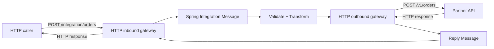
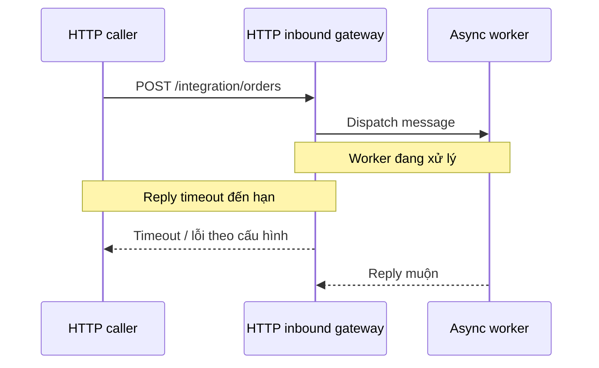
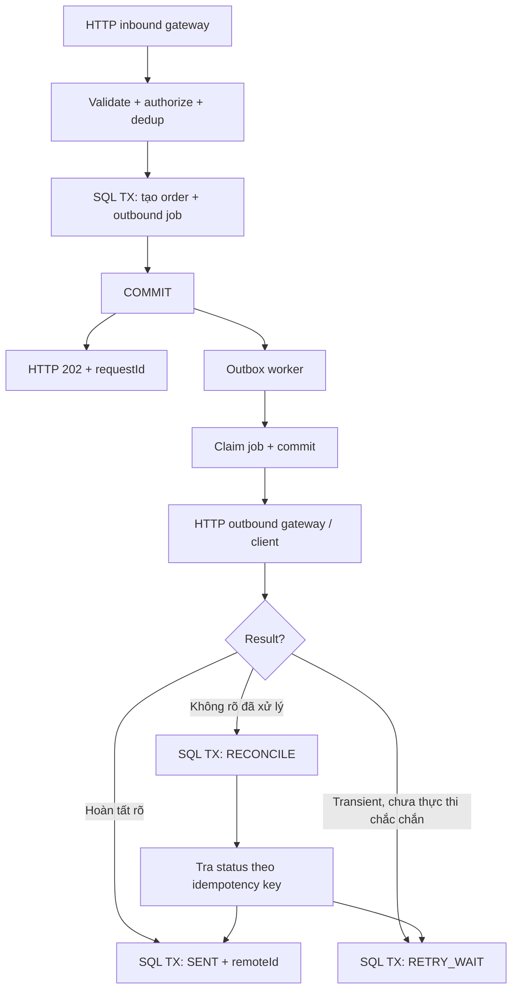
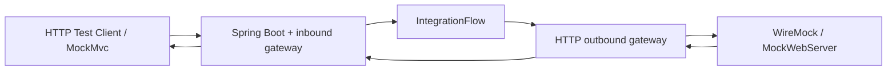

# HTTP inbound gateway và outbound gateway

> **Chương:** Adapter tích hợp  
> **Phạm vi:** Module **SPRING_BOOT_INTEGRATION** tổ chức kết nối hệ thống trong Spring Boot qua HTTP client, SQL, cache, broker và các adapter Spring Integration. Bài này giải thích **HTTP inbound gateway** và **HTTP outbound gateway** trong Spring Integration, cách cấu hình luồng request–reply, chuyển đổi HTTP thành `Message<?>` và ngược lại, cũng như cách bảo vệ hợp đồng dữ liệu, giao dịch, lỗi, idempotency, kiểm thử và khả năng quan sát khi tích hợp dịch vụ ngoài.

## 1. Tình huống: nhận HTTP, xử lý message, gọi HTTP khác

Giả sử hệ thống đặt hàng nhận request từ một ứng dụng nội bộ:

```http
POST /integration/orders HTTP/1.1
Content-Type: application/json
X-Correlation-Id: corr-824

{"externalOrderId":"ORD-42","amountMinor":125000,"currency":"VND"}
```

Ứng dụng cần:

1. Nhận HTTP request và chuyển nó thành message để xử lý bằng Spring Integration.
2. Xác thực, kiểm tra dữ liệu và chuyển sang hợp đồng của API đối tác.
3. Gửi HTTP POST tới `/v1/orders` của đối tác.
4. Nhận response đối tác, phân loại trạng thái và trả response thích hợp cho caller.
5. Không biến timeout, HTTP 4xx/5xx hay mất kết nối thành “giao dịch đã hoàn tất”.
6. Theo dõi correlation ID, timeout từng chặng và side effect khi cần retry.

Hai gateway ở hai ranh giới sẽ thực hiện việc chuyển đổi giao thức–message:



**Điểm quan trọng:** Inbound gateway và outbound gateway **không phải hai tên gọi cho cùng một endpoint**. Một bên tiếp nhận kết nối HTTP từ caller vào ứng dụng; bên kia đóng vai **HTTP client** gọi dịch vụ khác. Cả hai tham gia cùng một request–reply flow khi được nối đúng.

## 2. Phân biệt gateway, adapter và HTTP client trực tiếp

Spring Integration dùng mô hình **Enterprise Integration Patterns**: `Message` có payload và headers; `MessageChannel` chuyển message giữa các endpoint; transformer/router/filter/service activator thực hiện công việc trung gian.

| Thành phần | Hướng và mô hình | Dùng khi nào? |
| --- | --- | --- |
| **HTTP inbound gateway** | HTTP request → message, rồi chờ reply message → HTTP response | API đồng bộ cần trả kết quả xử lý qua integration flow |
| **HTTP inbound channel adapter** | HTTP request → message theo kiểu một chiều | Nhận thông tin và không cần reply nghiệp vụ từ downstream; vẫn phải xử lý HTTP acknowledgment cho phù hợp |
| **HTTP outbound gateway** | Message → HTTP request, chờ HTTP response → reply message | Flow cần kết quả từ đối tác để tiếp tục hoặc phản hồi caller |
| **HTTP outbound channel adapter** | Message → HTTP request, không phát reply nghiệp vụ cho flow | Đẩy thông tin một chiều; không nên dùng khi cần đọc response body để quyết định nghiệp vụ |
| **`RestClient`/`WebClient`** | HTTP client được service gọi trực tiếp | Tích hợp đơn giản hoặc khi không cần dựng message flow |
| **Spring MVC `@RestController`** | HTTP endpoint thông thường | API CRUD/request–response không cần channel/router/endpoint của Spring Integration |

**Gateway là request–reply, không mặc định là bất đồng bộ.** HTTP inbound gateway có thể chờ một reply message. Nếu downstream chuyển sang worker bất đồng bộ mà không tạo reply phù hợp trong giới hạn thời gian, caller có thể bị timeout.

Spring Integration HTTP outbound gateway trong cấu hình Servlet/imperative truyền thống sử dụng cơ chế HTTP client của Spring (thường dựa trên `RestTemplate`). Nó **không trở thành `RestClient` chỉ vì ứng dụng có một bean RestClient khác**. Nếu muốn Spring Integration dựa trên WebFlux/reactive, cần xem **Spring Integration WebFlux** với các gateway tương ứng, không giả định HTTP gateway servlet đang dùng là non-blocking.

### 2.1. Chọn gateway hay controller + service?

Dùng HTTP gateway của Spring Integration khi một request thực sự thuộc **luồng tích hợp**: nhiều channel, phân luồng theo loại message, enrich header, transformer, dịch vụ ngoài, retry hoặc error channel. Nếu API chỉ là đọc một bảng SQL rồi trả JSON, một controller/service thông thường thường rõ ràng và đơn giản hơn.

Không chọn gateway chỉ vì muốn “nâng cấp HTTP lên message queue”: message channel trong memory **không tự tạo persistence, message durability hay broker**.

## 3. Các dependency cần thiết

Ví dụ sử dụng **Spring Boot 3.x**, Java 17+, Spring Integration Java DSL với Spring MVC/Servlet:

```xml
<dependencies>
    <dependency>
        <groupId>org.springframework.boot</groupId>
        <artifactId>spring-boot-starter-integration</artifactId>
    </dependency>
    <dependency>
        <groupId>org.springframework.integration</groupId>
        <artifactId>spring-integration-http</artifactId>
    </dependency>
    <dependency>
        <groupId>org.springframework.boot</groupId>
        <artifactId>spring-boot-starter-web</artifactId>
    </dependency>
</dependencies>
```

Thư viện HTTP adapter ở `spring-integration-http`; starter web cung cấp nền tảng Servlet/Spring MVC và JSON conversion phù hợp. Dùng BOM của Spring Boot để các phiên bản Spring Framework, Spring Integration và codec tương thích.

Ví dụ cấu hình:

```yaml
server:
  port: 8080

partner:
  orders:
    base-url: ${PARTNER_ORDERS_BASE_URL:http://localhost:8089}

integration:
  http:
    reply-timeout-ms: 8000
```

Các giá trị và timeout chỉ minh họa. Base URL đối tác trong môi trường production phải lấy từ cấu hình được phép, không lấy tùy ý từ request của caller. URL `http://localhost` không phù hợp cho kết nối production có yêu cầu bảo mật; áp dụng TLS, service authentication và certificate validation theo hợp đồng.

## 4. HTTP được chuyển thành Spring Message như thế nào?

Một `Message<?>` của Spring Integration gồm hai phần:

```text
Message
 ├── payload: đối tượng Java hoặc bytes đã được chuyển đổi
 └── headers: metadata phục vụ flow
       ├── id / timestamp
       ├── thông tin HTTP được map theo cấu hình
       ├── correlation ID nếu đã được bổ sung
       └── các header nghiệp vụ có chủ đích
```

HTTP inbound gateway đọc HTTP request qua hạ tầng web, áp dụng content negotiation/message converter, sau đó phát Spring Message vào request channel của gateway. Message reply được chuyển thành HTTP response dựa trên payload, headers và cấu hình converter/status.

| Thành phần HTTP | Sang thế giới message | Điều cần quyết định |
| --- | --- | --- |
| URL path + HTTP method | Chọn inbound endpoint/route HTTP | Endpoint nào được phép POST/GET, có path variable không |
| Request body | Payload message | Deserialize JSON/XML/binary theo content type và expected class |
| Request headers | Một phần header được mapper chuyển vào message | Không copy toàn bộ header nhạy cảm tùy tiện |
| Query/path variables | Metadata/arguments được adapter hỗ trợ | Validate tên, kiểu và quyền của tham số |
| Reply payload | HTTP response body | JSON contract, null/empty body, response schema |
| Reply header trạng thái | HTTP response status code | Chọn 200/201/202/4xx/5xx theo contract |
| Exception hoặc không có reply | Đường lỗi / timeout | Không mặc định tự được chuyển thành đúng status JSON |

Spring Integration có các hằng header HTTP, ví dụ `org.springframework.integration.http.HttpHeaders.STATUS_CODE`. Header của Spring Integration khác với tên lớp `org.springframework.http.HttpHeaders` (lớp biểu diễn HTTP headers thông thường). Hãy import đúng kiểu khi thao tác với trạng thái phản hồi.

**Không dựa vào mọi request header chắc chắn được chuyển qua gateway.** Header mapping có chính sách và danh sách được phép; những header không được map có thể biến mất, còn những header do caller gửi không mặc nhiên đáng tin.

## 5. HTTP inbound gateway: tạo endpoint nhận request

Một cấu hình Java DSL đơn giản:

```java
package com.example.integration.http;

import org.springframework.context.annotation.Bean;
import org.springframework.context.annotation.Configuration;
import org.springframework.http.HttpMethod;
import org.springframework.integration.dsl.IntegrationFlow;
import org.springframework.integration.http.dsl.Http;

@Configuration
class InboundOrderConfiguration {

    @Bean
    IntegrationFlow orderLookupFlow(OrderLookupService service) {
        return IntegrationFlow.from(
                Http.inboundGateway("/integration/orders/lookup")
                        .requestMapping(
                                mapping -> mapping.methods(HttpMethod.POST))
                        .requestPayloadType(OrderLookupRequest.class)
                        .replyTimeout(5000))
                .handle(OrderLookupRequest.class,
                        (payload, headers) -> service.lookup(payload))
                .get();
    }
}

record OrderLookupRequest(String tenantId, String orderId) {}
record OrderLookupReply(String orderId, String status) {}
```

`OrderLookupService` là một bean nghiệp vụ do ứng dụng cung cấp, với phương thức trả `OrderLookupReply`. DSL tạo inbound endpoint gắn với đường dẫn POST, chuyển JSON body sang DTO, rồi đưa message vào service activator. Nếu handler trả một object, inbound gateway dùng reply message để tạo HTTP response. Đây là cấu trúc **request–reply**, không có outbound HTTP ở ví dụ này.

Các điểm cần làm rõ:

- `requestPayloadType(OrderLookupRequest.class)` chỉ cho biết kiểu payload muốn nhận; **không thay Bean Validation, authentication hoặc authorization**.
- JSON muốn được decode phải có converter/codec tương thích, ví dụ Jackson trên classpath.
- `replyTimeout(5000)` là thời gian chờ reply của gateway theo cấu hình; **không phải HTTP connect timeout** cho một đối tác ở xa.
- Request mapping chỉ cho phép POST tại path đã đăng ký; không tự cho phép mọi HTTP method.
- Nếu một message được đưa sang channel không có subscriber, hoặc handler không trả reply, API không tự “thành công” theo ý muốn nghiệp vụ.

### 5.1. Khi có nhiều HTTP endpoint cùng path

Tránh khai báo trùng path/method giữa inbound gateway và Spring MVC controller hoặc giữa nhiều inbound gateway mà không kiểm soát thứ tự mapping. Lỗi có thể là ambiguous mapping hoặc request đi vào endpoint không như mong đợi.

Trong test, hãy gửi HTTP thật tới path/method và xác nhận đúng handler đã thực thi; chỉ assert bean có tồn tại chưa đủ.

### 5.2. Reply timeout không phải business success

Nếu flow chuyển message sang `ExecutorChannel` hoặc xử lý bất đồng bộ:



Reply muộn **không đảo ngược** tác dụng phụ đã xảy ra ở worker. Nếu caller cần nhận quyết định “đã chấp nhận yêu cầu” ngay, hãy thiết kế một phản hồi `202 Accepted` **sau khi ghi bền vững một job/outbox**, thay vì giữ kết nối HTTP chờ một tác vụ dài.

## 6. HTTP outbound gateway: biến message thành request đi

Một HTTP outbound gateway nhận message từ channel, tạo HTTP request, gọi endpoint đối tác, chuyển response thành reply message để các bước tiếp theo xử lý:

```java
package com.example.integration.http;

import org.springframework.context.annotation.Bean;
import org.springframework.context.annotation.Configuration;
import org.springframework.http.HttpMethod;
import org.springframework.integration.dsl.IntegrationFlow;
import org.springframework.integration.http.dsl.Http;

@Configuration
class PartnerOutboundConfiguration {

    @Bean
    IntegrationFlow partnerLookupFlow() {
        return IntegrationFlow.from("lookupPartnerRequests")
                .handle(
                        Http.outboundGateway(
                                "http://localhost:8089/v1/orders/lookup")
                                .httpMethod(HttpMethod.POST)
                                .expectedResponseType(PartnerOrderReply.class))
                .get();
    }
}

record PartnerOrderReply(String partnerOrderId, String status) {}
```

Ở đây `lookupPartnerRequests` là một input channel của integration flow, và gateway tạo **HTTP POST** tới URL đích cố định. Cấu hình không minh họa producer gọi channel; cần một upstream gateway/handler phát message có reply channel phù hợp khi muốn nhận `PartnerOrderReply`.

**`expectedResponseType(...)` chỉ định kiểu muốn decode từ response body.** Nó không biến HTTP 400/503 thành business DTO hợp lệ và không xác minh nội dung response thỏa schema. Response không tương thích codec có thể gây exception; cần error flow và kiểm thử.

### 6.1. URL cố định và URL động

URL cố định trong ví dụ phù hợp cho một đối tác duy nhất. Nếu phải thêm path/query variable từ message, dùng cơ chế URI template/variable hoặc biểu thức do Spring Integration hỗ trợ **với input đã validate**.

Không dựng đích HTTP bằng cách tin trực tiếp giá trị `targetUrl` từ JSON/HTTP header chưa xác thực: hành vi đó có thể dẫn đến **SSRF** (gọi địa chỉ nội bộ/metadata endpoint hoặc server không mong đợi). Chọn host từ cấu hình allowlist, bảo vệ DNS/redirect và kiểm soát quyền theo đối tác.

### 6.2. Outbound gateway khác REST client trực tiếp

Nếu service chỉ có một lời gọi HTTP và xử lý kết quả ngay trong Java, `RestClient` có thể đơn giản hơn. HTTP outbound gateway phù hợp khi muốn kết nối endpoint này với **router, transformer, filter, retry advice, error channel, claim-check hoặc channel orchestration** của Spring Integration.

Đừng kỳ vọng outbound gateway tự cung cấp distributed transaction, HTTP retry an toàn hay persisted message. Các guarantee phải được thiết kế ở flow và tầng lưu trữ.

## 7. Ví dụ end-to-end: inbound HTTP → biến đổi → outbound HTTP → reply

Ví dụ hoàn chỉnh dưới đây minh họa một **HTTP proxy theo hợp đồng**. Nó không ghi DB và không tự retry POST. Trong production, cần thêm xác thực/phân quyền, validate, timeout HTTP và idempotency như các mục sau.

### 7.1. DTO của hai phía

API nội bộ nhận DTO khác hợp đồng đối tác:

```java
package com.example.integration.http;

public record CreateOrderRequest(
        String externalOrderId,
        long amountMinor,
        String currency
) {}

public record PartnerCreateOrder(
        String externalId,
        long totalMinor,
        String currencyCode
) {}

public record PartnerCreateOrderReply(
        String partnerOrderId,
        String state
) {}

public record CreateOrderReply(
        String orderId,
        String status
) {}
```

Hai kiểu DTO có mục đích khác nhau: inbound contract là API nội bộ, còn `PartnerCreateOrder`/`PartnerCreateOrderReply` thuộc version contract đối tác. Không dùng cùng một DTO “cho nhanh” nếu schema/version tiến hóa độc lập.

### 7.2. IntegrationFlow với hai gateway

```java
package com.example.integration.http;

import org.springframework.beans.factory.annotation.Value;
import org.springframework.context.annotation.Bean;
import org.springframework.context.annotation.Configuration;
import org.springframework.http.HttpMethod;
import org.springframework.http.HttpStatus;
import org.springframework.integration.dsl.IntegrationFlow;
import org.springframework.integration.http.dsl.Http;
import org.springframework.messaging.support.MessageBuilder;

@Configuration
public class OrderBridgeFlowConfiguration {

    @Bean
    IntegrationFlow orderBridgeFlow(
            @Value("${partner.orders.base-url}") String partnerBaseUrl) {
        return IntegrationFlow.from(
                Http.inboundGateway("/integration/orders")
                        .requestMapping(
                                mapping -> mapping.methods(HttpMethod.POST))
                        .requestPayloadType(CreateOrderRequest.class)
                        .replyTimeout(8000))
                .handle(CreateOrderRequest.class, (request, headers) -> {
                    if (request.externalOrderId() == null
                            || request.externalOrderId().isBlank()
                            || request.amountMinor() < 0) {
                        throw new IllegalArgumentException(
                                "Invalid order request");
                    }
                    return new PartnerCreateOrder(
                            request.externalOrderId(),
                            request.amountMinor(),
                            request.currency());
                })
                .handle(
                        Http.outboundGateway(
                                partnerBaseUrl + "/v1/orders")
                                .httpMethod(HttpMethod.POST)
                                .expectedResponseType(
                                        PartnerCreateOrderReply.class))
                .handle(PartnerCreateOrderReply.class, (partner, headers) ->
                        MessageBuilder.withPayload(
                                new CreateOrderReply(
                                        partner.partnerOrderId(),
                                        partner.state()))
                                .setHeader(
                                        org.springframework.integration.http
                                                .HttpHeaders.STATUS_CODE,
                                        HttpStatus.CREATED)
                                .build())
                .get();
    }
}
```

Luồng gồm năm bước:

1. Inbound gateway nhận POST và chuyển JSON sang `CreateOrderRequest`.
2. Handler kiểm tra một số invariant cơ bản (minh họa; production cần validation đầy đủ).
3. Handler biến đổi sang `PartnerCreateOrder`; đây là **transform qua service activator**, không cần viết Java JSON bằng tay.
4. Outbound gateway tạo HTTP POST, decode JSON reply thành `PartnerCreateOrderReply`.
5. Handler cuối tạo `CreateOrderReply` và gắn status HTTP `201 Created` cho inbound gateway.

**Đặc điểm:** một HTTP request ở caller có thể mở tiếp **một HTTP request ở đối tác** trong cùng hành trình. Nếu đối tác chậm, caller cũng phải chờ (trừ khi flow được thiết kế lại để trả reply sớm).

**Giới hạn có chủ đích của ví dụ:** mã chỉ bắt `IllegalArgumentException` bằng exception thông thường, chưa map thành JSON 400; outbound client chưa cấu hình connect/read timeout hoặc credential; chưa có idempotency-key propagation; và một lỗi sau remote side effect vẫn có thể làm caller thấy thất bại dù đối tác đã xử lý. Cần bổ sung chúng trước production.

### 7.3. Ví dụ tương tác

```http
POST /integration/orders HTTP/1.1
Content-Type: application/json

{"externalOrderId":"ORD-42","amountMinor":125000,"currency":"VND"}
```

Outbound request mong đợi ở HTTP mock server:

```http
POST /v1/orders HTTP/1.1
Content-Type: application/json

{"externalId":"ORD-42","totalMinor":125000,"currencyCode":"VND"}
```

Giả sử đối tác trả `201` và body:

```json
{"partnerOrderId":"P-419","state":"ACCEPTED"}
```

Response nội bộ mà flow định tạo:

```http
HTTP/1.1 201 Created
Content-Type: application/json

{"orderId":"P-419","status":"ACCEPTED"}
```

**Không nhầm state `ACCEPTED` của nghiệp vụ với trạng thái hoàn tất.** Nếu đối tác quy định `ACCEPTED` nghĩa là đang xử lý bất đồng bộ, không được đổi nội dung thành `COMPLETED` hay hứa chắc chắn đã tạo order; cần status lookup hoặc một lệnh xác nhận riêng.

## 8. HTTP status, body và lỗi phải được ánh xạ rõ

Một trong những lỗi thường gặp là **HTTP outbound trả mã lỗi rồi inbound tự bị xem là đã thành công** hoặc ngược lại. Hợp đồng giữa client nội bộ và API đối tác có thể có mã lỗi khác nhau.

| Kết quả outbound | Diễn giải | Chính sách inbound gợi ý |
| --- | --- | --- |
| `200` / `201` và JSON hợp lệ theo contract | Đối tác xác nhận một kết quả cụ thể | Chuyển đổi DTO rồi trả 200/201 phù hợp contract nội bộ |
| `202 Accepted` | Đối tác mới nhận công việc; chưa chắc hoàn tất | Trả 202 và status resource nếu contract nội bộ cho phép, hoặc lưu trạng thái pending |
| `204 No Content` | Không có body | Không yêu cầu decode DTO bắt buộc nếu đối tác quy định 204; xử lý riêng |
| `400` / `422` | Đầu vào không hợp lệ theo contract đối tác | Map sang lỗi có cấu trúc; không retry mù |
| `401` / `403` | Sai credential/permission giữa các dịch vụ | Cảnh báo bảo mật/cấu hình; không lộ token/chi tiết đối tác |
| `404` | Route/resource không tồn tại | Phân biệt lỗi config URL với business not found |
| `409` | Conflict/duplicate | Kiểm tra ngữ nghĩa idempotency; có thể là key mismatch hoặc đã xử lý |
| `429` | Rate limited | Backoff, giới hạn retry, `Retry-After` nếu được hỗ trợ |
| `5xx` / timeout / connection reset | Downstream lỗi hoặc kết quả chưa rõ | Giới hạn retry, circuit breaker, status lookup/idempotency |

`Http.outboundGateway(...)` trong Spring Integration HTTP truyền thống dùng cơ chế status/error handling của HTTP client nền; phản hồi non-2xx thường phát sinh exception thay vì tự giải mã ra DTO thành công. Quy tắc cụ thể cần xác minh với client/request factory và Spring Integration version. **Không mặc định một reply từ lỗi 404/500 sẽ đi qua cùng handler `PartnerCreateOrderReply`.**

### 8.1. Chuyển lỗi thành HTTP response

Trong request–reply flow đồng bộ, exception có thể lan trở lại HTTP inbound gateway; trong flow bất đồng bộ với cơ chế error publishing, lỗi có thể được đóng gói thành `ErrorMessage` tới một error channel. Header `errorChannel` không bảo đảm **mọi lỗi đồng bộ** đều tự xuất hiện ở một channel riêng.

Một chiến lược an toàn:

1. Phân loại rõ **validation**, **authentication/authorization**, **downstream business rejection**, **transient infrastructure failure** và **unknown outcome**.
2. Định nghĩa mã lỗi ổn định của API nội bộ, không trả nguyên stack trace hay body nhạy cảm của đối tác.
3. Cấu hình error mapping thực tế của HTTP inbound gateway/flow (hoặc boundary/controller phù hợp) để đổi exception thành message reply có **status code và DTO lỗi** được chỉ định.
4. Với request có side effect mà kết quả chưa rõ, trả trạng thái thích hợp và cung cấp cách truy vấn theo request ID, không khẳng định thất bại hoàn toàn.

Đối với Spring Integration HTTP, header `org.springframework.integration.http.HttpHeaders.STATUS_CODE` trên reply message là một cơ chế định nghĩa HTTP response status. Hãy kiểm thử cả status, content type và error body bằng HTTP client thật; **không suy ra `@ControllerAdvice` sẽ bắt mọi lỗi integration gateway** giống hệt REST controller thông thường.

### 8.2. Hành vi khi response body trống

Nếu đối tác có thể trả 204, `expectedResponseType(PartnerCreateOrderReply.class)` không còn là một hợp đồng đủ chính xác. Chọn một chính sách:

- Bảo đảm partner chỉ trả JSON object với 200/201 cho endpoint đó.
- Hoặc dùng cấu hình/converter phù hợp với optional/empty response và tạo reply theo outcome.
- Hoặc tách các endpoint/flow khi các trạng thái có body rất khác nhau.

Không ghi một DTO rỗng như thành công chỉ để tránh decode error.

## 9. Header mapping: correlation, tenant và idempotency

Metadata rất quan trọng vì message có thể đi qua nhiều tầng, nhưng **HTTP headers không nên được forward tự động không kiểm soát**.

| Header | Nguồn và cách dùng | Lưu ý |
| --- | --- | --- |
| `X-Correlation-Id` | Dùng để nối log/trace inbound → outbound | Nếu caller có thể tự gửi, giới hạn kích thước/format, không coi là bằng chứng bảo mật |
| `Idempotency-Key` | Ổn định qua các lần thử của **cùng một thao tác có side effect** | Phải gắn với tenant/operation và fingerprint; không sinh key mới ở mỗi retry |
| `Authorization` | Credential của caller hoặc service-to-service | **Không forward token caller sang đối tác** trừ khi thiết kế ủy quyền đích thực sự yêu cầu |
| `X-Tenant-Id` | Thông tin tenant do gateway/identity layer xác định | Không tin giá trị header user tự khai mà chưa xác thực |
| `Content-Type` | Format body gửi đi | Phải khớp encoder/JSON/XML và partner contract |
| `Accept` | Format response caller muốn | Phải khớp converter và supported media types |
| `traceparent` | Trace context theo chuẩn tracing khi được cấu hình | Không dùng làm idempotency key |
| `Host`, `Connection`, `Content-Length` | Header thuộc tầng transport/hop | Không copy tùy tiện từ inbound sang outbound |

Spring Integration cung cấp các tùy chọn **HTTP header mapper** cho inbound/outbound endpoints. Trong một số trường hợp phải cho phép map header ứng dụng cụ thể; trong trường hợp khác cần **loại bỏ** header không an toàn. Hãy kiểm tra những header thực sự tới downstream bằng HTTP mock server, vì một header có trong Spring Message không đồng nghĩa HTTP outbound adapter mặc định sẽ gửi đúng tên.

### 9.1. Tạo metadata có kiểm soát

Ví dụ tư duy khi tạo message outbound:

```java
Message<PartnerCreateOrder> outbound = MessageBuilder
        .withPayload(new PartnerCreateOrder(
                "ORD-42", 125000L, "VND"))
        .setHeader("X-Correlation-Id", correlationId)
        .setHeader("Idempotency-Key", stableRequestId)
        .build();
```

Code là một **đoạn minh họa bên trong service** có các biến `correlationId` và `stableRequestId` đã được validate/derive từ nguồn tin cậy. Cần đảm bảo outbound HTTP header mapper được cấu hình để chuyển hai header sang request vật lý. Nếu message được gửi qua route/gateway khác, các transformer không được vô tình làm mất headers này.

### 9.2. Data contract và bản sắc request

Payload nên chứa schema version khi cần, business ID và các thuộc tính có ngữ nghĩa. Idempotency key là một **định danh request**, không phải nội dung payload. Nếu client dùng lại cùng key cho payload khác, server/đối tác phải đối chiếu fingerprint và trả conflict theo hợp đồng.

Key phải được scope theo tenant/operation; correlation ID có thể chung cho nhiều hành động trong một workflow, nên không phù hợp làm idempotency key theo mặc định.

## 10. Timeout: nhiều mức khác nhau

Một flow inbound → outbound có thể chịu nhiều giới hạn thời gian:

| Timeout | Kiểm soát việc gì? | Nếu vượt quá |
| --- | --- | --- |
| **HTTP caller timeout** | Caller chờ API nội bộ bao lâu | Caller có thể retry khi server vẫn đang xử lý |
| **Inbound gateway reply timeout** | Gateway đợi reply message từ integration flow | Có thể lỗi/timeout; reply muộn không rollback side effect |
| **Message channel send timeout** | Thời gian gửi message vào một số loại channel | Không thay cho network timeout HTTP |
| **Outbound connect timeout** | Thiết lập TCP/TLS connection tới đối tác | Không biết chắc request đã được gửi hay chưa trong mọi tình huống |
| **Outbound response/read timeout** | Đợi response từ đối tác | Đối tác có thể đã commit business operation trước khi mất response |
| **Database/Redis timeout** | Đợi truy vấn, lock hoặc connection | Transaction của từng tài nguyên có semantics riêng |
| **Reverse proxy/load balancer timeout** | Thời gian chờ ở tầng trước ứng dụng | Có thể cắt kết nối dù Spring flow vẫn chạy |

**Đặt ngân sách timeout theo toàn hành trình:** timeout outbound nên có giới hạn rõ và phù hợp với deadline inbound. Nếu một service có nhiều lời gọi nối tiếp, tổng thời gian (kể cả retry/backoff) có thể vượt giới hạn caller ngay cả khi từng call riêng lẻ nằm trong timeout.

### 10.1. Client request factory và connection pool

HTTP outbound gateway truyền thống có thể được cấu hình với request factory/HTTP client tương ứng phiên bản Spring Integration. Tại đó cần cấu hình connect/read/response timeout, pooling, TLS, proxy và connection reuse phù hợp.

Không giả định chỉ đặt `replyTimeout(8000)` ở inbound gateway đã giới hạn kết nối tới đối tác trong tám giây. Nếu outbound HTTP client chờ network quá lâu trên thread đồng bộ, nó có thể vẫn chiếm thread/connection dù HTTP caller đã bỏ cuộc.

### 10.2. Không retry tràn lan

Giả sử client retry 3 lần, gateway retry 3 lần và HTTP client lại retry 3 lần: trong một sự cố, một thao tác có thể bị gửi nhiều lần hơn dự kiến. Chốt **một tầng chịu trách nhiệm retry chính**, giữ số lần thử hữu hạn, dùng exponential backoff/jitter và idempotency cho write operation.

Không retry mã 400/422 cho payload sai; không retry 401/403 vô hạn; với 429 nên tôn trọng `Retry-After` nếu contract hỗ trợ. Với timeout hoặc 5xx sau một POST, cần xác minh idempotency guarantee của đối tác.

## 11. Giao dịch: SQL và HTTP outbound không commit cùng nhau

Một phương thức:

```java
@Transactional
public void createAndNotify(CreateOrderRequest request) {
    orderRepository.save(toEntity(request));
    // Gọi HTTP outbound gateway trong transaction SQL
    partnerGateway.send(toPartnerRequest(request));
}
```

là **anti-pattern** khi coi hai tác dụng phụ nằm trong một transaction ACID. `@Transactional` với manager SQL quản lý transaction SQL; một HTTP POST thành công không bị rollback chỉ vì database rollback sau đó. Việc giữ DB transaction mở trong lúc chờ HTTP làm tăng lock duration, chiếm connection và giảm throughput.

Các kịch bản rủi ro:

- SQL đã ghi nhưng HTTP lỗi → transaction SQL có thể rollback, trong khi trạng thái remote chưa chắc chưa được thay đổi.
- HTTP thành công nhưng lỗi lúc DB commit → đối tác có order, database nội bộ không ghi nhận.
- HTTP timeout sau remote commit → caller có thể gửi lại, tạo side effect trùng nếu không có idempotency.
- Process crash giữa hai hệ thống → không có transaction JDBC thông thường nào khôi phục được cả hai đồng thời.

### 11.1. Thiết kế đáng tin cậy: transactional outbox cho HTTP



Trong mô hình này, inbound gateway phản hồi **202 Accepted chỉ sau khi đã ghi job bền vững**, không đợi remote business commit. Bản ghi job có:

| Trường | Ý nghĩa |
| --- | --- |
| `jobId` | Định danh bền vững, có thể dùng làm idempotency key theo contract |
| `tenantId, operation` | Phạm vi nghiệp vụ của request |
| `payloadSnapshot` | Nội dung gửi đã chuẩn hóa; giữ nguyên qua retry |
| `requestFingerprint` | Phát hiện dùng lại key với payload khác |
| `status` | PENDING, IN_FLIGHT, SENT, RETRY_WAIT, UNKNOWN hoặc FAILED_FINAL |
| `attempts, nextAttemptAt` | Giới hạn retry, backoff và lịch xử lý |
| `leaseToken, leasedUntil` | Điều phối nhiều worker và phục hồi khi crash |
| `remoteReference` | Kết quả đối tác dùng để tra cứu/đối chiếu |

Khi worker gửi HTTP ngoài transaction, nó dùng cùng payload và cùng idempotency key. Sau đó mở transaction SQL ngắn để ghi trạng thái. Nếu mất response, truy vấn trạng thái đối tác trước khi phát lại một POST nguy hiểm.

**Outbox làm bền vững ý định gửi, không tự cung cấp exactly-once xuyên SQL và HTTP.** Đối tác vẫn cần hỗ trợ idempotency/business unique constraint hoặc khả năng reconciliation.

### 11.2. Khi nào vẫn dùng đồng bộ inbound → outbound?

Với truy vấn GET không có side effect, một flow request–reply đồng bộ có deadline rõ thường hợp lý. Với POST ít quan trọng và đối tác hỗ trợ idempotency mạnh, flow đồng bộ cũng có thể chấp nhận được nếu contract nói rõ kết quả khi timeout. Với lệnh thanh toán, ghi đơn hoặc các thao tác khó bù, ưu tiên durable job + async status khi latency và độ tin cậy yêu cầu.

## 12. Request–reply và ranh giới channel

Spring Integration có nhiều loại channel với semantics khác nhau:

- **`DirectChannel`:** dispatch cùng thread đến subscriber, thuận tiện cho request–reply đồng bộ và transaction propagation trong cùng thread.
- **`ExecutorChannel`:** dispatch qua executor; caller có thể tách khỏi handler, **transaction context thread-bound không tự truyền**.
- **`QueueChannel`:** lưu message trong queue của ứng dụng khi được cấu hình; không mặc định persistent và không có business reply tự động.
- **`PublishSubscribeChannel`:** phát message tới subscriber; không phải cơ chế request–reply một người nhận theo mặc định.

Không thay `DirectChannel` bằng `ExecutorChannel` chỉ để “HTTP phản hồi nhanh hơn”. Nếu inbound gateway vẫn phải chờ reply message, caller có thể vẫn chờ đến timeout; nếu message được xử lý sau khi caller đã timeout, cần cơ chế trạng thái nghiệp vụ và chống trùng.

### 12.1. Reply routing

Spring Integration request–reply dựa trên thông tin reply channel của message và cấu hình endpoint. Nếu một transformer/service activator tự tạo message mới rồi làm mất header điều phối quan trọng, reply có thể không trở về inbound gateway mong đợi.

Nên dùng transformer/handler DSL giữ context/header phù hợp, và chỉ tạo mới `Message<?>` có chủ đích. Test một vòng HTTP end-to-end để xác minh **request đi đúng flow và response thực sự quay về caller**.

### 12.2. Chặn vòng lặp flow

Một cấu hình nhầm routing có thể gửi reply quay lại request channel, hoặc error flow publish vào chính inbound flow gây loop. Khi thêm discard/error channel, xác định rõ destination cuối, giới hạn retry và có metric để phát hiện message xoay vòng.

## 13. Bảo mật khi HTTP đứng ở cả hai đầu flow

### 13.1. Inbound gateway là một API boundary

Các yêu cầu tối thiểu:

1. **Authentication:** Spring Security hoặc cơ chế gateway/identity được tổ chức sử dụng.
2. **Authorization:** kiểm tra người gọi được phép thao tác trên order và tenant; không tin `tenantId` từ request body/header một cách độc lập.
3. **Validation:** schema, kích thước body, required fields, money/currency, length và business invariant.
4. **Rate limiting:** không cho caller mở vô hạn request đồng bộ đang chờ downstream.
5. **Content negotiation:** chấp nhận đúng Content-Type/Accept, hạn chế XML parser nguy hiểm nếu có XML.
6. **Error response:** không leak URL nội bộ, stack trace, SQL, token, key hay response body nhạy cảm của đối tác.

Đặc biệt, không chuyển một Spring Security user principal sang HTTP outbound bằng cách tự copy `Authorization`. Service-to-service credentials cần có issuer, audience, scope và vòng đời phù hợp với đối tác; nếu có token exchange/on-behalf-of, phải thiết kế tường minh.

### 13.2. Outbound gateway là một trust boundary

Outbound host nên đến từ allowlist/cấu hình deployment. Bảo vệ TLS certificate, hostname, proxy và HTTP redirect policy. Nếu phải chấp nhận endpoint dynamic, không chỉ regex URL; còn phải kiểm soát IP nội bộ, DNS rebinding, port, scheme và redirect.

Header mapper nên giữ **một allowlist rõ**; không forward cookie, bearer token, forwarded headers hoặc trace baggage nhạy cảm khi không cần. Giới hạn response size và content type để đối tác lỗi không khiến JVM tiêu thụ tài nguyên vô hạn.

### 13.3. Không dùng filter làm kiểm tra quyền cuối

Một Spring Integration `Filter` có thể chặn message theo event type/partner state, nhưng không thay thế xác thực/ủy quyền. Nếu filter trả false trong request–reply flow mà không có reply hợp lệ, HTTP caller có thể timeout; với dữ liệu không được phép, trả lỗi 403 rõ ràng ở boundary thích hợp.

## 14. Khả năng quan sát và tối ưu hiệu năng

Trong một luồng inbound → outbound, latency caller nhìn thấy gần bằng **tổng** thời gian đọc body, validation, channel/handler, HTTP network, decode reply và trả response. Khi lỗi xảy ra, cần phân biệt đang chậm ở tầng nào.

| Chỉ số | Ý nghĩa |
| --- | --- |
| `http_inbound_requests_total` theo endpoint và status | Lượng request và tỷ lệ thành công/lỗi |
| `integration_gateway_reply_timeout_total` | Gateway không nhận reply đúng hạn |
| `integration_http_outbound_latency` theo partner | Thời gian gọi HTTP và tình trạng downstream |
| `integration_http_outbound_errors_total` theo loại lỗi | Phân biệt 4xx, 5xx, timeout, SSL, decode |
| `integration_flow_inflight` | Số flow đang xử lý đồng thời |
| `integration_channel_queue_depth` khi có queue | Backlog/khả năng quá tải |
| `integration_idempotency_replay_total` | Retry trùng đã được trả lại kết quả |
| `integration_outbox_pending_age` | Job bền vững chờ gửi quá lâu |

Các tên trên là **đề xuất metric của ứng dụng**, không phải cam kết Spring Boot tự xuất tất cả. Kết hợp Actuator/Micrometer, tracing và instrumentation của HTTP client, broker/database. Cần kiểm tra tên metric và lifecycle theo đúng phiên bản framework/provider đang dùng.

**Metric tags:** nên là endpoint/route hữu hạn, partner, status class và error category. Không đặt `orderId`, idempotency key, access token, user email hoặc URL đầy đủ mang dữ liệu nhạy cảm làm tag; cardinality cao làm tăng chi phí và rủi ro.

### 14.1. Cách tối ưu an toàn

- Giới hạn inbound concurrency và request body size trước khi deserialize.
- Cấu hình outbound connection pooling, connect/response timeout và TLS đúng client.
- Tránh giữ SQL transaction trong lúc gọi HTTP.
- Dùng cache cho dữ liệu đọc tương đối ổn định, nhưng không dựa vào cache miss để ra quyết định side effect.
- Nếu downstream bị rate limit, chuyển tải dài sang job queue/outbox thay vì kéo dài đồng bộ HTTP.
- Test throughput khi rolling deployment làm số replica tăng tạm thời; tổng HTTP connection và DB pool cũng tăng.

## 15. Kiểm thử từ HTTP boundary tới đối tác

### 15.1. Không chỉ unit test handler

Gọi trực tiếp hàm `orderBridgeFlow()` hoặc test DTO converter riêng **không chứng minh** HTTP path, request mapping, header mapper, reply channel, HTTP client converter và status hoạt động đúng. Cần ít nhất một **integration test**:



Sử dụng mock HTTP server để kiểm tra path, method, headers, JSON body, thời gian chờ và các mã lỗi. Nếu flow có SQL/outbox, dùng database thật (có thể qua Testcontainers) để kiểm tra transaction/unique constraint; mock repository không chứng minh được atomicity hoặc idempotency dưới concurrency.

### 15.2. Các tình huống bắt buộc

| Ca kiểm thử | Kết quả mong đợi |
| --- | --- |
| POST đúng JSON và route | Inbound nhận, transformer chạy, outbound gọi đúng host/path và trả reply DTO |
| Gửi GET tới path chỉ nhận POST | Bị từ chối theo HTTP mapping, không gọi đối tác |
| Content-Type không hỗ trợ | Lỗi client phù hợp, không gửi payload sai |
| Payload thiếu `externalOrderId` hoặc amount âm | Validation error có cấu trúc, không gọi remote |
| Partner trả 201 + JSON hợp lệ | Nội bộ trả kết quả/mã trạng thái đã cam kết |
| Partner trả 204 khi client kỳ vọng DTO | Xử lý empty body đúng contract, không tạo DTO giả |
| Partner trả 400/422 | Không retry; map lỗi rõ |
| Partner trả 401/403 | Cảnh báo credential/permission, không leak secret |
| Partner trả 409 | Phân loại duplicate vs payload mismatch theo hợp đồng |
| Partner trả 429 / `Retry-After` | Retry/backoff đúng giới hạn nếu policy cho phép |
| Partner trả 500 hoặc timeout | Không coi là business success; phân loại outcome chưa rõ |
| Reply đến sau inbound timeout | Không sinh business execution mới chỉ vì caller retry |
| Missing/mapped correlation header | Trace được nối qua flow theo policy, không mất hoặc rò rỉ credential |
| Hai tenant cùng order ID | Không truy cập chéo tenant; authorization được thực thi trước side effect |
| Client retry cùng idempotency key | Không tạo duplicate business result khi có cơ chế lưu/đối chiếu |
| Crash sau SQL commit trước HTTP | Outbox job còn tồn tại, worker có thể khôi phục |
| Crash sau remote commit trước local status update | Reconciliation/stable key ngăn side effect trùng |

### 15.3. Pseudocode kiểm tra bằng HTTP

```java
// Skeleton JUnit/MockMvc, giả định context Spring Boot và
// mock HTTP partner đã được khởi động/cấu hình:
mockMvc.perform(post("/integration/orders")
        .contentType(MediaType.APPLICATION_JSON)
        .content("""
            {"externalOrderId":"ORD-42",
             "amountMinor":125000,"currency":"VND"}
            """))
    .andExpect(status().isCreated())
    .andExpect(jsonPath("$.orderId").value("P-419"));

// Sau đó assert mock server nhận đúng:
// POST /v1/orders
// body có externalId=ORD-42, totalMinor=125000, currencyCode=VND.
```

Đây là **test skeleton**: cần import static JUnit/MockMvc, stub HTTP partner trả `201` với JSON `PartnerCreateOrderReply`, và bảo đảm configuration test dùng base URL mock server thay vì URL production. Với network test ngoài mock server, đặt deadline hữu hạn và kiểm tra request bytes/status thực.

### 15.4. Test timeout và lỗi không biết kết quả

Một test quan trọng cho POST có side effect: mock partner **ghi nhận request nhưng trì hoãn hoặc cắt response**. Caller nhận timeout, nhưng remote đã xử lý. Sau đó retry **cùng request identity** phải lấy lại kết quả hoặc cho phép reconciliation, không tạo đơn thứ hai. Chỉ xác minh một exception network đã xảy ra chưa chứng minh ứng dụng đạt yêu cầu này.

## 16. Các nhầm lẫn thường gặp

1. **“Inbound gateway chỉ nhận message, không trả HTTP reply.”** Sai: gateway là request–reply; adapter một chiều có mục đích khác.
2. **“Outbound gateway nghĩa là kết nối bất đồng bộ không chờ response.”** Sai: outbound gateway thường chờ HTTP response để tạo reply message.
3. **“Thêm `spring-integration-http` thì mọi controller thành gateway.”** Sai: cần định nghĩa endpoint/flow và mapping.
4. **“`replyTimeout` là timeout kết nối tới đối tác.”** Sai: timeout chờ reply trong flow khác connect/read timeout HTTP.
5. **“Response body từ đối tác tự luôn được convert sang DTO.”** Sai: cần converter, MIME và `expectedResponseType` phù hợp.
6. **“HTTP status 500 có thể xử lý như business reply 200.”** Sai: phải phân loại exception/error flow và status contract.
7. **“Cứ chuyển toàn bộ request headers qua outbound là giữ đủ ngữ cảnh.”** Sai: có thể leak token, cookie, user PII hoặc hop-by-hop headers.
8. **“Dùng `DirectChannel` là tự có message durability.”** Sai: đây không phải persisted queue/broker.
9. **“HTTP client timeout nghĩa là đối tác chưa xử lý POST.”** Sai: side effect có thể đã commit trước khi response mất.
10. **“`@Transactional` rollback được remote HTTP call.”** Sai: JDBC/JPA transaction chỉ bảo vệ nguồn dữ liệu thuộc transaction manager.
11. **“Đổi sang `ExecutorChannel` giúp inbound trả HTTP response ngay.”** Sai: request–reply gateway vẫn cần reply; có thể timeout.
12. **“`errorChannel` bắt mọi exception giống hệt trên mọi loại channel.”** Sai: phụ thuộc synchronous/asynchronous error propagation và endpoint config.
13. **“Cache hoặc TTL ngắn đủ chống retry trùng.”** Sai: cần durable idempotency/unique constraint và contract retention.
14. **“Một unit test gọi Java handler đủ chứng minh HTTP gateway hoạt động.”** Sai: cần kiểm tra mapping, header/codec, reply/status và request bytes end-to-end.

## 17. Checklist khi triển khai gateway trong Spring Boot

1. **Chọn đúng endpoint:** inbound gateway hay inbound adapter; outbound gateway hay outbound adapter/RestClient?
2. **Khai báo hợp đồng:** method/path, Content-Type, DTO/schema version, status code, retry semantics và headers.
3. **Đặt ranh giới tin cậy:** authentication/authorization cho inbound, TLS/service credentials/allowlist cho outbound.
4. **Tổ chức flow:** DirectChannel hoặc async boundary có chủ đích; reply channel trở về đúng caller.
5. **Tạo error mapping:** validation, HTTP 4xx/5xx, decode error, timeout và unknown outcome.
6. **Giới hạn tài nguyên:** request body size, connect/read timeout, concurrency và connection pool.
7. **Chốt idempotency:** key ổn định, fingerprint, scope, TTL/retention và status lookup cho POST có side effect.
8. **Tách transaction:** không giữ SQL transaction qua HTTP; nếu cần durable delivery, dùng outbox/worker/reconciliation.
9. **Quan sát:** trace/correlation, latency từng chặng, error category, reply timeout và backlog.
10. **Kiểm thử:** HTTP inbound → integration flow → mock partner → reply; crash/retry/tenant isolation khi có side effect.

### Câu hỏi tự kiểm tra

1. HTTP inbound gateway khác HTTP inbound channel adapter ở điểm nào?
2. HTTP outbound gateway và outbound channel adapter khác nhau về response ra sao?
3. Vì sao `Http.inboundGateway("/integration/orders")` không tương đương một `@RestController` thông thường?
4. `requestPayloadType` và `expectedResponseType` giúp converter điều gì, nhưng không thể thay validation nào?
5. `org.springframework.integration.http.HttpHeaders.STATUS_CODE` được dùng ở bước nào?
6. Tại sao copy nguyên `Authorization` từ caller sang đối tác có thể là lỗi bảo mật?
7. Một inbound gateway trả timeout có chứng minh đối tác chưa xử lý POST không?
8. Vì sao `ExecutorChannel` có thể làm hỏng kỳ vọng request–reply nếu không tổ chức reply hợp lệ?
9. Làm thế nào để vừa commit đơn vào SQL, vừa gửi HTTP đáng tin cậy khi không có distributed transaction?
10. Vì sao cần integration test qua HTTP thật và mock server, thay vì chỉ test từng method Java?
11. HTTP 202 từ đối tác có luôn có nghĩa đơn hàng đã hoàn tất không?
12. Khi có HTTP 429 hoặc 503, thành phần nào cần sở hữu retry policy để tránh nhân số lượt thử?

**Ghi nhớ:** **HTTP inbound gateway** chuyển HTTP request thành Spring Message và đưa reply message trở lại caller; **HTTP outbound gateway** chuyển message thành HTTP request tới đối tác và tạo reply message từ HTTP response. Chúng phù hợp khi HTTP là các cạnh của một **Spring Integration request–reply flow**, nhưng không tự mang lại queue bền vững, distributed transaction hoặc exactly-once. Tính đúng đắn đến từ **hợp đồng payload/header/status rõ ràng, timeout tách bạch, phân loại lỗi, authorization, idempotency và kiểm thử end-to-end**; với lệnh có side effect cần độ tin cậy cao, kết hợp SQL outbox, worker và reconciliation.
