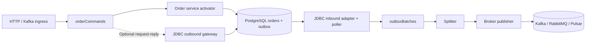
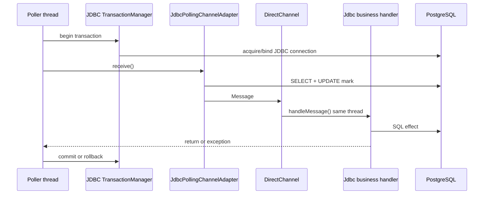
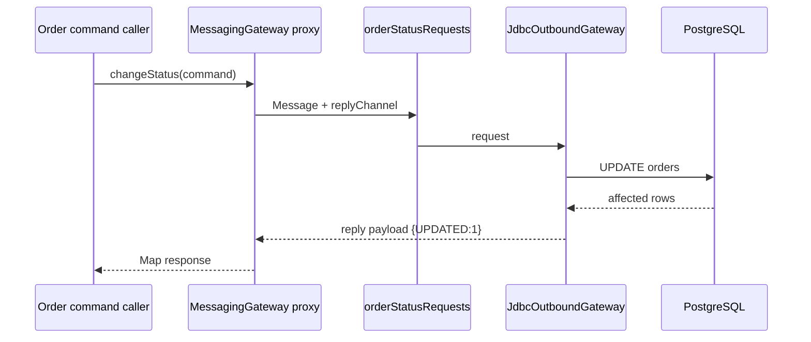
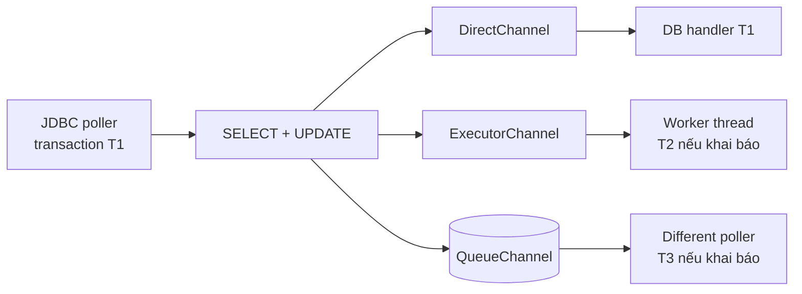
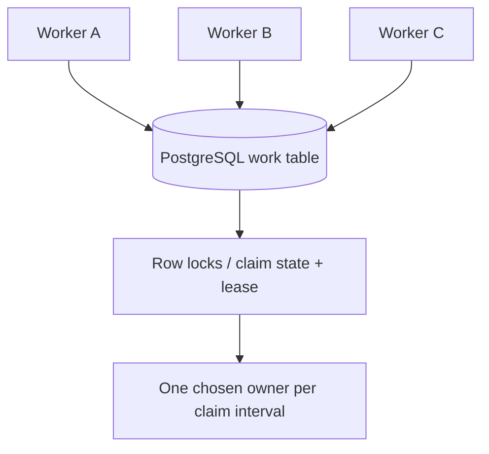
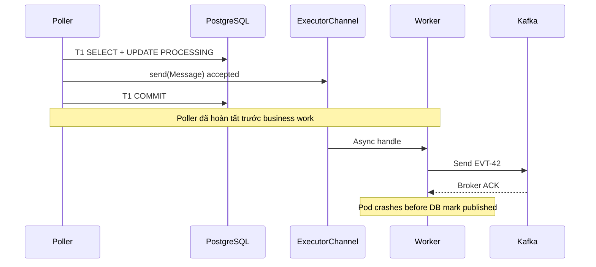

# JDBC adapter hoặc gateway và liên hệ với transaction manager

## 1. JDBC adapter giải quyết vấn đề gì trong hệ thống tích hợp?

Trong module **SPRING_BOOT_INTEGRATION**, một ứng dụng Spring Boot thường phải kết nối các luồng HTTP, database, cache và broker thông điệp. Có những dữ liệu cần lấy từ PostgreSQL theo lịch rồi chuyển thành Spring Integration `Message`; cũng có những message cần ghi vào database hoặc gửi yêu cầu SQL để nhận phản hồi. Spring Integration cung cấp **JDBC channel adapters** và **JDBC outbound gateway** để nối các endpoint bằng `MessageChannel`, thay vì để mọi phần của flow tự tổ chức truy vấn SQL.

Ví dụ một dịch vụ xử lý đơn hàng:



Trong sơ đồ, database là **nguồn trạng thái có thể lưu bền vững**; channel là ranh giới gửi message trong ứng dụng. JDBC adapter không tự biến PostgreSQL thành Kafka và không tự mang lại exactly-once delivery. Điều đó cần một thiết kế transaction, khóa/claim dữ liệu, idempotency, retry và quy tắc ACK rõ ràng.

### Mục tiêu học tập

Sau bài này, bạn có thể:

1. Phân biệt **JDBC inbound channel adapter**, **JDBC outbound channel adapter** và **JDBC outbound gateway** theo hướng dữ liệu và request-reply.
2. Hiểu `JdbcPollingChannelAdapter`, `JdbcMessageHandler`, `JdbcOutboundGateway`, `DataSource`, `JdbcTemplate` và các endpoint/poller của Spring Integration.
3. Cấu hình adapter bằng Spring Integration 6.x với Java configuration/Java DSL và biết giới hạn của JDBC DSL chuyên dụng theo phiên bản.
4. Định nghĩa một **`PlatformTransactionManager` đúng `DataSource`** và giải thích điều kiện để poll, update và downstream handler cùng transaction.
5. Phân biệt `DirectChannel` với `QueueChannel`/`ExecutorChannel` khi xét thread-bound JDBC transaction.
6. Thiết kế claim/retry an toàn khi có nhiều worker, crash giữa database commit và broker publish, và xử lý event trùng.
7. Kiểm thử PostgreSQL thật, transaction rollback, gateway reply và các kịch bản shutdown/timeout.

> **Giả định phiên bản:** Spring Boot 3.5.x, Spring Integration 6.x, Java 17+ và PostgreSQL. Ví dụ code dùng API có trong dòng 6.x. **Spring Integration 7.0** mới bổ sung factory DSL chuyên dụng `org.springframework.integration.jdbc.dsl.Jdbc`; không sao chép ví dụ `Jdbc.inboundAdapter(...)` từ tài liệu 7.x vào project 6.x rồi kỳ vọng biên dịch. Các hành vi mặc định phải được kiểm tra lại nếu dự án dùng dòng khác.

## 2. Ba vai trò: inbound adapter, outbound adapter và outbound gateway

| Thành phần | Hướng message | Công việc SQL | Có reply? | Lớp liên quan |
| --- | --- | --- | --- | --- |
| JDBC **inbound channel adapter** | Database → Spring Integration flow | `SELECT` theo lịch; có thể `UPDATE` trạng thái đã đọc | Không theo mô hình request-reply | `JdbcPollingChannelAdapter` |
| JDBC **outbound channel adapter** | Spring Integration flow → database | `INSERT`/`UPDATE`/`DELETE` từ message | Một chiều, không phát business reply | `JdbcMessageHandler` |
| JDBC **outbound gateway** | Message request → SQL → Message reply | SQL update và có thể truy vấn kết quả; trả affected rows, generated keys hoặc result set tùy config | Có | `JdbcOutboundGateway` |

Ví dụ luồng:

```text
Inbound:
  PostgreSQL SELECT → List<Map<String,Object>> → MessageChannel → handler

Outbound adapter:
  Message<AuditEvent> → INSERT audit_events → kết thúc

Outbound gateway:
  Message<ChangeOrderStatus> → UPDATE orders → Message<{UPDATED: 1}>
  gateway caller chờ reply và quyết định kết quả nghiệp vụ
```

### 2.1. “Inbound” và “outbound” là tương đối với flow

Inbound adapter **đưa dữ liệu từ database vào messaging flow**; outbound adapter **ghi dữ liệu từ messaging flow ra database**. Không nên hiểu inbound là SQL `INSERT`, outbound là SQL `SELECT`. Cùng một `DataSource` có thể phục vụ nhiều adapter.

Một Spring Integration *gateway* dùng request-reply, nhưng không mặc định là HTTP gateway. `JdbcOutboundGateway` là **SQL request-reply endpoint**; `@MessagingGateway` là **Java interface gateway** đưa lời gọi Java vào flow. Có thể sử dụng hai khái niệm cùng nhau, nhưng chúng không phải cùng một lớp.

### 2.2. `MessageChannel` không tự mở transaction

`MessageChannel.send()` chuyển message giữa endpoint. Việc transaction JDBC được bắt đầu, commit hay rollback là trách nhiệm của **Spring transaction management** và phạm vi thực thi. Channel type ảnh hưởng thread và vì vậy ảnh hưởng khả năng giữ transaction.

## 3. Dependencies, driver, DataSource và module JDBC

Ví dụ Maven dùng Spring Boot parent/BOM:

```xml
<dependencies>
    <dependency>
        <groupId>org.springframework.boot</groupId>
        <artifactId>spring-boot-starter-integration</artifactId>
    </dependency>
    <dependency>
        <groupId>org.springframework.integration</groupId>
        <artifactId>spring-integration-jdbc</artifactId>
    </dependency>
    <dependency>
        <groupId>org.springframework.boot</groupId>
        <artifactId>spring-boot-starter-jdbc</artifactId>
    </dependency>
    <dependency>
        <groupId>org.postgresql</groupId>
        <artifactId>postgresql</artifactId>
        <scope>runtime</scope>
    </dependency>
</dependencies>
```

Gradle:

```groovy
dependencies {
    implementation 'org.springframework.boot:spring-boot-starter-integration'
    implementation 'org.springframework.integration:spring-integration-jdbc'
    implementation 'org.springframework.boot:spring-boot-starter-jdbc'
    runtimeOnly 'org.postgresql:postgresql'
}
```

`spring-integration-jdbc` chứa JDBC adapters/gateway; `spring-boot-starter-jdbc` cung cấp JDBC infrastructure và HikariCP thông thường; JDBC driver giúp kết nối PostgreSQL. Spring Integration starter **không tự thêm tất cả** module adapters cho HTTP, Kafka, RabbitMQ hoặc Redis.

### 3.1. Cấu hình DataSource

```yaml
spring:
  datasource:
    url: jdbc:postgresql://localhost:5432/orders
    username: ${DB_USERNAME}
    password: ${DB_PASSWORD}
    hikari:
      maximum-pool-size: 10
      connection-timeout: 3s
      pool-name: orders-integration-pool

  sql:
    init:
      mode: never
```

Một JDBC adapter cần **`DataSource` hoặc `JdbcOperations`/`JdbcTemplate`** phù hợp. Không thể đưa trực tiếp R2DBC `ConnectionFactory` vào `JdbcPollingChannelAdapter`: Spring Integration JDBC adapter sử dụng **JDBC blocking API**.

Khi cùng có R2DBC `ConnectionFactory`, JDBC `DataSourceAutoConfiguration` của Spring Boot có thể back off. Lúc đó phải chủ động cung cấp `@Bean DataSource` hoặc cấu hình Boot tương thích thay vì chỉ đặt `spring.datasource.url`.

### 3.2. Quản lý schema bằng Flyway

Ví dụ các bảng `orders`, `integration_outbox` và `processed_event` nên được tạo qua Flyway/Liquibase có version. Đừng để `schema.sql`, Hibernate `ddl-auto=update` và Flyway cùng sửa một schema production.

```yaml
spring:
  flyway:
    enabled: true
    locations: classpath:db/migration
    validate-on-migrate: true
    clean-disabled: true
```

Flyway PostgreSQL ở những dòng gần đây có thể cần `flyway-core` và `flyway-database-postgresql` cùng JDBC driver. Các dependency migrations cần được khai báo và quản lý version theo Spring Boot BOM; Flyway có thể chạy ở deployment job riêng.

**Dữ liệu ví dụ bên dưới là SQL minh họa cho bài học, không phải yêu cầu tự tạo file migration ngoài Markdown đang được giao.**

## 4. Transaction manager của JDBC adapter

`JdbcTransactionManager` hoặc `DataSourceTransactionManager` đều thuộc họ `PlatformTransactionManager` cho JDBC. Với Spring JDBC trên Spring Framework 6.x, `JdbcTransactionManager` là lựa chọn phù hợp khi cần dịch JDBC exceptions cho commit/rollback. Điều kiện cốt lõi là transaction manager phải quản lý **đúng DataSource** mà adapter/handler sử dụng.

```java
package example.integration.config;

import javax.sql.DataSource;
import org.springframework.beans.factory.annotation.Qualifier;
import org.springframework.context.annotation.Bean;
import org.springframework.context.annotation.Configuration;
import org.springframework.jdbc.support.JdbcTransactionManager;
import org.springframework.transaction.PlatformTransactionManager;

@Configuration(proxyBeanMethods = false)
public class JdbcTransactionConfiguration {

    @Bean("integrationJdbcTransactionManager")
    PlatformTransactionManager integrationJdbcTransactionManager(
            @Qualifier("dataSource") DataSource dataSource) {
        return new JdbcTransactionManager(dataSource);
    }
}
```

Trong ứng dụng chỉ có một `DataSource`, Boot thường có thể tạo transaction manager mặc định khi các conditions phù hợp. Tạo bean explicit như trên hữu ích khi muốn **định danh rõ** manager được poller sử dụng. Ví dụ giả định bean `dataSource` tồn tại; đổi `@Qualifier` nếu tên thực tế khác.

### 4.1. Ghi nhớ sự khác nhau giữa các manager

| Manager | Tài nguyên được điều phối | Ghi chú |
| --- | --- | --- |
| `JdbcTransactionManager` | JDBC `DataSource` | Cho JDBC adapters, `JdbcTemplate` và SQL thuần |
| `DataSourceTransactionManager` | JDBC `DataSource` | Biến thể nền tảng của Spring JDBC transactions |
| `JpaTransactionManager` | JPA `EntityManagerFactory`, có thể đồng bộ JDBC phù hợp | Chọn khi service dùng Hibernate/JPA |
| `R2dbcTransactionManager` | R2DBC `ConnectionFactory` | Reactive transaction; **không** trực tiếp điều phối JDBC adapter |
| JTA manager | Nhiều XA resources nếu nền tảng hỗ trợ đúng | Không tự có chỉ bằng `@Transactional` |

Một ứng dụng có `JpaTransactionManager` không nên tự thêm `JdbcTransactionManager` trên cùng tables rồi mặc định hai transactions hợp nhất. Cần quyết định **transaction owner** và kiểm chứng participation với EntityManager/JDBC connections. Khi có nhiều managers, ghi rõ tên trong `@Transactional(transactionManager="...")` hoặc transaction advice.

### 4.2. Thread-bound transaction và JDBC connection

Spring JDBC dùng `TransactionSynchronizationManager` để gắn JDBC connection vào thread trong thời gian transaction hoạt động. `JdbcTemplate` và các JDBC operations nhận connection qua Spring transaction-aware path có thể dùng cùng connection.



Nếu downstream handler ném exception **trong cùng transaction đồng bộ**, cả `SELECT`/claim `UPDATE` và JDBC writes cùng transaction có thể rollback. Nhưng nếu handler gọi HTTP/Kafka, những external side effects **không rollback cùng JDBC transaction**.

### 4.3. Không trộn sai DataSource

Ví dụ rất nguy hiểm:

```text
Poller transaction manager: DataSource A
JdbcPollingChannelAdapter: DataSource B
Business JdbcTemplate:      DataSource B
```

Transaction manager đang giữ transaction trên A, nhưng adapter/query trên B có thể chạy ngoài transaction được mong đợi. `@Transactional` xuất hiện trong log không chứng minh cả ba operations đã cùng transaction. Khi có nhiều DataSources, dùng `@Qualifier` cho manager, adapter, `JdbcTemplate` và tests.

## 5. JDBC inbound adapter: SELECT → Message theo lịch

`JdbcPollingChannelAdapter` là một `MessageSource` thực hiện SQL `SELECT` theo lượt poll. Payload mặc định thường là **`List<Map<String, Object>>`**: một message chứa **toàn bộ result set** của lần query, không phải mỗi row một message.

```text
Database rows:
  R1, R2, R3
      ↓ JDBC SELECT
Message<List<Map>> [R1,R2,R3]
      ↓ splitter (nếu cần)
Message<Map> R1
Message<Map> R2
Message<Map> R3
```

Nếu query không có rows, thường không tạo business message; adapter có thể trả `null` cho một poll rỗng. `RowMapper` cho phép chuyển mỗi row thành DTO, nhưng phải đảm bảo mapping SQL aliases/IDs khi dùng `updateSql`.

### 5.1. `maxRows` khác `maxMessagesPerPoll`

| Tham số | Thuộc về | Ý nghĩa |
| --- | --- | --- |
| `JdbcPollingChannelAdapter.setMaxRows(10)` | JDBC source | Số rows tối đa đưa vào một message sau một lần query |
| Poller `maxMessagesPerPoll(1)` | Scheduler/endpoint | Số lần `receive()` được gọi trong một lượt poll |
| SQL `LIMIT 10` | PostgreSQL query | Giới hạn rows ngay ở database |
| Poller fixed delay 500 ms | Scheduler | Khoảng trễ từ một lần poll hoàn tất đến lần tiếp theo |

Ví dụ: `maxMessagesPerPoll=3`, mỗi SELECT trả 10 rows ⇒ trong một lượt có thể thực hiện **ba queries** và tạo tối đa ba messages, mỗi message mang tối đa 10 rows. Không tự hiểu `maxMessagesPerPoll=10` là lấy 10 rows.

Với bảng lớn, ưu tiên **SQL `LIMIT`/index** để DB không phải tạo result set cực lớn rồi mới bị Java cắt số rows. `maxRows` là guardrail bổ sung, không thay kế hoạch query.

### 5.2. Tại sao cần update SQL?

Nếu chỉ làm:

```sql
SELECT * FROM integration_outbox WHERE delivery_state = 'PENDING';
```

thì lượt poll tiếp theo vẫn nhìn thấy những rows cũ và có thể gửi lại vô hạn. JDBC inbound adapter hỗ trợ `updateSql` để đánh dấu những rows đã đọc **trong quá trình poll**, theo một transaction phù hợp.

Ví dụ nguyên lý:

```text
SELECT các rows PENDING
    → UPDATE các rows vừa chọn thành PROCESSING
    → phát Message<List<row>>
    → downstream handler
    → commit hoặc rollback theo scope transaction
```

**Không gọi trạng thái PROCESSING là “đã publish”.** Nếu downstream chưa thực hiện business effect, đó mới chỉ là việc claim/đổi trạng thái trong database. Nếu transaction commit sau SELECT+UPDATE trước downstream, cần lease/recovery để tránh rows mắc kẹt.

## 6. Schema thực hành: bảng work và bảng receipt

Giả sử PostgreSQL đã được migration:

```sql
CREATE TABLE integration_work (
    work_id VARCHAR(80) PRIMARY KEY,
    work_type VARCHAR(80) NOT NULL,
    payload_json JSONB NOT NULL,
    state VARCHAR(20) NOT NULL DEFAULT 'PENDING',
    retry_count INTEGER NOT NULL DEFAULT 0,
    created_at TIMESTAMPTZ NOT NULL DEFAULT now(),
    processed_at TIMESTAMPTZ
);

CREATE INDEX idx_work_pending
    ON integration_work(created_at, work_id)
    WHERE state = 'PENDING';

CREATE TABLE processed_work (
    consumer_name VARCHAR(100) NOT NULL,
    work_id VARCHAR(80) NOT NULL,
    processed_at TIMESTAMPTZ NOT NULL,
    PRIMARY KEY (consumer_name, work_id)
);
```

`state` có thể là `PENDING`, `PROCESSING`, `DONE`, `FAILED` theo business contract. Nên dùng constraint/check phù hợp nếu danh sách trạng thái ổn định. Unique key ở `processed_work` cho phép một consumer workflow **nhận lại message nhưng không áp dụng side effect hai lần**.

### 6.1. Query có giới hạn và row locking cho PostgreSQL

```sql
SELECT
    work_id AS id,
    work_type,
    payload_json
FROM integration_work
WHERE state = 'PENDING'
ORDER BY created_at, work_id
LIMIT 10
FOR UPDATE SKIP LOCKED;
```

`FOR UPDATE SKIP LOCKED` giúp tránh nhiều transactions đang claim cùng row trên PostgreSQL. Nó yêu cầu hiểu chính xác isolation/lock semantics và không áp dụng nguyên cú pháp cho mọi RDBMS. Giữ transaction mở trong lúc xử lý HTTP đối tác chậm có thể khóa rows lâu; giải pháp production có thể phải dùng **claim ngắn + lease** thay vì giữ lock xuyên external call.

Update tương ứng:

```sql
UPDATE integration_work
SET state = 'PROCESSING'
WHERE work_id IN (:id);
```

Theo quy ước parameter projection của Spring Integration JDBC inbound adapter, cột alias **`id`** từ select rows có thể tạo parameter list `:id` cho update SQL. Dùng row mapping tùy biến cần kiểm tra lại parameter source factory hoặc chuẩn hóa IDs để tránh cập nhật nhầm rows.

### 6.2. Một poll không phải một message trên mỗi row

Khi adapter trả list 10 rows, một `splitter` ở downstream có thể phát 10 messages. Nếu poller advice mở một transaction và downstream vẫn đồng bộ trong cùng thread, cả 10 handlers có thể thuộc **một poll transaction**. Exception ở row thứ 8 có thể rollback updates của cả batch, đồng nghĩa 7 rows trước sẽ được xử lý lại.

Nếu 7 rows đầu đã gửi thành công tới broker, database rollback **không thu hồi được** 7 events ấy. Vì vậy nên tránh giữ DB transaction dài bao quanh external sends; sử dụng outbox/inbox/idempotency cho at-least-once delivery.

## 7. Ví dụ Java: cấu hình JDBC source và transaction advice

Với Spring Integration **6.x**, có thể dùng lớp JDBC adapter hiện có rồi đưa nó vào `IntegrationFlow.from(...)`. Không cần factory `Jdbc.inboundAdapter(...)` dành cho dòng 7.x.

### 7.1. Bean `JdbcPollingChannelAdapter`

```java
// JdbcWorkSourceConfiguration.java
package example.integration.jdbc;

import javax.sql.DataSource;

import org.springframework.context.annotation.Bean;
import org.springframework.context.annotation.Configuration;
import org.springframework.integration.jdbc.JdbcPollingChannelAdapter;

@Configuration(proxyBeanMethods = false)
public class JdbcWorkSourceConfiguration {

    @Bean
    JdbcPollingChannelAdapter jdbcWorkSource(DataSource dataSource) {
        String selectSql = """
                SELECT work_id AS id, work_type, payload_json
                FROM integration_work
                WHERE state = 'PENDING'
                ORDER BY created_at, work_id
                LIMIT 10
                FOR UPDATE SKIP LOCKED
                """;

        var source = new JdbcPollingChannelAdapter(
                dataSource, selectSql);

        source.setUpdateSql("""
                UPDATE integration_work
                SET state = 'PROCESSING'
                WHERE work_id IN (:id)
                """);

        // Bảo vệ thêm ở phía JDBC source.
        source.setMaxRows(10);
        return source;
    }
}
```

Với default row mapping, output của source thường là `List<Map<String,Object>>`; `id` là alias dùng cho phần update query. Nếu muốn trả DTO, sử dụng `setRowMapper(...)` và đồng thời bảo đảm cách tạo SQL update parameters phù hợp.

### 7.2. Bean transaction advice cho poller

```java
// JdbcPollTransactionAdviceConfiguration.java
package example.integration.jdbc;

import java.util.Properties;

import org.springframework.beans.factory.annotation.Qualifier;
import org.springframework.context.annotation.Bean;
import org.springframework.context.annotation.Configuration;
import org.springframework.transaction.PlatformTransactionManager;
import org.springframework.transaction.interceptor.TransactionInterceptor;

@Configuration(proxyBeanMethods = false)
public class JdbcPollTransactionAdviceConfiguration {

    @Bean("jdbcPollTransactionAdvice")
    TransactionInterceptor jdbcPollTransactionAdvice(
            @Qualifier("integrationJdbcTransactionManager")
            PlatformTransactionManager manager) {

        Properties attributes = new Properties();
        attributes.setProperty("*", "PROPAGATION_REQUIRED");

        var advice = new TransactionInterceptor();
        advice.setTransactionManager(manager);
        advice.setTransactionAttributes(attributes);
        return advice;
    }
}
```

Đây là Spring AOP `TransactionInterceptor`, được poller dùng để bao quanh `receive()` và phần xử lý downstream **đồng bộ**. Lỗi không được nuốt trong handler nếu cần transaction rollback. Với nhiều managers, bean phải tham chiếu đúng JDBC transaction manager của `DataSource` nguồn.

**Lưu ý:** transaction advice của poller và `@Transactional` trên service có thể tương tác theo propagation. Nếu cùng manager, `PROPAGATION_REQUIRED` thường tham gia transaction hiện có. Nếu service dùng `REQUIRES_NEW`, nó có thể commit độc lập ngay cả khi poller về sau rollback; cần kiểm tra khi có các thao tác nhạy cảm.

### 7.3. IntegrationFlow: poll → split → service activator

```java
// JdbcWorkFlowConfiguration.java
package example.integration.jdbc;

import java.time.Duration;
import org.springframework.context.annotation.Bean;
import org.springframework.context.annotation.Configuration;
import org.springframework.integration.dsl.IntegrationFlow;
import org.springframework.integration.dsl.Pollers;
import org.springframework.integration.jdbc.JdbcPollingChannelAdapter;
import org.springframework.transaction.interceptor.TransactionInterceptor;

@Configuration(proxyBeanMethods = false)
public class JdbcWorkFlowConfiguration {

    @Bean
    IntegrationFlow jdbcWorkFlow(
            JdbcPollingChannelAdapter jdbcWorkSource,
            TransactionInterceptor jdbcPollTransactionAdvice,
            WorkProcessingService workProcessingService) {

        return IntegrationFlow
                .from(
                        jdbcWorkSource,
                        endpoint -> endpoint
                                .id("jdbcWorkPoller")
                                .poller(
                                        Pollers.fixedDelay(
                                                        Duration.ofSeconds(1))
                                                .maxMessagesPerPoll(1)
                                                .advice(
                                                        jdbcPollTransactionAdvice)))
                .split()
                .handle(workProcessingService, "process")
                .get();
    }
}
```

Các endpoint giữa source, splitter và handler sử dụng các channel đồng bộ theo Java DSL thông thường khi không đặt async channel rõ ràng. Vì vậy poll advice có thể bao phủ các JDBC writes trong handler.

Thứ tự logic:

```text
Poller tick
  └─ TransactionInterceptor begin
       ├─ SELECT 10 rows FOR UPDATE SKIP LOCKED
       ├─ UPDATE selected ids → PROCESSING
       ├─ Message<List<Map>> into splitter
       ├─ 10 × Message<Map> into service activator
       │    ├─ JDBC business effect
       │    └─ UPDATE each row → DONE
       └─ commit if all succeed / rollback on exception
```

### 7.4. Handler dùng cùng JDBC transaction

```java
// WorkProcessingService.java
package example.integration.jdbc;

import java.util.Map;
import org.springframework.jdbc.core.JdbcTemplate;
import org.springframework.stereotype.Service;

@Service
public class WorkProcessingService {

    private final JdbcTemplate jdbc;

    public WorkProcessingService(JdbcTemplate jdbc) {
        this.jdbc = jdbc;
    }

    public void process(Map<String, Object> row) {
        String workId = String.valueOf(row.get("id"));

        // Một bản ghi receipt giúp nhận lại an toàn theo consumer scope.
        jdbc.update("""
                INSERT INTO processed_work
                    (consumer_name, work_id, processed_at)
                VALUES (?, ?, now())
                ON CONFLICT (consumer_name, work_id) DO NOTHING
                """, "jdbc-work-consumer", workId);

        // Trong ví dụ đồng bộ DB-only, business update dùng
        // cùng DataSource/transaction manager của poller.
        jdbc.update("""
                UPDATE integration_work
                SET state = 'DONE', processed_at = now()
                WHERE work_id = ?
                """, workId);
    }
}
```

Đoạn này mô tả **một tác vụ SQL nội bộ**, không giả lập việc publish broker. Nếu business effect là trừ tồn kho, ghi hóa đơn hoặc cập nhật một bảng khác, đặt effect đó **trong cùng transaction** với `processed_work`, và xử lý trường hợp receipt đã tồn tại trước khi áp side effect. Ở đoạn code trên, `INSERT ... ON CONFLICT DO NOTHING` chỉ là idempotency guard; không tự bảo vệ một side effect ở nơi khác nếu handler vẫn thực thi nó dù receipt đã tồn tại.

### 7.5. Vì sao transaction advice nên đặt trên poller?

Nếu chỉ đặt:

```java
@Transactional
public void process(Map<String, Object> row) { /* ... */ }
```

thì mỗi `process()` có thể có transaction riêng, nhưng `SELECT` và `UPDATE` của inbound adapter đã chạy **trước đó** và có thể chưa thuộc transaction ấy. Khi handler thất bại, claim có thể vẫn còn `PROCESSING`. Poller transaction advice cho phép một transaction bao quanh **read/claim + synchronous dispatch**, nếu tất cả JDBC operations dùng đúng `DataSource`.

Tuy nhiên, giữ transaction bao quanh cả batch có trade-off: long locks, partial external side effects, deadlocks và lock wait. Để publish HTTP/Kafka ở quy mô sản xuất, nên chuyển sang **claim transaction ngắn + retryable delivery state**.

## 8. Một sơ đồ so sánh transaction đúng và sai

```mermaid
flowchart TB
    subgraph OK["Đúng khi cần atomic DB operations"]
        P1["Poller starts JDBC transaction"] --> S1["SELECT + claim"]
        S1 --> D1["DirectChannel / synchronous handler"]
        D1 --> U1["Update business tables"]
        U1 --> C1["Commit / rollback toàn batch"]
    end
    subgraph WRONG["Nguy hiểm nếu mong rollback downstream"]
        P2["Poller starts JDBC transaction"] --> S2["SELECT + claim"]
        S2 --> Q2["ExecutorChannel / QueueChannel"]
        Q2 --> C2["Poller commits trước"]
        C2 --> W2["Worker xử lý DB/HTTP sau"]
    end
```



| Tình huống | Transaction outcome |
| --- | --- |
| Poller advice + DirectChannel + JDBC handler cùng DataSource | Có thể commit/rollback cùng một thread-bound transaction |
| Poller không có advice + handler `@Transactional` riêng | SELECT/UPDATE và handler có thể thuộc các transactions khác |
| Poller advice + ExecutorChannel | Worker khác thread không tự mang JDBC transaction của poller |
| Poller advice + QueueChannel + poller mới | Inbound có thể commit rồi downstream mới xử lý |
| Poller advice + HTTP/Kafka send | External side effect không rollback theo JDBC transaction |
| JDBC manager quản lý A, adapter dùng B | Transaction trên A không bao phủ SQL trên B |

Chỉ cần thêm `.channel(c -> c.executor(...))` ở giữa flow cũng có thể **thay đổi điểm commit**. Review channel type là một phần của transaction design, không chỉ tối ưu hiệu năng.

## 9. JDBC outbound channel adapter: message thành SQL write

`JdbcMessageHandler` nhận message và thực thi một câu `INSERT`, `UPDATE` hoặc `DELETE`. Nó là endpoint **một chiều**; upstream không nhận một result payload chứa row count.

### 9.1. Schema audit

```sql
CREATE TABLE integration_audit (
    event_id VARCHAR(80) PRIMARY KEY,
    category VARCHAR(80) NOT NULL,
    created_at TIMESTAMPTZ NOT NULL DEFAULT now()
);
```

### 9.2. Bean `JdbcMessageHandler` cho Spring Integration 6.x

```java
// JdbcAuditAdapterConfiguration.java
package example.integration.jdbc;

import javax.sql.DataSource;
import org.springframework.context.annotation.Bean;
import org.springframework.context.annotation.Configuration;
import org.springframework.integration.annotation.ServiceActivator;
import org.springframework.integration.jdbc.JdbcMessageHandler;
import org.springframework.messaging.MessageHandler;

@Configuration(proxyBeanMethods = false)
public class JdbcAuditAdapterConfiguration {

    @Bean
    @ServiceActivator(inputChannel = "auditJdbcWrites")
    MessageHandler auditJdbcMessageHandler(DataSource dataSource) {
        return new JdbcMessageHandler(
                dataSource,
                """
                INSERT INTO integration_audit (event_id, category)
                VALUES (:payload[eventId], :payload[category])
                ON CONFLICT (event_id) DO NOTHING
                """);
    }
}
```

Đoạn SQL dùng **named parameters** lấy từ message payload, ví dụ payload là `Map<String,String>` có keys `eventId` và `category`. Spring Integration JDBC adapter mặc định cung cấp payload/headers làm parameter source, và cú pháp `:payload[eventId]` thể hiện truy cập thuộc tính/key trên message theo convention của adapter.

Ví dụ gửi:

```java
package example.integration.jdbc;

import java.util.Map;
import org.springframework.beans.factory.annotation.Qualifier;
import org.springframework.messaging.MessageChannel;
import org.springframework.messaging.support.MessageBuilder;
import org.springframework.stereotype.Service;

@Service
public class AuditIngress {

    private final MessageChannel auditJdbcWrites;

    public AuditIngress(
            @Qualifier("auditJdbcWrites") MessageChannel auditJdbcWrites) {
        this.auditJdbcWrites = auditJdbcWrites;
    }

    public void record(String eventId, String category) {
        var payload = Map.of(
                "eventId", eventId,
                "category", category);

        boolean sent = auditJdbcWrites.send(
                MessageBuilder.withPayload(payload).build());

        if (!sent) {
            throw new IllegalStateException(
                    "Audit message not dispatched");
        }
    }
}
```

Khai báo channel `auditJdbcWrites`:

```java
@Bean
MessageChannel auditJdbcWrites() {
    return new DirectChannel();
}
```

Với `DirectChannel`, JDBC handler chạy đồng bộ trong thread của `send()`; nếu bên gửi đã có transaction JDBC đang hoạt động trên cùng DataSource, handler có thể tham gia transaction đó. Nhưng `send()==true` **không phải business receipt bền vững** trong mọi channel type: nếu chuyển sang Queue/Executor, code sẽ có semantics khác.

### 9.3. Vấn đề idempotency

`ON CONFLICT (event_id) DO NOTHING` bảo đảm mỗi `event_id` chỉ tạo một audit row khi primary key tồn tại. Tuy nhiên, nếu một event bị gửi hai lần với **cùng ID nhưng payload khác nhau**, `DO NOTHING` sẽ che mâu thuẫn dữ liệu. Nghiệp vụ quan trọng có thể cần lưu hash/schema version hoặc kiểm tra cùng event ID có cùng nội dung.

Nếu handler còn gửi email/HTTP sau khi insert audit, database constraint **không tự ngăn external side effects trùng**. Cần thiết kế idempotency cho từng hệ thống bị tác động.

### 9.4. Batch update

`JdbcMessageHandler` có khả năng batch update khi payload là `Iterable` theo chế độ hỗ trợ, với các tham số riêng từng item. Điều này khác với việc gửi một message chứa Map:

```text
Message<List<AuditEvent>>
    → JDBC batchUpdate (nếu handler được cấu hình/điều kiện đúng)

Message<AuditEvent>
    → một SQL operation
```

Batch update giảm round trips nhưng không thay thế transaction/constraint. Nếu một phần tử fail, rollback behavior tùy JDBC driver, database và transaction boundary. Cần test với PostgreSQL thật, không suy ra một batch luôn atomic trong mọi tình huống.

## 10. JDBC outbound gateway: SQL request và reply

`JdbcOutboundGateway` là **reply-producing message handler**. Nó thực thi SQL dựa trên request message rồi trả message tới reply channel.



Để minh họa, một request có payload map `{orderId: "ORD-42", status: "PAID"}`:

```sql
UPDATE orders
SET order_status = :payload[status]
WHERE order_id = :payload[orderId];
```

JDBC outbound gateway với **update-only query** trả kết quả mô tả số rows cập nhật, ví dụ một map có khóa `UPDATED`. Khi cần lấy rows sau update, có thể khai báo cả `updateQuery` và `selectQuery` theo các constructor được hỗ trợ. Không tự coi `UPDATED=1` là một `OrderReceipt` với đầy đủ hợp đồng nghiệp vụ.

### 10.1. Tạo `JdbcOutboundGateway` bean

```java
// JdbcOrderStatusGatewayConfiguration.java
package example.integration.jdbc;

import javax.sql.DataSource;
import org.springframework.context.annotation.Bean;
import org.springframework.context.annotation.Configuration;
import org.springframework.integration.annotation.ServiceActivator;
import org.springframework.integration.jdbc.JdbcOutboundGateway;
import org.springframework.messaging.MessageHandler;

@Configuration(proxyBeanMethods = false)
public class JdbcOrderStatusGatewayConfiguration {

    @Bean
    @ServiceActivator(inputChannel = "orderStatusRequests")
    MessageHandler jdbcOrderStatusGateway(DataSource dataSource) {
        return new JdbcOutboundGateway(
                dataSource,
                """
                UPDATE orders
                SET order_status = :payload[status]
                WHERE order_id = :payload[orderId]
                """);
    }
}
```

`JdbcOutboundGateway` implement message handling và phát reply qua framework; không tạo thêm một `@ServiceActivator` khác trên cùng `orderStatusRequests` nếu muốn mỗi request luôn được xử lý một lần.

### 10.2. Java interface gateway cho caller

```java
// OrderStatusRequestGateway.java
package example.integration.jdbc;

import java.util.Map;
import org.springframework.integration.annotation.Gateway;
import org.springframework.integration.annotation.MessagingGateway;

@MessagingGateway(defaultRequestChannel = "orderStatusRequests")
public interface OrderStatusRequestGateway {

    @Gateway(requestTimeout = 2000, replyTimeout = 5000)
    Map<String, Object> changeStatus(Map<String, Object> request);
}
```

Đảm bảo package chứa interface được Spring Integration gateway scanning xử lý, ví dụ dùng `@IntegrationComponentScan` trong configuration phù hợp:

```java
@Configuration(proxyBeanMethods = false)
@IntegrationComponentScan
class GatewayScanConfiguration {
}
```

Và một channel đồng bộ:

```java
@Bean
MessageChannel orderStatusRequests() {
    return new DirectChannel();
}
```

Các snippet cấu hình bổ sung cần đặt trong các Java classes/packages phù hợp và import `Configuration`, `Bean`, `IntegrationComponentScan`, `MessageChannel`, `DirectChannel`. Chúng minh họa **tách file**, không yêu cầu ghép mọi snippet vào một class.

Gọi gateway:

```java
Map<String, Object> reply = gateway.changeStatus(
        Map.of("orderId", "ORD-42", "status", "PAID"));

Object updated = reply.get("UPDATED");
```

`gateway` là bean `OrderStatusRequestGateway` được inject. Key `UPDATED` là payload convention cho update-only gateway; code production phải kiểm tra chính xác kiểu và giá trị của result, xử lý 0 rows, nhiều rows bất thường và database exceptions. Nếu business yêu cầu status transition hợp lệ, bổ sung điều kiện `WHERE order_status = :expectedStatus` và optimistic concurrency.

### 10.3. Timeout của gateway và thời gian chờ SQL khác nhau

`requestTimeout` giới hạn thời gian gửi request vào channel theo gateway semantics; `replyTimeout` liên quan thời gian chờ reply. Với **DirectChannel đồng bộ**, một SQL query block trong handler có thể khiến caller cũng block; hai timeout của gateway không nhất thiết **hủy JDBC statement** giữa chừng.

Thêm JDBC query timeout, PostgreSQL `statement_timeout`, lock timeout và transaction timeout phù hợp. Dù gateway caller nhận timeout, downstream request có thể vẫn đã commit; **đừng retry một cập nhật không idempotent mà không kiểm tra outcome**.

## 11. Adapter hay gateway: chọn theo hợp đồng trả kết quả

| Cần làm | Chọn | Phải xác định |
| --- | --- | --- |
| Poll các rows pending và phát vào channel | JDBC inbound adapter | Poll schedule, row claim, transaction |
| Ghi audit/log event không cần business reply | JDBC outbound adapter | DDL constraints, retry/idempotency |
| Thực hiện UPDATE và biết affected rows | JDBC outbound gateway | Reply payload, 0/multi-row handling |
| Gọi stored procedure trả result | Stored procedure outbound gateway | Input/output parameters, dialect, transaction |
| Một service method có business rules phức tạp | Service activator gọi service/repository | Transaction boundary và domain validation |
| Kafka → DB + outbox cùng transaction | Business service với JDBC transaction, có thể dùng adapter bên trong flow | Broker ack sau DB commit, idempotency |

**Gateway không tự tốt hơn adapter:** nó giải quyết request-reply. Nếu cần một workflow gồm ba SQL statements, kiểm tra business invariant và ghi outbox, dùng service/application transaction rõ ràng thường dễ review hơn việc cố đẩy toàn bộ nghiệp vụ vào một SQL gateway.

## 12. Stored procedure, function và JDBC MessageStore

Spring Integration JDBC còn có các thành phần dành cho **stored procedures/functions**:

- Stored procedure inbound channel adapter: poll một routine để lấy dữ liệu.
- Stored procedure outbound adapter: gọi routine một chiều.
- Stored procedure outbound gateway: gọi routine và trả kết quả.
- JDBC `MessageStore`: lưu các Spring Integration messages/groups theo cách của message store, thường dùng cho aggregator/resequencer hoặc durable channel khi cấu hình thích hợp.

Những thành phần này vẫn dùng JDBC và **DataSource/transaction manager đúng**; stored procedure không làm HTTP/broker side effect bên trong nó trở thành distributed transaction. Hơn nữa, routine có thể có side effects hoặc implicit commits tùy RDBMS; cần test rollback thực, nhất là khi chuyển từ PostgreSQL sang vendor khác.

### 12.1. JDBC MessageStore không phải business inbox/outbox

`JdbcMessageStore` quản lý Spring Integration message storage theo schema và serialization riêng của framework. Bảng **business inbox/outbox** thường chứa eventId, aggregateId, status, payload contract version, retries và các indexes chuyên biệt. Một MessageStore có thể hỗ trợ persistent channels/aggregators, nhưng không tự giải quyết toàn bộ:

- Broker ACK/offset commit.
- Idempotent business effect trên các services khác.
- DLT/retention cho poison messages.
- Business-level correlation, event schema evolution.
- Sự khác nhau giữa **message đã lưu** và **business đã xử lý xong**.

Chỉ dùng JDBC MessageStore khi đã chọn đúng schema, serializer, transaction và recovery policy của Spring Integration; không mặc định một `QueueChannel` in-memory có durability.

## 13. Transaction semantics khi có nhiều thread/channel

Trong Spring Integration, `DirectChannel` thường dispatch handler ngay trên **thread gửi**; `ExecutorChannel` dùng executor; `QueueChannel` để consumer poll sau. Sự khác biệt này quyết định liệu transaction từ poller hay caller có tiếp tục tới handler không.



| Kênh trung gian | Handler thread | Cơ hội tham gia poller transaction | Điều cần cẩn thận |
| --- | --- | --- | --- |
| `DirectChannel` | Sender/poller thread | Có, nếu cùng DataSource và không thay propagation | Blocking handler làm poll lâu, giữ DB locks |
| `PublishSubscribeChannel` đồng bộ | Sender thread cho subscribers | Có thể | Fan-out nhiều handlers làm cùng transaction kéo dài; side effects ngoài DB không rollback |
| `ExecutorChannel` | Executor worker | Không tự động | Poller có thể commit claim trước khi worker xong |
| `QueueChannel` | Poller khác hoặc manual receiver | Không tự động | In-memory buffer có thể mất khi crash |
| Broker adapter | Container/broker thread/network riêng | Không tự động | ACK/offset/producer transaction thuộc transport |

### 13.1. `@Transactional` trên handler và poller advice khác nhau

Ví dụ một handler:

```java
@Transactional(transactionManager = "integrationJdbcTransactionManager")
public void saveReceipt(WorkMessage message) {
    // JDBC statements...
}
```

Nếu phương thức được Spring transaction proxy gọi hợp lệ và đang có poller transaction **trên cùng manager**, mặc định propagation `REQUIRED` có thể tham gia T1. Nếu gọi method của chính bean qua `this.saveReceipt(...)`, Spring proxy-based `@Transactional` có thể **không intercept self-invocation**; transaction advice ở poller vẫn là một cơ chế khác, không nên lẫn hai phạm vi.

Trên handler chạy ở worker thread khác, `@Transactional` thường mở một transaction **mới** T2, độc lập với T1. T1 commit trước không đợi T2 chỉ vì message đã qua `ExecutorChannel`.

### 13.2. Sự kiện rollback nhưng HTTP đã thành công

```text
Poller T1 start
  → SELECT + UPDATE state=PROCESSING
  → DirectChannel handler gọi API partner
  → Partner trả 200 và thực hiện side effect
  → Handler ghi DB nhưng SQL lỗi
  → T1 rollback, state trở lại PENDING
  → Poller retry, gọi API partner lần nữa
```

Không có transaction JDBC nào có thể rollback hệ thống HTTP đối tác sau khi response 200. Để an toàn, cần **idempotency key** mà partner hỗ trợ, hoặc workflow có trạng thái/reconcile; một cách khác là lưu intent qua outbox và để publisher quản lý unknown outcomes.

### 13.3. Cách cắt transaction đúng chỗ

Một thiết kế vận hành tốt:

```text
T1 (rất ngắn):
  select/claim work under DB lock
  set state=CLAIMED + lease_until
  commit

Processing (không giữ T1):
  call partner/broker with eventId as idempotency key

T2 (rất ngắn):
  persist outcome, mark DONE or retryable
  commit
```

Như vậy không giữ JDBC connection/row lock trong khi HTTP call chờ nhiều giây. Nhưng có **crash window** giữa các bước; cần lease reclaim và dedupe, không còn atomic toàn pipeline.

## 14. Nhiều replicas: claim và lease cho JDBC polling

Nếu ba pods cùng chạy poller:



Một `SELECT` bình thường rồi `UPDATE` riêng trong autocommit có thể xảy ra race:

```text
Worker A SELECT work_id=42 PENDING
Worker B SELECT work_id=42 PENDING
Worker A UPDATE 42 PROCESSING
Worker B UPDATE 42 PROCESSING
Both publish event 42
```

**Cần transaction và thuật toán claim được kiểm chứng**, không chỉ `maxRows=1` hoặc một JVM-level lock.

### 14.1. Claim bằng `SKIP LOCKED` trong transaction ngắn

PostgreSQL có thể dùng một câu `UPDATE ... RETURNING` với CTE chọn rows đã khóa:

```sql
WITH candidate AS (
    SELECT work_id
    FROM integration_work
    WHERE state = 'PENDING'
    ORDER BY created_at, work_id
    LIMIT 10
    FOR UPDATE SKIP LOCKED
)
UPDATE integration_work AS w
SET state = 'PROCESSING'
FROM candidate
WHERE w.work_id = candidate.work_id
RETURNING w.work_id, w.work_type, w.payload_json;
```

Đây là **SQL claim pattern chuyên biệt của PostgreSQL**; không phải cú pháp `SELECT` được `JdbcPollingChannelAdapter` mặc định tự suy ra. Một custom `MessageSource` hoặc service dùng `JdbcTemplate`/transaction có thể dùng `UPDATE RETURNING` khi cần claim nguyên tử trong một statement. Nếu dùng built-in JDBC inbound adapter, hãy cấu hình **SELECT + updateSql** đúng transaction và kiểm thử concurrency thực.

### 14.2. Lease và recovery

Mở rộng work table:

```sql
ALTER TABLE integration_work
    ADD COLUMN claimed_by VARCHAR(120),
    ADD COLUMN lease_until TIMESTAMPTZ,
    ADD COLUMN last_error VARCHAR(500);
```

Luồng trạng thái:

```text
PENDING
   ↓ claim under DB transaction
PROCESSING(lease_until=...)
   ├── success → DONE
   ├── recoverable error → PENDING or RETRY_AT
   ├── permanent error → FAILED / parking
   └── worker crash → lease expires → reclaim with checks
```

**Lease hết hạn không chứng minh worker cũ đã chết.** Nó có thể vẫn đang gọi API đối tác chậm và sau đó trả về; worker mới claim cùng row, tạo xử lý song song. Cần idempotency theo event ID, có thể thêm fencing/version token và conditional update để worker cũ không ghi đè kết quả của owner mới.

Ví dụ update có fencing:

```sql
UPDATE integration_work
SET state = 'DONE',
    processed_at = now()
WHERE work_id = :workId
  AND claimed_by = :workerId
  AND state = 'PROCESSING';
```

Nếu worker ID bị tái sử dụng hoặc lease được cấp mới cho cùng worker, cần token/attempt version riêng hơn là chỉ dùng workerId. Kiểm tra affected row count để phát hiện claim đã hết quyền sở hữu.

### 14.3. Đừng poll vô hạn trên hàng lỗi

Nếu một row luôn gây `DataIntegrityViolationException` hoặc JSON không parse được:

- Retry có budget và backoff, phân loại lỗi transient/permanent.
- Ghi `retry_count`, `last_error` tóm tắt và thời gian thử lại.
- Chuyển sang `FAILED`/parking table sau ngưỡng hợp lý, có runbook replay.
- Không đưa raw token/payment payload vào lỗi/log.
- Nếu giữ row trạng thái PENDING và poller luôn chọn nó đầu tiên, có thể gây **starvation** cho những rows hợp lệ.

### 14.4. State machine và SQL constraints

Các trạng thái nên có nghĩa nghiệp vụ và được chuyển theo điều kiện:

```sql
UPDATE integration_work
SET state = 'PROCESSING',
    retry_count = retry_count + 1
WHERE work_id = :workId
  AND state = 'PENDING';
```

Một affected-row count bằng 0 có thể là tranh chấp hợp lệ, không phải chắc chắn “database lỗi”. Với optimistic/conditional updates, phải **kiểm tra số rows thực cập nhật** và chọn retry/skip theo policy.

## 15. JDBC adapter phối hợp với transactional outbox

Một transactional outbox chia thay đổi state trong DB và hành động publish thành hai giai đoạn:

```mermaid
sequenceDiagram
    participant HTTP as HTTP/Business API
    participant SRV as OrderService
    participant DB as PostgreSQL
    participant P as JDBC Outbox Poller
    participant K as Kafka
    HTTP->>SRV: PlaceOrder
    SRV->>DB: BEGIN; INSERT orders + outbox
    DB-->>SRV: COMMIT
    SRV-->>HTTP: Success according to contract
    P->>DB: Claim pending outbox
    P->>K: Send event
    K-->>P: ACK or timeout
    P->>DB: Mark published or schedule retry
```

Điểm atomic trong giai đoạn đầu:

```sql
BEGIN;

INSERT INTO orders(order_id, order_status)
VALUES ('ORD-42', 'NEW');

INSERT INTO integration_outbox(
    event_id, aggregate_id, event_type, schema_version,
    payload_json, created_at)
VALUES (
    'EVT-42', 'ORD-42', 'order.created', 1,
    '{"orderId":"ORD-42"}'::jsonb, now());

COMMIT;
```

Đây là SQL minh họa trong một schema khác với `integration_work`; cần migration tạo bảng/cột và placeholders của application cho production. Không ghép chuỗi SQL từ input người dùng, dùng parameter binding.

### 15.1. Vì sao không publish trong poll transaction dài?

Nếu poller đọc outbox rồi gọi Kafka send **trước commit**, có hai tình huống:

- Broker ACK thành công nhưng database transaction rollback → outbox vẫn PENDING → gửi trùng.
- DB commit đánh dấu đã gửi nhưng broker send thật sự lỗi hoặc kết quả không rõ → có thể mất event.

Với thiết kế có event ID ổn định, nên **ưu tiên at-least-once publish + idempotent consumer**, không hứa exactly-once giữa DB và Kafka khi chưa có giao thức/transaction coordinator phù hợp.

### 15.2. Publisher ghi trạng thái sau ACK

Pseudo-code:

```java
var future = kafkaTemplate.send(
        topic, event.aggregateId(), event.payloadJson());

future.whenComplete((result, error) -> {
    if (error == null) {
        outboxRepository.markPublished(event.eventId());
    } else {
        outboxRepository.scheduleRetry(event.eventId(), error);
    }
});
```

Các biến `kafkaTemplate`, `event`, `topic`, `outboxRepository` là dependencies/DTO ứng dụng. `markPublished` phải là DB transaction độc lập với claim nếu claim đã commit. **Đừng cho poller return thành công rồi ack nguồn message chỉ vì Kafka send future được tạo**; cần quyết định rõ completion/callback và durable pending state.

Khi app chết giữa broker ACK và database `markPublished`, event có thể được gửi lại. Consumer downstream nên có receipt unique theo `event_id`.

### 15.3. Inbox phía consumer

```sql
CREATE TABLE integration_inbox (
    consumer_name VARCHAR(100) NOT NULL,
    event_id VARCHAR(80) NOT NULL,
    event_type VARCHAR(120) NOT NULL,
    processed_at TIMESTAMPTZ NOT NULL,
    PRIMARY KEY (consumer_name, event_id)
);
```

Khi nhận event từ Kafka/RabbitMQ/Pulsar:

1. Bắt đầu business DB transaction.
2. Claim unique `(consumer_name,event_id)` hoặc kiểm tra event đã xử lý an toàn với concurrent consumers.
3. Thực hiện side effect nghiệp vụ **trong cùng transaction** nếu chưa xử lý.
4. Commit.
5. ACK/commit offset nguồn theo semantics của adapter/container.

Điểm yếu sẽ xuất hiện nếu receipt nằm ở JDBC transaction A nhưng business effect ở R2DBC transaction B: hai transactions **không tự atomic**, dù trỏ cùng PostgreSQL database.

## 16. JDBC transaction và broker ACK: ranh giới không thể bỏ qua

Một Kafka inbound adapter hoặc `@KafkaListener` có thể đưa message vào `DirectChannel` rồi gọi `JdbcMessageHandler`:

```text
Kafka poll → DirectChannel → JdbcMessageHandler / JdbcService
                                 ↓
                              DB commit
             Kafka ACK/offset commit theo container policy
```

Khi listener **đợi đồng bộ** đến lúc JDBC transaction commit trước khi kết thúc callback, adapter/container có thể áp ack policy theo kết quả. Nhưng điều này còn phụ thuộc ack mode, transaction manager và error handler của broker cụ thể.

Nếu đổi sang:

```text
Kafka listener
  → QueueChannel.send() returns true
  → listener returns / offset may commit
  → worker polls channel
  → JDBC write happens later
```

thì broker có thể ack **trước khi** JDBC transaction thành công. Khi JVM crash, message chỉ nằm trong RAM queue sẽ mất. Với business-critical flows, giữ work ở broker cho tới durable receipt hoặc ghi inbox bền vững trước ACK.

### 16.1. Không gán lỗi SQL thành lỗi message format một cách vô điều kiện

Phân loại:

| Loại lỗi | Ví dụ | Chính sách thường phù hợp |
| --- | --- | --- |
| Transient connectivity | DB restart, connection timeout | Retry với backoff/budget |
| Contention | Deadlock/serialization failure | Retry toàn transaction với jitter, bounded |
| Constraint violation do trùng | Duplicate eventId | Idempotent success nếu data trùng đúng nghĩa |
| Constraint violation do payload sai | Null field bắt buộc, malformed JSON | Reject/DLT/parking, không retry vô hạn |
| Schema version mismatch | Cột thiếu do migration chưa chạy | Dừng rollout/repair deployment, không nuốt lỗi |
| Credential/TLS error | Invalid password, CA/SAN | Sửa cấu hình/quyền, không retry nóng |
| Unknown external publish outcome | Broker timeout sau send | Giữ event pending, retry có dedupe |

Một exception trong `JdbcMessageHandler` có thể được Spring dịch thành `DataAccessException` hoặc thành exception dạng messaging/wrapped error khi qua endpoint. Error flow nên mở **root cause** để quyết định retry, không chỉ so `MessageHandlingException` ở lớp ngoài.

### 16.2. Error channel không rollback hộ SQL

`errorChannel` có thể nhận `ErrorMessage` tùy endpoint/error handler và ranh giới async. Nhưng nếu một handler bắt exception, ghi log rồi **trả thành công**, transaction interceptor có thể commit thay vì rollback. Trong một poller transaction, để rollback thường cần **exception đi xuyên transaction advice** hoặc đánh dấu rollback một cách chủ động.

Đối với `ExecutorChannel`, lỗi xuất hiện ở worker khác thread có thể được đưa vào error channel sau khi poller đã commit. Vì vậy thiết kế recovery cần dựa vào durable state, không chỉ trông vào poller rollback.

## 17. R2DBC và JDBC adapter không phải cùng stack

Spring Boot có thể vừa có `io.r2dbc.spi.ConnectionFactory` vừa có `javax.sql.DataSource` nếu cấu hình rõ. Nhưng Spring Integration JDBC adapters cần **JDBC DataSource/JdbcOperations**, không dùng R2DBC connection.

| Thành phần | Công nghệ | Transaction |
| --- | --- | --- |
| `JdbcPollingChannelAdapter` | JDBC blocking | `PlatformTransactionManager` quản lý DataSource |
| `JdbcMessageHandler` | JDBC blocking | Thread-bound JDBC/JPA transaction phù hợp |
| `JdbcOutboundGateway` | JDBC blocking | Transaction gắn request thread nếu có |
| `DatabaseClient` (Spring R2DBC) | Reactive SQL | `ReactiveTransactionManager`, Reactor context |
| `JdbcTemplate` | JDBC blocking | Thread-bound JDBC transaction |

Nếu `@Transactional("r2dbcTransactionManager")` bao quanh một reactive service, không suy ra một JDBC outbound adapter được thực thi ở giữa flow sẽ tham gia cùng transaction đó.

Khi xử lý HTTP WebFlux, **không chạy JDBC adapter/gateway blocking trực tiếp trên Netty event loop**. Nếu cần bridge:

```java
return Mono.fromCallable(() -> jdbcOrderService.lookup(orderId))
        .subscribeOn(Schedulers.boundedElastic());
```

Đây là cơ chế cô lập blocking JDBC call khỏi event loop, không biến JDBC thành nonblocking. Với transactional business logic, đảm bảo transaction được mở **bên trong** lời gọi JDBC được chạy trên boundedElastic thread, thay vì mở transaction ở thread này rồi cố chuyển context sang thread khác.

Với lượng lớn công việc reactive thuần, hãy cân nhắc một adapter/service dùng R2DBC API thích hợp hoặc tách workload, thay vì duy trì hàng nghìn boundedElastic tasks chờ JDBC pool.

## 18. Nhiều DataSources: chọn đúng manager và history schema

Một integration service có thể có:

```text
ordersDataSource   → PostgreSQL orders_app
auditDataSource    → PostgreSQL audit_app
reportDataSource   → legacy reporting database
```

Không mặc định `@Primary` giải quyết toàn bộ ý định nghiệp vụ. Với JDBC adapter:

```java
@Bean
JdbcPollingChannelAdapter auditSource(
        @Qualifier("auditDataSource") DataSource dataSource) {
    return new JdbcPollingChannelAdapter(
            dataSource,
            "SELECT audit_id AS id FROM audit_queue WHERE state='PENDING'");
}
```

Khi muốn transaction cho source đó:

```java
@Bean("auditTransactionManager")
PlatformTransactionManager auditTransactionManager(
        @Qualifier("auditDataSource") DataSource dataSource) {
    return new JdbcTransactionManager(dataSource);
}
```

Cần import `@Bean`, `@Qualifier`, `DataSource`, `JdbcPollingChannelAdapter`, `JdbcTransactionManager` và `PlatformTransactionManager` trong class cấu hình thực.

**Không cấu hình** poller advice với `ordersTransactionManager` trong khi adapter query `auditDataSource`. Hai database transactions không tự gộp thành một transaction; muốn phân tán atomicity cần giải pháp phù hợp được đánh giá riêng, hoặc thiết kế saga/outbox.

### 18.1. Schema và search path

Hai connections tới cùng PostgreSQL host/database có thể khác `search_path`/default schema hoặc quyền. Query `SELECT * FROM integration_work` có thể đọc bảng khác schema nếu search path khác.

- Ghi rõ schema trong SQL khi cần: `orders_app.integration_work`.
- Xác minh `current_database()`, `current_schema()` cho từng datasource.
- Không dùng tên schema lấy trực tiếp từ message header của đối tác để tạo SQL không kiểm soát.
- Flyway migrations cần tạo tables/indexes trong schema và credential phù hợp.

### 18.2. Transaction propagation bất ngờ khi JPA cùng có mặt

Nếu service có cả JPA/Hibernate và Spring Integration JDBC adapter trên cùng database, có thể dùng `JpaTransactionManager` để phối hợp theo khả năng của JPA/JDBC cùng DataSource. Nhưng khả năng tham gia connection phụ thuộc configuration thực, không nên tự đổi manager mà không test. Trong hệ có nhiều EntityManagerFactories, `@Transactional` không ghi manager có thể chọn nhầm manager hoặc gây ambiguity.

## 19. SQL injection, parameter binding và dữ liệu nhạy cảm

JDBC adapters hỗ trợ **named parameters**; đó là cơ chế truyền giá trị an toàn hơn ghép SQL từ input người dùng:

```sql
-- Parameter binding, không nội suy chuỗi người dùng:
UPDATE orders
SET order_status = :payload[status]
WHERE order_id = :payload[orderId];
```

Không làm:

```java
String sql = "SELECT * FROM " + message.getHeaders().get("table");
```

Kể cả khi filter bảng theo tenant, tên schema/table/column là **SQL identifiers** và thường không thể bind như một parameter value. Phải whitelist server-side, cố định SQL hoặc chọn adapter được đăng ký rõ theo tenant.

### 19.1. Headers và payload không cùng độ tin cậy

- `correlationId`: giúp trace, không phải authorization.
- `eventId`: dùng idempotency nếu contract đảm bảo unique/stable.
- `tenantId`: cần xác thực/ủy quyền, không cho tùy ý điều khiển SQL schema.
- Raw JSON: cần validation schema, size limit và policy dữ liệu nhạy cảm.
- `replyChannel`/`errorChannel`: là metadata của Spring Messaging, không cần đưa vào SQL business table.

Nếu SQL parameters lấy từ message headers, chỉ nhận những headers đã được validate/whitelist. Không log toàn payload và credentials khi JDBC query thất bại; SQL errors có thể vô tình chứa giá trị được bind tùy logging library.

### 19.2. DB user và TLS

Connection của adapter và gateway dùng quyền database user được cấu hình. Đừng cấp quyền `DROP SCHEMA`/DDL cho runtime poller nếu không cần; migration job dùng user khác. Với PostgreSQL production, dùng TLS có CA và hostname verification phù hợp như JDBC `sslmode=verify-full`, bảo vệ password trong secrets.

Một gateway có thể thực thi SQL update theo message từ HTTP; điều đó **không thay thế** authorization của ứng dụng. Hãy xác minh caller có quyền cập nhật order cụ thể và status transition hợp lệ trước khi cho message tới JDBC gateway.

## 20. Performance: connection pool, row locks và batch size

Một poller JDBC là một **blocking workload**. Nếu mỗi poll giữ transaction 3 giây và có 8 poller threads, số JDBC connections hoạt động có thể gần 8, chưa tính HTTP controllers, Spring Batch hoặc JPA.

```text
Hikari max connections: 12
  HTTP/JPA requests:     5 connections
  JDBC pollers:          4 connections
  Legacy batch:          2 connections
  Reserve:               1 connection
```

Đây là ngân sách minh họa ở **một pod**. Với 6 pods, connection pressure có thể tăng tương ứng. Tăng pool size không giải quyết contention nếu nhiều transactions cùng cập nhật một hot row.

### 20.1. Những tham số cần đo

| Thành phần | Tham số/metric | Vì sao |
| --- | --- | --- |
| Poller | Fixed delay/rate, maxMessagesPerPoll | Số lần query và backlog |
| JDBC source | SQL LIMIT, maxRows, index | Batch size và chi phí query |
| JDBC transaction | Transaction duration, lock wait | Connection và row locks |
| Hikari pool | Active, idle, pending, timeout | Tắc nghẽn connection acquisition |
| Adapter handler | Success/failure, latency | SQL update/gateway reply |
| Database | WAL, CPU, I/O, deadlocks | Khả năng mở rộng và cạnh tranh với request paths |
| Work table | PENDING count, oldest age, PROCESSING leases | Thời gian hoàn tất business |
| Broker/outbox | Send failures, duplicate event IDs, DLT | Business delivery correctness |

### 20.2. Fixed rate vs fixed delay

- **Fixed delay** tính khoảng cách từ lúc poll hoàn tất đến lượt kế tiếp.
- **Fixed rate** lên lịch theo mốc thời gian cố định; nếu xử lý chậm, scheduler behavior và concurrency thực tế quyết định có backlog/dồn poll hay không.

Đừng đặt poll interval 10 ms cho một SQL query mất 200 ms rồi mong throughput tăng 20 lần. Cần đo DB query plan, indexes, batch size và downstream capacity.

### 20.3. Không giữ transaction trong lúc HTTP partner chậm

Một flow:

```text
BEGIN JDBC tx
  SELECT FOR UPDATE
  UPDATE PROCESSING
  RestClient.post() (chờ 10 giây)
  UPDATE DONE
COMMIT
```

có thể giữ row lock và JDBC connection hơn 10 giây, làm Hikari pending tăng và tăng deadlocks. Với integration phải gọi đối tác, ưu tiên claim/commit ngắn, HTTP call với idempotency key/timeout và transaction khác để ghi outcome; có recovery policy cho unknown result.

## 21. Kiểm thử JDBC adapter/gateway với PostgreSQL thật

Mockito unit tests có thể kiểm tra mapping và định tuyến message, nhưng không chứng minh:

- `SELECT ... FOR UPDATE SKIP LOCKED` hoạt động dưới PostgreSQL locking thực.
- Một poller transaction rollback cả SELECT/UPDATE/handler khi lỗi.
- Named parameters `:payload[status]` được bind đúng.
- `JdbcOutboundGateway` thực trả `UPDATED`/generated keys như mong đợi.
- Nhiều replicas không cùng claim một row.
- Commit JDBC và Kafka ACK cùng đạt điểm bền vững.

Vì vậy phải có **integration tests với PostgreSQL** và, khi cần, broker thật.

### 21.1. Dependencies test

```xml
<dependency>
    <groupId>org.springframework.boot</groupId>
    <artifactId>spring-boot-starter-test</artifactId>
    <scope>test</scope>
</dependency>
<dependency>
    <groupId>org.springframework.boot</groupId>
    <artifactId>spring-boot-testcontainers</artifactId>
    <scope>test</scope>
</dependency>
<dependency>
    <groupId>org.testcontainers</groupId>
    <artifactId>junit-jupiter</artifactId>
    <scope>test</scope>
</dependency>
<dependency>
    <groupId>org.testcontainers</groupId>
    <artifactId>postgresql</artifactId>
    <scope>test</scope>
</dependency>
```

Trong Spring Boot 3.1+, `@ServiceConnection` có thể đưa connection details từ Testcontainers PostgreSQL vào DataSource auto-configuration khi classpath/conditions phù hợp. Nếu ứng dụng có custom DataSources, phải xác minh connection details thực được sử dụng.

### 21.2. Test JDBC outbound gateway update reply

```java
// JdbcOutboundGatewayIT.java
package example.integration.jdbc;

import java.util.Map;

import org.junit.jupiter.api.Test;
import org.springframework.beans.factory.annotation.Autowired;
import org.springframework.boot.test.context.SpringBootTest;
import org.springframework.boot.testcontainers.service.connection.ServiceConnection;
import org.springframework.jdbc.core.JdbcTemplate;
import org.testcontainers.containers.PostgreSQLContainer;
import org.testcontainers.junit.jupiter.Container;
import org.testcontainers.junit.jupiter.Testcontainers;

import static org.assertj.core.api.Assertions.assertThat;

@Testcontainers
@SpringBootTest
class JdbcOutboundGatewayIT {

    @Container
    @ServiceConnection
    static PostgreSQLContainer<?> postgres =
            new PostgreSQLContainer<>("postgres:16-alpine");

    @Autowired
    JdbcTemplate jdbc;

    @Autowired
    OrderStatusRequestGateway gateway;

    @Test
    void gatewayUpdatesTheOrderAndReturnsAffectedRows() {
        jdbc.update(
                "INSERT INTO orders(order_id, order_status) VALUES (?, ?)",
                "ORD-IT-1", "NEW");

        Map<String, Object> result = gateway.changeStatus(
                Map.of("orderId", "ORD-IT-1", "status", "PAID"));

        assertThat(result).containsKey("UPDATED");
        assertThat(((Number) result.get("UPDATED")).intValue())
                .isEqualTo(1);

        String actualStatus = jdbc.queryForObject(
                "SELECT order_status FROM orders WHERE order_id=?",
                String.class,
                "ORD-IT-1");

        assertThat(actualStatus).isEqualTo("PAID");
    }
}
```

Test giả định Flyway/test migration đã tạo `orders(order_id, order_status)` và có bean `OrderStatusRequestGateway`. Nếu bảng có thêm cột `NOT NULL`, fixtures phải tạo đầy đủ data; không tạo database schema tự phát trong production. Dùng event/order IDs test riêng để tránh va chạm khi chạy lặp trong một shared DB.

**Vì sao test này cần thiết?** Nó kiểm chứng SQL named parameter binding, message request-reply và kết quả database. Unit test chỉ mock `JdbcOutboundGateway` sẽ không phát hiện tên cột sai hoặc kiểu reply payload khác dự kiến.

### 21.3. Test rollback của JDBC inbound source

Thiết kế integration test cho poller:

```text
Given:
  integration_work(work_id='W-1', state='PENDING')
  JDBC source SELECT/UPDATE + transaction advice
  Synchronous DirectChannel handler

When:
  handler cố ý throw exception khi xử lý W-1

Then:
  SELECT row lock được giải phóng sau transaction
  state của W-1 vẫn là PENDING
  business receipt/effect trong cùng transaction không commit
  lần poll tiếp theo có thể nhận lại W-1
```

Nếu handler có `REQUIRES_NEW` hoặc sử dụng một DataSource khác, business effect có thể không rollback cùng source; test phải được thiết kế để phát hiện điều đó.

Để tránh race trong test, có thể **tắt auto-startup của poller** bằng cấu hình test và thực hiện một lần poll có kiểm soát trong transaction, hoặc khởi động endpoint có ID rồi dùng latch/timeout xác nhận trạng thái. Đừng để background poller tự xử lý row trước khi test kịp assert.

### 21.4. Test giao dịch khi chuyển sang ExecutorChannel

```text
Given:
  Poller transaction T1
  downstream ExecutorChannel → handler transaction T2

When:
  T1 claim W-2 và commit
  T2 handler ném exception

Then:
  W-2 có thể vẫn PROCESSING dù handler thất bại
  transaction T1 không rollback vì lỗi T2
  recovery/lease chuyển W-2 về trạng thái retryable
```

Đây là test về **semantics** khi đổi channel. Nếu team thay Direct bằng Executor chỉ để tăng throughput, test này giúp phát hiện thay đổi ranh giới transaction trước khi đưa lên production.

### 21.5. Test concurrency nhiều worker

Một test có hai application contexts hoặc hai pollers dùng cùng PostgreSQL:

1. Tạo 100 rows PENDING với ID khác nhau.
2. Khởi động hai consumers cùng lúc, giới hạn query batch.
3. Dùng `CountDownLatch` trong handler để tạo overlap có chủ đích.
4. Kiểm tra cùng `work_id` không bị **claim đồng thời** khi DB lock/lease policy yêu cầu độc quyền.
5. Inject crash/timeout của một worker, xác minh row được recover theo lease.
6. Cho worker còn lại hoàn tất, kiểm tra **business effect mỗi event ID đúng một lần**, kể cả khi delivery có thể xảy ra nhiều lần.

Không suy ra nhiều workers đúng chỉ vì test chạy tuần tự trên một JVM; phải tạo overlap và kiểm tra DB-level locking, connection isolation.

### 21.6. Test broker + JDBC + idempotency

Với Kafka/RabbitMQ/Pulsar:

```text
Publish event EVT-1
  → broker listener
  → Spring Integration channel
  → JDBC business transaction + receipt
  → ACK

Crash/rebalance/redeliver EVT-1
  → receipt unique đã tồn tại
  → không áp business effect lần hai
  → ACK sau quyết định idempotency
```

Cần Testcontainers hoặc hạ tầng test broker thật để xác minh error handler và ack mode. Test JDBC adapter chỉ kiểm tra SQL, **không** kiểm chứng listener container commit offset/ACK đúng thời điểm.

## 22. Quan sát và vận hành JDBC integration

### 22.1. Những metrics quan trọng

| Thành phần | Tín hiệu | Diễn giải |
| --- | --- | --- |
| JDBC inbound poller | Poll attempts, rows selected, empty polls | Nguồn có backlog hay poll quá nhiều |
| `integration_work` | Pending count, oldest age | Trễ xử lý đầu cuối |
| `PROCESSING` rows | Lease expired, claim owner, retry_count | Worker crash hoặc stuck jobs |
| JDBC transaction | Commit/rollback count, duration | Retry storm, lock contention |
| PostgreSQL | Lock waits, deadlocks, slow SQL, WAL | Adapter làm nghẽn shared database |
| Hikari | Active, idle, pending, acquisition timeout | Pool saturation |
| JDBC outbound adapter | SQL success/failure, constraint errors | DB write outcome |
| JDBC outbound gateway | Reply latency, updated=0/1/>1 | Contract request-reply |
| Spring Integration channel | Dispatch success/errors, handler durations | Message đi qua ranh giới nào |
| Broker | Consumer lag, publisher ACK errors, DLT | At-least-once và recovery |
| Outbox | Oldest PENDING age, retries | Công việc vẫn chờ publish |

Không mặc định tên metric trong bảng là những meter được Spring Integration/Micrometer xuất sẵn ở mọi bản. Dùng Spring Boot Actuator, Spring Integration management/micrometer instrumentation và business metrics tùy nhu cầu; kiểm tra tên meter thực được tạo.

### 22.2. Correlation, event ID và SQL audit

| Trường | Dùng cho |
| --- | --- |
| `correlationId` | Tracing qua HTTP, channel và broker |
| `eventId` hoặc `work_id` | Idempotency/dedupe bền vững |
| `claim_id`/lease token | Fencing khi nhiều workers |
| `transactionId` (nếu có) | Debug transaction boundaries, không thay business ID |
| `attempt`/`retry_count` | Quan sát retry và DLT |
| `schemaVersion` | Contract của event payload, không phải Flyway DB migration version |

Không dùng `work_id`/eventId làm metric tags nếu cardinality tăng vô hạn. Trong logs, correlation có thể được ghi có kiểm soát, nhưng tránh log full JSON payload chứa PII, access token hoặc financial data.

### 22.3. Shutdown order

```text
SIGTERM / graceful shutdown
  → Stop inbound adapter poller (không query/claim thêm rows)
  → Drain handlers đã được dispatch hoặc giữ recovery state
  → Finalize short JDBC transactions
  → Set/leave work rows retryable as appropriate
  → Stop outbound broker producers after pending send callbacks
  → Close Hikari DataSource
  → Flush metrics/tracing
```

Nếu đóng `DataSource` trước poller, adapter còn chạy có thể báo “connection pool closed”. Nếu handler đã chuyển sang `ExecutorChannel`, việc stop poller **không tự chờ** mọi worker ngoài poller dừng; cần in-flight tracking và durable recovery.

Kubernetes `terminationGracePeriodSeconds` cần đủ cho stop, drain và resource close; nó không thay idempotency khi pod bị `SIGKILL`.

## 23. Những lỗi thường gặp

| Triệu chứng | Nguyên nhân có thể | Điều tra và khắc phục |
| --- | --- | --- |
| JDBC inbound adapter không phát message | Query không có rows, poller chưa start, wrong schema | Chạy SELECT bằng đúng DB user/schema, kiểm tra endpoint lifecycle |
| `Dispatcher has no subscribers` | Input channel không có handler | Kiểm tra `ServiceActivator`, Java DSL và component scanning |
| Query đọc đi đọc lại một row | Không có updateSql/status hoặc transaction rollback | Kiểm tra state machine, update parameters |
| Update SQL không nhận `:id` | SELECT không trả alias `id` hoặc custom RowMapper khác | Kiểm tra projection/SqlParameterSourceFactory |
| Handler nhận List thay vì Map | Source trả whole result set | Thêm splitter hoặc xử lý batch có chủ đích |
| `maxMessagesPerPoll=10` làm DB quá tải | 10 queries mỗi poll, không phải 10 rows | Dùng `maxRows` và SQL LIMIT |
| Row bị đánh dấu PROCESSING mãi | Source/handler khác transaction, async queue, worker crash | Lease/recovery và poll advice |
| Không rollback khi service ném exception | Sai transaction manager hoặc error bị catch/nuốt | Kiểm tra manager/DataSource và error propagation |
| Deadlock/lock wait tăng | Transaction giữ row locks lâu, batch quá lớn | Giảm transaction length, index/query plan, retry bounded |
| Gateway timeout nhưng SQL vẫn commit | Direct handler block hoặc timeout không cancel JDBC | SQL/query timeout và idempotent retry |
| Gateway trả `UPDATED=0` | Không match row hoặc conditional update fail | Phân biệt 404/optimistic conflict theo business API |
| Gateway không trả reply | Dùng outbound adapter thay gateway hoặc mất replyChannel | Kiểm tra endpoint type, gateway wiring, payload |
| Có hai subscribers trên DirectChannel | Trùng annotation và DSL flow | Chỉ đăng ký một expected consumer hoặc fan-out có chủ đích |
| Kafka offset đã commit, DB chưa ghi | Async work được enqueue trước khi ACK | Sync commit hoặc durable inbox trước ACK |
| Event được publish hai lần | DB rollback sau broker ACK, outbox retry | EventId stable và consumer idempotency |
| JDBC adapter chặn WebFlux event loop | Blocking SQL ở nonblocking thread | Đẩy tới boundedElastic/worker riêng có giới hạn |
| `No qualifying bean of type DataSource` | JDBC auto-config back off khi có R2DBC `ConnectionFactory` | Explicit DataSource, check condition report |
| Pool acquisition timeout | Quá nhiều pollers/transactions, SQL chậm | Hikari metrics, SQL indexes, bound concurrency |
| Connection đóng khi poller còn chạy | Shutdown ordering sai | Dừng endpoint trước pool close |
| Production schema thiếu bảng | Migration chưa chạy, wrong DB/schema | Flyway history, exact URL, roles/search path |
| Replays làm thay đổi state sai | Không có unique receipt/conditional update | Transactional inbox, fencing, dedupe |

### 23.1. Runbook: transaction rollback nhưng row vẫn PROCESSING

1. Xác định `work_id`, thời điểm poll, pod owner và trạng thái row.
2. Kiểm tra source `SELECT` và `updateSql` có thực chạy trên cùng JDBC DataSource.
3. Kiểm tra transaction advice có thật sự bao quanh poller không.
4. Liệt kê channel từ source tới handler: có `QueueChannel`, `ExecutorChannel` hoặc async API không?
5. Xem handler có `REQUIRES_NEW` hoặc tự catch exception không.
6. Nếu transaction claim đã commit, kiểm tra lease/retry policy trước khi sửa row.
7. Kiểm tra external publish/HTTP outcome và idempotency key trước khi replay.
8. Thử phục hồi trên staging với bản copy dữ liệu phù hợp; không update status production bừa bãi.

### 23.2. Runbook: gateway trả timeout

1. Kiểm tra request channel, subscriber và reply channel.
2. Xác nhận handler là `JdbcOutboundGateway`, không phải outbound adapter một chiều.
3. Kiểm tra Hikari pending/acquire timeout và SQL statement timeout.
4. Xem PostgreSQL `pg_stat_activity`/locks trong phạm vi quyền.
5. Kiểm tra database đã thực commit hay rollback trước khi retry.
6. Dùng eventId/business operation idempotency key để tránh cập nhật hai lần.
7. Nếu kết quả SQL đã commit nhưng reply bị mất, tra cứu state theo business ID thay vì cứ gửi lại update không điều kiện.

## 24. Tình huống tổng hợp: outbox JDBC poller vô tình gửi trùng

**Bối cảnh giả định:** order service tạo event trong `integration_outbox` bằng JDBC transaction. Một `JdbcPollingChannelAdapter` chọn rows PENDING, cập nhật PROCESSING và phát message vào `ExecutorChannel`. Worker dùng Kafka producer gửi event rồi cập nhật published status. Pod bị kill khi consumer chưa làm xong.

### 24.1. Sự cố thực sự ở đâu?



`ExecutorChannel.send()` thành công không chứng minh Kafka đã publish xong; T1 claim transaction commit độc lập với kết quả W. Sau crash, row có thể nằm `PROCESSING`, và một replay job có thể gửi lại event đã ACK.

### 24.2. Sửa bằng state machine và idempotency

Một chiến lược hợp lý:

1. **Trong T1:** claim ngắn với row lock hoặc atomic update, lưu lease/token rồi commit.
2. **Ngoài T1:** publish tới Kafka, có event ID cố định, timeout và callback/future tracking.
3. **Trong T2:** cập nhật published nếu claim token còn hợp lệ; nếu lỗi, giữ row retryable và ghi error category.
4. **Sau crash:** row hết lease có thể reclaim; publisher có thể gửi lại EVT-42.
5. **Consumer:** inbox unique theo EVT-42 bảo đảm không áp side effect thêm lần nữa.

Nếu yêu cầu business không thể chấp nhận duplicate delivery ở transport, cần đánh giá cơ chế messaging/transaction khác và giới hạn của từng hệ, không chỉ thêm `@Transactional` vào poller.

### 24.3. Khi nào nên giữ DirectChannel?

Nếu handler chỉ thực hiện nhiều **JDBC updates trong cùng database**, một poller transaction + DirectChannel có thể là lựa chọn đơn giản và chặt chẽ. Nếu handler thực hiện **remote HTTP/Kafka side effects**, giao dịch kéo dài không đem lại atomicity và làm tăng lock contention; dùng short transactions + durable outbox sẽ thực tế hơn.

**Nguyên tắc:** chọn channel dựa trên **commit semantics**, không chỉ dựa trên thread throughput.

## 25. Checklist thiết kế JDBC adapter/gateway cùng transaction manager

1. **Nêu contract:** inbound poll, one-way SQL write hay request-reply gateway?
2. **Dependency:** `spring-integration-jdbc`, `spring-boot-starter-jdbc`, JDBC driver đúng phiên bản.
3. **Version API:** Boot 3.x/SI 6.x dùng `JdbcPollingChannelAdapter`/`JdbcMessageHandler`/`JdbcOutboundGateway`; JDBC `Jdbc.*` DSL chuyên dụng từ SI 7.0.
4. **DataSource owner:** bean, URL, schema, credentials, TLS và Hikari properties rõ.
5. **Transaction manager:** manager quản lý đúng DataSource, tránh `@Transactional` ambiguous.
6. **Poller advice:** nếu cần atomic SELECT + UPDATE + handler DB, advice đặt bao quanh poller.
7. **Channel type:** Direct vs Executor/Queue thay đổi transaction boundary và completion semantics.
8. **SQL LIMIT:** giới hạn rows ở DB; phân biệt `maxRows` và `maxMessagesPerPoll`.
9. **Row mapping:** xác minh alias ID, payload List/Map, SqlParameterSourceFactory.
10. **Concurrency:** nhiều pods dùng row locking/claim, lease, fencing và conditional updates.
11. **No long locks:** không giữ JDBC transaction dài khi gọi HTTP/broker.
12. **Reply:** outbound gateway phải trả đúng type/affected rows; timeout không tự cancel SQL.
13. **SQL security:** bind values, whitelist SQL identifiers/tenant routing, validate headers.
14. **Idempotency:** unique eventId/receipt và business side effects cùng transaction.
15. **Broker ACK:** chỉ ACK sau business commit hoặc durable inbox theo adapter policy.
16. **Outbox:** eventId stable, publish/retry sau DB commit, consumer dedupe.
17. **Error handling:** transient/permanent, retry budget, DLT/parking và alert.
18. **Pool budget:** Hikari pending, row locks, DB capacity toàn cụm, scheduler concurrency.
19. **Migrations:** Flyway/Liquibase schema version, indexes và backfill có kế hoạch.
20. **Testing:** PostgreSQL/Testcontainers, rollback, gateway response, concurrency và crash.
21. **Observability:** oldest pending age, retries, lock waits, gateway latency, business completion.
22. **Shutdown:** stop poller/consumer rồi drain trước khi đóng DataSource/producer.

### Câu hỏi tự kiểm tra

**1.** Inbound adapter, outbound adapter và outbound gateway khác nhau ở direction và reply contract như thế nào?

**2.** Một JDBC inbound poll trả 10 rows. Có bao nhiêu Spring Integration messages được phát **trước splitter**?

**3.** `maxRows(10)` và `maxMessagesPerPoll(10)` có cùng ý nghĩa không?

**4.** Vì sao `SELECT` và `UPDATE` claim cần thuộc transaction phù hợp khi nhiều pods cùng poll?

**5.** Transaction advice trên poller mang lại gì so với `@Transactional` chỉ ở service handler?

**6.** Điều gì xảy ra nếu handler qua `ExecutorChannel` sau khi source claim row?

**7.** JDBC outbound gateway update-only trả thông tin gì, và phải xử lý `UPDATED=0` ra sao?

**8.** Vì sao `KafkaTemplate.send()` thành công trước khi DB transaction rollback vẫn có thể tạo duplicate event?

**9.** Vì sao không nên giữ PostgreSQL `FOR UPDATE` lock trong khi chờ HTTP API 10 giây?

**10.** Một row `PROCESSING` có lease đã hết hạn; liệu worker cũ chắc chắn đã chết chưa? Cơ chế nào bảo vệ race?

**11.** Nếu poller dùng `ordersTransactionManager` nhưng JDBC adapter dùng `auditDataSource`, rollback có đúng không?

**12.** Khi ứng dụng có R2DBC `ConnectionFactory`, vì sao JDBC adapter vẫn cần một `DataSource` rõ ràng?

**13.** Khi `JdbcMessageHandler` nhận `List` payload, batch semantics khác việc gửi từng message thế nào?

**14.** Một test cần tạo lỗi ở row thứ 8 của batch và xác minh điều gì về 7 rows trước đó?

**15.** Vì sao một JDBC message store không tự là một transactional business outbox?

## Tài liệu tham khảo

- [Spring Integration — JDBC Support](https://docs.spring.io/spring-integration/reference/6.5/jdbc.html): các JDBC channel adapters, gateways và JDBC message store.
- [Spring Integration — JDBC Inbound Channel Adapter](https://docs.spring.io/spring-integration/reference/6.5/jdbc/inbound-channel-adapter.html): SELECT/UPDATE, transaction trong poller, row mapping, `maxRows`.
- [Spring Integration — JDBC Outbound Channel Adapter](https://docs.spring.io/spring-integration/reference/6.5/jdbc/outbound-channel-adapter.html): `JdbcMessageHandler`, named parameters, batch updates.
- [Spring Integration — JDBC Outbound Gateway](https://docs.spring.io/spring-integration/reference/6.5/jdbc/outbound-gateway.html): reply payload, affected rows và generated keys.
- [Spring Integration — Transaction Support](https://docs.spring.io/spring-integration/reference/6.5/transactions.html): poller transaction advice, rollback và transaction synchronization.
- [Spring Integration — Java DSL Inbound Adapters](https://docs.spring.io/spring-integration/reference/6.5/dsl/java-inbound-adapters.html): cách kết nối `MessageSource` vào `IntegrationFlow`.
- [Spring Integration — Changes from 6.5 to 7.0](https://docs.spring.io/spring-integration/reference/changes-6.5-7.0.html): JDBC DSL factory được giới thiệu trong SI 7.0.
- [Spring Framework — Transaction Management](https://docs.spring.io/spring-framework/reference/data-access/transaction.html): `PlatformTransactionManager`, propagation và rollback.
- [Spring Framework — JDBC](https://docs.spring.io/spring-framework/reference/data-access/jdbc.html): `JdbcTemplate`, SQL parameter binding và JDBC exception translation.
- [Spring Boot 3.5 — SQL Databases](https://docs.spring.io/spring-boot/3.5/reference/data/sql.html): DataSource, JDBC auto-configuration và connection pooling.
- [Spring Boot 3.5 — Database Initialization](https://docs.spring.io/spring-boot/3.5/how-to/data-initialization.html): Flyway/Liquibase và initialization.
- [PostgreSQL — SELECT](https://www.postgresql.org/docs/current/sql-select.html): `FOR UPDATE SKIP LOCKED`, locking và SQL result ordering.
- [PostgreSQL — UPDATE](https://www.postgresql.org/docs/current/sql-update.html): `UPDATE ... RETURNING` và conditional updates.
- [Testcontainers PostgreSQL](https://java.testcontainers.org/modules/databases/postgres/): test database thật.

## Kết luận

Trong Spring Integration, **JDBC inbound channel adapter** lấy dữ liệu từ database qua poller, **JDBC outbound channel adapter** ghi SQL theo message một chiều, còn **JDBC outbound gateway** xử lý SQL request và trả reply. Điểm kỹ thuật quyết định độ tin cậy không chỉ là truy vấn SQL mà là **`DataSource` nào được dùng, `PlatformTransactionManager` nào quản lý nó và đoạn nào trong flow còn chạy đồng bộ trong cùng thread**. Poller transaction advice và `DirectChannel` có thể giúp SELECT/claim và những JDBC writes cùng commit/rollback; khi chuyển sang `ExecutorChannel`, `QueueChannel` hoặc gọi HTTP/broker, transaction JDBC không tự bao trùm phần xử lý bên ngoài. Với ứng dụng tích hợp thực tế, hãy kết hợp **claim/lease, short transactions, unique IDs, inbox/outbox, ACK phù hợp, retry/DLT, quan sát pool/lock/backlog và Testcontainers**. Chỉ khi xác định rõ commit và recovery boundaries, JDBC adapter hoặc gateway mới trở thành một thành phần đáng tin cậy trong luồng Spring Boot thay vì điểm tạo ra message trùng hoặc mất công việc.
