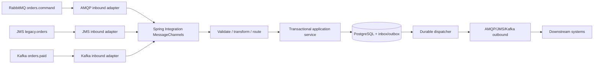
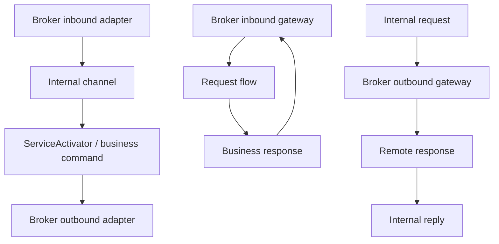
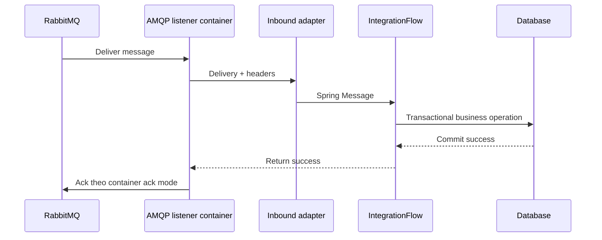
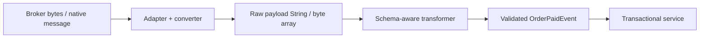
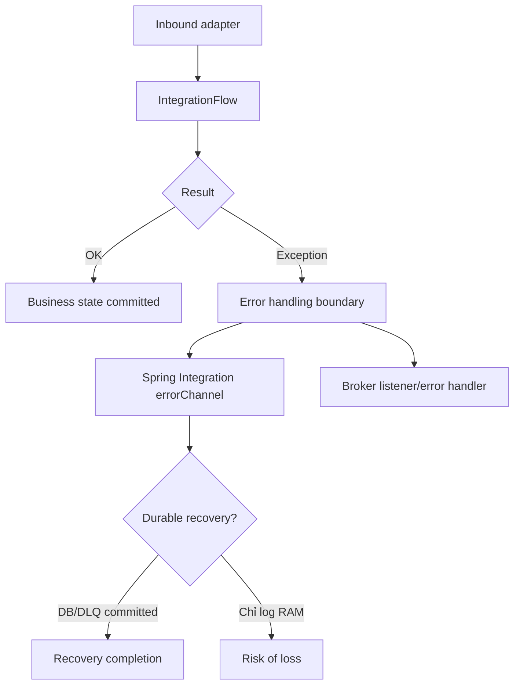
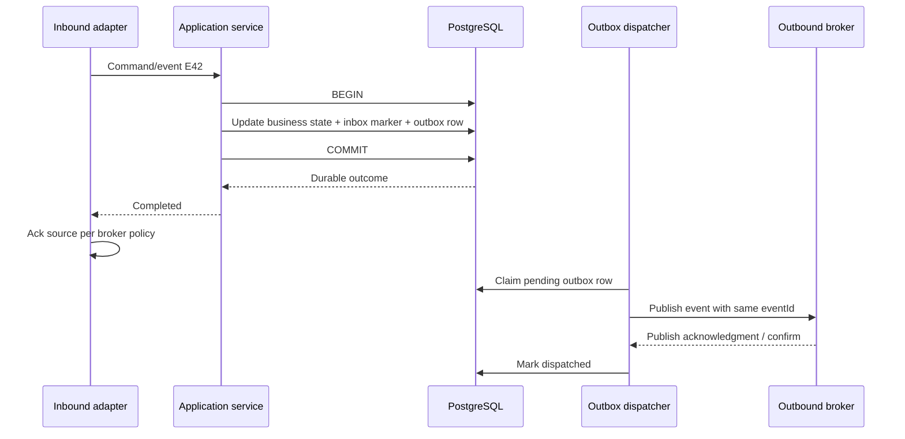

# AMQP, JMS hoặc Kafka adapter trong `IntegrationFlow`

## 1. Bài toán: kết nối broker vào một luồng tích hợp mà không làm sai ngữ nghĩa giao nhận

Một hệ thống Spring Boot nhận đơn hàng qua HTTP, ghi PostgreSQL, phát sự kiện `OrderPaid` lên Kafka và gửi yêu cầu giao hàng cho một đối tác dùng RabbitMQ. Một hệ thống kế toán lâu đời lại cung cấp queue qua JMS. Ta có thể sử dụng Spring Integration để biến các đầu vào/đầu ra này thành các **`Message<?>` đi qua `IntegrationFlow`**, thay vì đặt logic xử lý ở ba loại listener hoàn toàn tách biệt.

Nhưng “cùng là message” không có nghĩa ba broker giống nhau. RabbitMQ dùng exchange/queue/binding và acknowledgments; JMS là API với destinations, sessions và acknowledgment/transaction; Kafka là log phân vùng với consumer group, offset commit và retention. Một adapter chỉ nối **ranh giới giao thức** vào message channel của Spring Integration, **không tạo một giao dịch nguyên tử xuyên broker, database và HTTP client**.

Ví dụ luồng:



Bài **“AMQP, JMS hoặc Kafka adapter trong IntegrationFlow”** thuộc chương **“Adapter tích hợp”**, module **SPRING_BOOT_INTEGRATION**. Bối cảnh toàn module là tổ chức tích hợp Spring Boot qua HTTP client, cơ sở dữ liệu, cache, broker và adapters Spring Integration, đặc biệt chú trọng cấu hình, hợp đồng dữ liệu, giao dịch, xử lý lỗi/trùng lặp, kiểm thử và khả năng quan sát.

Sau bài học, bạn có thể:

- Chọn đúng inbound/outbound **channel adapter** hoặc **gateway** cho fire-and-forget và request-reply.
- Cấu hình Java DSL `IntegrationFlow` dựa trên AMQP, JMS hoặc Kafka infrastructure được Spring Boot quản lý.
- Hiểu khi nào broker ack/commit xảy ra, nhất là khi flow đổi thread hoặc xử lý bất đồng bộ.
- Thiết kế converter, header mapping, error channel, retry, dead-letter và idempotency phù hợp từng broker.
- Phối hợp adapter với JDBC/jOOQ/JPA, Redis, HTTP/SOAP và transactional outbox.
- Kiểm thử bằng broker thật và quan sát lỗi ở **đúng boundary**.

**Kết luận xuyên suốt:** adapter cung cấp một cách viết flow nhất quán, còn độ tin cậy phụ thuộc broker-specific delivery semantics và mốc bền vững thực tế.

## 2. Ngôn ngữ chung: `Message<?>`, channel, endpoint và handler

Spring Integration xây dựng theo mô hình **Enterprise Integration Patterns**. Một message gồm:

- **Payload**: dữ liệu nghiệp vụ, có thể là bytes, JSON string, DTO, record hoặc đối tượng provider-specific.
- **Headers**: metadata, ví dụ correlation ID, content type, broker topic/queue, delivery info hoặc acknowledgment handle.
- **Channel**: kết nối các endpoints; cách chọn channel ảnh hưởng threading và error propagation.
- **Endpoint**: thành phần nhận/gửi message, như adapter, gateway, transformer, filter, router, service activator.
- **`IntegrationFlow`**: khai báo chuỗi endpoints bằng Java DSL.

```java
import org.springframework.integration.dsl.IntegrationFlow;
import org.springframework.context.annotation.Bean;

@Bean
IntegrationFlow simpleFlow(OrderCommandService service) {
    return IntegrationFlow.from("validatedOrders")
        .filter((OrderCommand command) ->
                command.orderId() != null)
        .handle(service, "apply")
        .get();
}
```

`OrderCommand`/`OrderCommandService` là types của ứng dụng; method `apply` cần phù hợp payload và signatures được Spring Integration hỗ trợ. Ví dụ chỉ làm rõ một channel nội bộ, **chưa có broker adapter**.

### 2.1. Một số channel quan trọng

| Channel | Hành vi | Rủi ro khi dùng sau inbound broker |
|---|---|---|
| `DirectChannel` | Gọi subscriber đồng bộ, thường trên thread sender. | Handler chậm chặn poll/delivery thread; tuy nhiên dễ gắn kết failure với ack boundary. |
| `ExecutorChannel` | Chuyển việc sang executor khác. | Inbound adapter có thể return/ack trước khi business work commit; transaction/context không tự truyền. |
| `QueueChannel` | Giữ message trong queue của JVM (nếu là implementation in-memory). | Không có durability qua process crash; timeout/poller và acknowledgment cần được thiết kế. |
| `PublishSubscribeChannel` | Phân phối tới nhiều subscribers theo cấu hình. | Partial success/error và reply semantics khó hơn; không đồng nghĩa broker pub/sub. |
| Persistent channel store | Lưu message qua store được cấu hình đúng. | Cần transaction, serialization, TTL, recovery; không chỉ đặt tên “persistent”. |

Mặc định `DirectChannel` là lựa chọn dễ hiểu cho một inbound adapter gọi một transactional service đồng bộ. Nhưng khi service cần gọi ERP vài chục giây, có thể chuyển sang **durable handoff** trước rồi mới ack broker, thay vì đẩy vào `ExecutorChannel` RAM.

### 2.2. `MessageHeaders` không phải bản sao mọi broker headers

Spring Integration `MessageHeaders` là abstraction trong JVM. AMQP `MessageProperties`, JMS message properties và Kafka `Headers` dùng kiểu dữ liệu/giới hạn khác nhau. Adapter/converter phải **ánh xạ có kiểm soát**; không copy toàn bộ headers với `replyChannel`, `errorChannel`, auth token hoặc Java object không serialize được ra broker.

## 3. So sánh AMQP, JMS và Kafka trước khi chọn adapter

| Khía cạnh | RabbitMQ qua AMQP | JMS | Apache Kafka |
|---|---|---|---|
| Bản chất | Broker queue/exchange routing qua AMQP 0-9-1 ở hệ Spring AMQP phổ biến. | API Java messaging; hành vi thực phụ thuộc JMS provider (ví dụ Artemis). | Distributed append-only log với partitions. |
| Điểm nhận | Queue được binding tới exchange. | Queue hoặc topic subscription, durable/shared theo provider. | Topic + partitions + consumer group. |
| Phân phối | Competing consumers trên queue; pub/sub qua nhiều queues/bindings. | Queue competing consumers hoặc topic subscriptions. | Một partition thường gán một consumer trong group; nhiều groups đọc độc lập. |
| Vị trí tiến độ | Queue message được ack/nack/requeue theo cơ chế broker. | Session acknowledgment/transaction và redelivery. | Offsets được consumer group commit. |
| Replay | Cần queue/DLX/retention/republish policy phù hợp. | Phụ thuộc broker persistence/durable subscription. | Có thể replay offsets còn trong retention. |
| Ordering | Phụ thuộc queue, prefetched messages, concurrency/requeue. | Phụ thuộc destination/provider, concurrent sessions/consumers. | Thứ tự trong **một partition**, không total order toàn topic. |
| Định danh | App message ID/correlation ID nên đặt rõ. | `JMSMessageID` do provider, app correlation/operation ID. | Topic-partition-offset là vị trí log, không phải business event ID. |
| Retry lỗi | nack/requeue, dead-letter exchange, delayed mechanisms. | Session rollback/recover, provider redelivery/DLQ. | Seek/reprocess, error handler, retry topics/DLT. |
| Transaction | AMQP channel transaction/confirm theo broker, không tự atomic với DB. | JMS session transaction/JTA nếu thực sự cấu hình. | Producer transactions/consumer offsets trong Kafka scope, không tự atomic với DB. |

**Không chọn broker chỉ vì một DSL method tiện hơn**. Hãy chọn theo semantics, hệ sinh thái hiện hữu, dữ liệu phải giữ bao lâu, throughput, ordering và độ tin cậy. Nếu nhiệm vụ chỉ là nối vào broker đã có, adapter giữ sự nhất quán của flow nhưng không che những khác biệt cần quyết định.

## 4. Adapter hay gateway: event một chiều hay request-reply?

Spring Integration có hai nhóm thành phần dễ bị gọi chung là “adapter”:

- **Inbound channel adapter**: nhận message từ bên ngoài và gửi vào Spring `MessageChannel`; là **one-way**.
- **Outbound channel adapter**: nhận Spring message và gửi ra hệ thống bên ngoài; **không** cung cấp reply business như gateway.
- **Inbound gateway**: nhận request từ bên ngoài, chuyển vào flow và chờ/sinh reply theo giao thức.
- **Outbound gateway**: gửi request ra bên ngoài và trả reply về flow.



Nếu producer chỉ gửi `OrderPaid` và không đợi business reply, chọn **adapter**. Nếu một request từ JMS queue yêu cầu response tới `JMSReplyTo` theo correlation contract, chọn **gateway** và thiết kế timeout/reply ownership.

Đừng tạo “RPC qua Kafka topic” chỉ vì có request-reply gateway: yêu cầu thêm request ID, correlation, reply topic/partition, TTL, deadline và xử lý response đến sau timeout. Kafka phù hợp event streaming hơn synchronous RPC ở nhiều use cases.

## 5. Dependencies và Spring Boot-managed infrastructure

Với Spring Boot 3.x/Spring Integration 6.x, cấu hình Gradle Kotlin DSL có thể gồm:

```kotlin
dependencies {
    implementation("org.springframework.boot:spring-boot-starter-integration")

    // Chỉ thêm adapter của broker thật sự sử dụng:
    implementation("org.springframework.integration:spring-integration-amqp")
    implementation("org.springframework.integration:spring-integration-jms")
    implementation("org.springframework.integration:spring-integration-kafka")

    // Broker clients/starters theo yêu cầu:
    implementation("org.springframework.boot:spring-boot-starter-amqp")
    implementation("org.springframework.boot:spring-boot-starter-activemq")
    implementation("org.springframework.kafka:spring-kafka")

    implementation("org.springframework.boot:spring-boot-starter-jdbc")

    testImplementation("org.springframework.boot:spring-boot-starter-test")
    testImplementation("org.springframework.integration:spring-integration-test")
}
```

**Đây là danh mục minh họa, không phải dependency bắt buộc cài tất cả cùng lúc.** Với JMS, dùng starter/provider đúng triển khai (Artemis hoặc ActiveMQ Classic tương thích); ở nhiều dự án Boot 3 cần `jakarta.jms.*`, không trộn `javax.jms` với `jakarta.jms`. Dùng Spring Boot BOM để các versions Spring Integration, Spring AMQP, Spring Kafka và driver tương thích.

### 5.1. Ai sở hữu bean kết nối?

| Broker | Bean nên tái sử dụng | Tránh |
|---|---|---|
| RabbitMQ | Spring AMQP `ConnectionFactory`, `RabbitTemplate`, listener container factory khi cần. | Tạo connection factory không có TLS/credentials/recovery config chung. |
| JMS | `jakarta.jms.ConnectionFactory`, `JmsTemplate`, message listener container factory phù hợp. | Tạo session/client per message và bypass transaction/auth. |
| Kafka | `ConsumerFactory`, `ProducerFactory`, `KafkaTemplate`, listeners/containers. | Tạo `KafkaConsumer` mỗi record hoặc tự dựng factory mất deserializer/security. |

Boot auto-configuration có điều kiện và có thể back off khi thấy custom beans. Trước khi đưa flow vào production, kiểm tra **bean nào adapter đang dùng**, không chỉ nhìn `application.yml`.

## 6. Java DSL: đọc một `IntegrationFlow` từ trái sang phải

Một flow mô hình:

```java
@Bean
IntegrationFlow incomingOrdersFlow(OrderApplicationService service) {
    return IntegrationFlow.from("ordersInbound")
        .filter((String payload) -> !payload.isBlank())
        .transform(String.class, String::trim)
        .handle(service, "applyJson")
        .get();
}
```

Giải nghĩa:

1. `from("ordersInbound")` tạo/đăng ký một input channel endpoint theo DSL.
2. `filter(...)` loại messages không đạt điều kiện; nếu dùng trong business flow, phải định nghĩa **discard/error outcome** rõ, không silently drop message bắt buộc xử lý.
3. `transform(...)` chuyển payload, mặc định headers có thể được bảo toàn theo framework nhưng từng transformer/header mapper cần kiểm tra.
4. `handle(...)` gọi service activator để thực thi nghiệp vụ; nếu service ném exception, đường xử lý tùy **thread/channel/error handling**.
5. `get()` hoàn thành cấu hình flow (theo API phiên bản).

Một flow trong Spring Integration không tạo Kafka consumer chỉ vì channel tên `ordersInbound`. Cần gắn **broker inbound adapter** vào channel hoặc dùng `IntegrationFlow.from(adapterSpec)`.

## 7. AMQP inbound: RabbitMQ queue → `IntegrationFlow`

RabbitMQ được tiếp cận qua **Spring AMQP**. Inbound adapter có thể lắng nghe queue bằng listener container rồi chuyển payload và mapped headers thành Spring messages.

Ví dụ Java DSL theo tổ hợp Spring Integration AMQP hỗ trợ:

```java
import org.springframework.amqp.rabbit.connection.ConnectionFactory;
import org.springframework.context.annotation.Bean;
import org.springframework.integration.amqp.dsl.Amqp;
import org.springframework.integration.dsl.IntegrationFlow;

@Bean
IntegrationFlow rabbitOrdersInbound(
        ConnectionFactory rabbitConnectionFactory,
        OrderApplicationService orders) {

    return IntegrationFlow
        .from(Amqp.inboundAdapter(
                rabbitConnectionFactory, "orders.inbound"))
        .handle(orders, "applyJson")
        .get();
}
```

`OrderApplicationService.applyJson(...)` là method tự định nghĩa, nhận kiểu payload sau AMQP converter. Ví dụ giả định `orders.inbound` đã tồn tại và binding/routing đã được provision. Nếu converter trả `byte[]` thay vì `String`, method sẽ không tự phù hợp nếu thiếu transformer/converter.

**Trường hợp nên dùng:** nhận command/event từ Rabbit queue, xử lý đồng bộ rồi quyết định ack/nack theo listener container policy. Không gắn đồng thời một `@RabbitListener` khác cho cùng queue nếu muốn mỗi message đi qua một business handler duy nhất: hai consumers có thể chia tải, tạo hành vi khó dự đoán.

### 7.1. Đường nhận RabbitMQ



Sơ đồ mô tả **container auto acknowledgment** theo đường synchronous success. Nếu flow dùng `ExecutorChannel`/`QueueChannel` in-memory rồi return, listener container có thể xem việc giao vào channel là thành công dù business processing chưa commit. Nếu bật manual acknowledgments, ứng dụng phải ack/nack theo policy riêng, không áp dụng sơ đồ trên máy móc.

### 7.2. Inbound adapter và AMQP gateway khác nhau

AMQP inbound **adapter** phù hợp one-way. AMQP inbound **gateway** dùng khi broker sender đợi reply, cần `replyTo`, correlation ID và timeout/reply routing rõ ràng. Không để remote sender chờ một gateway response trong lúc ERP xử lý nhiều phút nếu có thể chuyển sang async operation ID + result event.

## 8. AMQP outbound: Spring message → exchange/routing key

Outbound AMQP adapter dùng `RabbitTemplate` để gửi message tới exchange/routing key theo cấu hình.

```java
import org.springframework.amqp.rabbit.core.RabbitTemplate;
import org.springframework.context.annotation.Bean;
import org.springframework.integration.amqp.dsl.Amqp;
import org.springframework.integration.dsl.IntegrationFlow;

@Bean
IntegrationFlow rabbitShipmentOutbound(RabbitTemplate rabbitTemplate) {
    return IntegrationFlow
        .from("shipmentOutbound")
        .handle(Amqp.outboundAdapter(rabbitTemplate)
                .exchangeName("shipping.events")
                .routingKey("shipment.requested"))
        .get();
}
```

Một bean/flow khác có thể gửi vào `shipmentOutbound` qua `MessageChannel`/`MessagingGateway`; không dùng magic string trong code business nếu có thể định nghĩa interface/typed gateway.

### 8.1. Publish success nghĩa là gì?

`RabbitTemplate.convertAndSend(...)` trở về bình thường **không tự chứng minh** message đã đến queue mong muốn. Cần cấu hình publisher confirms, returns/mandatory và queue/exchange/binding topology theo contract. RabbitMQ có thể nhận publish tới exchange nhưng message không route tới queue do binding sai.

Tùy Spring Integration AMQP endpoint/version, outbound handler có thể sử dụng publish confirm/return channel hoặc async callback. Phải xác minh **mốc nào mới được coi là durable publish**, nhất là khi dispatcher định mark `outbox.PUBLISHED`.

### 8.2. Dynamic routing keys và an toàn

Nếu routing key lấy từ message header, chỉ cho phép giá trị theo policy hoặc mapping từ event type/trust boundary. Không cho người dùng ngoài gửi tùy ý exchange/routing key từ HTTP header và dùng credentials Rabbit có quyền rộng; có thể tạo information disclosure hoặc gửi dữ liệu đến queue ngoài phạm vi.

## 9. JMS inbound: message-driven thay vì polling nếu cần phản ứng nhanh

JMS là **API**, không phải tên một broker. Spring Integration JMS hỗ trợ inbound adapters/gateways, trong đó **message-driven channel adapter** thường dùng listener container thay vì liên tục tự `receive()` trong poller.

Ví dụ concept theo Java DSL Spring Integration JMS:

```java
import jakarta.jms.ConnectionFactory;
import org.springframework.context.annotation.Bean;
import org.springframework.integration.dsl.IntegrationFlow;
import org.springframework.integration.jms.dsl.Jms;

@Bean
IntegrationFlow jmsLegacyOrdersInbound(
        ConnectionFactory jmsConnectionFactory,
        LegacyOrderService service) {

    return IntegrationFlow
        .from(Jms.messageDrivenChannelAdapter(
                jmsConnectionFactory)
                .destination("legacy.orders.queue"))
        .handle(service, "apply")
        .get();
}
```

Ví dụ giả định provider/JMS session factory đã có, queue destination name được cấu hình/provision và converter mapping trả payload theo `apply`. **Tên builder methods có thể khác theo Spring Integration major release**, cần đối chiếu API/BOM khi triển khai. Một số phiên bản hỗ trợ overload nhận destination hoặc container factory; code mẫu chọn diễn đạt rõ cơ chế listener.

### 9.1. Polling JMS adapter khác message-driven adapter

| Kiểu | Cách hoạt động | Khi dùng |
|---|---|---|
| JMS **polling inbound adapter** | Một poller gọi receive ở tần suất và timeout đã cấu hình. | Batch windows/rate-controlled intake, tích hợp poller chung. |
| JMS **message-driven inbound adapter** | Message listener container nhận và đẩy message vào channel. | Xử lý liên tục, có container concurrency/transaction/ack policy. |
| JMS **inbound gateway** | Nhận JMS request và gửi JMS reply. | Legacy request-reply với `JMSReplyTo`, correlation, timeout. |

Nếu dùng polling, không mặc định poller transaction giống message-driven container; đặc biệt phải biết khi JMS message được acknowledge và Spring Integration có channel polling/error flow nào chạy.

### 9.2. JMS `queue` khác `topic`

JMS Queue thường dùng competing consumers; JMS Topic có subscriptions. Durable/shared durable subscription và `clientId` có quy định riêng theo JMS provider. Đừng chuyển từ queue sang topic chỉ bằng đổi một chuỗi destination name mà không xác nhận publisher/subscriber semantics và subscription lifecycle.

## 10. JMS outbound và message conversion

JMS outbound adapter có thể dùng `JmsTemplate` để gửi vào destination.

```java
import org.springframework.context.annotation.Bean;
import org.springframework.integration.dsl.IntegrationFlow;
import org.springframework.integration.jms.dsl.Jms;
import org.springframework.jms.core.JmsTemplate;

@Bean
IntegrationFlow legacyBillingOutbound(JmsTemplate jmsTemplate) {
    return IntegrationFlow
        .from("billingOutbound")
        .handle(Jms.outboundAdapter(jmsTemplate)
                .destination("legacy.billing.queue"))
        .get();
}
```

Không tự giả định payload Java record sẽ được chuyển thành XML/text contract đúng. JMS converters có thể tạo `TextMessage`, `BytesMessage` hoặc kiểu khác theo `MessageConverter`. Với tích hợp xuyên JVM/broker phiên bản khác, nên thống nhất wire format như UTF-8 JSON/XML/Avro và schema version; tránh serialize Java object tùy ý từ ứng dụng.

### 10.1. JMS request-reply: correlation và timeout

Với JMS gateway, cần thiết kế:

- `JMSReplyTo` destination hoặc reply queue có quyền hợp lệ.
- Correlation ID ổn định và mapping đúng giữa request/reply.
- Thời gian chờ, cleanup unmatched/late reply.
- Quy tắc xử lý duplicate request khi producer retry.
- Khả năng một reply đến sau khi caller timeout và operation đã thành công.
- Không giữ JDBC transaction/synchronous HTTP thread chờ vô hạn.

JMS message ID/provider correlation thường không phải idempotency key nghiệp vụ; dùng `operationId` hoặc command ID trong payload/header hợp đồng.

## 11. Kafka inbound adapter: consumer group → `IntegrationFlow`

Kafka record có topic, partition, offset, key, value và headers. Spring Integration Kafka có message-driven inbound adapter kết nối một `ConsumerFactory`/container tới flow.

Ví dụ record listener:

```java
import org.apache.kafka.common.serialization.StringDeserializer;
import org.springframework.context.annotation.Bean;
import org.springframework.integration.dsl.IntegrationFlow;
import org.springframework.integration.kafka.dsl.Kafka;
import org.springframework.integration.kafka.inbound.KafkaMessageDrivenChannelAdapter;
import org.springframework.kafka.core.ConsumerFactory;

@Bean
IntegrationFlow kafkaOrderPaidInbound(
        ConsumerFactory<String, String> consumerFactory,
        OrderProjectionService projections) {

    return IntegrationFlow
        .from(Kafka.messageDrivenChannelAdapter(
                consumerFactory,
                KafkaMessageDrivenChannelAdapter.ListenerMode.record,
                "orders.paid"))
        .handle(projections, "applyJson")
        .get();
}
```

Các imports/overloads của Kafka DSL nên kiểm tra theo Spring Integration version. Đây là ví dụ **dùng ConsumerFactory được cấu hình trước**, không tự khởi tạo Kafka consumer trong flow. Các bean names/types phải thống nhất với `StringDeserializer` cho payload và đúng group ID của logical subscriber.

### 11.1. Một consumer group cần định danh rõ

```yaml
spring:
  kafka:
    bootstrap-servers: ${KAFKA_BOOTSTRAP_SERVERS}
    consumer:
      group-id: order-projection
      enable-auto-commit: false
      auto-offset-reset: earliest
      key-deserializer: org.apache.kafka.common.serialization.StringDeserializer
      value-deserializer: org.apache.kafka.common.serialization.StringDeserializer
```

Trong ví dụ, `order-projection` phải là group tương ứng với adapter này. Nếu nhiều Kafka consumers/subscriptions dùng group ID giống nhau, họ **chia partitions**, không phải mỗi group instance nhận đầy đủ stream.

### 11.2. Adapter không làm biến mất partitions/offsets

- Một partition thường chỉ có một consumer owner trong một group tại một thời điểm.
- `concurrency` chỉ tăng workers hữu ích tới giới hạn partitions và downstream capacity.
- `auto-offset-reset=earliest` không rewind committed offsets đang tồn tại.
- Kafka giữ thứ tự **trong một partition**; retry topic và async channels có thể làm processing out-of-order.
- `topic/partition/offset` là vị trí log; business dedupe cần `eventId` bền vững.

Khi Spring Integration flow đã gọi database thành công nhưng offset commit thất bại, Kafka có thể redeliver. Đây là failure window cần consumer idempotency, không thể sửa bằng việc “đổi adapter”.

## 12. Kafka outbound adapter: chuyển payload sang record với key và topic

```java
import org.springframework.context.annotation.Bean;
import org.springframework.integration.dsl.IntegrationFlow;
import org.springframework.integration.kafka.dsl.Kafka;
import org.springframework.kafka.core.KafkaTemplate;

@Bean
IntegrationFlow kafkaFulfillmentOutbound(
        KafkaTemplate<String, String> kafkaTemplate) {

    return IntegrationFlow
        .from("fulfillmentOutbound")
        .handle(Kafka.outboundChannelAdapter(kafkaTemplate)
                .topic("fulfillment.events"))
        .get();
}
```

Kafka serialization và key cần được xác định: với những events cùng `orderId` yêu cầu ordering theo aggregate, producer cần dùng aggregate ID làm **record key** theo policy. Nếu không đặt key, partition routing có thể khác dự kiến. Spring Integration Kafka outbound handler hỗ trợ topic/key từ configuration và headers, nhưng header name/mapping cần kiểm tra đúng phiên bản; không tự tin payload JSON có field orderId sẽ tự trở thành Kafka key.

### 12.1. Gửi async và mốc hoàn tất

`KafkaTemplate.send(...)` thường trả `CompletableFuture` trong các Spring Kafka thế hệ hiện đại; outbound adapter có thể dùng sync/async behavior tùy endpoint configuration. Nếu flow trả về ngay khi **đã enqueue send**, điều đó không chứng minh broker ack. Nếu nguồn dữ liệu là outbox, dispatcher phải dựa vào producer acknowledgment/callback theo hợp đồng trước khi mark event delivered.

**Một successful invocation của `IntegrationFlow` không tự chứng minh downstream broker đã lưu bền vững và consumer xử lý xong.**

## 13. Spring Integration DSL hay `@KafkaListener`/`@RabbitListener`/`@JmsListener`?

| Tiêu chí | Broker-native annotation listener | Spring Integration DSL adapter |
|---|---|---|
| Bắt đầu một handler đơn | Rõ ràng, ít boilerplate. | Cần định nghĩa flow/adapter. |
| Routing, filtering, split/aggregate, gateway composition | Tự gọi services hoặc tích hợp flow khác. | Mạnh khi flow có nhiều integration patterns. |
| Error channel và flow diagnostics | Dựa container-native error handler. | Có thêm Spring Integration error flow; vẫn giữ container rules. |
| Conversion/header mapping | Broker/framework-level. | Broker adapter + Spring Message transform/map. |
| Ack/transaction | Vẫn thuộc container/broker. | **Không tự thay đổi** ack/transaction guarantees. |
| Khả năng mở rộng | Listener business service rõ. | Flow phù hợp nếu có nhiều giao thức và orchestration. |

Không chuyển toàn bộ `@KafkaListener` sang DSL chỉ để “đẹp”. Với flow chỉ gọi một service, listener trực tiếp có thể dễ vận hành hơn. Với pipeline có validation/transform/router/durable handoff/outbound adapters nhiều nơi, DSL giúp nhìn rõ business flow.

**Tránh cùng lúc đăng ký native listener và Integration inbound adapter cho cùng logical subscriber nếu không cố ý competing consumers.**

## 14. Message conversion: payload từ broker không tự có kiểu mong muốn

Một lỗi phổ biến là application service nhận `OrderPaidEvent` nhưng inbound adapter thực tế gửi `byte[]` hoặc `String`, khiến handler resolution/type conversion lỗi.

Thiết kế rõ ba bước:



Một ví dụ transformer JSON nằm trong flow (không gắn DTO class của producer với driver):

```java
import com.fasterxml.jackson.databind.ObjectMapper;
import org.springframework.context.annotation.Bean;
import org.springframework.integration.dsl.IntegrationFlow;

@Bean
IntegrationFlow decodedOrderEvents(
        ObjectMapper mapper,
        OrderPaidApplicationService service) {
    return IntegrationFlow.from("orderJsonInbound")
        .transform(String.class, json -> {
            try {
                return mapper.readValue(
                        json, OrderPaidEvent.class);
            } catch (com.fasterxml.jackson.core.JsonProcessingException ex) {
                throw new InvalidOrderEventException(
                        "Invalid OrderPaidEvent payload", ex);
            }
        })
        .handle(service, "applyIdempotently")
        .get();
}
```

`OrderPaidEvent` và `InvalidOrderEventException` là types do ứng dụng tự khai báo; production cần validate `eventId`, `schemaVersion`, `aggregateVersion`, tenant authorization và payload size. Đây là **flow nhận từ channel nội bộ**, phải được nối với broker inbound adapter bằng channel name hoặc subflow phù hợp.

### 14.1. Cẩn trọng với trusted types và Java serialization

- Với AMQP, message converters có thể dùng content type và type headers; hãy giới hạn class/packages khi deserialize dữ liệu không tin cậy.
- Với JMS, `ObjectMessage` và Java serialization làm tăng tương thích/serdes/security risk; ưu tiên text/bytes + schema rõ.
- Với Kafka, `JsonDeserializer` có trusted packages/type headers; đừng dùng wildcard tin cậy trên public/shared topic mà thiếu contract.
- Nếu dùng Schema Registry (Avro/Protobuf/JSON Schema), quản lý subject/version/compatibility thay vì suy DTO type từ user-supplied Java class name.

### 14.2. Không biến deserialize failure thành message “rỗng hợp lệ”

Nếu parse thất bại, đừng `catch` rồi return DTO default hoặc string rỗng khiến downstream ack và mất dữ liệu. Lỗi malformed cần error handler/quarantine và durable record phù hợp, đồng thời tránh log raw payload có thông tin nhạy cảm.

## 15. Header mapping và correlation across AMQP/JMS/Kafka

Một logical event nên mang:

```json
{
  "eventId": "9bb8720a-7fce-467c-b3d5-8c83fb89ef74",
  "eventType": "OrderPaid",
  "schemaVersion": 1,
  "aggregateId": "O-42",
  "aggregateVersion": 7,
  "correlationId": "order-workflow-821",
  "data": {
    "orderId": "O-42"
  }
}
```

Định danh `eventId`, `aggregateId` và version nên có trong **payload/envelope ổn định**; có thể ánh xạ sang broker headers như tối ưu, nhưng không chỉ giữ chúng trong provider-specific metadata dễ mất khi chuyển gateway hoặc replay.

| Nguồn | Metadata thường thấy | Không được suy luận |
|---|---|---|
| RabbitMQ | `AmqpHeaders.*`, delivery tag, routing key, received exchange, redelivered. | Delivery tag là event ID toàn hệ thống. |
| JMS | `JMSCorrelationID`, `JMSMessageID`, `JMSRedelivered`, provider properties. | `JMSMessageID` là idempotency key cho logical command republished. |
| Kafka | `KafkaHeaders.*`, key, topic, partition, offset, acknowledgment object. | Kafka offset là event ID qua nhiều topics/retries. |
| Spring Integration | `MessageHeaders.ID`, correlation/sequence, reply/error channels. | Spring Message ID tự bảo toàn qua broker serialization/restart. |

### 15.1. Header security và trusted boundaries

Không forward blanket `Authorization`, `Cookie`, JMS internal objects, `Acknowledgment`, channel objects hoặc raw SOAP/HTTP headers sang broker khác. Chỉ map allowlist cần thiết, thay secret bằng scoped credential của outbound adapter, và kiểm thử message headers ở wire level.

Tracing context (`traceparent`, B3) có thể được instrumentation inject/extract khi có support và bật observation; **một field tên `traceparent` đơn lẻ không chứng minh distributed trace đã nối**.

## 16. Transaction boundaries: local database, broker session và integration flow

Giả sử inbound AMQP/JMS/Kafka message yêu cầu update PostgreSQL, sau đó publish event ra một broker khác.

```mermaid
sequenceDiagram
    participant B as Source broker
    participant IN as Inbound adapter/container
    participant F as IntegrationFlow
    participant DB as PostgreSQL
    participant OUT as Outbound broker
    B->>IN: Deliver event E42
    IN->>F: Message payload + headers
    F->>DB: BEGIN; update + inbox/outbox; COMMIT
    DB-->>F: Committed
    F->>OUT: Publish event
    OUT-->>F: Broker acknowledgment/confirm
    F-->>IN: Success
    IN->>B: Ack/commit source progress
```

Nếu **DB commit rồi outbound publish fail**, business state và downstream event có thể lệch. Nếu outbound publish thành công rồi source ack fail, message sẽ redeliver. Nếu DB update và outbox ghi cùng transaction, việc phát downstream trở thành một **workflow riêng có retry bền vững**.

**Spring Integration `IntegrationFlow` không tạo distributed transaction** qua RabbitMQ, JMS, Kafka, PostgreSQL và HTTP client. `@Transactional` chỉ có hiệu lực trên resources/transaction managers tham gia thực tế.

### 16.1. Transaction của polling endpoint

Polling adapter có thể dùng transactional poller nếu được cấu hình đúng, nhưng một poller transaction thường không tự làm outbound HTTP/SOAP call nằm trong transaction ACID. Với message-driven adapter, container có transaction/ack boundary riêng. Đừng nhầm hai cơ chế chỉ vì chúng đều là `IntegrationFlow`.

## 17. Acknowledgment: điểm quyết định mất hay giao lại message

**Mốc an toàn phổ biến:** broker nhận ack/source offset commit **sau khi business work hoặc durable handoff đã commit**.

| Broker | Mốc tiến độ | Khi sai có thể xảy ra |
|---|---|---|
| RabbitMQ | Message ack/nack/reject ở channel delivery. | Auto ack sớm → mất work; nack/requeue không giới hạn → poison loop. |
| JMS | Session transacted commit hoặc acknowledgment theo mode/provider. | Session/client ack trước durable business outcome → mất work. |
| Kafka | Committed offset của group theo container ack mode. | Commit offset rồi mới async task RAM → mất work. |

### 17.1. `DirectChannel` và synchronous error propagation

Với inbound adapter → `DirectChannel` → transactional service, listener container có thể nhận exception đồng bộ và xử lý theo policy (requeue, rollback, retry, seek). Điều đó **không tự bảo đảm exactly-once**: service DB commit xong thì exception có thể xuất hiện ở bước tiếp theo, làm source redelivery.

### 17.2. `ExecutorChannel` hoặc async gateway thay đổi nghĩa “xử lý thành công”

```text
Kafka/AMQP/JMS inbound
  -> send Message tới ExecutorChannel in-memory
  -> adapter/listener return
  -> source offset/ack được commit
  -> process crash trước worker xử lý DB
  -> mất việc
```

Nếu cần tách slow worker, hãy lưu **job/inbox/outbox bền vững** vào DB trong transaction trước khi return/ack, sau đó worker khác có thể xử lý. Một `QueueChannel` in-memory không thay durability của broker hay database.

## 18. AMQP redelivery, nack/requeue và DLX

Với RabbitMQ:

- Listener có thể ack sau success theo container mode.
- Khi lỗi, container/recoverer có thể reject/nack message và chọn requeue hay dead-letter.
- Dead-letter exchange (DLX) định tuyến messages bị từ chối/hết TTL/vượt delivery conditions theo broker topology.
- Header `x-death` và redelivered flags giúp diagnostics, **không thay business eventId**.
- Prefetch và concurrency ảnh hưởng throughput, fairness và memory in-flight.

### 18.1. Requeue liên tục là một retry storm

Một message JSON hỏng không tự sửa sau 100 lần requeue. Cần phân loại:

| Lỗi | Chính sách thường hợp lý |
|---|---|
| Payload/schema invalid | Reject/quarantine/DLQ, cần sửa producer/data. |
| Business validation từ chối | Commit rejected outcome, không retry nóng. |
| DB deadlock/transient | Bounded retry/backoff khi idempotent. |
| ERP timeout sau write | Outcome `UNKNOWN`, đối soát; không requeue vô hạn với key mới. |
| Auth/queue configuration sai | Alert, dừng retry nóng. |

DLX phải được provision, queue binding và TTL/retention rõ; không chỉ gọi `reject` rồi mặc định có một DLQ lưu message.

### 18.2. Manual ack có điều kiện thread/channel

AMQP delivery tag gắn với channel; nếu code giữ acknowledgment để xử lý tùy ý từ thread khác sau container shutdown/recovery, có thể ack sai hoặc chạm channel đã đóng. Khi manual ack, tuân theo Spring AMQP API/thread/lifecycle, kiểm thử cancel/shutdown và channel reuse. Không tự copy delivery tag vào business DTO rồi ack ở một process khác.

## 19. JMS session, transacted mode và redelivery

JMS acknowledgment có thể là `AUTO_ACKNOWLEDGE`, `CLIENT_ACKNOWLEDGE`, `DUPS_OK_ACKNOWLEDGE` hoặc transacted session, tùy provider và listener container. **CLIENT_ACKNOWLEDGE** có thể xác nhận nhiều messages đã tiêu thụ trong session chứ không nhất thiết chỉ một message như RabbitMQ delivery tag.

| Cơ chế | Chú ý |
|---|---|
| `AUTO_ACKNOWLEDGE` | Thời điểm ack phụ thuộc JMS listener/provider/container semantics, phải test với lỗi trong handler. |
| `CLIENT_ACKNOWLEDGE` | Ack trên session có phạm vi khác per-message broker ack, không tự dùng chung abstraction. |
| Transacted session | Commit/rollback JMS session trong scope JMS, không mặc nhiên có DB transaction. |
| JTA/XA | Có thể phối hợp nhiều XA resources khi được cấu hình thực sự; thêm complexity, recovery logs và constraints. |
| Provider redelivery/DLQ | Phụ thuộc Artemis/ActiveMQ/provider policy và delay/max-deliveries. |

Với Spring Boot, bean `JmsListenerContainerFactory` hoặc `DefaultMessageListenerContainer` có thể được cấu hình transaction/ack/recovery khác nhau; Spring Integration JMS adapter phải được gắn vào container/factory đúng. **Không tin file YAML của JMS broker có effect lên một container tự tạo không dùng configurer**.

### 19.1. Vì sao không dùng JMS XA như lời giải mặc định?

Distributed XA có operational cost: transaction coordinator, durable logs, participant recovery, timeout, in-doubt states. HTTP/SOAP endpoint bên ngoài vẫn không tham gia XA trong đa số tích hợp. Với workflow event-driven, transactional outbox/inbox cùng compensation/reconciliation thường dễ vận hành hơn.

## 20. Kafka ack/offset, error handler và batch semantics

Spring Integration Kafka message-driven adapter dựa vào Spring Kafka listener container. Các thuộc tính như `AckMode.RECORD`, `AckMode.BATCH`, `AckMode.MANUAL`/`MANUAL_IMMEDIATE`, concurrency và `DefaultErrorHandler` quyết định redelivery/retry/offset progression.

Một cấu hình định hướng:

```yaml
spring:
  kafka:
    consumer:
      group-id: order-projection
      enable-auto-commit: false
      auto-offset-reset: earliest
      max-poll-records: 100
    listener:
      ack-mode: record
      concurrency: 3
```

**Quan trọng:** khi bạn tạo Kafka adapter/`ConcurrentMessageListenerContainer` riêng bằng Spring Integration DSL, `spring.kafka.listener.*` có thể **không tự áp** như khi Boot cấu hình `@KafkaListener` factory. Phải kiểm tra container properties thực tế và quyết định ack/error handler ở đúng nơi tạo container.

### 20.1. Manual ack yêu cầu header/handler contract phù hợp

Nếu chọn manual acknowledgment, adapter có thể expose một `Acknowledgment` handle qua Kafka header theo configuration và Spring Kafka version. Ứng dụng chỉ nên gọi `acknowledge()` sau durable work, trên đúng lifecycle/thread semantics; tránh serialize handle qua Kafka/JMS/AMQP hoặc chuyển sang async worker không kiểm soát.

### 20.2. Batch listener khác record listener

Batch mode có thể cung cấp `List` records/payload và semantics offset/error khác. Nếu một record trong batch lỗi, không được commit cả batch chỉ vì 99/100 records thành công. Cần chọn batch error policy/partial failure handling theo Spring Kafka version; đôi khi record listener + batch SQL trong application service dễ duy trì hơn.

### 20.3. Kafka deserialization lỗi trước flow

Một `SerializationException` từ Kafka `Deserializer` có thể xảy ra **trước khi Spring Integration nhận `Message<?>`**, nên Spring Integration `errorChannel` bên trong flow không tự thấy lỗi. Dùng `ErrorHandlingDeserializer`/container error handling phù hợp để đưa poison record sang DLT/quarantine. Đây là ranh giới quan trọng giữa **broker client**, **adapter**, **integration flow** và **business handler**.

## 21. Error channel: đường lỗi của Spring Integration, không phải DLQ bền vững

Spring Integration có `ErrorMessage`, `errorChannel` và endpoint error handling. Một error message có thể mang exception và failed message để routing/logging/recovery.



Sơ đồ này minh họa **những đường có thể tồn tại**; không có nghĩa mọi exception được gửi đồng thời đến cả `errorChannel` và broker handler. Điều nào nhận lỗi phụ thuộc inbound endpoint, channel thread, poller, error channel configuration và exception propagation.

### 21.1. Đồng bộ vs bất đồng bộ

- **Đồng bộ `DirectChannel`**: exception thường propagate lên inbound sender/container; container có thể xử lý ack/requeue/error handler.
- **Bất đồng bộ `ExecutorChannel`/poller**: lỗi có thể được phát tới error channel của task/poller, **không** quay về thread đã nhận broker message.
- **Recovery callback**: nếu ghi lỗi ra log rồi trả thành công, container có thể xem message đã xử lý, tùy endpoint.

**Error channel trong bộ nhớ không phải một persistent queue.** Khi lỗi bắt buộc phải được phục hồi, ghi durable record/job/outbox/quarantine hoặc broker DLQ có publisher confirmation phù hợp trước khi source ack.

### 21.2. Không dùng catch-all nuốt nguyên nhân

Phản mẫu:

```java
try {
    service.apply(event);
} catch (Exception ex) {
    log.error("Integration failed", ex);
}
// Flow trả success dù chưa lưu failure state
```

Hãy phân loại `TRANSIENT`, `PERMANENT_CONTRACT`, `BUSINESS_REJECTED` và `UNKNOWN_OUTCOME`. Nếu không có durable recovery, propagate exception để broker container có cơ hội thực hiện chính sách đã cấu hình.

## 22. Retry nằm ở đâu? Tránh nhân nhiều tầng attempts

Một flow có thể có retry ở:

1. Kafka/RabbitMQ/JMS client, producer hoặc consumer container.
2. `RequestHandlerRetryAdvice` của Spring Integration handler.
3. Spring Retry ở service method.
4. HTTP client/ERP adapter.
5. Database transaction retry.
6. Broker redelivery/DLT/retry topic.
7. Durable job worker sau outbox.

Nếu mỗi lớp tự retry ba lần, tổng attempts có thể nhân lên đáng kể, đặc biệt với remote command ghi dữ liệu. Chọn một **primary retry owner** ở boundary hợp lý, xác định budget chung, deadline, backoff/jitter, rate limit và hành vi sau exhausted retries.

### 22.1. Ma trận retry theo lỗi

| Nguồn lỗi | Retry nóng? | Lý do |
|---|---|---|
| Bad JSON/schema, unsupported event version | Không. | Payload không tự sửa; quarantine/DLT. |
| Unauthorized/invalid TLS/WS-Security | Không retry nóng. | Cần sửa quyền/cấu hình. |
| DB deadlock/serialization conflict | Có điều kiện. | Rollback attempt lỗi và thao tác idempotent. |
| Broker network ngắt ngắn | Có giới hạn. | Có thể phục hồi; publish result có thể UNKNOWN. |
| ERP HTTP 503/429 | Có điều kiện. | Backoff và quota, total deadline. |
| ERP write timeout sau request gửi | Không phát lại mù. | Remote side effect có thể đã commit. |
| Duplicate business event | Thường không. | Kiểm tra same intent/outcome và ack khi an toàn. |
| Poison message gây lỗi code cố định | Không vô hạn. | Sửa code, DLQ và replay sau deploy. |

### 22.2. Retry advice không tự rollback nhiều resources

Nếu `RequestHandlerRetryAdvice` bao quanh một handler đã commit DB rồi lỗi ở Kafka publish, retry handler có thể chạy lại DB update/HTTP call. Thiết kế lại ranh giới: ghi DB + outbox trong cùng transaction, dispatcher retry publishing riêng, consumer dùng inbox/idempotency.

## 23. Transactional outbox cho outbound flow có yêu cầu không mất event

Một mẫu an toàn khi có **business database là nguồn sự thật**:



Ở đây, inbound adapter không gửi trực tiếp outbound event **trong cùng DB transaction** mà chỉ ghi ý định phát. Nếu outbound broker tạm ngừng, outbox vẫn giữ event. Dispatcher có thể dùng AMQP/JMS/Kafka outbound adapter, nhưng cần **xác minh adapter đã nhận publisher acknowledgment/confirm** trước khi mark `PUBLISHED`.

Khi publish thành công nhưng worker crash trước khi mark, event được phát lại với **cùng eventId**, consumer dedupe. Outbox giải quyết atomicity giữa domain state + intent; không tạo exactly-once delivery ở broker/consumer.

### 23.1. Mô hình code ngắn cho inbox + outbox

```java
import org.springframework.jdbc.core.simple.JdbcClient;
import org.springframework.stereotype.Service;
import org.springframework.transaction.annotation.Transactional;

@Service
class OrderPaidService {

    private final JdbcClient jdbc;
    private final OutboxWriter outboxWriter;

    OrderPaidService(JdbcClient jdbc, OutboxWriter outboxWriter) {
        this.jdbc = jdbc;
        this.outboxWriter = outboxWriter;
    }

    @Transactional
    public void applyIdempotently(OrderPaidEvent event) {
        int inserted = jdbc.sql("""
            INSERT INTO inbox(consumer_name, event_id, payload_hash)
            VALUES ('order-projection', :eventId, :hash)
            ON CONFLICT (consumer_name, event_id) DO NOTHING
            """)
            .param("eventId", event.eventId())
            .param("hash", event.verifiedPayloadHash())
            .update();

        if (inserted == 0) {
            verifyPriorOutcome(event);
            return;
        }

        applyBusinessState(event);
        outboxWriter.insertEvent(
                event.derivedIntegrationEvent());
    }

    private void verifyPriorOutcome(OrderPaidEvent event) {
        // Đọc hash/outcome đã lưu; không coi mọi duplicate là success.
    }

    private void applyBusinessState(OrderPaidEvent event) {
        // JDBC/JPA/jOOQ business update cùng transaction.
    }
}
```

`OrderPaidEvent` và `OutboxWriter` là abstractions ứng dụng phải triển khai. `verifiedPayloadHash()` phải tính từ payload/canonical representation đáng tin, không dùng hash do caller tùy ý khai báo. Các methods placeholder cần có implementation; **không copy class này rồi coi nó là idempotency đầy đủ**. `OutboxWriter` phải dùng cùng `DataSource`/transaction manager và không dùng `REQUIRES_NEW`.

## 24. Request-reply gateways: timeout không chứng minh remote chưa xử lý

Với AMQP/JMS request-reply, gateway có thể gửi command qua broker và chờ response. Khi hết `replyTimeout`:

```text
Caller gửi ReserveStock(operationId=R42)
  -> broker nhận và remote consumer thực hiện thành công
  -> response thất lạc hoặc đến quá muộn
  -> gateway timeout, caller không biết kết quả
  -> retry với operationId mới => có thể dự trữ hai lần
```

Cần:

- Stable `operationId`/idempotency key trong request.
- Remote service hỗ trợ query by ID hoặc safe idempotent command.
- Reply correlation và timeout/late replies có owner.
- Business state `UNKNOWN`/`PENDING_RECONCILIATION` nếu side effect chưa rõ.
- Deadline tổng và throttling/backpressure.
- Không giữ local DB transaction mở hàng chục giây trong lúc chờ remote reply nếu có thể thiết kế bất đồng bộ.

Adapter gửi một chiều và gateway đợi reply có **failure windows khác nhau**, nhưng cả hai đều không tự cho exactly-once end-to-end.

## 25. Broker header propagation, tracing và context qua threads

Spring Boot có Micrometer Observation/Tracing; Spring AMQP/Kafka/JMS/Spring Integration có hỗ trợ instrumentation khác nhau theo phiên bản và cấu hình. Khi dùng Spring Integration:

- **`DirectChannel`** giữ call stack đồng bộ nên active scope dễ đi theo handler.
- **`ExecutorChannel`** chuyển thread; `ThreadLocal`/MDC không tự lan truyền nếu không có task decorator/context propagation.
- **`QueueChannel`/poller** có thể xử lý sau khi inbound span đã kết thúc.
- **Broker wire headers** cần propagator/header mapping để inject/extract trace context.
- **Outbox dispatcher** chạy sau commit có thể tạo trace mới; stable eventId/correlationId giúp nối business workflow dài.
- Không dùng `traceId` làm idempotency key hoặc metric label.

### 25.1. Observation có thể thiếu nếu bypass Boot beans

Tự tạo `RabbitTemplate`/`KafkaTemplate`/`ConsumerFactory` hoặc JMS listener container mà không áp ObservationRegistry, credentials, TLS hay customizers chung có thể khiến trace đứt. Khi tạo custom adapter, hãy xác nhận bean/handler thực sự được dùng và instrumentation bật đúng ở **producer lẫn consumer**.

### 25.2. Metric labels phải có cardinality thấp

Đo `flow=orders-paid-kafka`, `broker=kafka`, `outcome=success|retry|dlt`, `error.category=contract|transient`. Không tag `orderId`, `eventId`, `traceId` hoặc raw routing key từ user; giữ chúng trong logs/traces có kiểm soát quyền/retention.

## 26. Backpressure và concurrency: theo broker và downstream, không theo số flow beans

Một flow chạy được không đồng nghĩa đủ capacity. Các bottlenecks:

| Thành phần | Chỉ số | Điều chỉnh |
|---|---|---|
| Rabbit inbound | Prefetch, active consumers, unacked count, queue depth. | Listener concurrency/prefetch, bounded worker capacity. |
| JMS inbound | Consumer sessions, pending messages, redeliveries, provider queue depth. | Container concurrency/session transaction/redelivery policy. |
| Kafka inbound | Consumer lag, partitions assigned, poll interval, max poll records. | Concurrency không vượt useful partitions, giảm blocking. |
| Spring Integration channel | Executor queue depth, rejected tasks, processing latency. | Bounded queue, durable handoff, downstream bulkhead. |
| PostgreSQL | Hikari active/pending, lock wait, query latency. | Giảm parallel writes/hot keys, transaction ngắn. |
| ERP HTTP/SOAP | Pool limits, timeouts, 429/503, in-flight commands. | Concurrency budget, circuit breaker, reconciliation. |
| Outbox | Oldest pending age, dispatch attempts, publisher confirms. | Worker batch/lease/retry và broker capacity. |

**Không tăng concurrency để chữa mọi loại lag**. Nếu consumer có nhiều threads nhưng cùng gọi một ERP giới hạn 20 requests/s, có thể gây retry storm. Với Kafka, handler xử lý hơn `max.poll.interval.ms` mà không poll sẽ rebalance, tăng duplicate deliveries.

### 26.1. Async channel không tự là backpressure

`ExecutorChannel` với unbounded queue chỉ chuyển backlog vào heap. Cần capacity, rejection policy, shutdown drain và durability khi tasks bắt buộc phải xử lý. Nếu không thể làm việc ngay, lựa chọn tốt hơn có thể là tạm giảm/pausing consumer, hoặc commit một durable job rồi ack.

## 27. Bảo mật và trust boundary khi chuyển giữa ba broker

Một integration flow chuyển Kafka event thành JMS/AMQP message có thể vượt **nhiều security domains**. Các nguyên tắc:

1. Không forward mặc định mọi inbound headers sang outbound message.
2. Dùng per-broker credentials, TLS/mTLS và ACL tối thiểu.
3. Không cho untrusted user quyết định exchange/topic/destination trực tiếp.
4. Dữ liệu cần ký/mã hóa phải có hợp đồng end-to-end; broker TLS chỉ bảo vệ transport.
5. Không log raw payload có payment/PII, token, secret hoặc `ObjectMessage` không tin cậy.
6. Giới hạn payload size, schema version và content-type acceptance.
7. Phân biệt tenant authorization trong application với tenant ID trong message.
8. Restrict DLT/quarantine/replay operators; replay có thể tạo side effects.
9. Giữ audit trail cho manual retry, DLT re-drive và routing configuration changes.
10. Dùng W3C propagation đúng instrumentation khi cần, không sao chép bearer header sang broker khác.

Một Spring Integration `HeaderEnricher`/`HeaderFilter` có thể giúp xây outbound allowlist, nhưng business IDs (eventId/operationId) nên nằm trong envelope để không mất nếu header mapper không hỗ trợ một trường.

## 28. Kiểm thử unit: logic flow không cần broker thật

Unit tests hữu ích cho:

- JSON/XML transformer, schema validation.
- Router theo `eventType`, không theo raw untrusted destination.
- Idempotency decision khi thấy cùng eventId nhưng payload khác.
- Error classification `TRANSIENT/PERMANENT/UNKNOWN`.
- Retry budget và status transitions.
- Mapping business → outbound message headers/payload contract.

Spring Integration test module có các test helpers như channel probes/test harness theo phiên bản. Có thể dùng `QueueChannel` thử một đoạn flow in-memory, nhưng **không** chứng minh broker ack/rebalance, JMS session rollback hay Rabbit routing/confirm.

### 28.1. Một flow unit test dựa trên kênh in-memory

```java
import org.junit.jupiter.api.Test;
import org.springframework.integration.channel.QueueChannel;
import org.springframework.messaging.support.MessageBuilder;

import static org.junit.jupiter.api.Assertions.assertNotNull;

class MessageFlowContractTest {

    @Test
    void channelCanCarryValidatedEnvelope() {
        QueueChannel channel = new QueueChannel();

        channel.send(MessageBuilder
                .withPayload("{\"eventId\":\"E42\"}")
                .setHeader("eventType", "OrderPaid")
                .build());

        assertNotNull(channel.receive(1000));
    }
}
```

Test này chỉ minh họa `Message<?>` có payload/headers đi qua một channel, **chưa chạy adapter/transformer production**. Với kiểm thử flow thực, khởi động Spring context tương ứng và assert result channel/side effect, không chỉ test QueueChannel độc lập rồi gọi là integration test.

## 29. Broker integration tests với Testcontainers

Nên dùng broker thật cho semantics broker-specific:

| Broker | Test container gợi ý | Kiểm tra |
|---|---|---|
| RabbitMQ | `RabbitMQContainer`. | Exchange/queue/binding, adapter routing, ack/nack, DLX, confirm/returns. |
| JMS (Artemis) | Artemis image qua Testcontainers/provider setup. | Connection factory, queue/topic, session rollback, redelivery/DLQ. |
| Kafka | `KafkaContainer`/`ConfluentKafkaContainer` theo Testcontainers version. | Topic/group assignment, offset, retry/DLT, serialization, rebalance. |
| PostgreSQL | `PostgreSQLContainer`. | Inbox + business + outbox atomic commit, rollback, duplicate constraints. |

Spring Boot có thể hỗ trợ `@ServiceConnection` cho một số Testcontainers module và broker providers theo phiên bản. Nếu không, dùng `@DynamicPropertySource` với **mapped host/port/bootstrapServers**. Không hard-code `localhost:5672`, `localhost:9092` hoặc JMS broker address vì remote Docker/CI có dynamic ports.

### 29.1. Kafka + PostgreSQL failure window

1. Gửi event E42 lên test Kafka topic.
2. Listener/flow ghi inbox, business state và outbox trong **một PostgreSQL transaction**.
3. Giả lập crash/commit offset failure sau DB commit.
4. Gửi lại **cùng eventId** hoặc replay offset.
5. Assert business effect chỉ một lần, outbox chỉ phản ánh một logical operation.
6. Dispatcher publish event cùng event ID; consumer downstream dedupe.
7. Không dùng `Thread.sleep(...)` cố định để chờ; poll database với deadline.

### 29.2. RabbitMQ routing/confirm failure

1. Provision exchange/queue/bindings như production.
2. Publish request qua outbound adapter với test payload.
3. Assert message đến queue được định tuyến đúng; headers đã lọc.
4. Giả lập routing key không match/mandatory return.
5. Kiểm tra publisher returns/confirm path trước khi đánh dấu outbox published.
6. Kiểm thử handler lỗi và DLX/DLQ theo container ack mode.

### 29.3. JMS session rollback và poison message

1. Test producer gửi text message đúng schema.
2. Listener/flow chạy với transacted session policy đã chọn.
3. Ném lỗi giả lập ở business handler; assert message được redeliver theo provider.
4. Sau configured max deliveries, assert DLQ/quarantine theo policy.
5. Test duplicate message ID/operationId và successful commit path.
6. Không kết luận JMS transactional với DB nếu test không cấu hình JTA/XA thực sự.

## 30. Ma trận lỗi cần xác minh trước production

| Failure window | Điều cần chứng minh |
|---|---|
| Broker giao record rồi service validation fail. | Không ack success; reject/quarantine hoặc business-rejected outcome có ghi nhận. |
| Database rollback. | Source redelivery hoặc durable error path; không phát event “đã commit”. |
| Database commit, source ack fail. | Redelivery được xử lý idempotent. |
| Outbound broker publish timeout. | Không coi publisher success, giữ durable retry; khả năng duplicate. |
| Outbound broker ack nhưng DB mark fail. | Replay cùng eventId, không tạo side effect trùng. |
| Kafka deserializer lỗi trước adapter. | Container ErrorHandlingDeserializer/DLT can thiệp, không chỉ flow errorChannel. |
| Rabbit queue chưa bind tới exchange. | Publisher returns/topology kiểm soát undeliverable. |
| JMS session rollback vì handler exception. | Broker redelivery policy đúng, không mất message. |
| Flow đổi sang `ExecutorChannel`. | Không ack trước durable handoff, context propagation có kiểm tra. |
| DLT publish lỗi. | Original message không bị coi là handled sai. |
| Retry topic làm đảo thứ tự. | Aggregate version guard/reconciliation ngăn state lùi. |
| HTTP ERP write timeout. | Operation UNKNOWN + query by key trước retry. |
| Duplicate with different payload hash. | Báo conflict/quarantine, không coi trùng là success. |
| Shutdown/rebalance giữa xử lý. | Work có thể tiếp tục qua replay/durable state. |
| Broker reconnect thay thread/session. | No stale ack handle, no leaked credentials/MDC. |

## 31. Observability: theo dõi cả flow và broker

Một dashboard tốt cần đo nhiều tầng:

| Tín hiệu | Câu hỏi |
|---|---|
| `integration.flow.duration`/handler latency (custom nếu cần) | Bước nào đang chậm? |
| AMQP unacked/ready queue depth | Có messages chờ và consumers bị kẹt không? |
| JMS provider queue depth/redelivery count | Có poison/retry backlog không? |
| Kafka group lag/rebalances | Subscription có bắt kịp input không? |
| Spring Integration errorChannel count | Có lỗi handler/transform/router không? |
| HTTP/SOAP timeout và rate limits | Downstream dependency có gây lag không? |
| Hikari pending/DB lock contention | DB transaction có là nút thắt không? |
| Inbox duplicates/conflicts | Source redelivery/producer duplicate có được xử lý an toàn không? |
| Outbox oldest pending age/failed publish | Business đã commit nhưng event chưa được phát lâu bao nhiêu? |
| DLT/quarantine oldest age | Sự cố nghiệp vụ chưa được operator giải quyết bao lâu? |

Không mặc định Spring Boot Actuator tạo tất cả metric nêu trên. Nhiều metric cần custom Micrometer Observation/Counter/Timer hoặc broker exporter, đồng thời phụ thuộc observation-enabled config của adapter/template/container.

### 31.1. Logs và correlation

Nên ghi `flowName`, `operation`, `broker`, `eventType`, `outcome`, exception class và correlation ID được bảo vệ. Không log toàn bộ broker message body hoặc token headers; không dùng `eventId/orderId/traceId` làm metric labels high cardinality.

## 32. Troubleshooting: adapter đã bật nhưng không chạy đúng

| Triệu chứng | Khả năng | Điều tra |
|---|---|---|
| Flow bean có nhưng không nhận AMQP message. | Sai queue name/binding/consumer startup. | Queue/exchange, ConnectionFactory, listener container logs. |
| JMS inbound không nhận dù queue có message. | Provider/destination/clientId/subscription sai. | JMS container, queue/topic semantics, auth. |
| Kafka inbound không nhận event. | Sai group ID/topic, committed offsets, ACL, no assignment. | Consumer group, partitions, adapter container. |
| `spring.kafka.listener.ack-mode` không có tác dụng. | Adapter tạo container riêng, không dùng Boot listener factory. | Bean wiring/container properties thực tế. |
| Payload String vào service nhưng nhận `byte[]`. | MessageConverter/transformer mismatch. | Wire content type, inbound converter, handler signature. |
| Message headers biến mất khi chuyển broker. | Header mapper/filter không forward hoặc format không serialize. | Input/output wire headers và allowlist. |
| Flow errorChannel không thấy Kafka malformed JSON. | Deserializer lỗi trước khi adapter tạo Message. | Kafka client/container ErrorHandlingDeserializer. |
| Rabbit handler exception nhưng message bị mất. | Auto ack/exception swallowed, reject không requeue hoặc DLX thiếu. | Container ack mode, error handler, DLQ topology. |
| JMS message redeliver nhiều lần rồi biến mất. | Provider max redeliveries/DLQ policy. | Broker provider config và session rollback. |
| Offset Kafka đã commit dù DB chưa update. | `ExecutorChannel`/async handoff RAM, hoặc catch rồi success. | Timeline ack vs DB durable commit. |
| Duplicate event tạo hai business effects. | Inbox thiếu hoặc marker không cùng transaction. | Unique key, business hash/outcome, ack gap. |
| Kafka outbound handler return nhưng broker không có event. | Async send not awaited, callback failure, serialization. | Producer ack/future, adapter sync mode. |
| Rabbit publish confirmed nhưng queue không nhận. | No binding/routing or returns disabled. | Publisher return, exchange topology. |
| Tracing đứt sau Spring Integration poller. | Context không truyền qua thread và adapter instrumentation thiếu. | Context propagation, broker headers, correlation. |
| Throughput không tăng khi tăng concurrency. | Ít partitions, DB/ERP quota, hot partition. | Assignment, Hikari, HTTP pool, broker metrics. |
| Một workflow giữ HTTP request chờ quá lâu. | Dùng gateway request-reply cho task dài. | Async operation ID + durable job/result event. |
| Staging không như local. | TLS/SASL/JMS namespace/BOM và broker topology khác. | Connection beans, provider versions, Testcontainers contract. |

### 32.1. Runbook điều tra theo thứ tự

1. Xác định broker, destination/topic/queue, group/subscription, input/output flow ID.
2. Xem connection factory/template/consumer factory nào thực sự được inject.
3. Kiểm tra converter/deserializer và message payload/headers trên wire.
4. Xác định `DirectChannel` hay async/poller và error handler nào sở hữu exception.
5. Kiểm tra container ack/session commit/Kafka offset mode **thực tế**.
6. Đối chiếu business DB transaction/outbox/inbox state với broker progress.
7. Kiểm tra retry budget, DLT/DLQ routing và việc publisher confirm.
8. Xem concurrency, lag, pool saturation, downstream HTTP/SOAP failures.
9. Thêm regression test bằng broker tương ứng, không chỉ unit mock DSL.
10. Chỉ replay/reset offsets sau khi xác nhận idempotency và ảnh hưởng side effects.

## 33. Những phản mẫu cần tránh

1. Coi AMQP, JMS và Kafka chỉ là ba tên của một `MessageChannel` với ack giống nhau.
2. Dùng inbound **adapter** khi nghiệp vụ đòi request-reply có correlation và deadline, hoặc ngược lại.
3. Bật ba adapter nhận cùng logical command nhưng thiếu explicit routing/deduplication.
4. Tự tạo RabbitTemplate/Kafka ConsumerFactory/JMS ConnectionFactory thiếu security/Boot config.
5. Đẩy inbound message sang `ExecutorChannel` in-memory rồi ack broker ngay.
6. Gửi Kafka/RabbitMQ outbound trực tiếp trong JDBC `@Transactional` rồi tin dual write atomic.
7. Catch exception ở service activator rồi return success mà chưa lưu durable failure state.
8. Coi Spring Integration errorChannel là DLT lưu bền vững tự động.
9. Retry mọi lỗi deserialization/validation vô hạn.
10. Cho rằng Kafka deserializer error chắc chắn vào flow errorChannel.
11. Dùng Kafka offset, JMSMessageID hoặc Rabbit deliveryTag làm business eventId.
12. Coi Rabbit publish return bình thường là queue đã nhận durable message.
13. Không quan sát async Kafka send future/callback trước khi mark outbox published.
14. Dùng JMS transacted session để giả định HTTP/DB side effects cùng rollback.
15. Chuyển đổi message bằng Java object serialization với untrusted input.
16. Copy toàn bộ headers qua broker khác, bao gồm bearer token/replyChannel/ack handles.
17. Không xác minh container factory ack mode của integration adapter cụ thể.
18. Tăng concurrency vượt partitions, database connections hoặc ERP quota.
19. Dùng traceId làm idempotency key hoặc correlation state duy nhất.
20. Test chỉ bằng QueueChannel/mock service rồi kết luận ack/offset semantics đúng.
21. Dùng static `Thread.sleep` trong integration test bất đồng bộ.
22. Replay DLT với eventId mới khiến subscriber không thể dedupe.
23. Bỏ qua schema version và error path khi một consumer cũ nhận event mới.
24. Đánh dấu workflow business hoàn thành chỉ vì producer span kết thúc.

## 34. Checklist triển khai AMQP/JMS/Kafka trong `IntegrationFlow`

- [ ] Đã xác định broker và delivery model (Rabbit queue/exchange, JMS queue/topic, Kafka topic/group).
- [ ] Chọn inbound/outbound adapter hay gateway đúng one-way/request-reply semantics.
- [ ] Spring Integration module, Spring Boot, Spring AMQP/Kafka và JMS provider versions tương thích.
- [ ] Adapter dùng connection/template/factory do Boot quản lý hoặc custom bean giữ cấu hình chung.
- [ ] TLS/SASL/credentials/ACL và destination provisioning đúng môi trường.
- [ ] Payload converter/deserializer, schema/version và handler parameter types được xác minh.
- [ ] Headers có allowlist; eventId/operationId nằm trong business envelope bền vững.
- [ ] Channel threading được hiểu rõ: DirectChannel vs ExecutorChannel/poller.
- [ ] Container ack/transaction/offset mode gắn với durable business completion.
- [ ] Không ack sau in-memory handoff nếu task phải được đảm bảo.
- [ ] Có unique business key/inbox/idempotency cho source redelivery và producer duplicate.
- [ ] Ghi business state + outbox event cùng local DB transaction khi cần durable publish.
- [ ] Outbound publisher acknowledgment/confirm được kiểm chứng, không dựa vào send invocation.
- [ ] Có retry bounded/backoff/jitter/deadline và một primary owner.
- [ ] Lỗi permanent đi quarantine/DLT/DLQ có retention, owner và replay policy.
- [ ] Không coi Spring Integration errorChannel in-memory là durable storage.
- [ ] JMS session transaction và provider redelivery được test đúng thực tế.
- [ ] Rabbit prefetch/ack/DLX/routing/returns/confirm đã test.
- [ ] Kafka group/partitions/deserializer/error handler/offset commit đã test.
- [ ] Gateway reply timeout/late response/correlation/UNKNOWN outcome được thiết kế.
- [ ] Có concurrency/bulkhead capacity theo broker và downstream resources.
- [ ] Trace propagation/observations qua adapter/thread boundaries được xác minh.
- [ ] Logs/metrics không tiết lộ payload secrets/PII hay high-cardinality tags.
- [ ] Unit tests cho transform/route/validation và broker Testcontainers integration tests.
- [ ] Test crash-after-commit-before-ack, duplicate, DLT fail, outbound timeout, schema drift.
- [ ] Có dashboard lag/unacked/DLQ/outbox age và runbook reset/replay an toàn.

## 35. Tổng kết

**AMQP, JMS và Kafka adapters đưa broker vào Spring Integration `IntegrationFlow` qua một mô hình message/channel/endpoint thống nhất**, giúp dễ tổ chức transformer, filter, router, service activator và gateway. Nhưng ba giao thức vẫn khác nhau ở destination/routing, acknowledgement, ordering, redelivery, transaction và replay. Vì vậy, adapter không phải lớp “đồng nhất hóa mọi bảo đảm”.

Trong **SPRING_BOOT_INTEGRATION**, mỗi inbound adapter cần biết **khi nào công việc trở nên bền vững trước ack**; mỗi outbound adapter cần biết **mốc broker đã xác nhận publish**; mỗi retry/error flow cần có owner, budget và nơi lưu failure. Với nguồn dữ liệu quan trọng, kết hợp **local transaction + inbox/outbox, stable eventId, schema contract, bounded concurrency, Testcontainers và observability** để chịu được crash, timeout, replay và downstream outage.

Khi phân biệt đúng **adapter (one-way)** với **gateway (request-reply)**, sử dụng Spring Boot-managed infrastructure và giữ business recovery state ngoài message queue in-memory, một `IntegrationFlow` có thể kết nối RabbitMQ, JMS và Kafka mà không làm mất message hoặc tạo side effect trùng lặp do nhầm lẫn delivery semantics.
