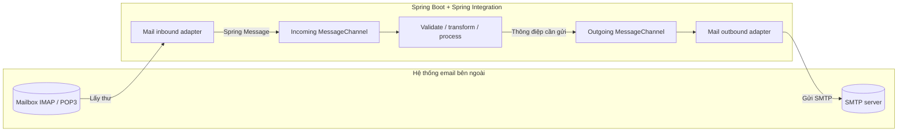
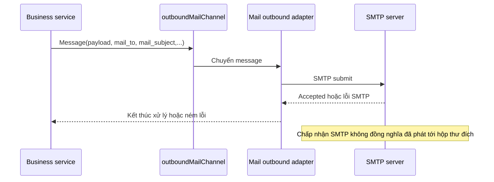
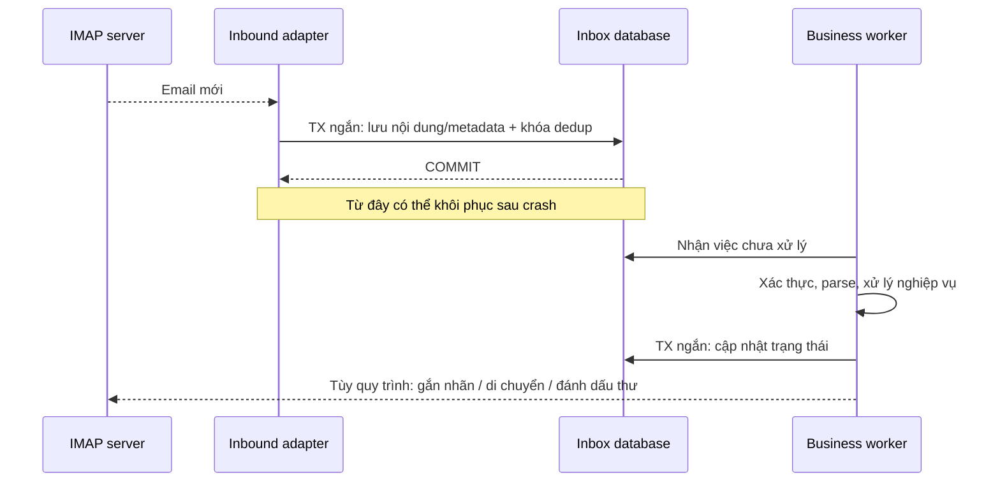
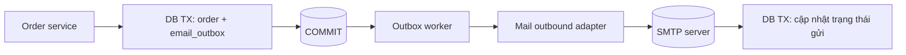

# Mail adapter và phân biệt nhận thư với gửi thư

## 1. Mail adapter đứng ở đâu trong Spring Boot Integration?

Trong một hệ thống Spring Boot, email có thể là **đầu vào** của một quy trình (hòm thư hỗ trợ khách hàng, hóa đơn nhà cung cấp gửi đến) hoặc **đầu ra** của quy trình (thông báo đơn hàng, báo cáo, mã xác nhận). Spring Integration cung cấp **mail channel adapter** để nối hệ thống email với mô hình `Message<?>`, `MessageChannel` và `IntegrationFlow` của Spring.

Điểm cần phân biệt ngay từ đầu:

- **Nhận thư (mail inbound adapter):** lấy thư từ **mailbox** của hệ thống ngoài, tạo **Spring Message** rồi đưa vào luồng xử lý nội bộ. Giao thức thường là **IMAP/IMAPS** hoặc **POP3/POP3S**.
- **Gửi thư (mail outbound adapter):** nhận **Spring Message** từ luồng nội bộ, chuyển thành email và chuyển cho **SMTP server** để gửi ra ngoài. Giao thức là **SMTP**, có thể dùng STARTTLS hoặc SMTPS theo cấu hình máy chủ.

Hai chiều này khác nhau về giao thức, thời điểm kích hoạt, cách xác nhận kết quả và xử lý trùng lặp. Không thể cấu hình inbound bằng thông tin SMTP, hoặc dùng IMAP như giao thức gửi email.



### So sánh theo hướng dữ liệu

| Tiêu chí | Nhận thư: inbound | Gửi thư: outbound |
| --- | --- | --- |
| Chiều dữ liệu | Mail server → ứng dụng Spring | Ứng dụng Spring → SMTP server |
| Điểm bắt đầu | Poller hoặc sự kiện IMAP IDLE | Message được gửi vào input channel |
| Giao thức | IMAP/IMAPS; POP3/POP3S | SMTP với TLS phù hợp máy chủ |
| Thành phần điển hình | `MailReceivingMessageSource`, `ImapMailReceiver`, `Pop3MailReceiver`, `ImapIdleChannelAdapter` | `MailSendingMessageHandler`, `JavaMailSender` |
| Spring Integration Java DSL | `Mail.imapInboundAdapter(...)`, `Mail.imapIdleAdapter(...)`, `Mail.pop3InboundAdapter(...)` | `Mail.outboundAdapter(...)` |
| Dữ liệu xử lý | `MimeMessage` hoặc payload được map, kèm thông tin thư | Payload nội dung, mail headers hoặc `MimeMessage` đã dựng |
| Rủi ro chính | Đọc lặp, mất thư do đánh dấu đã đọc quá sớm, lỗi attachment | Gửi lặp, timeout không rõ SMTP đã chấp nhận hay chưa, bounce sau khi gửi |
| Ý nghĩa thành công | Ứng dụng **đã nhận/đọc** thư; xử lý nghiệp vụ còn là bước riêng | SMTP server **đã chấp nhận** yêu cầu gửi; chưa bảo đảm người nhận đã đọc hoặc nhận được |

Đây là hai loại **one-way channel adapter**: chúng không tạo mô hình request/reply trực tiếp như gateway. Một inbound adapter có thể tạo message rồi đưa vào flow; một outbound adapter kết thúc flow bằng side effect gửi email. Nếu cần kết quả nghiệp vụ, hãy ghi trạng thái và phát một sự kiện hoặc dùng kênh phản hồi của ứng dụng.

## 2. Chuẩn bị dependency và cấu hình

Với ứng dụng Spring Boot sử dụng Spring Integration Java DSL, cần module Spring Integration, hỗ trợ Mail của Spring Integration và thư viện mail của Spring. Ví dụ Maven (dùng version do Spring Boot BOM quản lý khi phù hợp):

```xml
<dependencies>
    <dependency>
        <groupId>org.springframework.boot</groupId>
        <artifactId>spring-boot-starter-integration</artifactId>
    </dependency>
    <dependency>
        <groupId>org.springframework.integration</groupId>
        <artifactId>spring-integration-mail</artifactId>
    </dependency>
    <dependency>
        <groupId>org.springframework.boot</groupId>
        <artifactId>spring-boot-starter-mail</artifactId>
    </dependency>
</dependencies>
```

`spring-boot-starter-mail` cung cấp `JavaMailSender` và khả năng cấu hình SMTP qua `spring.mail.*`; module `spring-integration-mail` cung cấp adapter đưa việc gửi/nhận vào `IntegrationFlow`. Nếu ứng dụng chỉ gửi một email đơn lẻ từ service, gọi trực tiếp `JavaMailSender` cũng hợp lý; dùng adapter khi cần nối email vào các bước filter, transform, router, channel, retry hoặc giám sát luồng tích hợp.

```yaml
spring:
  mail:
    host: ${SMTP_HOST}
    port: ${SMTP_PORT:587}
    username: ${SMTP_USERNAME}
    password: ${SMTP_PASSWORD}
    properties:
      mail.smtp.auth: true
      mail.smtp.starttls.enable: true
      mail.smtp.connectiontimeout: 5000
      mail.smtp.timeout: 10000
      mail.smtp.writetimeout: 10000

app:
  integration:
    mail:
      # Giá trị được nạp từ cấu hình bí mật; xem phần bảo mật.
      store-uri: ${MAIL_STORE_URI}
```

Ví dụ `MAIL_STORE_URI` có dạng `imaps://<user>:<password>@imap.example.com/INBOX` và **chỉ để minh họa định dạng**, không chèn tài khoản thực vào source code hay log. Với địa chỉ email nằm trong username, phải URL-encode ký tự đặc biệt theo quy tắc của URI (chẳng hạn `@` thành `%40`). Tùy nhà cung cấp có thể cần OAuth2/app password thay vì mật khẩu thông thường. Dùng kết nối TLS được xác thực và lưu secret trong hệ thống quản lý bí mật.

`spring.mail.*` ở trên cấu hình **SMTP outbound**. Nó **không tự cung cấp IMAP/POP3 inbound**; inbound cần cấu hình mailbox/store URI hoặc `MailReceiver` riêng. Timeout cho IMAP/POP3 cũng phải cấu hình độc lập, không lấy các giá trị `mail.smtp.*` làm timeout nhận thư.

## 3. Gửi thư với outbound mail adapter

### Luồng dữ liệu

Khi đơn hàng thanh toán thành công, ứng dụng tạo một Spring Message mang nội dung email và các header chỉ định người gửi, người nhận, tiêu đề. Outbound adapter biến thông điệp đó thành email rồi chuyển cho `JavaMailSender` và SMTP server.



### Ví dụ Java DSL

Sau khi cấu hình `spring.mail.*`, Spring Boot có thể cung cấp bean `JavaMailSender`. Định nghĩa kênh đầu ra và flow gửi:

```java
import org.springframework.beans.factory.annotation.Qualifier;
import org.springframework.context.annotation.Bean;
import org.springframework.context.annotation.Configuration;
import org.springframework.integration.channel.DirectChannel;
import org.springframework.integration.dsl.IntegrationFlow;
import org.springframework.integration.mail.dsl.Mail;
import org.springframework.mail.javamail.JavaMailSender;
import org.springframework.messaging.MessageChannel;

@Configuration
public class MailOutboundConfiguration {

    @Bean
    public MessageChannel outboundMailChannel() {
        return new DirectChannel();
    }

    @Bean
    public IntegrationFlow mailOutboundFlow(
            @Qualifier("outboundMailChannel") MessageChannel outboundMailChannel,
            JavaMailSender mailSender) {
        return IntegrationFlow.from(outboundMailChannel)
                .handle(Mail.outboundAdapter(mailSender))
                .get();
    }
}
```

Một service tạo thông điệp và gửi vào channel:

```java
import org.springframework.beans.factory.annotation.Qualifier;
import org.springframework.integration.mail.MailHeaders;
import org.springframework.messaging.MessageChannel;
import org.springframework.messaging.support.MessageBuilder;
import org.springframework.stereotype.Service;

@Service
public class OrderEmailNotificationService {
    private final MessageChannel outboundMailChannel;

    public OrderEmailNotificationService(
            @Qualifier("outboundMailChannel") MessageChannel outboundMailChannel) {
        this.outboundMailChannel = outboundMailChannel;
    }

    public void sendPaidOrderNotice(String address, String orderCode) {
        var mailMessage = MessageBuilder.withPayload(
                    "Đơn hàng " + orderCode + " đã được xác nhận thanh toán.")
                .setHeader(MailHeaders.FROM, "no-reply@shop.example")
                .setHeader(MailHeaders.TO, new String[] { address })
                .setHeader(MailHeaders.SUBJECT, "Xác nhận đơn hàng " + orderCode)
                .build();

        if (!outboundMailChannel.send(mailMessage)) {
            throw new IllegalStateException("Mail channel không nhận message");
        }
    }
}
```

Trong ví dụ dùng `DirectChannel`, lời gọi handler diễn ra đồng bộ trên luồng gọi; một lỗi gửi SMTP có thể truyền ngược về caller. Nếu thay bằng `QueueChannel` hay `ExecutorChannel`, thời gian và nơi nhận lỗi sẽ khác: `send()` trả về thành công chỉ nói rằng **channel chấp nhận message**, không chứng minh SMTP đã nhận hay người nhận đã đọc thư.

Các header `MailHeaders.TO`, `MailHeaders.CC`, `MailHeaders.BCC`, `MailHeaders.FROM`, `MailHeaders.REPLY_TO`, `MailHeaders.SUBJECT` hỗ trợ điều khiển địa chỉ và tiêu đề. Với email HTML, multipart, file đính kèm hoặc template phức tạp, nên dựng `MimeMessage` bằng `MimeMessageHelper` hoặc một transformer phù hợp rồi chuyển xuống outbound adapter. **Không ghép MIME thủ công** bằng chuỗi thô; cần đặt content type/charset và xử lý attachment đúng cách.

### Cẩn thận với ngữ nghĩa “đã gửi”

Khi `MailSendingMessageHandler` hoàn tất mà không có exception, kết luận thông thường là SMTP đã **chấp nhận yêu cầu**. Một email vẫn có thể bị trả về sau đó (`bounce`), vào spam, bị chặn do quota hoặc chính sách người nhận. Nên phân biệt:

1. `READY`: hệ thống đã tạo yêu cầu gửi.
2. `SUBMITTING`: worker đang gọi SMTP/provider.
3. `ACCEPTED`: SMTP/API nhà cung cấp đã chấp nhận.
4. `DELIVERED`/`BOUNCED` (nếu có): trạng thái do nhà cung cấp cung cấp qua webhook/bounce mailbox; không thể suy ra chỉ từ outbound adapter.

Ngoài ra, khi timeout giữa chừng, SMTP có thể đã chấp nhận thư dù client không nhận phản hồi cuối. Retry không kiểm soát sẽ tạo thư trùng. SMTP chuẩn không có idempotency key cho toàn bộ nghiệp vụ; với thư quan trọng, duy trì bản ghi yêu cầu riêng, khóa nghiệp vụ và chính sách chống gửi lặp ở tầng ứng dụng hoặc dùng nhà cung cấp có cơ chế dedup phù hợp. `Message-ID` email **không tự bảo đảm** thư chỉ được gửi một lần.

## 4. Nhận thư với inbound mail adapter

### IMAP/POP3 là kết nối tới hộp thư

Inbound mail adapter kết nối tới mailbox, chọn thư phù hợp, đưa thư vào channel. Có hai cách kích hoạt chính:

| Cách nhận | Cơ chế | Khi phù hợp | Điều cần lưu ý |
| --- | --- | --- | --- |
| **Polling** | Mỗi khoảng thời gian, adapter gọi IMAP hoặc POP3 để tìm thư | Máy chủ không hỗ trợ IDLE; khối lượng vừa; muốn dễ điều tiết tốc độ | Độ trễ phụ thuộc poll interval, cần giới hạn mỗi lượt, tránh polling chồng |
| **IMAP IDLE** | Duy trì kết nối IMAP và chờ thông báo mailbox có thay đổi | Cần phản ứng gần thời gian thực và server hỗ trợ `IDLE` | Cần reconnect khi mất mạng; IDLE chỉ báo có thư, vẫn phải kiểm tra/truy xuất thư |

POP3 có khả năng duyệt/lấy thư hạn chế hơn IMAP, không hỗ trợ ngữ nghĩa thư mục/`\Seen` tương tự IMAP. Nếu không xóa thư trên server, khi phiên POP3 được tạo lại, ứng dụng có thể đọc lại các thư cũ. Vì thế POP3 cần cơ chế ghi nhận đã xử lý rõ ràng, thường dựa vào UIDL nếu server hỗ trợ và trạng thái lưu bền vững.

### Ví dụ inbound polling bằng IMAP

Đọc email từ hộp `INBOX` sau mỗi 30 giây, tối đa 10 message trong một lượt poll. `storeUri` được nạp từ cấu hình bí mật:

```java
import org.springframework.beans.factory.annotation.Value;
import org.springframework.context.annotation.Bean;
import org.springframework.context.annotation.Configuration;
import org.springframework.integration.dsl.IntegrationFlow;
import org.springframework.integration.dsl.Pollers;
import org.springframework.integration.mail.dsl.Mail;

@Configuration
public class MailInboundConfiguration {

    @Bean
    public IntegrationFlow imapPollingFlow(
            @Value("${app.integration.mail.store-uri}") String storeUri) {
        return IntegrationFlow.from(
                    Mail.imapInboundAdapter(storeUri)
                            .shouldDeleteMessages(false)
                            .shouldMarkMessagesAsRead(false)
                            .maxFetchSize(10),
                    endpoint -> endpoint.poller(
                            Pollers.fixedDelay(30000)
                                    .maxMessagesPerPoll(10)))
                .channel("receivedMailChannel")
                .get();
    }
}
```

`shouldDeleteMessages(false)` để lại email trong mailbox và `shouldMarkMessagesAsRead(false)` tránh chủ động đánh dấu `\Seen` trong bước nhận. **Đây chưa phải cơ chế đảm bảo xử lý chính xác một lần**: Spring Integration mail receiver có thể dùng các cờ IMAP khác (`\Recent`, user flag hoặc `\Flagged`) để lọc thư đã thu thập; hành vi tùy cấu hình và khả năng của server. Đừng mặc định rằng exception ở bước sau sẽ khiến thư được giao lại lần nữa.

Một handler có thể nhận `Message<?>` và kiểm tra `MimeMessage`:

```java
import jakarta.mail.MessagingException;
import jakarta.mail.internet.MimeMessage;
import org.springframework.integration.annotation.ServiceActivator;
import org.springframework.messaging.Message;
import org.springframework.stereotype.Component;

@Component
public class ReceivedMailHandler {

    @ServiceActivator(inputChannel = "receivedMailChannel")
    public void process(Message<?> integrationMessage) throws MessagingException {
        if (!(integrationMessage.getPayload() instanceof MimeMessage mime)) {
            throw new IllegalArgumentException("Payload không phải MimeMessage");
        }

        String messageId = mime.getMessageID();
        String subject = mime.getSubject();

        // Ví dụ: chuẩn hóa người gửi, kiểm tra MIME, lưu vào bảng inbox
        // với khóa khử trùng lặp; xử lý nghiệp vụ sau bước nhận bền vững.
        persistInboxRecord(messageId, subject);
    }

    private void persistInboxRecord(String messageId, String subject) {
        // Phần triển khai repository/domain được giản lược để tập trung vào adapter.
    }
}
```

Mặc định, payload nhận được thường là `jakarta.mail.internet.MimeMessage`. Nếu bật message mapping, framework có thể chuyển nội dung đơn giản thành `String`/`byte[]` và đưa thông tin thư vào các mail headers. Vì thế handler phải khớp với **cấu hình thực tế**; không ép kiểu `MimeMessage` vô điều kiện khi đã cấu hình mapping hoặc transformer.

Đối với `MimeMessage` và multipart attachment, dữ liệu có thể phụ thuộc vòng đời `Folder`/`Store`; cần đọc hoặc chuyển thành DTO/byte[] bền vững trước khi đóng kết nối. Không đưa thẳng `MimeMessage`/`Part` sang hàng đợi phân tán hoặc luồng bất đồng bộ mà không xét khả năng truy cập nội dung, tính serializable và kích thước dữ liệu.

### Ví dụ IMAP IDLE thay cho polling

Nếu mail server hỗ trợ IMAP IDLE, chỉ sử dụng **một** cơ chế nhận cho mailbox/nhóm thư tương ứng nhằm tránh xử lý cạnh tranh với poller khác:

```java
@Bean
public IntegrationFlow imapIdleFlow(
        @Value("${app.integration.mail.store-uri}") String storeUri) {
    return IntegrationFlow.from(
                Mail.imapIdleAdapter(storeUri)
                        .shouldDeleteMessages(false)
                        .shouldMarkMessagesAsRead(false)
                        .autoStartup(true)
                        .id("inboundImapIdle"))
            .channel("receivedMailChannel")
            .get();
}
```

Đây là **phương án thay thế** `imapPollingFlow`, không bật đồng thời hai bean ví dụ trên cho cùng hộp thư nếu chưa thiết kế phối hợp. `IMAP IDLE` không cần `Poller`; adapter phát message khi có thông báo. Hãy theo dõi sự kiện/lỗi mất kết nối (`ImapIdleExceptionEvent`), reconnect, thời gian không nhận thư bất thường và giới hạn session của nhà cung cấp.

## 5. Tách bước “nhận được thư” khỏi bước “xử lý thành công”

Một lỗi rất phổ biến là nhận một email rồi đánh dấu đã đọc hoặc xóa trên IMAP **trước khi** cập nhật database, gửi phản hồi hay phát event thành công. Nếu ứng dụng crash ở giữa, mailbox cho rằng thư đã được xử lý nhưng nghiệp vụ thực tế chưa hoàn tất.



Thiết kế thực tế nên có **inbox table** hoặc hàng đợi bền vững: ghi mã hộp thư, định danh thư, thông tin người gửi, subject, dữ liệu cần xử lý và trạng thái trong transaction cục bộ ngắn. Sau commit, worker xử lý bên ngoài và chuyển trạng thái từ `RECEIVED` sang `PROCESSING`, `DONE`, `RETRY` hoặc `QUARANTINED`.

### Định danh và khử trùng lặp

- Với **IMAP**, cặp `(account, mailbox, UIDVALIDITY, UID)` định danh thư trong một folder tại một thời kỳ UID hợp lệ; UID riêng lẻ có thể bị tái sử dụng khi `UIDVALIDITY` thay đổi. Nên lưu khóa có đủ ngữ cảnh nếu lấy được qua `UIDFolder`.
- Header **`Message-ID`** hữu ích để liên kết và chẩn đoán nhưng có thể thiếu, bị trùng hoặc do người gửi giả mạo. Nếu dùng để dedup, phải hiểu giới hạn và thêm khóa/thông tin đối chiếu thích hợp.
- Với **POP3**, cân nhắc `UIDL` nếu server hỗ trợ; không dựa vào vị trí thư hoặc số thứ tự giữa các phiên làm định danh ổn định.
- Đặt **unique constraint** trong DB cho khóa nghiệp vụ đã chọn; xử lý duplicate như sự kiện đã biết, không phát side effect thêm.

Lưu ý: việc lưu nội dung trước không có nghĩa mail server và DB nằm trong một giao dịch phân tán. Vẫn có khoảng hở khi thư đã được đọc nhưng DB chưa commit hoặc khi DB commit rồi ứng dụng crash trước khi cập nhật cờ thư. Phải dùng dedup, đối soát và quy trình đọc lại được kiểm soát; đặc biệt không xem `\Seen` là ACK giao dịch của ứng dụng.

### Phân loại lỗi để phục hồi

| Loại lỗi | Xử lý phù hợp |
| --- | --- |
| Không kết nối được IMAP/POP3 | Retry với backoff, giám sát kết nối, kiểm tra credential/TLS/quota |
| MIME bị lỗi, attachment không hợp lệ | Chuyển `QUARANTINED`, lưu metadata để điều tra, tránh retry vô hạn |
| Database tạm thời lỗi | Không đánh dấu xử lý thành công; retry hoặc đọc lại theo quy trình có kiểm soát |
| Worker crash sau khi ghi inbox | Tiếp tục từ trạng thái DB chưa hoàn tất; dedup để ngăn xử lý hai lần |
| Email bị chuyển thư mục/xóa bởi bên khác | Kiểm tra UIDVALIDITY/UID và có lộ trình đối soát; không dựa vào thứ tự thư |

### Khi nào cần transaction synchronization?

Spring Integration có hỗ trợ **transaction synchronization** cho một số luồng polling. Cơ chế này có thể dùng để đồng bộ hành động phụ thuộc kết quả transaction, nhưng không nên giả định rằng cờ mailbox và database tạo thành một ACID transaction duy nhất. Hãy kiểm tra giới hạn cụ thể của adapter, receiver, mail server và thời điểm gắn cờ. Với quy trình nghiệp vụ quan trọng, **inbox bền vững + dedup + retry/đối soát** vẫn là nền tảng.

## 6. Gửi email đáng tin cậy: kết hợp outbound adapter với outbox

Một ví dụ Spring Boot Integration thực tế là đặt đơn hàng trong database rồi gửi email xác nhận. Nếu gọi SMTP **ngay trong** phương thức `@Transactional` cập nhật đơn hàng, transaction DB có thể bị giữ lâu khi mạng chậm; SMTP thành công cũng không rollback nếu DB commit sau đó thất bại.

Đối với email quan trọng:

1. Trong một **transaction DB ngắn**, lưu đơn hàng và một bản ghi `email_outbox` có `notificationId`, loại thư, người nhận, payload tham chiếu và trạng thái `PENDING`.
2. Commit. Worker nhận bản ghi outbox và gửi message đến **mail outbound adapter bên ngoài DB transaction**.
3. Trong transaction mới, ghi `ACCEPTED` hoặc `RETRY`/`UNKNOWN` kèm lý do; có retry/backoff và giới hạn số lần thử.
4. Dùng khóa thông báo (`orderId + notificationType + templateVersion`, chẳng hạn) để tránh tạo trùng **yêu cầu gửi**. Với timeout không rõ SMTP đã nhận, xem xét đối soát và chấp nhận rằng email có thể gửi lặp nếu nhà cung cấp không hỗ trợ dedup.



Điều này phù hợp với cách tổ chức HTTP client, DB, cache, broker và adapter trong Spring Boot: các bước tích hợp bên ngoài nên có timeout, trạng thái và ranh giới transaction rõ ràng. Outbox đảm bảo **yêu cầu gửi đã được lưu bền vững** cùng thay đổi nghiệp vụ, nhưng không biến SMTP thành exactly-once delivery. Nếu cần throughput cao, worker có thể đưa message vào broker rồi một consumer chuyên gửi mail tiếp tục xử lý; cả publisher và consumer cần cơ chế idempotent.

## 7. Bảo mật và bảo vệ dữ liệu email

Email là dữ liệu không tin cậy: người gửi có thể giả mạo tên hiển thị, đặt tiêu đề độc hại, gửi HTML chứa liên kết lừa đảo hoặc attachment quá lớn. Mail adapter chỉ vận chuyển dữ liệu; nghiệp vụ phải tự kiểm tra đầu vào.

- **Quản lý bí mật:** giữ username, password, OAuth token, store URI khỏi Git, exception message và access log; giới hạn quyền của tài khoản nhận/gửi. Ưu tiên secret manager hoặc biến môi trường được kiểm soát.
- **Mã hóa đường truyền:** dùng IMAPS/POP3S hoặc STARTTLS có kiểm tra chứng chỉ; với SMTP cấu hình TLS đúng yêu cầu server. Không tắt certificate validation để “sửa nhanh” lỗi kết nối.
- **Giới hạn dữ liệu:** giới hạn số thư mỗi poll, kích thước email/attachment, số attachment và thời gian xử lý; quét malware hoặc cô lập file theo chính sách của hệ thống.
- **Xử lý HTML/MIME:** parse MIME có kiểm soát, không thực thi nội dung email; sanitize HTML nếu hiển thị trên trang web. Không tự động tin các file đính kèm dựa trên phần mở rộng.
- **Chống giả mạo:** địa chỉ `From` và tên người gửi không chứng minh danh tính; áp dụng chính sách kiểm tra SPF/DKIM/DMARC từ hệ thống nhận và xác minh riêng với thao tác nhạy cảm.
- **Dữ liệu cá nhân:** tránh log body, địa chỉ email đầy đủ, file đính kèm, mã xác thực; xác định retention và quyền truy cập inbox/outbox.

## 8. Kiểm thử mail adapter đúng theo chiều tích hợp

| Kịch bản | Kiểm tra cần thực hiện |
| --- | --- |
| **Outbound gửi thư hợp lệ** | SMTP test server nhận đúng `To`, `From`, `Subject`, charset, body; không gửi tới người nhận thật |
| **Outbound SMTP chậm/timeout** | Flow giới hạn thời gian; trạng thái `RETRY`/`UNKNOWN` hợp lý; không commit transaction DB dài |
| **Outbound gửi lặp** | Hai sự kiện nghiệp vụ cùng khóa không tạo hai yêu cầu outbox; nhận thức giới hạn dedup phía SMTP |
| **Inbound polling** | Thư mới được đưa vào channel, `maxFetchSize`/poller giới hạn lượng xử lý; thư cũ/không hợp lệ được xử lý theo chính sách |
| **Inbound IDLE** | Có thư mới thì flow kích hoạt; mất kết nối có thông báo và phục hồi; không bật thêm poller trùng mailbox |
| **Inbound duplicate sau restart** | Cùng định danh thư không làm nghiệp vụ chạy hai lần; trạng thái inbox có thể tiếp tục sau crash |
| **MIME multipart/attachment** | Parse đúng charset, alternative body, file đính kèm lớn/sai định dạng; giới hạn tài nguyên hoạt động |
| **Lỗi DB sau khi đọc thư** | Không mất bản ghi nghiệp vụ; có phương án đọc lại/đối soát nếu mail flag đã thay đổi |

Có thể dùng **GreenMail** hoặc mail test server hỗ trợ SMTP/IMAP/POP3 trong kiểm thử tích hợp; với outbound đơn thuần, SMTP sink như Mailpit cũng hữu ích. Test cần quan sát mailbox và các bản ghi DB thay vì chỉ mock phương thức `send()` rồi xem như thư đã được gửi. Với lỗi mạng, có thể cấu hình test server ngắt kết nối ở các thời điểm khác nhau để kiểm tra trạng thái chưa xác định.

Trong vận hành, theo dõi số thư nhận/gửi mỗi phút, độ tuổi inbox/outbox chưa xử lý, lỗi xác thực, số lần reconnect IMAP, thời gian đáp ứng SMTP, lỗi MIME, số duplicate và lượng thư vào quarantine. Trace ID và business ID giúp lần theo một thông điệp qua adapter → channel → handler → database; tránh đưa body và thông tin nhạy cảm vào span/log.

## 9. Checklist chọn đúng mail adapter

- Dữ liệu đi từ **hộp thư vào ứng dụng**? Chọn **inbound** qua IMAP/POP3; dùng polling hoặc IMAP IDLE nếu server hỗ trợ.
- Dữ liệu đi từ **ứng dụng tới máy chủ gửi thư**? Chọn **outbound** qua SMTP; dùng `JavaMailSender` và mail headers hoặc `MimeMessage`.
- Chỉ cần gửi đơn lẻ, không có flow? `JavaMailSender` trực tiếp có thể đủ; dùng Spring Integration khi cần channel/filter/transform/retry/routing chung.
- Nhận thư cho nghiệp vụ quan trọng? Lưu inbox bền vững, dedup theo định danh ổn định, xử lý lại và đối soát; không coi `\Seen` là xác nhận nghiệp vụ.
- Gửi thư gắn với cập nhật DB? Ghi outbox trong transaction ngắn, gửi SMTP sau commit, theo dõi `ACCEPTED`/`UNKNOWN` và xử lý bounce khi có.
- Cần tránh lỗi production? Cấu hình timeout, TLS, secret, giới hạn file, retry/backoff, cảnh báo và kiểm thử lỗi mạng ở từng chiều.

**Ví dụ ghi nhớ:** hòm thư `support@shop.example` có email khách hàng mới → **IMAP inbound** nhận và tạo ticket; hệ thống tạo ticket thành công rồi gửi email “Chúng tôi đã nhận yêu cầu” → **SMTP outbound** phát thư xác nhận. Hai adapter có thể cùng xuất hiện trong một `IntegrationFlow` hoặc hai flow riêng, nhưng đọc thư và gửi thư luôn có giao thức, trạng thái và phương án khôi phục khác nhau.

### Tài liệu tham khảo

- [Spring Integration Reference — Mail Support](https://docs.spring.io/spring-integration/reference/mail.html): outbound mail, IMAP/POP3 inbound, IMAP IDLE, mapping, flags và lỗi kết nối.
- [Spring Integration Reference — Integration Endpoints](https://docs.spring.io/spring-integration/reference/endpoint-summary.html): phân biệt channel adapter với gateway.
- [Spring Boot Reference — Sending Email](https://docs.spring.io/spring-boot/reference/io/email.html): tự động cấu hình `JavaMailSender` và `spring.mail.*`.
