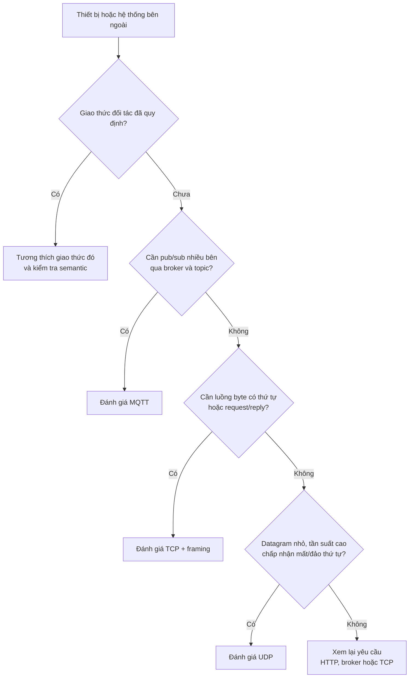
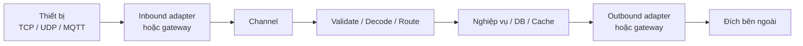
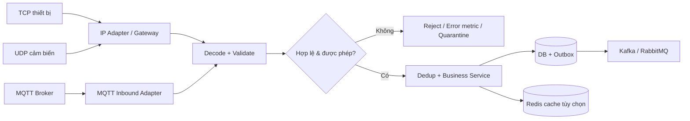

# TCP, UDP hoặc MQTT adapter theo yêu cầu giao thức

## 1. Vì sao phải chọn adapter theo giao thức?

Trong một hệ thống **Spring Boot Integration**, API HTTP, cơ sở dữ liệu, cache và broker thông điệp không phải con đường trao đổi duy nhất. Các thiết bị IoT, hệ thống đo đạc, máy quét mã, ứng dụng công nghiệp, thiết bị định vị hoặc một phần mềm cũ có thể chỉ cung cấp **TCP socket**, **UDP datagram** hoặc **MQTT topic**. Spring Integration cung cấp các adapter và gateway để biến dữ liệu mạng thành `Message<?>`, sau đó xử lý bằng channel, transformer, filter, router, service activator hoặc flow thông thường.

Ví dụ một nền tảng quản lý kho tiếp nhận:

- Máy cân truyền bản tin nhị phân qua TCP và đợi phản hồi xác nhận.
- Thiết bị đo nhiệt độ gửi UDP datagram định kỳ; bản tin mới có thể thay thế bản tin cũ.
- Gateway cảm biến công bố trạng thái qua MQTT broker; nhiều ứng dụng cùng đăng ký topic.

Ba thiết bị đều gửi "thông tin về kho" nhưng yêu cầu **kết nối, ranh giới bản tin, độ tin cậy, định tuyến, bảo mật và xử lý trùng lặp** khác nhau. Nếu dùng nhầm giao thức hoặc cấu hình sai adapter, hệ thống có thể đọc sai khung dữ liệu, nhân đôi tác dụng phụ, mất bản tin khi mất kết nối hoặc tích tụ vô hạn khi downstream chậm.

Sau bài này, người học cần lựa chọn đúng giao thức; phân biệt inbound/outbound adapter với gateway; viết cấu hình Spring Boot cho TCP, UDP, MQTT; và thiết kế hợp đồng dữ liệu, timeout, backpressure, idempotency, quan sát và kiểm thử trên đường tích hợp thật.

## 2. So sánh TCP, UDP và MQTT

| Đặc tính | TCP | UDP | MQTT |
| --- | --- | --- | --- |
| Mô hình | Luồng byte hướng kết nối giữa hai đầu | Datagram không kết nối ở tầng vận chuyển | Publish/subscribe qua broker; thường dùng TCP/TLS ở tầng dưới |
| Ranh giới message | **Không có sẵn**: ứng dụng phải xác định framing | Một datagram là một đơn vị nhận | Broker/client quản lý MQTT packet và payload |
| Thứ tự & độ tin cậy mạng | Byte đến đúng thứ tự trong một kết nối còn sống; lỗi kết nối vẫn tạo kết quả không chắc chắn ở tầng nghiệp vụ | Có thể mất, trùng, đảo thứ tự hoặc đến muộn | Theo QoS 0/1/2 giữa các hop; không mặc nhiên exactly-once nghiệp vụ |
| Phía nhận | Socket server/client | UDP socket nhận datagram | Subscriber đăng ký topic tại broker |
| Hướng giao tiếp | Song công, thường có request/reply tùy protocol ứng dụng | Gửi một chiều hoặc hai chiều do ứng dụng thiết kế | Nhiều producer/consumer theo topic, có session/retained message |
| Chi phí vận hành | Quản lý kết nối và codec | Nhẹ, nhưng phải tự xử lý mất gói nếu cần | Cần broker, session, ACL/topic và quản lý reconnect |
| Trường hợp điển hình | Thiết bị có protocol riêng cần ACK/command | Telemetry nhanh, discovery, sự kiện có thể bỏ lỡ | IoT telemetry, command, state notification nhiều bên quan tâm |

**MQTT không phải biến thể "UDP có QoS".** MQTT mô tả giao thức ứng dụng publish/subscribe. Với kiểu kết nối thông dụng, MQTT chạy trên TCP, thêm broker, topic, session và cơ chế xác nhận theo QoS. TCP lại chỉ bảo đảm thứ tự **byte** trong kết nối; một TCP read có thể nhận nửa bản tin hoặc nhiều bản tin nối liền.

### 2.1. Cây quyết định thực tế



Nếu thiết bị chỉ hỗ trợ một giao thức cố định, adapter phải tuân theo protocol đó. Tính quan trọng của dữ liệu ảnh hưởng chủ yếu đến cách thiết kế **ACK, lưu bền vững, retry, dedup và nghiệp vụ phía sau**.

## 3. Mô hình Spring Integration: adapter, gateway và flow

Spring Integration làm việc với một `Message<T>` gồm **payload** và **headers**. Mỗi thành phần giao thức đảm nhận chuyển đổi giữa mạng và hệ thống message:

- **Inbound channel adapter:** nhận bản tin từ network/broker và đẩy vào channel; thường phù hợp luồng dữ liệu một chiều.
- **Outbound channel adapter:** đọc message từ channel rồi gửi tới endpoint; không định nghĩa một phản hồi nghiệp vụ theo từng yêu cầu.
- **Inbound gateway:** nhận request từ endpoint bên ngoài và chờ reply của flow để gửi về cùng kết nối/ngữ cảnh.
- **Outbound gateway:** nhận message nội bộ, gọi endpoint bên ngoài và trả reply vào flow, với timeout và correlation theo contract.



Ví dụ, TCP client gửi yêu cầu có mã lệnh rồi chờ một phản hồi cần **TCP inbound gateway**; telemetry một chiều đi qua UDP inbound adapter chỉ cần service activator tiêu thụ message. Với MQTT, inbound adapter subscribe topic và outbound message handler publish sự kiện.

Không nên mặc định mọi message inbound đã đáng tin cậy. Phải giới hạn kích thước, kiểm tra schema/encoding, xác thực thiết bị, mapping metadata và quyết định trạng thái khi downstream thất bại. `DirectChannel` đồng bộ, tức handler chậm có thể giữ luồng/nguồn tiếp nhận; nếu chuyển qua `ExecutorChannel` hoặc queue thì cũng cần pool, queue và chính sách từ chối có giới hạn.

## 4. Dependency và cấu hình Spring Boot

Ví dụ bên dưới minh họa **Spring Boot 3.x với Spring Integration 6.x**, Java 17+ và Spring Integration Java DSL. Các API cụ thể có thể khác giữa những phiên bản; cần kiểm tra BOM và tài liệu của phiên bản dự án. Cấu hình ví dụ giả định triển khai TCP/UDP/MQTT tùy yêu cầu; không nhất thiết một service phải bật cả ba.

```kotlin
// build.gradle.kts: để Spring Boot quản lý phiên bản tương thích
implementation("org.springframework.boot:spring-boot-starter-integration")
implementation("org.springframework.integration:spring-integration-ip")
implementation("org.springframework.integration:spring-integration-mqtt")
implementation("org.springframework.boot:spring-boot-starter-actuator")
```

`spring-integration-ip` cung cấp TCP/UDP; `spring-integration-mqtt` cung cấp MQTT adapter/handler. MQTT Paho v3 trong ví dụ dưới đây dùng API Eclipse Paho MQTT v3; nếu dự án dùng MQTT v5 thì chọn adapter/cấu hình tương thích MQTT v5 thay vì đổi URI mà vẫn giữ nguyên các lớp v3.

```yaml
# application.yml — ví dụ định tuyến cấu hình theo môi trường
app:
  integration:
    tcp:
      listen-port: ${TCP_LISTEN_PORT:15100}
    udp:
      listen-port: ${UDP_LISTEN_PORT:15101}
    mqtt:
      broker-uri: ${MQTT_BROKER_URI:tcp://localhost:1883}
      subscriber-client-id: ${MQTT_SUB_CLIENT_ID:warehouse-ingest-local}
      publisher-client-id: ${MQTT_PUB_CLIENT_ID:warehouse-pub-local}
```

Trong production, cung cấp thông tin xác thực và TLS qua cấu hình được bảo vệ, không dùng broker public hoặc client ID cố định cho nhiều replica. Nếu có nhiều deployment profile, tách cấu hình theo service và chỉ kích hoạt các adapter cần dùng. Docker/Kubernetes cũng cần ánh xạ cổng, firewall, security group và health/readiness phù hợp.

## 5. TCP adapter: socket là luồng byte, không phải chuỗi bản tin

### 5.1. Framing là quyết định đầu tiên

Giả sử máy cân gửi hai lệnh:

```text
WEIGHT|A01|1250
WEIGHT|A02|1275
```

TCP có thể chia thành ba lần đọc hoặc dồn vào một lần đọc. Vì vậy, **không bao giờ mặc định một lần `read()` tương ứng một bản tin**.

Các cách xác định ranh giới thông dụng:

| Kiểu framing | Đặc điểm | Lưu ý |
| --- | --- | --- |
| Delimiter, ví dụ CRLF | Đọc đến ký tự kết thúc | Dữ liệu nhị phân hoặc payload chứa delimiter cần escape/encode rõ ràng |
| Length prefix | Gửi độ dài trước phần payload | Hai bên thống nhất số byte prefix, byte order, kích thước tối đa |
| Fixed length | Mỗi frame cố định kích thước | Đơn giản nhưng hao băng thông và cần padding |
| Protocol chuyên biệt | Header, checksum, version, type, length | Phải bám sát tài liệu giao thức của thiết bị |

Spring Integration IP có các serializer/deserializer cho một số kiểu framing, ví dụ `ByteArrayLengthHeaderSerializer` và `ByteArrayCrLfSerializer`. Codec client và server **phải khớp**. Chọn một giới hạn kích thước message để client không thể khai báo độ dài rất lớn rồi giữ connection/bộ nhớ vô thời hạn.

### 5.2. TCP inbound gateway request/reply

Ví dụ TCP client gửi một frame UTF-8 có tiền tố độ dài 4 byte, ứng dụng trả một frame tương ứng. Đoạn mã sử dụng một gateway để giữ ngữ cảnh phản hồi trên kết nối đã nhận request:

```java
import java.nio.charset.StandardCharsets;
import java.util.Map;

import org.springframework.beans.factory.annotation.Qualifier;
import org.springframework.beans.factory.annotation.Value;
import org.springframework.context.annotation.Bean;
import org.springframework.context.annotation.Configuration;
import org.springframework.integration.channel.DirectChannel;
import org.springframework.integration.dsl.IntegrationFlow;
import org.springframework.integration.ip.tcp.TcpInboundGateway;
import org.springframework.integration.ip.tcp.connection.TcpNetServerConnectionFactory;
import org.springframework.integration.ip.tcp.serializer.ByteArrayLengthHeaderSerializer;
import org.springframework.messaging.MessageChannel;

@Configuration
class TcpDeviceIntegration {

    @Bean
    TcpNetServerConnectionFactory deviceTcpServer(
            @Value("${app.integration.tcp.listen-port:15100}") int port) {
        var factory = new TcpNetServerConnectionFactory(port);
        var framing = new ByteArrayLengthHeaderSerializer();
        factory.setDeserializer(framing);
        factory.setSerializer(framing);
        return factory;
    }

    @Bean("deviceTcpRequests")
    MessageChannel deviceTcpRequests() {
        return new DirectChannel();
    }

    @Bean
    TcpInboundGateway deviceTcpInboundGateway(
            TcpNetServerConnectionFactory deviceTcpServer,
            @Qualifier("deviceTcpRequests") MessageChannel requests) {
        var gateway = new TcpInboundGateway();
        gateway.setConnectionFactory(deviceTcpServer);
        gateway.setRequestChannel(requests);
        gateway.setReplyTimeout(2_000);
        return gateway;
    }

    @Bean
    IntegrationFlow deviceTcpFlow() {
        return IntegrationFlow.from("deviceTcpRequests")
                .handle((byte[] payload, Map<String, Object> headers) -> {
                    String request = new String(payload, StandardCharsets.UTF_8);
                    // Ví dụ echo để minh họa vòng request/reply.
                    // Production: kiểm tra command, schema và authorization.
                    String response = "ACK|" + request;
                    return response.getBytes(StandardCharsets.UTF_8);
                })
                .get();
    }
}
```

Flow này chỉ minh họa cách nối TCP gateway vào Spring Integration. Muốn xử lý máy cân thật cần parse frame, xác thực thiết bị, kiểm tra độ dài và giá trị, bảo vệ downstream bằng timeout/bulkhead, rồi tạo ACK có ngữ nghĩa rõ. **Không** phản hồi `ACK` thành công trước khi thao tác bắt buộc được ghi bền vững, trừ khi hợp đồng quy định ACK chỉ xác nhận "đã nhận".

Khi kết nối nhiều client, connection factory quản lý nhiều socket. Một gateway request/reply sẽ giữ mối liên hệ giữa phản hồi và kết nối nhận; nếu chọn cặp inbound/outbound adapter riêng, cần bảo toàn header connection ID và cấu hình gửi đến đúng connection. Với protocol cho phép nhiều yêu cầu đồng thời trên cùng socket, cần request ID và cách multiplexing ở tầng ứng dụng; không thể lấy riêng connection ID làm correlation của từng request.

### 5.3. TCP outbound: client và gateway

Khi Spring Boot cần **chủ động gọi thiết bị TCP** và đợi phản hồi, cân nhắc TCP outbound gateway kết hợp một client connection factory. Nếu chỉ gửi lệnh một chiều, dùng outbound channel adapter. Các yếu tố cần cấu hình và test:

1. Host/port của thiết bị, cách xác thực/TLS, idle timeout và thời gian chờ kết nối.
2. Framing giống phía server; charset hoặc binary schema phải xác định.
3. Chính sách tái sử dụng kết nối và số lượng kết nối, không tạo socket không giới hạn theo mỗi request.
4. Điều kiện khi thiết bị reset/đóng socket giữa lúc xử lý, đặc biệt khi response thất lạc.
5. Định danh request/sequence, idempotency và độ tin cậy của ACK trước khi retry.

Nếu TCP socket bị timeout **sau khi** lệnh "mở cửa kho" đã đến thiết bị, client không thể kết luận thiết bị chưa thực thi. Retry mù có thể tác động lần hai. Dùng command ID/sequence và xác nhận trạng thái thực tế trước khi phát lại với thao tác không idempotent.

### 5.4. Các lỗi TCP hay gặp

- Dùng serializer CRLF trong server nhưng client gửi length prefix nên đọc lệch vô thời hạn.
- Giữ connection lâu mà không heartbeat/idle policy; TCP keepalive ở OS không đồng nghĩa phát hiện lỗi tức thì.
- Đặt timeout quá cao; hàng trăm connection cùng chờ chiếm memory, thread hoặc pool.
- Gộp nhiều lệnh nghiệp vụ trong một frame mà không có version/parser phù hợp.
- Đặt ngưỡng message quá lớn, không giới hạn connection hoặc client chưa xác thực.
- Coi `connectionId` là business ID hoặc sử dụng ACK transport như xác nhận giao dịch đã commit.

## 6. UDP adapter: nhận datagram nhỏ và xử lý mất gói

UDP giữ nguyên ranh giới của **datagram**, nên ứng dụng không cần length-prefix để tìm đầu/cuối mỗi datagram như TCP. Tuy nhiên, UDP **không cam kết** một datagram sẽ đến, đến đúng thứ tự hoặc chỉ đến một lần. Datagram quá lớn có thể bị IP fragment; mất một fragment có thể làm mất toàn bộ datagram. Với Internet hoặc mạng phức tạp, gửi payload ngắn theo MTU thực tế thay vì dựa vào kích thước UDP lý thuyết tối đa.

UDP phù hợp dữ liệu trạng thái được cập nhật liên tục, ví dụ cảm biến gửi một bản tin nhiệt độ mới mỗi vài giây. Nếu thiếu một mẫu đo có thể chấp nhận, ứng dụng lưu mẫu tiếp theo. Nhưng nếu mỗi datagram là một lệnh trừ tiền hoặc một sự kiện tồn kho cần đúng đủ, UDP trần **không đủ**: phải bổ sung cơ chế ACK, sequence, retry, dedup và bảo mật hoặc chọn giao thức khác.

### 6.1. Inbound UDP với Spring Integration IP

```java
import java.nio.charset.StandardCharsets;

import org.springframework.beans.factory.annotation.Qualifier;
import org.springframework.beans.factory.annotation.Value;
import org.springframework.context.annotation.Bean;
import org.springframework.context.annotation.Configuration;
import org.springframework.integration.annotation.ServiceActivator;
import org.springframework.integration.channel.DirectChannel;
import org.springframework.integration.ip.udp.UnicastReceivingChannelAdapter;
import org.springframework.messaging.MessageChannel;
import org.springframework.messaging.MessageHandler;

@Configuration
class UdpTelemetryIntegration {

    @Bean("udpDatagrams")
    MessageChannel udpDatagrams() {
        return new DirectChannel();
    }

    @Bean
    UnicastReceivingChannelAdapter udpReceiver(
            @Value("${app.integration.udp.listen-port:15101}") int port,
            @Qualifier("udpDatagrams") MessageChannel output) {
        var adapter = new UnicastReceivingChannelAdapter(port);
        adapter.setOutputChannel(output);
        return adapter;
    }

    @Bean
    @ServiceActivator(inputChannel = "udpDatagrams")
    MessageHandler udpTelemetryHandler() {
        return message -> {
            byte[] bytes = (byte[]) message.getPayload();
            String packet = new String(bytes, StandardCharsets.UTF_8);
            // Demo: parse/validate packet rồi chuyển đến service xử lý.
            // Production: kiểm tra giới hạn kích thước, deviceId,
            // timestamp, sequence và nguồn gửi có được tin cậy không.
            System.out.println("Received telemetry: " + packet);
        };
    }
}
```

Mẫu demo chỉ minh họa luồng nhận; **không log payload thiết bị tùy ý trong production**. Thay bằng parser có giới hạn, metric theo loại thiết bị, và service ghi dữ liệu theo hợp đồng. Trong Spring Integration IP, message có thể có metadata địa chỉ/port nguồn tùy adapter và phiên bản; thông tin này hữu ích để chẩn đoán hoặc trả datagram, nhưng địa chỉ IP nguồn **không thay thế xác thực**.

Để gửi UDP, Spring Integration IP hỗ trợ outbound UDP message handler/adapter như `UnicastSendingMessageHandler`. Khi thiết kế phản hồi về nguồn, phải bảo đảm biết địa chỉ/port đích và chính sách chống UDP amplification; không nhận một payload không xác thực rồi phát một phản hồi lớn về IP do kẻ gửi có thể giả mạo.

### 6.2. Sequence, cửa sổ trễ và dedup

Một payload telemetry có thể mang:

```json
{
  "deviceId": "sensor-17",
  "sequence": 1042,
  "observedAt": "2026-11-21T05:00:00Z",
  "temperatureC": 24.7
}
```

Server có thể giữ `lastSequence` theo `deviceId` và phân loại:

| Quan sát | Xử lý gợi ý |
| --- | --- |
| Sequence tăng, timestamp hợp lệ | Chấp nhận bản tin; cập nhật trạng thái |
| Sequence trùng | Bỏ qua tác dụng phụ hoặc ghi metric duplicate |
| Sequence nhỏ hơn | Xem là out-of-order nếu chưa có cơ chế reset/wrap-around |
| Nhảy nhiều sequence | Ghi metric packet loss, có thể yêu cầu đồng bộ lại nếu protocol hỗ trợ |
| Thiết bị restart/reset sequence | Dùng boot/session ID hoặc quy tắc reset được định nghĩa rõ |

Một Redis cache tạm có thể giúp theo dõi sequence nhanh, nhưng phải xét TTL, mất ghi khi failover và nhiều instance cập nhật đồng thời. Khi tính đúng đắn quan trọng, cần update atomically/unique constraint ở nguồn dữ liệu phù hợp. Nếu dữ liệu chỉ là trạng thái mới nhất, có thể dùng `(deviceId, observedAt, sequence)` để quyết định bản ghi nào mới hơn; không dựa riêng vào đồng hồ thiết bị nếu đồng hồ không đáng tin.

### 6.3. UDP multicast và giới hạn mạng

UDP multicast hữu ích nếu nhiều receiver trong cùng mạng cần cùng dữ liệu; Spring Integration IP có adapter cho multicast theo cấu hình tương ứng. Nhưng multicast có thể bị hạn chế ở cloud, Kubernetes, NAT hoặc router. Cần xác nhận IGMP, TTL/hop limit, network policy và cách deploy thực tế. Với giao tiếp xuyên Internet, MQTT broker hoặc một giao thức có cơ chế định tuyến rõ thường dễ vận hành hơn.

## 7. MQTT adapter: publish/subscribe qua broker

MQTT cho phép các thiết bị **publish** payload vào topic; broker định tuyến tới những subscriber đã đăng ký. Một service Spring Boot có thể subscribe topic telemetry, còn một service khác publish command; cả hai không cần mở socket trực tiếp đến từng thiết bị.

Ví dụ topic:

```text
devices/sensor-17/telemetry
devices/sensor-17/status
devices/sensor-17/commands
devices/+/telemetry         # topic filter dùng để subscribe
```

`+` khớp đúng một cấp và `#` khớp nhiều cấp trong **subscription topic filter**; wildcard không được dùng làm tên topic publish thông thường. Tên topic nên có namespace, version và quy tắc phân quyền. Đừng chấp nhận topic tự do từ payload rồi publish nếu chưa validate.

### 7.1. QoS và điều nó không bảo đảm

| QoS | Đảm bảo MQTT theo giao thức | Tình huống phù hợp |
| --- | --- | --- |
| 0 – At most once | Gửi không có trao đổi ACK QoS bảo đảm giao nhận | Sensor cập nhật nhanh, mất một vài mẫu chấp nhận được |
| 1 – At least once | Có xác nhận giữa các bên; bản tin có thể giao lại | Telemetry/sự kiện cần tăng cơ hội giao nhận và có dedup |
| 2 – Exactly once | Handshake để hạn chế giao trùng ở mức protocol/session tương ứng | Payload cần đặc tính QoS 2, với chi phí mạng và trạng thái cao hơn |

**QoS 2 không đồng nghĩa "ghi database đúng một lần"**. Consumer có thể crash sau commit nhưng trước khi xác nhận xong một công đoạn; bridge khác hoặc ứng dụng có thể publish lại cùng sự kiện logic. Cần `eventId` và idempotency/dedup ở consumer khi có side effect quan trọng.

QoS là hợp đồng giữa từng hop. Nếu publisher publish QoS 1 nhưng subscription nhận QoS 0, ứng dụng không được giả định end-to-end QoS 1. Session expiry/persistence, clean session, retained messages và broker durability cũng ảnh hưởng dữ liệu được giữ khi client ngắt kết nối.

### 7.2. Subscribe bằng Spring Integration MQTT Paho v3

Ví dụ sử dụng Paho MQTT v3.1.1 adapter và Spring Integration 6.x:

```java
import org.eclipse.paho.client.mqttv3.MqttConnectOptions;
import org.springframework.beans.factory.annotation.Qualifier;
import org.springframework.beans.factory.annotation.Value;
import org.springframework.context.annotation.Bean;
import org.springframework.context.annotation.Configuration;
import org.springframework.integration.annotation.ServiceActivator;
import org.springframework.integration.channel.DirectChannel;
import org.springframework.integration.mqtt.core.DefaultMqttPahoClientFactory;
import org.springframework.integration.mqtt.core.MqttPahoClientFactory;
import org.springframework.integration.mqtt.inbound.MqttPahoMessageDrivenChannelAdapter;
import org.springframework.integration.mqtt.support.DefaultPahoMessageConverter;
import org.springframework.messaging.MessageChannel;
import org.springframework.messaging.MessageHandler;

@Configuration
class MqttDeviceIntegration {

    @Bean
    MqttPahoClientFactory mqttClientFactory(
            @Value("${app.integration.mqtt.broker-uri}") String brokerUri) {
        var options = new MqttConnectOptions();
        options.setServerURIs(new String[] { brokerUri });
        // Production: cấu hình TLS, ACL/credentials và session
        // qua secret manager cùng chính sách của MQTT broker.
        var factory = new DefaultMqttPahoClientFactory();
        factory.setConnectionOptions(options);
        return factory;
    }

    @Bean("mqttTelemetry")
    MessageChannel mqttTelemetry() {
        return new DirectChannel();
    }

    @Bean
    MqttPahoMessageDrivenChannelAdapter mqttTelemetryInbound(
            MqttPahoClientFactory mqttClientFactory,
            @Value("${app.integration.mqtt.subscriber-client-id}") String clientId,
            @Qualifier("mqttTelemetry") MessageChannel channel) {

        var adapter = new MqttPahoMessageDrivenChannelAdapter(
                clientId, mqttClientFactory, "devices/+/telemetry");
        adapter.setQos(1);

        var converter = new DefaultPahoMessageConverter();
        converter.setPayloadAsBytes(true);
        adapter.setConverter(converter);
        adapter.setOutputChannel(channel);
        return adapter;
    }

    @Bean
    @ServiceActivator(inputChannel = "mqttTelemetry")
    MessageHandler mqttTelemetryHandler() {
        return message -> {
            byte[] raw = (byte[]) message.getPayload();
            // Validate topic, device authorization, payload schema,
            // eventId/sequence và lưu trạng thái với idempotency.
            if (raw.length == 0) {
                throw new IllegalArgumentException("Empty MQTT payload");
            }
        };
    }
}
```

Để gửi command qua MQTT, dùng `MqttPahoMessageHandler` trên một outbound channel; đặt topic, QoS và retained flag bằng cấu hình hoặc các message headers MQTT phù hợp. Ví dụ handler:

```java
import org.springframework.beans.factory.annotation.Value;
import org.springframework.context.annotation.Bean;
import org.springframework.integration.annotation.ServiceActivator;
import org.springframework.integration.mqtt.core.MqttPahoClientFactory;
import org.springframework.integration.mqtt.outbound.MqttPahoMessageHandler;
import org.springframework.messaging.MessageHandler;

@Bean
@ServiceActivator(inputChannel = "mqttCommands")
MessageHandler publishMqttCommands(
        MqttPahoClientFactory mqttClientFactory,
        @Value("${app.integration.mqtt.publisher-client-id}") String publisherId) {
    var handler = new MqttPahoMessageHandler(publisherId, mqttClientFactory);
    handler.setDefaultTopic("devices/commands");
    handler.setDefaultQos(1);
    return handler;
}
```

Trong cấu hình trên, phải khai báo channel `mqttCommands` (ví dụ `@Bean("mqttCommands") MessageChannel mqttCommands()` trả `DirectChannel`) và tạo message có topic đích/metadata nếu ứng dụng cần route theo từng thiết bị. Đoạn ví dụ chỉ cho thấy thành phần outbound: service nghiệp vụ phải giới hạn quyền publish và xác định khi nào coi một command đã được thiết bị **thực thi**. Broker xác nhận nhận message không đồng nghĩa thiết bị đã thực hiện command. Nếu gửi lệnh nguy hiểm hoặc có side effect, nên dùng command ID, thời hạn hiệu lực, trạng thái/ACK ở tầng ứng dụng và giới hạn retry.

**MQTT v5:** Spring Integration có các adapter API riêng cho Paho v5 ở phiên bản hỗ trợ; session expiry, reason codes và properties khác MQTT v3. Không đưa cấu hình v5 vào class v3 hoặc giả định broker hỗ trợ mọi tùy chọn. Khi dùng MQTT qua WebSocket/TLS, kiểm tra URI, chứng chỉ, authorization và hướng đi thực tế của hệ thống.

### 7.3. Session, retained, Last Will và nhiều replica

- **Client ID phải duy nhất cho các kết nối đồng thời.** Hai replica cùng một client ID thường khiến broker ngắt kết nối trước và tạo vòng reconnect.
- **Persistent session** có thể giữ subscriptions và một số message QoS thích hợp khi thiết bị offline, tùy phiên bản MQTT, broker và cấu hình clean session/session expiry. Không đồng nghĩa message được giữ vô hạn.
- **Retained message** giúp subscriber mới nhận giá trị cuối cùng của topic; nó có thể là **trạng thái cũ**. Dùng timestamp, version và TTL/ngữ nghĩa hết hạn ở tầng ứng dụng nếu cần.
- **Last Will and Testament** cho phép broker publish trạng thái khi client ngắt bất thường theo điều kiện giao thức; không dùng nó làm chứng cứ tuyệt đối rằng thiết bị đã hỏng.
- Khi nhiều replica cùng subscribe topic thông thường, mỗi client có thể nhận **một bản sao** message. Muốn cân bằng tải giữa consumer, nghiên cứu shared subscription và khả năng hỗ trợ của broker/client; không nhầm pub/sub fan-out với consumer group.
- Nếu broker có giới hạn inflight, queue hoặc message expiry, cấu hình phải tương thích với tốc độ xử lý downstream. Khi handler chậm, kết nối MQTT và khả năng ack/backpressure cũng có thể bị ảnh hưởng.

## 8. Hợp đồng payload và metadata xuyên giao thức

Một dữ liệu tích hợp nên có định danh, schema và ngữ nghĩa độc lập với TCP/UDP/MQTT. Ví dụ event telemetry chuẩn:

```json
{
  "eventId": "d625ead2-2756-42e0-bc2b-e60f6099867b",
  "eventType": "TemperatureObserved",
  "schemaVersion": 1,
  "deviceId": "sensor-17",
  "sequence": 1042,
  "observedAt": "2026-11-21T05:00:00Z",
  "data": {
    "celsius": 24.7
  }
}
```

| Khía cạnh | TCP | UDP | MQTT | Xử lý sau adapter |
| --- | --- | --- | --- | --- |
| Định danh thiết bị | Trong frame/session đã xác thực | Trong payload + xác thực bên ngoài | Danh tính client/topic/ACL và payload | Xác minh mapping về `deviceId` đã đăng ký |
| Correlation | ID trong frame; connection ID chỉ là metadata socket | ID trong payload nếu cần | ID trong payload hoặc header/properties tùy MQTT | Gắn log/trace, giữ khi bridge |
| Chống trùng | Command/event ID và sequence | Device + boot/session + sequence | Event ID hoặc command ID; không chỉ dựa QoS | Unique constraint hoặc idempotency store bền vững |
| Version/schema | Header frame hoặc payload | Payload | Payload; properties khi được hỗ trợ | Validate trước khi chạy nghiệp vụ |
| Độ tin cậy | Reply/ACK ứng dụng theo hợp đồng | Sequence, ACK/retry ứng dụng nếu cần | QoS + ACK ứng dụng cho side effect | Commit/outbox/inbox theo tính đúng đắn |
| Định tuyến | Lệnh trong frame | Loại datagram | Topic/filter | Router/transformer dựa dữ liệu đã xác thực |

**Không lấy correlation ID làm khóa idempotency.** Một workflow có thể có nhiều event với cùng correlation ID. Cũng không lấy MQTT topic hoặc TCP connection ID làm bằng chứng quyền truy cập: nội dung phải được xác thực theo device/tenant đã đăng ký.

Nếu bridge sang Kafka/RabbitMQ, nên bảo toàn `eventId`, `correlationId`, `causationId`, `occurredAt` và `schemaVersion` trong envelope/outbox theo hợp đồng. Map header một cách chủ động; một số header của Spring Integration như `ip_connectionId` hoặc header MQTT có thể không tồn tại hoặc không giữ nguyên khi chuyển sang broker khác.

## 9. Kiến trúc bridge: thiết bị → adapter → nghiệp vụ → broker



Phân chia trách nhiệm:

1. **Adapter:** nhận byte/datagram/MQTT packet, trích metadata giao thức và thực hiện kiểm tra kỹ thuật ban đầu.
2. **Transformer/parser:** giải mã đúng charset/binary schema, kiểm tra kích thước, version, checksum và cấu trúc.
3. **Authorization:** đối chiếu định danh thiết bị, tenant, certificate/credentials và quyền đọc/ghi topic hoặc command.
4. **Business service:** thực thi validation nghiệp vụ, idempotency và trạng thái; không phụ thuộc framework header khi ra quyết định quan trọng.
5. **Persistence/outbox:** ghi thay đổi nghiệp vụ và sự kiện phát đi một cách nhất quán nếu cần. Cache Redis chỉ hỗ trợ tăng tốc khi dữ liệu nguồn bền vững nằm ở DB.
6. **Publisher:** phát sự kiện qua broker, xử lý xác nhận, lỗi và retry theo hợp đồng; log/trace đủ truy vết.

Với TCP gateway, thời điểm trả ACK phải tương ứng trạng thái đã xác nhận được. Với UDP, không có ACK transport mặc định. Với MQTT, ACK ở QoS không đồng nghĩa consumer đã commit nghiệp vụ. Các khác biệt này phải xuất hiện trong **hợp đồng giao thức và API** để tránh báo thành công giả.

## 10. Bảo mật theo từng giao thức

| Yêu cầu | TCP | UDP | MQTT |
| --- | --- | --- | --- |
| Mã hóa và xác thực | TLS/mTLS hoặc cơ chế bảo mật của protocol; IP allowlist chỉ là lớp bổ sung | UDP trần không có TLS; dùng DTLS hoặc mạng/bảo mật tầng ứng dụng phù hợp | MQTTS qua TLS, mTLS, username/password hoặc identity phù hợp và ACL |
| Kiểm soát đầu vào | Max frame size, idle timeout, rate/connection limits | Max datagram, packet rate, nguồn gửi; hạn chế phản hồi amplification | Max payload/topic length, inflight/queue, session expiry, topic filter |
| Phân quyền | Danh tính thiết bị/command ở tầng ứng dụng | Không tin IP/port nguồn là danh tính | ACL publish/subscribe theo client/tenant/topic |
| Bí mật | Key/cert qua secret manager | Shared key/cert qua cơ chế riêng nếu có | Broker credential/cert qua secret manager |
| Audit | Command ID, connection/session, outcome | Device ID, sequence, drop/duplicate metrics | Client identity, topic, event/command ID, publish/consume result |

Không forward nguyên văn `Authorization`, mật khẩu, cookie hoặc mọi header từ một protocol sang protocol khác. Không ghép tên topic, Redis key, đường dẫn file hoặc SQL từ payload chưa validate. Không log toàn bộ frame nhị phân hoặc payload chứa thông tin cá nhân; log structured metadata cần thiết, có masking và chính sách retention.

## 11. Chịu lỗi, backpressure và xử lý trùng lặp

### 11.1. Khi downstream chậm hơn tốc độ nhận

Thiết bị có thể gửi 10.000 datagram/giây trong khi DB chỉ ghi được 2.000 bản ghi/giây. Chuyển tất cả vào queue không giới hạn sẽ dẫn đến hết RAM. Thiết kế cần có:

- **Giới hạn đầu vào:** tối đa connection TCP, rate thiết bị, MQTT inflight/consumer throughput, UDP receive buffer và dropped packet metric.
- **Hàng đợi hữu hạn:** nếu cần bất đồng bộ, dùng bounded executor/queue hoặc broker có persistence, có chính sách reject/drop/pausing được mô tả rõ.
- **Bulkhead theo dependency:** giới hạn thao tác gọi DB/HTTP/Redis, không để broker hoặc thiết bị chậm chiếm toàn bộ worker.
- **Timeout và retry có kiểm soát:** backoff+jitter, deadline, idempotency và ngưỡng retry; tránh lặp request/lệnh không idempotent khi kết quả chưa biết.
- **Giảm cấp có chủ đích:** telemetry có thể bỏ mẫu cũ, command quan trọng thì đưa vào DLQ/quarantine hoặc báo lỗi tường minh theo contract.

TCP flow control có thể làm phía gửi chậm lại khi receiver không đọc; điều đó **không** thay thế queue/backpressure ở tầng ứng dụng. UDP mặc định không có cơ chế flow control đảm bảo người gửi nhận biết drop. MQTT broker có quota và policy riêng, nhưng subscriber vẫn phải xử lý tốc độ tiêu thụ và session queue một cách có giới hạn.

### 11.2. Retry ở ranh giới giao thức

| Tình huống | Kết quả có thể xảy ra | Phản ứng an toàn |
| --- | --- | --- |
| TCP connection reset sau khi gửi command | Thiết bị có thể đã xử lý nhưng reply mất | Query trạng thái hoặc retry bằng command ID idempotent |
| UDP không thấy phản hồi | Datagram có thể mất, phản hồi mất hoặc thiết bị vẫn xử lý | Sequence/ACK với time window và dedup nếu protocol yêu cầu |
| MQTT QoS 1 nhận duplicate sau reconnect | Cùng thông điệp logic được giao lại | Dedupe theo event/command ID trong phạm vi consumer |
| Broker MQTT ngừng | Không nhận/gửi trong một thời gian, session phụ thuộc cấu hình | Giới hạn retry, persistence/outbox, đánh giá backlog/session expiry |
| DB commit xong nhưng publish Kafka thất bại | Dữ liệu nguồn và broker có thể lệch | Transactional outbox và publisher retry idempotent |
| Redis phục hồi nhưng dữ liệu dedup mất | Tác dụng phụ có thể thực thi lại | Dùng kho dedup có durability phù hợp hoặc unique constraint DB |

Không có tổ hợp TCP, UDP hoặc MQTT nào tự bảo đảm **exactly-once business effect** qua nhiều hệ thống. Tính đúng đắn phải được thiết kế ở application/database, kể cả khi transport có acknowledgment.

## 12. Quan sát và chẩn đoán sự cố

Tổ chức metric/log theo **protocol, adapter, operation và outcome**:

| Thành phần | Metrics nên thu | Tín hiệu cần điều tra |
| --- | --- | --- |
| TCP | Connections active/open/close, timeout, bytes, frame decode errors, request latency | Socket reset, kết nối treo, framing mismatch, ACK chậm |
| UDP | Datagram received/dropped, malformed, sequence gaps, processing latency | Datagram lớn, packet loss, thiết bị gửi nhanh hơn khả năng tiêu thụ |
| MQTT | Connection/reconnect count, subscription health, inbound/outbound rate, publish/ack latency, redelivery | Broker outage, duplicate client ID, ACL từ chối, session queue backlog |
| Business service | Validation failures, dedup hit, DB/Redis/HTTP latency, outbox backlog | Dữ liệu sai, retry storm, downstream nghẽn |
| Toàn hệ thống | p95/p99 end-to-end, error rate, dropped/rejected, queue depth | Luồng tích hợp bất ổn dù adapter vẫn còn kết nối |

Gắn `correlationId`, `deviceId` hoặc `eventId` vào log/traces khi phù hợp, có kiểm soát dữ liệu cá nhân. Tránh gắn các ID thay đổi theo từng message vào **metric labels**, vì cardinality lớn sẽ làm hệ thống metrics quá tải. Với async pipeline, tracing context không tự động đi xuyên socket/UDP/broker nếu contract không mang nó; phát correlation ID ở ranh giới khi thiếu và lưu quan hệ trong envelope/outbox.

Một `health check` chỉ kiểm tra adapter bean đã khởi tạo chưa là chưa đủ: cần kiểm tra kết nối broker, khả năng bind/listen, tỷ lệ decode lỗi, backlog và sự sẵn sàng của business dependency. Quyết định readiness phải phản ánh khả năng phục vụ thực tế; phụ thuộc tùy chọn hỏng không nhất thiết khiến mọi instance lặp lại restart.

## 13. Kiểm thử tích hợp và fault injection

| Bài kiểm thử | Cách thực hiện | Tiêu chí chấp nhận |
| --- | --- | --- |
| TCP split/coalesced frame | Chia một frame qua nhiều lần gửi hoặc gộp nhiều frame | Parser không nhầm message boundary |
| TCP wrong framing/oversized | Gửi sai length prefix, frame quá lớn hoặc connection idle | Từ chối/đóng kết nối có kiểm soát, không giữ bộ nhớ/luồng vô hạn |
| TCP socket reset | Ngắt socket trước và sau khi xử lý command | Không báo sai ACK; retry dựa command ID/trạng thái |
| UDP loss/dup/reorder | Proxy/network test tạo mất, trùng, đảo gói | Sequence và policy xử lý đúng; không lặp side effect |
| UDP malformed/spoofed | Datagram sai JSON/schema hoặc nguồn chưa được xác thực | Bị loại và ghi metric, không xử lý command |
| MQTT QoS 0/1/2 | Publish ở các QoS với broker test | Hành vi nhận/duplicate phù hợp, consumer dedup khi cần |
| MQTT reconnect/session | Restart client/broker và publish lúc subscriber offline | Session/retained/backlog đúng theo hợp đồng broker |
| MQTT nhiều replica | Tăng replica với client ID độc lập | Không liên tục kick nhau; semantics fan-out/shared subscription được kiểm chứng |
| MQTT ACL/TLS | Sai certificate, username hoặc topic không được phép | Kết nối/publish bị từ chối, secret không lộ vào log |
| Downstream chậm | Cố ý làm DB/Redis/HTTP chậm dưới tải | Queue/concurrency bị giới hạn; timeout và metrics hoạt động |
| Broker bridge redelivery | Sau khi lưu DB, cho publish/retry lại cùng event ID | Đối soát được event và không lặp tác dụng phụ |

Với MQTT, dùng một broker test thực như Mosquitto hoặc EMQX theo cấu hình của dự án; mock Java thuần không thể chứng minh QoS, session và ACL. Với TCP/UDP, mở socket thật và tạo frame/datagram theo giao thức để xác minh xử lý byte, timeout và đóng kết nối. Testcontainers hoặc môi trường tích hợp cách ly hữu ích khi cần broker phụ thuộc; chạy test với network topology gần staging/production để phát hiện DNS/firewall/TLS sai.

### Ví dụ dữ liệu test TCP length prefix

Với frame UTF-8 `PING`, phần payload dài 4 byte. Khi dùng length header 4 byte big-endian, chuỗi byte gửi có dạng:

```text
00 00 00 04 50 49 4E 47
| length = 4 | P  I  N  G
```

Hãy gửi từng byte hoặc gửi hai frame liên tiếp vào cùng socket: gateway vẫn phải tách được hai message đúng. Nếu phía client chỉ gửi ASCII `PING` mà thiếu length prefix, server sẽ hiểu bốn byte đầu là độ dài và có thể chờ vô lý; vì vậy giới hạn kích thước frame và timeout rất cần thiết.

## 14. Lỗi thiết kế thường gặp và checklist

Các lỗi điển hình:

- Dùng TCP nhưng không định nghĩa framing hoặc cho rằng một `read()` là một message.
- Dùng UDP cho sự kiện phải xử lý đủ chính xác nhưng không thiết kế sequence/ACK/dedup.
- Tin rằng MQTT QoS 2 khiến transaction database tự động exactly-once.
- Triển khai MQTT subscriber nhiều replica với cùng client ID, gây ngắt kết nối lặp lại.
- Coi retained message là dữ liệu mới nhất theo thời gian thực mà không kiểm tra timestamp.
- Dùng queue vô hạn để chống nghẽn adapter; khi downstream chậm, ứng dụng cạn RAM.
- Gửi command tác động thật và retry sau timeout khi trạng thái trước đó chưa biết.
- Không truyền business/event ID qua adapter bridge; chỉ dựa vào header connection hoặc broker metadata.
- Dùng địa chỉ IP, MQTT topic hay header tự khai là quyền truy cập mà không xác thực tenant/device.
- Chỉ test happy path trong memory mà bỏ qua socket thật, broker thật và lỗi mạng.

Checklist trước khi triển khai:

- [ ] Đã ghi rõ yêu cầu về thứ tự, mức mất bản tin chấp nhận được, latency, throughput và ACK nghiệp vụ.
- [ ] Chọn TCP/UDP/MQTT theo protocol của thiết bị và mô hình giao tiếp; phân biệt gateway với adapter.
- [ ] TCP framing, charset, maximum frame size, connection/idle timeout được thống nhất hai phía.
- [ ] UDP có datagram size, thiết kế sequence/late/duplicate và chính sách bảo mật/ACK phù hợp.
- [ ] MQTT có broker, TLS/ACL, topic convention, QoS, session, retained, Last Will và client ID riêng theo replica.
- [ ] Message envelope có schema version, device/business ID, event/command ID và metadata correlation cần thiết.
- [ ] Có giới hạn concurrency/queue, retry có backoff và khả năng chống trùng trong nghiệp vụ.
- [ ] Log/traces/metrics và cảnh báo phản ánh backlog, packet loss, reconnect, timeout và downstream errors.
- [ ] Đã thử nghiệm loss, reorder, duplicate, reconnect, crash, broker down và downstream overload.

**Kết quả mong muốn:** adapter chỉ làm nhiệm vụ đưa dữ liệu giao thức vào/ra Spring Integration theo hợp đồng; validation, authorization, idempotency, transaction và quan sát được xử lý ở các lớp phù hợp. Khi đổi thiết bị hoặc broker, hệ thống giữ được ý nghĩa nghiệp vụ và có thể chứng minh luồng tích hợp hoạt động đúng cả khi mạng chậm, mất kết nối hoặc giao lại bản tin.
