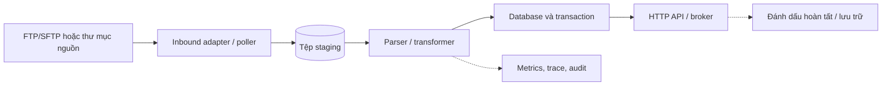
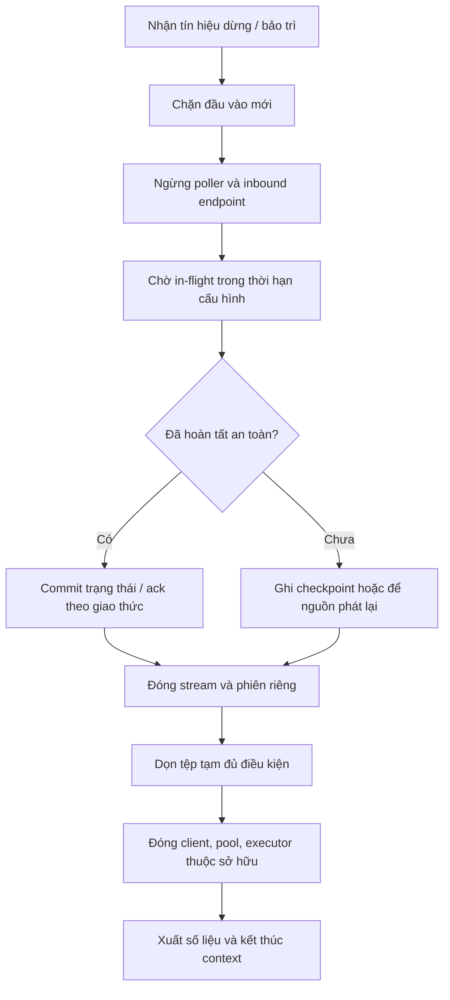

# Đóng phiên, dọn tệp và giải phóng tài nguyên khi flow dừng trong Spring Integration

## 1. Khi dừng flow, điều gì thực sự phải kết thúc?

Trong module **SPRING_BOOT_INTEGRATION**, một luồng tích hợp Spring Boot có thể nhận tệp qua local file adapter, FTP/SFTP, HTTP hoặc broker thông điệp, biến đổi dữ liệu, ghi database, gửi message và gọi hệ thống đối tác. Khi deploy lại ứng dụng, thu hồi một integration flow động hoặc tạm dừng adapter để bảo trì, phần khó không chỉ là gọi `stop()`: **phải ngừng nhận công việc mới, xử lý công việc đang chạy đến một trạng thái an toàn, đóng tài nguyên có chủ sở hữu rõ ràng và giữ đủ thông tin để khôi phục**.

Phân biệt bốn thao tác:

- **Stop/Quiesce:** ngừng nguồn tiếp nhận hoặc polling, không chủ động cấp thêm công việc mới.
- **Drain:** cho những công việc đã nhận hoàn tất hoặc bàn giao trạng thái phục hồi được trong một khoảng thời gian hữu hạn.
- **Close/Dispose:** giải phóng stream, phiên FTP/SFTP, socket, channel, executor và connection pool mà thành phần đó thực sự sở hữu.
- **Cleanup:** xử lý tệp tạm, lock, marker và bản ghi xử lý theo trạng thái đã xác nhận; không xóa dữ liệu chưa hoàn tất.

`stop()` của một endpoint **không đồng nghĩa** với việc mọi message đang xử lý đã được commit hoặc mọi tài nguyên bên dưới đã được đóng. Ngược lại, `close()` một connection dùng chung trong lúc các consumer khác còn chạy có thể gây mất kết nối dây chuyền.

### Một flow thực tế



Một shutdown an toàn cần biết message hiện nằm ở đâu, ai đang giữ session/stream, thao tác ngoài nào đã xảy ra và bằng chứng nào cho phép chuyển tệp sang `done` hoặc xóa. Nếu transaction database đã commit nhưng HTTP call đến đối tác chưa xác nhận, chỉ xóa tệp staging sẽ làm mất khả năng tiếp tục xử lý.

## 2. Sơ đồ vòng đời và thứ tự đóng

Một trình tự khuyến nghị cho flow có polling là:



Thứ tự trên là **mô hình thiết kế**, không phải thứ tự framework tự áp dụng cho mọi loại adapter. Có thể cần các bước đặc thù:

| Loại adapter/luồng | Chặn tiếp nhận mới | Công việc đang chạy | Điều kiện trước khi đóng tài nguyên |
|---|---|---|---|
| File inbound poller | Stop polling endpoint | Tệp đã phát ra channel có thể tiếp tục được xử lý | Xác nhận trạng thái tệp/in-flight; không xóa tệp đang đọc |
| FTP/SFTP inbound | Stop poller hoặc streaming source | Download, đọc stream và remote session có thể vẫn đang dùng | Hoàn tất/giải phóng stream, xử lý checkpoint, trả session |
| HTTP inbound gateway | Ngừng nhận request mới qua hạ tầng/web server | Request đã nhận tiếp tục trong giới hạn graceful shutdown | Trả response phù hợp hoặc lưu trạng thái phục hồi |
| JMS/AMQP/Kafka inbound | Dừng listener container | Message đã giao/poll có thể chưa ack hoặc chưa commit offset | Quyết định ack/nack, commit/rollback, idempotency và khả năng redelivery |
| TCP/UDP, WebSocket | Stop inbound adapter/acceptor | Session/socket và buffer đang hoạt động | Đảm bảo frame, response, timeout và chính sách reconnect |
| Outbound HTTP/SFTP/DB | Chặn handler nhận thêm dữ liệu | Call đang gửi và transaction dở dang | Chờ hoặc hủy có kiểm soát, sau đó trả/đóng tài nguyên sở hữu |
| Executor/QueueChannel | Ngừng upstream và producer | Message trong hàng đợi nội bộ có thể chưa xử lý | Drain hoặc có nơi lưu bền vững trước khi đóng executor |

**Điểm mấu chốt:** một `DirectChannel` thường chuyển cho handler đồng bộ trong thread người gửi; `ExecutorChannel` có ranh giới bất đồng bộ và nhiệm vụ có thể còn nằm trong executor. `QueueChannel` là hàng đợi nội bộ; nếu không cấu hình persistence phù hợp, công việc đang chờ có thể mất khi process tắt. Vì vậy, chỉ nhìn kết quả gọi `stop()` ở inbound adapter là chưa đủ.

## 3. Lifecycle của Spring và Spring Integration

### 3.1. `Lifecycle`, `SmartLifecycle` và đóng ApplicationContext

Spring Integration quản lý nhiều endpoint qua lifecycle của Spring:

- `Lifecycle.start()` và `Lifecycle.stop()` biểu diễn bắt đầu/dừng thành phần. Nhiều inbound adapter, poller, listener container và endpoint Spring Integration tham gia vòng đời này.
- `SmartLifecycle` bổ sung `isAutoStartup()`, thứ tự `getPhase()` và phương thức `stop(Runnable callback)` phục vụ shutdown có phối hợp. Nếu tự triển khai `SmartLifecycle` bất đồng bộ, phải gọi callback khi việc dừng thực sự hoàn thành.
- `DisposableBean.destroy()` hoặc `@PreDestroy` dành cho giải phóng tài nguyên khi **bean bị hủy**. Chúng không mặc nhiên chạy mỗi lần `stop()` được gọi.
- Khi **ApplicationContext đóng**, Spring dừng các lifecycle bean theo thứ tự phase trước khi hủy bean. Khi chỉ **stop một endpoint**, ApplicationContext vẫn tồn tại và các bean dùng chung thường vẫn hoạt động.

Với `SmartLifecycle`, phase cao hơn thường **start sau** và **stop trước** phase thấp hơn. Tuy nhiên, thứ tự hiệu quả còn phụ thuộc quan hệ bean và auto-configuration; hãy kiểm tra topology thực tế thay vì tự đặt phase tùy ý cho mọi thành phần.

Khi một flow cần tạm dừng để thay đổi cấu hình, chỉ stop inbound endpoint có thể đủ. Khi ứng dụng thật sự kết thúc, cần thêm bước drain, cleanup và hủy các resource bean của context. Nếu flow được đăng ký động qua `IntegrationFlowContext`, việc remove/destroy registration có thể tháo các bean thuộc registration; cần xác định đúng ownership trước khi thao tác.

### 3.2. Graceful shutdown của Spring Boot

Spring Boot có cấu hình cho shutdown web server và giới hạn chờ các lifecycle phase:

```yaml
# application.yml (ví dụ)
server:
  shutdown: graceful

spring:
  lifecycle:
    timeout-per-shutdown-phase: 30s
```

Thiết lập này giúp điều phối shutdown web/lifecycle theo phiên bản Spring Boot đang dùng. **Nó không tự tạo guarantee rằng mọi SFTP download, queue message, task trong executor hay side effect ở hệ thống đối tác đã hoàn tất**. Các flow ngoài HTTP phải có cơ chế ghi nhận in-flight và phục hồi riêng.

Khi chạy container/orchestrator, thời hạn termination của nền tảng cần **đủ dài** so với ngân sách chờ lifecycle, drain và đóng tài nguyên; nếu process bị kill ngay khi hết hạn thì callback cleanup cũng có thể không được chạy. Thiết kế phải chịu được cả dừng đột ngột, không chỉ shutdown sạch.

### 3.3. Stop toàn flow hay chỉ stop nguồn?

Đối với flow gồm inbound adapter → transformer → service activator → outbound adapter, muốn tạm ngừng nhập mới thường nên **dừng điểm nhận đầu vào** trước; cho những handler đã nhận message chạy hết hoặc checkpoint. Dừng/hủy tất cả thành phần ngay lập tức có thể làm tác vụ đang chạy thất bại giữa chừng.

Cần phân biệt:

1. **Pause intake:** dừng poller/listener hoặc chuyển trạng thái từ chối nhận request mới.
2. **Drain:** theo dõi số tác vụ đang chạy, hàng đợi bất đồng bộ, giao dịch và message chưa ack.
3. **Destroy flow:** hủy endpoint/registration khi đã an toàn và không còn consumer phụ thuộc.
4. **Destroy shared infrastructure:** đóng connection factory, scheduler hoặc pool khi toàn bộ owner không còn sử dụng.

Nếu nhiều flow dùng chung `TaskScheduler`, `ThreadPoolTaskExecutor`, `CachingConnectionFactory` hoặc `SessionFactory`, một flow dừng không được tự ý hủy tài nguyên chung đó.

## 4. Quy tắc sở hữu tài nguyên

| Tài nguyên | Ai thường sở hữu? | Khi nào giải phóng? | Sai lầm thường gặp |
|---|---|---|---|
| `InputStream`/`OutputStream` mở trong handler | Handler mở stream | Khi handler đọc/ghi xong, kể cả lỗi | Chỉ đóng ở `@PreDestroy`, gây rò rỉ từng message |
| FTP/SFTP `Session<?>` lấy từ factory | Code mượn session; factory/pool sở hữu kết nối vật lý | Gọi `session.close()` trong `finally` để trả/đóng theo factory | Giữ session qua nhiều job hoặc không trả khi exception |
| `CachingSessionFactory` | Bean cấu hình dùng chung | Khi context/owner kết thúc hoặc theo thao tác cache có chủ đích | Reset/hủy pool sau mỗi message, ảnh hưởng flow khác |
| AMQP/JMS connection factory | Infrastructure bean | Khi context hoặc owner thực sự đóng | Tự đóng shared connection trong listener |
| Database `Connection` từ pool | Code mượn connection, pool quản lý | Trả connection đúng phạm vi transaction | Đóng toàn bộ datasource khi một flow stop |
| HTTP client và connection pool | Bean client dùng chung | Khi client bean/context bị hủy | Tạo client mỗi message rồi không dispose |
| Scheduler/executor | Spring/context hoặc bean riêng của flow | Sau khi input stop và task được drain/cancel có kiểm soát | `shutdownNow()` khiến job bị ngắt khi đang ghi file |
| Temp/staging file | Quy trình xử lý/retention policy | Khi kết quả đã bền vững và không cần để phục hồi | Xóa theo tuổi file mà không kiểm tra in-flight |
| File lock, metadata store | Adapter hoặc cơ chế điều phối | Theo phạm vi lock/flow, gắn với checkpoint | Xóa marker/checkpoint trước khi hoàn tất |

Một nguyên tắc hữu ích là **bên tạo hoặc mượn tài nguyên chịu trách nhiệm trả đúng phạm vi sử dụng**, còn thành phần sở hữu bean/pool quản lý việc hủy cuối cùng. Không thể gộp “close session”, “close connection factory” và “delete file” thành cùng một thao tác.

## 5. File adapter: phân biệt tệp nguồn, staging và tệp đã xử lý

Với file integration, nên thiết kế trạng thái tệp rõ ràng thay vì chạy một tác vụ dọn thư mục khi shutdown:

```text
/incoming/       tệp mới, đã được publisher ghi hoàn tất
/processing/     tệp đã được claim để xử lý
/archive/        tệp đã xử lý thành công, lưu có thời hạn
/quarantine/     tệp lỗi vĩnh viễn hoặc cần can thiệp
/tmp/            tệp ghi dở, bản tải tạm, dữ liệu có thể tái tạo
```

Có thể dùng database checkpoint, metadata store hoặc bảng trạng thái như `NEW → CLAIMED → COMPLETED/FAILED` để phối hợp nhiều instance. Đổi tên/di chuyển file trên **cùng filesystem** có thể dùng atomic move nếu filesystem hỗ trợ. Di chuyển qua mount hoặc object storage không đảm bảo atomic theo cách đó.

### 5.1. Đảm bảo tệp đã ghi xong trước khi poll

Đối với local file inbound adapter, nếu producer ghi trực tiếp tên tệp cuối, poller có thể nhìn thấy tệp chưa hoàn chỉnh. Một giao ước đơn giản:

1. Producer ghi `invoice-123.csv.tmp` vào cùng thư mục/filesystem.
2. Ghi và đóng file xong mới rename thành `invoice-123.csv`.
3. Poller chỉ chấp nhận đuôi `.csv`, hoặc producer tạo marker “ready” sau khi hoàn tất.
4. Consumer claim tệp và chuyển sang `processing` trước khi xử lý.

Nếu filesystem không hỗ trợ atomic rename, cần giao thức “ready marker”, kiểm tra checksum hoặc cơ chế bàn giao tương đương; không coi “kích thước không đổi trong một giây” là bảo đảm tuyệt đối.

### 5.2. Không xóa tệp chỉ vì handler đã bắt đầu

Giả sử flow đọc CSV, cập nhật database và gửi đơn cho đối tác. Thời điểm đủ an toàn để xóa bản staging tùy semantics:

- Nếu chỉ cần kiểm tra định dạng: xử lý thành công có thể cho phép lưu trữ/xóa.
- Nếu cần gửi ra broker: phải có bằng chứng publish được broker xác nhận và chiến lược xử lý unroutable/timeout.
- Nếu cần hoàn tất nghiệp vụ: cần trạng thái bền vững trong database hoặc acknowledgement từ đích theo hợp đồng dữ liệu.
- Nếu task có thể retry: phải giữ tệp hoặc lưu một bản sao bền vững có thể phát lại cùng idempotency key.

Một `ACK` với broker thường không có nghĩa API đối tác đã commit; một HTTP 200 của adapter cũng không tự nói rằng nhiều tài nguyên ngoài hệ thống đã cùng commit. Chọn điểm đánh dấu `COMPLETED` theo hợp đồng nghiệp vụ thực tế.

### 5.3. Ví dụ xử lý tệp đã claim và lưu trữ sau thành công

Ví dụ Java sau giả định producer đã bàn giao tệp hoàn chỉnh vào `incoming`, mỗi worker được phân vùng hoặc có cơ chế claim tránh hai instance cùng đọc một tệp, và `processor.process(stream)` là thao tác đồng bộ chỉ trả về khi đã đạt mốc thành công được định nghĩa:

```java
@Component
public final class StagedFileProcessor {
    private final BusinessFileProcessor processor;
    private final Path processingDir;
    private final Path archiveDir;

    public StagedFileProcessor(
            BusinessFileProcessor processor,
            @Value("${app.files.processing-dir}") String processingDir,
            @Value("${app.files.archive-dir}") String archiveDir) {
        this.processor = processor;
        this.processingDir = Path.of(processingDir);
        this.archiveDir = Path.of(archiveDir);
    }

    public void handle(File incomingFile) throws IOException {
        Path source = incomingFile.toPath();
        Path working = processingDir.resolve(source.getFileName());
        Path archived = archiveDir.resolve(source.getFileName());

        // Cùng filesystem và không có filename collision.
        // Nếu ATOMIC_MOVE không được hỗ trợ, báo lỗi và xử lý bằng
        // chiến lược claim khác thay vì im lặng tiếp tục.
        Files.move(source, working, StandardCopyOption.ATOMIC_MOVE);

        // Trả tài nguyên đọc trong cả hai trường hợp thành công/lỗi.
        try (InputStream in = Files.newInputStream(working)) {
            processor.process(in);
        }

        // Chỉ chạy khi xử lý thành công theo hợp đồng nghiệp vụ.
        Files.move(working, archived, StandardCopyOption.ATOMIC_MOVE);
    }
}
```

`BusinessFileProcessor` là interface ứng dụng tự định nghĩa với method `void process(InputStream in) throws IOException`; ví dụ cần import `Files`, `Path`, `InputStream`, `StandardCopyOption` và annotation phù hợp. Cần tạo thư mục và kiểm tra quyền ở giai đoạn khởi động; tránh tạo tùy tiện trong shutdown.

**Giới hạn phải thiết kế thêm trong hệ thống thực tế:**

- Trùng tên `archived` hoặc `working` phải được xử lý bằng mã tệp duy nhất/claim token, không ghi đè tệp cũ; kiểm tra tồn tại trước khi move **không** ngăn hoàn toàn race giữa nhiều instance.
- Nếu side effect đã thành công nhưng process chết trước khi chuyển `working` sang `archive`, tệp có thể được xử lý lại. Cần idempotency key, inbox/outbox pattern hoặc trạng thái nghiệp vụ bền vững để tránh thực hiện hai lần.
- Với kết quả cần rollback nhiều hệ thống, không có “transaction atomic” tự động giữa local file, JDBC, RabbitMQ và HTTP; cần thiết kế consistency/recovery.
- Nếu không hỗ trợ `ATOMIC_MOVE`, có thể dùng phương án claim qua database/lock hoặc quy trình copy + marker đã xác minh. Không tự động fallback sang rename không atomic mà bỏ qua rủi ro.
- Việc move file **sau khi đóng InputStream** tránh tình trạng file đang mở không thể đổi tên/xóa trên một số hệ điều hành; thao tác archive thất bại cần được ghi log và retry an toàn.

Khi shutdown giữa bước đọc hoặc gọi đối tác, **giữ lại** file trong `processing`, đánh dấu checkpoint phù hợp và giải phóng stream. Lần khởi động tiếp theo rà soát những mục đã claim quá hạn, đối chiếu trạng thái nghiệp vụ rồi retry/chuyển sang quarantine. Không mặc định mọi `processing` cũ đều thất bại và có thể chạy lại vô điều kiện.

## 6. FTP/SFTP adapter và streaming session

### 6.1. Hai cách nhận tệp từ server từ xa

**Synchronizing inbound adapter** thường đồng bộ tệp từ FTP/SFTP xuống local filesystem rồi phát đối tượng file nội bộ cho flow. Vì vậy phải quan sát cả **tệp remote**, **bản tải local** và **trạng thái xử lý nghiệp vụ**.

**Streaming inbound adapter** có thể phát message chứa `InputStream` đọc trực tiếp từ tệp remote; session phía sau stream có thể cần được giữ đến lúc consumer xử lý xong. Trường hợp này không thể chỉ stop poller rồi mặc nhiên coi session không còn đang sử dụng.

Bảng so sánh:

| Cách nhận | Bước dễ bị bỏ quên | Thiết kế an toàn |
|---|---|---|
| Synchronize về local | Remote đã tải xong nhưng local chưa xử lý | Giữ bản local/marker cho recovery; remote delete có chính sách riêng |
| Streaming remote | Stream còn mở khi poller dừng | Đóng stream và closeable resource/session của delivery đúng phạm vi |
| Outbound transfer | Upload xong một phần khi flow dừng | Ghi tên tạm, hoàn tất upload rồi rename/commit theo giao thức đích |
| Polling nhiều file | Một số file đã claim, số khác chưa | Stop thêm poll; giữ checkpoint cho file đang chạy, tránh lấy hai lần |

**Cẩn trọng với `deleteRemoteFiles`:** ở các inbound synchronizer hỗ trợ tùy chọn xóa remote sau khi đồng bộ, việc xóa có thể gắn với **download thành công**, không nhất thiết đợi bước xử lý downstream hoặc HTTP/API đối tác hoàn tất. Nếu yêu cầu “chỉ xóa remote khi nghiệp vụ commit”, cần luồng xác nhận/archiving riêng có thể phục hồi, hoặc giữ remote cho đến khi xác nhận thành công thực sự.

### 6.2. Đóng session lấy từ pool

Spring Integration cung cấp abstraction `SessionFactory`/`Session` cho nhiều giao thức file remote. Khi code tự mượn session, phải trả trong `finally`:

```java
Session<?> session = remoteSessionFactory.getSession();
try (OutputStream output = Files.newOutputStream(localTempPath)) {
    session.read(remotePath, output);
} finally {
    session.close();
}
```

Khi factory được bọc bằng `CachingSessionFactory`, `session.close()` thường **trả session về cache** theo cách wrapper quản lý, chứ không nhất thiết đóng socket vật lý tức thì. Đó là hành vi mong muốn khi nhiều message dùng pool.

Điều này khác với hủy cả pool: chỉ reset/destroy factory lúc không còn thành phần nào đang cần session, hoặc theo cơ chế quản lý cache có chủ đích. Nếu có session được mượn mà không trả, cache có thể cạn dù số message vào thấp.

### 6.3. Streaming adapter: đóng cả stream và closeable resource

Với những streaming inbound adapter hỗ trợ header `IntegrationMessageHeaderAccessor.CLOSEABLE_RESOURCE`, message có thể mang một tài nguyên cần đóng sau khi xử lý payload; đây thường là phần liên quan phiên remote. Handler custom phải đóng tài nguyên dù business code ném lỗi. Ví dụ khung xử lý:

```java
@ServiceActivator(inputChannel = "remoteFileInput")
public void consumeRemoteFile(Message<InputStream> message) throws IOException {
    Object resource = message.getHeaders().get(
            IntegrationMessageHeaderAccessor.CLOSEABLE_RESOURCE
    );

    try {
        try (InputStream stream = message.getPayload()) {
            remoteFileProcessor.process(stream);
        }
    } finally {
        if (resource != message.getPayload()
                && resource instanceof Closeable closeable) {
            closeable.close();
        }
    }
}
```

Đoạn minh họa dùng Spring Integration message header accessor và Java `Closeable`; loại closeable resource thực tế phụ thuộc adapter/phiên bản. Nếu dùng endpoint, transformer hoặc splitter có cơ chế tự quản lý resource, cần làm rõ hợp đồng sở hữu để tránh close quá sớm. Nếu dispatch stream sang thread khác, không được đóng ở thread nhận trước khi thread xử lý đọc xong; cách an toàn hơn thường là **copy sang staging storage có kiểm soát**, đóng remote stream, sau đó xử lý bất đồng bộ bằng tham chiếu đến tệp/bản ghi bền vững.

Không lưu `InputStream` chưa đóng vào hàng đợi bất đồng bộ dài hạn hoặc serializable message store: stream là tài nguyên sống, không phải định danh bền vững để khôi phục sau restart.

## 7. Dọn tệp tạm, lock và metadata: những thứ không được xóa nhầm

Các dạng dữ liệu phụ trợ thường gặp:

- **Tệp tải dở:** hậu tố tạm ở local, file upload dở trên SFTP, partial multipart object.
- **Tệp đã claim:** nằm ở `processing` hoặc có marker/lock bảo vệ.
- **Metadata của filter:** những khóa ghi nhận tệp đã thấy/đã nhận để tránh đọc lặp.
- **Lock và lease:** ngăn hai worker xử lý đồng thời; có thể cần timeout và cơ chế fencing để tránh chủ sở hữu cũ tiếp tục ghi.
- **Retry/recovery state:** số lần thử, thời điểm tiếp tục, lỗi cuối cùng, idempotency key.

Nếu dùng filter “accept once” chỉ lưu trạng thái **trong bộ nhớ**, restart có thể cho phép quét lại tệp cũ. Với metadata store bền vững, chính sách xoá marker phải được phối hợp với tiến độ xử lý, trạng thái remote/local và thiết kế retry. Xóa toàn bộ metadata khi shutdown là một nguồn gây xử lý trùng lặp.

### Phân loại trước khi cleanup

| Dữ liệu | Có thể dọn ngay khi dừng? | Điều kiện tối thiểu |
|---|---|---|
| Stream và session do handler mở | Có, sau khi handler đã kết thúc/hủy an toàn | Luôn đóng để tránh rò tài nguyên; xử lý lỗi đóng rõ ràng |
| Tệp `*.tmp` đã không còn owner | Có thể | Có cơ chế xác minh không in-flight, đủ tuổi, có thể tái tạo từ nguồn |
| Tệp `processing/*` | Không mặc định | Kiểm tra checkpoint, lease, business outcome và khả năng replay |
| Tệp `archive/*` | Theo retention policy | Đã quá hạn giữ và có bản đối soát/đối chiếu theo yêu cầu |
| Tệp `quarantine/*` | Không tự động khi stop | Theo quy trình xử lý lỗi hoặc retention được phê duyệt |
| Filter metadata và idempotency keys | Không xóa toàn bộ | Chỉ xóa theo chính sách gắn với vòng đời dữ liệu và retry |
| Remote file gốc | Không mặc định | Đã có bản sao và/hoặc xử lý thành công được xác minh theo yêu cầu nghiệp vụ |

### Quy tắc an toàn khi thực thi cleanup

1. Chỉ thao tác trong root path được cấu hình rõ ràng; chuẩn hóa và xác minh đường dẫn trước khi xóa, tránh path traversal và symlink dẫn ra ngoài vùng staging.
2. Cleanup cần **idempotent**: chạy lại nhiều lần vẫn cho cùng kết quả hợp lệ; một file đã được xóa/di chuyển không làm hỏng toàn bộ lượt dọn.
3. Có dry-run hoặc log liệt kê đối tượng dọn trong vận hành nhạy cảm; giới hạn số lượng và thời gian mỗi đợt.
4. Không dọn đè lên file đang mở/đang claim; cần lock/lease hoặc trạng thái owner rõ ràng, không suy đoán chỉ bằng timestamp.
5. Khi cleanup lỗi, ghi số file thất bại và lý do; giữ lại artifact phục hồi, tránh nuốt exception rồi báo shutdown “thành công”.

Trong Windows, file đang được process khác mở có thể làm `Files.delete(...)` hoặc rename thất bại; trên một số hệ Unix, unlink file đang mở có thể thành công nhưng nội dung vẫn được giữ đến khi descriptor cuối đóng. Không nên phụ thuộc vào khác biệt hệ điều hành để xác định an toàn nghiệp vụ.

## 8. Đồng bộ shutdown với transaction và delivery semantics

Tài nguyên thường được trả về pool sau khi method hoàn tất, nhưng điều đó **khác** với việc transaction đã commit ở mọi đích. Các tình huống cần suy xét:

### 8.1. Database commit trước message ack

Giả sử handler ghi `order_sync_state=COMPLETED` vào DB rồi process chết trước khi broker nhận ACK. Broker có thể redeliver message. Listener mới phải dựa vào idempotency key/unique constraint để không gửi lại tác động không mong muốn, và vẫn có thể ack message sau khi nhận biết kết quả đã xử lý.

### 8.2. Ack trước khi external call hoàn tất

Nếu listener tự ack sớm rồi HTTP request thất bại hoặc bị cắt khi shutdown, message có thể mất khỏi queue và không được redeliver. Cần điều chỉnh ack boundary hoặc lưu work item bền vững trước ack.

### 8.3. Tệp đã di chuyển nhưng transaction rollback

Nếu file bị move sang archive trước khi database commit, DB có thể rollback mà tệp không còn ở nơi worker có thể nhìn thấy. Thiết kế trạng thái tệp/metadata phải liên kết với transaction outcome hoặc có bước reconciliation khôi phục.

### 8.4. In-flight task vượt timeout

Nếu graceful shutdown hết hạn, quy trình có thể phải ngừng chờ và để hệ thống nguồn phát lại hoặc restore từ checkpoint. Không ép báo `COMPLETED` trong khi worker vẫn đang chạy. Sau restart, dùng bảng trạng thái/outbox/inbox và idempotency để đối chiếu những việc chưa được xác nhận.

Mục tiêu thực tế thường là **at-least-once + idempotent handling + durable checkpoint**. Không nên hứa “exactly once trên toàn bộ file, DB, broker và HTTP” chỉ vì adapter có transaction manager.

## 9. Ví dụ flow polling và điểm điều khiển dừng

Một flow inbound file đơn giản có thể đăng ký ID endpoint để người vận hành **dừng chính nguồn poll**:

```java
@Configuration
class FileFlowConfiguration {

    @Bean
    IntegrationFlow importFileFlow(
            StagedFileProcessor processor,
            @Value("${app.files.inbox}") File inbox) {

        return IntegrationFlow
                .from(
                        Files.inboundAdapter(inbox),
                        endpoint -> endpoint
                                .id("fileIngressEndpoint")
                                .poller(Pollers.fixedDelay(Duration.ofSeconds(5))
                                        .maxMessagesPerPoll(10))
                )
                .handle(processor, "handle")
                .get();
    }
}
```

Ví dụ giả định các class Spring Integration Java DSL và bean `StagedFileProcessor` đã được khai báo. Khi muốn tạm dừng, sử dụng lifecycle của endpoint được đặt ID `fileIngressEndpoint` thông qua Spring context hoặc cơ chế điều khiển riêng của ứng dụng; ngừng endpoint này chặn thêm lượt poll, còn những message đã vào handler cần được quan sát và xử lý theo giao ước drain.

**Không tự đóng shared `TaskScheduler` khi chỉ stop flow trên.** Scheduler có thể phục vụ nhiều poller khác. Nếu source phát vào `ExecutorChannel` hoặc channel có queue, cần theo dõi thêm backlog và in-flight ngoài endpoint vì việc stop poller không chờ toàn bộ job downstream.

Với flow đăng ký động, theo dõi ID/registration qua `IntegrationFlowContext`; trước khi remove/destroy, ngừng nhập, drain, lưu checkpoint rồi mới tháo flow. Khi nhận lại một message sau restart, đảm bảo processor có idempotency.

### Cấu hình minh họa về đường dẫn và giới hạn thời gian

```yaml
app:
  files:
    inbox: /srv/integration/incoming
    processing-dir: /srv/integration/processing
    archive-dir: /srv/integration/archive
  shutdown:
    drain-timeout: 20s
    cleanup-enabled: true
```

`app.shutdown.*` là **thuộc tính tùy biến**: Spring Boot không tự hiểu hay tự thực thi drain/cleanup chỉ vì chúng xuất hiện trong YAML. Ứng dụng cần bind cấu hình bằng `@ConfigurationProperties` và xây dựng cơ chế phối hợp. Các đường dẫn minh họa phải được đặt trong volume có chính sách lưu trữ thích hợp; nếu dùng filesystem ephemeral của container thì restart có thể làm mất file đang xử lý.

## 10. Thiết kế bộ phối hợp drain có thể kiểm chứng

Một service phối hợp shutdown nên có các chức năng rõ ràng:

- **stopIntake():** vô hiệu hóa nguồn nhận (poller, listener), từ chối yêu cầu mới khi phù hợp.
- **awaitInFlight(deadline):** đợi số tác vụ active và work queue đạt trạng thái quy định. Dùng deadline hữu hạn; xử lý interrupt theo đúng contract.
- **markRecoverable():** ghi checkpoint và giải phóng lock cho task không thể hoàn tất trong thời gian chờ.
- **closeOwnedResources():** close stream/session do coordinator sở hữu, sau khi handler ngừng sử dụng. Với pool dùng chung, ủy quyền cho lifecycle của owner.
- **cleanupEligibleFiles():** chỉ dọn file đủ điều kiện; theo dõi lỗi và để lại khả năng chạy lại.

Một cách biểu diễn đơn giản:

```text
onGracefulStop(deadline):
    set accepting = false
    stop inbound endpoint(s)
    wait for in-flight and queued work until deadline
    if unfinished work remains:
        record recoverable state; do not delete its files
    close any streams/sessions owned by this component
    clean only completed or safely orphaned temporary files
    allow application context to destroy shared factories/pools
```

Đây là **pseudocode**, không phải API Spring Integration có sẵn. Từ `stop(Runnable)` hoặc hook vòng đời ứng dụng, cần bảo đảm callback được gọi kể cả khi timeout/failure đã được xử lý, nếu không Spring có thể chờ đến giới hạn rồi tiếp tục đóng các phase khác.

Nếu `@PreDestroy` chỉ ghi “delete all temp files”, callback có thể chạy lúc vẫn còn task bất đồng bộ, và không chạy khi process bị kill đột ngột. Vì vậy cleanup cũng cần một **recovery job lúc khởi động** và chính sách retention định kỳ có kiểm tra ownership, độc lập với việc shutdown có xảy ra sạch hay không.

## 11. Quan sát quá trình dừng và giải phóng tài nguyên

Trong Spring Boot Actuator/Micrometer, nên có một số metric/log để trả lời “đã ngừng hoàn toàn chưa?”:

| Tín hiệu | Vì sao cần? |
|---|---|
| `integration.flow.accepting` (gauge boolean/0-1) | Nguồn đã ngừng nhận mới hay chưa |
| `integration.flow.inflight` | Bao nhiêu handler đang làm việc |
| `integration.flow.pending` | Bao nhiêu message còn trong queue/executor |
| `integration.flow.drain.duration` | Drain mất bao lâu, bao nhiêu lần chạm deadline |
| `integration.file.cleanup.deleted` / `failed` | Bao nhiêu tệp được dọn an toàn, bao nhiêu bị lỗi |
| `integration.remote.session.borrowed` / `returned` | Phát hiện session chưa được trả hoặc pool cạn |
| `integration.flow.recovery.pending` | Số work item chưa hoàn tất cần đối soát sau restart |

Đây là **tên metric gợi ý cho ứng dụng**, không phải tất cả metric framework mặc định có sẵn. Spring Integration, Micrometer và adapter tương ứng có thể xuất thêm timer/observation; kiểm tra output thực tế để tránh ghi trùng số liệu.

Đối với log, dùng `flow_id`, `adapter_type`, `shutdown_reason`, `drain_result`, số tệp còn tồn và deadline. Đưa định danh file/job vào log theo quy định bảo mật, nhưng không đưa path chứa thông tin khách hàng, secret hoặc message payload vào metric tags có cardinality lớn.

Một shutdown có thể báo `drain_timeout` mà vẫn an toàn nếu công việc còn lại đã được checkpoint để replay. Ngược lại, shutdown “thành công” nhưng âm thầm xóa staging file chưa xử lý là lỗi nghiêm trọng.

## 12. Kiểm thử shutdown và recovery

Với Spring Boot Test, Testcontainers và stub server, cần kiểm thử cả dừng có kiểm soát và dừng bất ngờ. Những tình huống nên thử:

| Tình huống | Cách mô phỏng | Kết quả mong đợi |
|---|---|---|
| Stop khi không có công việc | Dừng poller trước lần poll tiếp theo | Không nhận thêm file, metric in-flight về 0 |
| Stop giữa lúc đọc file | Chặn handler bằng latch trong test, phát lệnh stop | File không bị xóa khi chưa hoàn tất; stream được close khi handler dừng |
| Stop khi outbound API chậm | Stub HTTP chờ lâu hơn drain timeout | Có timeout rõ ràng, trạng thái có thể replay |
| Session remote bị lỗi | Cắt kết nối SFTP hoặc khiến read ném exception | Session được close/return, file/checkpoint không mất |
| Executor còn hàng | Gửi nhiều message rồi stop nguồn | Drain hoặc bảo toàn backlog theo thiết kế |
| Kill đột ngột | Terminate process trong lúc file `processing` | Restart tìm lại orphan/lease hết hạn, xử lý lại idempotent |
| Lỗi archive/cleanup | Giả lập thiếu quyền hoặc đích không cho rename | Không báo nghiệp vụ thất bại sai, có log/metric và retry cleanup |
| Hai instance cùng claim | Cạnh tranh nhận một tệp | Chỉ một claim hợp lệ, không ghi đè hoặc mất file |
| Remote đã tải nhưng downstream lỗi | Cho download thành công rồi ném lỗi tại handler | Bản copy/checkpoint phục hồi được, không xóa remote theo nhầm mốc |

Khi test, đừng chỉ assert `endpoint.isRunning() == false`. Hãy assert **kết quả cuối cùng**: số message được xử lý, file còn ở đâu, session/pool được trả, file tạm nào hợp lệ để dọn, công việc nào sẽ được phát lại, và không có side effect bị thực hiện hai lần. Dùng timeout hữu hạn trong test để tránh treo vô thời hạn.

### Một checklist trước khi đưa flow vào production

- [ ] Xác định rõ inbound endpoint nào cần stop trước khi context đóng.
- [ ] Theo dõi được in-flight, backlog và deadline drain với cả channel bất đồng bộ.
- [ ] Biết session/stream/client nào do handler sở hữu, bean nào là shared pool.
- [ ] Mọi stream được đóng bằng `try-with-resources` hoặc `finally` theo contract adapter.
- [ ] Tệp tạm/processing/archive/quarantine có quy tắc riêng; cleanup không xóa công việc chưa hoàn tất.
- [ ] Có cơ chế claim/idempotency/checkpoint và phục hồi sau kill đột ngột.
- [ ] Remote delete và outbound upload tuân thủ mốc hoàn tất nghiệp vụ phù hợp.
- [ ] Có cảnh báo khi session không trả, drain timeout, orphan file hoặc cleanup thất bại.
- [ ] Đã kiểm thử dừng giữa file, transaction, HTTP call, broker delivery và restart.

## 13. Những lỗi thường gặp và cách sửa

**“Gọi `stop()` là mọi tài nguyên được giải phóng.”** Sai: stop điểm nhận thường chỉ ngừng nguồn. Cần tách lifecycle của endpoint, resource bean và nhiệm vụ đang chạy; chờ drain hoặc checkpoint.

**“Xóa toàn bộ `tmp` và `processing` trong `@PreDestroy`.”** Sai: có thể có file chưa commit hoặc handler chưa đóng stream. Chỉ dọn những đối tượng đủ điều kiện theo trạng thái, lease và thời hạn lưu trữ.

**“Đóng SessionFactory để trả một session.”** Sai: code mượn session phải gọi `session.close()`; đóng shared factory có thể cắt các flow khác. Pool được destroy ở đúng vòng đời owner.

**“HTTP 200, broker ACK và file archive đều tương đương business completed.”** Không chắc: mỗi tín hiệu xác nhận một bước khác nhau. Thiết kế idempotency và trạng thái nghiệp vụ giải quyết vùng không chắc chắn giữa các hệ thống.

**“Spring Boot graceful shutdown tự drain mọi queue.”** Sai: graceful web shutdown và lifecycle phases không tự bảo đảm drain một `ExecutorChannel`, Kafka/AMQP delivery hay file local. Cần instrument và quy trình phục hồi theo adapter.

**“Không cần recovery vì shutdown hook luôn chạy.”** Sai: mất điện, OOM, kill cưỡng bức hoặc node chết có thể bỏ qua hook. Cần scan/reconcile sau restart và test tình huống đó.

## 14. Kết luận

Ở chương **Adapter tích hợp**, “đóng phiên, dọn tệp và giải phóng tài nguyên khi flow dừng” là bài toán về **quyền sở hữu tài nguyên và tính đúng đắn của tiến độ xử lý** trong hệ thống Spring Boot. Với các adapter HTTP, database, cache, broker thông điệp và Spring Integration, thứ tự an toàn thường là ngừng nhận công việc mới, drain/checkpoint phần đang chạy, trả stream và session đúng phạm vi, dọn đúng tệp đã đủ điều kiện, rồi để owner đóng factory/pool. Nếu shutdown bị ngắt giữa chừng, dữ liệu tạm và trạng thái phục hồi phải đủ để khởi động lại mà không mất việc hoặc gây side effect trùng lặp.
