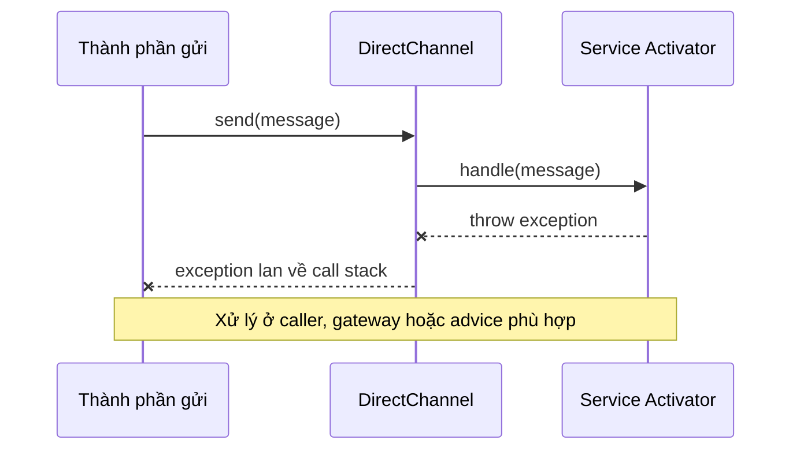
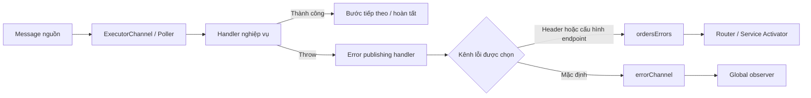
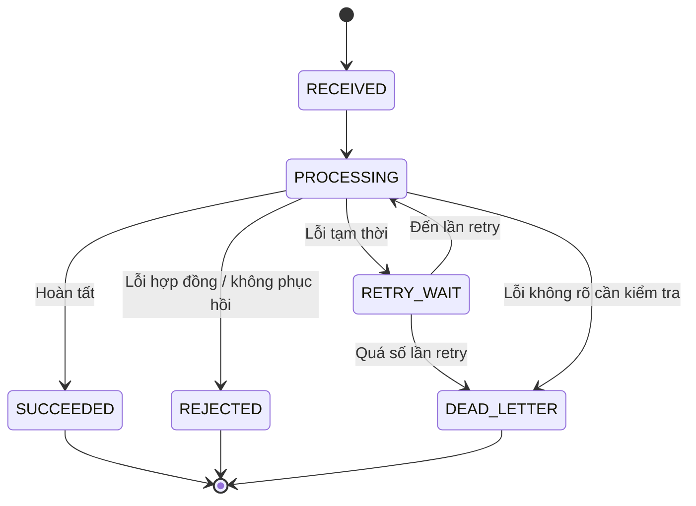
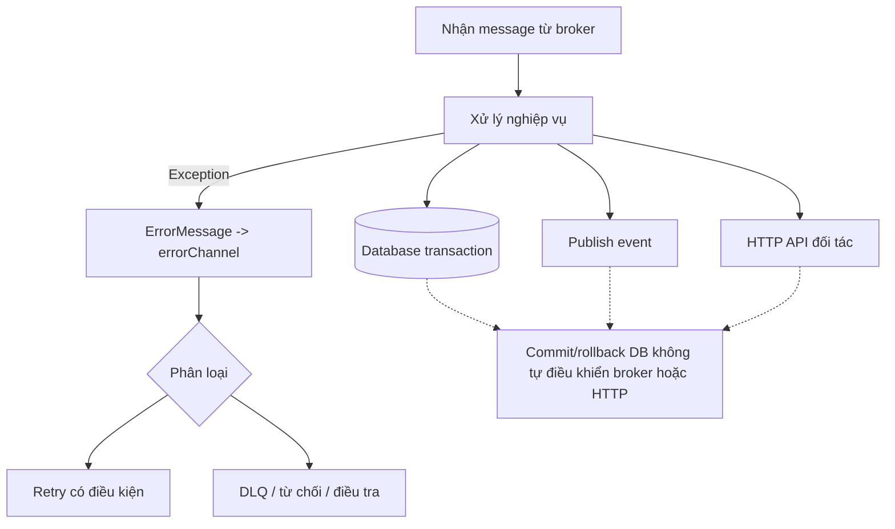

# errorChannel, ErrorMessage và định tuyến lỗi xử lý

> **Chương:** Lỗi và trạng thái flow  
> **Phạm vi:** Trong module **SPRING_BOOT_INTEGRATION**, các luồng tích hợp Spring Boot có thể đi qua HTTP client, cơ sở dữ liệu, cache, message broker và các adapter của Spring Integration. Bài này tập trung vào cách Spring Integration biểu diễn và chuyển tiếp lỗi bằng `ErrorMessage`, `errorChannel`; cách phân loại lỗi để retry, từ chối hoặc đưa vào luồng xử lý thủ công; và cách giữ trạng thái nghiệp vụ nhất quán khi nhiều hệ thống tham gia.

## 1. Vì sao lỗi trong integration flow cần một luồng riêng?

Một flow nhận thông điệp từ broker, gọi HTTP API đối tác, cập nhật cơ sở dữ liệu rồi phát sự kiện có thể thất bại ở bất kỳ bước nào. Nếu tất cả lỗi chỉ được ghi log, hệ thống khó trả lời ba câu hỏi: **thông điệp nào thất bại, đã xử lý đến đâu, và cần làm gì tiếp?**

Spring Integration cung cấp cơ chế **error flow**: thay vì chỉ nhìn thấy exception trong Java call stack, một số điểm thực thi có thể **đóng gói exception thành một message** rồi gửi đến một `MessageChannel` chuyên nhận lỗi. Nhờ đó, ứng dụng dùng các thành phần quen thuộc của Spring Integration để quan sát, phân loại và chuyển lỗi sang những nhánh xử lý thích hợp.

Ba khái niệm cần phân biệt:

| Khái niệm | Bản chất | Trách nhiệm |
| --- | --- | --- |
| **Exception** | Một đối tượng `Throwable` được ném ra trong lúc xử lý | Biểu diễn nguyên nhân thất bại của một thao tác |
| **`ErrorMessage`** | `Message<Throwable>` chứa exception, headers và có thể có thông điệp gốc | Đưa lỗi vào cơ chế message flow |
| **`errorChannel`** | Tên kênh lỗi mặc định toàn cục trong Spring Integration; cũng là header phổ biến để chỉ định kênh đích | Vận chuyển `ErrorMessage` đến handler/router |

**Điểm mấu chốt:** `errorChannel` không phải một message broker hoặc kho lưu lỗi bền vững. Nó là một kênh thông điệp trong ứng dụng. Nếu muốn đảm bảo có thể phục hồi sau restart, cần thêm cơ chế lưu trạng thái, retry store, broker dead-letter queue (DLQ) hoặc outbox/inbox phù hợp.

## 2. ErrorMessage chứa những gì?

Spring Integration sử dụng kiểu `org.springframework.messaging.support.ErrorMessage`; đây là một message mà **payload là `Throwable`**, không phải thông tin lỗi ở dạng chuỗi.

Một số nguồn lỗi có thể bọc exception vào `MessagingException` hoặc các biến thể như `MessageHandlingException` và `MessageDeliveryException`, vì vậy nguyên nhân thực tế thường nằm trong chuỗi `getCause()`.

| Vị trí | Ý nghĩa | Cách dùng |
| --- | --- | --- |
| `errorMessage.getPayload()` | Exception được chuyển vào error flow | Phân loại lỗi, ghi nhận loại exception và nguyên nhân |
| `errorMessage.getHeaders()` | Metadata của chính thông điệp lỗi | Liên kết trace, theo dõi điều kiện xử lý |
| `errorMessage.getOriginalMessage()` | Message gốc nếu thành phần phát lỗi có cung cấp | Lấy business key, route, dữ liệu cần xử lý lại |
| `((MessagingException) cause).getFailedMessage()` | Message liên quan đến exception, nếu exception có kiểu phù hợp | Dự phòng khi original message không có |
| `errorChannel` trên message gốc | Thường dùng để chỉ kênh nhận lỗi cho message cụ thể | Điều hướng lỗi theo đối tác, nghiệp vụ hoặc nguồn nhận |

Ví dụ handler đọc lỗi:

```java
import org.springframework.integration.annotation.ServiceActivator;
import org.springframework.messaging.Message;
import org.springframework.messaging.MessagingException;
import org.springframework.messaging.support.ErrorMessage;
import org.springframework.stereotype.Component;

@Component
class GlobalErrorObserver {

    @ServiceActivator(inputChannel = "errorChannel")
    public void observe(ErrorMessage error) {
        Throwable failure = error.getPayload();
        Message<?> original = error.getOriginalMessage();

        if (original == null && failure instanceof MessagingException me) {
            original = me.getFailedMessage();
        }

        String sourceMessageId = original == null
                ? "unknown"
                : original.getHeaders().getId().toString();

        // Demo: ghi nhận metadata; không log toàn bộ payload nhạy cảm.
        System.err.println(
                "Integration failed: messageId=" + sourceMessageId
                + ", exception=" + failure.getClass().getSimpleName()
        );
    }
}
```

Handler trên đăng ký vào kênh mặc định `errorChannel` do hạ tầng Spring Integration cung cấp trong các cấu hình thông dụng. Khi hệ thống đã có handler toàn cục khác, cần quyết định rõ ai quan sát, ai chịu trách nhiệm phục hồi; đừng để hai subscriber cùng thực hiện side effect khôi phục một sự kiện.

**Lưu ý:** `getOriginalMessage()` có thể trả `null`. Không giả định mọi exception đều có failed message, và không dùng nội dung exception hoặc dữ liệu khách hàng làm log không giới hạn.

## 3. Lỗi đồng bộ và lỗi bất đồng bộ đi đường nào?

Không phải mọi exception đều tự động được gửi vào `errorChannel`. Điều quyết định là **điểm thực thi có cơ chế xuất bản lỗi (error publishing) hay không**.

### 3.1. DirectChannel: lỗi thường quay về người gọi

`DirectChannel` mặc định chuyển message đến subscriber **trên cùng luồng gọi**. Nếu service activator ném exception, lỗi thường lan ngược qua `send()` hoặc gateway đến caller. Chỉ đặt header `errorChannel` trên message **không bảo đảm** nó tự biến thành `ErrorMessage`.



Đối với HTTP inbound gateway, kết quả cuối cùng còn phụ thuộc cấu hình gateway, reply/error channel và cách chuyển exception thành HTTP response. Không thể suy ra rằng hễ có một kênh tên `errorChannel` thì mọi lỗi REST đều đi qua kênh này.

### 3.2. ExecutorChannel, poller và listener: có ranh giới thực thi

Với các điểm thực thi bất đồng bộ như `ExecutorChannel`, hoặc các tác vụ poll được tích hợp error handler, exception không thể luôn ném ngược vào caller ban đầu. Hạ tầng có thể dùng `MessagePublishingErrorHandler` để phát `ErrorMessage` tới kênh lỗi.



Cấu hình cụ thể của inbound adapter (JMS, AMQP, Kafka, HTTP...), poller, gateway hoặc reactive endpoint ảnh hưởng cách lỗi được bắt, chuyển tiếp và cách **acknowledgment/rollback** ở hệ thống nguồn diễn ra. **Phát `ErrorMessage` không đồng nghĩa broker đã retry, requeue hoặc rollback.** Phải kiểm tra chính sách ack/transaction của adapter nguồn.

### 3.3. Cần hiểu ranh giới đồng bộ

| Nơi phát sinh lỗi | Hành vi thường gặp | Cần kiểm tra |
| --- | --- | --- |
| Handler trên `DirectChannel` | Ném exception lên sender | Caller có catch/transaction/error advice không? |
| Handler qua `ExecutorChannel` | Exception phát sinh trên worker thread; có thể được đóng gói và gửi tới error channel | Error handler, header `errorChannel`, delivery của nhánh lỗi |
| Polling endpoint | Poll task có thể chuyển lỗi tới error channel | Poller error handler, transaction của lần poll |
| Message-driven adapter | Theo cơ chế container và cấu hình endpoint | Ack/nack, retry/redelivery, DLQ phía broker |
| Reactive chain | `onError`/terminal signal của Reactor có vai trò chính | Có cầu nối xuất bản `ErrorMessage` hay không? |

Đặc biệt, việc chuyển sang bất đồng bộ có thể làm caller thấy `send()` thành công dù handler nghiệp vụ vẫn thất bại về sau. “Đã gửi vào channel” và “đã hoàn tất xử lý” là hai trạng thái khác nhau.

## 4. Kênh lỗi toàn cục, kênh riêng và header errorChannel

### 4.1. Kênh `errorChannel` toàn cục

Spring Integration thường đăng ký một bean có tên `errorChannel` để làm điểm nhận mặc định cho những thành phần phát lỗi mà không có nơi đến cụ thể. Cài đặt mặc định và hành vi khi không có subscriber có thể khác theo phiên bản; hãy kiểm tra cấu hình và logs của ứng dụng thực tế. Có thể khai báo `@ServiceActivator(inputChannel = "errorChannel")` để quan sát lỗi toàn cục.

Kênh mặc định thích hợp cho cảnh báo, đo số liệu và bắt các lỗi chưa được định tuyến rõ, nhưng **không nên tự động retry mọi lỗi từ mọi flow** ở đây: một lỗi validation, một lỗi timeout và một lỗi không thể commit DB đòi hỏi quyết định khác nhau.

### 4.2. Kênh lỗi theo flow hoặc nguồn nhận

Đặt các kênh như `ordersErrors`, `customerSyncErrors` hoặc `partnerApiErrors` cho những quy trình có hợp đồng retry và trạng thái khác nhau. Một message có thể mang header `errorChannel` để error publisher chuyển lỗi tới đích tương ứng khi endpoint hỗ trợ.

```java
import org.springframework.messaging.Message;
import org.springframework.messaging.MessageChannel;
import org.springframework.messaging.support.MessageBuilder;

Message<OrderEvent> message = MessageBuilder
        .withPayload(new OrderEvent("order-1042", 3, true))
        .setErrorChannelName("ordersErrors")
        .build();

boolean accepted = ordersInput.send(message);
// accepted chỉ nói về việc gửi message vào channel;
// không xác nhận nghiệp vụ đã hoàn thành ở worker thread.
```

Ví dụ này giả định `ordersInput` là một channel được inject và `OrderEvent` là DTO ứng dụng; phần cấu hình đầy đủ nằm ở mục sau. Tên kênh trong header cần được Spring Integration resolver phân giải thành bean `MessageChannel` hợp lệ.

Trong một số endpoint, có thể thiết lập error channel trực tiếp trên adapter/gateway/poller. Quy tắc chọn kênh phụ thuộc nơi bắt lỗi và loại endpoint; **không tự coi header luôn có quyền ưu tiên trong mọi trường hợp**. Đọc cấu hình của endpoint và xác nhận bằng integration test.

## 5. Ví dụ Spring Boot: phân loại lỗi rồi định tuyến

Giả sử dịch vụ xử lý lệnh tạo đơn từ đối tác. Nếu đối tác tạm ngừng hoạt động, lỗi có thể xử lý lại; nếu số lượng âm hoặc hợp đồng đầu vào không hợp lệ, cần đưa sang nhánh từ chối. Ta dùng `ExecutorChannel` để minh họa một ranh giới bất đồng bộ nơi lỗi được xuất bản thành `ErrorMessage`.

Thêm dependency (thường do Spring Boot quản lý phiên bản):

```xml
<dependency>
    <groupId>org.springframework.boot</groupId>
    <artifactId>spring-boot-starter-integration</artifactId>
</dependency>
```

Ví dụ một lớp cấu hình độc lập:

```java
package com.example.integration.order;

import org.slf4j.Logger;
import org.slf4j.LoggerFactory;
import org.springframework.beans.factory.annotation.Qualifier;
import org.springframework.context.annotation.Bean;
import org.springframework.context.annotation.Configuration;
import org.springframework.integration.annotation.Router;
import org.springframework.integration.annotation.ServiceActivator;
import org.springframework.integration.channel.DirectChannel;
import org.springframework.integration.channel.ExecutorChannel;
import org.springframework.integration.config.EnableIntegration;
import org.springframework.messaging.MessageChannel;
import org.springframework.messaging.support.ErrorMessage;
import org.springframework.core.task.TaskExecutor;
import org.springframework.scheduling.concurrent.ThreadPoolTaskExecutor;

@Configuration
@EnableIntegration
public class OrderErrorFlowConfig {

    private static final Logger log =
            LoggerFactory.getLogger(OrderErrorFlowConfig.class);

    @Bean("ordersExecutor")
    public TaskExecutor ordersExecutor() {
        ThreadPoolTaskExecutor executor = new ThreadPoolTaskExecutor();
        executor.setCorePoolSize(2);
        executor.setMaxPoolSize(4);
        executor.setQueueCapacity(100);
        executor.setThreadNamePrefix("orders-");
        return executor;
    }

    @Bean("ordersInput")
    public MessageChannel ordersInput(
            @Qualifier("ordersExecutor") TaskExecutor executor) {
        return new ExecutorChannel(executor);
    }

    @Bean("ordersErrors")
    public MessageChannel ordersErrors() {
        return new DirectChannel();
    }

    @Bean("retryAlerts")
    public MessageChannel retryAlerts() {
        return new DirectChannel();
    }

    @Bean("rejectedAlerts")
    public MessageChannel rejectedAlerts() {
        return new DirectChannel();
    }

    @ServiceActivator(inputChannel = "ordersInput")
    public void process(OrderEvent order) {
        if (order.quantity() < 0) {
            throw new IllegalArgumentException("quantity must be >= 0");
        }
        if (order.partnerUnavailable()) {
            throw new PartnerTemporarilyUnavailableException(
                    "partner is unavailable"
            );
        }
        // Demo: xử lý thành công; ứng dụng thực gọi service nghiệp vụ.
        log.info("Processed order {}", order.externalId());
    }

    @Router(inputChannel = "ordersErrors")
    public String routeError(ErrorMessage error) {
        Throwable root = rootCause(error.getPayload());
        return root instanceof PartnerTemporarilyUnavailableException
                ? "retryAlerts"
                : "rejectedAlerts";
    }

    @ServiceActivator(inputChannel = "retryAlerts")
    public void onRetryable(ErrorMessage error) {
        log.warn("Retryable order error: {}",
                error.getPayload().getClass().getSimpleName());
        // Production: lưu retry job bền vững rồi lên lịch thử lại.
    }

    @ServiceActivator(inputChannel = "rejectedAlerts")
    public void onRejected(ErrorMessage error) {
        log.error("Rejected order error: {}",
                error.getPayload().getClass().getSimpleName());
        // Production: ghi trạng thái REJECTED/DLQ kèm mã lỗi an toàn.
    }

    private Throwable rootCause(Throwable throwable) {
        Throwable current = throwable;
        while (current.getCause() != null
                && current.getCause() != current) {
            current = current.getCause();
        }
        return current;
    }

    public record OrderEvent(
            String externalId,
            int quantity,
            boolean partnerUnavailable) {}

    static class PartnerTemporarilyUnavailableException
            extends RuntimeException {
        PartnerTemporarilyUnavailableException(String message) {
            super(message);
        }
    }
}
```

**Cách chạy:** adapter hoặc producer gửi `OrderEvent` vào `ordersInput` và đặt header `errorChannel=ordersErrors`. `ExecutorChannel` chuyển nhiệm vụ sang thread của executor; nếu `process()` ném exception, error publishing handler tạo `ErrorMessage` và chuyển vào `ordersErrors`. Router phân loại nguyên nhân rồi chuyển sang `retryAlerts` hoặc `rejectedAlerts`, nơi service activator tương ứng xử lý.

Ví dụ trên **chỉ ghi log ở hai nhánh cuối** để minh họa định tuyến. Để triển khai production, hai handler cần lưu trạng thái, retry job hoặc DLQ một cách bền vững, có điều kiện chống trùng lặp; không nên xem log là hàng đợi retry.

Vì `@Router` trả về tên channel, những bean `retryAlerts` và `rejectedAlerts` phải tồn tại và có subscriber. Lỗi ngay trong error router hoặc handler lỗi có thể làm thất bại cả đường xử lý lỗi: cần đường cảnh báo cuối cùng và chiến lược không lặp vô hạn.

## 6. Phân loại lỗi để quyết định xử lý

Nên phân loại theo **ngữ nghĩa và hợp đồng nghiệp vụ**, không chỉ dựa vào chuỗi message của exception.

| Loại lỗi | Ví dụ | Hành động thường phù hợp |
| --- | --- | --- |
| **Tạm thời / có thể phục hồi** | Timeout HTTP, 503, connection DB gián đoạn, broker tạm unavailable | Retry có giới hạn, exponential backoff và jitter |
| **Dữ liệu đầu vào không hợp lệ** | Thiếu trường bắt buộc, schema sai, quantity âm | Từ chối, lưu lỗi và báo nguồn gửi sửa |
| **Xung đột / trùng lặp** | Unique constraint violation do cùng business key | Kiểm tra idempotency; trả lại kết quả cũ hoặc xác định conflict |
| **Không được phép** | Thiếu quyền, credential hết hạn, từ chối theo policy | Dừng/đưa sang luồng xử lý bảo mật; không retry liên tục |
| **Lỗi lập trình hoặc cấu hình** | Mapping sai, null ngoài dự kiến, thiếu bean/channel, serialization lỗi do schema lệch | Đưa sang DLQ hoặc incident, sửa code/cấu hình trước khi replay |
| **Không rõ trạng thái hoàn tất** | DB đã commit nhưng caller timeout; broker đã nhận nhưng ack mất | Tra cứu kết quả theo idempotency key rồi mới quyết định gửi lại |

Tùy quy trình, một mã HTTP 429 có thể retry sau thời gian chỉ định, trong khi 400 là lỗi dữ liệu không cần retry. Không nên mặc định mọi 5xx đều retry vô hạn hoặc mọi `IllegalArgumentException` đều là lỗi người dùng: lỗi này cũng có thể do bug phía server.

Định tuyến có thể dựa trên exception class, cause chain, header nguồn, số lần thử, mã nghiệp vụ hoặc partner ID. Spring Integration cũng có các router chuyên biệt như `ErrorMessageExceptionTypeRouter` nếu muốn route theo kiểu exception; phương pháp dùng `@Router` trong ví dụ dễ mở rộng cho tiêu chí nghiệp vụ.

## 7. Retry, dead-letter và trạng thái xử lý

### 7.1. ErrorMessage chỉ là tín hiệu, chưa phải trạng thái bền vững

Khi một lỗi đi vào `errorChannel`, **không có gì đảm bảo hệ thống tự ghi nhận “FAILED” trong database**. Nếu yêu cầu theo dõi end-to-end, hãy lưu trạng thái theo một business key/idempotency key.

Ví dụ trạng thái của một integration job:



Những trạng thái này là **mô hình nghiệp vụ do ứng dụng xây dựng**, không phải trạng thái Spring Integration tự lưu. Tùy yêu cầu, một job có thể có các trường:

| Trường | Công dụng |
| --- | --- |
| `messageId` / `businessKey` | Định danh ổn định của thao tác tích hợp; dùng để chống xử lý trùng |
| `sourceSystem`, `partnerId` | Xác định nguồn, quy tắc retry và owner |
| `status` | `RECEIVED`, `PROCESSING`, `RETRY_WAIT`, `SUCCEEDED`, `REJECTED`, `DEAD_LETTER` |
| `attemptCount`, `nextAttemptAt` | Giới hạn số lần thử và thời điểm thực hiện lần sau |
| `lastErrorCode`, `lastErrorAt` | Phân loại, chẩn đoán và cảnh báo |
| `correlationId`, `traceId` | Kết nối hành trình message qua HTTP, DB và broker |
| `payloadReference` | Tham chiếu dữ liệu lưu an toàn để replay khi được phép |

**Bảo vệ idempotency ở nơi lưu dữ liệu**, chẳng hạn unique constraint theo `sourceSystem + businessKey`. Nếu hai worker cùng lấy một job, cần cơ chế claim/lease hoặc optimistic locking để tránh xử lý cạnh tranh.

### 7.2. Retry ở đúng vị trí

Có thể dùng retry advice cho handler phù hợp (ví dụ `RequestHandlerRetryAdvice`) khi muốn thử lại thao tác trong cùng ngữ cảnh thực thi. Với retry dài hạn, nên ghi retry job và dùng scheduler/broker để thực hiện sau; không giữ thread hoặc transaction DB trong một khoảng delay dài.

Quy tắc thực tiễn:

1. Đặt **giới hạn số lần thử**, khoảng cách tăng dần (*exponential backoff*) và jitter để tránh quá tải đồng loạt.
2. Retry lệnh có side effect chỉ khi có **idempotency key**, thao tác idempotent hoặc khả năng tra cứu kết quả trước khi gửi lại.
3. Chuyển lỗi không thể phục hồi hoặc hết số lần retry tới DLQ/quy trình xử lý thủ công, kèm nguyên nhân và metadata đủ truy vết.
4. Lưu lý do retry và trạng thái bền vững; không dựa vào counter trong bộ nhớ khi nhiều instance cùng chạy.
5. Khi replay từ DLQ, xác minh phiên bản schema, trạng thái hiện tại và chống trùng; không replay hàng loạt mù quáng.

### 7.3. Không biến error flow thành vòng lặp vô hạn

Nếu `retryAlerts` đẩy lại ngay cùng message vào `ordersInput` mà không giới hạn số lần thử, hệ thống có thể tạo vòng lặp liên tục. Nếu handler ở `ordersErrors` lại ném exception, nhánh lỗi có thể tiếp tục lỗi và không còn đường phục hồi.

Thiết kế một điểm chốt: thất bại khi xử lý lỗi phải được cảnh báo, ghi vào kho bền vững khi có thể, và **dừng retry tại ngưỡng xác định**. Các channel trên cùng JVM không thay thế giao dịch lưu trữ.

## 8. Giao dịch, broker acknowledgment và lỗi đa hệ thống

Luồng tích hợp thường đi qua các tài nguyên có transaction riêng:



**Lưu ý ranh giới:**

- Exception trong transaction DB chỉ rollback được thay đổi thuộc transaction đó theo quy tắc transaction manager. Nó không hoàn tác một HTTP request đã được đối tác xử lý.
- Gửi `ErrorMessage` không tự quyết định message nguồn được broker ack, nack hay requeue. Điều này phụ thuộc listener container, transaction và chính sách lỗi cụ thể của JMS/AMQP/Kafka adapter.
- Nếu một flow dùng thread khác thông qua `ExecutorChannel`, transaction/thread context ở upstream **không tự truyền sang worker thread**. Hãy đặt transaction ở đúng service/handler thực thi việc ghi DB.
- Nếu cần “ghi DB rồi gửi event” đáng tin cậy, cân nhắc **transactional outbox**: cùng transaction lưu dữ liệu nghiệp vụ và outbox; publisher riêng phát event. Consumer vẫn phải chịu được việc nhận trùng.
- Nếu lỗi xảy ra sau khi DB commit nhưng trước khi response/ack về nguồn, thông điệp có thể bị gửi lại. Idempotency và việc truy vấn trạng thái cuối giúp tránh side effect kép.

Một error flow có thể cập nhật `RETRY_WAIT` hoặc `DEAD_LETTER`, nhưng trạng thái này cần **giao dịch riêng** khi transaction nghiệp vụ trước đó đã rollback. Không cố tiếp tục dùng một transaction bị đánh dấu rollback-only để ghi trạng thái phục hồi.

## 9. Quan sát và bảo mật trên error flow

Để debug luồng liên hệ nhiều hệ thống, nên có cùng một correlation ID từ điểm nhận message, qua HTTP client, DB, broker và error flow. Ghi nhận metadata theo cấu trúc thay vì log nguyên payload.

Các chỉ số đáng theo dõi:

- **Số lỗi theo flow/route, loại exception, đối tác và phiên bản hợp đồng**.
- **Tỷ lệ retry thành công, số lần retry trung bình, tuổi của job trong RETRY_WAIT và số lượng DLQ**.
- **Thời gian từ RECEIVED đến SUCCEEDED**, timeout downstream, độ trễ broker, số task đang chờ executor.
- **Tỷ lệ thất bại của chính error handler/router**, vì đây là tín hiệu đường phục hồi gặp trục trặc.

Với Micrometer/Actuator nếu đã cấu hình, có thể thu thập các metric/trace phù hợp; việc gắn instrumentation thực tế phụ thuộc dependency và phiên bản. Hạn chế cardinality của metric tags: không đưa `businessKey`, ID người dùng hoặc nội dung exception tùy ý làm tag.

`ErrorMessage` hoặc failed message có thể chứa thông tin cá nhân, credential, token hoặc payload tài chính. Cần lọc log, kiểm soát quyền đọc DLQ, đặt thời hạn lưu trữ và chính sách xử lý dữ liệu nhạy cảm. Một error handler chung không nên in toàn bộ `Throwable` và original message trên môi trường production.

## 10. Kiểm thử đúng đường đi của lỗi

| Tình huống kiểm thử | Kết quả cần xác nhận |
| --- | --- |
| Handler trên `DirectChannel` ném exception | Caller nhận exception; không kỳ vọng error channel bắt mọi lỗi |
| Handler trên `ExecutorChannel` thất bại và header đặt `ordersErrors` | Nhận `ErrorMessage` ở kênh phù hợp, có thông tin truy vết nếu được cung cấp |
| Lỗi giả lập thuộc nhóm tạm thời | Router chuyển sang nhánh retry, ghi số lần thử và thời gian thử lại |
| Lỗi đầu vào không hợp lệ | Router đưa vào nhánh từ chối/DLQ, không retry vô hạn |
| ErrorMessage thiếu original message hoặc exception bọc nhiều lớp | Handler không NPE; phân loại nguyên nhân có quy tắc |
| Hai bản sao cùng business key | DB/khóa xử lý ngăn tạo side effect trùng |
| Broker redelivery sau khi DB đã commit | Trạng thái cuối và idempotency ngăn xử lý lại sai |
| Error handler hoặc DLQ tạm unavailable | Có cảnh báo/đường xử lý dự phòng, không im lặng bỏ mất lỗi |

Với integration test, nên dùng một ứng dụng Spring Boot thật hoặc test context Spring Integration, gửi message qua các channel đã cấu hình và đợi kết quả bất đồng bộ bằng latch/queue có timeout để tránh test treo. Khi cần xác minh hành vi ack, rollback, delivery, unique constraint hoặc outbox, dùng broker/database kiểm thử tương ứng (có thể thông qua Testcontainers). Unit test một hàm phân loại exception đơn lẻ **không chứng minh** message thật đã được publish, route và persist đúng.

## 11. Những nhầm lẫn phổ biến

1. **“Chỉ cần đặt `errorChannel` là bắt được mọi exception.”** Sai: lỗi đồng bộ vẫn có thể ném thẳng về caller; endpoint và error handler quyết định nơi bắt.
2. **“`ErrorMessage` có payload là message nghiệp vụ gốc.”** Sai: payload là `Throwable`; original/failed message chỉ có khi hạ tầng cung cấp.
3. **“Nhận ErrorMessage nghĩa là message nguồn đã rollback.”** Sai: rollback và broker acknowledgment phụ thuộc transaction/adapter.
4. **“Nhánh retry log thành công nghĩa là đã xử lý lại.”** Sai: cần một cơ chế retry thật và trạng thái bền vững.
5. **“Mỗi lỗi đều nên retry.”** Sai: validation, authentication, schema mismatch và bug có thể cần từ chối hoặc sửa hệ thống trước.
6. **“Định tuyến lỗi sang một channel đồng nghĩa đã có DLQ.”** Sai: chỉ có kênh xử lý trong process; DLQ yêu cầu nguồn lưu trữ có cơ chế bền vững.
7. **“Caller gửi vào ExecutorChannel thành công là nghiệp vụ thành công.”** Sai: xử lý có thể đang diễn ra ở thread khác và thất bại sau đó.

## 12. Câu hỏi tự kiểm tra

1. Vì sao ngoại lệ từ `DirectChannel` không mặc định chạy qua `errorChannel`?
2. Trong `ErrorMessage`, nên tìm nguyên nhân và thông điệp thất bại ở đâu? Khi nào các thông tin đó vắng mặt?
3. Header `errorChannel`, bean `errorChannel` toàn cục và error channel cấu hình trên endpoint khác nhau thế nào?
4. Vì sao một retry queue cần lưu `attemptCount`, `nextAttemptAt` và business key?
5. Nếu việc gọi API đối tác đã thành công nhưng response bị mất, retry trực tiếp nguy hiểm ở điểm nào?
6. Điều gì xảy ra khi handler xử lý lỗi tự ném exception? Thiết kế phòng ngừa vòng lặp thế nào?
7. Vì sao đưa exception vào `errorChannel` không có nghĩa đã nack một message Kafka/AMQP?

**Ghi nhớ:** `ErrorMessage` biến exception thành một message có thể đưa qua integration flow; `errorChannel` là nơi nhận lỗi mặc định hoặc theo ngữ cảnh; router/handler giúp phân nhánh theo khả năng phục hồi. Độ tin cậy của hệ thống vẫn đến từ ranh giới transaction rõ ràng, idempotency, trạng thái bền vững, retry có giới hạn, kiểm thử bằng hạ tầng phù hợp và quan sát đủ để truy vết một message từ đầu đến cuối.
