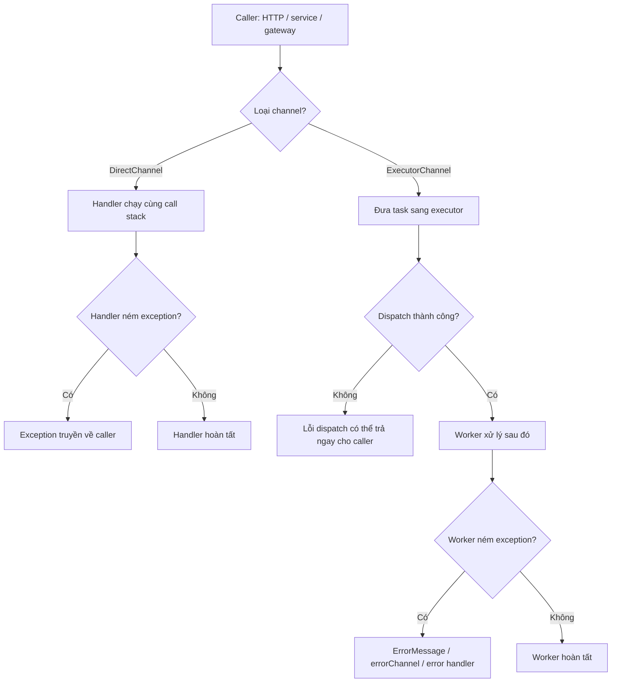
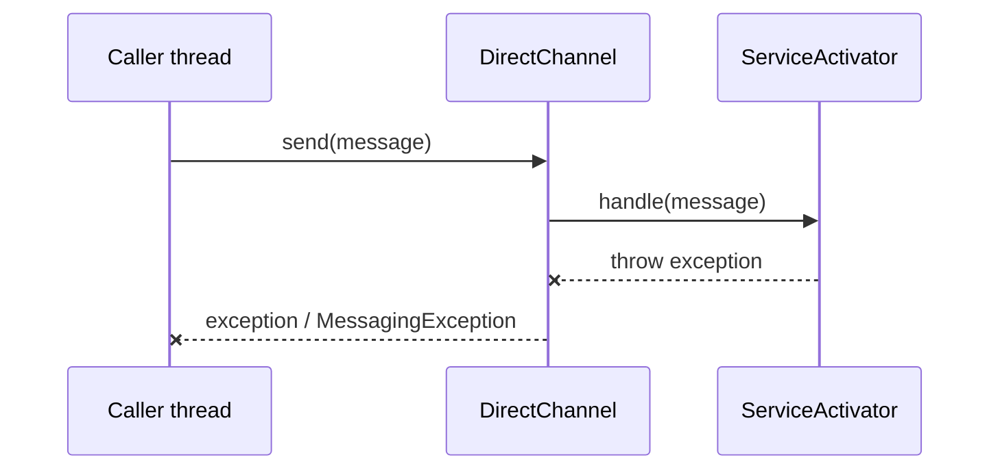
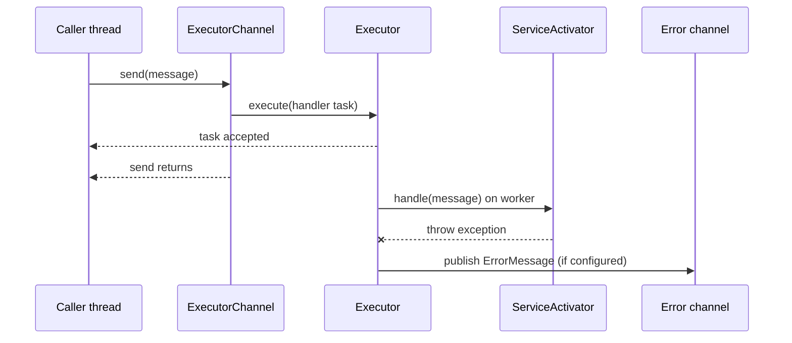
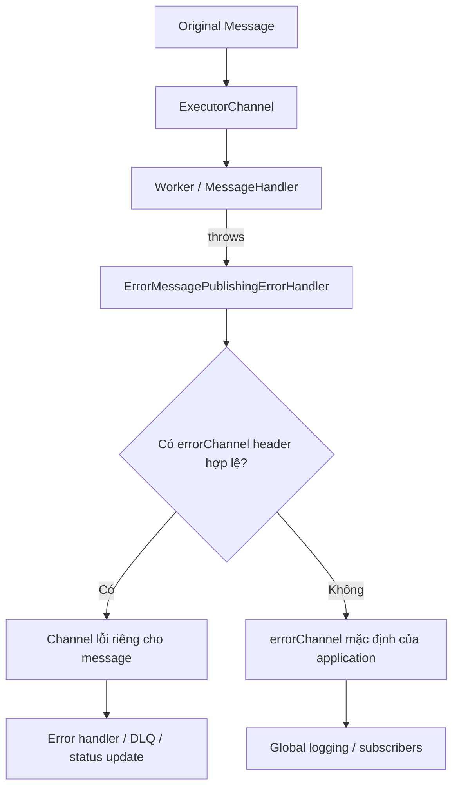
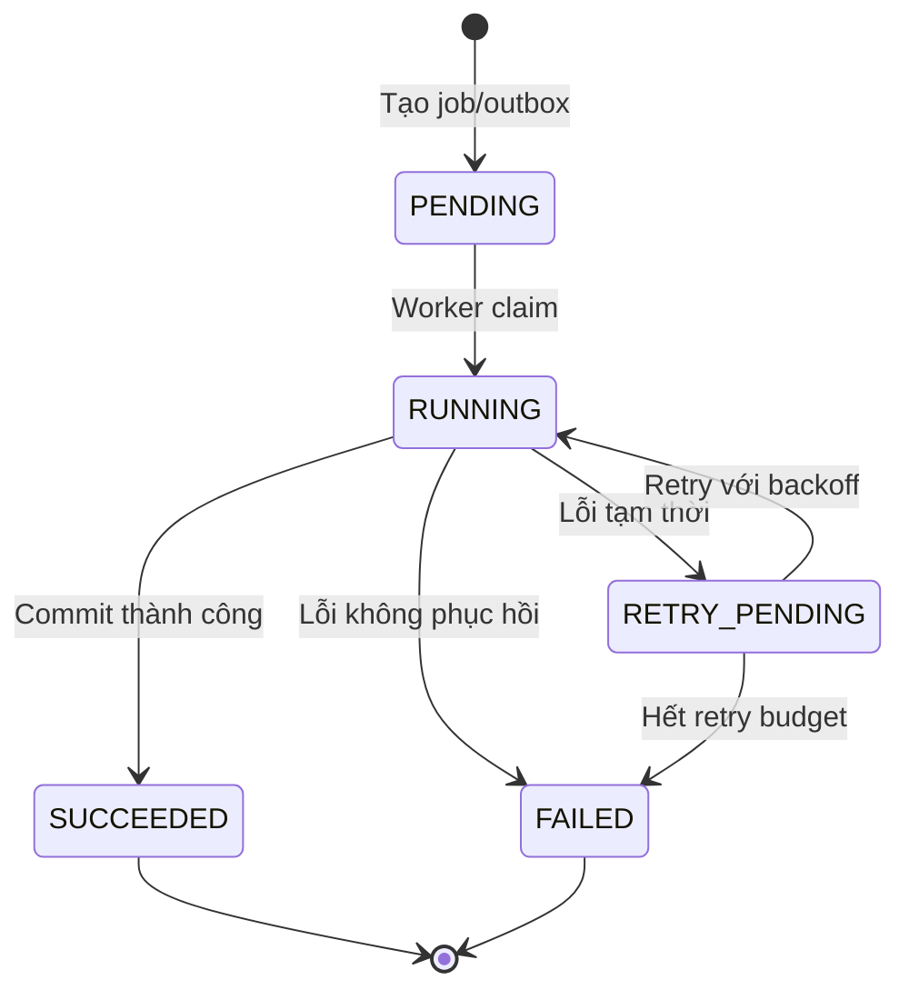
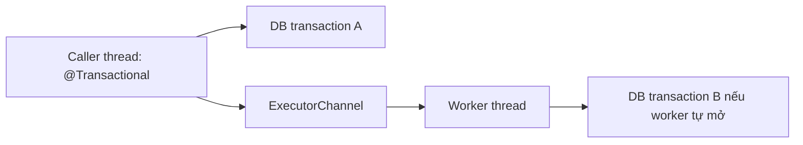
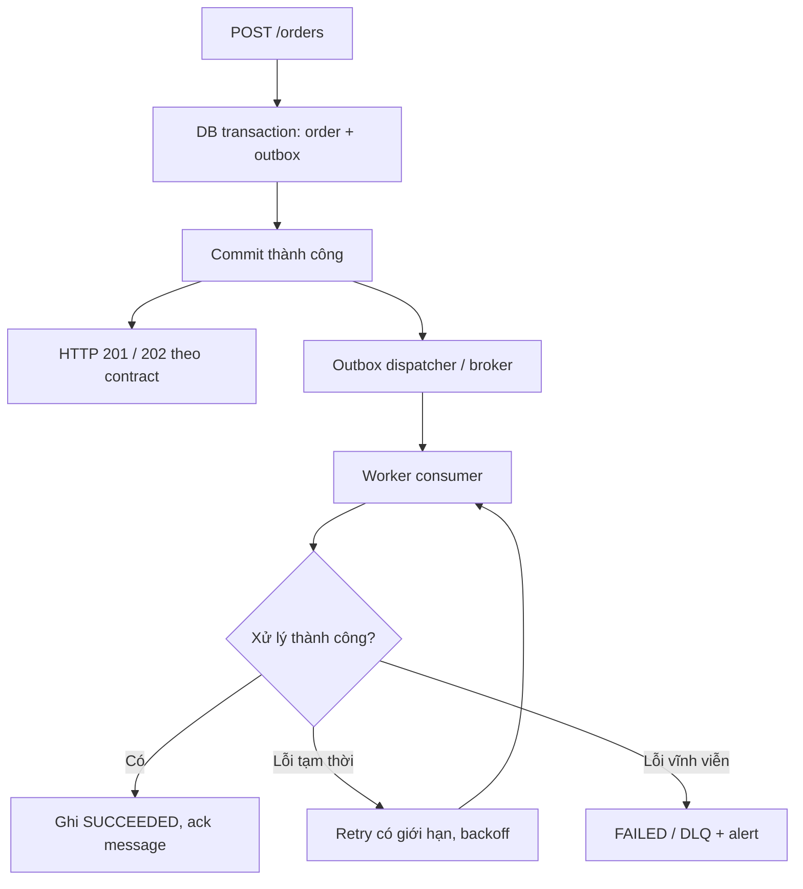

# Phân biệt lỗi đồng bộ trả về bên gọi với lỗi trên executor

## 1. Vấn đề: cùng một exception nhưng bên gọi có thể thấy kết quả khác nhau

Trong **SPRING_BOOT_INTEGRATION**, một ứng dụng Spring Boot thường điều phối nhiều bước: nhận HTTP request, gọi cơ sở dữ liệu, đọc cache, phát thông điệp lên broker hoặc chuyển dữ liệu qua các adapter của **Spring Integration**. Các bước này có thể chạy ngay trên thread nhận yêu cầu hoặc được chuyển sang một executor để xử lý ở thread khác. **Ranh giới thread quyết định exception có thể truyền trực tiếp về bên gọi hay phải đi qua một kênh lỗi.**

Giả sử Order Service nhận yêu cầu tạo đơn rồi gửi một message vào flow xử lý:

- Nếu message đi qua **DirectChannel** và handler ném lỗi ngay trong lời gọi, exception thường quay về code gọi `send()` hoặc gateway trên **cùng call stack**.
- Nếu message đi qua **ExecutorChannel**, lời gọi `send()` có thể hoàn tất sau khi công việc được nhận để chạy. Handler sẽ xử lý ở thread của executor; nếu handler ném lỗi **sau đó**, bên gọi ban đầu không còn ở cùng call stack để nhận exception. Lỗi cần được đưa tới `errorChannel` hoặc một cơ chế quan sát/khôi phục khác.
- Nếu executor từ chối task ngay lúc dispatch vì quá tải hoặc đã shutdown, đó có thể là **lỗi đồng bộ ngay khi gọi `send()`**, dù channel thuộc loại bất đồng bộ.

Đây là khác biệt giữa **“bên gọi có nhận được exception hay không”** và **“công việc đã xử lý thành công hay chưa”**. Một giá trị `true` từ `MessageChannel.send(...)` không tự bảo đảm database đã commit, HTTP downstream đã nhận dữ liệu, hoặc broker đã xác nhận xử lý nghiệp vụ.



Bài viết tập trung vào **lỗi và trạng thái flow**: đường truyền exception, cách Spring Integration tạo và định tuyến `ErrorMessage`, hành vi của gateway, ranh giới transaction, retry/idempotency, giới hạn executor, kiểm thử cả hai kiểu lỗi và cách quan sát trong production.

Các ví dụ minh họa Spring Boot 3.x, Spring Framework 6 và Spring Integration 6.x. Với phiên bản khác, cần đối chiếu điều kiện auto-configuration và API tương ứng.

## 2. Bốn khái niệm cần tách bạch

| Khái niệm | Câu hỏi | Ví dụ |
| --- | --- | --- |
| **Dispatch** | Channel đã nhận và chuyển message sang handler hoặc hàng đợi chưa? | `MessageChannel.send(message)` trả `true` |
| **Execution** | Handler đã thực sự chạy và kết thúc chưa? | Lời gọi HTTP/DB trong service activator |
| **Failure propagation** | Exception được truyền cho ai và bằng cách nào? | `throw` về caller hoặc `ErrorMessage` tới error channel |
| **Business acknowledgment** | Nghiệp vụ đã commit/hoàn tất chưa? | Bản ghi order được lưu, event đã xử lý idempotent |

Bốn sự kiện này **không đồng thời** trong một flow bất đồng bộ. Ngay cả khi có log “message accepted”, downstream vẫn có thể thất bại. Nếu caller cần biết kết quả cuối, phải thiết kế **reply/correlation**, trạng thái công việc hoặc callback/event xác nhận.

Một số thành phần Spring Integration liên quan:

- `Message<?>`: bao gồm `payload` và `headers`, mang context nghiệp vụ.
- `MessageChannel`: điểm truyền message giữa endpoint.
- `DirectChannel`: mặc định gọi handler trực tiếp trên thread của caller.
- `ExecutorChannel`: chuyển việc dispatch tới `Executor`; handler chạy trên thread executor.
- `QueueChannel`: nhận message vào queue để poller hoặc consumer lấy sau.
- `PublishSubscribeChannel`: có thể xử lý subscriber đồng bộ nếu không cấu hình executor, hoặc bất đồng bộ nếu có executor.
- `MessagingException`: họ exception của Spring Messaging, có thể lưu `failedMessage`.
- `ErrorMessage`: một message đặc biệt có `payload` là `Throwable`, thường được gửi qua error channel.

Không nên gắn nhãn “bất đồng bộ” cho cả một flow chỉ vì có một channel tên `asyncOrders`. **Hành vi phụ thuộc channel implementation và vị trí executor/poller thực sự trong đường đi.**

## 3. DirectChannel: exception đi theo call stack của bên gọi

Với `DirectChannel`, handler được kích hoạt ngay trong luồng gửi message. Nếu một service activator ném exception và không có tầng nào bắt/biến đổi, exception sẽ truyền ngược lên bên gọi đồng bộ.



Ví dụ cấu hình channel:

```java
import org.springframework.context.annotation.Bean;
import org.springframework.context.annotation.Configuration;
import org.springframework.integration.config.EnableIntegration;
import org.springframework.integration.channel.DirectChannel;
import org.springframework.messaging.MessageChannel;

@Configuration
@EnableIntegration
public class SyncFlowConfiguration {

    @Bean("syncOrders")
    MessageChannel syncOrders() {
        return new DirectChannel();
    }
}
```

Handler có thể là một Spring Integration service activator:

```java
import org.springframework.integration.annotation.ServiceActivator;
import org.springframework.stereotype.Component;

@Component
public class SyncOrderHandler {

    @ServiceActivator(inputChannel = "syncOrders")
    public void handle(OrderCommand command) {
        if (command.quantity() <= 0) {
            throw new IllegalArgumentException(
                "Quantity must be greater than zero"
            );
        }

        // Gọi nghiệp vụ xử lý đơn hàng trong cùng luồng thực thi.
    }
}
```

Ở đây `OrderCommand` là DTO của ứng dụng, ví dụ:

```java
public record OrderCommand(
    String orderId,
    String sku,
    int quantity
) {}
```

Caller gửi message và bắt lỗi:

```java
import org.springframework.messaging.MessageChannel;
import org.springframework.messaging.support.MessageBuilder;

public void submitSync(
        MessageChannel syncOrders,
        OrderCommand command) {

    try {
        boolean dispatched = syncOrders.send(
            MessageBuilder.withPayload(command).build()
        );

        if (!dispatched) {
            throw new IllegalStateException(
                "Message was not dispatched"
            );
        }
    } catch (RuntimeException exception) {
        // Nhận được lỗi trên đường thực thi đồng bộ.
        // Có thể unwrap MessagingException để phân loại.
        throw exception;
    }
}
```

Spring Integration có thể bọc lỗi handler trong `MessageHandlingException` hoặc một subtype `MessagingException` trước khi đưa lên call stack. Vì thế trong test/application logic không nên giả định lúc nào cũng bắt trực tiếp `IllegalArgumentException` nguyên bản. Hãy kiểm tra **cause chain** và error type thực tế theo endpoint đang dùng.

**Điều gì bảo đảm?** Bên gọi chỉ có thể quan sát lỗi khi handler đã được gọi trong cùng đường thực thi đồng bộ và exception không bị một endpoint/interceptor/error handler bắt lại. Nếu handler tự bắt exception rồi log, caller đương nhiên không nhận exception đó.

## 4. ExecutorChannel: chuyển điểm xử lý sang thread khác

`ExecutorChannel` sử dụng `Executor` để dispatch message bất đồng bộ. Caller có thể kết thúc `send()` khi task đã được chấp nhận, trong khi worker vẫn chưa bắt đầu xử lý.



Ví dụ cấu hình executor có giới hạn để tránh tạo thread vô hạn:

```java
import org.springframework.beans.factory.annotation.Qualifier;
import org.springframework.context.annotation.Bean;
import org.springframework.context.annotation.Configuration;
import org.springframework.integration.channel.ExecutorChannel;
import org.springframework.messaging.MessageChannel;
import org.springframework.scheduling.concurrent.ThreadPoolTaskExecutor;

@Configuration
public class AsyncFlowConfiguration {

    @Bean("orderFlowExecutor")
    ThreadPoolTaskExecutor orderFlowExecutor() {
        ThreadPoolTaskExecutor executor =
            new ThreadPoolTaskExecutor();

        executor.setCorePoolSize(2);
        executor.setMaxPoolSize(4);
        executor.setQueueCapacity(100);
        executor.setThreadNamePrefix("order-flow-");
        return executor;
    }

    @Bean("asyncOrders")
    MessageChannel asyncOrders(
            @Qualifier("orderFlowExecutor")
            ThreadPoolTaskExecutor executor) {
        return new ExecutorChannel(executor);
    }
}
```

`ThreadPoolTaskExecutor` được Spring quản lý vòng đời như một bean. Các con số 2/4/100 chỉ để minh họa; lựa chọn thực tế dựa trên tải, latency downstream, giới hạn connection pool, khả năng backpressure và yêu cầu xử lý khi đầy queue.

Handler:

```java
import org.springframework.integration.annotation.ServiceActivator;
import org.springframework.stereotype.Component;

@Component
public class AsyncOrderHandler {

    @ServiceActivator(inputChannel = "asyncOrders")
    public void handle(OrderCommand command) {
        // Thường chạy trên thread có prefix "order-flow-".
        if (command.quantity() <= 0) {
            throw new IllegalArgumentException(
                "Quantity must be greater than zero"
            );
        }

        // Có thể gọi DB/HTTP/broker và thất bại ở bước sau.
    }
}
```

Tại thời điểm `send()` trả về, caller **chưa có kết quả cuối**. Nếu handler ném lỗi sau khi được executor chạy, `try/catch` quanh `send()` trong caller **không bắt được** lỗi đó vì stack của caller và worker đã tách rời.

Một điểm dễ bỏ sót: **executor có thể từ chối việc ngay lúc dispatch**. Khi pool/queue bị bão hòa, `execute(...)` có thể ném `RejectedExecutionException` hoặc một exception tương ứng. Lỗi này có thể đi ngược về caller trong chính lời gọi `send()`, trước khi task được chấp nhận. Vì thế không được kết luận “mọi lỗi của ExecutorChannel đều chỉ nằm trên errorChannel”.

## 5. So sánh hành vi theo vị trí lỗi và channel

| Tình huống | Nơi lỗi phát sinh | Bên gọi `send()` có thể bắt trực tiếp? | Đường xử lý hợp lý |
| --- | --- | --- | --- |
| Handler trên `DirectChannel` ném exception | Thread caller | **Có**, nếu không bị bắt ở giữa | Truyền exception cho service/controller/gateway |
| Handler sau `ExecutorChannel` ném exception | Thread worker | **Không**, nếu lỗi xảy ra sau khi dispatch thành công | `ErrorMessage` → error channel / xử lý lỗi async |
| Executor từ chối task khi submit | Thread caller | **Có thể có** | Bắt lỗi dispatch, trả kết quả không nhận công việc |
| `QueueChannel` đã nhận message, poller xử lý sau thất bại | Thread poller | **Không** qua lời gọi send ban đầu | Poller error handling, error channel, retry/DLQ |
| `PublishSubscribeChannel` không có executor, một subscriber ném lỗi | Thread caller | **Có thể có** | Xét lỗi dispatch và cấu hình các subscriber |
| `PublishSubscribeChannel` có executor, subscriber thất bại | Thread executor | Thường **không** qua send ban đầu | Lỗi bất đồng bộ qua handler/error channel |
| HTTP/DB call trong worker timeout | Thread worker | Không qua send ban đầu | Phân loại lỗi, retry có giới hạn, trạng thái công việc |
| Handler đã xử lý thành công nhưng async reply bị mất | Tầng reply/transport | Không nhất thiết | Correlation ID, timeout, đối soát |

Các cột mô tả **hành vi thường gặp**, không phải cam kết cho mọi cấu hình interceptor, transaction manager, gateway hay custom error handler. Khi có gateway hoặc bridge, hãy xác định điểm nào giữ kết nối request–reply và điểm nào cắt sang async.

## 6. errorChannel và ErrorMessage hoạt động như thế nào?

Trong Spring Integration, lỗi bất đồng bộ có thể được chuyển thành `ErrorMessage`. Đây là `Message` có `payload` là `Throwable`, thường chứa `MessagingException` hoặc cause của lỗi xử lý.

Một luồng điển hình:



**Lưu ý:** sơ đồ phản ánh cơ chế Spring Integration thông dụng với endpoint/executor được Spring quản lý và error handler hỗ trợ xuất bản lỗi. Nếu bạn tự tạo thread, gọi `Executor.submit` hoặc tự xử lý Reactive stream bên ngoài cơ chế này, Spring Integration không mặc nhiên biến mọi `Throwable` thành `ErrorMessage`. Phải cấu hình một nơi bắt và chuyển lỗi có chủ đích.

### 6.1. Message gốc có thể chỉ định kênh lỗi riêng

Với `MessageHeaders.ERROR_CHANNEL`, producer có thể chỉ định đích nhận lỗi của message. Trong ví dụ sau, dùng **tham chiếu `MessageChannel`** làm header để tránh phụ thuộc vào việc resolve channel name bằng chuỗi:

```java
import org.springframework.beans.factory.annotation.Qualifier;
import org.springframework.messaging.MessageChannel;
import org.springframework.messaging.MessageHeaders;
import org.springframework.messaging.support.MessageBuilder;
import org.springframework.stereotype.Service;

@Service
public class AsyncOrderSubmitter {

    private final MessageChannel asyncOrders;
    private final MessageChannel orderErrors;

    public AsyncOrderSubmitter(
            @Qualifier("asyncOrders") MessageChannel asyncOrders,
            @Qualifier("orderErrors") MessageChannel orderErrors) {
        this.asyncOrders = asyncOrders;
        this.orderErrors = orderErrors;
    }

    public boolean submit(OrderCommand command) {
        return asyncOrders.send(
            MessageBuilder.withPayload(command)
                .setHeader(
                    MessageHeaders.ERROR_CHANNEL,
                    orderErrors
                )
                .setHeader("correlationId", command.orderId())
                .build()
        );
    }
}
```

Cấu hình channel lỗi riêng:

```java
import org.springframework.context.annotation.Bean;
import org.springframework.context.annotation.Configuration;
import org.springframework.integration.channel.DirectChannel;
import org.springframework.messaging.MessageChannel;

@Configuration
public class OrderErrorChannelConfiguration {

    @Bean("orderErrors")
    MessageChannel orderErrors() {
        return new DirectChannel();
    }
}
```

Nếu handler của `asyncOrders` ném exception ở thread worker và endpoint có error handler xuất bản lỗi, Spring Integration sẽ dùng header `errorChannel` phù hợp để định tuyến. Với `DirectChannel` lỗi riêng như trên, việc xử lý lỗi có thể tiếp tục **trên chính thread worker**; đây là async so với caller ban đầu nhưng chưa chắc tạo thêm thread xử lý lỗi.

### 6.2. Nhận ErrorMessage và khai thác failedMessage

```java
import org.springframework.integration.annotation.ServiceActivator;
import org.springframework.messaging.Message;
import org.springframework.messaging.MessagingException;
import org.springframework.messaging.support.ErrorMessage;
import org.springframework.stereotype.Component;

@Component
public class OrderFlowErrorHandler {

    @ServiceActivator(inputChannel = "orderErrors")
    public void handle(ErrorMessage errorMessage) {
        Throwable failure = errorMessage.getPayload();

        Message<?> failedMessage = null;
        if (failure instanceof MessagingException messagingException) {
            failedMessage = messagingException.getFailedMessage();
        }

        // Có thể tra correlationId, mã lỗi và loại exception.
        // Cập nhật trạng thái FAILED / RETRY_PENDING theo nghiệp vụ.
        // Tránh log password, token hoặc toàn bộ payload nhạy cảm.
    }
}
```

Không giả định `getFailedMessage()` luôn khác `null` hoặc mọi payload lỗi đều là `MessagingException`. Với version Spring Messaging có hỗ trợ, `ErrorMessage.getOriginalMessage()` cũng có thể giúp truy vết bản tin gốc; cần kiểm tra những trường đó trước khi đọc. Một số lỗi xảy ra trước khi message được tạo hoặc trước khi handler nhận dữ liệu sẽ thiếu context mong đợi.

### 6.3. Global errorChannel

Spring Integration thường cung cấp một kênh `errorChannel` mặc định với logic ghi log các lỗi chưa được xử lý. Kênh toàn cục hữu ích để quan sát, nhưng **không nên dựa riêng vào logging mặc định để bảo đảm công việc đã được phục hồi**.

Một lỗi nghiệp vụ quan trọng nên được định tuyến tới flow lỗi riêng hoặc có error handler đủ rõ để:

- Phân loại exception tạm thời và vĩnh viễn.
- Ghi trạng thái công việc có thể đối soát.
- Đưa thông điệp lỗi vào broker queue/DLQ hoặc retry store thích hợp nếu cần bền vững.
- Gắn correlation ID, operation và attempt count.
- Tạo metric/alert khi số lần thất bại vượt ngưỡng.

Tránh định nghĩa tùy tiện bean mới cùng tên `errorChannel` nếu ứng dụng đã dựa vào global error channel mặc định. Khi cần tùy chỉnh, hãy hiểu lifecycle, số subscriber và cơ chế mặc định của framework. Với flow riêng, tên `orderErrors` giúp phạm vi lỗi dễ kiểm soát hơn.

## 7. Exception gửi về caller khác với ErrorMessage gửi tới errorChannel

Hai đường truyền lỗi thường bị nhầm vì cùng xuất phát từ một `throw`:

**Đường đồng bộ**

```text
HTTP Controller
  -> MessageChannel.send()
      -> DirectChannel
          -> ServiceActivator
              -> throw exception
  <- exception truyền ngược theo call stack
```

**Đường executor**

```text
HTTP Controller
  -> MessageChannel.send()
      -> ExecutorChannel -> submit task
  <- send() trả về sau dispatch

Thread worker, thực thi sau đó:
  -> ServiceActivator
      -> throw exception
      -> ErrorMessagePublishingErrorHandler
      -> orderErrors / errorChannel
```

Vì thế, một `try/catch` bên ngoài `asyncOrders.send(message)` xử lý được lỗi **dispatch** phát sinh trong lời gọi đó, nhưng không phải cơ chế thu hồi kết quả của mọi công việc xử lý sau này.

**Cũng không nên giải thích ngược lại:** nhận `ErrorMessage` không có nghĩa lỗi đã được truyền thành exception tới HTTP caller. Cần một đường reply/correlation chủ động hoặc cách truy vấn trạng thái nếu caller cần kết quả cuối.

## 8. MessagingGateway: khi nào vẫn có thể trả lỗi về bên gọi?

Spring Integration `@MessagingGateway` đóng vai trò cầu nối giữa lời gọi method Java và messaging flow. Với request–reply gateway, caller có thể đợi reply và framework có thể cung cấp temporary reply/error channels hoặc routing liên quan gateway theo cấu hình.

Ví dụ giao diện gateway đồng bộ:

```java
import org.springframework.integration.annotation.Gateway;
import org.springframework.integration.annotation.MessagingGateway;

@MessagingGateway
public interface OrderGateway {

    @Gateway(
        requestChannel = "ordersGatewayInput",
        replyTimeout = "3000"
    )
    OrderResult submit(OrderCommand command);
}
```

`OrderResult` là DTO kết quả nghiệp vụ của ứng dụng; `ordersGatewayInput` là request channel được flow cung cấp. Đoạn code minh họa gateway cần nhận **một reply**. Giá trị timeout ở đây tính theo mili-giây theo API gateway. Trong ứng dụng thật cần xem cả request timeout và tình huống endpoint không tạo reply.

### 8.1. Gateway đi qua DirectChannel

Khi gateway đi qua handler đồng bộ:

- Handler trả reply → gateway có thể trả kết quả cho caller.
- Handler ném exception → gateway/caller có thể nhận exception theo cơ chế gateway, trừ khi error flow khác đã xử lý.
- Lời gọi có thể nằm trong ranh giới transaction và thread của caller, tùy cấu hình transaction.

### 8.2. Gateway đi qua ExecutorChannel

Khi phía sau gateway có executor:

- Thread gateway **có thể vẫn đợi** reply theo request–reply contract dù handler đã chuyển sang worker thread.
- Nếu worker trả reply về reply channel hợp lệ trước deadline, gateway có thể trả kết quả cho caller.
- Nếu lỗi được định tuyến thành error reply qua cơ chế error channel mà gateway nhận/biến đổi, gateway có thể phát exception cho caller.
- Nếu không có reply/error reply phù hợp trước timeout, gateway có thể timeout, trả `null` hoặc ném lỗi theo return type/cấu hình cụ thể.

Do vậy câu “ExecutorChannel luôn khiến caller không nhận được lỗi” là **quá rộng** nếu caller đang dùng một request–reply gateway và gateway chủ động chờ/kết nối đường phản hồi lỗi. Điều đúng là **exception worker không truyền trực tiếp qua stack của `send()`**; gateway có thể chuyển thông tin lỗi thành phản hồi riêng thông qua channel.

### 8.3. Chọn hợp đồng API ngay từ đầu

| Yêu cầu HTTP API | Kiểu thiết kế | Cách thông báo lỗi |
| --- | --- | --- |
| Cần xử lý xong mới trả 200/4xx/5xx | Flow đồng bộ hoặc request–reply gateway có timeout | Exception/result của cùng request |
| Chỉ nhận công việc để chạy sau | Async channel + durable queue/job store | HTTP 202 kèm job ID; trạng thái tra cứu/callback/event |
| Thời gian xử lý không xác định, có thể kéo dài | Job state machine, event/callback | `PENDING`, `RUNNING`, `SUCCEEDED`, `FAILED` |
| Cần chính sách phục hồi khi broker/DB lỗi | Outbox, retry có giới hạn, DLQ/inbox | Tách lỗi tiếp nhận khỏi lỗi xử lý |

Trả HTTP `202 Accepted` chỉ nên dùng khi hệ thống thực sự **đã chấp nhận nhiệm vụ theo cam kết được công bố**. Một task chỉ nằm trong memory queue của executor có thể mất khi process crash; nếu yêu cầu bền vững, cần persist job/outbox trước khi xác nhận.

## 9. Trạng thái công việc: ACCEPTED không phải SUCCEEDED

Các trạng thái thường gặp của một công việc bất đồng bộ:



**Sự kiện trong state machine phải được ghi ở một nơi bền vững** nếu SLA yêu cầu khôi phục sau restart. Đối với một flow chỉ làm enrichment nhanh hoặc best-effort metric, có thể chấp nhận execution trong memory; tuy nhiên phải thể hiện rõ tính chất đó trong hợp đồng.

Mỗi job nên có:

- `jobId`/`eventId` ổn định, thường được gắn từ lúc tạo.
- `correlationId` và metadata truy vết an toàn.
- `status` cùng `createdAt`/`updatedAt`.
- `attemptCount` và `nextRetryAt` nếu retry.
- Mã lỗi có cấu trúc, phân biệt retryable/permanent; tránh ghi secrets/PII trong error detail.
- Cơ chế claim/lease khi nhiều worker xử lý đồng thời.

Một điểm lỗi có thể xảy ra: worker thực hiện side effect thành công rồi process chết trước khi cập nhật `SUCCEEDED`. Hệ thống sẽ retry và có nguy cơ thực hiện hai lần; muốn an toàn cần **idempotency** tại nơi sở hữu dữ liệu.

## 10. Ranh giới transaction thay đổi khi chuyển sang executor

Trong Spring, transaction database phổ biến sử dụng context gắn với thread đang thực thi. `ExecutorChannel` chuyển sang thread khác nên transaction bắt đầu ở caller **không tự đi theo** sang worker.



Hệ quả:

1. Caller có thể commit transaction DB trước khi worker thực sự xử lý message.
2. Nếu transaction caller rollback, task đã được submit vẫn có thể chạy trên dữ liệu chưa tồn tại hoặc không còn hợp lệ.
3. Worker có thể mở **transaction riêng** bằng `@Transactional` trên một Spring bean được gọi qua proxy; đây không phải transaction đã mở ở caller.
4. Lỗi worker không tự rollback transaction đã commit của caller.
5. Đặt `@Transactional` trên method gọi `send()` không làm toàn bộ flow ở executor trở thành atomic.

### 10.1. Ví dụ rủi ro khi phát task trước commit

```java
@Transactional
public void createOrder(CreateOrderRequest request) {
    orderRepository.save(toEntity(request));
    asyncOrders.send(
        MessageBuilder.withPayload(
            new OrderCommand(request.orderId(), request.sku(), 1)
        ).build()
    );
}
```

Tại thời điểm worker đọc order từ DB, transaction caller có thể **chưa commit**; worker thấy dữ liệu cũ hoặc không thấy order. Nếu caller rollback sau khi task được submit, worker vẫn có thể xử lý một sự kiện không còn hợp lệ.

Giải pháp phụ thuộc độ tin cậy cần thiết:

- **After-commit hook** phù hợp với tác vụ nhẹ best-effort, nhưng không bảo đảm bền vững nếu process chết sau commit trước lúc dispatch.
- **Transactional outbox**: ghi order và outbox event trong cùng DB transaction; một publisher riêng đọc outbox đã commit rồi gửi tới broker/worker có retry.
- **Broker bền vững + idempotent consumer**: xử lý redelivery và kiểm soát acknowledgment.
- **Saga/compensation** nếu một chuỗi nghiệp vụ gồm nhiều hệ thống không có transaction phân tán.

**Không dùng ThreadLocal propagation để “chuyển” database transaction qua executor.** Context logging/security có thể được truyền bằng cơ chế được hỗ trợ khi phù hợp, nhưng transaction JDBC gắn tài nguyên thread không nên copy sang thread worker.

## 11. Retry, duplicate và lỗi sau khi side effect đã xảy ra

Lỗi ở executor thường được phát hiện **muộn hơn** thời điểm caller chấp nhận công việc. Khi retry, một lệnh gửi message hoặc gọi HTTP có thể đã hoàn tất tại downstream trước khi timeout trở về worker. Vì thế phải phân biệt:

| Loại thao tác | Retry có thể an toàn? | Điều kiện |
| --- | --- | --- |
| Đọc dữ liệu không thay đổi trạng thái | Thường an toàn | Deadline/retry budget phù hợp, giới hạn tải |
| `SET` với cùng key/value vào cache | Có thể idempotent | TTL và side effect phụ được hiểu đúng |
| `INCR`, trừ tiền, tạo đơn | Không mặc định | Idempotency key, unique constraint hoặc dedupe |
| Gửi email/notification | Có thể gửi trùng | Notification ID và trạng thái, provider idempotency nếu có |
| Phát broker event | Có thể phát trùng sau timeout | Stable eventId + consumer inbox |
| Ghi DB rồi gửi broker | Có rủi ro mất/nhân đôi sự kiện | Transactional outbox + consumer idempotency |

### 11.1. Không retry vô hạn ngay trong errorChannel

Nếu error handler nhận `ErrorMessage` rồi lập tức gửi lại message gốc vào cùng `ExecutorChannel` mà không giới hạn, lỗi vĩnh viễn có thể tạo vòng lặp nóng, nghẽn queue và tiêu hết thread.

Quy tắc thực dụng:

1. Phân loại lỗi tạm thời/permanent.
2. Ghi attempt count, nextRetryAt và nguyên nhân đã rút gọn.
3. Retry có giới hạn kèm backoff/jitter nếu thao tác an toàn.
4. Chuyển DLQ/parking queue hoặc `FAILED` khi hết số lần retry.
5. Có công cụ đối soát và reprocess có kiểm soát sau khi sửa lỗi.
6. Đo retry queue depth, tuổi job và tỷ lệ lỗi theo operation.

**`ErrorMessage` tự nó không phải một durable retry queue.** Nếu chỉ xử lý trong JVM, thông tin lỗi có thể mất khi ứng dụng crash. Với công việc quan trọng, cần lưu trạng thái ra database hoặc broker phù hợp.

## 12. Xử lý lỗi ở thread worker không được che mất tín hiệu

Một error handler chỉ ghi log rồi hoàn tất có thể phù hợp với telemetry best-effort. Với nghiệp vụ quan trọng, log-only là chưa đủ vì bên gọi không có cách biết job thất bại.

Ví dụ handler có thể nhận lỗi và yêu cầu service quản lý trạng thái cập nhật:

```java
@Component
public class OrderErrorRecorder {

    private final OrderJobService jobs;

    public OrderErrorRecorder(OrderJobService jobs) {
        this.jobs = jobs;
    }

    @ServiceActivator(inputChannel = "orderErrors")
    public void onFailure(ErrorMessage error) {
        Throwable failure = error.getPayload();

        String jobId = findJobId(error);
        if (jobId == null) {
            // Log warning có mã lỗi và correlation context an toàn.
            // Chuyển tới kênh điều tra nếu không thể gắn lỗi với job.
            return;
        }

        jobs.recordFailure(jobId, classify(failure));
    }

    // findJobId(...) và classify(...) là logic ứng dụng cần tự triển khai.
}
```

Đây là **minh họa thiết kế**, không phải class copy nguyên vào project rồi chạy: `OrderJobService`, `findJobId` và `classify` do ứng dụng triển khai. Trong code thật, nên thống nhất lấy jobId từ original/failed message headers hoặc business payload, xử lý `null` và bảo đảm cập nhật trạng thái idempotent.

Nếu chính `recordFailure` lỗi (ví dụ database không khả dụng), error handler có thể thất bại lần nữa. Để tránh mất dữ liệu, cần cơ chế retry/persistence ở tầng error handling và cảnh báo; không để exception thứ hai bị chôn trong log khó tìm.

## 13. Quan sát luồng lỗi trên nhiều thread

Khi flow đi qua executor, log theo thread name có thể không đủ để kết nối các sự kiện. Thread worker có thể xử lý message của nhiều request khác nhau và `MDC`/ThreadLocal context không tự đi theo message.

**Metadata nên đi theo message:**

- `correlationId`: liên hệ HTTP request với chuỗi xử lý.
- `jobId` hoặc `eventId`: định danh nghiệp vụ ổn định để idempotency/đối soát.
- `operation`/`flowName`: xác định bước đang chạy.
- `attempt` hoặc retry count: theo dõi xử lý lại.
- `traceparent`/trace context: theo cơ chế observability phù hợp và không lộ dữ liệu nhạy cảm.

Có thể dùng Spring Integration Micrometer/Observation instrumentation khi dependency và cấu hình hỗ trợ. Các chỉ số hữu ích:

| Vùng | Metric/log | Ý nghĩa |
| --- | --- | --- |
| Caller | Số message dispatch accepted/rejected | Đánh giá mức nhận tải |
| Executor | Active threads, queue depth, task rejection | Phát hiện quá tải và saturation |
| Handler | Processing time, success/failure count | Đo kết quả thật sự |
| Error channel | ErrorMessage rate theo flow/exception | Phân loại lỗi sau dispatch |
| State store | Job age, pending/retry/failed count | Đo backlog chưa xử lý xong |
| Downstream | DB/HTTP/broker timeout, latency, error rate | Tìm nguồn lỗi |
| End-to-end | Thời gian từ ACCEPTED đến SUCCEEDED | Đánh giá SLA nghiệp vụ |

**Một metric send success cao không phải throughput xử lý thành công.** Khi worker backlog tăng, caller có thể tiếp tục gửi thành công trong khi kết quả bị trễ. Cần ghép tỷ lệ accept với completion, age của job và error rate.

Khi log, không ghi nguyên payload có PII, token, password hay body HTTP nhạy cảm. Dùng mã lỗi có cấu trúc và correlation ID để điều tra thay vì dump toàn bộ exception context chứa dữ liệu chưa được lọc.

## 14. Kiểm thử lỗi đồng bộ và lỗi executor

Phần này mô tả các phép thử cần có trong Spring Boot 3.x/Spring Integration 6.x; ví dụ test giả định đã có các bean `syncOrders`, `asyncOrders` và handler ở phần trước.

### 14.1. Đồng bộ: assert exception tại lời gọi send

```java
import static org.assertj.core.api.Assertions.assertThatThrownBy;

import org.junit.jupiter.api.Test;
import org.springframework.beans.factory.annotation.Autowired;
import org.springframework.beans.factory.annotation.Qualifier;
import org.springframework.boot.test.context.SpringBootTest;
import org.springframework.messaging.MessageChannel;
import org.springframework.messaging.support.MessageBuilder;

@SpringBootTest
class SyncErrorPropagationTest {

    @Autowired
    @Qualifier("syncOrders")
    MessageChannel channel;

    @Test
    void propagatesFailureToCaller() {
        var invalid = new OrderCommand("ord-1", "sku-1", 0);

        assertThatThrownBy(() -> channel.send(
            MessageBuilder.withPayload(invalid).build()
        ))
            .isInstanceOf(RuntimeException.class);
    }
}
```

Trong một test project thật, kiểm tra thêm **cause chain** để xác nhận lỗi validation mong đợi, tránh chỉ assert “bất kỳ RuntimeException nào” vì lỗi wiring `NoSuchBeanDefinitionException` hoặc message routing sai cũng có thể làm test xanh một cách sai lệch. Hãy dùng handler/fixture riêng để kiểm tra chính xác đường lỗi.

### 14.2. Executor: nhận ErrorMessage qua QueueChannel test

`QueueChannel` là `PollableChannel` và hữu ích để thu nhận lỗi trong test, vì test có thể đợi có giới hạn thay vì dựa vào `Thread.sleep(...)`.

```java
import static org.assertj.core.api.Assertions.assertThat;

import org.junit.jupiter.api.Test;
import org.springframework.beans.factory.annotation.Autowired;
import org.springframework.beans.factory.annotation.Qualifier;
import org.springframework.boot.test.context.SpringBootTest;
import org.springframework.integration.channel.QueueChannel;
import org.springframework.messaging.Message;
import org.springframework.messaging.MessageChannel;
import org.springframework.messaging.MessageHeaders;
import org.springframework.messaging.support.ErrorMessage;
import org.springframework.messaging.support.MessageBuilder;

@SpringBootTest
class AsyncErrorChannelTest {

    @Autowired
    @Qualifier("asyncOrders")
    MessageChannel asyncOrders;

    @Test
    void publishesFailureAfterDispatch() {
        QueueChannel errorReplies = new QueueChannel();

        Message<OrderCommand> request =
            MessageBuilder.withPayload(
                    new OrderCommand("ord-2", "sku-2", 0)
                )
                .setHeader(
                    MessageHeaders.ERROR_CHANNEL,
                    errorReplies
                )
                .build();

        boolean dispatched = asyncOrders.send(request);

        assertThat(dispatched).isTrue();

        Message<?> error = errorReplies.receive(3000);
        assertThat(error).isInstanceOf(ErrorMessage.class);
        assertThat(((ErrorMessage) error).getPayload())
            .isInstanceOf(Throwable.class);
    }
}
```

Test này cần executor đã được cấu hình để nhận task, handler cố ý ném lỗi cho quantity 0 và cơ chế error publishing của Spring Integration đang hoạt động. Để test sắc bén hơn, assert cả cause chain chứa validation exception và correlation ID của failed/original message. **`receive(3000)` đợi tối đa 3 giây**; nó không giả định worker chạy sau một số mili-giây cố định.

**Vì sao dùng QueueChannel trong test?** Test nhận tín hiệu lỗi qua chính kênh, không giả định thứ tự thread hoặc thời điểm thực thi. Với error handler production, vẫn cần kiểm thử riêng việc cập nhật `FAILED`/retry store và broker DLQ.

### 14.3. Trường hợp executor bị từ chối task

Bổ sung một bài test ép executor có queue nhỏ/đã shutdown rồi gọi `send()`, quan sát exception xuất hiện **ngay trong đường submit**. Test này giúp xác nhận application không nhầm “không thể nhận công việc” với “đã nhận nhưng xử lý thất bại”.

Đừng viết test nạp tải vô hạn nhằm chạm saturation vì dễ gây flakiness; cấu hình executor giới hạn và điều khiển task bằng synchronization primitive trong môi trường test để có trạng thái tái lập được.

### 14.4. Gateway reply timeout và lỗi xử lý

Với một gateway request–reply đi qua ExecutorChannel, kiểm tra ít nhất bốn case:

1. Worker trả reply trước timeout → gateway trả giá trị đúng.
2. Worker ném lỗi và error reply được định tuyến đúng → gateway nhận lỗi tương ứng theo configuration.
3. Worker không trả reply/error reply → gateway timeout hoặc kết quả theo return contract.
4. Caller timeout trong khi worker vẫn hoàn tất muộn → hệ thống dùng jobId/idempotency để tránh retry tạo side effect trùng.

Một lần gateway timeout **không chứng minh worker đã bị hủy hay rollback**. Test phải đối soát trạng thái cuối nếu nghiệp vụ có side effect.

## 15. Một số nhầm lẫn thường gặp

| Nhầm lẫn | Thực tế | Hướng sửa |
| --- | --- | --- |
| “`send()` trả `true` là xử lý xong” | Với executor, `true` có thể chỉ là dispatch accepted | Tách accepted/completed và lưu job status |
| “Dùng `try/catch` ngoài `send()` sẽ bắt mọi lỗi” | Không bắt exception worker phát sinh sau dispatch | Cấu hình `ErrorMessage`/error channel và job tracking |
| “Mọi lỗi ExecutorChannel đều async” | Pool rejection có thể xảy ra ngay trên caller thread | Xử lý lỗi dispatch trực tiếp |
| “Cứ có errorChannel thì HTTP nhận 500” | Error channel là routing message; không tự chuyển thành HTTP response | Thiết kế gateway reply hoặc trạng thái job |
| “@Transactional ở caller bảo vệ worker” | Transaction context thường gắn thread | Mở transaction riêng hoặc dùng outbox |
| “Queue in-memory bảo đảm không mất task” | Process crash có thể làm mất task | Dùng job store/broker bền vững khi cần |
| “Retry lỗi nào cũng được” | POST, payment, email, broker event có thể tạo side effect lặp | Thiết kế idempotency và retry budget |
| “Một callback lỗi chỉ cần log” | Job có thể thất bại âm thầm | Ghi trạng thái, metric, alert, DLQ |
| “Đưa MDC sang worker là đủ để có transaction” | Trace context không phải DB transaction | Truyền correlation, giữ boundary transaction rõ |
| “Gateway timeout nghĩa là backend chưa làm gì” | Worker có thể đang chạy hoặc đã commit | Query status/reconciliation trước khi retry |

## 16. Tình huống tổng hợp: HTTP tạo đơn và flow xử lý sau

Order Service nhận `POST /orders`, cần lưu đơn hàng, gửi sự kiện qua broker và gọi Notification Service. Thiết kế ban đầu có thể chỉ dùng `DirectChannel`:

```text
HTTP request
  -> @Transactional createOrder
  -> DirectChannel
  -> xử lý event/HTTP/DB
  -> trả 200 hoặc exception
```

Cách này dễ quan sát lỗi ngay từ caller nhưng làm request chịu độ trễ downstream. Nếu chuyển sang `ExecutorChannel` để trả HTTP sớm hơn mà không điều chỉnh giao dịch và hợp đồng, có thể phát sinh tình huống:

- HTTP trả 200 trước khi notification được gửi.
- Worker đọc order trước khi transaction caller commit.
- Worker lỗi không đến được HTTP caller.
- Một lỗi SMTP/HTTP downstream được log nhưng không có trạng thái để retry.
- App restart làm mất task đang đợi trong memory queue.

Một kiến trúc chặt hơn:



**Tách rõ hai phản hồi:**

- Response HTTP đồng bộ: xác nhận order đã được tạo hoặc yêu cầu đã được chấp nhận bền vững theo contract.
- Trạng thái xử lý hậu kỳ: `PENDING`/`RUNNING`/`SUCCEEDED`/`FAILED`, truy vấn được bằng jobId hoặc phát thông báo kết quả.

Khi handler chạy qua executor, `errorChannel` là một điểm quan trọng để ghi lỗi, nhưng độ bền vững còn đến từ outbox/broker, transaction ở worker và cơ chế xử lý trùng lặp.

### Checklist trước khi đưa flow vào production

1. Xác định đúng channel thực tế: `DirectChannel`, `ExecutorChannel`, `QueueChannel`, poller hay pub/sub có executor.
2. Vẽ thread boundary và điểm dispatch; phân biệt lỗi ngay trên caller với lỗi phát sinh sau đó.
3. Quy định contract của caller: cần kết quả ngay, request–reply có timeout hay chỉ nhận job ID.
4. Cấu hình kênh lỗi/`ErrorMessage` cho đường bất đồng bộ, handler ghi trạng thái và cảnh báo.
5. Giới hạn thread pool, queue capacity, task rejection và backpressure; kiểm tra khi hệ thống quá tải.
6. Định nghĩa transaction boundary ở caller và worker, không cho rằng transaction tự vượt thread.
7. Chọn retry budget và idempotency; dùng outbox/inbox/broker khi cần xử lý bền vững.
8. Kiểm thử synchronous exception, async ErrorMessage, executor rejection, gateway timeout, crash/retry.
9. Theo dõi dispatch accepted, work completed, error rate, retry backlog, oldest job age và correlation ID.

**Kết luận:** lỗi của handler đồng bộ trên `DirectChannel` thường đi ngược về bên gọi qua call stack; lỗi xảy ra **sau khi ExecutorChannel dispatch thành công** chạy trên thread khác và cần một đường error/reply riêng để được quan sát. Ngay cả với executor, lỗi khi submit task vẫn có thể xuất hiện đồng bộ. Khi tích hợp Spring Boot với database, HTTP client, cache hoặc broker, cần thiết kế đồng thời trạng thái công việc, ranh giới giao dịch, idempotency, retry và observability để câu trả lời “đã nhận xử lý” không bị hiểu nhầm là “đã xử lý thành công”.
