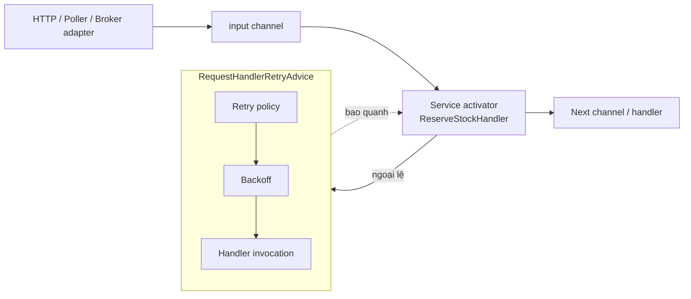
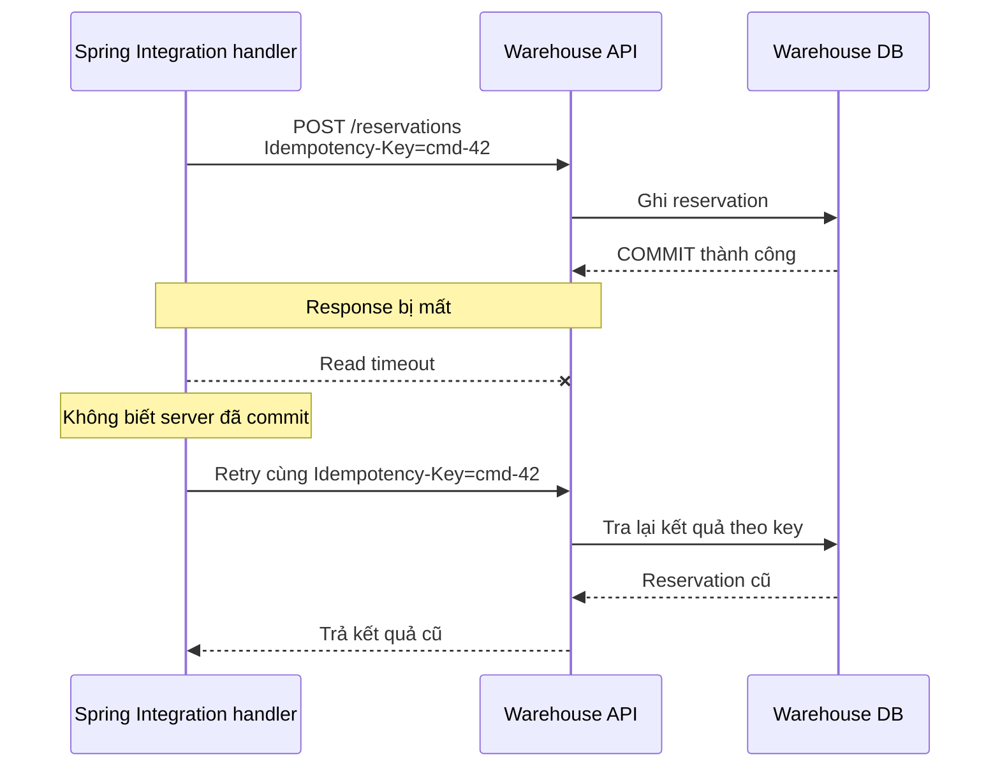
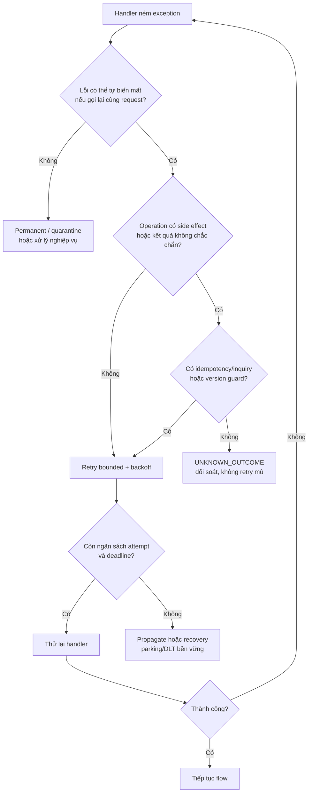

# `RequestHandlerRetryAdvice` và phân loại lỗi được phép thử lại

## 1. Bối cảnh: retry không đơn giản là gọi lại một method

Giả sử `order-service` nhận yêu cầu đặt hàng, sau đó một Spring Integration flow gọi `warehouse-service` qua HTTP để giữ tồn kho. Khi Warehouse trả `503 Service Unavailable`, ứng dụng có thể thử lại và thành công sau một khoảng chờ. Nhưng nếu Warehouse trả `400 Bad Request` vì SKU sai định dạng, gửi lại đúng request một trăm lần cũng không sửa được lỗi.

Khó hơn nữa: Warehouse có thể đã ghi reservation vào database nhưng response `201 Created` bị mất trên đường truyền. Client nhận **read timeout**, không biết lệnh đã được thực hiện hay chưa. Retry lúc này chỉ an toàn khi hợp đồng phía Warehouse bảo đảm idempotency hoặc có cơ chế đối soát trạng thái.

**`RequestHandlerRetryAdvice`** của Spring Integration cho phép áp dụng chính sách thử lại **quanh một message handler** trong `IntegrationFlow`. Nó sử dụng Spring Retry để quyết định ngoại lệ nào được thử lại, số lần thử, khoảng chờ và cách kết thúc khi đã hết lượt.

Bài học thuộc chương **Lỗi và trạng thái flow** của module **SPRING_BOOT_INTEGRATION**. Ngoài HTTP client, các adapter Spring Integration còn tương tác database, cache, file, Kafka và RabbitMQ. Vì vậy, retry phải gắn với ranh giới giao dịch, bảo đảm xử lý trùng, hợp đồng dữ liệu, error channel, kiểm thử và quan sát thực tế.

Sau bài học, bạn có thể:

1. Giải thích vị trí và phạm vi hoạt động của `RequestHandlerRetryAdvice`.
2. Cấu hình `RetryTemplate`, `SimpleRetryPolicy`, exponential backoff và advice chain.
3. Phân loại lỗi transient, permanent và **unknown outcome** trước khi quyết định retry.
4. Gắn advice vào service activator trong Java DSL mà không tạo retry chồng tầng.
5. Thiết kế recovery, error channel, parking/DLT và chính sách acknowledgment sau khi hết lượt thử.
6. Bảo vệ transaction, idempotency và thứ tự thông điệp khi handler được gọi nhiều lần.
7. Kiểm thử số lần thử, xử lý ngoại lệ, lỗi mạng và khả năng phục hồi khi restart.

> **Phiên bản:** Ví dụ dựa trên Java 17+, Spring Boot 3.x, Spring Integration 6.x và Spring Retry 2.x theo bộ dependency tương thích của dự án. Với Spring Boot 4.x/Spring Integration 7.x, kiểm tra API, configuration metadata và dependency management trước khi áp dụng. Bài tập trung vào retry đồng bộ quanh **message handler**, không coi advice là hệ thống lập lịch retry bền vững.

## 2. `RequestHandlerRetryAdvice` nằm ở đâu?

Một flow thường có input channel, transformer/filter, service activator và output channel. `RequestHandlerRetryAdvice` được gắn vào **handler cần bảo vệ**; nó không tự bao phủ toàn bộ luồng hoặc mọi hoạt động của nguồn nhận message.



**Vòng lặp tư duy:**

1. Một message đến handler.
2. Advice gọi handler lần đầu.
3. Handler thành công → flow tiếp tục; không cần retry.
4. Handler ném ngoại lệ → `RetryPolicy` đánh giá **ngoại lệ, lịch sử thử và điều kiện khác**.
5. Nếu được phép thử lại → chờ theo `BackOffPolicy` rồi **gọi lại chính handler**.
6. Nếu hết lượt/không được retry → hoặc ngoại lệ được ném ra, hoặc `RecoveryCallback` xử lý theo cấu hình.

Một lần **retry** ở đây không nhất thiết là một lần broker giao lại message. Trong cấu hình stateless thông thường, nhiều lần gọi handler có thể diễn ra **trong cùng thread, trong cùng lần delivery**. Nếu message đã được ack hoặc đã được ghi vào queue khác, hành vi hoàn toàn khác; không suy luận chỉ từ số lần retry.

### 2.1. Phạm vi và điều không được bảo đảm

| Thành phần | Advice có tác dụng gì? | Không tự làm gì? |
| --- | --- | --- |
| Service activator có advice | Thử lại invocation của handler khi handler ném lỗi phù hợp. | Không rollback side effect đã commit ở dịch vụ ngoài. |
| Handler gọi HTTP | Có thể gọi lại thao tác HTTP qua cùng method. | Không biết POST trước đó đã thành công ở provider hay chưa. |
| Handler ghi database | Có thể thử lại phần xử lý nếu transaction boundary cho phép. | Không tạo transaction mới một cách thần kỳ. |
| `DirectChannel` | Thường gọi handler đồng bộ, lỗi có thể trở lại sender. | Không cung cấp durable retry queue. |
| `ExecutorChannel` | Advice chạy quanh handler trên thread xử lý. | Sender có thể không nhận exception trực tiếp. |
| `@KafkaListener` / Rabbit listener | Advice có thể nằm trong flow mà listener gọi đến. | Không thay thế broker retry/ack/DLT/rebalance. |
| Polling file/JDBC | Handler có thể được retry sau khi nguồn phát message. | Không “hoàn tác” việc filter đã đánh dấu file đã nhận. |
| Handler thành công rồi bước kế tiếp thất bại | Bước kế tiếp tự xử lý lỗi theo cấu hình. | Advice ở handler trước không tự retry cả flow từ đầu. |

**Đặc biệt:** Nếu handler trả về một `CompletableFuture`/`Mono` nhưng công việc bên trong thất bại **sau khi handler đã trả về**, một advice đồng bộ không mặc nhiên retry lỗi bất đồng bộ đó. Cần xử lý tại boundary thực sự sở hữu kết quả và acknowledgment.

## 3. Ba nhóm kết quả cần phân loại trước khi retry

Không nên chỉ hỏi “exception có xảy ra không?”. Hãy xác định lỗi thuộc nhóm nào và lệnh có thể chạy lại mà không làm hỏng dữ liệu hay không.

### 3.1. Lỗi tạm thời (transient)

Ví dụ:

- HTTP `429 Too Many Requests`, có thể retry khi đã tôn trọng quota/`Retry-After`.
- HTTP `502 Bad Gateway`, `503 Service Unavailable` hoặc `504 Gateway Timeout` khi upstream tạm không sẵn sàng.
- DB deadlock, không lấy được lock hoặc một số exception được tầng truy cập dữ liệu phân loại là transient.
- Redis/Elasticsearch tạm unavailable khi operation có cơ chế idempotency phù hợp.
- Lỗi kết nối ngắn hạn với một **thao tác chỉ đọc**; cần có timeout và ngân sách retry.

Lỗi transient nghĩa là *có khả năng thành công ở lần sau*, **không** có nghĩa mọi lệnh đều an toàn để retry.

### 3.2. Lỗi vĩnh viễn hoặc cần thay đổi đầu vào (permanent)

Ví dụ:

- HTTP `400`/`422` vì payload không hợp lệ hoặc vi phạm schema.
- HTTP `401`/`403` vì credential sai hoặc thiếu quyền (thường cần sửa cấu hình/token).
- HTTP `404` khi tài nguyên thực sự không tồn tại theo hợp đồng.
- HTTP `409` do business conflict hoặc idempotency key bị dùng với payload khác.
- HTTP `412 Precondition Failed` do ETag/version đã cũ.
- Không deserialize được JSON do breaking change; thiếu field bắt buộc.
- File CSV sai cấu trúc, XML không hợp lệ, message thiếu khóa nghiệp vụ.

Nếu lỗi không tự mất đi khi thử lại **cùng input**, cách đúng là fail fast, báo lỗi hợp đồng hoặc đưa message vào nơi xử lý thủ công, không kéo dài thread với backoff.

### 3.3. Kết quả không chắc chắn (unknown outcome)

Ví dụ:



Lỗi network sau khi gửi lệnh ghi là tình huống **không rõ đã áp dụng hay chưa**, không đơn thuần là transient failure. Chỉ nên retry tự động nếu:

1. Operation vốn idempotent theo đúng contract và không có side effect phụ bị lặp; **hoặc**
2. Provider hỗ trợ **idempotency key** và bảo đảm cùng key/cùng payload được xử lý một lần về mặt nghiệp vụ; **hoặc**
3. Client có thể kiểm tra kết quả bằng command/business ID trước khi gửi lại và xử lý các trạng thái trung gian.

Nếu không có những bảo đảm này, cần phát trạng thái `UNKNOWN_OUTCOME` để đối soát; retry mù có thể giữ kho/thu tiền/gửi email nhiều lần.

### 3.4. Ma trận quyết định

| Loại lỗi | Ví dụ | Có thể retry? | Điều kiện bắt buộc |
| --- | --- | --- | --- |
| HTTP GET timeout | Kết nối tới catalog bị ngắt. | Thường có. | GET không có side effect; retry bounded. |
| HTTP POST trả 503 | Warehouse tạm unavailable. | Có điều kiện. | POST có idempotency key/contract hoặc tra trạng thái. |
| HTTP POST read timeout | Có thể đã commit. | **Không mặc định.** | Idempotency/inquiry hoặc parking để đối soát. |
| HTTP 429 | Quota/rate limit. | Có điều kiện. | Tôn trọng `Retry-After`, ngân sách thời gian và rate limit. |
| HTTP 500 | Lỗi server không rõ mức hoàn tất. | Tùy contract. | Đã phân tích safety của command và provider. |
| HTTP 400/422 | Dữ liệu không hợp lệ. | Không. | Sửa payload/schema. |
| HTTP 401/403 | Xác thực/phân quyền lỗi. | Không retry nguyên request. | Refresh token có kiểm soát hoặc sửa quyền rồi retry ở boundary riêng. |
| HTTP 404 | Không tìm thấy SKU. | Thường không. | Nếu eventual consistency được tài liệu hóa, có policy riêng. |
| HTTP 409/412 | Conflict/ETag lỗi thời. | Không retry mù. | Tải state mới, tính lại command nếu business cho phép. |
| JDBC deadlock | Transaction bị chọn rollback. | Có thể. | Retry **toàn bộ transaction**, đảm bảo side effect an toàn. |
| Unique constraint violation | Event/batch ID đã có. | Không như transient. | Phân biệt duplicate hợp lệ với payload conflict. |
| Kafka publish timeout | Broker có thể đã nhận record. | Có điều kiện. | Producer idempotency, key và business dedup. |
| JSON schema mismatch | Phía gửi đổi field. | Không. | Nâng contract/adapter hoặc quarantine. |

**Quy tắc mạnh nhất:** quyết định retry phải dựa trên **exception + operation + idempotency guarantee + ranh giới commit**, không chỉ status code.

## 4. Các thành phần kỹ thuật của Spring Retry

| Thành phần | Vai trò |
| --- | --- |
| `RequestHandlerRetryAdvice` | Interceptor bọc lời gọi Spring Integration message handler. |
| `RetryTemplate` | Thực thi vòng thử lại; kết hợp policy, backoff và callback. |
| `RetryPolicy` | Quyết định một exception có được retry và còn bao nhiêu lượt. |
| `SimpleRetryPolicy` | Chính sách theo số lượt và map phân loại exception. |
| `ExponentialBackOffPolicy` | Chờ tăng dần giữa các lần thử. |
| `RetryContext` | Thông tin của phiên retry, số lần thử và exception gần nhất. |
| `RecoveryCallback` | Xử lý khi retry thất bại hết hoặc không còn được phép. |
| `ErrorMessageSendingRecoverer` | Chuyển lỗi retry exhausted sang một `MessageChannel`. |

**Số lượt trong `maxAttempts` bao gồm lần gọi đầu tiên.** Ví dụ `maxAttempts=3` là tối đa ba lần thực thi handler (lần đầu và hai lần thử lại), không phải một lần đầu cộng ba lượt retry.

Một `RetryTemplate` cơ bản là retry **stateless** trong một lần invocation. Nó không lưu lịch sử xuyên restart; muốn trì hoãn hàng giờ, xử lý crash hoặc phục hồi sau broker redelivery cần trạng thái bền vững, scheduler/queue và quy trình retry khác.

## 5. Dependency và cấu hình tối thiểu

Ví dụ Maven cho Spring Boot 3.x:

```xml
<!-- pom.xml sử dụng Spring Boot parent/BOM tương ứng -->
<dependency>
    <groupId>org.springframework.boot</groupId>
    <artifactId>spring-boot-starter-integration</artifactId>
</dependency>
<dependency>
    <groupId>org.springframework.retry</groupId>
    <artifactId>spring-retry</artifactId>
</dependency>
<dependency>
    <groupId>org.springframework.boot</groupId>
    <artifactId>spring-boot-starter-web</artifactId>
</dependency>
<dependency>
    <groupId>org.springframework.boot</groupId>
    <artifactId>spring-boot-starter-test</artifactId>
    <scope>test</scope>
</dependency>
<dependency>
    <groupId>org.springframework.integration</groupId>
    <artifactId>spring-integration-test</artifactId>
    <scope>test</scope>
</dependency>
```

Ở đây `spring-retry` được khai báo tường minh để code sử dụng các class `RetryTemplate`, `RetryPolicy`, `BackOffPolicy` một cách rõ ràng. Boot BOM quản lý version tương thích; không ghép một bản Spring Retry ngẫu nhiên với Spring Integration trong production.

Ví dụ cấu hình upstream:

```yaml
# application.yml
clients:
  warehouse:
    base-url: ${WAREHOUSE_BASE_URL:https://warehouse.example.internal}
    connect-timeout: 2s
    read-timeout: 5s

integration:
  warehouse:
    retry:
      attempts: 3
      initial-backoff: 250ms
      max-backoff: 2s
```

Những thuộc tính `integration.warehouse.retry.*` là **cấu hình riêng của ứng dụng**, không phải thuộc tính được Spring Integration tự động nhận diện. Bài minh họa trước với giá trị cố định trong bean, sau đó giải thích cách externalize policy.

## 6. Ánh xạ lỗi HTTP thành ngoại lệ có ý nghĩa

Thực hành tốt là để gateway HTTP phân loại lỗi theo **hợp đồng của operation**, rồi `RequestHandlerRetryAdvice` chỉ quyết định retry dựa trên các exception đã được chuẩn hóa. Điều này tránh một `SimpleRetryPolicy` chung phải hiểu mọi thư viện HTTP, JDBC và Kafka.

### 6.1. Lệnh mẫu và exception

```java
// ReserveStockCommand.java
public record ReserveStockCommand(
    String commandId,
    String orderId,
    String sku,
    int quantity
) {}

// ReserveStockRequest.java
public record ReserveStockRequest(
    String orderId,
    String sku,
    int quantity
) {}

// RetryableWarehouseException.java
public final class RetryableWarehouseException extends RuntimeException {
    public RetryableWarehouseException(String message, Throwable cause) {
        super(message, cause);
    }
}

// NonRetryableWarehouseException.java
public final class NonRetryableWarehouseException extends RuntimeException {
    public NonRetryableWarehouseException(String message, Throwable cause) {
        super(message, cause);
    }
}
```

Các `public` type được đặt trong **file Java riêng cùng tên**. Tên `RetryableWarehouseException` là đánh dấu cho policy, không phải bằng chứng tất cả lệnh đến Warehouse đều retry an toàn. Chỉ sử dụng nó khi operation được bảo vệ bằng idempotency/inquiry như đã thỏa thuận.

### 6.2. `WarehouseGateway` dùng `RestClient`

Giả định API Warehouse hỗ trợ `Idempotency-Key` và lưu cùng kết quả cho cùng lệnh/payload, kể cả sau timeout. Mỗi `ReserveStockCommand` đã có `commandId` ổn định từ trước khi gửi lần đầu.

```java
// WarehouseGateway.java
import org.springframework.http.HttpStatus;
import org.springframework.http.MediaType;
import org.springframework.web.client.HttpClientErrorException;
import org.springframework.web.client.HttpServerErrorException;
import org.springframework.web.client.ResourceAccessException;
import org.springframework.web.client.RestClient;

public final class WarehouseGateway {
    private final RestClient client;

    public WarehouseGateway(RestClient client) {
        this.client = client;
    }

    public void reserve(ReserveStockCommand command) {
        if (command.commandId() == null
            || command.commandId().isBlank()
            || command.orderId() == null
            || command.quantity() <= 0) {
            throw new IllegalArgumentException("Lệnh giữ hàng không hợp lệ");
        }

        try {
            var response = client.post()
                .uri("/api/v1/reservations")
                .contentType(MediaType.APPLICATION_JSON)
                .header("Idempotency-Key", command.commandId())
                .body(new ReserveStockRequest(
                    command.orderId(),
                    command.sku(),
                    command.quantity()
                ))
                .retrieve()
                .toBodilessEntity();

            if (response.getStatusCode() != HttpStatus.CREATED) {
                throw new NonRetryableWarehouseException(
                    "Warehouse trả status khác 201", null
                );
            }
        } catch (HttpClientErrorException.TooManyRequests ex) {
            throw new RetryableWarehouseException(
                "Warehouse rate limit (HTTP 429)", ex
            );
        } catch (HttpClientErrorException ex) {
            throw new NonRetryableWarehouseException(
                "Warehouse từ chối lệnh (HTTP "
                    + ex.getStatusCode().value() + ")", ex
            );
        } catch (HttpServerErrorException ex) {
            int status = ex.getStatusCode().value();
            if (status == 502 || status == 503 || status == 504) {
                throw new RetryableWarehouseException(
                    "Warehouse tạm thời không sẵn sàng (HTTP " + status + ")",
                    ex
                );
            }
            throw new NonRetryableWarehouseException(
                "Lỗi server cần phân tích (HTTP " + status + ")", ex
            );
        } catch (ResourceAccessException ex) {
            // Chỉ coi là retryable vì contract của endpoint này
            // có idempotency key bền vững, kể cả khi kết quả không rõ.
            throw new RetryableWarehouseException(
                "Lỗi kết nối/timeout: kết quả lệnh có thể không rõ", ex
            );
        }
    }
}
```

Giải thích:

- `429` được tách khỏi 4xx còn lại; nó thường có khả năng phục hồi, nhưng **policy exponential backoff đơn giản chưa tự đọc `Retry-After`**.
- `502/503/504` được coi là retryable **chỉ cho thao tác này** nhờ hợp đồng idempotency. Một HTTP 500 khác cần phân tích nguyên nhân, không được mặc định retry.
- `400/401/403/404/409/412` không được thử lại nguyên lệnh. Nếu 409 phản ánh một reservation đã tồn tại, gateway có thể tra cứu trạng thái và đối chiếu theo contract thay vì chỉ ném exception; điều đó nằm ở tầng nghiệp vụ.
- `ResourceAccessException` bao gồm một số lỗi I/O/timeout không cho biết provider đã commit hay chưa. Một HTTP command **không** được bảo vệ bằng idempotency phải đưa loại lỗi này tới trạng thái đối soát, không dùng policy này mù quáng.
- Lỗi parse response, serialization hoặc validation không được biến thành `RetryableWarehouseException` vì retry cùng dữ liệu thường không sửa hợp đồng.

Nếu provider trả `202 Accepted` cho lệnh bất đồng bộ, code trên sẽ đánh giá không đúng hợp đồng; cần thay bằng kết quả `PENDING` và status inquiry/event thay vì coi nó là 201. Lựa chọn này phải dựa trên API thực tế.

## 7. Tạo `RequestHandlerRetryAdvice` với whitelist exception

### 7.1. Cấu hình `RetryTemplate` có giới hạn

```java
// WarehouseRetryConfiguration.java
import java.util.HashMap;
import java.util.Map;
import org.springframework.context.annotation.Bean;
import org.springframework.context.annotation.Configuration;
import org.springframework.integration.handler.advice.RequestHandlerRetryAdvice;
import org.springframework.retry.backoff.ExponentialBackOffPolicy;
import org.springframework.retry.policy.SimpleRetryPolicy;
import org.springframework.retry.support.RetryTemplate;

@Configuration(proxyBeanMethods = false)
public class WarehouseRetryConfiguration {

    @Bean
    RequestHandlerRetryAdvice warehouseRetryAdvice() {
        Map<Class<? extends Throwable>, Boolean> retryable =
            new HashMap<>();
        retryable.put(RetryableWarehouseException.class, true);

        // 3 attempts = một lần đầu + tối đa hai lần retry.
        SimpleRetryPolicy retryPolicy =
            new SimpleRetryPolicy(3, retryable, true);

        ExponentialBackOffPolicy backoff =
            new ExponentialBackOffPolicy();
        backoff.setInitialInterval(250L);
        backoff.setMultiplier(2.0);
        backoff.setMaxInterval(2_000L);

        RetryTemplate template = new RetryTemplate();
        template.setRetryPolicy(retryPolicy);
        template.setBackOffPolicy(backoff);

        RequestHandlerRetryAdvice advice =
            new RequestHandlerRetryAdvice();
        advice.setRetryTemplate(template);

        // Không khai báo RecoveryCallback ở ví dụ này:
        // nếu hết lượt, lỗi được đẩy ngược đến boundary gọi handler.
        return advice;
    }
}
```

Điểm quan trọng:

- **Whitelist:** chỉ `RetryableWarehouseException` được phép thử lại. Không thêm `Exception.class` hoặc `RuntimeException.class` vào whitelist vì chúng sẽ bao phủ validation, serialization và business bugs.
- Tham số `true` ở constructor `SimpleRetryPolicy` cho phép **traverse causes**; hữu ích vì exception có thể được Spring Integration bọc trong `MessageHandlingException`. Vẫn cần test exception wrapping thật ở endpoint cụ thể.
- `maxAttempts=3` và exponential backoff 250 ms → 500 ms tương ứng hai khoảng chờ trong trường hợp cả ba lần đều lỗi. Không nên coi khoảng chờ là deadline tổng của request.
- Nếu có retry sau restart/broker redelivery, số lượt sẽ tiếp tục ở một **cơ chế ngoài memory**; cấu hình `RetryTemplate` này không tự tích lũy số lượt toàn hệ thống.

### 7.2. Vì sao phải tránh default retry policy quá rộng?

Một số cấu hình `RetryTemplate` mặc định/quickstart cho phép thử lại nhiều loại `Exception`. Trong môi trường production, điều đó dễ biến lỗi lập trình thành retry storm:

```text
NullPointerException -> retry -> retry -> retry
IllegalArgumentException (sai SKU) -> retry -> retry -> retry
HttpClientErrorException.Unauthorized -> retry -> retry -> retry
```

**Định nghĩa policy tường minh** cho từng business operation. Với nhiều handler, tạo advice hoặc retry template riêng, không bắt mọi endpoint sử dụng một whitelist chung.

### 7.3. Backoff và jitter

Nếu 100 pod đồng thời nhận 503 rồi retry sau đúng 250 ms và 500 ms, các đợt request có thể đồng bộ hóa gây **thundering herd**. Jitter làm thời điểm retry phân tán. Spring Retry cung cấp các backoff policy có yếu tố ngẫu nhiên, chẳng hạn `ExponentialRandomBackOffPolicy`; tùy phiên bản/API bạn có thể thay thế policy cố định sau khi kiểm thử.

Với HTTP 429, header `Retry-After` có thể chỉ định số giây hoặc HTTP date. `ExponentialBackOffPolicy` ở ví dụ **không tự động** đọc header này. Nếu upstream yêu cầu đợi lâu hoặc rate limit tính theo phút, nên dùng retry scheduler/queue có delay đủ dài, hoặc custom backoff policy được thiết kế để tôn trọng `Retry-After`. Đừng ngủ hàng phút trên một servlet hoặc poller thread.

## 8. Gắn advice vào `IntegrationFlow`

### 8.1. Khai báo client và handler

```java
// WarehouseFlowConfiguration.java
import java.net.http.HttpClient;
import java.time.Duration;
import org.springframework.beans.factory.annotation.Qualifier;
import org.springframework.beans.factory.annotation.Value;
import org.springframework.context.annotation.Bean;
import org.springframework.context.annotation.Configuration;
import org.springframework.http.client.JdkClientHttpRequestFactory;
import org.springframework.integration.dsl.IntegrationFlow;
import org.springframework.integration.handler.advice.RequestHandlerRetryAdvice;
import org.springframework.web.client.RestClient;

@Configuration(proxyBeanMethods = false)
public class WarehouseFlowConfiguration {

    @Bean("warehouseRestClient")
    RestClient warehouseRestClient(
        RestClient.Builder builder,
        @Value("${clients.warehouse.base-url}") String baseUrl
    ) {
        HttpClient http = HttpClient.newBuilder()
            .connectTimeout(Duration.ofSeconds(2))
            .build();
        JdkClientHttpRequestFactory factory =
            new JdkClientHttpRequestFactory(http);
        factory.setReadTimeout(Duration.ofSeconds(5));

        return builder.baseUrl(baseUrl)
            .requestFactory(factory)
            .build();
    }

    @Bean
    WarehouseGateway warehouseGateway(
        @Qualifier("warehouseRestClient") RestClient client
    ) {
        return new WarehouseGateway(client);
    }

    @Bean
    IntegrationFlow reserveStockFlow(
        WarehouseGateway gateway,
        RequestHandlerRetryAdvice warehouseRetryAdvice
    ) {
        return IntegrationFlow.from("reserveStockRequests")
            .handle(
                gateway,
                "reserve",
                endpoint -> endpoint.advice(warehouseRetryAdvice)
            )
            .get();
    }
}
```

`reserveStockRequests` là message channel đầu vào do Java DSL đăng ký. Với flow đơn giản như trên, handler đồng bộ và exception có thể trở về sender; nếu thay channel bằng executor/queue hoặc listener có adapter riêng, phải xem lại cách lỗi được route và message được ack.

**Lưu ý:** Trong cấu hình này timeout HTTP viết cố định để tập trung vào advice; khi triển khai thực, bind `connect-timeout`/`read-timeout` từ cấu hình để tránh YAML và giá trị Java mâu thuẫn. Đồng thời nên giới hạn deadline của cả flow, không chỉ một lần HTTP call.

### 8.2. Gửi message vào flow

```java
import org.springframework.beans.factory.annotation.Qualifier;
import org.springframework.messaging.MessageChannel;
import org.springframework.messaging.support.MessageBuilder;

public class ReservationFlowSender {
    private final MessageChannel channel;

    public ReservationFlowSender(
        @Qualifier("reserveStockRequests") MessageChannel channel
    ) {
        this.channel = channel;
    }

    public void submit(ReserveStockCommand command) {
        if (!channel.send(
            MessageBuilder.withPayload(command).build()
        )) {
            throw new IllegalStateException("Không gửi được vào flow");
        }
    }
}
```

Đây là class minh họa cách gọi channel, chưa được đăng ký thành Spring bean trong đoạn code. Khi dùng `DirectChannel` đồng bộ và handler chưa có recovery callback, nếu handler còn ném exception sau retry, `send(...)` cũng có thể ném lỗi thay vì trả `false`. Với channel bất đồng bộ, `send(...) == true` chỉ cho biết message đã được nhận vào channel; **không phải** Warehouse đã giữ hàng thành công.

### 8.3. Phạm vi advice chain

```text
Input -> Transformer -> [Retry Advice -> Warehouse Handler] -> Audit Handler
          ^                         ^                        ^
          |                         |                        |
    không tự retry            được retry             không tự retry
```

Nếu `Transformer` throw do JSON sai, advice ở Warehouse handler không chạy. Nếu Warehouse đã thành công nhưng Audit handler sau đó thất bại, advice trên Warehouse handler không tự chạy lại ở lần đó. Nếu upstream redeliver **toàn bộ message** sau lỗi Audit, Warehouse có thể bị gọi lại: đó là lý do cần idempotency end-to-end.

## 9. Stateless retry, stateful retry và delivery boundary

### 9.1. Stateless retry

Với cấu hình ở trên:

```text
Receive message #42
  Attempt 1 -> 503
  Backoff 250 ms
  Attempt 2 -> 503
  Backoff 500 ms
  Attempt 3 -> 201
Return success to current caller
```

Đặc điểm:

- Các attempt thuộc cùng một lần xử lý message trong process.
- Thường chiếm thread trong khi chờ backoff.
- Crash ở attempt 2 không làm `RetryTemplate` tự lưu số attempt để tiếp tục sau restart.
- Nếu broker phát lại message, một chu kỳ tối đa ba attempt **mới** có thể diễn ra.

### 9.2. Stateful retry

Spring Retry có khái niệm stateful retry: trạng thái các lần thử gắn với khóa nhận diện của một thao tác, phục vụ một số kiểu transaction/redelivery. Các phiên bản Spring Integration có khả năng cấu hình stateful retry qua các thành phần tương ứng, nhưng **không mặc định bật** khi tạo `RequestHandlerRetryAdvice` như ví dụ.

Stateful retry không tự đồng nghĩa lưu bền qua mọi restart: độ bền và chia sẻ trạng thái phụ thuộc `RetryContextCache`/key/state generator và phạm vi process. Muốn retry được kiểm soát qua crash và nhiều instance, ưu tiên mô hình lưu **attempt counter, nextAttemptAt, lease và trạng thái nghiệp vụ** trong database/queue hoặc tận dụng cơ chế broker retry phù hợp.

**Không dùng message UUID được tạo lại mỗi delivery** làm business dedup key. Dùng `commandId`/`eventId` ổn định qua retry, redelivery và restart.

### 9.3. Hai kiểu retry thường bị nhầm

| Kiểu | Điều gì lặp lại? | Ai kiểm soát? |
| --- | --- | --- |
| Handler retry | Cùng method xử lý message được gọi lại. | `RequestHandlerRetryAdvice` + `RetryTemplate`. |
| Broker redelivery | Broker/adapter giao message lại cho listener/flow. | Kafka/RabbitMQ/ack/rebalance/DLT policy. |
| Scheduled delayed retry | Message lưu và xử lý lại tại thời điểm tương lai. | Queue/scheduler/database state. |
| Caller HTTP retry | Bên gọi endpoint `POST /orders` gửi lại request. | Client API, idempotency key, HTTP retry policy. |

Một message có thể đi qua **tất cả bốn lớp**. Nếu mỗi lớp tự retry ba lần, số thao tác downstream tối đa có thể nhân lên; cần chỉ định một **chủ sở hữu retry** cho mỗi ranh giới và một ngân sách tổng thể.

## 10. Hết lượt thử: ném lỗi hay recovery?

Đây là quyết định có ảnh hưởng đến delivery semantics. Khi `RetryTemplate` không còn cho phép retry:

1. **Không có recovery callback**: ngoại lệ còn lại được ném ra khỏi handler invocation (có thể được Spring Integration bọc bằng exception messaging).
2. **Có `RecoveryCallback`**: callback được gọi; kết quả của callback quyết định luồng tiếp tục như thế nào. Nếu callback xử lý lỗi và trả bình thường, phía gọi có thể coi invocation đã được phục hồi.

### 10.1. Propagate exception khi boundary trên sở hữu retry

Phù hợp khi `@KafkaListener` hoặc Rabbit listener đang quản lý redelivery/DLT, hoặc caller đồng bộ cần nhận failure:

```java
RequestHandlerRetryAdvice advice =
    new RequestHandlerRetryAdvice();
advice.setRetryTemplate(template);
// Không setRecoveryCallback.
```

Trong một flow trực tiếp, exception có thể trở về sender. Trong một flow bắt đầu bởi broker listener, exception có thể đi qua adapter/container để error handler xử lý **nếu đường gọi/ack không nuốt lỗi**. Hãy kiểm tra hành vi thực tế của adapter và executor.

### 10.2. Dùng `ErrorMessageSendingRecoverer`

Khi muốn chuyển lỗi đã thử hết sang một channel riêng, Spring Integration cung cấp `ErrorMessageSendingRecoverer`. Ví dụ cấu hình **thay thế** cho advice không recovery ở trên:

```java
import org.springframework.integration.channel.DirectChannel;
import org.springframework.integration.handler.advice.ErrorMessageSendingRecoverer;
import org.springframework.integration.handler.advice.RequestHandlerRetryAdvice;
import org.springframework.messaging.MessageChannel;
import org.springframework.context.annotation.Bean;
import org.springframework.beans.factory.annotation.Qualifier;

@Bean
MessageChannel exhaustedReservations() {
    return new DirectChannel();
}

@Bean
RequestHandlerRetryAdvice warehouseRetryAdviceWithRecovery(
    RetryTemplate warehouseRetryTemplate,
    @Qualifier("exhaustedReservations") MessageChannel errorChannel
) {
    RequestHandlerRetryAdvice advice =
        new RequestHandlerRetryAdvice();
    advice.setRetryTemplate(warehouseRetryTemplate);
    advice.setRecoveryCallback(
        new ErrorMessageSendingRecoverer(errorChannel)
    );
    return advice;
}
```

Trong đó `warehouseRetryTemplate` là `RetryTemplate` được đăng ký làm bean riêng từ phần cấu hình policy. **Không copy cả hai bean advice vào một context rồi inject theo type không qualifier**; chọn một phương án và đặt tên phù hợp.

Recoverer gửi một `ErrorMessage` chứa thông tin exception và context message thất bại đến channel. Cần gắn một handler lưu **bản ghi parking bền vững** hoặc chuyển tới retry/DLT có kiểm soát, ví dụ:

```text
Retry exhausted
  -> ErrorMessageSendingRecoverer
  -> exhaustedReservations channel
  -> Persist failed command (DB) / DLT
  -> Alert + operator replay
```

**Cảnh báo cực kỳ quan trọng:** Nếu recovery callback **chỉ gửi lỗi lên một channel và trả bình thường**, upstream có thể coi message đã xử lý xong và **ack/commit offset**. Nếu error channel chỉ là `DirectChannel`/`QueueChannel` trong bộ nhớ, crash có thể làm mất command. Do đó phải quyết định rõ:

- Đã lưu parking record/DLT **bền vững** chưa?
- Có cần acknowledgment sau khi parking commit không?
- Nếu gửi DLT thất bại thì recovery callback phải phát sinh lỗi ra sao?
- Message được replay bởi ai và theo khóa gì?
- Một lỗi đã được “recovered” có đang bị KPI thành công che khuất không?

Không dùng recoverer như cách “nuốt exception cho hệ thống chạy xanh” nếu chưa có cơ chế phục hồi.

## 11. Transaction boundary: retry tại đâu cho an toàn?

### 11.1. Retry trong một transaction có thể sai

Giả sử:

```java
@Transactional
public void process(ReserveStockCommand command) {
    orderRepository.save(...);
    warehouseGateway.reserve(command);
}
```

Nếu transaction bên ngoài đã bị đánh dấu `rollback-only` sau lỗi DB, retry mỗi phần gateway có thể không giải quyết được trạng thái transaction. Hơn nữa, giữ transaction DB mở trong khi chờ HTTP backoff làm tăng lock/connection hold time. Nếu Warehouse đã commit nhưng Order DB rollback, retry/rollback local không hoàn tác Warehouse.

### 11.2. Retry toàn bộ đơn vị transactional cần thiết

Với một operation database **thuần local**:

```text
Retry Advice
  -> Transaction boundary (mỗi attempt)
      -> Read data
      -> Apply business rule
      -> Write database
      -> Commit
```

Nếu transaction bị deadlock, retry cần bắt đầu với **transaction mới và đọc state mới**. Không đặt một retry loop ở **bên trong** transaction đã rollback-only.

Với luồng HTTP + DB + broker, thường tách:

1. Ghi lệnh/pending state + outbox trong local DB transaction.
2. Worker/consumer nhận lệnh và gọi Warehouse với stable idempotency key.
3. Cập nhật trạng thái thành công/thất bại hoặc cần đối soát.
4. Khi có event, dùng inbox/version để ngăn processing trùng.

Việc cấu hình thứ tự advice chain, Spring transaction interceptor và message handler proxy phải được kiểm thử thực tế; đừng chỉ nhìn annotation `@Transactional` rồi kết luận mỗi attempt có transaction mới.

### 11.3. Phát sinh side effect trước khi lỗi

```text
handler invocation:
  write DB SUCCESS
  send email SUCCESS
  call downstream FAILED (503)

RequestHandlerRetryAdvice retries handler:
  write DB AGAIN?
  send email AGAIN?
  call downstream AGAIN
```

Retry **toàn bộ handler** có thể lặp những bước đã thành công. Cách sửa là thu nhỏ handler thành một operation idempotent, chia các bước ra thành state machine, hoặc dùng outbox/inbox và idempotency key cho từng side effect.

## 12. Kafka, RabbitMQ và file adapter: khác biệt quan trọng

### 12.1. Kafka consumer

Với Kafka:

- `@KafkaListener`/Spring Integration Kafka inbound adapter có chính sách acknowledgment, commit offset và error handler riêng.
- Advice trên handler retry ngay trong cùng delivery, có thể chặn consumer thread.
- Sau khi hết lượt, nếu exception propagate, container error handler có thể retry/reseek/đưa DLT tùy cấu hình.
- Nếu dùng `RecoveryCallback` nuốt lỗi, container có thể coi lần xử lý thành công và commit offset. Phải bảo đảm command đã được lưu vào nơi bền vững trước khi chấp nhận điều đó.
- Cùng message có thể được giao lại khi process crash sau DB commit nhưng trước offset commit; handler vẫn phải idempotent.

Đừng đồng thời cấu hình `RequestHandlerRetryAdvice` ba lần, Kafka error handler mười lần và retry topic hai mươi lần mà không định nghĩa tổng số request đến upstream.

### 12.2. RabbitMQ consumer

Với RabbitMQ, acknowledgment/nack/requeue và dead-letter exchange quyết định message quay lại hay bị chuyển nơi khác. Handler retry không tạo ra DLT tự động. Nếu consumer requeue message ngay mỗi khi hết lượt, một bản ghi lỗi vĩnh viễn có thể trở thành **poison message** lặp vô hạn. Đối với permanent errors, chuyển parking/DLT hoặc reject không requeue theo chính sách.

### 12.3. File inbound adapter

Khi poller đọc file qua `FileReadingMessageSource` và `AcceptOnceFileListFilter`, việc file đã được phát ra khỏi nguồn có thể khiến nó bị đánh dấu “đã thấy”. Advice trên handler không tự xóa dấu đó khi xử lý lỗi. Nếu cần retry sau restart, thiết kế archive/quarantine, persistent metadata, trạng thái batch và idempotency DB. Không coi `RequestHandlerRetryAdvice` là thay thế cho pipeline nhận file bền vững.

### 12.4. HTTP inbound caller

Nếu API Controller gửi message qua `DirectChannel` tới handler:

- Retry advice làm HTTP request của caller chờ thêm cho đến khi thành công/hết lượt.
- Cần tính **tổng deadline** của controller, load balancer và upstream, không để client đã timeout mà server vẫn retry tốn tài nguyên.
- Với workflow dài, HTTP endpoint có thể trả `202 Accepted` với job ID và xử lý lại bằng queue/scheduler thay vì chặn request.

## 13. Thiết kế phân loại lỗi theo adapter

Một whitelist chung cho mọi lỗi sẽ nhanh chóng sai khi hệ thống tích hợp nhiều kiểu nguồn. Nên định nghĩa taxonomy theo business operation và gateway:

| Adapter | Retryable khi... | Không retry khi... | Ngoài phạm vi advice |
| --- | --- | --- | --- |
| HTTP `RestClient` GET | Connect/read timeout, 429, 502/503/504 theo policy. | 400/401/403/404/422 hoặc JSON sai. | TLS, auth rotation, circuit breaker. |
| HTTP POST/PATCH | Có idempotency/inquiry và lỗi thực sự có thể hồi phục. | Input invalid, duplicate conflict khác payload. | Unknown outcome reconciliation. |
| JDBC/jOOQ/JPA | Deadlock, transient DB connection/lock theo isolation và transaction. | Unique conflict, validation/mapping error. | Transaction boundary, schema migration. |
| MongoDB | Transient transaction error với transaction mới và operation idempotent. | Unauthorized, schema validation, duplicate key. | Session, topology/replica set. |
| Redis | Read-only cache query/reconnect; một số lệnh idempotent. | Command invalid, key format lỗi, counter increments không có chống trùng. | Fallback và cache consistency. |
| Kafka producer | Retryable broker failures với producer/idempotency đúng. | Serialization/schema error, ACL denial. | Delivery acknowledgment và DLT. |
| File adapter | Transient permission/network-share incident nếu source bền và replay an toàn. | CSV/XML sai schema, checksum mismatch. | Source file claims, archive/quarantine. |

**Lỗi vĩnh viễn có thể trở thành lỗi tạm thời sau khi người vận hành sửa hệ thống**, ví dụ 401 do token hết hạn; nhưng điều này không có nghĩa handler nên tự thử lại ngay cùng token trong một giây. Cần tách hành động **refresh/reconfigure** và thời điểm retry thích hợp.

## 14. Bộ kiểm thử cho retry advice

### 14.1. Unit test policy bằng `RetryTemplate`

Test policy độc lập giúp xác minh số lượt và whitelist exception trước khi gắn vào flow:

```java
import static org.junit.jupiter.api.Assertions.assertEquals;
import static org.junit.jupiter.api.Assertions.assertThrows;

import java.util.HashMap;
import java.util.Map;
import java.util.concurrent.atomic.AtomicInteger;
import org.junit.jupiter.api.Test;
import org.springframework.retry.policy.SimpleRetryPolicy;
import org.springframework.retry.support.RetryTemplate;

class WarehouseRetryPolicyTest {

    private RetryTemplate retryTemplate() {
        Map<Class<? extends Throwable>, Boolean> retryable =
            new HashMap<>();
        retryable.put(RetryableWarehouseException.class, true);

        RetryTemplate template = new RetryTemplate();
        template.setRetryPolicy(
            new SimpleRetryPolicy(3, retryable, true)
        );
        // Không thiết lập backoff để unit test chạy nhanh.
        return template;
    }

    @Test
    void transientExceptionIsRetriedUpToThreeAttempts() {
        AtomicInteger attempts = new AtomicInteger();

        String result = retryTemplate().execute(context -> {
            int attempt = attempts.incrementAndGet();
            if (attempt < 3) {
                throw new RetryableWarehouseException("503", null);
            }
            return "OK";
        });

        assertEquals("OK", result);
        assertEquals(3, attempts.get());
    }

    @Test
    void permanentExceptionIsNotRetried() {
        AtomicInteger attempts = new AtomicInteger();

        assertThrows(NonRetryableWarehouseException.class,
            () -> retryTemplate().execute(context -> {
                attempts.incrementAndGet();
                throw new NonRetryableWarehouseException("400", null);
            })
        );

        assertEquals(1, attempts.get());
    }
}
```

**Đây chỉ là unit test `RetryTemplate`**, không chứng minh advice đã được gắn đúng vào handler của `IntegrationFlow`. Cần thêm integration test cho việc wire advice.

### 14.2. Kiểm thử advice thực sự bao quanh handler

Ví dụ JUnit 5/Spring Test với một handler giả lập thất bại hai lần đầu:

```java
import static org.junit.jupiter.api.Assertions.assertEquals;
import static org.junit.jupiter.api.Assertions.assertTrue;

import java.util.HashMap;
import java.util.Map;
import java.util.concurrent.atomic.AtomicInteger;
import org.junit.jupiter.api.Test;
import org.springframework.beans.factory.annotation.Autowired;
import org.springframework.beans.factory.annotation.Qualifier;
import org.springframework.context.annotation.Bean;
import org.springframework.context.annotation.Configuration;
import org.springframework.integration.dsl.IntegrationFlow;
import org.springframework.integration.handler.advice.RequestHandlerRetryAdvice;
import org.springframework.messaging.MessageChannel;
import org.springframework.messaging.support.MessageBuilder;
import org.springframework.retry.policy.SimpleRetryPolicy;
import org.springframework.retry.support.RetryTemplate;
import org.springframework.test.context.junit.jupiter.SpringJUnitConfig;

@SpringJUnitConfig(RetryAdviceFlowTest.TestConfig.class)
class RetryAdviceFlowTest {

    @Autowired
    @Qualifier("retryCommands")
    MessageChannel input;

    @Autowired
    FlakyHandler handler;

    @Test
    void adviceRetriesTheActualMessageHandler() {
        assertTrue(input.send(
            MessageBuilder.withPayload("cmd-42").build()
        ));
        assertEquals(3, handler.attempts.get());
    }

    static class FlakyHandler {
        final AtomicInteger attempts = new AtomicInteger();

        public void process(String commandId) {
            if (attempts.incrementAndGet() < 3) {
                throw new RetryableWarehouseException("503", null);
            }
        }
    }

    @Configuration(proxyBeanMethods = false)
    static class TestConfig {
        @Bean
        FlakyHandler flakyHandler() {
            return new FlakyHandler();
        }

        @Bean
        RequestHandlerRetryAdvice testRetryAdvice() {
            Map<Class<? extends Throwable>, Boolean> retryable =
                new HashMap<>();
            retryable.put(RetryableWarehouseException.class, true);
            RetryTemplate template = new RetryTemplate();
            template.setRetryPolicy(
                new SimpleRetryPolicy(3, retryable, true)
            );

            RequestHandlerRetryAdvice advice =
                new RequestHandlerRetryAdvice();
            advice.setRetryTemplate(template);
            return advice;
        }

        @Bean
        IntegrationFlow testFlow(
            FlakyHandler handler,
            RequestHandlerRetryAdvice advice
        ) {
            return IntegrationFlow.from("retryCommands")
                .handle(handler, "process", e -> e.advice(advice))
                .get();
        }
    }
}
```

Test này quan sát đủ ba invocation trong **một message delivery**. Với lỗi permanent và handler ném ngay, nên test xác minh chỉ có một lần gọi và exception propagate; khi có recovery callback, test phải kiểm tra parking record thực sự được lưu trước khi đánh dấu xong.

### 14.3. Kiểm thử endpoint HTTP với mock server

Dùng `MockRestServiceServer` hoặc WireMock để kiểm tra `WarehouseGateway`:

- Lần 1 trả 503, lần 2 trả 201; assert cùng URL, payload và **cùng Idempotency-Key**.
- Trả 400 → một request duy nhất, không retry.
- Trả 429 kèm `Retry-After` → policy phải xử lý thời gian chờ hoặc trì hoãn bền vững theo thiết kế.
- Lỗi kết nối/read timeout sau khi provider đã ghi → mô phỏng replay và kiểm tra chỉ có một reservation.
- Lần cuối vẫn 503 → exception hoặc parking/DLT theo cấu hình.

`MockRestServiceServer` không mô phỏng hoàn chỉnh TCP reset, TLS và connection pool; cần WireMock/MockWebServer hoặc service test thật cho network behavior.

### 14.4. Ma trận test lỗi và giao dịch

| Test | Dự kiến |
| --- | --- |
| Handler thành công ngay | Một invocation, không backoff. |
| Handler 503 hai lần rồi thành công | Tối đa ba invocation, message tiếp tục. |
| Handler 400 | Một invocation, fail fast. |
| Handler throw wrapped exception | `traverseCauses=true` nhận đúng retryable cause. |
| Hết maxAttempts | Không thử lần thứ tư; exception/recovery rõ ràng. |
| Retry-After lớn | Không giữ thread quá thời gian SLA; chuyển delayed retry nếu cần. |
| DB deadlock | Mỗi attempt có transaction sạch nếu policy yêu cầu. |
| DB đã commit, response HTTP mất | Cùng commandId, không nhân đôi side effect. |
| Kafka redelivery | Business inbox/idempotency ngăn lặp dù restart. |
| Recovery callback | Parking/DLT bền vững trước ack; lỗi parking không bị nuốt. |
| Hai instance retry cùng command | Unique key/version ngăn nhân đôi trạng thái. |
| Poison message | Không lặp vô hạn, được quarantine/DLT và có thể replay. |
| Retry storm | Throttle/jitter/metrics hoạt động dưới tải. |

## 15. Quan sát và quản trị retry trong production

### 15.1. Metrics nên thu thập

| Metric/tín hiệu | Dùng để |
| --- | --- |
| `integration.handler.attempts` theo handler/exception category | Phát hiện endpoint thường xuyên phải retry. |
| Tỷ lệ thành công sau attempt 2/3 | Đánh giá lợi ích của retry ngắn hạn. |
| Retry exhausted count | Phát hiện lỗi kéo dài/poison messages. |
| Backoff wait time và handler latency | Đo tác động lên poller/consumer threads. |
| Parking/DLT backlog và tuổi message cũ nhất | Đảm bảo lỗi không bị bỏ quên. |
| HTTP 429/503, connect/read timeout | Phân biệt rate limit với outage. |
| Unknown-outcome count và reconciliation age | Theo dõi lệnh có khả năng đã commit ở upstream. |
| Kafka consumer lag / queue depth | Đánh giá ảnh hưởng của retry lên throughput. |
| DB duplicate-key/conflict count | Phát hiện replay và xung đột key/payload. |

Tránh dùng `orderId`, `commandId`, tên khách hàng hoặc URL chứa query làm **metric tag**; cardinality lớn và có nguy cơ lộ dữ liệu. Dùng handler name, exception category, status group, upstream alias và outcome. Business IDs có thể xuất hiện trong structured log/traces có kiểm soát truy cập và retention thích hợp.

### 15.2. Log theo từng lần thử mà không làm ngập hệ thống

Khi lỗi transient ngắn hạn, không nhất thiết log stack trace đầy đủ ở từng attempt. Một log event hữu ích có:

```json
{
  "flow": "reserveStockFlow",
  "handler": "warehouseGateway.reserve",
  "attempt": 2,
  "maxAttempts": 3,
  "errorCategory": "UPSTREAM_503",
  "retryable": true,
  "nextDelayMs": 500,
  "traceId": "trace-illustration"
}
```

Đây là **ví dụ schema log của ứng dụng**, không phải event JSON tự sinh mặc định của `RequestHandlerRetryAdvice`. Nếu cần log `RetryContext`, có thể dùng retry listeners/interceptors hoặc application instrumentation. Chỉ phát một alert khi retry exhausted hoặc khi rate lỗi vượt ngưỡng, tránh spam khi từng pod retry.

### 15.3. Ngân sách thời gian

Ví dụ:

```text
3 attempts x readTimeout 5 s
  + backoff 250 ms + 500 ms
  + connect/serialization/queue overhead
  => có thể vượt 15 giây
```

Nếu HTTP caller có SLA 3 giây hoặc Kafka poll loop cần tránh block dài, policy trên không phù hợp. Tính deadline từ **nguồn message đến kết quả cần công bố**, cân nhắc async delayed retry, circuit breaker, bounded concurrency và phân tách interactive traffic khỏi background processing.

## 16. Những sai lầm thường gặp

| Sai lầm | Hậu quả | Cách khắc phục |
| --- | --- | --- |
| Retry mọi `RuntimeException` | Lặp validation bug, NPE, schema mismatch. | Whitelist exception theo operation. |
| Dùng `maxAttempts=3` nhưng hiểu là 1 + 3 retry | Tổng request vượt thiết kế. | Nhớ 3 bao gồm lần đầu. |
| Coi 503 luôn an toàn cho POST | Lệnh có thể đã commit và bị gửi lại. | Stable idempotency key/inquiry. |
| Coi read timeout là server chưa xử lý | Nhân đôi reservation/email/payment. | Xử lý unknown outcome. |
| Bỏ qua `Retry-After` của 429 | Rate limit liên tục và retry storm. | Tôn trọng header/scheduler/backoff policy phù hợp. |
| Giữ lock DB trong lúc sleep backoff HTTP | Giữ connection lâu, tăng contention. | Tách transaction và retry boundary. |
| Retry bên trong transaction rollback-only | Attempt sau không thể commit. | Retry bên ngoài transaction sạch, test thứ tự advice. |
| Một handler có nhiều side effect rồi retry cả handler | Side effect ở bước trước bị lặp. | Idempotent commands hoặc chia state machine. |
| Đặt advice ở bước khác rồi tưởng toàn flow được retry | Lỗi transformer/handler sau không được cover. | Gắn advice đúng endpoint và test đường đi. |
| Nuốt lỗi bằng recovery callback | Broker ack/HTTP success trong khi message mất. | Parking bền vững rồi mới xác nhận. |
| Dùng `ErrorMessageSendingRecoverer` với in-memory channel duy nhất | Crash làm mất message cần replay. | Persist/DLT và chính sách ack rõ ràng. |
| Để Spring Kafka và advice cùng retry nhiều tầng | Khuếch đại số lần gửi downstream. | Một owner retry/budget xuyên tầng. |
| Tin `RetryTemplate` lưu attempt qua restart | Retry budget reset khi crash/rebalance. | Durable retry state nếu nghiệp vụ yêu cầu. |
| Dùng message ID thay vì commandId làm dedup | Redelivery tạo key mới, mất idempotency. | Business commandId/eventId ổn định. |
| Chỉ test policy, không test IntegrationFlow | Advice có thể chưa gắn vào handler. | Integration test với channel thật và stub. |
| Chỉ log “retrying” nhưng không đo exhausted | Không phát hiện mất dữ liệu/DLT backlog. | Metrics, alert và operator replay. |

## 17. Quy trình chọn retry policy cho một handler



**Checklist trước khi đưa vào production:**

1. Xác định đúng handler/operation cần retry, không áp cùng policy cho mọi adapter.
2. Liệt kê status và exception từ tài liệu API/driver, phân loại transient/permanent/unknown outcome.
3. Xác nhận idempotency key, unique business ID, version check hoặc inquiry cho mỗi command có side effect.
4. Cấu hình `RetryTemplate` với whitelist, số lượt, backoff, jitter và deadline tổng.
5. Gắn `RequestHandlerRetryAdvice` vào đúng handler; kiểm thử exception wrapping.
6. Định nghĩa cách kết thúc: propagate cho listener/caller hay recovery sang durable parking/DLT.
7. Kiểm tra thứ tự retry và transaction advice; mỗi retry DB phải có transaction phù hợp.
8. Tránh retry chồng tầng ở HTTP client, IntegrationFlow, Kafka/RabbitMQ và caller.
9. Kiểm thử fail fast, transient recovery, exhaustion, timeout không rõ kết quả, crash/replay và concurrent duplicate.
10. Đo attempts, exhausted, parking age, latency, consumer lag và unknown-outcome reconciliation.

**Câu hỏi tự kiểm tra**

1. `RequestHandlerRetryAdvice` bọc toàn bộ `IntegrationFlow` hay một message handler?
2. `maxAttempts=3` dẫn đến tối đa bao nhiêu lần thực thi handler?
3. Vì sao `SimpleRetryPolicy` nên whitelist exception thay vì retry mọi `RuntimeException`?
4. HTTP POST bị read timeout sau khi provider commit cần điều kiện gì trước khi tự retry?
5. `ExponentialBackOffPolicy` có tự đọc `Retry-After` hay không?
6. Vì sao việc retry trong một transaction đã rollback-only có thể vô ích?
7. Sự khác nhau giữa handler retry và Kafka redelivery là gì?
8. `RecoveryCallback` gửi `ErrorMessage` lên in-memory channel rồi trả bình thường có thể làm mất message như thế nào?
9. Lỗi 409 và 412 có nên được retry nguyên request không? Khi nào cần đọc state mới?
10. Vì sao kiểm thử `RetryTemplate` riêng lẻ chưa đủ để chứng minh advice hoạt động trong flow?

## 18. Tài liệu tham khảo

- [Spring Integration — Retry Advice](https://docs.spring.io/spring-integration/reference/handler-advice/classes.html#retry-advice): `RequestHandlerRetryAdvice`, retry, recovery và advice chain.
- [Spring Integration — Message Handler Advice](https://docs.spring.io/spring-integration/reference/handler-advice.html): phạm vi áp dụng advice cho message handlers.
- [Spring Integration — Java DSL](https://docs.spring.io/spring-integration/reference/dsl.html): cấu hình `IntegrationFlow`, handlers và endpoints.
- [Spring Retry — Reference Documentation](https://docs.spring.io/spring-retry/reference/): `RetryTemplate`, retry policy, backoff và listeners.
- [Spring Retry — SimpleRetryPolicy Javadoc](https://docs.spring.io/spring-retry/docs/current/apidocs/org/springframework/retry/policy/SimpleRetryPolicy.html): số lượt, map retryable exceptions và cause traversal.
- [Spring Retry — ExponentialBackOffPolicy Javadoc](https://docs.spring.io/spring-retry/docs/current/apidocs/org/springframework/retry/backoff/ExponentialBackOffPolicy.html): exponential backoff.
- [Spring Framework — REST Clients](https://docs.spring.io/spring-framework/reference/integration/rest-clients.html): status/error handling với `RestClient`.
- [Spring for Apache Kafka — Handling Exceptions](https://docs.spring.io/spring-kafka/reference/kafka/annotation-error-handling.html): listener error handler, retry và dead-letter topics.
- [Spring AMQP — Listener Exception Handling](https://docs.spring.io/spring-amqp/reference/amqp/exception-handling.html): lỗi listener, requeue, reject và dead-letter.
- [RFC 9110 — HTTP Semantics](https://www.rfc-editor.org/rfc/rfc9110.html): HTTP methods, status và idempotency.
