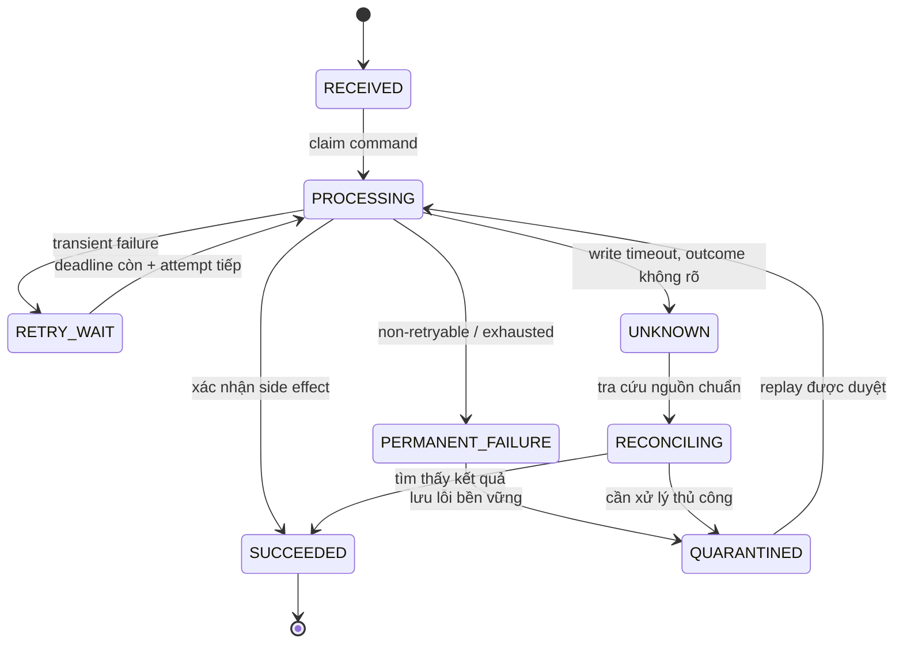
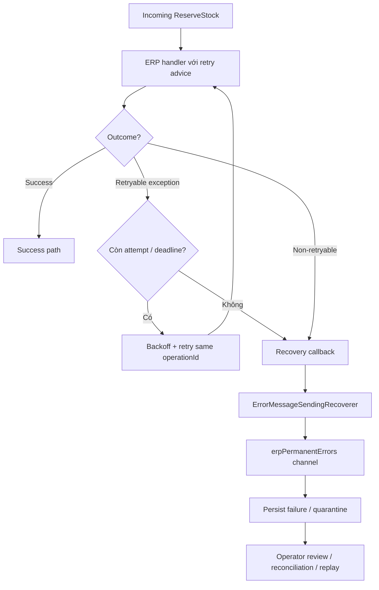
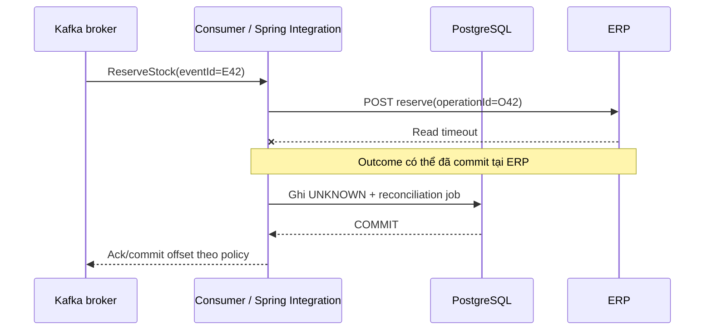
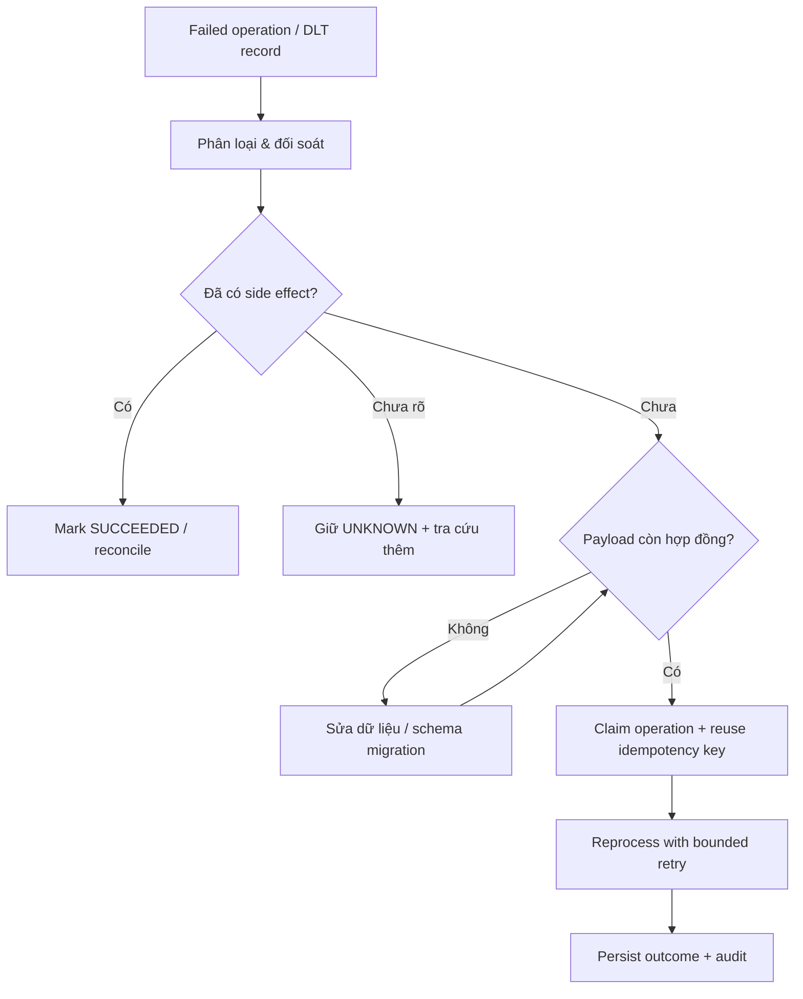

# Khôi phục sau thử lại và chuyển thông điệp sang kênh xử lý lỗi

## 1. Bối cảnh: lỗi trong flow không dừng ở một exception

Một hệ thống Spring Boot tích hợp thực tế thường đi qua nhiều ranh giới: HTTP nhận yêu cầu, PostgreSQL lưu ý định xử lý, Redis cache trạng thái, Kafka hoặc RabbitMQ giao thông điệp, Spring Integration điều phối các bước, sau đó một HTTP/SOAP client gọi ERP. Bất kỳ bước nào cũng có thể chậm, mất kết nối, trả dữ liệu sai hợp đồng hoặc hoàn tất một phần rồi bị gián đoạn.

Trong module **SPRING_BOOT_INTEGRATION**, chương **Lỗi và trạng thái flow** tập trung vào điều phải xảy ra **sau khi đã thử lại nhưng vẫn thất bại**: ai giữ bản tin, chuyển lỗi đến đâu, trạng thái nghiệp vụ nào được ghi lại, broker có được acknowledgment chưa, và hệ thống có khôi phục được sau restart không?

Ví dụ xuyên suốt:

1. Consumer nhận sự kiện `OrderPaid` có `eventId=E-42`.
2. Database ghi ý định gửi `ReserveStock` kèm một `operationId` ổn định.
3. Spring Integration flow đọc lệnh và gọi ERP để dự trữ.
4. ERP trả lỗi `503`, timeout hoặc SOAP Fault.
5. Flow thử lại những lỗi tạm thời trong ngân sách.
6. Nếu vẫn thất bại, flow chuyển thông điệp lỗi tới **error channel**, ghi trạng thái bền vững và/hoặc đưa vào dead-letter workflow.
7. Worker hoặc người vận hành có thể sửa nguyên nhân rồi **replay có kiểm soát**, không tạo đơn trùng.

Điểm mấu chốt: **“Đã đưa vào error channel” không đồng nghĩa “đã khôi phục nghiệp vụ”.** Một kênh lỗi trong RAM có thể mất dữ liệu khi JVM dừng; log một stack trace không thay thế trạng thái xử lý và kế hoạch phục hồi.

Sau bài học, bạn có thể:

- Phân biệt retry, recovery callback, error channel, dead-letter queue và workflow đối soát.
- Hiểu sự khác nhau giữa lỗi đồng bộ và bất đồng bộ trong Spring Integration.
- Thiết lập `RequestHandlerRetryAdvice`, `RetryTemplate` và `ErrorMessageSendingRecoverer` cho một handler.
- Chọn loại lỗi được retry, backoff, deadline và hành vi khi đã hết lượt thử.
- Đảm bảo message không mất giữa transaction, broker acknowledgment và lưu trạng thái lỗi.
- Thiết kế kiểm thử, metrics, log/trace và runbook cho lỗi tích hợp.

## 2. Từ vựng phải phân biệt chính xác

| Khái niệm | Nghĩa | Không tự đảm bảo |
|---|---|---|
| **Retry** | Gọi lại thao tác sau lỗi có thể phục hồi. | Thao tác an toàn để gọi lại hoặc kết quả lần trước chưa xảy ra. |
| **Backoff** | Chờ giữa các lần thử, có thể tăng dần và thêm jitter. | Deadline tổng không bị vượt. |
| **Recovery callback** | Hành động sau khi retry policy không còn cho thử lại. | Đã hoàn tất nghiệp vụ thành công. |
| **`ErrorMessage`** | Message có payload là một `Throwable`, có thể chứa thông tin message gốc. | Bản tin gốc luôn có đủ header để replay. |
| **Error channel** | `MessageChannel` nhận những thông điệp lỗi của flow/handler. | Lưu trữ bền vững, DLQ hoặc alert tự động. |
| **Dead-letter destination** | Queue/topic/bảng bền vững để giữ message không xử lý được theo policy. | Message đã được sửa hoặc có thể replay vô điều kiện. |
| **Acknowledgment** | Consumer hoặc broker client xác nhận một mốc xử lý theo cấu hình. | Database commit và remote side effect đồng thời nguyên tử. |
| **Idempotency** | Cùng ý định được giao/thử lại nhiều lần không tạo thêm business effect. | Hệ thống upstream hỗ trợ tự động nếu không có hợp đồng. |
| **Reconciliation** | Tra cứu/đối chiếu nguồn dữ liệu có thẩm quyền khi kết quả chưa biết. | Có thể suy kết quả chỉ từ exception phía client. |

Không gộp các bước này vào một cờ `success=false`: thông điệp có thể đang đợi retry, hết retry nhưng đã lưu DLQ, đã gửi ERP song mất response, hoặc thất bại hẳn do schema không tương thích.

### 2.1. Ba kết quả khác nhau sau một lần xử lý

- **SUCCEEDED:** side effect đã được xác nhận theo hợp đồng và trạng thái bền vững đã ghi.
- **FAILED_FINAL / DEAD_LETTERED:** policy đã dừng thử tự động, yêu cầu kiểm tra hoặc xử lý nhánh bù trừ; phải giữ nguyên message và nguyên nhân ở nơi bền vững.
- **UNKNOWN / PENDING_RECONCILIATION:** đã có thể gửi lệnh ghi ra ngoài nhưng không nhận được response đủ tin cậy; **không đánh dấu thất bại chắc chắn**, cũng không retry với business key mới.

Các tên trạng thái là gợi ý của ứng dụng, không phải enumeration mặc định của Spring Integration.

## 3. Mô hình trạng thái flow: recovery phải có đích đến rõ

Một flow đáng tin cậy nên mô tả state machine, thay vì chỉ dựa vào số lần gọi handler:



Những thông tin hữu ích để lưu cùng operation:

| Field | Mục đích |
|---|---|
| `operationId` | Nhận diện một ý định nghiệp vụ qua nhiều lượt thử và restart. |
| `eventId`/`messageId` | Nhận diện thông điệp đầu vào để dedupe. |
| `aggregateId` và `aggregateVersion` | Bảo vệ ordering và update đúng phiên bản. |
| `attemptCount` / `lastAttemptAt` | Điều tra retry budget, tránh vòng lặp vô hạn. |
| `state` | `RETRY_WAIT`, `UNKNOWN`, `QUARANTINED`... |
| `nextAttemptAt` | Lập lịch retry bền vững, không dùng `Thread.sleep` dài. |
| `errorCode`/`errorCategory` | Nguyên nhân chuẩn hóa để alert và quyết định replay. |
| `correlationId` | Liên kết log/trace; không đưa thành metric label. |
| `payloadSchemaVersion` | Khả năng đọc lại sau ứng dụng nâng cấp schema. |

Thời điểm chuyển state phải được ràng buộc với **transaction và side effect** phù hợp. Nếu một worker ghi `SUCCEEDED` trước khi ERP thực sự xác nhận, công cụ monitoring có thể báo xanh giả.

## 4. Spring Integration xử lý lỗi khác nhau giữa đồng bộ và bất đồng bộ

Trước khi viết retry/recovery, cần biết **lỗi xuất hiện trên thread nào**. Spring Integration không tự gửi mọi exception vào cùng `errorChannel` trong mọi tình huống.

| Thành phần | Đường thực thi phổ biến | Lỗi thường đi đâu? |
|---|---|---|
| `DirectChannel` | Handler chạy trên thread sender. | Exception có thể **propagate trực tiếp** về caller của `send()`/gateway. |
| `ExecutorChannel` | Handler được giao sang executor. | Lỗi trong worker không quay lại call stack ban đầu; hạ tầng error handling của executor/integration có thể publish `ErrorMessage`. |
| `QueueChannel` + poller | Message nằm trong queue, poller lấy ra. | Lỗi tại task poller thường được xử lý qua error handler/channel theo cấu hình. |
| Inbound adapter với task scheduler | Message được tạo từ external source trong thread nội bộ. | Error handler của endpoint/poller quyết định cách publish và có thể ảnh hưởng ack/rollback. |
| Kafka/Rabbit listener adapter | Container/broker quản lý delivery/ack. | Có thể đi vào error channel của integration adapter hoặc error handler của listener container, tùy cấu hình. |

**Nguyên tắc:** `errorChannel` không phải “`catch` toàn cục” cho mọi method Java. Với luồng đồng bộ, exception có thể quay về HTTP/controller/gateway. Với luồng bất đồng bộ, người gửi thường đã trả về, do đó lỗi cần được **materialize thành message** để hạ tầng xử lý.

### 4.1. Vì sao xác định ranh giới quan trọng?

Giả sử HTTP controller dùng `DirectChannel` và downstream `RestClient` ném timeout. HTTP thread có thể nhận exception và trả 504 theo chính sách. Nếu đổi thành `ExecutorChannel` để tránh chờ, controller có thể trả về trước khi worker thất bại: callback lỗi cần ghi trạng thái và báo qua event/status API. Nếu chỉ chuyển channel mà không đổi hợp đồng HTTP, ứng dụng có thể trả `200 OK` trong khi ERP chưa được gọi.

### 4.2. Global và per-message error channel

Spring Integration có tên channel hệ thống `errorChannel` được nhiều endpoint sử dụng theo conventions. Message có thể mang header `errorChannel` để định tuyến lỗi tới channel riêng khi hạ tầng tương ứng hỗ trợ; adapter/poller cũng có cấu hình error channel cụ thể.

Tuy nhiên:

- Không mặc định mọi path tự động đọc header hoặc phát error message.
- Không giả định `errorChannel` mặc định là durable storage.
- Không lấy một `errorChannel` tùy ý từ input người dùng rồi gửi Throwable chứa dữ liệu nội bộ vào đó.
- Nếu nhiều flow có SLA, dữ liệu và quyền truy cập khác nhau, **định nghĩa error channel riêng** sẽ dễ điều hành hơn dùng một kênh global cho mọi loại lỗi.

## 5. `ErrorMessage` và thông tin message gốc

Spring Messaging cung cấp `org.springframework.messaging.support.ErrorMessage` với payload là `Throwable`. Spring Integration thường dùng `MessagingException` hoặc các subtype để mang thông điệp thất bại; `getFailedMessage()` có thể giúp liên hệ với input gốc.

Ví dụ một handler error channel:

```java
import org.springframework.messaging.Message;
import org.springframework.messaging.MessagingException;
import org.springframework.messaging.support.ErrorMessage;
import org.springframework.integration.annotation.ServiceActivator;

@ServiceActivator(inputChannel = "erpPermanentErrors")
public void onFailure(ErrorMessage error) {
    Throwable throwable = error.getPayload();

    Message<?> failed = error.getOriginalMessage();
    if (failed == null && throwable instanceof MessagingException me) {
        failed = me.getFailedMessage();
    }

    if (failed == null) {
        throw new IllegalStateException(
                "Cannot recover without failed-message identity", throwable);
    }

    // Chuyển sang failure envelope/record bền vững.
    persistFailure(failed, throwable);
}
```

`persistFailure(...)` do ứng dụng định nghĩa. Đoạn code minh họa **không chạy được độc lập** nếu thiếu service bean, repository và imports tương ứng. Trong thực tế, nguyên nhân có thể bị bọc nhiều lớp (`MessageHandlingException`, exception từ transport, retry context). Không kỳ vọng trực tiếp `error.getPayload()` luôn là exception gốc hay mọi ErrorMessage đều chứa `originalMessage`.

### 5.1. Không gửi raw exception lên broker công cộng

Throwable thường chứa stack trace, class name, message headers, URI và đôi khi nội dung request. Không serialize trực tiếp Java `Throwable` thành JSON DLQ payload để chia sẻ giữa hệ thống. Hãy tạo **failure envelope có schema**:

```json
{
  "operationId": "op-4201",
  "eventId": "evt-4201",
  "flow": "reserve-stock",
  "stage": "erp-outbound",
  "errorCategory": "UPSTREAM_UNAVAILABLE",
  "errorCode": "ERP_HTTP_503",
  "attemptCount": 3,
  "occurredAt": "2026-11-21T08:30:00Z",
  "payloadReference": "outbox:12467",
  "schemaVersion": 1
}
```

Ở ví dụ trên, `payloadReference` giả định trỏ tới bản ghi được bảo vệ, thay vì copy thông tin khách hàng/token vào DLQ. Nếu cần lưu payload để replay, phải có encryption, retention, quyền truy cập và versioning phù hợp.

## 6. Retry là một chính sách có giới hạn, không phải giải pháp cho mọi lỗi

Một handler nhận `ReserveStock` có thể thất bại do nhiều lý do:

| Lỗi | Có nên retry? | Vì sao |
|---|---|---|
| TCP connect failure trước khi gửi | Có thể, khi upstream tạm down và còn deadline. | Thường chưa thực hiện side effect, nhưng vẫn cần xác định trạng thái kết nối thực. |
| HTTP 503/429 | Có thể theo policy/backoff và `Retry-After` nếu có. | Lỗi tạm thời/quota, tránh retry storm. |
| DB deadlock hoặc serialization conflict | Có thể nếu transaction idempotent và chính sách đúng. | Khả năng thành công ở attempt sau. |
| Validation 400, payload thiếu trường | Không. | Thử lại cùng payload sẽ thất bại. |
| JSON/XML schema không tương thích | Không retry nóng. | Cần sửa contract/codegen/data. |
| 401/403 do credential | Không retry liên tục. | Cần cấp quyền/rotate secret. |
| SOAP Fault nghiệp vụ | Theo mã Fault đã thỏa thuận, thường không. | HTTP 500 không đủ để kết luận lỗi transient. |
| Timeout sau lệnh ghi ERP | **Không retry mù.** | ERP có thể đã commit dù response bị mất. |
| Bug `NullPointerException`/`ClassCastException` | Không. | Cần sửa code, không phải chờ. |

Cần xem exception **và ngữ cảnh operation**. Một `ReadTimeoutException` ở GET idempotent khác cùng exception ở POST tạo thanh toán. Chính sách retry phải được kiểm tra với upstream contract.

### 6.1. Các thành phần của retry policy

- **Số attempts tối đa**, tính cả attempt đầu tiên.
- **Exception classification**: retryable, non-retryable, unknown outcome.
- **Backoff + jitter** để tránh nhiều instances retry đồng thời.
- **Deadline tổng** và ngân sách còn lại từ HTTP inbound/broker message.
- **Concurrency/rate limit**: retry phải tính vào quota của ERP.
- **Recovery behavior**: hết attempts thì báo lỗi về caller, publish error message hay ghi job bền vững?
- **Metrics**: số attempts, exhausted, recovery failures, latency và số lệnh cần đối soát.

Đừng cấu hình retry ở ba lớp cùng lúc — Spring Integration advice, HTTP client filter và broker listener — để ba attempts ở mỗi tầng biến thành 27 remote calls.

## 7. `RequestHandlerRetryAdvice`: retry tại một handler Spring Integration

Spring Integration cung cấp `RequestHandlerRetryAdvice` để áp Spring Retry quanh **message handler invocation**. Nó thích hợp khi muốn retry một outbound adapter/service activator nhưng không chạy lại toàn bộ các bước trước đó.

Ví dụ cấu hình cơ bản (Spring Integration và Spring Retry tương thích với Spring Boot 3.x):

```java
import org.springframework.context.annotation.Bean;
import org.springframework.context.annotation.Configuration;
import org.springframework.beans.factory.annotation.Qualifier;
import org.springframework.integration.handler.advice.RequestHandlerRetryAdvice;
import org.springframework.integration.handler.advice.ErrorMessageSendingRecoverer;
import org.springframework.messaging.MessageChannel;
import org.springframework.retry.backoff.ExponentialBackOffPolicy;
import org.springframework.retry.policy.SimpleRetryPolicy;
import org.springframework.retry.support.RetryTemplate;

@Configuration(proxyBeanMethods = false)
class ErpRetryConfiguration {

    @Bean
    RequestHandlerRetryAdvice erpRetryAdvice(
            @Qualifier("erpPermanentErrors") MessageChannel erpPermanentErrors) {

        RetryTemplate template = new RetryTemplate();

        // Minh họa kỹ thuật: mặc định có thể retry quá rộng.
        template.setRetryPolicy(new SimpleRetryPolicy(3));

        ExponentialBackOffPolicy backoff = new ExponentialBackOffPolicy();
        backoff.setInitialInterval(200L);
        backoff.setMultiplier(2.0);
        backoff.setMaxInterval(2000L);
        template.setBackOffPolicy(backoff);

        RequestHandlerRetryAdvice advice = new RequestHandlerRetryAdvice();
        advice.setRetryTemplate(template);
        advice.setRecoveryCallback(
                new ErrorMessageSendingRecoverer(erpPermanentErrors));
        return advice;
    }
}
```

Dependency Spring Retry cần có trong dependency graph, ví dụ `org.springframework.retry:spring-retry` theo phiên bản do BOM quản lý; Spring Integration có module core/DSL phù hợp. **`new SimpleRetryPolicy(3)` ở đây chỉ minh họa cơ chế**, không phải policy production: nó có thể thử lại cả lỗi validation, mapping hoặc exception không an toàn. Bản thật phải thu hẹp loại lỗi và theo dõi side effect.

### 7.1. Số attempts và thời gian chờ

`SimpleRetryPolicy(3)` nghĩa là tối đa **ba lần thử tổng cộng**, không phải một lần đầu cộng ba lần retry. Với backoff khởi đầu 200 ms, nhân 2, hệ thống có thể chờ khoảng 200 ms rồi 400 ms giữa ba lượt nếu các lượt liên tục thất bại (chưa tính thời gian xử lý). Deadline đầu-cuối phải bao trùm **attempt + backoff + queue wait**.

### 7.2. Đúng điểm đặt advice

Giả sử flow:

```text
Inbound -> Validate -> Enrich -> Persist -> ERP outbound handler -> Map Result
```

Gắn retry advice vào **ERP outbound handler** sẽ thử lại chính handler ấy. Điều này hữu ích khi Validate/Enrich không nên chạy lại. Nhưng nếu ERP handler gọi một phương thức chứa thêm DB writes, toàn bộ side effect **bên trong handler** cũng có thể chạy lại. Cần tách ranh giới idempotency và transaction.

Không đặt retry quanh toàn flow chỉ vì muốn sửa một HTTP 503, nếu điều đó khiến bước insert order hoặc ghi outbox chạy lại không an toàn.

## 8. Cấu hình flow để advice thực sự được áp

Ví dụ Java DSL cho command outbound:

```java
import org.springframework.context.annotation.Bean;
import org.springframework.context.annotation.Configuration;
import org.springframework.integration.dsl.IntegrationFlow;
import org.springframework.integration.handler.advice.RequestHandlerRetryAdvice;

@Configuration(proxyBeanMethods = false)
class OrderOutboundFlowConfiguration {

    @Bean
    IntegrationFlow reserveStockFlow(
            ErpCommandSender erpSender,
            RequestHandlerRetryAdvice erpRetryAdvice) {

        return IntegrationFlow.from("reserveStockInput")
                .handle(erpSender, "send",
                        endpoint -> endpoint.advice(erpRetryAdvice))
                .get();
    }
}
```

`ErpCommandSender` là bean do ứng dụng triển khai, ví dụ có method `public void send(ReserveStockCommand command)`. Flow nhận message từ channel tên `reserveStockInput`; trong ứng dụng thật phải khai báo channel hoặc để DSL giải quyết theo cấu hình tương thích, xác định nguồn gửi và transaction/ack boundary.

Điều cần kiểm tra khi chạy:

1. Message đi qua handler được gắn `erpRetryAdvice`, không gọi thẳng `erpSender.send(...)` ngoài flow.
2. Advice được áp trên **handler có thể retry**, không chỉ đăng ký bean mà quên gắn vào endpoint.
3. Method outbound giữ **cùng idempotency key** qua các attempts.
4. Exception thích hợp được ném ra để Spring Retry nhận biết; không bị catch và trả một giá trị thành công giả.
5. Handler có kết quả bất đồng bộ thì review phạm vi advice: nếu method trả trước khi Future hoàn tất, retry advice không tự chờ để biết failure xảy ra sau đó.

### 8.1. Ví dụ sender có ranh giới nghiệp vụ

```java
import org.springframework.stereotype.Component;

public record ReserveStockCommand(
        String operationId, String orderId,
        String sku, int quantity) {}

@Component
class ErpCommandSender {

    private final ErpStockClient client;

    ErpCommandSender(ErpStockClient client) {
        this.client = client;
    }

    public void send(ReserveStockCommand command) {
        client.reserve(
                command.orderId(),
                command.sku(),
                command.quantity(),
                command.operationId());
    }
}
```

`ErpStockClient` là adapter HTTP/SOAP do ứng dụng định nghĩa; tham số cuối giả định ERP hỗ trợ một idempotency key. Nếu không hỗ trợ, phải có cơ chế tra cứu/đối soát hoặc business key ở ERP. Retry cùng `operationId` **không tự bảo đảm** idempotency nếu upstream không xử lý theo key.

## 9. Khi hết retry: `ErrorMessageSendingRecoverer` chuyển sang error channel

Cấu hình `setRecoveryCallback(new ErrorMessageSendingRecoverer(erpPermanentErrors))` thực hiện một hành động **sau khi `RetryTemplate` kết thúc vì lỗi**: dựng/publish thông điệp lỗi tới channel được chỉ định theo API Spring Integration tương ứng.



**Điểm có thể gây mất dữ liệu:** recovery callback **có thể xử lý exception và trả về** sau khi gửi ErrorMessage. Theo cấu hình endpoint/container và response contract, luồng phía ngoài có thể xem invocation đã “xử lý xong”. Nếu error channel chỉ log và bỏ qua, hệ thống có thể ack bản tin gốc dù nghiệp vụ chưa thành công.

Vì vậy cần ghi rõ **quy tắc hoàn tất recovery**:

- Nếu nhánh error đã **lưu công việc thất bại bền vững**, có thể chấp nhận ack message gốc theo hợp đồng.
- Nếu error handler không lưu được lỗi, **không được nuốt lỗi rồi ack thành công**. Phải để failure propagate/rollback hoặc có cơ chế retry bền vững khác.
- Nếu outcome từ ERP là `UNKNOWN`, không coi “chuyển lỗi thành công” là business failure chắc chắn; cần trạng thái đối soát.
- Nếu caller của flow yêu cầu reply, recovery callback cần xác định reply/error contract; không giả định một `void`/`null` result là business success.

Không nên dùng `ErrorMessageSendingRecoverer` như một nơi “báo lỗi rồi quên”; nó là điểm chuyển từ **retry nóng** sang **quản lý thất bại có trạng thái**.

## 10. Thiết kế error channel riêng cho flow thay vì dựa vào mặc định

Một cấu hình rõ ràng dùng `DirectChannel` để đưa lỗi **ngay lập tức** sang handler lưu trạng thái:

```java
import org.springframework.context.annotation.Bean;
import org.springframework.context.annotation.Configuration;
import org.springframework.integration.channel.DirectChannel;
import org.springframework.messaging.MessageChannel;

@Configuration(proxyBeanMethods = false)
class ErrorChannelConfiguration {

    @Bean("erpPermanentErrors")
    MessageChannel erpPermanentErrors() {
        return new DirectChannel();
    }
}
```

Handler:

```java
import org.springframework.integration.annotation.ServiceActivator;
import org.springframework.messaging.Message;
import org.springframework.messaging.MessagingException;
import org.springframework.messaging.support.ErrorMessage;
import org.springframework.stereotype.Component;

@Component
class ErpFailureRecorder {

    private final FailedOperationStore store;

    ErpFailureRecorder(FailedOperationStore store) {
        this.store = store;
    }

    @ServiceActivator(inputChannel = "erpPermanentErrors")
    public void record(ErrorMessage error) {
        Message<?> failed = error.getOriginalMessage();

        if (failed == null &&
                error.getPayload() instanceof MessagingException ex) {
            failed = ex.getFailedMessage();
        }

        if (failed == null ||
                !(failed.getPayload() instanceof ReserveStockCommand cmd)) {
            // Không ack thành công nếu không thể nhận diện việc cần lưu.
            throw new IllegalStateException(
                    "Missing failed ReserveStockCommand",
                    error.getPayload());
        }

        store.recordForRecovery(
                cmd.operationId(),
                "ERP_OUTBOUND_FAILED",
                ErrorCategories.safeCode(error.getPayload()));
    }
}
```

`FailedOperationStore` và `ErrorCategories` là abstraction ứng dụng cần triển khai; bản ghi lỗi nên chứa `operationId` unique, trạng thái, số attempts và tham chiếu payload bền vững. Ở ví dụ này, lời gọi lưu phải **đảm bảo commit theo policy** trước khi original message được ack.

**Tại sao dùng `DirectChannel` cho ví dụ?** Nó gọi subscriber đồng bộ trên thread hiện tại; nếu `store.recordForRecovery(...)` thất bại và exception được propagate đúng, recovery không bị coi là hoàn tất một cách im lặng. Tuy nhiên, cách xử lý nested exceptions và khả năng rollback còn phụ thuộc lớp retry/container bên ngoài. Cần kiểm thử bằng DB và broker thật. Dùng `ExecutorChannel` hoặc `QueueChannel` in-memory cho recovery mà không có durable handoff có thể khiến caller hoàn tất **trước** khi bản ghi lỗi được lưu.

### 10.1. Không bắt buộc một error channel cho tất cả flow

Những dependency khác nhau nên có chính sách riêng:

| Channel | Nguồn lỗi | Điều kiện hoàn tất recovery |
|---|---|---|
| `erpPermanentErrors` | Gọi ERP sau khi hết retry. | Ghi operation trạng thái lỗi/UNKNOWN và payload reference. |
| `paymentSecurityErrors` | Lỗi xác thực, chữ ký, quyền. | Cảnh báo bảo mật, hạn chế retry, lưu audit có kiểm soát. |
| `inventorySchemaErrors` | Payload không đọc được. | Quarantine bản tin gốc và schema metadata an toàn. |
| `cacheRefreshErrors` | Redis lỗi khi refresh cache. | Fail-open/closed theo nghiệp vụ và giới hạn fallback load. |

Không dùng channel global nhận mọi loại Throwable rồi áp một chính sách retry giống nhau. Phân loại ở tầng đủ ngữ cảnh để tránh chuyển nhầm lỗi hợp đồng sang retry vô hạn.

## 11. `errorChannel` không phải dead-letter queue

Một `DirectChannel` là đường chuyển trong JVM. Một `QueueChannel` mặc định dùng bộ nhớ nếu không có message store bền vững. Một `PublishSubscribeChannel` nhân bản thông điệp cho subscribers nhưng không tạo sẵn lịch sử để replay. **Không có channel in-memory nào tự bảo đảm sống qua JVM restart**.

Để có đường phục hồi bền vững, error handler có thể:

1. Lưu failure record và payload reference vào PostgreSQL (`failed_operations`/job table).
2. Ghi outbox row để dispatcher publish failure event.
3. Gửi trực tiếp tới broker DLQ/DLT với publish confirm và quy tắc ack phù hợp.
4. Đưa vào workflow manual review/reconciliation trước khi replay.

Bảng so sánh:

| Đích recovery | Có bền vững qua restart? | Khi nào phù hợp? |
|---|---|---|
| `DirectChannel` + logger | Không, nếu chỉ log. | Diagnosing/test; không đủ cho lệnh quan trọng. |
| `QueueChannel` in-memory | Không bảo đảm. | Handoff nội bộ best effort; phải giới hạn capacity. |
| Database failure store | Có, nếu commit đúng. | Cần tra cứu, trạng thái, replay có điều kiện, audit. |
| Kafka dead-letter topic | Theo broker retention/config. | Quarantine event, vận hành lại consumer với schema/policy. |
| RabbitMQ DLQ | Theo topology/durability và ack policy. | Hàng đợi xử lý lỗi riêng, requeue có kiểm soát. |
| Transactional outbox | Có sau DB commit. | Cần chuyển failure/event ra broker dù broker tạm down. |

**Recovery thành công = đã đạt một mốc bền vững được hợp đồng xác định**, không phải chỉ gọi `channel.send(...)` trả `true` trên một queue RAM.

## 12. Phân loại lỗi trước khi chuyển kênh phục hồi

Một flow nên phân biệt **trạng thái kinh doanh** với **loại exception kỹ thuật**:

| Nhóm lỗi | Ví dụ | Quyết định |
|---|---|---|
| Transient dependency | ERP `503`, DB connection temporarily unavailable. | Retry bounded, còn lỗi thì defer/quarantine. |
| Rate limit/backpressure | HTTP 429, connection pool exhausted, executor rejected. | Backoff, giảm concurrency; không retry storm. |
| Permanent contract | Invalid JSON, JAXB mapping, schema mismatch. | Không retry nóng; quarantine + sửa contract. |
| Business rejection | Không đủ tồn kho, order không tồn tại, trạng thái không hợp lệ. | Ghi `REJECTED` theo contract; không tự xem là lỗi hạ tầng. |
| Authentication/authorization | `401/403`, certificate expired. | Dừng retry nóng, cảnh báo bảo mật/rotate secret. |
| Unknown remote outcome | Write timeout sau khi gửi request. | Đánh dấu `UNKNOWN`, query/reconcile trước replay. |
| Local programming error | NPE, cast error, invariant broken. | Quarantine/alert, sửa code; không retry vô hạn. |
| Poison message | Payload không deserialize được trước handler. | Error handler ở converter/adapter/container, không chỉ handler advice. |

**Đừng chỉ dựa vào HTTP status.** Một SOAP Fault nghiệp vụ đôi khi đi qua HTTP 500; một HTTP 200 có thể chứa business error. Phân loại ở adapter giao tiếp có hiểu hợp đồng, rồi đưa về exception/state chuẩn để flow quyết định.

### 12.1. Chú ý lỗi trước khi vào handler

Nếu JSON deserialization thất bại ngay tại Kafka/RabbitMQ adapter, `RequestHandlerRetryAdvice` gắn với `erpSender.send` sẽ **không chạy**. Phải cấu hình error handling ở đúng tầng converter/container và route failure envelope vào quarantine bằng cơ chế phù hợp. Tương tự, lỗi xảy ra trong router, splitter, aggregator, poller hoặc outbound adapter khác có thể nằm ngoài phạm vi advice của một handler cụ thể.

## 13. Retry trong bộ nhớ và retry qua broker là hai lớp khác nhau

Có hai mô hình thử lại phổ biến:

**Immediate/local retry** của `RetryTemplate`:

```text
Handler attempt 1 -> 503
  backoff 200ms
Handler attempt 2 -> 503
  backoff 400ms
Handler attempt 3 -> 503
  recovery callback
```

Ưu điểm: đơn giản, phù hợp sự cố ngắn. Nhược điểm: chiếm worker/transaction nếu backoff dài, chết JVM có thể mất ngữ cảnh local; không làm durable job state nếu ứng dụng không lưu.

**Deferred/broker retry**:

```text
Original message -> Handler fails
  -> record retry state (operationId, nextAttemptAt)
  -> durable retry queue/topic/job table
  -> scheduler/consumer receives later
  -> handler retries idempotently
  -> exhausted -> quarantine/DLQ
```

Ưu điểm: tách retry khỏi thread hiện tại, dễ xử lý sự cố dài/scale-out; nhược điểm: yêu cầu thiết kế ordering, redelivery và retry headers/state bền vững.

Khi quyết định phối hợp hai lớp, hãy định nghĩa **tổng attempts**, deadline và owner của từng lớp. Ví dụ “tối đa 3 attempts tại handler trong mỗi lần broker delivery, tối đa 4 deliveries” có thể tạo 12 HTTP requests; nếu HTTP client còn retry tiếp, số thực tế nhiều hơn. Không để mỗi tầng tự thêm retry mà không có ngân sách chung.

## 14. Broker-level DLQ/DLT khác Spring Integration error channel

Spring Integration error channel nhận `ErrorMessage` trong hạ tầng Spring Messaging. Broker-level dead-letter destination được xử lý bởi **Kafka/RabbitMQ/JMS container/broker configuration**.

### 14.1. RabbitMQ: DLX, DLQ và consumer ack

Trong RabbitMQ, queue có thể được cấu hình dead-letter exchange để route message bị reject/nack không requeue, hết TTL hoặc vượt giới hạn nhất định theo policy/broker version. Topology, routing key, queue durability và dead-letter strategy quyết định message đi đâu. Một số cách triển khai dùng operator-managed policy thay vì hard-code `x-dead-letter-exchange` trong code.

Ví dụ minh họa một queue command có DLX:

```java
@Bean
Queue reserveCommandQueue() {
    return QueueBuilder.durable("inventory.reserve.commands")
            .deadLetterExchange("inventory.dead")
            .deadLetterRoutingKey("inventory.reserve.failed")
            .build();
}
```

Đoạn code chỉ minh họa queue arguments; production phải khai báo exchange, binding, DLQ và xem policy trên cluster. Nếu handler recovery **bắt lỗi rồi trả thành công**, container có thể ack message và **broker DLX sẽ không được kích hoạt**. Muốn để broker dead-letter message, container phải nhận failure/nack/reject theo cơ chế được cấu hình.

### 14.2. Spring Kafka: error handler và DLT

Spring Kafka cung cấp container error handling và recoverer, như `DefaultErrorHandler` kết hợp `DeadLetterPublishingRecoverer` trong các phiên bản tương ứng, hoặc cấu hình retry topic khi phù hợp. Những cơ chế này hoạt động ở **lớp Kafka listener/container**, không đồng nhất với `RequestHandlerRetryAdvice` của Spring Integration handler.

Ví dụ minh họa khung ý tưởng:

```java
// Trình tự tư duy, không phải full @Bean config:
// Kafka listener fails
//   -> DefaultErrorHandler kiểm tra backoff/loại exception
//   -> DeadLetterPublishingRecoverer publish sang DLT
//   -> Ack/offset strategy theo container config
```

Nếu listener có một Spring Integration flow bên trong, phải quyết định rõ:

- Retry ở Kafka container hay `RequestHandlerRetryAdvice`?
- Recovery callback có nuốt exception trước khi `DefaultErrorHandler` nhìn thấy không?
- Nếu DLT publish thất bại, offset message gốc có được commit không?
- Khi chuyển DLT thành công, có cần DB failure record để đối soát không?

Không khẳng định chỉ cấu hình một bean error handler là mọi đường đi đã có delivery guarantee. Cần test bằng broker thật.

### 14.3. JMS: redelivery policy và DLQ của provider

Với JMS, message broker/provider có chính sách redelivery count, delayed delivery và dead-letter handling riêng. Transactional session, listener rollback/recover và số lần redelivery ảnh hưởng khi nào message bị chuyển DLQ. Không dùng `JMSCorrelationID` hay application retry counter thay thế cơ chế ack/redelivery của provider; chúng phục vụ vai trò khác.

## 15. Ack và failure recovery phải nằm trong một hợp đồng bền vững

Xét luồng nhận command Kafka:



Hành vi an toàn yêu cầu **lưu trạng thái `UNKNOWN` bền vững trước khi ack**. Nếu DB thất bại, consumer không nên xem message đã hoàn tất; để redelivery và idempotency xử lý. Nếu đã chuyển sang error channel nhưng chỉ log rồi ack, không còn đường đối soát sau crash.

### 15.1. Ba khe lỗi phải kiểm thử

| Khe lỗi | Rủi ro | Cơ chế giảm thiểu |
|---|---|---|
| DB update/outbox commit thành công, broker ack thất bại. | Broker giao lại message. | Inbox/unique business key; xử lý idempotent. |
| Broker DLT publish thành công, offset/ack chưa hoàn tất. | Original có thể redeliver rồi publish DLT trùng. | Stable `eventId`, DLT dedupe và retry policy. |
| Error handler trả thành công nhưng failure record chưa commit. | Original được ack, không còn công việc bền vững. | Durable handoff synchronous/transactional trước ack. |

Không thể chỉ dựa vào một local `@Transactional` để tạo transaction nguyên tử giữa PostgreSQL, Kafka/RabbitMQ và ERP HTTP. Với nhiều resource, cần outbox/inbox, saga hoặc reconciliation theo mức nhất quán nghiệp vụ.

## 16. Idempotency và kết quả không xác định sau timeout

Một nguy cơ lớn là **retry một command có side effect** sau lỗi `read timeout`. Trình tự:

```text
Attempt 1: POST ERP ReserveStock(O42)
ERP: commit reservation O42
Client: timeout trước khi nhận response
Attempt 2: POST ERP ReserveStock(O42) với key mới O43
ERP: tạo thêm reservation thứ hai
```

Để tránh:

1. Gán `operationId`/`idempotencyKey` **trước lần thử đầu** và giữ nguyên qua retries/replay.
2. Nếu ERP hỗ trợ key, truyền cùng key mỗi attempt; kiểm thử hợp đồng dedupe của ERP.
3. Nếu không hỗ trợ, dùng business key/tra cứu trạng thái hoặc workflow đối soát trước khi phát lại.
4. Phân loại timeout của lệnh ghi thành `UNKNOWN`, không mặc định `TRANSIENT_FAILURE`.
5. Nếu phát hiện command đã hoàn thành trong hệ thống ERP, cập nhật state `SUCCEEDED` và tránh gửi lại.
6. Với broker redelivery, dùng inbox unique key trước khi tạo side effect mới; tránh đánh dấu processed trước khi toàn bộ business transaction phù hợp commit.

**Idempotency không chỉ là dedupe event ID trong một JVM.** Cần database constraint/transaction hoặc cơ chế ở upstream có thẩm quyền, hiệu lực qua restart và nhiều replicas.

## 17. Trạng thái ERROR nên được lưu như thế nào?

Một bảng PostgreSQL minh họa:

```sql
CREATE TABLE integration_operations (
    operation_id VARCHAR(100) PRIMARY KEY,
    aggregate_id VARCHAR(100) NOT NULL,
    state VARCHAR(40) NOT NULL,
    attempt_count INT NOT NULL DEFAULT 0,
    next_attempt_at TIMESTAMPTZ,
    error_category VARCHAR(80),
    error_code VARCHAR(100),
    payload_ref VARCHAR(200),
    updated_at TIMESTAMPTZ NOT NULL DEFAULT now(),
    version BIGINT NOT NULL DEFAULT 0
);

CREATE INDEX idx_integration_operations_retry
    ON integration_operations(state, next_attempt_at)
    WHERE state IN ('RETRY_WAIT', 'UNKNOWN');
```

Đây là schema tham khảo, không phải bảng do Spring Integration tự tạo. Với hệ thống có nhiều workers, update state nên dùng optimistic locking hoặc claim atomic để tránh hai workers đồng thời replay một operation.

Ví dụ cập nhật có điều kiện theo version:

```sql
UPDATE integration_operations
SET state = 'QUARANTINED',
    error_category = :category,
    error_code = :code,
    version = version + 1,
    updated_at = now()
WHERE operation_id = :operation_id
  AND state = 'PROCESSING'
  AND version = :expected_version;
```

Phải kiểm tra số dòng update. Nếu bằng 0, state đã đổi hoặc version không còn khớp: không cưỡng ép ghi lỗi cũ đè lên `SUCCEEDED` vừa được một worker khác xác nhận.

### 17.1. Payload tham chiếu tốt hơn payload thô trong lỗi

Bảng chỉ giữ `payload_ref` trỏ tới outbox/inbox object store hoặc dữ liệu riêng có quyền truy cập. Nhờ đó error channel không cần gửi full PII/secret qua nhiều nhánh. Nếu cần replay, hệ thống phải đảm bảo bản gốc còn tồn tại đủ lâu và schema version của nó được hỗ trợ.

## 18. Khôi phục sau sửa lỗi: replay là một nghiệp vụ riêng

Một operation đã chuyển `QUARANTINED` thường cần khôi phục khi:

- ERP đã phục hồi.
- Mapping JSON/XML đã được sửa sau deployment.
- Credential/certificate đã được rotate.
- Dữ liệu đầu vào đã được sửa hoặc cho phép xử lý lại.
- Nhân viên vận hành xác nhận nguồn dữ liệu có thẩm quyền.

Replay không nên là nút “gửi lại y hệt” vô điều kiện. Một quy trình:



Các quy tắc quan trọng:

- Operator/user phải có quyền tương ứng, mọi replay được audit.
- Có **operation-level lock/claim** để tránh hai worker thực hiện cùng lúc.
- Giữ business `operationId`, tránh duplicate side effect.
- Xác nhận schema version, consumer version và biến đổi payload nếu cần.
- Không replay event có aggregate version cũ làm trạng thái mới quay ngược.
- Giới hạn tốc độ replay để không làm ERP/DB quá tải ngay sau outage.
- Đặt TTL/retention để tránh tham chiếu payload đã hết hạn mà vẫn hiển thị có thể replay.

## 19. Retry, error channel và transaction advice: thứ tự ảnh hưởng kết quả

Spring Integration handler có thể được áp nhiều advice: transaction, retry, circuit breaker hoặc custom metrics. **Thứ tự bao quanh invocation quyết định phạm vi rollback và mỗi attempt thấy trạng thái nào**.

Ví dụ tình huống:

- Retry nằm **bên trong** một transaction: tất cả attempts có thể dùng chung transaction/connection; sau lỗi đầu tiên, transaction có thể đã `rollback-only`.
- Transaction được mở **cho từng attempt**: mỗi lần thử có boundary riêng, dễ phục hồi từ deadlock hơn nhưng cần đảm bảo idempotency side effect.
- Error channel handler lưu bản ghi lỗi **trong transaction đã rollback-only**: failure record cũng có thể rollback.
- Recovery handler ghi DB **sau commit của trạng thái nguồn**: nếu process crash giữa hai bước, có thể mất record, nên cân nhắc outbox/durable transaction.

Không có một thứ tự advice đúng cho mọi flow. Cần xác định ranh giới `DB transaction`, `remote side effect` và `ack` rồi kiểm thử các failure windows. Với JDBC, có thể dùng service bean `@Transactional` tách khỏi handler khi cần mỗi attempt có transaction đúng; không tự coi retry callback chạy trên thread khác hay tự mở transaction.

### 19.1. Không giữ DB transaction mở suốt backoff

Nếu một handler giữ JDBC connection/lock rồi ngủ backoff 5 giây, nhiều messages đồng thời có thể làm pool cạn. Với outage dài, **deferred retry** bằng broker/topic/job table thường tốt hơn ngủ trong worker transaction.

### 19.2. Không tự nuốt lỗi tại tầng dưới

Nếu `ErpClient.reserve(...)` bắt timeout rồi trả `null`, advice có thể coi attempt thành công. Hãy chuyển lỗi thành exception được phân loại (hoặc outcome typed rõ như `UNKNOWN`), rồi đảm bảo Spring Integration flow phản ánh outcome ấy. Một `200 OK` chứa business rejection cũng không nên được coi thành công chỉ vì transport không ném exception.

## 20. Error channel và request-reply gateway

Một flow có reply channel khác với flow one-way. Nếu caller dùng request-reply qua Spring Integration gateway mà handler retry exhausted rồi recovery callback gửi ErrorMessage đến kênh khác, caller có thể:

- Nhận business reply lỗi được map rõ theo hợp đồng.
- Nhận exception/timeout từ gateway tùy cấu hình advice/error handling.
- Không nhận reply nếu recovery nuốt exception và không trả kết quả phù hợp.

Ví dụ yêu cầu nghiệp vụ: API tra trạng thái ERP phải trả `503 Service Unavailable`/`504 Gateway Timeout` khi không có response đáng tin cậy; nó không được trả `200` với object rỗng chỉ vì error đã được log.

Cần xác định:

1. Caller có còn đang đợi khi recovery xảy ra không?
2. ErrorMessage được map thành error reply hay chỉ là nhánh xử lý ngoài luồng?
3. Nếu request ghi có thể đã thành công, reply `PENDING_RECONCILIATION`/`202 Accepted` có phù hợp hợp đồng không?
4. Có deadline tổng cho cả send, queue, backoff, remote call và reply không?
5. Nếu caller disconnect, flow có tiếp tục xử lý? Nếu có, trạng thái có bền vững không?

Đừng dùng một error channel cho cả lỗi cần trả ngay cho caller và công việc xử lý bất đồng bộ nhiều phút nếu không có lớp mapping/routing rõ ràng.

## 21. Phối hợp với Spring Batch, scheduler và broker

Cùng cơ chế handler có thể được gọi từ nhiều nguồn, nhưng **owner của retry và completion khác nhau**:

| Nguồn | Mốc completion cần quyết định | Điều không được làm |
|---|---|---|
| HTTP API → flow đồng bộ | Response hợp đồng hoặc state accepted bền vững. | Trả success khi handler chỉ gửi ErrorMessage vào RAM. |
| Kafka listener → integration flow | DB durable state/processing complete trước offset commit. | Submit async và commit offset khi worker chưa lưu ý định. |
| RabbitMQ listener → integration flow | Ack/nack/reject gắn với transaction/handoff policy. | Nuốt exception, ack rồi mất bản tin. |
| Spring Batch step | Chunk/step transaction + skip/retry/restart semantics. | Giả định Integration retry advice thay JobRepository checkpoint. |
| Poller/Scheduler | Claim job, cập nhật `nextAttemptAt`/state bền vững. | Dựa vào in-memory timer cho công việc không được mất. |
| Spring Integration `ExecutorChannel` | Async worker ghi outcome/error durable. | Đưa exception vào queue RAM rồi xem sender đã hoàn tất nghiệp vụ. |

Nếu một message handler vừa được gọi bởi Kafka container có retry, vừa có `RequestHandlerRetryAdvice`, cần có **retry budget chung**. Trong Spring Batch, skip/retry policy thuộc batch step có thể ảnh hưởng record counters và job restart; nên chọn một lớp sở hữu business retry chính.

## 22. Kiểm thử retry-exhausted và error channel bằng Spring context thật

Unit test của `RetryTemplate` có thể xác minh attempts, nhưng để chứng minh **endpoint advice, message metadata và error routing**, phải gọi flow qua Spring Integration infrastructure thực tế.

Một khung integration test có thể dùng `QueueChannel` **chỉ trong test** làm error sink rồi kiểm tra:

```java
import java.util.concurrent.atomic.AtomicInteger;
import org.junit.jupiter.api.Test;
import org.springframework.beans.factory.annotation.Autowired;
import org.springframework.messaging.Message;
import org.springframework.messaging.support.ErrorMessage;
import org.springframework.messaging.support.MessageBuilder;
import org.springframework.integration.channel.QueueChannel;
import org.springframework.messaging.MessageChannel;

import static org.assertj.core.api.Assertions.assertThat;

class RetryToErrorChannelIT {

    @Autowired MessageChannel reserveStockInput;
    @Autowired QueueChannel testErrorSink;
    @Autowired AtomicInteger attemptCounter;

    @Test
    void exhaustedRetryProducesErrorMessage() {
        ReserveStockCommand command =
                new ReserveStockCommand("op-42", "o-42", "SKU-1", 1);

        reserveStockInput.send(
                MessageBuilder.withPayload(command).build());

        Message<?> msg = testErrorSink.receive(1500L);

        assertThat(msg).isInstanceOf(ErrorMessage.class);
        assertThat(attemptCounter.get()).isEqualTo(3);
    }
}
```

Đây là **khung test**, chưa phải class độc lập có thể chạy: phải có `@SpringBootTest` hoặc `@SpringJUnitConfig` thích hợp, một flow gắn retry advice, handler test tăng `attemptCounter` và ném lỗi mỗi lần, bean `reserveStockInput`, `testErrorSink`, cùng cấu hình backoff ngắn. Để sink trong test nhận lỗi, advice phải publish tới sink ấy. Nếu test dùng một `DirectChannel` và recovery handler throw sau khi publish, cần kiểm soát expected exception tương ứng.

Với production, **không dùng QueueChannel RAM như nơi lưu lỗi cuối cùng**. Test chỉ tận dụng nó để quan sát event nội bộ trong context và làm assertions chính xác.

### 22.1. Những assertions quan trọng

| Kiểm thử | Điều phải chứng minh |
|---|---|
| Transient lỗi hai lần, lần ba thành công | Attempts đúng, không phát error message. |
| Non-retryable lỗi | Không retry nóng và được phân loại/quarantine. |
| Retry exhausted | Có ErrorMessage hoặc failure record đúng `operationId`. |
| Recovery handler ghi DB lỗi | Không silently ack/commit original message. |
| ErrorMessage thiếu failed message | Không mất context quan trọng; báo lỗi/chuyển fallback có chủ đích. |
| Backoff/deadline | Không vượt budget hoặc giữ thread quá lâu. |
| Handler đã ghi ERP rồi response timeout | Đánh dấu `UNKNOWN`, không replay với key mới. |
| Kafka/Rabbit ack fail sau DB commit | Redelivery không tạo duplicate effect. |
| Broker DLT publish fail | Offset/ack policy tránh đánh dấu xử lý thành công giả. |
| Replay trùng `operationId` | Kết quả idempotent qua nhiều worker/restarts. |
| Error event/schema version cũ | Đọc/upgrade/quarantine theo contract rõ. |
| Process crash sau ghi failure trước ack | Có thể khôi phục qua dữ liệu bền vững. |

### 22.2. Dùng Testcontainers cho failure boundary

Với PostgreSQL và Kafka/RabbitMQ trong Testcontainers, hãy mô phỏng ít nhất:

1. Ghi business operation + outbox trong transaction PostgreSQL thật.
2. Consumer nhận command, giả lập ERP `503` trong hai attempts.
3. Cho handler retry exhausted, kiểm tra failure record được commit.
4. Giả lập crash/redelivery bằng cơ chế container/listener test, assert không tạo duplicate operation.
5. Replay sau khi ERP stub phục hồi, assert state chuyển `SUCCEEDED` và outbox phản ánh đúng.
6. Thử lỗi broker khi phát DLQ, xem original ack/offset có bị commit sai không.

Sử dụng HTTP/SOAP stub để điều khiển phản hồi upstream; không cần chạy ERP thật chỉ để test network classification. Tránh `Thread.sleep(...)` để chờ broker; dùng polling có deadline và reset dữ liệu/idempotency keys giữa các tests.

## 23. Quan sát retry, recovery và kênh lỗi trong production

Hệ thống chỉ có log exception sẽ khó trả lời “đơn nào vẫn đang kẹt?” hoặc “đã thực sự phục hồi chưa?”. Cần metric ở **cấp attempt**, **cấp operation**, **cấp queue** và **cấp business state**.

| Chỉ số | Mô tả |
|---|---|
| `integration.handler.attempts` | Số attempts theo flow/handler/error category. |
| `integration.retry.exhausted` | Lệnh vượt retry budget, theo dependency/operation. |
| `integration.recovery.persist.success/failure` | Error handoff đã lưu bền vững hay thất bại. |
| `integration.flow.state.count` | Số operation `PROCESSING`, `RETRY_WAIT`, `UNKNOWN`, `QUARANTINED`. |
| `integration.reconciliation.age` | Tuổi operation đang chờ đối soát. |
| `integration.replay.success/failure` | Kết quả replay sau sửa lỗi, phân biệt tự động và thủ công. |
| Broker lag/queue depth/DLQ depth | Backlog, poison messages, quá tải consumer. |
| HTTP client attempts/timeouts | Sự cố ERP/DB/HTTP backend và retry storm. |
| DB/HTTP pool saturation | Connection pending, worker exhaustion, queue wait. |

Các tên `integration.*` trên là **gợi ý metric ứng dụng tự định nghĩa**, không phải tên Spring Integration/Micrometer tự tạo chắc chắn. Spring Integration có thể cung cấp Micrometer observations/meters cho thành phần channel/handler tùy cấu hình và version; cần xác minh registry, actuator endpoints và exporter thật, không chỉ giả định thêm Actuator sẽ có toàn bộ chỉ số nghiệp vụ.

### 23.1. Cần alert theo state, không chỉ theo exception count

Ví dụ:

- `UNKNOWN` tồn tại quá 10 phút cho operation có SLO đối soát 5 phút.
- `QUARANTINED` tăng liên tục sau deploy schema mới.
- DLQ có message nhưng không có owner hoặc replay job.
- Recovery failure store lỗi trong khi consumer vẫn ack.
- Retry attempts/operation tăng cùng với ERP latency và HTTP pool pending.

Ngưỡng là **ví dụ**, phải điều chỉnh theo SLO/traffic thực tế. Metric tags nên giới hạn: `flow=reserve-stock`, `stage=erp-outbound`, `outcome=exhausted`, `errorCategory=UPSTREAM_TIMEOUT`. Không gắn `orderId`, `eventId`, `operationId` hoặc correlation ID trực tiếp vào metric label.

### 23.2. Trace và log khi xử lý bất đồng bộ

Chuyển từ `DirectChannel` sang `ExecutorChannel`, poller hoặc broker tạo async boundary; MDC/trace context có thể không lan truyền tự động. Cần context propagation theo Spring/Micrometer/transport version, đồng thời giữ `operationId` trong business envelope để nối workflow qua restart (trace span không sống mãi).

Log nên có state transition, attempt, error category và payload reference đã che. Tránh log raw exception body chứa token, payment information hoặc customer PII. Với lỗi có chứa stack trace, bảo vệ quyền truy cập và thời gian lưu giữ.

## 24. Troubleshooting: “đã chuyển error channel” nhưng vẫn mất việc

| Triệu chứng | Nguyên nhân thường gặp | Hướng xử lý |
|---|---|---|
| `errorChannel` không nhận lỗi từ flow đồng bộ. | `DirectChannel` propagate exception trực tiếp về sender. | Bắt/route ở đúng boundary hoặc dùng advice/recovery cụ thể. |
| `@ServiceActivator` error handler không chạy. | Sai tên channel, không subscribe, message không tới path đó. | Kiểm tra bean names, endpoint subscriptions và test flow. |
| Retry chạy nhưng không thấy error message. | Handler đã thành công, advice không gắn, policy không exhausted, recovery callback thiếu. | Xem handler advice chain và exception propagation. |
| Handler retry quá nhiều lần. | Retry chồng ở HTTP, Integration và broker. | Tính tổng attempts và chốt owner retry. |
| Message lỗi được log rồi biến mất. | Kênh trong RAM/handler nuốt lỗi, original đã ack. | Ghi durable store/DLT trước ack, test crash. |
| Một command tạo hai side effects. | Timeout write bị retry bằng key mới, không có idempotency. | Reuse key, tra cứu/đối soát ERP. |
| Hết retry rồi vẫn retry sau restart. | Broker redelivery hoặc scheduler replay theo policy riêng. | Đồng bộ attempts/state và cơ chế dedupe. |
| Error handler lưu DB nhưng record biến mất. | Ghi trong transaction rollback-only. | Thiết kế transaction boundary riêng, durable outbox. |
| Kafka DLT có message nhưng original cũng xử lý lại. | Publish/offset commit gap. | Dedupe bằng ID và kiểm tra container error handler. |
| RabbitMQ message không vào DLQ. | Listener trả thành công hoặc nack/requeue policy không đúng. | Kiểm tra ack/nack và DLX bindings. |
| DLQ chứa payload không deserialize được sau deploy. | Schema version không tương thích hoặc serializer Java không portable. | Lưu versioned envelope/reference, cung cấp migration path. |
| Replay làm trạng thái lùi. | Event cũ đến sau event mới, thiếu aggregate version guard. | Update có điều kiện/optimistic locking. |
| Hệ thống chạy chậm dù nhiều worker. | Backoff giữ threads, pool/ERP quota quá nhỏ, retry storm. | Deferred retry + bulkhead + queue limits. |
| Không thấy metrics recovery. | Chỉ instrument HTTP attempts, chưa đo business state. | Thêm state/hand-off metrics và alert. |

### 24.1. Quy trình điều tra có thứ tự

1. Xác nhận bản tin bắt đầu ở đâu: HTTP inbound, Kafka/Rabbit listener, poller hay gateway.
2. Xác định channel type, thread boundary và nơi exception thực sự phát sinh.
3. Kiểm tra handler có retry advice không; `maxAttempts`, backoff và classifier là gì.
4. Xác định exhaustion đi đâu: propagate, `ErrorMessageSendingRecoverer`, container handler hay DLT.
5. Theo dõi một `operationId` xuyên các state transitions và xác minh **mốc durable**.
6. Đối chiếu DB commit với broker ack/offset và remote side effect; đánh dấu UNKNOWN khi cần.
7. Kiểm tra DLQ/bảng lỗi, replay job, retention và quyền thao tác.
8. Sau khi sửa, viết regression test mô phỏng crash/failure window đã gây sự cố.

Không xử lý mọi lỗi bằng “tăng số lần retry”. Với schema bug, retry chỉ tạo backlog; với ERP quá tải, retry mạnh có thể làm outage dài hơn.

## 25. Những phản mẫu cần tránh

1. **`errorChannel` chỉ có logger nhưng vẫn ack original message.**
2. **Hiểu `ErrorMessageSendingRecoverer` là nghiệp vụ đã thành công**, trong khi nó chỉ chuyển exception sang nơi khác.
3. **Giả định `DirectChannel` sẽ tự gửi mọi exception vào error channel** như poller/executor.
4. **Retry cả lỗi không thể sửa bằng chờ**, như validation/schema/auth.
5. **Thử lại POST có side effect sau read timeout mà không có idempotency/đối soát.**
6. **Đặt backoff dài trong transaction giữ JDBC connection/lock.**
7. **Có retry ở nhiều lớp nhưng không tính tổng attempts/latency.**
8. **Dùng `QueueChannel` in-memory làm DLQ**, mất dữ liệu khi JVM restart.
9. **Chỉ lưu exception text, không lưu operation ID/payload reference/schema version.**
10. **Ghi failure record trong transaction đã rollback-only** rồi tưởng đã commit.
11. **Ack Kafka/Rabbit trước khi trạng thái xử lý/lỗi được lưu bền vững.**
12. **Replay nguyên event cũ mà không kiểm tra aggregate version** và kết quả đã xử lý.
13. **Serialize Throwable/stack trace vào topic công cộng** làm lộ cấu trúc nội bộ/bí mật.
14. **Không phân biệt poison message lỗi deserialize trước handler** với lỗi trong handler.
15. **Xem broker DLT như nơi có người tự động sửa lỗi** mà không có owner/runbook/alert.
16. **Đánh đồng message delivery retry với completion business workflow** và mất trạng thái UNKNOWN.

## 26. Checklist triển khai recovery cho flow tích hợp

- [ ] Đã mô tả source of truth, side effect, trạng thái kết quả và người sở hữu operation.
- [ ] Có `operationId`/`eventId`/`aggregateVersion` ổn định qua retry, redelivery và replay.
- [ ] Phân biệt transient, permanent, business reject và remote outcome UNKNOWN.
- [ ] Retry chỉ ở đúng handler/boundary, có max attempts, backoff, jitter và deadline.
- [ ] `RequestHandlerRetryAdvice` thực sự gắn vào endpoint; không chỉ tồn tại dưới dạng bean.
- [ ] Nếu dùng `ErrorMessageSendingRecoverer`, xác định error channel và điều kiện hoàn tất recovery.
- [ ] Biết lỗi sync `DirectChannel` và async `ExecutorChannel`/poller đi đâu.
- [ ] Có error handler đọc được failed message hoặc fallback nhận diện operation an toàn.
- [ ] Không log/serialize raw secrets, PII hoặc Throwable làm public failure payload.
- [ ] Recovery path ghi state hoặc DLQ **bền vững** trước mốc ack theo hợp đồng.
- [ ] Khi failure record/DLT publish lỗi, không silently ack original.
- [ ] Có unique key/inbox/outbox khi DB và broker cần phối hợp.
- [ ] Retry write command giữ nguyên idempotency key, có reconciliation nếu kết quả chưa rõ.
- [ ] Phân biệt broker/container retries với handler retries; chốt ngân sách chung.
- [ ] ErrorMessage từ handler advice không bị nhầm với container-level DLQ.
- [ ] Có schema/version/retention/payload reference để replay sau deployment.
- [ ] Replay có claim/lock, audit, quyền thao tác, quota và check aggregate version.
- [ ] Có test lỗi trước handler (deserialization), trong handler, exhaustion và recovery failure.
- [ ] Có test DB commit/ack gap, crash, redelivery và idempotent replay trên phụ thuộc thật.
- [ ] Metrics đo attempts, exhausted, recovery commit, UNKNOWN age, DLQ depth và outcomes.
- [ ] Có alert/runbook cho quarantine, reconciliation và replay backlog.

## 27. Tổng kết

**Retry** cho hệ thống thêm cơ hội vượt lỗi tạm thời; **recovery callback** quyết định khi nào dừng thử và làm gì tiếp; **error channel** là đường chuyển thông điệp lỗi cho các handler xử lý. Với Spring Integration, `RequestHandlerRetryAdvice` phối hợp `RetryTemplate` và `ErrorMessageSendingRecoverer` là một cách tổ chức rõ ràng ở ranh giới handler. Nhưng **error channel không tự là DLQ bền vững**, và recoverer không tự bảo đảm upstream đã hoàn thành nghiệp vụ.

Trong **SPRING_BOOT_INTEGRATION**, mục tiêu cuối cùng không phải “exception biến mất khỏi log”, mà là **mỗi operation được xử lý thành công, bị từ chối có lý do, hoặc tồn tại ở trạng thái bền vững để đối soát/replay**. Phân loại lỗi đúng, lưu trạng thái trước ack, giữ idempotency key, kiểm soát retry budget, test các khe commit/ack và giám sát hàng lỗi sẽ biến flow có lỗi từ một tình huống khó đoán thành một quy trình có thể khôi phục và vận hành được.
