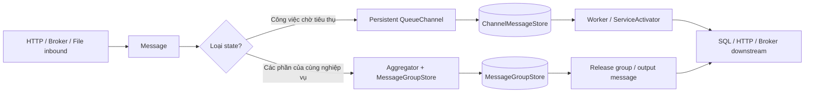
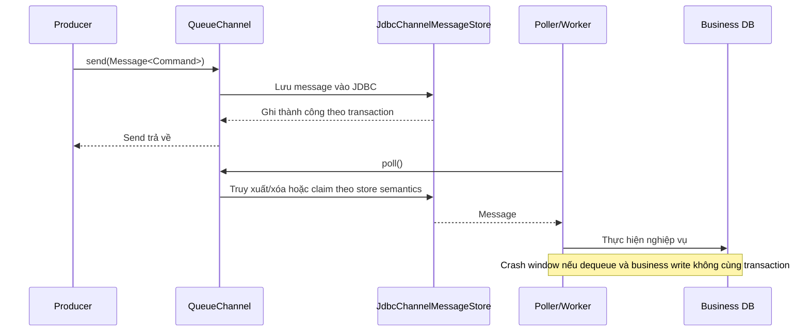
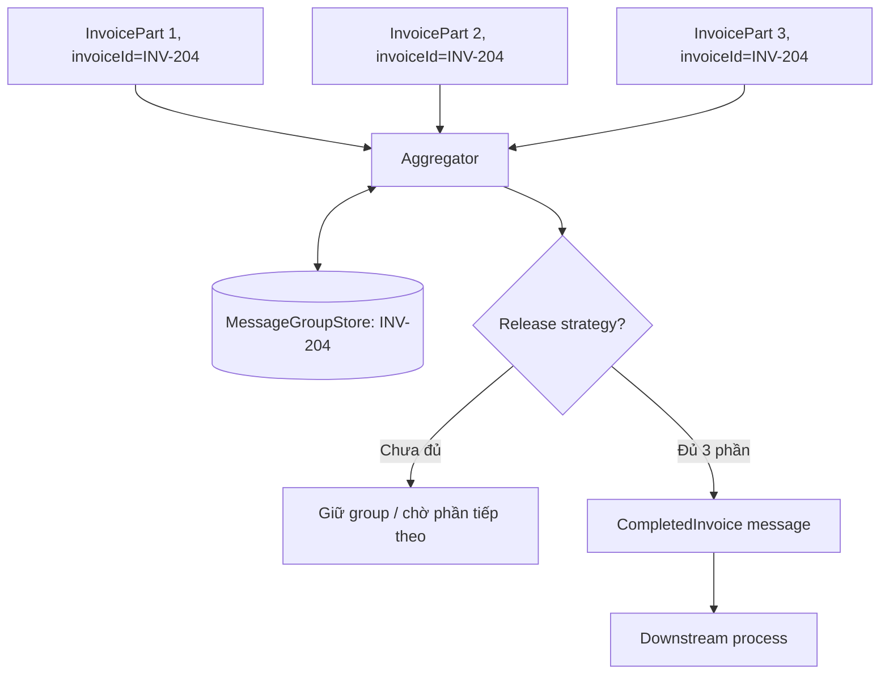
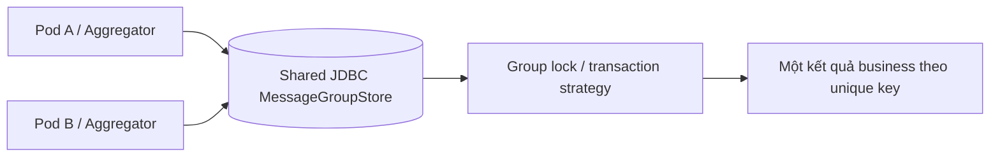
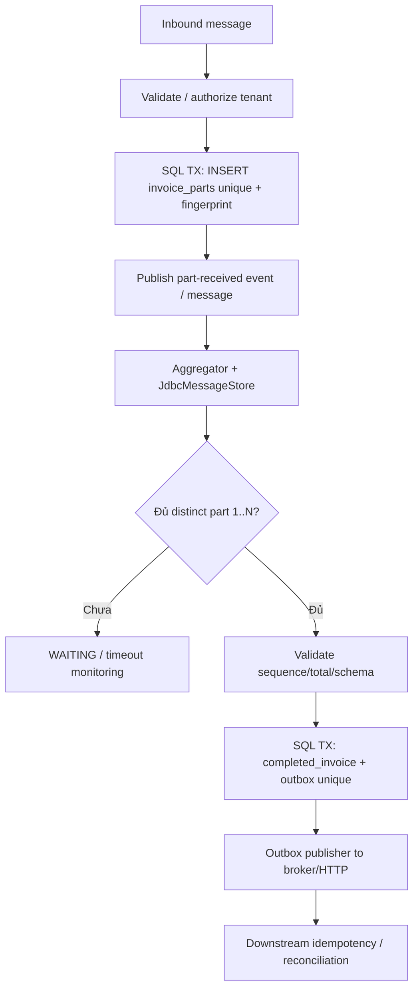

# MessageStore và lưu trạng thái channel hoặc aggregator

> **Chương:** Lỗi và trạng thái flow  
> **Phạm vi:** Trong module **SPRING_BOOT_INTEGRATION**, Spring Boot kết nối các hệ thống bằng HTTP client, cơ sở dữ liệu, cache, broker thông điệp và adapter Spring Integration. Bài này tập trung vào **MessageStore**: vì sao một integration flow cần lưu message hoặc message group, cách dùng store cho **channel** và **aggregator**, sự khác biệt giữa bộ nhớ và lưu trữ bền vững, cùng các ranh giới transaction, duplicate, timeout, phục hồi sau sự cố, bảo mật, kiểm thử và quan sát.

## 1. Tình huống: tiến trình chết khi flow chưa hoàn tất

Giả sử ứng dụng nhận các phần của một hóa đơn từ nhiều nguồn. Hóa đơn `INV-204` gồm ba phần:

```text
Nguồn A gửi (invoiceId=INV-204, part=1/3)
Nguồn B gửi (invoiceId=INV-204, part=2/3)
Nguồn C gửi (invoiceId=INV-204, part=3/3)
```

Spring Integration có thể gom ba phần vào một **aggregator**, chờ đủ rồi tạo hóa đơn hoàn chỉnh. Nhưng sau khi nhận phần 1 và 2, ứng dụng restart. Nếu các message group chỉ nằm trong bộ nhớ JVM, những phần đã tích lũy có thể biến mất.

Một tình huống khác: inbound HTTP gateway nhận một công việc, đưa vào `QueueChannel`, rồi trả `202 Accepted` cho caller. Nếu queue chỉ giữ dữ liệu trong RAM và pod restart trước khi worker xử lý, công việc đã được nhận nhưng không còn.

**Vấn đề không nằm ở cú pháp `IntegrationFlow`**, mà ở quyết định **trạng thái chưa xử lý được lưu ở đâu** và **hành vi gì khi có lỗi ở từng ranh giới**.



**Mục tiêu bài học:** phân biệt message store của channel với store của aggregator, tránh nhầm **lưu message** với **đã hoàn tất nghiệp vụ**, và thiết kế phục hồi theo dữ liệu thực tế thay vì chỉ dựa vào một flag trạng thái của process.

## 2. Ba dạng state dễ bị nhầm trong integration flow

| Loại trạng thái | Ví dụ | Cách lưu thích hợp |
| --- | --- | --- |
| **Message đang chờ xử lý** | Job tạo báo cáo đã được nhận nhưng worker chưa lấy | Queue có persistence hoặc broker; trong Spring Integration có persistent channel backed by store |
| **Message group đang tích lũy** | Đã nhận 2/3 phần hóa đơn, cần chờ phần cuối | `MessageGroupStore` cho aggregator/resequencer |
| **Business outcome** | Hóa đơn đã tạo, partner đã charge, event đã publish | Bảng nghiệp vụ, ledger, outbox/inbox, trạng thái bền vững theo business key |

Một `MessageStore` không tự trở thành **business ledger**. Nếu message đã được lấy khỏi queue rồi HTTP POST tới đối tác thành công nhưng process chết trước khi ghi kết quả, việc queue còn hay hết một message không đủ để xác định đối tác đã xử lý hay chưa.

### 2.1. Flow state khác transaction state

Một message group có thể ở trạng thái “đang chờ phần thứ ba”, nhưng hai phần đầu có thể đã được lưu bằng những transaction riêng. Ngược lại, một SQL transaction nghiệp vụ có thể rollback trong khi metadata của group hoặc một HTTP request bên ngoài đã được thay đổi ở một ranh giới khác.

Do đó cần tách bạch:

1. **Lưu trạng thái điều phối:** những message nào đang chờ và thuộc group nào.
2. **Lưu kết quả nghiệp vụ:** hệ thống đã làm được việc gì và bằng ID nào.
3. **Lưu ý định gửi đi:** outbox cho lời gọi/event tiếp theo.
4. **Ghi nhận đã tiêu thụ:** inbox/unique constraint để xử lý message đến lại.

## 3. Các interface và implementation của MessageStore

Spring Integration cung cấp các abstraction lưu message và message group. Các interface cụ thể có thể mở rộng nhau và thay đổi chi tiết giữa các phiên bản Spring Integration; hãy chọn **loại store tương thích với endpoint**, không chỉ chọn một class có chữ “MessageStore” trong tên.

| Abstraction / implementation | Mục đích | Lưu ý |
| --- | --- | --- |
| **`MessageStore`** | Lưu và truy xuất message bằng ID | Không mặc nhiên có semantics queue/polling hoặc group completion |
| **`BasicMessageGroupStore` / `MessageGroupStore`** | Lưu một nhóm message theo correlation key, phục vụ aggregator/resequencer | Cần quản lý release, complete, expiry và group cleanup |
| **`ChannelMessageStore`** | Hợp đồng lưu message để các channel queue-style sử dụng | Có đặc thù lấy/xóa message theo channel/group |
| **`SimpleMessageStore`** | Implementation trong memory, thuận tiện khi thử nghiệm hoặc state có thể mất | Không bền vững sau restart |
| **`JdbcMessageStore`** | Store dùng JDBC, thích hợp lưu message/group vào SQL | Cần schema tương thích, serializer, transaction và cleanup |
| **`JdbcChannelMessageStore`** | JDBC store chuyên dùng cho channel queue-style | Không nên tự thay thế mặc định cho aggregator group store |
| **Redis-backed message store** | Một lựa chọn qua Spring Integration Redis ở phiên bản hỗ trợ | Persistence/expiry/failover/transaction phụ thuộc Redis và cách cấu hình |

Tên class trên phản ánh các nhóm API Spring Integration thường được dùng. Với dự án Spring Boot 3.x, cần đối chiếu API Spring Integration do **BOM quản lý** và tài liệu version tương ứng trước khi copy bean configuration.

### 3.1. Message không chỉ có payload

```text
Message<OrderPart>
  payload:
    invoiceId = "INV-204"
    partNumber = 2
    amountMinor = 250000
  headers:
    id = UUID(...)
    timestamp = ...
    correlationId = "INV-204"
    sequenceNumber = 2
    sequenceSize = 3
    tenantId = "tenant-a"
```

Một store cho Spring Message có thể cần lưu **payload và headers** để phục hồi đúng routing/correlation/reply behavior. Tuy nhiên, không phải mọi header đều serialize được hoặc nên tồn tại lâu:

- Header chứa object runtime như connection, principal, bean hoặc lambda có thể không serialize được.
- Header chứa bearer token/PII gây rủi ro khi lưu vào database hoặc backup.
- Một `replyChannel` nội bộ trong memory không tự có ý nghĩa sau khi JVM restart.
- Message ID là định danh của message instance, **không luôn là business event ID**.

Muốn lưu message lâu dài, nên dùng payload/headers có schema đơn giản, ổn định, hạn chế nội dung nhạy cảm và định nghĩa **contract sau restore**.

## 4. In-memory store và persistent store khác nhau thế nào?

| Tiêu chí | Trong bộ nhớ JVM | JDBC / external persistent store |
| --- | --- | --- |
| Khởi động | Đơn giản, thường không cần schema | Cần database/service, schema, quyền và migrations |
| Tốc độ truy cập | Thường thấp latency nhất | Có I/O, serialization, lock, connection pool |
| Sau process restart | State thường mất | Có thể khôi phục nếu transaction commit và storage còn |
| Nhiều replica | Mỗi instance có state độc lập | Có thể chia sẻ, **nhưng cần xử lý đồng thời/locking** |
| TTL / cleanup | RAM tự giải phóng khi process dừng; còn chạy thì phải dọn | Cần chính sách xóa group/message hết hạn và quản trị DB |
| Schema/version evolution | Ít vấn đề vì state ngắn hạn | Phải giữ compatibility với serialized message cũ |
| Lỗi thường gặp | Mất queue khi crash, memory tăng | Lock contention, query chậm, disk đầy, schema sai |
| Cách kiểm thử | Unit test, thử behavior cơ bản | Integration test với backend thật, restart và concurrency |

**Persistent không đồng nghĩa exactly-once.** Nó chỉ giúp giữ một số trạng thái qua crash theo transaction/cấu hình. Tính đúng đắn vẫn đòi hỏi giải quyết những cửa sổ như **sau khi gửi remote nhưng trước khi ghi DONE**.

### 4.1. Khi nào in-memory là đủ?

Có thể dùng in-memory khi dữ liệu **có thể tái tạo dễ dàng** từ nguồn bền vững, hoặc mất state là hành vi được chấp nhận và đã được mô tả. Ví dụ một bộ đếm tạm để hiển thị trạng thái pipeline không quan trọng.

Không nên dùng một in-memory `QueueChannel` làm cam kết durable job nếu HTTP đã trả accepted và client sẽ không gửi lại. Nếu đã nhận nghĩa vụ xử lý, phải có **commit bền vững trước acknowledgement** hoặc contract rõ rằng request chỉ được nhận tạm thời.

## 5. Cài đặt Spring Integration JDBC và chuẩn bị schema

Ví dụ dưới đây dùng **Spring Boot 3.x, Java 17+, Spring Integration Java DSL, JDBC và PostgreSQL**. Cấu hình là **bản minh họa để phát triển**; schema/tên bảng của Spring Integration JDBC phải lấy từ **bộ script đúng version và dialect** thay vì đoán tên bảng rồi tự tạo thiếu chỉ mục.

### 5.1. Dependency Maven

```xml
<dependencies>
    <dependency>
        <groupId>org.springframework.boot</groupId>
        <artifactId>spring-boot-starter-integration</artifactId>
    </dependency>
    <dependency>
        <groupId>org.springframework.integration</groupId>
        <artifactId>spring-integration-jdbc</artifactId>
    </dependency>
    <dependency>
        <groupId>org.springframework.boot</groupId>
        <artifactId>spring-boot-starter-jdbc</artifactId>
    </dependency>
    <dependency>
        <groupId>org.postgresql</groupId>
        <artifactId>postgresql</artifactId>
        <scope>runtime</scope>
    </dependency>
</dependencies>
```

**Vì sao cần `spring-integration-jdbc`?** Spring Boot JDBC starter cung cấp DataSource và JdbcTemplate; các store Spring Integration JDBC thuộc module riêng. Việc chỉ thêm starter integration không có nghĩa các class JDBC store và SQL schema đã sẵn sàng.

### 5.2. Kết nối DB lưu state

```yaml
app:
  integration-store:
    jdbc-url: ${INTEGRATION_STORE_URL:jdbc:postgresql://localhost:5432/integration_dev}
    username: ${INTEGRATION_STORE_USER:integration_app}
    password: ${INTEGRATION_STORE_PASSWORD}

spring:
  datasource:
    url: ${INTEGRATION_STORE_URL:jdbc:postgresql://localhost:5432/integration_dev}
    username: ${INTEGRATION_STORE_USER:integration_app}
    password: ${INTEGRATION_STORE_PASSWORD}
    hikari:
      maximum-pool-size: 10
      connection-timeout: 3s
```

Nhánh `app.integration-store` chỉ là **metadata minh họa cho cấu hình ứng dụng**, không tự tạo một DataSource thứ hai. Ở cấu hình một DataSource này, Spring Boot tự tạo JDBC datasource từ `spring.datasource.*`. Nếu ứng dụng có **businessDataSource** và **integrationDataSource** độc lập, phải tự wiring bằng bean/qualifier và transaction manager tương ứng; không kỳ vọng Boot tự biết store cần database nào.

Không commit password thật vào YAML hoặc log. Trong production, dùng secret manager/Kubernetes Secret hoặc phương pháp bảo mật của hạ tầng cùng TLS và quyền SQL tối thiểu.

### 5.3. Khởi tạo schema

Spring Integration JDBC có **DDL scripts cho từng database dialect** phục vụ message store/channel message store và các thành phần JDBC liên quan. Quy trình an toàn:

1. Chốt version Spring Integration theo Spring Boot BOM.
2. Lấy đúng SQL schema scripts đi kèm version/module và đúng PostgreSQL dialect.
3. Đọc và áp dụng bằng **Flyway/Liquibase** hoặc pipeline migration được quản lý.
4. Đảm bảo index/constraint mà implementation kỳ vọng vẫn còn.
5. Test read/write/restart/concurrency với store thật.

**Không tùy tiện dùng `spring.jpa.hibernate.ddl-auto=update` để “tạo bảng MessageStore”.** Đây không phải JPA entity schema của nghiệp vụ. Cũng không tự xóa bảng của Spring Integration khi thấy chúng tích lũy row: message đang chờ hoặc group chưa complete có thể bị mất.

### 5.4. Phân biệt schema hệ thống và bảng nghiệp vụ

```text
Schema dữ liệu nội bộ của Spring Integration JDBC:
  Message payload/headers, message group, channel queue state, metadata...
  (do bộ schema chính thức của đúng version quản lý)

Schema nghiệp vụ tự thiết kế:
  orders, invoices, integration_inbox, integration_outbox,
  external_operation, import_batch...
  (do đội ứng dụng quản lý)
```

**Không đọc/ghi trực tiếp các bảng nội bộ của Spring Integration thay cho API MessageStore**, trừ một công cụ migration/diagnostics được thiết kế có kiểm soát. Format và invariant của chúng thuộc implementation, có thể thay đổi giữa version.

## 6. MessageStore dùng để lưu channel state

### 6.1. QueueChannel mặc định không bền vững

```java
@Bean
QueueChannel volatileOrdersChannel() {
    return new QueueChannel(500);
}
```

Đây là **queue trong memory** với capacity minh họa. Nếu process crash, message trong queue thường mất. Channel capacity cũng không làm cho queue có durability.

### 6.2. QueueChannel với JDBC-backed MessageGroupQueue

Với phiên bản Spring Integration hỗ trợ `JdbcChannelMessageStore` và `MessageGroupQueue`, có thể tạo một channel sử dụng store JDBC:

```java
package com.example.integration.state;

import javax.sql.DataSource;

import org.springframework.beans.factory.annotation.Qualifier;
import org.springframework.context.annotation.Bean;
import org.springframework.context.annotation.Configuration;
import org.springframework.integration.channel.QueueChannel;
import org.springframework.integration.jdbc.store.JdbcChannelMessageStore;
import org.springframework.integration.store.MessageGroupQueue;

@Configuration(proxyBeanMethods = false)
public class PersistentChannelConfiguration {

    @Bean("ordersChannelStore")
    JdbcChannelMessageStore ordersChannelStore(
            @Qualifier("integrationDataSource") DataSource dataSource) {
        JdbcChannelMessageStore store =
                new JdbcChannelMessageStore(dataSource);
        store.setRegion("orders-ingress");
        return store;
    }

    @Bean("ordersQueueChannel")
    QueueChannel ordersQueueChannel(
            @Qualifier("ordersChannelStore")
            JdbcChannelMessageStore store) {
        return new QueueChannel(
                new MessageGroupQueue(store, "orders.commands.v1"));
    }
}
```

**Điều kiện để ví dụ dùng được:**

- Một bean `integrationDataSource` và transaction manager tương ứng **được ứng dụng cấu hình riêng** nếu không dùng DataSource mặc định.
- Schema Spring Integration JDBC đã được migrate đúng version.
- Các package/constructor cụ thể phải phù hợp Spring Integration version do BOM chọn; xác nhận qua compile và integration test.
- Region và group ID có quy ước ổn định giữa các lần restart; không tự đổi chuỗi sau deploy mà bỏ quên row cũ.

**`region` không phải tenant isolation/security boundary.** Nó giúp phân vùng key/group trong store theo cấu hình; nhiều tenant vẫn cần scope, SQL ACL và phân vùng nghiệp vụ phù hợp.

### 6.3. Đường đi của message



Sơ đồ mô tả **ý tưởng queue backing store**, không áp đặt chính xác thứ tự commit/locking của mọi version JDBC store. Khi muốn bảo đảm việc **remove message và business update** không tách rời, cần kiểm soát transaction của poller/handler và tài nguyên thực tế.

**Nhận diện một lỗi thiết kế:** producer gửi vào queue bền vững rồi lập tức báo “business complete”. Store chỉ chứng minh **công việc đã được nhận/lưu theo contract gửi**, không chứng minh handler, SQL, HTTP hay broker đích đã hoàn tất.

## 7. Poller, transaction và “đã lấy khỏi queue” không đồng nghĩa “đã xử lý”

Đối với `PollableChannel` như `QueueChannel`, một poller lấy message rồi gọi handler. Transaction boundary của poller là quyết định lớn.

### 7.1. Ví dụ flow lấy công việc

```java
package com.example.integration.state;

import java.time.Duration;

import org.springframework.beans.factory.annotation.Qualifier;
import org.springframework.context.annotation.Bean;
import org.springframework.context.annotation.Configuration;
import org.springframework.integration.channel.QueueChannel;
import org.springframework.integration.dsl.IntegrationFlow;
import org.springframework.integration.dsl.Pollers;

@Configuration
public class OrdersPollerConfiguration {

    @Bean
    IntegrationFlow processOrdersFromQueue(
            @Qualifier("ordersQueueChannel") QueueChannel channel,
            OrderCommandHandler handler) {
        return IntegrationFlow
                .from(channel,
                        endpoint -> endpoint.poller(
                                Pollers.fixedDelay(Duration.ofMillis(250))
                                        .maxMessagesPerPoll(10)))
                .handle(OrderCommand.class, (command, headers) -> {
                    handler.process(command);
                    return null; // Công việc one-way, không có reply.
                })
                .get();
    }
}

record OrderCommand(String operationId, String tenantId, String orderId) {}
```

`OrderCommandHandler` là service ứng dụng cần triển khai. Cấu hình này **chưa đặt transaction advice cho poller**; nó dùng để minh họa cơ chế lấy message và xử lý. Trong production, cần cấu hình **poller transactional** và xác nhận JDBC store với business write có thật sự chia sẻ cùng DataSource/manager và transaction hay không.

### 7.2. Hai cửa sổ lỗi

```text
A. Dequeue thành công/commit ở store
   → process chết
   → business update chưa xảy ra
   → message có thể mất nếu không còn bản durable/retry source

B. Business update đã commit
   → process chết trước khi xác nhận message được xử lý
   → message có thể phát lại
   → side effect có thể bị lặp nếu không có idempotency
```

Một poller được bao trong **cùng local JDBC transaction** với dequeue và business write **có thể** giảm những cửa sổ này khi cả hai operation dùng cùng DataSource và implementation hỗ trợ transaction đúng cách. Nhưng:

- Không có một transaction JDBC thông thường bao được remote HTTP POST.
- Hai database khác nhau không tự thuộc một local transaction.
- Redis store và PostgreSQL business DB không tự atomic.
- Handler chuyển qua `ExecutorChannel` hoặc `@Async` có thể chạy trên thread khác và không tự kế thừa transaction JDBC thread-bound.

**Không sử dụng việc chuyển sang persistent QueueChannel như một cam kết exactly-once.** Lưu trữ bền vững giảm nguy cơ mất state, còn dedup và kết quả nghiệp vụ cần cơ chế riêng.

### 7.3. Chọn durable job queue hay broker?

Một JDBC-backed channel có thể phù hợp khi:

- Lưu lượng vừa phải, đã vận hành PostgreSQL và cần một queue tích hợp với Spring Integration.
- Workflow nhỏ, cùng database và transaction boundary có thể kiểm thử được.
- Cần dễ introspect state mà không đưa thêm broker.

Broker như RabbitMQ/Kafka/JMS thường đáng cân nhắc khi cần:

- Fan-out/consumer groups theo mô hình broker.
- Retention/replay theo log hoặc queue semantics ở quy mô lớn.
- Nhiều service độc lập, horizontal scaling và khả năng vận hành message hạ tầng chuyên dụng.

**Không chọn chỉ theo throughput lý thuyết.** Cần đánh giá durability, order, consumer ack, DLQ, network, schema và chi phí vận hành theo workload.

## 8. MessageGroupStore: state của aggregator và resequencer

Aggregator là một **stateful endpoint**: nó nhận từng message, gom theo **correlation key**, áp dụng **release strategy** và tạo một output message khi group đủ điều kiện.



Một group gồm:

- **Correlation key:** ID đại diện cho nhóm.
- **Các message đã nhận:** payload và headers của từng phần.
- **Trạng thái group:** số lượng, thời điểm cập nhật, complete/expire metadata theo implementation.
- **Release policy:** đủ `sequenceSize`, đạt một số lượng, nhận marker kết thúc hoặc timeout.
- **Output processor:** biến group đã release thành kết quả cần gửi downstream.

Nếu dùng store in-memory, state nhóm đang tích lũy có thể mất khi restart. **MessageGroupStore persistent** giữ những phần đã lưu qua restart khi SQL commit và schema/serializer ổn định.

### 8.1. Khác biệt giữa channel queue và group state

| Channel store | Aggregator group store |
| --- | --- |
| Giữ **công việc chưa được tiêu thụ** | Giữ **các phần của một nhóm chưa hoàn tất** |
| Poller lấy một message để xử lý | Correlator đưa message vào group theo key |
| Quan tâm FIFO/priority/visibility/transaction | Quan tâm release, completion, timeout, duplicate parts |
| Ví dụ `JdbcChannelMessageStore` | Ví dụ `JdbcMessageStore` làm `MessageGroupStore` |
| “Không còn trong queue” chưa chắc business done | “Group released” chưa chắc downstream side effect đã commit |

Đây là hai loại trạng thái với semantics khác nhau. **Không dùng cùng một group ID hoặc cùng một store region cho nhiều flow không liên quan** nếu không có phân vùng thiết kế rõ ràng.

## 9. Ví dụ cấu hình aggregator lưu group vào JDBC

### 9.1. Định nghĩa MessageGroupStore

```java
package com.example.integration.invoice;

import javax.sql.DataSource;

import org.springframework.beans.factory.annotation.Qualifier;
import org.springframework.context.annotation.Bean;
import org.springframework.context.annotation.Configuration;
import org.springframework.integration.jdbc.store.JdbcMessageStore;
import org.springframework.integration.store.MessageGroupStore;

@Configuration(proxyBeanMethods = false)
public class InvoiceGroupStoreConfiguration {

    @Bean("invoiceGroupStore")
    MessageGroupStore invoiceGroupStore(
            @Qualifier("integrationDataSource") DataSource dataSource) {
        JdbcMessageStore store = new JdbcMessageStore(dataSource);
        store.setRegion("invoice-aggregation");
        return store;
    }
}
```

`JdbcMessageStore` là một lựa chọn persistent cho message/group khi dùng SQL. Nó cần schema và quyền phù hợp, đồng thời phải kiểm chứng serializer có thể đọc lại payload/headers sau restart hoặc deploy version mới.

### 9.2. Dữ liệu invoice part

```java
package com.example.integration.invoice;

public record InvoicePart(
        String invoiceId,
        int partNumber,
        int expectedParts,
        long amountMinor,
        String currency
) {}
```

Một producer có thể gửi `Message<InvoicePart>` với headers:

```java
Message<InvoicePart> message = MessageBuilder
        .withPayload(new InvoicePart(
                "INV-204", 2, 3, 250000L, "VND"))
        .setHeader("invoiceGroupId", "tenant-a:INV-204")
        .setHeader("expectedParts", 3)
        .setHeader("partNumber", 2)
        .build();
```

`MessageBuilder` thuộc Spring Messaging. Đoạn trên minh họa một message được xây trong service/producer đã có imports và chưa gửi vào channel. **Tenant phải đến từ identity đã xác thực**, không lấy nguyên chuỗi tùy ý từ caller.

### 9.3. IntegrationFlow gắn store

```java
package com.example.integration.invoice;

import org.springframework.beans.factory.annotation.Qualifier;
import org.springframework.context.annotation.Bean;
import org.springframework.context.annotation.Configuration;
import org.springframework.integration.dsl.IntegrationFlow;
import org.springframework.integration.store.MessageGroupStore;
import org.springframework.messaging.Message;

@Configuration
public class InvoiceAggregateFlowConfiguration {

    @Bean
    IntegrationFlow invoiceAggregateFlow(
            @Qualifier("invoiceGroupStore")
            MessageGroupStore groupStore,
            CompletedInvoiceHandler handler) {
        return IntegrationFlow.from("invoicePartsInput")
                .aggregate(spec -> spec
                        .correlationStrategy(message ->
                                message.getHeaders().get("invoiceGroupId"))
                        .releaseStrategy(group -> {
                            Message<?> first = group.getOne();
                            if (first == null) {
                                return false;
                            }
                            Object count = first.getHeaders()
                                    .get("expectedParts");
                            return count instanceof Integer expected
                                    && expected > 0
                                    && group.size() >= expected;
                        })
                        .messageStore(groupStore))
                .handle(handler, "handle")
                .get();
    }
}
```

`CompletedInvoiceHandler` là một bean nghiệp vụ cần định nghĩa, chấp nhận payload group được release theo output processor của aggregator (mặc định thường là một tập payload khi dùng default group processor).

**Điều kiện bắt buộc trước khi dùng ví dụ:** một **filter/validator ở upstream** phải bảo đảm `invoiceGroupId` hiện diện, `expectedParts` dương và đồng nhất giữa mọi part cùng group, `partNumber` nằm trong khoảng hợp lệ và mỗi part có business identity duy nhất. Release bằng `group.size()` chỉ an toàn khi **không có duplicate part được tính thành thành viên mới**.

### 9.4. Số lượng đủ chưa chắc dữ liệu đúng

Giả sử expectedParts=3, nhưng nhận:

```text
partNumber=1, messageId=m1
partNumber=1, messageId=m2  (redelivery, Message ID mới)
partNumber=2, messageId=m3
```

Group size có thể đạt 3 dù **chưa hề nhận part 3**. Do đó, không thể chỉ dựa vào message count để xác nhận hoàn chỉnh khi duplicate có thể đến:

- Dùng unique key `(tenantId, invoiceId, partNumber)` tại durable inbox/staging table.
- Xử lý **same part/different payload** thành conflict theo fingerprint, không âm thầm ghi đè.
- Kiểm tra đủ tập sequence number `1..N` và total checksum khi release.
- Đảm bảo output processor sắp xếp theo `partNumber` nếu hợp đồng yêu cầu.

Nếu nghiệp vụ nhạy cảm và cần tính toán đúng ngay sau restart, một **staging table có unique constraint** có thể phù hợp hơn việc dựa riêng vào MessageGroupStore.

## 10. Correlation, sequence và release strategy

### 10.1. Correlation key

**Correlation ID** xác định những message nào thuộc cùng group. Với multi-tenant, `invoiceId` đơn lẻ có thể trùng, nên key phải chứa **tenant đã xác thực** hoặc một globally unique business ID. Nếu key quá dài, có thể dùng structured encoding hoặc digest có collision policy rõ.

**Đừng dùng trace ID làm correlation key nghiệp vụ mặc định.** Một trace có thể bao gồm nhiều đơn hàng hoặc nhiều lần thử; một invoice có thể được xử lý qua nhiều traces.

### 10.2. Sequence number và sequence size

Khi một splitter tạo các phần của một message, Spring Integration có thể bổ sung các header chuẩn cho **correlation, sequence number và sequence size**. Nhưng message từ broker hoặc API bên ngoài **không tự có các header đó đúng nghĩa** nếu producer không cung cấp chúng.

Nếu số lượng phần chưa được biết trước (stream không có end marker), không thể dùng `sequenceSize` cố định như điều kiện release. Khi đó có thể:

1. Định nghĩa một **completion marker** hoặc message cuối cùng.
2. Dùng watermark/timeout với policy partial result có kiểm soát.
3. Đổi mô hình sang streaming aggregation/state database để ghi kết quả từng phần.

Đừng biến “quá 30 giây chưa thấy phần cuối” thành “đã đủ hóa đơn” mà thiếu một hợp đồng cho partial/failed group.

### 10.3. Release khác complete

Một aggregator có thể release một output khi đủ điều kiện, nhưng group metadata **có thể được giữ lại hoặc xóa tùy cấu hình**. Giữ group đã complete có thể giúp phát hiện late message/duplicate trong một khoảng thời gian; xóa ngay có thể cho phép cùng correlation key mở group mới nếu producer gửi lại sau đó.

**Cần quyết định rõ:**

- Sau release, group có được phép nhận phần mới?
- Retention của completed-group marker bao lâu?
- Khi nhận late message, bỏ qua, báo lỗi hay mở group mới?
- Nếu group bị reaped/expired, có thể tạo lại cùng key không?

Không dùng completed-group marker trong store làm lớp idempotency duy nhất khi cần chống trùng lâu hơn retention hoặc khi source có thể phát lại sau nhiều ngày.

## 11. Timeout, group expiry và MessageGroupStoreReaper

Một aggregator thiếu một phần có thể giữ state vô hạn nếu không có chính sách dọn. Ngược lại, xóa quá sớm làm mất những phần đã nhận hợp lệ.

| Cơ chế | Ý nghĩa | Rủi ro nếu dùng thiếu policy |
| --- | --- | --- |
| **Group timeout** | Đánh giá một group chờ quá lâu trong bối cảnh aggregator | Partial result hoặc group expiry gây mất kỳ vọng hoàn chỉnh |
| **`MessageGroupStoreReaper`** | Dọn/expire những group trong store theo timeout và lịch chạy | Dọn nhầm state còn hợp lệ hoặc nhiều replica cùng reaper gây cạnh tranh |
| **Send partial result on expiry** | Có thể phát kết quả chưa đủ phần khi cấu hình cho phép | Hóa đơn thiếu dòng bị coi thành hoàn tất |
| **Completed-group retention** | Giữ marker hoặc metadata sau release | Lưu quá lâu làm tăng dung lượng; xóa sớm làm tăng trùng |
| **Business deadline** | SLA “đủ 3 phần trước 18:00” | Không nên suy ra chỉ từ group creation time |

### 11.1. Một chính sách timeout ví dụ

```text
Invoice INV-204:
  expectedParts = 3
  timeout từ last-update = 15 phút
  hết hạn mà thiếu part:
      state nghiệp vụ = INCOMPLETE
      lưu missing part numbers + correlation ID
      gửi alert hoặc DLQ/quarantine
      KHÔNG xuất CompletedInvoice

  khi đủ part:
      validate total/checksum/currency
      lưu completed invoice bằng business unique constraint
      phát InvoiceCompleted qua outbox
```

Một `MessageGroupStoreReaper` chạy theo lịch chỉ xử lý **state của store**, không tự biết invoice nào được quyền đóng sổ, ai nhận thông báo hay có cần bù dữ liệu. Cần handler/error flow riêng và chính sách retention cho dữ liệu đã expire.

### 11.2. Tránh xóa dữ liệu khi business chưa xử lý

Không đặt `sendPartialResultOnExpiry=true` theo thói quen “để giải phóng bộ nhớ”. Nếu một partial invoice không hợp lệ, phát nó xuống downstream có thể tạo side effect sai. Có thể chọn hướng **mark group timed out → lưu diagnostic → retry/reconcile → dọn sau deadline**.

Khi dùng JDBC store, cleanup cần theo dõi cả dung lượng, SQL locks và số group còn chờ. Không xóa trực tiếp row trong bảng nội bộ mà bỏ qua lifecycle của aggregator.

## 12. Ranh giới transaction khi aggregator release kết quả

Một flow:

```text
MessagePart 3
  → JdbcMessageStore thêm part
  → Aggregator release group
  → gọi Billing API
  → update SQL completed
```

không tự trở thành **một transaction atomically commit toàn bộ**. Những cửa sổ phải xem xét:

1. **Add part đã commit, process chết trước release:** group còn trong store, nhưng cần cơ chế khởi động lại/trigger release.
2. **Group release/cleanup đã commit, process chết trước khi downstream nhận output:** có thể mất output nếu reply/output channel chỉ in-memory.
3. **HTTP downstream thành công, process chết trước ghi DONE:** retry có nguy cơ side effect trùng.
4. **Business DB rollback nhưng group store đã cập nhật:** state điều phối và state nghiệp vụ lệch.

**Phương án chắc chắn hơn cho side effect quan trọng:** Khi group đủ, ghi bản ghi kết quả nghiệp vụ và **outbox event** cùng SQL transaction theo một khóa business ổn định; worker downstream lấy outbox gửi HTTP/broker. Nếu aggregator store dùng cùng database, có thể cân nhắc transaction phối hợp giữa store và business write, nhưng phải kiểm thử chính xác thứ tự release, lock, output channel và transaction boundary ở version đang chạy.

### 12.1. TransactionTemplate không thay idempotency

```java
@Service
class InvoiceCompletionService {
    private final JdbcTemplate jdbc;

    InvoiceCompletionService(JdbcTemplate jdbc) {
        this.jdbc = jdbc;
    }

    @Transactional
    public void persistResult(
            String tenantId, String invoiceId, String summaryJson) {
        int inserted = jdbc.update("""
            INSERT INTO completed_invoices
                (tenant_id, invoice_id, summary_json)
            VALUES (?, ?, CAST(? AS jsonb))
            ON CONFLICT (tenant_id, invoice_id) DO NOTHING
            """, tenantId, invoiceId, summaryJson);
        if (inserted == 0) {
            // Tra payload hash/version để phân biệt replay hợp lệ
            // với conflict trước khi quyết định trả kết quả cũ.
            return;
        }
        // Nếu cần publish, INSERT vào outbox cùng SQL transaction ở đây.
    }
}
```

Đây là **mẫu minh họa SQL PostgreSQL**. Cần bổ sung DDL, fingerprint conflict check, producer identity, validation dữ liệu và transaction manager đúng khi nhiều DataSource. `ON CONFLICT DO NOTHING` chỉ chặn insert trùng key; **không tự chứng minh nội dung trùng là giống nhau**.

### 12.2. Hợp đồng trạng thái nghiệp vụ

```text
RECEIVING
   |
   +--> INCOMPLETE / EXPIRED
   |
   +--> VALIDATED
           |
           +--> PERSISTED + OUTBOX_COMMITTED
                       |
                       +--> PUBLISH_PENDING
                       +--> SENT
                       +--> UNKNOWN / RECONCILE
```

State của aggregator được dùng để biết **đang có những phần nào**. State trên bảng nghiệp vụ biết **đã hoàn tất bước nào**. Khi phục hồi sau crash, cần dựa trên cả hai nguồn theo một quy trình quyết định rõ.

## 13. Xử lý trùng, mất thứ tự và late messages

### 13.1. Message ID khác business ID

Mỗi Spring `Message<?>` có thể có ID riêng; cùng một event từ broker được deserialize rồi tạo `Message<?>` mới sau retry **có thể có ID khác**. Nếu chỉ dựa vào MessageStore dedup theo Spring Message ID, duplicate business event vẫn có thể được tính hai lần.

Một ledger bền vững nên định danh bằng:

```sql
CREATE TABLE invoice_parts (
    tenant_id VARCHAR(80) NOT NULL,
    invoice_id VARCHAR(120) NOT NULL,
    part_number INT NOT NULL CHECK (part_number > 0),
    payload_sha256 VARCHAR(64) NOT NULL,
    amount_minor BIGINT NOT NULL,
    currency VARCHAR(3) NOT NULL,
    created_at TIMESTAMPTZ NOT NULL DEFAULT CURRENT_TIMESTAMP,
    PRIMARY KEY (tenant_id, invoice_id, part_number)
);
```

Khi nhận part trùng:

- **Cùng primary key và cùng digest/nội dung:** có thể trả kết quả đã nhận theo idempotency policy.
- **Cùng primary key nhưng digest/nội dung khác:** conflict, quarantine và điều tra; không overwrite âm thầm.
- **Part khác số thứ tự:** thêm vào group/staging và chờ.
- **Late part sau complete/expire:** xử lý theo contract; không mở lại nghiệp vụ có side effect mà không kiểm tra business ledger.

### 13.2. Sắp thứ tự trước output

Một aggregator nhận part theo thứ tự `3,1,2` nhưng về mặt nghiệp vụ cần ghép theo `1,2,3`. Đừng dựa vào iteration order của `MessageGroup.getMessages()` như một hợp đồng thứ tự nếu output cần quyết định rõ.

Output processor phải validate và sắp theo `partNumber`, tính tổng và kiểm tra currency/schema trước khi phát kết quả. `Resequencer` là một endpoint liên quan nhưng mục tiêu chính của nó là **phát lại message theo đúng sequence**, còn aggregator thường **biến group thành một output**.

## 14. Nhiều instance dùng chung JDBC store: cần điều phối concurrency

Hai pod cùng nhận message thuộc `INV-204`:



Một shared database giúp hai pod thấy cùng state, nhưng **không tự bảo đảm** chỉ một thread cập nhật/release group tại mọi thời điểm. Cần xem:

- Lock theo correlation key (local hoặc distributed `LockRegistry` tùy topology).
- Transaction/row locks và isolation của store.
- Producer/consumer concurrency và số instance.
- Release strategy chạy đồng thời có thể phát duplicate output hay không.
- Group expiry/reaper có chạy ở nhiều instance và xung đột với add/release không.
- Có cần partition message theo business key để giảm tranh chấp không.

Spring Integration cung cấp cơ chế khóa cho aggregator/group management; với nhiều JVM cần chọn lock implementation có **tính chất phân tán** nếu thuật toán cần exclusivity xuyên pod. Một `DefaultLockRegistry` trong memory của pod A **không khóa** pod B. JDBC/Redis-backed locks cũng cần timeout/lease/fencing và kiểm thử failure; không xem chúng như bảo đảm exactly-once cho remote HTTP call.

### 14.1. Transaction manager phải quản lý đúng datasource

Nếu `JdbcMessageStore` trỏ `integrationDataSource` nhưng `@Transactional` lại dùng `businessTransactionManager` của database khác, SQL update nghiệp vụ và group update **không phải một local transaction**. Nhầm `@Primary`/`@Qualifier` có thể khiến test khởi động thành công mà dữ liệu sai.

Khi dùng SQL store và bảng nghiệp vụ cùng một database, có thể quyết định dùng chung DataSource/manager để hỗ trợ atomic work theo scope được kiểm thử. Khi khác database hoặc broker/HTTP, dùng outbox/inbox/reconciliation phù hợp.

## 15. Serialization, schema migration và khả năng đọc state sau deploy

Persistent store không chỉ lưu một Java object đang sống; nó phải ghi bytes/schema để phiên bản ứng dụng **tương lai có thể đọc lại**.

### 15.1. Các rủi ro với payload/headers

| Rủi ro | Ví dụ | Hướng giải quyết |
| --- | --- | --- |
| DTO đổi class/package | `InvoicePart` được chuyển package sau deploy | Versioning, serializer schema ổn định và migration |
| Header không serialize được | `replyChannel` là object runtime hoặc header chứa resource | Giảm headers lưu, dùng correlation identifier và thiết kế reply durable |
| Java serialization không an toàn | Deserialize dữ liệu không đáng tin | Giới hạn nguồn dữ liệu, allowlist/classes và dùng định dạng an toàn theo thiết kế |
| Contract thay đổi | `amountMinor` chuyển sang decimal hoặc field mới mandatory | Schema evolution/migration, test old/new version |
| Dữ liệu nhạy cảm | Token/PII được lưu trong SQL state | Redact, encryption/ACL, retention, secrets riêng |
| Schema store không tương thích | Spring Integration JDBC tables/indexes thay đổi | Migration theo version, kiểm thử rolling deploy/rollback |

Không viết thẳng một `java.io.Serializable` graph phức tạp chứa Spring bean, connection hay stream vào message chỉ vì local flow hoạt động. Với persistent state, ưu tiên **DTO bất biến, serializable theo hợp đồng có version**, và hạn chế header runtime.

### 15.2. Checklist trước nâng cấp Spring Boot / Spring Integration

1. Đếm pending message và active group; chốt deadline dừng nhận công việc nếu cần.
2. Đối chiếu version Spring Integration JDBC schema với version mới.
3. Kiểm tra serialization đọc được **dữ liệu của phiên bản cũ**; có thể dùng fixture lưu thật trước nâng cấp.
4. Không chỉ test message mới do version mới tạo.
5. Đánh giá khả năng rolling deploy: hai version có cùng đọc/ghi group table không?
6. Có rollback plan nếu message schema mới không đọc được ở binary cũ.
7. Kiểm tra index/cleanup/SQL plans với dữ liệu pending thật (không chỉ database rỗng).
8. Không tự sửa row nhị phân trong bảng store khi chưa hiểu encoding và invariant.

## 16. Quản lý retention và dung lượng

Một store bền vững có thể tăng rất nhanh nếu flow bị lỗi, group không release hoặc consumer không poll.

| Dữ liệu | Retention/cleanup cần quyết định |
| --- | --- |
| Pending channel messages | Giữ đến khi xử lý/expired theo nghiệp vụ; cảnh báo backlog |
| Active aggregator groups | Giữ trong deadline và khả năng delayed arrivals |
| Completed-group marker | Giữ đủ lâu để nhận biết late/duplicate theo chính sách |
| Expired groups | Chuyển trạng thái và lưu diagnostic trước khi purge |
| Business inbox/idempotency | Theo SLA retry/replay, không phụ thuộc TTL cache local |
| Outbox SENT/FAILED | Theo yêu cầu audit, reconciliation và storage budget |
| SQL logs/audit/backup | Theo data retention, bảo mật và quy định tổ chức |

**Không dùng một TTL chung cho mọi loại state.** Channel job có thể cần tồn tại nhiều ngày trong outage; aggregator chờ 30 phút nhưng idempotency ledger cần giữ qua tuần; dữ liệu PII có thể phải xóa theo chính sách.

### 16.1. Cleanup có thể cạnh tranh với flow đang chạy

Nếu một reaper expire group đúng lúc part cuối đến, cần xác định ai thắng theo lock/transaction semantics. Nếu một DBA job xóa row pending không thông qua API store, Spring Integration có thể thấy state bị thiếu hoặc output không đúng.

Tạo metric, dry run và retention policy riêng cho cleanup; thử nghiệm trên dữ liệu nhiều phiên bản trước khi tự động purge.

## 17. Bảo mật persistent message state

### 17.1. MessageStore là nơi chứa dữ liệu thật

Payload và header có thể chứa:

- Customer/order/invoice ID.
- Email, địa chỉ giao hàng, nội dung audit.
- Credentials hoặc token nếu upstream forward sai.
- Metadata để kết nối giữa tenant, partner và request.

Một JDBC store nên được xem như **data store nhạy cảm**, với quyền SQL tối thiểu, network/TLS, mã hóa storage/backup khi cần, audit access và retention. Không mở SQL access rộng cho các service không có nhu cầu. Nếu nhiều tenant dùng chung store, áp dụng isolation/authorization từ **trước khi message được lưu**, và không tin `tenantId` do caller tự khai.

### 17.2. Không log raw serialized message

Để debug, thường chỉ cần:

```text
flow=invoice-aggregate
region=invoice-aggregation
groupKeyHash=...
messageCount=2
expectedCount=3
ageSeconds=84
state=WAITING
errorClass=...
```

Những field trên là ví dụ, không phải metric được Spring tạo tự động. Hash group key cũng phải được cân nhắc nếu dữ liệu có không gian giá trị nhỏ và dễ suy đoán; log/metric nên dùng phân quyền, redaction và sampling.

## 18. Quan sát channel và aggregator

### 18.1. Metrics gợi ý

| Chỉ số | Phát hiện |
| --- | --- |
| Pending queue depth theo channel | Worker không theo kịp nguồn gửi |
| Oldest pending message age | Có công việc bị bỏ quên dù queue depth thấp |
| Group count theo aggregator/region | Nhóm tích lũy tăng bất thường |
| Group age/last update age | Missing part hoặc stale group |
| Group release rate và partial expiry rate | Chất lượng dữ liệu và khả năng hoàn tất |
| Duplicate part/business key conflict | Redelivery hoặc producer vi phạm contract |
| Store JDBC latency/errors | DB quá tải, lock contention, SQL schema/serialization lỗi |
| Transaction rollback/retry | Side effect hoặc group update thất bại |
| Outbox pending/reconciliation count | Đã release nhưng downstream chưa hoàn tất |
| JVM heap và DB storage size | In-memory pressure hoặc persistent backlog |

Không phải tất cả metric được Spring Integration/Actuator cung cấp mặc định. Có thể bổ sung Micrometer instrumentation tại adapter, handler, store/reaper và business ledger, đồng thời quan sát HikariCP, SQL lock wait và disk I/O.

**Tránh metric tag có cardinality cao:** không dùng invoiceId, orderId, messageId, correlationId tự do hoặc raw payload làm tag. Region, endpoint name, outcome và error category thường phù hợp hơn.

### 18.2. Phân biệt trạng thái hoạt động với state durable

Một application instance báo **healthy** không chứng minh backlog đã được tiêu thụ hết. Một channel depth bằng 0 không chứng minh message đã hoàn tất nghiệp vụ nếu poller đã dequeue rồi fail trước khi commit kết quả. Cần ít nhất ba lớp tín hiệu:

1. **Infrastructure:** DB connection, broker availability, errors.
2. **Flow state:** pending messages, active groups, expiry.
3. **Business state:** completed/failed/unknown operations, outbox/inbox/reconciliation.

## 19. Kiểm thử MessageStore với hậu quả sau crash

### 19.1. Bộ test tối thiểu

| Ca kiểm thử | Kết quả phải chứng minh |
| --- | --- |
| In-memory QueueChannel rồi restart | State mất theo thiết kế (không hứa persistence) |
| JDBC-backed QueueChannel rồi restart | Pending message đã commit vẫn truy xuất được |
| Aggregator nhận 2/3 rồi restart | Group state còn và phần 3 có thể hoàn tất |
| Part duplicate cùng business ID | Không làm `group.size()` đạt expected sai |
| Part cùng ID nhưng khác payload | Conflict/quarantine theo fingerprint |
| Release đủ parts nhưng downstream lỗi | Không mất business outcome mà không có retry/reconciliation |
| Timeout khi thiếu part | Không tạo invoice “complete” sai |
| Reaper đồng thời với part cuối | State không bị mất/nhân đôi qua race |
| Hai replica cùng correlation key | Chỉ một business completion theo unique constraint |
| SQL store schema/serializer upgrade | Đọc lại message/group trước nâng cấp |
| Sai transaction manager | Test phát hiện partial commit giữa store và business DB |
| Store DB timeout/down | Không trả accepted như thể job đã durable nếu chưa lưu |
| Crash sau remote side effect | Retry cùng operation ID không tạo duplicate |
| Payload có metadata nhạy cảm | Không bị log/xuất ra metric không được phép |

### 19.2. Test aggregator qua flow, không chỉ gọi strategy

Một test logic `releaseStrategy(group)` chỉ chứng minh phép đếm, không chứng minh:

- Message có được persist vào store qua transaction không.
- Store có khôi phục group sau restart không.
- Correlation key/headers có được serialize đúng không.
- Spring Integration có release đúng một output qua flow thật không.
- Group được cleanup, complete hoặc expire đúng ý không.

**Integration test với PostgreSQL Testcontainers** nên tạo schema chính thức, cấu hình `JdbcMessageStore`, gửi hai part vào flow, đóng context, tạo context mới dùng cùng database rồi gửi part cuối. Assert **một** completed invoice hợp lệ và state business đúng. Cần lưu ý TestContext caching và container lifecycle để context mới thực sự kết nối vào cùng database có dữ liệu pending.

### 19.3. Test queue bằng controlled failure

Một test đáng giá:

1. Gửi message có `operationId` cố định vào persistent queue.
2. Xác minh producer chỉ trả accepted sau khi write bền vững theo contract.
3. Tắt ứng dụng trước khi poller tiêu thụ.
4. Khởi động lại với cùng store/schema/region.
5. Xác minh message được poll và business handler xử lý.
6. Giả lập crash **sau business commit nhưng trước acknowledgment**.
7. Xác minh replay không tạo duplicate nhờ ledger/unique constraint.

Thêm một test khi database của message store offline: nếu chưa lưu được job, endpoint phải trả lỗi/không accepted theo contract, không giả vờ bền vững vì queue object vẫn tồn tại trong memory.

### 19.4. Không nhầm @SpringBootTest với test đủ durability

`@SpringBootTest` chỉ khởi động context và có thể dùng H2/in-memory test. Để chứng minh persistence của JDBC store, phải dùng **backend có transaction/schema giống production** và kiểm tra sau restart/commit. Với cơ chế multi-replica, cần ít nhất hai instances/contexts hoặc test tương đương để phát hiện race.

## 20. Troubleshooting những lỗi thường gặp

| Triệu chứng | Nguyên nhân thường gặp | Cách điều tra |
| --- | --- | --- |
| Message biến mất khi restart | `QueueChannel` in-memory hoặc send chưa commit | Kiểm tra bean channel/store và ranh giới accepted |
| JDBC store không khởi tạo | Thiếu `spring-integration-jdbc` hoặc schema SQL | Dependency, đúng dialect và migration version |
| Store tồn tại nhưng aggregator không khôi phục group | Flow trỏ nhầm store/region, serializer không đọc được, group đã bị expire | Bean wiring, region, SQL rows, lifecycle |
| Group không bao giờ release | Sai correlation/sequenceSize, thiếu last part, release strategy sai | Dump diagnostic an toàn về group count/expected |
| Group release quá sớm | Redelivery duplicate, chỉ dùng `group.size()` | Unique part ID, fingerprint, sequence validation |
| Group đã complete nhưng output mất | Output channel in-memory, crash window | Durable output/outbox + transaction trace |
| Cùng invoice được tạo hai lần | Nhiều instance release, retry hoặc expired key được mở lại | Business unique constraint, distributed lock, ledger |
| CPU/DB tăng vì reaper | Quá nhiều groups, cleanup index/interval không phù hợp | Index, group age, reaper schedule, retention |
| PostgreSQL disk đầy | Pending messages/old groups không được purge | Backlog, expiry policy, archiving và cleanup |
| ClassCast/deserialize exception sau deploy | DTO/header/schema serializer thay đổi | Fixture old-version, migration và rollback plan |
| Một JDBC @Transactional không rollback store | Store dùng DataSource/manager khác | `@Qualifier`, transaction boundary, actual connection |
| Message xử lý trùng sau recover | Chỉ dedup bằng Message ID hoặc thiếu inbox | Business operation ID + unique constraint |
| Cấu hình Redis store vẫn mất state | Redis eviction/expiry/failover/persistence policy | Redis configuration và durability SLA |
| Không thấy lỗi nhưng vẫn thiếu output | Flow error channel, discarded messages, late replies | ErrorMessage routing, DLQ/quarantine, tracing |

**Đừng xử lý mọi lỗi bằng cách tăng timeout hoặc xóa bảng store.** Tăng timeout có thể làm state tích tụ dài hơn; xóa bảng có thể khiến nghiệp vụ mất công việc hoặc phát lại sai. Luôn xác định từng correlation group, transaction và consumer outcome trước.

## 21. Bài thực hành: hóa đơn nhiều phần, phục hồi sau restart

### Đề bài

Thiết kế một flow nhận ba phần hóa đơn qua HTTP, broker hoặc file:

```json
{
  "tenantId": "tenant-a",
  "invoiceId": "INV-204",
  "partNumber": 1,
  "expectedParts": 3,
  "amountMinor": 125000,
  "currency": "VND",
  "eventId": "evt-901"
}
```

Yêu cầu:

1. Cùng tenant/invoice/part chỉ được chấp nhận một nội dung theo digest.
2. Nếu gửi hai phần rồi restart, part cuối vẫn có thể hoàn tất group.
3. Không đánh dấu completed khi thiếu part, dù đã hết timeout.
4. Sau khi hoàn tất, ghi completed invoice và outbox trong SQL.
5. Khi broker/HTTP downstream lỗi, không làm mất ý định gửi.
6. Khi event đến lại hoặc hai replica chạy đồng thời, không tạo invoice hai lần.

### Thiết kế gợi ý



**Chú ý atomicity ở bước C→D:** nếu ghi part vào SQL rồi phát message trực tiếp, process có thể chết trước publish. Khi yêu cầu không bỏ sót part, lưu **part-received outbox record trong cùng transaction C**, sau đó publisher phát sang aggregator. Group store là state để điều phối, còn bảng `invoice_parts` có thể làm nguồn phục hồi bền vững khi cần rebuild group.

### Bài mở rộng

- Thêm `schemaVersion` và chạy thử một context phiên bản mới đọc group do phiên bản cũ lưu.
- Mô phỏng message part 2 được gửi ba lần với ba Spring Message IDs khác nhau.
- Thử part 3 đến trước part 1, xác nhận output vẫn được sắp đúng thứ tự.
- Chạy hai instance cùng JDBC store và cùng correlation key, kiểm tra locking/unique completion.
- Thay đổi timeout từ 10 phút xuống 2 phút mà không làm mất group hợp lệ khi rollout.
- Kiểm tra khi group đã release nhưng downstream SQL tạm thời lỗi.

## 22. Checklist triển khai production

1. **Chỉ rõ state:** pending channel message, active group và business outcome khác nhau.
2. **Chọn store đúng endpoint:** `JdbcChannelMessageStore` cho channel queue-style, `JdbcMessageStore`/`MessageGroupStore` cho aggregator khi phù hợp.
3. **Bảo đảm SQL schema:** đúng dialect/version, index/constraint, migration và quyền truy cập.
4. **Chốt serializer:** payload/header có schema/version, không lưu resource object hoặc secret tùy tiện.
5. **Chốt correlation:** tenant + business key, tránh ID trùng và dynamic key không có chuẩn.
6. **Chốt release:** distinct part/checksum, không chỉ group size khi có duplicate.
7. **Chốt timeout:** expiry, partial/quarantine, reaper và retention theo business SLA.
8. **Chốt transaction:** đúng DataSource/manager cho store/handler, không hứa atomicity xuyên HTTP/broker.
9. **Chốt dedup:** unique constraint + inbox/outbox/idempotency key ổn định, tách Spring Message ID.
10. **Chốt multi-instance:** lock, concurrency, partitioning và reaper ownership khi share store.
11. **Quan sát:** queue depth/oldest age, group count/age, release/expiry, store latency, SQL locks và reconciliation.
12. **Kiểm thử lỗi:** crash trước/sau commit, restart, duplicate, late part, timeout, schema upgrade và production-like JDBC backend.

### Câu hỏi tự kiểm tra

1. Vì sao một `QueueChannel` trong memory không thích hợp để bảo đảm accepted job qua restart?
2. `MessageStore`, `ChannelMessageStore` và `MessageGroupStore` phục vụ các loại state khác nhau thế nào?
3. `JdbcChannelMessageStore` và `JdbcMessageStore` khác nhau ở use case nào?
4. Persistent MessageStore có mặc nhiên bảo đảm business side effect xảy ra exactly-once không?
5. Nếu dequeue message đã commit nhưng worker chết trước SQL update, điều gì có thể xảy ra?
6. Vì sao một aggregator cần correlation key và release strategy?
7. Tại sao `group.size() >= expectedParts` có thể sai khi broker redelivery cùng part bằng Spring Message ID mới?
8. `sequenceSize` có đủ cho một stream không biết trước tổng số phần không?
9. Sau khi group release và output sang channel in-memory, còn cửa sổ mất message nào?
10. Timeout/reaper có thay được quyết định business “hóa đơn hoàn chỉnh” không?
11. Vì sao nhiều instance dùng chung JDBC store vẫn có thể cần distributed lock và unique key?
12. Những dữ liệu nào trong message headers không nên lưu lâu vào SQL store?
13. Tại sao upgrade Spring Integration JDBC phải test đọc group cũ chứ không chỉ write group mới?
14. Khi group store và business DB nằm ở hai DataSource khác nhau, `@Transactional` đơn lẻ có đủ không?
15. Test nào chứng minh group vẫn hoàn tất chính xác sau restart và duplicate replay?

## 23. Tài liệu tham khảo

- [Spring Integration — Message Store](https://docs.spring.io/spring-integration/reference/message-store.html): lưu message, message group, persistence và các implementation.
- [Spring Integration — Aggregator](https://docs.spring.io/spring-integration/reference/aggregator.html): correlation, release, group timeout và lifecycle.
- [Spring Integration — Message Channels](https://docs.spring.io/spring-integration/reference/channel.html): `QueueChannel`, pollable channel và message delivery.
- [Spring Integration — JDBC Support](https://docs.spring.io/spring-integration/reference/jdbc.html): JDBC message store, schema và adapter.
- [Spring Framework — Transaction Management](https://docs.spring.io/spring-framework/reference/data-access/transaction.html): transaction boundary, transaction manager và rollback.
- [Spring Boot — Integration](https://docs.spring.io/spring-boot/reference/messaging.html): tổ chức messaging integration theo version.

**Ghi nhớ:** **MessageStore giúp lưu trạng thái của integration flow**, nhưng phải chọn **store cho channel** và **store cho aggregator/message group** theo đúng semantics. JDBC-backed store có thể giữ pending message và group qua restart; nó **không tự tạo distributed transaction hay exactly-once nghiệp vụ**. Với flow có SQL, HTTP, Redis hoặc broker, hãy xác định **ai sở hữu state, commit ở đâu, khi nào release/expire, duplicate được kiểm tra bằng business key nào và output đã bền vững chưa**. Một thiết kế production đáng tin cậy kết hợp MessageStore, transaction phù hợp, unique constraint/inbox/outbox, cleanup, quan sát và kiểm thử restart/crash/concurrency thực tế.
