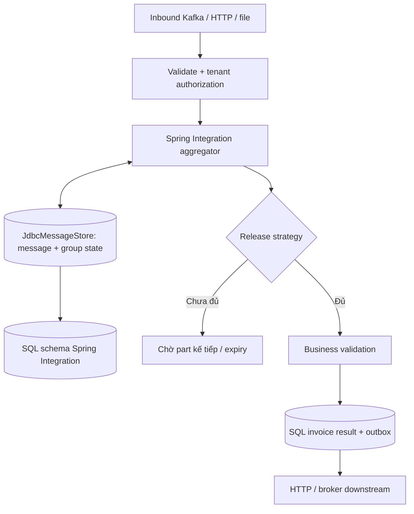
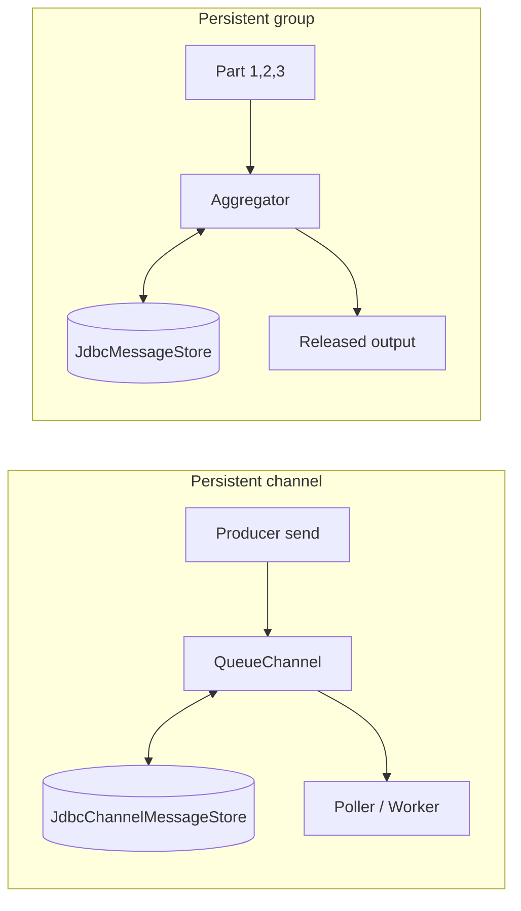
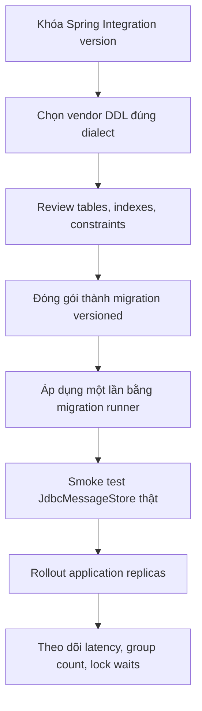
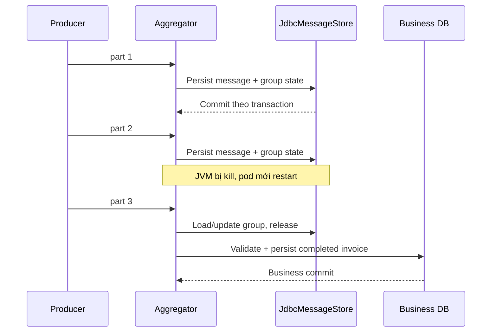
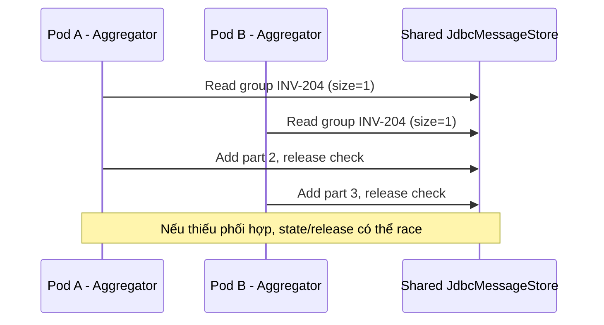
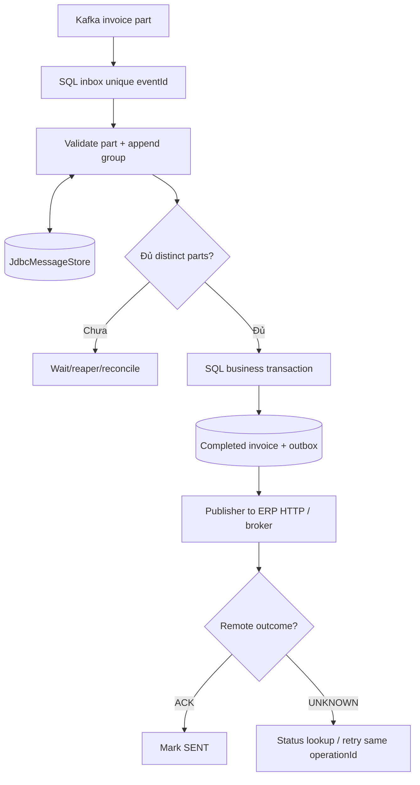
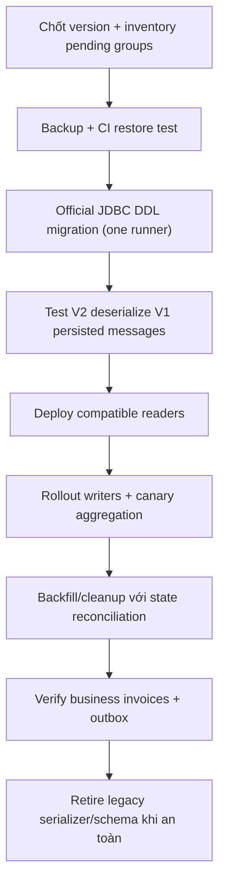

# JdbcMessageStore và quản lý schema hạ tầng

> **Chương:** Lỗi và trạng thái flow  
> **Phạm vi:** Trong module **SPRING_BOOT_INTEGRATION**, Spring Boot tổ chức tích hợp qua HTTP client, cơ sở dữ liệu, cache, broker thông điệp và adapter Spring Integration. Bài này tập trung vào **JdbcMessageStore** để lưu message/message group và cách quản trị **schema hạ tầng Spring Integration JDBC**: chọn đúng store, khởi tạo bảng, quản lý DDL theo phiên bản, triển khai migration, serialization, transaction, concurrency, cleanup, nâng cấp và phục hồi sau sự cố.

## 1. Bài toán: khôi phục aggregator sau khi JVM restart

Một hệ thống nhận ba phần dữ liệu của hóa đơn `INV-204` qua Kafka:

```text
09:00:00  invoice-part-1 -> Spring Integration aggregator
09:00:02  invoice-part-2 -> aggregator
09:00:03  JVM bị kill trong lúc rolling deployment
09:00:10  pod mới khởi động
09:00:12  invoice-part-3 đến
```

Nếu aggregator dùng một message group store trong RAM, phần 1 và 2 có thể biến mất. Nếu dùng **JdbcMessageStore** với schema và transaction phù hợp, những phần đã lưu thành công **có thể tồn tại qua restart**. Tuy nhiên, việc trả ra hóa đơn hoàn chỉnh còn phụ thuộc correlation key, release strategy, output durability và dedup.



**Điểm quan trọng:** JdbcMessageStore giúp lưu **trạng thái điều phối**. Nó **không tự bảo đảm** kết quả hóa đơn đã được ghi vào bảng nghiệp vụ, event đã được publish hoặc đối tác đã xử lý side effect.

### Mục tiêu học tập

Sau bài này, người đọc có thể:

1. Phân biệt `JdbcMessageStore`, `JdbcChannelMessageStore` và các interface `MessageStore`/`MessageGroupStore`.
2. Chọn schema SQL chính thức đúng **Spring Integration version** và **database dialect**.
3. Đặt quy ước `region`, table prefix và database/transaction manager để tránh xung đột.
4. Khai báo `JdbcMessageStore` cho một aggregator Spring Integration Java DSL.
5. Kiểm soát serializer, headers, document/schema evolution và rolling deployment.
6. Phân tích transaction boundary, deadlock/locking, crash window, duplicate và timeout.
7. Xây quy trình migrate → verify → deploy → cleanup → rollback có ownership rõ.
8. Kiểm thử restart, multi-instance, schema compatibility và observability với database thật.

## 2. MessageStore không phải một loại cơ sở dữ liệu nghiệp vụ mới

Trong Spring Integration, state có ít nhất ba lớp:

| Lớp | Dữ liệu được lưu | Nguồn sự thật cho việc gì? |
| --- | --- | --- |
| **Message store** | Spring `Message<?>`, payload, một số headers và metadata | Message nào còn được giữ trong flow |
| **Message group store** | Tập message theo correlation/group key, trạng thái complete/expire | Nhóm nào đang chờ release, có những phần nào |
| **Business tables / inbox / outbox** | Invoice đã tạo, command đã xử lý, lệnh gửi partner, trạng thái đối soát | Nghiệp vụ đã commit hay còn phải retry/reconcile |

Nếu một message đã release khỏi aggregator rồi đi qua `DirectChannel` tới handler gọi HTTP POST:

```text
JDBC group state = COMPLETE
HTTP call = có thể đã đến remote nhưng chưa nhận response
Business outcome = UNKNOWN
```

Đọc riêng bảng group không đủ để xác định hệ thống đã hoàn tất nghĩa vụ với remote. **Không dùng tables nội bộ của Spring Integration làm idempotency ledger thay cho một bảng nghiệp vụ có unique key**.

### 2.1. Vì sao cần schema hạ tầng?

`JdbcMessageStore` cần các bảng, cột, index và câu SQL **phù hợp với implementation** để:

- Lưu bytes của message.
- Ánh xạ message với group/correlation key.
- Ghi trạng thái group hoặc release/expiry metadata.
- Truy xuất message theo ID.
- Hỗ trợ transaction, concurrent updates và cleanup.

Schema này **không giống entity tables** do Spring Data JPA tạo; nó thuộc thư viện Spring Integration JDBC và có thể thay đổi qua phiên bản. Không tự suy DDL từ tên class hoặc từ một tutorial cũ.

## 3. Phân biệt JdbcMessageStore và JdbcChannelMessageStore

| Thành phần | Vai trò | Trường hợp thích hợp |
| --- | --- | --- |
| `MessageStore` | Abstraction lưu/truy xuất message | Lưu message theo ID |
| `BasicMessageGroupStore` / `MessageGroupStore` | Abstraction lưu group của aggregator/resequencer | Group state, release/complete/expiry |
| **`JdbcMessageStore`** | JDBC-backed message và group store | **Aggregator/resequencer**, message-group persistence |
| **`JdbcChannelMessageStore`** | JDBC-backed store chuyên cho channel queue-style | **Persistent QueueChannel**/channel messages |
| `SimpleMessageStore` | Message/group state trong bộ nhớ | Test hoặc flow cho phép mất state |
| `QueueChannel` + `MessageGroupQueue` | Channel lấy/nhận thông qua backing store | Durable queue khi dùng channel store tương thích |

**Không mặc định thay `JdbcChannelMessageStore` bằng `JdbcMessageStore` chỉ vì cả hai có chữ MessageStore.** Queue channel có semantics claim/dequeue/group key riêng, còn aggregator dùng correlation/release/expiry. Chọn implementation theo **endpoint contract và version API**.

### 3.1. Hai đường dữ liệu



Đây là sơ đồ phân biệt **hai use case**, không phải lời hứa rằng hai store dùng cùng bảng hoặc cùng transaction trong mọi phiên bản.

## 4. Cấu trúc một message phải được lưu để có thể đọc lại

```text
Message<InvoicePart>
  payload:
    tenantId = "tenant-a"
    invoiceId = "INV-204"
    partNumber = 2
    expectedParts = 3
    amountMinor = 250000
    currency = "VND"
  headers:
    id = UUID(...)
    timestamp = ...
    invoiceGroupKey = "tenant-a:INV-204"
    schemaVersion = 1
    eventId = "evt-502"
```

Trong một flow chỉ chạy RAM, payload có thể là Java object bất kỳ. Khi lưu JDBC, payload và headers cần được **serialize thành định dạng có thể đọc lại**:

- Object trong header như `replyChannel`, `Principal`, `Connection`, file stream hoặc lambda có thể không serializable.
- Header chứa bearer token, cookie, access secret hoặc PII có thể làm lộ dữ liệu trong DB/backup/diagnostics.
- Java class đổi package/field/`serialVersionUID` có thể khiến serialized bytes cũ không đọc được sau upgrade.
- Message ID của Spring là định danh một message instance, không nhất thiết là business event ID ổn định qua retry.
- `correlationId`/group key cần đủ scope tenant, invoice, schema/version theo contract.

Một **persistent message contract** thường nên sử dụng DTO bất biến, có schema/version, headers đơn giản và không tham chiếu resource runtime. Nếu cần durable reply, ghi **reply destination/correlation ID** vào message thay vì lưu trực tiếp object channel chỉ tồn tại trong JVM cũ.

## 5. Dependencies Spring Boot và phiên bản tham chiếu

Các ví dụ định hướng **Spring Boot 3.x, Java 17+, Spring Integration 6.x** và PostgreSQL. Khi dự án dùng Boot 4.x, Spring Integration 7.x hoặc dialect khác, hãy đối chiếu **API, DDL và serializer của version đang thực thi** trước khi triển khai.

### 5.1. Maven

```xml
<dependencies>
    <dependency>
        <groupId>org.springframework.boot</groupId>
        <artifactId>spring-boot-starter-integration</artifactId>
    </dependency>
    <dependency>
        <groupId>org.springframework.integration</groupId>
        <artifactId>spring-integration-jdbc</artifactId>
    </dependency>
    <dependency>
        <groupId>org.springframework.boot</groupId>
        <artifactId>spring-boot-starter-jdbc</artifactId>
    </dependency>
    <dependency>
        <groupId>org.postgresql</groupId>
        <artifactId>postgresql</artifactId>
        <scope>runtime</scope>
    </dependency>
</dependencies>
```

Nếu triển khai inbound Kafka/Rabbit/JMS, thêm dependencies của adapter/broker tương ứng; **JdbcMessageStore không tự tạo Kafka listener hoặc Rabbit queue**. Khi dùng Spring Boot BOM, để BOM quản lý version Spring Integration/JDBC trừ khi có quyết định upgrade được kiểm chứng toàn bộ.

### 5.2. Không nhầm ba nhóm schema

| Schema | Ai sở hữu? | Dùng cho |
| --- | --- | --- |
| **Spring Integration JDBC** | Module `spring-integration-jdbc`/version hiện tại | Message/group/channel state và metadata mà component JDBC yêu cầu |
| **Spring Batch JobRepository** | Module `spring-batch-core`/version hiện tại | JobExecution, StepExecution, ExecutionContext |
| **Business SQL schema** | Nhóm ứng dụng | `invoices`, `integration_inbox`, `integration_outbox`, reconciliation |

Một script schema của Spring Batch **không thay thế** script Spring Integration JDBC. Cũng không dùng `spring.jpa.hibernate.ddl-auto=update` để tạo các bảng MessageStore.

## 6. Lấy DDL chính thức đúng version và dialect

**Nguồn DDL đáng tin nhất** là các schema scripts được **đóng gói cùng đúng artifact `spring-integration-jdbc` đang chạy**, kèm ghi chú nâng cấp của phiên bản tương ứng. Chúng thường được đặt dưới classpath `org/springframework/integration/jdbc/`; tên file/dialect và nội dung phải được **kiểm tra trực tiếp theo version**, không copy một URL script trên Internet rồi mặc định tương thích.

### 6.1. Phải kiểm tra những gì?

1. Spring Integration version thực tế từ dependency management.
2. Database dialect: PostgreSQL, MySQL, Oracle, SQL Server, H2, v.v.
3. Schema script dành cho **message store**, **channel store** và các thành phần JDBC được dùng.
4. Table names/table prefix, columns, types, primary/unique keys, foreign keys, indexes.
5. Khả năng hỗ trợ `BYTEA`/`BLOB`/`VARBINARY`, timestamps, identifier length và collation.
6. Điều kiện version upgrade: DDL changes có cần migration bổ sung hay không?
7. Quyền SQL của runtime: SELECT/INSERT/UPDATE/DELETE trên đúng bảng.
8. Quyền của migration runner: CREATE/ALTER/DROP INDEX/TABLE trong scope cho phép.

**Không đưa vào bài một bộ DDL tự đoán các bảng nội bộ của Spring Integration.** Những bảng nội bộ không phải API ổn định cho business code, và DDL sai một cột/index có thể chỉ lộ lỗi khi restart hoặc concurrency cao.

### 6.2. Quy trình quản lý DDL



Schema chỉ nên được **một chủ thể có quyền** thay đổi theo quy trình release. Không để 10 ứng dụng mới startup đồng thời tự khởi tạo những bảng mà ứng dụng cũ vẫn đang sử dụng.

## 7. Flyway/Liquibase: migration thuộc pipeline, không thuộc request path

Giả sử nhóm đã review DDL chính thức và dùng **Flyway**:

```text
db/migration/integration/
  V001__create_spring_integration_jdbc_store.sql
  V002__add_vendor_approved_indexes.sql
  V003__integration_store_upgrade_for_new_version.sql

Business schema (do ứng dụng sở hữu):
  db/migration/business/V101__create_invoice_inbox.sql
  db/migration/business/V102__create_invoice_outbox.sql
```

Tên tệp chỉ là ví dụ quy ước. **Nội dung `V001` phải lấy từ DDL đã xác nhận phù hợp vendor/version**, không trộn nhiều file schema độc lập mà không kiểm tra bảng trùng, index hoặc table prefix.

### 7.1. App runtime không tự sửa schema

```yaml
spring:
  datasource:
    url: ${INTEGRATION_DB_URL:jdbc:postgresql://localhost:5432/integration_dev}
    username: ${INTEGRATION_DB_USER:integration_app}
    password: ${INTEGRATION_DB_PASSWORD}
    hikari:
      maximum-pool-size: 10
      connection-timeout: 3s

  sql:
    init:
      mode: never
```

`spring.sql.init.mode=never` tắt phần khởi tạo SQL theo cơ chế `spring.sql.init` của Boot, **không đồng nghĩa mọi thư viện migration/initializer khác đều bị tắt**. Nếu có Flyway/Liquibase chạy lúc startup thì cần cấu hình ownership cụ thể; nếu migration chạy trước qua pipeline, app runtime chỉ xác minh schema và bắt đầu xử lý.

**Không lưu secret thật trong YAML.** Dùng secret manager/environment injection cùng TLS, policy rotation và quyền database tối thiểu. Với nhiều DB, tránh cấu hình một DataSource chính rồi để store âm thầm kết nối sai database.

### 7.2. Migrations phải có lịch sử và checksum

Một ledger migration do Flyway/Liquibase quản lý giúp:

- Ghi migration ID, checksum, thời điểm và trạng thái áp dụng.
- Phát hiện script đã chạy bị sửa nội dung.
- Chặn các lần chạy đồng thời theo locking semantics của tool.
- Đánh giá bản nào đã đi qua production/staging.

Không sửa nội dung một migration đã áp dụng rồi triển khai lại; tạo **migration tiếp theo** có preconditions, action, postconditions và rollback strategy.

## 8. Cấu hình DataSource và transaction manager chính xác

### 8.1. Một DataSource

Khi Spring Boot chỉ có **một DataSource** và transaction manager tương ứng, `JdbcMessageStore` có thể dùng chúng:

```java
package com.example.integration.state;

import javax.sql.DataSource;

import org.springframework.context.annotation.Bean;
import org.springframework.context.annotation.Configuration;
import org.springframework.integration.jdbc.store.JdbcMessageStore;
import org.springframework.integration.store.MessageGroupStore;

@Configuration(proxyBeanMethods = false)
public class MessageStoreConfiguration {

    @Bean("invoiceGroupStore")
    MessageGroupStore invoiceGroupStore(DataSource dataSource) {
        JdbcMessageStore store =
                new JdbcMessageStore(dataSource);
        store.setRegion("invoice-aggregation-v1");
        return store;
    }
}
```

`region` là **namespace logic** mà store sử dụng để phân biệt dữ liệu. Nó không tự là một database schema hoặc tenant security boundary. Tên region phải **ổn định qua restart**, có chính sách versioning rõ và tránh trùng với flow không liên quan.

### 8.2. Hai DataSources: integration state và business

```java
@Bean("invoiceGroupStore")
MessageGroupStore invoiceGroupStore(
        @Qualifier("integrationDataSource")
        DataSource integrationDataSource) {
    JdbcMessageStore store =
            new JdbcMessageStore(integrationDataSource);
    store.setRegion("invoice-aggregation-v1");
    return store;
}
```

Đây là **snippet method** có `@Bean`, `@Qualifier` và các imports tương ứng. Bean `integrationDataSource` **phải được ứng dụng khai báo** và trỏ đúng database. Tương tự, transaction manager của endpoint/flow phải dùng đúng resource. Nếu `JdbcMessageStore` dùng DB A còn `@Transactional` trong business service dùng DB B, không có local transaction tự động bao trùm cả hai.

### 8.3. Phân biệt transaction nằm ở đâu

```text
integrationDataSource (DB A)
  -> JdbcMessageStore add/remove group

businessDataSource (DB B)
  -> invoice INSERT + outbox INSERT

Nếu transaction manager chỉ quản DB B:
  rollback DB B không làm DB A rollback.
```

Nếu cần atomicity giữa store và business SQL, việc dùng **cùng database, cùng DataSource và cùng transaction boundary** có thể đơn giản hơn, nhưng phải kiểm thử chính xác **thời điểm aggregator release, output channel và business handler**. Khi side effect ra HTTP/broker, không có một JDBC transaction thường nào rollback được remote.

## 9. Table prefix, region và phạm vi dữ liệu

Ba khái niệm dễ nhầm:

| Khái niệm | Ý nghĩa | Dùng khi |
| --- | --- | --- |
| **Database/schema SQL** | Namespace do PostgreSQL/DBMS quản lý | Phân quyền, isolation, migrations |
| **Table prefix** | Quy ước tên bảng nội bộ mà JDBC store SQL sử dụng, khi implementation hỗ trợ | Dùng nhiều bộ bảng khác nhau, tránh collision |
| **Region** | Phân vùng logic của dữ liệu message/group trong cùng store schema | Nhiều flows chia cùng backing tables |

### 9.1. Region dùng để làm gì?

```text
JdbcMessageStore (same physical DB tables)
  region=invoice-aggregation-v1
    correlationGroup=tenant-a:INV-204
  region=shipment-aggregation-v1
    correlationGroup=tenant-a:SHIP-300
```

Nếu hai flow dùng cùng group key string nhưng **khác region**, store có thể tách phạm vi logic theo thiết kế. Tuy nhiên **region không ngăn app có quyền SQL rộng xem/sửa dữ liệu region khác**; phân quyền phải nằm ở tầng ứng dụng/DB.

**Đừng đổi region theo mỗi deployment hash/pod name**: state từ phiên bản trước sẽ nằm ở region cũ và pod mới có thể “không thấy” group cần tiếp tục. Chỉ đổi region khi có kế hoạch migrate/drain/reconcile rõ.

### 9.2. Table prefix không tự đổi DDL

Một số JDBC stores cho phép cấu hình table prefix trong SQL do store dùng. Nếu chọn prefix khác mặc định, **schema trong database phải chứa đúng những bảng theo prefix đó**, và câu SQL của store phải trỏ đúng chúng.

Không đổi table prefix trên một bean rồi kỳ vọng thư viện tự sao chép/tạo những bảng mới trong production. Khi nhiều applications chia schema, cần review cấu hình và migration script của từng store. Đừng tự thay tên bảng theo suy đoán.

### 9.3. Multi-tenant

Correlation key phải chứa tenant đã xác thực hoặc ID globally unique. Ví dụ:

```text
GOOD:  groupKey = tenant-a:invoice:INV-204
BAD:   groupKey = INV-204
BAD:   groupKey = userSuppliedTenant + ":" + invoice
       (nếu tenant chưa được xác thực)
```

Region là config cấp flow; **không phải** key authorization. Nếu một tenant có thể cung cấp `invoiceId` của tenant khác, cần validate/authorize trước khi group store được đọc/ghi.

## 10. Cấu hình aggregator sử dụng JdbcMessageStore

Giả sử producer gửi các phần của invoice cùng metadata:

```java
package com.example.integration.invoice;

import java.io.Serializable;

public record InvoicePart(
        String tenantId,
        String invoiceId,
        int partNumber,
        int expectedParts,
        long amountMinor,
        String currency
) implements Serializable {}
```

`implements Serializable` là yêu cầu phù hợp với **một chiến lược Java serialization**, nhưng **không chứng minh mọi headers và custom classes đều serializable**. Với production cần kiểm tra serializer/deserializer thực tế của phiên bản, schema evolution và security of deserialization.

### 10.1. Message headers có correlation và sequence

```java
import org.springframework.integration.IntegrationMessageHeaderAccessor;
import org.springframework.messaging.Message;
import org.springframework.messaging.support.MessageBuilder;

InvoicePart part = new InvoicePart(
        "tenant-a", "INV-204", 2, 3, 250000L, "VND");

String groupKey =
        part.tenantId() + ":invoice:" + part.invoiceId();

Message<InvoicePart> message = MessageBuilder
        .withPayload(part)
        .setHeader("invoiceGroupKey", groupKey)
        .setHeader("expectedParts", part.expectedParts())
        .setHeader(
                IntegrationMessageHeaderAccessor.SEQUENCE_NUMBER,
                part.partNumber())
        .setHeader(
                IntegrationMessageHeaderAccessor.SEQUENCE_SIZE,
                part.expectedParts())
        .build();
```

Đây là snippet xây message, chưa gửi vào channel. Các header chuẩn `sequenceNumber`/`sequenceSize` có thể hỗ trợ splitter/aggregator theo cấu hình, nhưng **không có nghĩa một producer bên ngoài tự cung cấp chúng đúng**. Phải validate `expectedParts > 0`, `1 <= partNumber <= expectedParts`, currency/schema và tenant identity.

### 10.2. IntegrationFlow gắn store

```java
package com.example.integration.invoice;

import org.springframework.beans.factory.annotation.Qualifier;
import org.springframework.context.annotation.Bean;
import org.springframework.context.annotation.Configuration;
import org.springframework.integration.dsl.IntegrationFlow;
import org.springframework.integration.store.MessageGroupStore;
import org.springframework.messaging.Message;

@Configuration(proxyBeanMethods = false)
public class InvoiceAggregationConfiguration {

    @Bean
    IntegrationFlow invoiceAggregationFlow(
            @Qualifier("invoiceGroupStore")
            MessageGroupStore store,
            InvoiceResultHandler handler) {

        return IntegrationFlow.from("invoicePartsInput")
                .aggregate(spec -> spec
                        .messageStore(store)
                        .correlationStrategy(message ->
                                message.getHeaders()
                                        .get("invoiceGroupKey"))
                        .releaseStrategy(group -> {
                            Message<?> first = group.getOne();
                            if (first == null) {
                                return false;
                            }
                            Object count = first.getHeaders()
                                    .get("expectedParts");
                            return count instanceof Integer expected
                                    && expected > 0
                                    && group.size() >= expected;
                        }))
                .handle(handler, "handle")
                .get();
    }
}
```

`InvoiceResultHandler` là service nghiệp vụ do ứng dụng tự viết, nhận output theo message group processor thực tế, validate tính đầy đủ của tập parts và ghi invoice/result/outbox bền vững. **Đoạn release strategy chỉ minh họa cách nhóm có thể đủ số lượng; nó chưa bảo vệ duplicate part**.

**Điều kiện quan trọng:** một cùng part có thể được giao lại dưới Spring Message ID mới, khiến `group.size()` đạt expected mặc dù thiếu một `partNumber`. Trước khi cho flow vào production cần **durable inbox/staging unique key** và kiểm tra distinct part numbers, expected count nhất quán, checksum, currency và group isolation.

### 10.3. Mặc định output của aggregator là gì?

Aggregator thường tạo một output được sinh theo **message group processor** của endpoint. Không mặc định output payload luôn là `InvoicePart` hoặc một `InvoiceCompleted` tự tạo. Nếu handler cần DTO tổng hợp cụ thể, cấu hình **output processor** tường minh và test input/output mapping theo Spring Integration version.

Không để handler nhận `Object` rồi cast mù. Cần định nghĩa contract sau release và lưu lại transaction outcome bằng business ID ổn định.

## 11. Lưu và đọc group khác với xử lý đúng business



Sơ đồ giả định **các store writes đã commit thành công** và cấu hình mới dùng lại đúng DB, region, serializer và group correlation. Nó không có nghĩa framework luôn tự scan/release mọi group tồn tại ngay khi app restart nếu group đã đủ nhưng signal release trước crash bị mất.

### 11.1. Ba cửa sổ lỗi

| Crash window | State có thể còn | Việc cần làm khi khôi phục |
| --- | --- | --- |
| Trước commit add part | Part chưa chắc được lưu | Nguồn phải redeliver/replay; ACK không được quá sớm |
| Sau commit part, trước release | Group có đủ/thiếu parts theo dữ liệu lưu | Cần message tiếp theo, timeout/reaper hoặc reconciliation/trigger release được thiết kế |
| Sau release, trước business commit | Group có thể đã complete/cleanup, output có thể mất | Business ledger/outbox, transactional integration hoặc replay/recovery |

**Lưu message group là cơ chế giảm mất dữ liệu**, không phải một phép chứng minh “chỉ chạy một lần” hay “luôn phát output đúng một lần”.

## 12. Serialization và khả năng nâng cấp phiên bản

Trong memory store, payload chỉ cần còn là Java object hợp lệ trong process. Trong JdbcMessageStore, state phải tồn tại dưới dạng dữ liệu có thể được process khác/phiên bản khác deserialize.

### 12.1. Những đối tượng không nên persist

- `InputStream`, `Socket`, `Connection`, `DataSource`.
- Object `Principal` chứa security context sống hoặc thông tin bí mật.
- `replyChannel`/`errorChannel` là bean runtime channel object không ổn định qua restart.
- Lambda, bean service hoặc callback của request đang chạy.
- Một Java object graph mutable có tham chiếu tới entity/proxy không định nghĩa rõ serialization.

**Không “chữa” lỗi serialization bằng cách ghi toàn bộ headers sang chuỗi rồi parse lại tùy tiện**. Cần xác định header nào thật sự cần cho recovery; dùng ID, route/destination token và metadata có version.

### 12.2. DTO bền vững cần schema/version

```java
public record InvoicePartEnvelope(
        int schemaVersion,
        String tenantId,
        String invoiceId,
        int partNumber,
        int expectedParts,
        long amountMinor,
        String currency,
        String eventId,
        String payloadSha256
) implements java.io.Serializable {}
```

`schemaVersion` mô tả contract của ứng dụng; không tự thay thế version của **JDBC store schema**. Hai loại version cần được quản lý riêng:

| Version | Thay đổi gì? | Ai chịu trách nhiệm? |
| --- | --- | --- |
| **Business payload version** | `InvoicePartEnvelope` có thêm field, đổi đơn vị tiền, đổi enum | App/producer/consumer contract |
| **Spring Integration JDBC schema version** | Bảng/cột/index/SQL store format | Spring Integration artifact + migration |
| **Serialization format version** | Java binary/JSON/CBOR hoặc custom mapper | Store serializer/config + app compatibility |

Nếu thay serializer hay đổi package class Java mà không migrate bytes cũ, có thể gặp lỗi deserialize ngay khi lấy part thứ ba sau upgrade. **Phải test restore dữ liệu thật do phiên bản cũ ghi**, không chỉ test round-trip của version mới.

### 12.3. Cẩn trọng Java native deserialization

Deserializing Java object graphs có thể mang rủi ro security nếu attacker điều khiển bytes hoặc classpath. Bảo vệ DB credentials/ACL và chỉ cho trusted producer ghi store. Nếu cần format độc lập ngôn ngữ hoặc lưu lâu, cân nhắc schema-based format/custom serialization được **Spring Integration version hỗ trợ**, với allowlist/type mapping và migrations.

Không tự gọi một setter serializer không chắc có trong phiên bản đang dùng; tham khảo API chính thức trước khi wiring custom serialization. Mọi thay đổi format cần có kế hoạch dual-read hoặc data migration.

## 13. Nguyên tắc transaction khi dùng JdbcMessageStore

Một aggregator nhận part từ Kafka:

```text
Kafka poll part 2
  |
  v
JdbcMessageStore persist part 2
  |
  v
SQL commit store
  |
  v
Kafka offset ACK / commit
```

Đây là mô hình **store trước ACK** để cho phép replay khi commit store thất bại. Nhưng:

- Kafka offset commit không tham gia một JDBC transaction thông thường.
- Process có thể chết **sau commit SQL nhưng trước offset commit**, dẫn đến redelivery.
- Kafka consumer có thể batch poll, nên ACK policy phải xem toàn bộ batch/record và retry.
- Một message được deserialize lại có thể có Spring Message ID khác dù cùng business event.

**Vì vậy cần durable inbox/unique event ID** để duplicate không làm group đếm sai.

### 13.1. Store và business SQL cùng database

Khi cả hai dùng một DataSource/transaction manager, có thể cố gắng phối hợp việc lưu group và ghi business result trong một transaction phù hợp với flow. Nhưng phải kiểm chứng:

1. Endpoint/handler được gọi trong **cùng thread/transaction context**?
2. Output channel là `DirectChannel` hay `ExecutorChannel`/`@Async` làm chuyển thread?
3. Group state được complete/clear **trước hay sau handler**?
4. Exception downstream có rollback được store writes không?
5. Metadata/reaper có operation ngoài transaction boundary đó không?

### 13.2. Store và business SQL khác database

```text
Store DB A: persist/release group
Business DB B: INSERT completed_invoice

TX A commit, TX B rollback  -> lệch state
TX B commit, TX A rollback  -> có thể phát lại
```

Không dùng một `@Transactional` với manager của DB B để suy rằng cả DB A và HTTP/broker cùng commit. Có thể cần outbox/idempotency/reconciliation; distributed transaction/XA chỉ là một lựa chọn kiến trúc có điều kiện, không phải behavior mặc định.

### 13.3. Commit trước ACK không thay retry policy

Nếu persistence vào store thất bại do DB unavailable, consumer **không ACK thành công** như thể flow đã nhận bền vững. Có thể retry với backoff, dừng listener, hoặc đưa vào DLQ/quarantine theo policy. Nếu store commit rồi ACK thất bại, phải chấp nhận replay và xử lý idempotent.

## 14. Nhiều replica cùng một group: locking và đồng thời

Giả sử hai pods cùng nhận parts của `INV-204`:



**Một database dùng chung không tự bảo đảm một lần release duy nhất** khi nhiều ứng dụng/threads cùng cập nhật cùng correlation key. Cần xem xét:

- Lock theo group/correlation key ở endpoint.
- Transaction isolation và row-level locking do store/DB sử dụng.
- Spring Integration `LockRegistry`, phạm vi lock (một JVM hay nhiều JVM).
- Khả năng group bị expire bởi reaper trong lúc part cuối đến.
- Business unique constraint để chặn output side effect trùng ngay cả khi group bị release lại.
- Phân vùng nguồn broker theo cùng business key để giảm mức tranh chấp, nhưng không coi partitioning là tuyến bảo vệ cuối cùng.

### 14.1. Local lock không dùng được làm distributed lock

`DefaultLockRegistry` hoặc một in-process lock phù hợp **trong cùng JVM**, nhưng không khóa được một pod thứ hai. Nếu thuật toán aggregator đòi exclusivity xuyên pods, cân nhắc một `LockRegistry` backed by JDBC/Redis được framework hỗ trợ (ví dụ nhóm `JdbcLockRegistry`), hoặc partition data để mỗi key có một owner tại một thời điểm.

**Cẩn trọng:** database lock/lease không tự bảo đảm “exactly once” khi remote HTTP call đã chạy. Với lease có thể hết hạn, cần generation/fencing token hoặc unique business key ở đích để bảo vệ trước worker cũ tiếp tục sau pause dài.

### 14.2. Nếu dùng JDBC lock registry

Một phương án Spring Integration JDBC có thể yêu cầu **schema riêng của lock repository** ngoài những bảng MessageStore. Khi chọn:

1. Kiểm tra `JdbcLockRegistry`/`DefaultLockRepository` có trong version và cách cấu hình.
2. Triển khai **đúng DDL của lock repository** từ artifact/version tương ứng.
3. Định rõ owner/region/lock key scope, lease/renewal nếu có.
4. Test hai JVM trên cùng database với cùng group key.
5. Đo lock wait, deadlocks và rủi ro khi tiến trình giữ lock bị kill.

**Không tự suy rằng DDL của `JdbcMessageStore` đã có đầy đủ bảng cần cho JDBC locks**, hoặc một transaction manager bất kỳ sẽ bao trùm locks của DB khác.

### 14.3. Không giữ lock trong lúc chờ HTTP

Một aggregator có thể hoàn thành group rồi gọi partner:

```text
Acquire group lock
  -> group complete
  -> call HTTP partner 60 seconds  [KHÔNG nên giữ lock]
  -> release lock
```

Giữ SQL/LockRegistry lock trong lúc chờ đối tác chậm gây head-of-line blocking, deadlocks hoặc lease expiration. Nên hoàn thành local state + ghi outbox bằng transaction ngắn, rồi worker khác gửi remote theo idempotency key.

## 15. Group lifecycle: active, released, complete và expired

Một message group có nhiều trạng thái logic mà các đội vận hành thường nhầm:

```text
NEW
  -> ACTIVE (đã nhận >=1 part)
       -> READY_TO_RELEASE (đủ điều kiện)
            -> RELEASED (đã phát output theo flow)
                 -> COMPLETED / CLEANED
       -> TIMED_OUT / EXPIRED
            -> RECONCILE / QUARANTINE
```

Đây là **mô hình nghiệp vụ đề xuất**, không phải các enum nguyên văn trong JdbcMessageStore. Phải ánh xạ với lifecycle thực của aggregator và các cờ/metadata mà version đang dùng lưu.

### 15.1. Release khác business completed

Khi group đã release:

- Output message có thể đang ở in-memory channel.
- Downstream handler có thể chưa commit invoice.
- HTTP partner có thể chưa nhận được request.
- Group metadata có thể còn hoặc bị xóa tùy endpoint configuration.

**Không xóa mọi group ngay khi release rồi coi output đã bền vững.** Nếu side effect quan trọng, cần cơ chế atomic local business result + outbox, hoặc durable downstream channel được kiểm chứng.

### 15.2. Completed-group retention

Giữ lại marker của group complete giúp phát hiện late arrivals/duplicate trong một khoảng thời gian. Nhưng:

- Marker chiếm storage và có thể tăng vô hạn.
- Xóa marker sớm có thể khiến cùng group key được mở lại khi event cũ redeliver.
- Marker không thay business inbox ledger nếu replay xảy ra sau thời gian retention.

Quyết định retention theo **message replay horizon, SLA late arrival, yêu cầu audit** và khả năng tái dựng từ nguồn. Không chọn 24 giờ chỉ vì TTL của cache cũng là 24 giờ.

## 16. Timeout và MessageGroupStoreReaper

Nếu invoice chỉ nhận 2/3 parts, group có thể nằm mãi trong SQL. Một giải pháp là **đặt group timeout và cleanup policy** thông qua aggregator/`MessageGroupStoreReaper` phù hợp phiên bản.

| Khái niệm | Ý nghĩa | Cần quyết định |
| --- | --- | --- |
| **Group timeout** | Đến hạn đánh giá một group chưa hoàn tất | Timeout tính từ lần tạo hay cập nhật cuối? |
| **MessageGroupStoreReaper** | Component quét/expire groups theo lịch/policy | Ai chạy, cadence, concurrency và SQL load |
| **Partial result on expiry** | Có thể phát một group thiếu part theo config | Business có cho phép partial invoice không? |
| **Completed marker** | Dữ liệu đánh dấu group đã complete | Giữ bao lâu để chống late duplicate? |
| **Business deadline** | Sau giờ nào invoice phải complete/fail/reconcile | Không suy chỉ từ SQL row creation time |

### 16.1. Chính sách ví dụ

```text
InvoicePart group:
  correlationKey = tenant-a:invoice:INV-204
  expectedParts = 3
  inactivityTimeout = 20 phút

Nếu đủ 3 distinct parts:
  -> validate amount/currency/total
  -> ghi InvoiceCompleted + outbox
  -> đánh dấu group resolved

Nếu hết hạn nhưng còn thiếu part:
  -> status = INCOMPLETE
  -> ghi missingParts + diagnostic vào business table
  -> alert/quarantine, KHÔNG publish completed invoice
  -> cleanup group sau retention và reconciliation
```

**Không bật `sendPartialResultOnExpiry` để đơn giản hóa dọn bảng nếu partial invoice là sai nghiệp vụ.** Group hết hạn nên được chuyển vào một quy trình có business outcome rõ, không xóa thẳng rồi làm mất khả năng điều tra.

### 16.2. Reaper cạnh tranh với producer

Hai việc có thể xảy ra đồng thời:

```text
T0: group INV-204 đủ điều kiện timeout
T1: reaper bắt đầu expire group
T2: message part 3 đến
T3: aggregator muốn add/release group
```

Nếu hai bên không dùng cơ chế lock/transaction tương thích, có thể xảy ra lost part, double completion hoặc race cleanup. Khi nhiều replicas cùng chạy reaper, cần quy định **ownership/leader hoặc distributed coordination**; không mặc định tất cả pod cùng quét toàn bộ groups là an toàn.

## 17. Quản lý dung lượng schema: không chỉ tạo bảng rồi để đó

Một hệ có 200.000 invoices/ngày, mỗi invoice có 4 parts và mỗi message serialized khoảng 4 KB:

```text
200.000 invoices/ngày × 4 parts/invoice = 800.000 parts/ngày
800.000 parts × 4 KB/part ≈ 3,2 GB payload/ngày (ước lượng thô)

Chưa gồm:
  SQL row/index overhead
  serialized headers / metadata
  WAL/redo logs
  replication
  backup
  dead tuples / vacuum
```

**Đây chỉ là giả định để nhìn quy mô**, không phải số đo của một hệ thống cụ thể. Ngay cả khi group thường complete trong vài giây, lỗi release/cleanup có thể khiến payload lưu lại nhiều ngày, làm database đầy.

### 17.1. Các chỉ số dung lượng

| Metric | Câu hỏi |
| --- | --- |
| Active group count theo region | Có bao nhiêu nhóm đang chờ? |
| Group age P95/P99/max | Group nào đã quá deadline? |
| Stored message count/bytes | Bao nhiêu payload chưa được cleanup? |
| SQL table/index size | Database có tăng bất thường không? |
| WAL/transaction log volume | Store writes có làm replication/backup quá tải không? |
| PostgreSQL dead tuples / vacuum | Cleanup tạo bloat hoặc autovacuum chậm? |
| Lock wait/deadlocks | Concurrent aggregators/reapers tranh chấp? |
| Payload deserialize failures | Có bytes cũ không đọc được sau deploy? |

Không mặc định tất cả metric trên là **Actuator metrics có sẵn**. Cần kết hợp Micrometer, JDBC/HikariCP, PostgreSQL monitoring và instrumentation của flow/store.

### 17.2. Cleanup không được xóa thẳng bảng nội bộ

Một DBA có thể muốn chạy:

```sql
-- ANTI-PATTERN (chỉ minh họa, KHÔNG chạy):
-- DELETE FROM internal_group_table WHERE created_date < NOW() - INTERVAL '7 days';
```

Vì không biết những metadata/relations/constraints mà store duy trì, thao tác này có thể để lại orphan rows, xóa group đang xử lý hoặc khiến framework không đọc được state. **Dùng API/lifecycle cleanup được hỗ trợ hoặc migration có hiểu biết đầy đủ về schema/version**, và luôn có backup/reconciliation policy.

### 17.3. Không tự làm TTL bằng một cron vô điều kiện

SQL không tự biết một group `ACTIVE` đã được hoàn tất nghiệp vụ hay chưa. Cleanup phải xét:

- Status của group và business result.
- Last activity, business deadline và late-arrival SLA.
- Có message chưa được ACK hoặc còn outbox pending?
- Có writer/reader old version chưa dừng?
- Reaper/aggregator có thể cùng thao tác không?

Nếu quyết định xóa, thực thi theo batch nhỏ có transaction/lock/metrics phù hợp; không chạy một delete quét toàn bộ hàng chục triệu rows trong giờ cao điểm.

## 18. Indexes nội bộ và hiệu năng SQL

Schema Spring Integration JDBC có indexes phục vụ những câu query do implementation dùng. Đừng tự drop những indexes “ít dùng” chỉ vì một dashboard SQL cho thấy chúng ít được scan:

- Một index có thể chỉ hữu ích cho reaper/cleanup chạy mỗi đêm.
- Một unique/primary constraint có thể dùng để bảo vệ invariant chứ không phải tối ưu query thường xuyên.
- Query plans thay đổi khi số group/message tăng mạnh.
- Region/group key có phân phối khác nhau giữa các flows.

### 18.1. Cách điều tra câu SQL chậm

1. Xác định store operation: add message, get group, update status, remove, expire.
2. Thu thập SQL latency/lock waits **qua database observability**; không log full serialized payload.
3. Kiểm tra index và query plan cho câu SQL thực của version thư viện.
4. Đo connection pool saturation và transaction duration.
5. Xem số lượng active groups, group size và payload bytes.
6. Kiểm tra release strategy/cleanup có tạo hot correlation key hay không.
7. Nếu thêm index, triển khai qua **migration được review**, benchmark write cost/space trước khi áp dụng production.

Không sửa câu SQL của thư viện hoặc bảng hạ tầng trực tiếp bằng “quick fix” mà chưa xem version và test restart.

### 18.2. Một group quá lớn làm chậm cả hệ

Nếu producer thiếu end marker hoặc `expectedParts` sai, aggregator có thể giữ hàng trăm nghìn messages trong một group. Truy vấn một group lớn làm tăng payload bytes/serialization/lock duration, dù database có index đúng. Cần:

- Giới hạn số parts/group.
- Giới hạn payload size.
- Validate `expectedParts` và part numbers ngay ở ingress.
- Quarantine group vượt ngưỡng.
- Metric group size và age; alert trước khi hết disk.

Index tuning không thay thế validation và lifecycle.

## 19. Thay đổi schema hạ tầng khi nâng cấp Spring Integration

Một nâng cấp Boot có thể kéo theo Spring Integration/JDBC version mới. Không được xem version bump là việc thuần Maven khi còn persisted groups do version cũ lưu.

### 19.1. Bốn lớp compatibility

| Lớp | Cần tương thích điều gì? |
| --- | --- |
| **SQL DDL** | Tables, columns, keys, indexes đúng với SQL statements phiên bản mới |
| **Serialized message bytes** | Phiên bản mới deserialize được payload/headers đã lưu |
| **Endpoint semantics** | Correlation/release/expiry/complete flags đọc đúng state cũ |
| **Application contract** | Business DTO, event IDs và output handler hiểu dữ liệu cũ |

**Schema SQL mới có đầy đủ bảng vẫn chưa đủ nếu Java payload class đã đổi package**, và ngược lại. Phải test cả hai.

### 19.2. Rolling deployment hai phiên bản cùng dùng một store

```text
Pod v1 ---\
           > Shared JdbcMessageStore tables
Pod v2 ---/

v1 có thể ghi message bytes mà v2 không đọc được
v2 có thể dùng schema mới mà v1 không hiểu
v1/v2 có thể khác release behavior
```

Các cách giảm rủi ro:

1. **Expand DDL trước:** thêm những thay đổi tương thích ngược nếu vendor/version cho phép.
2. **Đọc được dữ liệu cũ:** test fixtures do v1 ghi, đọc bằng v2.
3. **Hai chiều khi rolling:** nếu v1 còn chạy thì v1 phải đọc được state v2 ghi, hoặc tạm ngừng writers không tương thích.
4. **Ổn định region/group key:** không tự thay tên khi v2 rollout.
5. **Migrate serializer có kiểm soát:** dual-read hoặc drain old groups trước khi chuyển format.
6. **Contract DDL sau:** chỉ bỏ columns/index/legacy format khi v1 đã rút hết và rollback plan không cần chúng.

Đối với thay đổi breaking không thể hỗ trợ hai chiều, có thể phải **drain/stop producers, hoàn tất/reconcile pending groups**, hoặc tạo store/region mới và migrate state theo quy trình riêng thay vì rolling chung tables.

### 19.3. Không coi rollback app là rollback database

Nếu v2 đã thực thi DDL hoặc ghi bytes mới, việc redeploy image v1 **không phục hồi ngay** schema/serializer cũ. Cần có backward compatibility hoặc forward-fix/migration dữ liệu có chủ đích. Không xóa tables trong quá trình rollback để “cho khởi động lại được”.

## 20. Quy trình release migration an toàn

Một kế hoạch từ dev đến production:

| Pha | Việc làm | Điều kiện qua bước |
| --- | --- | --- |
| **1. Inventory** | Chốt version, dialect, tables/region, active group count, pending messages | Có baseline và owner |
| **2. Preflight** | Check DDL, permissions, data size, serializer compatibility | Không có blocker chưa giải quyết |
| **3. Backup/snapshot** | Chốt restore/recovery point và retention | Biết rollback database/data thế nào |
| **4. Expand migration** | Một runner áp dụng DDL thêm/chỉnh tương thích | Schema checksum/DDL verified |
| **5. Smoke test** | Insert/get/group/release/cleanup trên staging hoặc canary | Tất cả operations PASS |
| **6. Rollout** | Canary version mới, kiểm tra region/deserialization/locks | Không có lỗi mới và latency ổn |
| **7. Reconcile/backfill** | Xử lý state cũ, late groups, serializer migration nếu cần | Counts và business checksums đạt |
| **8. Contract** | Dọn stale groups, bỏ schema/index cũ khi an toàn | Không còn reader/writer cũ |

**Một migration chạy thành công về SQL syntax chưa chứng minh Spring Integration flow vẫn chạy đúng.** Smoke test phải thực hiện các operations thực tế của `JdbcMessageStore` và aggregator, đặc biệt với message cũ/headers và failed group.

### 20.1. Kiểm soát môi trường

- Local: có thể khởi tạo DDL tự động trên database dùng một lần để học.
- CI: tạo database mới qua Testcontainers; chạy cùng pipeline migrations production.
- Staging: dùng volume/profile dữ liệu gần thực tế; test rolling v1/v2.
- Production: chạy migration qua một owner; app runtime không cần schema-admin privileges.

**Không bật một initializer `always` ở production rồi để nhiều replicas tranh nhau tạo bảng.** Đừng dùng H2 làm bằng chứng cuối cho PostgreSQL lock/index/transaction behavior.

### 20.2. Thứ tự deploy producer và consumer

Nếu producer version mới phát payload `schemaVersion=2`, consumer cũ có thể không đọc được. Thường triển khai **consumer đọc được cả v1/v2 trước**, rồi mới cho producer gửi v2; cuối cùng bỏ v1 sau thời gian retention. Với persistent store, còn phải xem **pending bytes v1 được consumer v2 đọc sau restart**.

## 21. Bảo mật database chứa Spring Message

Payload/headers có thể chứa invoice/customer/order IDs, địa chỉ, email hoặc thông tin vận hành. Khi lưu vào database lâu dài, đây là một **data store cần phân quyền và retention**, không chỉ là một cache kỹ thuật.

### 21.1. Tách quyền runtime và migration

| Identity | Quyền gợi ý |
| --- | --- |
| App runtime dùng JdbcMessageStore | DML cần thiết trên đúng bảng/schema |
| Migration runner | DDL/schema privileges trong phạm vi đã được phê duyệt |
| Read-only diagnostics | SELECT/metadata giới hạn, không đọc bytes nhạy cảm bừa bãi |
| DBA/backup | Quyền vận hành, audit, bảo mật backup và restore |

Nếu ứng dụng dùng nhiều tenants cùng schema, database credentials dùng chung **không tự ngăn cross-tenant read**. Authorization và correlation key scope phải được kiểm tra ở ingress/handler; có thể dùng tách schema/DB hoặc row-level security theo thiết kế riêng khi cần.

### 21.2. Không lưu live credentials trong message

```text
KHÔNG:
  header Authorization = "Bearer eyJ..."
  header partnerPassword = "..."

NÊN:
  header credentialRef = "partner-cred-v5"
  header tenantId = "tenant-a"   (đã xác thực)
  header correlationKey = "..."
```

Sau restart, consumer có thể lấy credentials hiện tại qua secret manager theo scope phù hợp. Không cần persist raw bearer token hoặc một `Principal` object có lifespan ngắn.

### 21.3. Deserialization là trust boundary

Không cho nguồn ngoài ghi bytes tùy ý vào bảng nội bộ rồi deserialize như các Java classes được tin cậy. Cần bảo vệ quyền truy cập DB, validate DTO ở inbound adapter, giới hạn payload size và thiết kế serializer an toàn. Nếu cho phép plugin/custom classpath không kiểm soát, rủi ro deserialize tăng.

## 22. Tính nhất quán nghiệp vụ: inbox, outbox và reconciliation

Một **completed group** không nên là bằng chứng duy nhất rằng hóa đơn đã được gửi tới ERP. Thiết kế:



### 22.1. Business identity khác Spring Message ID

```sql
CREATE TABLE invoice_part_inbox (
    tenant_id VARCHAR(80) NOT NULL,
    invoice_id VARCHAR(120) NOT NULL,
    part_number INT NOT NULL CHECK (part_number > 0),
    event_id VARCHAR(120) NOT NULL,
    payload_sha256 VARCHAR(64) NOT NULL,
    received_at TIMESTAMPTZ NOT NULL DEFAULT CURRENT_TIMESTAMP,
    PRIMARY KEY (tenant_id, invoice_id, part_number),
    UNIQUE (tenant_id, event_id)
);
```

Đây là **business-owned schema minh họa** cho PostgreSQL, **không phải bảng Spring Integration JDBC**. Nó xác định mỗi part theo business key và event ID, cho phép xử lý replay và conflict. Với bài toán thực tế cần lưu cả payload/staging hoặc một reference bền vững để có thể dựng lại group; bảng này chỉ minh họa uniqueness.

### 22.2. Phân loại replay

| Tình huống | Xử lý |
| --- | --- |
| Cùng `eventId`/part key và cùng fingerprint | Đã nhận, trả idempotent outcome; không thêm part thứ hai |
| Cùng part key nhưng payload khác | Conflict/quarantine, không làm group complete sai |
| Part mới hợp lệ, group chưa đủ | Lưu state rồi chờ part khác |
| Part cuối làm group đủ | Validate completeness, persist business result + outbox |
| Group đã complete nhưng broker redelivery | Business ledger xác nhận đã xử lý; ACK đúng policy |
| ERP timeout sau POST | Status UNKNOWN; retry cùng operation ID hoặc reconcile |

**Chống trùng ở inbox trước khi add group** quan trọng: nếu duplicate business part được thêm vào group với một Spring Message ID mới, `group.size()` có thể tăng sai và release sớm.

### 22.3. Nếu business DB khác integration-store DB

Không tự viết “insert inbox → add group” như một operation atomic nếu hai database riêng. Cần thiết kế:

- Một nguồn part bền vững duy nhất (ví dụ broker log, SQL staging) để rebuild group.
- Outbox event từ inbox/staging sang aggregator khi write đã commit.
- Reconciliation scan những part đã staging nhưng group chưa nhận.
- Idempotency khi event phát lại từ outbox.

Mục tiêu không nhất thiết là một transaction xuyên mọi hệ, mà là **không làm mất nghĩa vụ và có cách phục hồi khi một bước chỉ hoàn tất một phần**.

## 23. Test JdbcMessageStore với PostgreSQL thật

### 23.1. Bộ test phải chứng minh những điều gì?

| Test | Kết quả cần chứng minh |
| --- | --- |
| Database mới + official migration | Store khởi tạo và thao tác được với đúng schema |
| Missing table/column/index | Fail có chẩn đoán rõ, không âm thầm bỏ qua |
| Add message và get group | Payload + headers đọc lại đúng |
| Nhận part 1 và 2, restart context | Group còn trong DB, version mới đọc được |
| Nhận part 3 sau restart | Chỉ một completed invoice, đủ distinct parts |
| Deserialize DTO/headers version cũ | Dữ liệu pending trước nâng cấp vẫn được đọc |
| Một part được redeliver bằng Spring Message ID khác | Không tăng distinct part count |
| Two concurrent pods cùng group | Không double release/business completion |
| Group timeout/reaper | Không phát incomplete invoice như complete |
| SQL rollback khi add group | Không ACK như thể message đã lưu bền |
| Business commit thành công, ACK broker mất | Idempotent replay, không tạo side effect trùng |
| DB unavailable/connection pool exhausted | Flow fail/retry đúng policy, không treo vô hạn |
| Dung lượng lớn và cleanup | Không giữ orphan/pending group vô hạn |
| Payload size vượt ngưỡng | Reject/quarantine thay vì làm store OOM/disk full |
| Region khác nhau | Group keys tương tự không đụng scope |
| Upgrade/rollback DDL | Schema và serializer tương thích với cả hai phiên bản theo plan |

### 23.2. Integration test setup

```text
PostgreSQL Testcontainers
   |
   +-- Apply official Spring Integration JDBC migrations
   +-- Apply business inbox/outbox migrations
   +-- Start Spring Boot context V1, same DataSource
   |     +-- send invoice parts 1,2
   |     +-- assert pending group persisted
   +-- Close context V1 (DB container giữ nguyên)
   +-- Start Spring Boot context V2, same DB + region
   |     +-- send part 3
   |     +-- assert InvoiceCompleted once + business outbox
   +-- Restart/replay parts and assert idempotency
```

Không dùng H2 in-memory hoặc mock `MessageGroupStore` làm bằng chứng cuối cho PostgreSQL SQL dialect, locking, transaction isolation và persistence qua process restart. Các tests này không bắt buộc trong STEP 4 writing; đây là kế hoạch **STEP test/QA tiếp theo** cho dự án.

### 23.3. Một skeleton test dùng Spring application context

```java
@SpringBootTest(properties = {
        "spring.sql.init.mode=never",
        "spring.main.web-application-type=none"
})
class JdbcMessageStoreContractIT {

    @Autowired
    @Qualifier("invoiceGroupStore")
    MessageGroupStore groupStore;

    @Test
    void storeIsConfiguredAndCanBeUsed() {
        assertThat(groupStore)
                .isInstanceOf(JdbcMessageStore.class);

        // Test setup: PostgreSQL Testcontainers đã được migrate.
        // Send Message<InvoicePart> qua invoicePartsInput.
        // Assert store/group state qua API được version hỗ trợ.
        // Restart context và kiểm tra persistent group.
    }
}
```

Đây là **test skeleton**, cần imports, test dependencies, fixture và Spring Boot context đầy đủ. Với một `MessageGroupStore` bean khác ở cùng context, phải dùng đúng `@Qualifier`; nếu một flow có nhiều stores cần kiểm thử từng region.

### 23.4. Test SQL migration độc lập với business flow

Một migration smoke test nên:

1. Tạo PostgreSQL database trống.
2. Áp dụng scripts Flyway/Liquibase đúng version.
3. Khởi tạo `JdbcMessageStore` trỏ tới DataSource đó.
4. Lưu và đọc lại message có headers/DTO thật.
5. Tạo group, thêm nhiều parts, đọc lại group, release/cleanup qua flow.
6. Thực hiện lại pipeline migration ở lần startup thứ hai và xác minh idempotent/no conflicting DDL.
7. Nếu có JDBC locks/channel stores, kiểm tra riêng schema và startup của từng component.

**Không đủ nếu test chỉ chạy `SELECT 1` hoặc kiểm tra một bảng tồn tại.** Một index bị thiếu, serializer mismatch hoặc SQL update status sai có thể chỉ lộ ở operation khác.

## 24. Kiểm thử failure và upgrade theo thời điểm commit

### 24.1. Crash matrix

```text
T1: Broker giao part 2
T2: SQL store transaction BEGIN
T3: JdbcMessageStore ghi part
T4: SQL store COMMIT
T5: Kafka offset ACK
T6: Aggregator release group
T7: Business invoice + outbox COMMIT
T8: ERP HTTP POST + response
T9: Outbox SENT COMMIT
```

Đây là **các mốc logic để tiêm lỗi**, thứ tự vận hành thật có thể khác (ví dụ release xảy ra ngay trong flow trước ACK). Mỗi mốc phải phân tích:

- Process chết trước T4 → source phải replay, không ACK giả.
- Chết sau T4 trước T5 → part có thể được giao lại, cần inbox.
- Chết sau T6 trước T7 → output có thể không durable, cần reconciliation.
- Chết sau T8 trước T9 → remote outcome có thể UNKNOWN; retry cùng key.

### 24.2. Nâng cấp schema có dữ liệu đang chờ

Test thực sự hữu ích:

1. Dùng version V1 tạo group chưa đủ trong DB.
2. Chụp snapshot/backup test DB.
3. Áp dụng migration DDL cần cho V2.
4. Chạy V2 đọc lại V1 group bytes và headers.
5. Gửi part cuối, xác minh release và business result đúng.
6. Nếu deploy rolling, thử V1 đọc lại state **V2 đã ghi** hoặc chứng minh kế hoạch tách/drain.
7. Thử rollback V1 sau bước V2 nếu runbook nói có thể rollback.

Một test chạy V2 từ database rỗng **không chứng minh** compatibility của dữ liệu production cũ.

### 24.3. So sánh behavior trên cùng bộ dữ liệu

Khi thay serializer, không chỉ assert `payload.equals(...)`. Cần kiểm tra:

- Correlation key và sequence/expected part count.
- Headers nào còn, headers nào bị lược bỏ.
- Datatype `BigDecimal`, `Instant`, Java enum, null/missing.
- Backward/forward compatibility theo app version.
- Security: không persist token/PII ngoài policy.
- Memory/CPU/bytes serialization ở payload lớn.

## 25. Observability và chẩn đoán vấn đề

| Triệu chứng | Nguyên nhân có thể | Điều tra |
| --- | --- | --- |
| Startup lỗi `relation/table does not exist` | Thiếu vendor DDL hoặc trỏ nhầm database/schema | Migration history, DataSource URI, schema search path |
| SQL lỗi unknown column | DDL/version lệch implementation | Dependency version và migration checksum |
| Group mất sau restart | Store cũ in-memory, sai region, writes chưa commit, DB khác | Bean wiring, region, DataSource và transaction |
| Deserialize exception sau deploy | DTO/header/serializer incompatible | Fixture V1/V2, classpath, bytes version |
| Một invoice complete hai lần | Duplicate part, concurrent release, late replay | Inbox unique, lock registry, business ledger |
| Store giữ hàng triệu rows | Group không release, reaper không chạy, cleanup sai | Group age/count/size, timeout policy |
| Deadlock/lock wait tăng | Hai pods cùng group, reaper cạnh tranh, long transaction | SQL lock diagnostics, endpoint concurrency |
| Kafka consumer lag tăng | Store SQL chậm, connection pool đầy, serializing payload lớn | Hikari, SQL latency, message bytes |
| Group đã complete nhưng ERP chưa có invoice | Output không durable, outbox missing, remote unknown | Business result/outbox/reconciliation |
| Runbook xóa rows khiến app lỗi | Sửa bảng nội bộ không qua API/store invariant | Restore/forward-fix theo version |
| JdbcChannelMessageStore vẫn lỗi | Cài nhầm DDL chỉ cho JdbcMessageStore | Kiểm tra mỗi store type và vendor scripts |
| Migration runner xong nhưng app mới không chạy | SQL schema đúng nhưng serializer hoặc group semantics sai | Integration test với pending state cũ |

### 25.1. Khi gặp lỗi, truy vết theo ba ID

```text
business operation ID  -> invoiceId, eventId
correlation/group key   -> tenant + invoiceId
framework message ID    -> Spring Message UUID
```

Ba ID phục vụ các vai trò khác nhau. Log/trace cần thể hiện mối liên hệ nhưng không dùng raw payload làm metric label. Với tenant nhạy cảm, có thể hash/canonicalize ID ở logging layer có phân quyền. Không dùng message ID mới sau retry để kết luận đó là business event mới.

### 25.2. Dashboard tối thiểu

- Pending/active group count theo **region**.
- Age/last update age của group, oldest group.
- Group releases, expirations, partial failures.
- JDBC store operation latency/errors, SQL lock waits/deadlocks.
- HikariCP active/idle/waiting connections.
- Table/index size, WAL/replication lag, vacuum/bloat.
- Deserialize failures sau deployments.
- Broker redelivery/lag, inbox duplicate/conflict count.
- Outbox pending/UNKNOWN age, completed invoices và ERP acknowledgments.

Không mặc định một `JdbcMessageStore` bean xuất ra sẵn toàn bộ metrics này. Chọn instrumentation từ Spring Integration management, Micrometer/Actuator, PostgreSQL exporter và business services theo observability stack.

## 26. Runbook: ứng dụng không đọc được group sau deploy

### Tình huống A: schema SQL không khớp

1. **Tạm dừng nhận business messages mới** nếu DB writes có nguy cơ tạo state không đồng nhất.
2. Ghi nhận Spring Boot, Spring Integration JDBC version và deployment ID.
3. Kiểm tra migration ledger và schema thực tế **read-only**.
4. Xác minh app đang trỏ đúng database, SQL schema và region.
5. So sánh DDL/vendor scripts của phiên bản đang chạy.
6. Nếu migration thiếu, áp dụng bằng runner có kiểm soát sau preflight; **không thêm cột tự đoán từ stack trace**.
7. Khởi động/canary, thử restore pending groups, rồi mở dần consumers.

### Tình huống B: serialized message không đọc được

1. Không truncate/delete message rows để cho app startup “xanh”.
2. Lưu snapshot/backup, xác định bytes/message ID và schemaVersion có liên quan.
3. Test trên bản sao dữ liệu với app V1 và V2.
4. Quyết định dual-reader/custom serializer/migration/drain; không chạy deserializer không tin cậy trên production dataset thiếu kiểm soát.
5. Reconcile những group không đọc được với nguồn durable inbox/event log.
6. Kiểm tra late messages và completed invoice ledger sau khôi phục.

### Tình huống C: group tồn tại nhưng không release

1. Xác minh `correlationKey`, region, expected count và **distinct part numbers**.
2. Kiểm tra có duplicate event hay payload conflict.
3. Kiểm tra group timeout/reaper/complete marker.
4. Kiểm tra lock contention/transaction errors và consumer backlog.
5. Nếu group thực sự đủ nhưng thiếu release trigger sau crash, dùng **quy trình reconciliation có kiểm soát** theo version, không tự UPDATE bảng nội bộ bằng SQL để “đánh dấu COMPLETE”.
6. Kiểm tra business result/outbox trước khi phát lại output để tránh duplicate side effect.

## 27. Bài thực hành: nâng cấp JdbcMessageStore không mất hóa đơn

### Đề bài

Bạn vận hành 3 Spring Boot replicas với:

- Spring Integration aggregator nhận 4 parts cho mỗi invoice.
- `JdbcMessageStore` lưu state trong PostgreSQL.
- Kafka nhận event có thể redeliver.
- Đã có hàng chục nghìn group chưa đủ.
- Dự định upgrade Spring Boot/Spring Integration và thay đổi DTO `InvoicePart`.
- Một vài nhóm đã release nhưng outbox chưa hoàn tất.

Yêu cầu:

1. Không xóa pending groups khi deploy.
2. Không accept event rồi ACK trước khi durable state được commit.
3. Không tạo duplicate completed invoice dù broker redeliver.
4. Group do version cũ lưu có thể được version mới đọc và hoàn tất.
5. Có kế hoạch xử lý partial groups, late parts và stale completed markers.
6. Migration không do mọi pod tự thực thi khi startup.
7. Có khả năng điều tra cả schema, SQL locks và serialized messages.

### Thiết kế mẫu



### Checklist nghiệm thu

| Kết quả | Bằng chứng |
| --- | --- |
| Schema khớp version | Migration checksum + store smoke test |
| Pending groups không mất | Group count/IDs trước–sau, fixture V1→V2 |
| Serialized data tương thích | Deserialize payload/header cũ bằng V2 |
| Không double business result | Unique invoice ID + replay/concurrency tests |
| Late parts được phân loại | Test expired/completed/duplicate groups |
| Multi-instance không race nguy hiểm | Test hai JVM cùng key, lock/unique |
| Resource budget rõ | Table bytes, SQL lock time, connection pool, reaper load |
| Rollback hợp lệ | Test canary rollback hoặc kế hoạch forward-fix |
| Không lưu bí mật | Header scanning/redaction/secret policy |

## 28. Anti-pattern thường gặp

1. **“Đã dùng JdbcMessageStore thì flow exactly-once.”** Sai: store persistence không bao trùm broker ACK hoặc HTTP side effect.
2. **“JdbcMessageStore dùng được thay JdbcChannelMessageStore mọi nơi.”** Sai: store contracts và SQL tables/operations khác.
3. **“Dùng JPA ddl-auto là tạo được schema message store.”** Sai: DDL thuộc Spring Integration JDBC.
4. **“Schema của Spring Batch đủ cho JdbcMessageStore.”** Sai: hai module có schema riêng.
5. **“Copy DDL H2 vào PostgreSQL production cũng được.”** Sai: dialect/types/indexes khác.
6. **“Mọi pod startup đều nên chạy CREATE TABLE cho tiện.”** Sai: migration cần owner/locking/permissions.
7. **“Chỉ đổi region mới sau deploy là sạch state.”** Sai: pending messages có thể thành orphan về logic.
8. **“Đổi table prefix thì store tự tạo bảng.”** Sai: cần DDL tương ứng.
9. **“Headers nào trong Java cũng nên persist.”** Sai: secrets/runtime references/serialization risks.
10. **“DTO implements Serializable chắc chắn upgrade đọc được.”** Sai: class/schema/UID thay đổi vẫn có thể lỗi.
11. **“Đã lưu part 1–2 thì framework sẽ luôn tự release group đủ sau restart.”** Không bảo đảm nếu thiếu trigger/lifecycle recovery.
12. **“Release group đồng nghĩa ERP đã tạo invoice.”** Sai: output/remote có ranh giới riêng.
13. **“Group size==expected thì đủ distinct parts.”** Sai khi duplicate có Message ID mới.
14. **“DefaultLockRegistry khóa cả Kubernetes cluster.”** Sai: in-process lock không phân tán.
15. **“Một @Transactional bao trùm hai databases.”** Không với local transaction manager thường.
16. **“Reaper có thể xóa thẳng mọi group cũ.”** Sai: có incomplete/cross-version state và business retention.
17. **“Xóa rows bảng nội bộ để sửa deserialization lỗi là ổn.”** Sai: mất dữ liệu và không biết business outcome.
18. **“Migrated DDL là hoàn tất upgrade.”** Sai: phải test deserialization, old data và release semantics.
19. **“Rollback app sẽ rollback schema và bytes đã ghi.”** Sai: cần plan tương thích hoặc forward-fix.
20. **“Test với mock MessageGroupStore là đủ chứng minh persistence.”** Sai: cần DB thật và restart.
21. **“Metric group count bằng 0 chứng minh không còn việc phải làm.”** Sai: còn outbox/remote UNKNOWN.
22. **“Region tách tenant an toàn tuyệt đối.”** Sai: authorization/SQL permissions riêng vẫn cần.

## 29. Checklist triển khai production

1. **Khóa versions:** Spring Boot, Spring Integration JDBC và PostgreSQL dialect rõ ràng.
2. **Chọn store đúng:** `JdbcMessageStore` cho group/aggregator, `JdbcChannelMessageStore` cho channel khi phù hợp.
3. **Vendor DDL chính xác:** dùng SQL scripts cùng artifact/version, review indexes và metadata.
4. **Migration ownership:** một runner, checksum/ledger, privileged account riêng, không để pod auto-DDL.
5. **Wiring rõ ràng:** DataSource, schema, table prefix, region, transaction manager có kiểm chứng.
6. **Serialization contract:** DTO/headers có version, không persist runtime resources hoặc secrets.
7. **Multi-tenant:** group key có tenant scope đã xác thực, không coi region là ACL.
8. **Release strategy:** validate distinct parts, sequence, checksum, consistency; không chỉ đếm group.
9. **Dedupe:** business event ID/fingerprint + unique inbox key, không dựa vào Spring Message ID.
10. **Transaction:** commit store đúng trước ACK; tách business outbox và remote side effects.
11. **Multi-instance:** lock registry/partition key/DB constraints, race reaper vs aggregator.
12. **Group lifecycle:** active/release/complete/expiry retention và reconciliation policy.
13. **Capacity:** group age/count/bytes, DB disk/WAL, connection pool, cleanup budgets.
14. **Backward compatibility:** test old bytes + new code và rolling two-way compatibility.
15. **Release strategy:** expand → migrate/verify → canary → backfill → contract.
16. **Security:** schema privileges, TLS, secret handling, serialized payload/data retention.
17. **Observability:** store SQL latency, errors, locks, deserialization, broker lag và outbox UNKNOWN.
18. **Testing:** PostgreSQL real backend, restart, crash injection, duplicate, concurrency, migration rollback.
19. **Runbook:** schema mismatch, unrecoverable group, missing release trigger, safe restore và reconcile.

### Câu hỏi tự kiểm tra

1. `JdbcMessageStore` lưu những loại state nào, và điều gì thuộc business ledger?
2. Vì sao `JdbcChannelMessageStore` không phải tên khác của `JdbcMessageStore`?
3. Tại sao schema Spring Batch không dùng thay schema Spring Integration JDBC?
4. Chọn DDL dựa trên những thông tin version/dialect nào?
5. Vì sao migration runner nên tách khỏi việc nhiều pod Spring Boot startup?
6. `region` khác SQL schema/table prefix thế nào?
7. Điều gì xảy ra nếu app mới dùng region khác mà state cũ chưa được drain?
8. Vì sao payload/header có thể serialize trong phiên bản cũ nhưng không deserialize được trong phiên bản mới?
9. Vì sao `implements Serializable` không thay schema migration?
10. Nếu Kafka ACK mất sau JdbcMessageStore commit, tại sao duplicate có thể đến?
11. Chỉ dựa vào Spring Message ID có bảo vệ được duplicate business event không?
12. Khi nào một group đủ số lượng nhưng thực tế thiếu part?
13. Vì sao group released không chứng minh ERP đã nhận event?
14. Điều gì xảy ra nếu two pods cùng update/release một group và chỉ có local locks?
15. `MessageGroupStoreReaper` cần phối hợp với timeout/business retention thế nào?
16. Vì sao không nên xóa trực tiếp rows bảng MessageStore bằng SQL tùy ý?
17. Khi nhóm tồn tại nhưng không release sau restart, cần kiểm tra những yếu tố nào?
18. Tại sao tests V2 trên database trống không chứng minh rolling upgrade tương thích?
19. Nếu integration-store DB và business DB khác nhau, có thể dùng một local `@Transactional` để rollback cả hai không?
20. Những metrics nào giúp phát hiện stale groups, SQL lock contention và serialization errors?
21. Nếu runtime user có quyền DML nhưng không có DDL, migration được vận hành thế nào?
22. Làm sao chứng minh không mất việc khi pod bị kill giữa Kafka commit, JDBC store write và business outbox?

## 30. Tài liệu tham khảo

- [Spring Integration — Message Store](https://docs.spring.io/spring-integration/reference/message-store.html): message/group store, persistence, JDBC-backed implementations.
- [Spring Integration — JDBC Support](https://docs.spring.io/spring-integration/reference/jdbc.html): JDBC schema scripts, message/channel store và SQL adapters.
- [Spring Integration — Aggregator](https://docs.spring.io/spring-integration/reference/aggregator.html): correlation, release, group lifecycle, timeout và cleanup.
- [Spring Integration — Message Channels](https://docs.spring.io/spring-integration/reference/channel.html): PollableChannel/QueueChannel và semantics.
- [Spring Integration — Distributed Locks](https://docs.spring.io/spring-integration/reference/distributed-locks.html): LockRegistry và lựa chọn locking theo topology.
- [Spring Framework — Transaction Management](https://docs.spring.io/spring-framework/reference/data-access/transaction.html): transaction managers và boundary.
- [Spring Boot — SQL Databases](https://docs.spring.io/spring-boot/reference/data/sql.html): datasource, SQL init, Flyway/Liquibase integration.
- [PostgreSQL Documentation — Explicit Locking](https://www.postgresql.org/docs/current/explicit-locking.html): database transaction/row locks.

**Ghi nhớ:** **JdbcMessageStore** giúp lưu message/group state của Spring Integration vào SQL để có thể phục hồi qua restart, nhưng chỉ khi **schema hạ tầng đúng version/dialect, serializer tương thích, transaction đã commit, region nhất quán và flow có cơ chế release/recovery phù hợp**. Hãy quản lý bảng/index bằng **migration runner** thay vì tự tạo ở mọi pod startup; phân biệt rõ `JdbcMessageStore` với `JdbcChannelMessageStore`; bảo vệ concurrency và business side effects bằng **lock phù hợp, unique inbox/outbox, idempotency, TTL/reaper có policy, observability và tests restart/multi-instance trên PostgreSQL thật**. Một message group được lưu bền vững vẫn chưa tự chứng minh một hóa đơn đã được phát ra hoặc ERP đã ghi nhận thành công.
