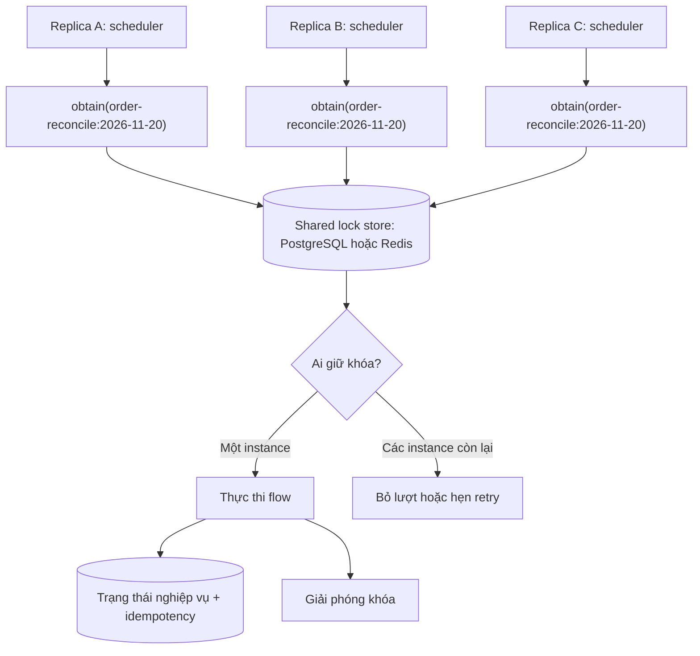
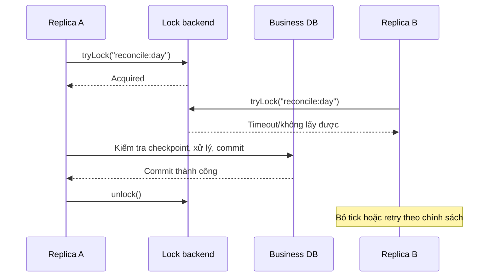

# LockRegistry và phối hợp flow giữa nhiều bản sao ứng dụng

Khi một ứng dụng Spring Boot được triển khai thành nhiều bản sao (replica), các bản sao thường cùng cấu hình scheduler, HTTP endpoint, consumer hoặc Spring Integration flow. Điều đó có thể khiến cùng một công việc được kích hoạt nhiều lần: hai pod đồng thời đối soát đơn hàng, hai instance cùng quét thư mục hoặc hai consumer cùng cập nhật trạng thái của một đối tượng nghiệp vụ. Nếu tác vụ không có cơ chế phối hợp, dữ liệu có thể bị ghi trùng, thao tác bên ngoài bị gửi hai lần hoặc trạng thái flow không nhất quán.

Trong Spring Integration, `LockRegistry` cung cấp cách **lấy khóa bằng một định danh nghiệp vụ** thông qua giao diện `java.util.concurrent.locks.Lock`. Tùy implementation, khóa có thể chỉ tồn tại trong một JVM hoặc được phối hợp qua database/Redis dùng chung giữa các replica. Bài học thuộc nhóm **Lỗi và trạng thái flow** của module `SPRING_BOOT_INTEGRATION`: tổ chức tích hợp hệ thống trong Spring Boot qua HTTP client, database, cache, broker thông điệp và Spring Integration adapter, đồng thời kiểm soát cấu hình, giao dịch, retry, xử lý trùng lặp, kiểm thử và quan sát.

Mục tiêu là thiết kế việc phối hợp flow theo đúng mức bảo đảm của khóa: **khóa hạn chế việc cùng lúc vào vùng xử lý**, còn tính đúng đắn lâu dài cần bổ sung trạng thái bền vững, idempotency và chiến lược phục hồi lỗi.

## 1. Tình huống: cùng một tác vụ chạy trên ba replica

Giả sử `order-integration-service` chạy ba instance A, B, C. Cả ba đều có:

- `@Scheduled` chạy lúc 02:00 để đối soát đơn hàng ngày hôm trước.
- Một integration flow đọc dữ liệu từ database, gọi HTTP tới đối tác rồi cập nhật kết quả.
- Cơ chế retry khi HTTP timeout, hoặc khi worker chết giữa chừng.

Nếu cả ba instance nhận cùng tick của scheduler, ba lượt đối soát có thể chạy đồng thời. Việc thêm `synchronized` trong Java chỉ chặn các thread **trên cùng một instance** và không bảo vệ ba process khác nhau.



Khóa chia sẻ có thể giúp chỉ một bản sao đi vào cùng một đoạn xử lý ở một thời điểm, **trong điều kiện quyền sở hữu khóa còn hiệu lực và hệ thống lưu khóa hoạt động đúng**. Khóa không tự biến một lịch trình, cuộc gọi HTTP hay xử lý message thành "exactly once".

### Những gì cần phối hợp

| Nhu cầu | Định danh khóa gợi ý | Lưu ý |
| --- | --- | --- |
| Chỉ một replica chạy đối soát cho một ngày | `reconcile:orders:2026-11-20` | Cùng ngày phải dùng cùng key trên mọi replica. |
| Không xử lý đồng thời cùng một đơn hàng | `order:12345` | Cho phép đơn hàng khác chạy song song. |
| Chỉ một instance quét một nguồn dữ liệu ngoài | `poll:partner-x:invoices` | Cần kết hợp checkpoint để không đọc trùng sau crash. |
| Chỉ một instance quản lý một tác vụ theo tenant | `tenant:acme:export:2026-11-20` | Namespace rõ ràng giúp tránh va chạm key. |
| Một replica đóng vai trò điều phối (leader) | `leader:order-service` | Cần phát hiện mất quyền lãnh đạo và ngăn leader cũ tiếp tục ghi. |

Không đưa `instanceId`, pod name hoặc UUID ngẫu nhiên vào khóa cho một tác vụ cần phối hợp toàn cụm: mỗi instance sẽ lấy một key khác nhau và khóa trở nên vô nghĩa. Ngược lại, một khóa toàn cục như `lock:all` thường làm giảm song song không cần thiết.

## 2. LockRegistry hoạt động thế nào?

Hợp đồng cốt lõi của `org.springframework.integration.support.locks.LockRegistry` là lấy một đối tượng `Lock` theo key:

```java
Lock lock = lockRegistry.obtain("reconcile:orders:2026-11-20");

boolean acquired = false;
try {
    acquired = lock.tryLock(2, TimeUnit.SECONDS);
    if (acquired) {
        // Vùng xử lý cần điều phối
    }
} catch (InterruptedException interrupted) {
    Thread.currentThread().interrupt();
    throw new IllegalStateException("Bị ngắt khi chờ khóa", interrupted);
} finally {
    if (acquired) {
        lock.unlock();
    }
}
```

`obtain(key)` không có nghĩa là đã giữ khóa; lời gọi `lock()`, `tryLock()` hoặc `lockInterruptibly()` mới thực hiện việc chiếm khóa. `tryLock(timeout, unit)` thích hợp cho các flow cần giới hạn thời gian chờ để tránh chiếm hết thread. `unlock()` chỉ được gọi khi thực sự chiếm khóa, từ đúng luồng sở hữu phù hợp với implementation.

Một số implementation có thêm khả năng quản lý lease hoặc dọn khóa không sử dụng. Các khả năng đó **không nằm trong bảo đảm chung của `LockRegistry`**; phải xem cách backend cụ thể quản lý hết hạn, phục hồi và ownership.

### Các implementation cần phân biệt

| Implementation | Phạm vi phối hợp | Khi nào dùng | Rủi ro chính |
| --- | --- | --- | --- |
| `DefaultLockRegistry` | Một JVM | Demo, test đơn instance, đồng bộ thread trong một process | Không khóa giữa các replica khác JVM. |
| `JdbcLockRegistry` + `DefaultLockRepository` | Nhiều instance truy cập cùng database lock | Đã có PostgreSQL/MySQL/SQL Server dùng chung, muốn quản lý DDL/history và quyền rõ ràng | Bảng lock, transaction, thời gian sống khóa và sự cố database. |
| `RedisLockRegistry` | Nhiều instance truy cập cùng Redis | Có hạ tầng Redis ổn định, yêu cầu lock ngắn với độ trễ thấp | TTL/lease hết khi công việc còn chạy, gián đoạn Redis, tình huống failover. |

Khi chỉ có một `DefaultLockRegistry` trong từng pod, ba bản sao có **ba registry độc lập**, dù các bean có cùng tên. Muốn phối hợp giữa pod cần chọn một implementation phân tán và cấu hình tất cả replica dùng chung backend, cùng namespace và chính sách khóa.

`LockRegistry` cũng khác với `MessageStore`: khóa kiểm soát sự cạnh tranh ở thời điểm chạy, còn message store/checkpoint lưu trạng thái qua khởi động lại. Một aggregator, resequencer hoặc poller cần state bền vững sẽ không trở nên an toàn khi scale chỉ nhờ thêm khóa.

## 3. Vòng đời của một khóa phân tán

Một lượt chạy đúng quy trình thường đi qua sáu bước:

1. Xác định key từ **định danh ổn định của tài nguyên hoặc tác vụ**, kèm namespace môi trường/dịch vụ khi cần.
2. Gọi `obtain(key)` và thử chiếm khóa với timeout phù hợp.
3. Nếu không chiếm được, chọn rõ một chính sách: bỏ tick scheduler, trả lỗi xung đột, đưa message vào hàng đợi retry hoặc chờ có giới hạn.
4. Nếu chiếm được, kiểm tra **trạng thái bền vững** xem tác vụ đã hoàn thành hay chưa, rồi thực hiện phần công việc cần bảo vệ.
5. Ghi checkpoint/kết quả hoặc trạng thái idempotent; bảo đảm bước commit đã thành công trước khi coi tác vụ hoàn tất.
6. Giải phóng khóa trong `finally`, đồng thời ghi nhận số liệu quan sát.



**Không** giữ khóa khi thực hiện phần việc không cần bảo vệ; ví dụ nếu chỉ phải cập nhật một checkpoint, hãy xem liệu một câu lệnh `UPDATE ... WHERE status = 'PENDING'` nguyên tử có đủ thay thế khóa dài hay không. Giữ khóa qua HTTP call chậm hoặc batch kéo dài hàng giờ tăng khả năng lease hết hạn và chặn các replica khác.

## 4. Cấu hình JdbcLockRegistry với Spring Boot

Nếu hệ thống đã dùng database quan hệ, JDBC lock là phương án dễ quản trị bằng cùng công cụ migration schema. Spring Integration JDBC dùng `DefaultLockRepository` để lưu thông tin khóa và `JdbcLockRegistry` để cung cấp giao diện `LockRegistry`.

Dependency Maven minh họa (phiên bản do BOM của Spring Boot quản lý):

```xml
<dependency>
    <groupId>org.springframework.integration</groupId>
    <artifactId>spring-integration-jdbc</artifactId>
</dependency>
```

Trước khi khởi động các replica, cần tạo **bảng khóa `INT_LOCK`** trên database dùng chung, theo DDL chính thức tương ứng với nhà cung cấp database và phiên bản Spring Integration đang dùng. Có thể đưa DDL này vào Flyway/Liquibase để bảo đảm bảng tồn tại trước khi flow bắt đầu. Nếu đổi prefix bảng trong repository, DDL và cấu hình phải đồng nhất.

Ví dụ cấu hình, giả sử ứng dụng đã có `ordersDataSource` do Spring Boot/JDBC khai báo:

```java
import javax.sql.DataSource;

import org.springframework.beans.factory.annotation.Qualifier;
import org.springframework.context.annotation.Bean;
import org.springframework.context.annotation.Configuration;
import org.springframework.integration.jdbc.lock.DefaultLockRepository;
import org.springframework.integration.jdbc.lock.JdbcLockRegistry;
import org.springframework.integration.support.locks.LockRegistry;

@Configuration(proxyBeanMethods = false)
public class CoordinationJdbcLockConfig {

    @Bean
    DefaultLockRepository coordinationLockRepository(
            @Qualifier("ordersDataSource") DataSource dataSource) {
        DefaultLockRepository repository = new DefaultLockRepository(dataSource);
        repository.setRegion("order-service");
        return repository;
    }

    @Bean("coordinationLockRegistry")
    LockRegistry coordinationLockRegistry(
            DefaultLockRepository coordinationLockRepository) {
        return new JdbcLockRegistry(coordinationLockRepository);
    }
}
```

Trong một deployment, cả A, B, C phải trỏ `ordersDataSource` ở cấu hình trên tới **cùng một đích lưu khóa**. `region` là một phần của không gian khóa, nên nếu mỗi replica đặt region khác nhau thì chúng sẽ không cạnh tranh cùng bản ghi khóa. Tách region có thể phù hợp giữa hai ứng dụng hoặc hai môi trường nhưng phải thống nhất giữa những instance cùng phối hợp.

Tài khoản database dành cho registry cần quyền thao tác bảng lock theo đúng yêu cầu của `DefaultLockRepository` (và quyền kết nối/schema tương ứng). Việc tạo/đổi bảng do tài khoản migration phụ trách. Với nhiều DataSource, luôn dùng `@Qualifier` để tránh khóa vô tình được tạo trên database local hoặc database khác nhau giữa các replica.

### Những điểm cần kiểm tra với JDBC lock

- **Bảng lock và migration:** history của Flyway/Liquibase phải quản lý bảng lock cùng các thay đổi schema liên quan. Nếu có nhiều DataSource, phải áp dụng DDL đúng database.
- **Transaction và connection pool:** cơ chế lock dùng thêm truy cập database; một pool bão hòa có thể khiến thời gian lấy khóa tăng dù không có tranh chấp nghiệp vụ.
- **Thời gian sống của bản ghi:** `DefaultLockRepository` có chính sách TTL để xử lý bản ghi khóa cũ sau sự cố. TTL phải tương thích với thời gian giữ khóa và hành vi phục hồi; không coi TTL là bảo đảm rằng worker cũ đã dừng.
- **Tính sẵn sàng:** khi database lock mất kết nối, ứng dụng phải báo thất bại chiếm khóa và từ chối chạy công việc cần exclusivity. Không tự chuyển sang local lock trong production.

JDBC lock không tạo transaction phân tán giữa database lock, database nghiệp vụ và HTTP API. Nếu muốn cùng dữ liệu bền vững quyết định ai được xử lý, có thể dùng cơ chế claim ngay trong bảng nghiệp vụ với điều kiện cập nhật nguyên tử.

## 5. Cấu hình RedisLockRegistry

Nếu các replica đã chia sẻ Redis, có thể cấu hình `RedisLockRegistry`:

```xml
<dependency>
    <groupId>org.springframework.integration</groupId>
    <artifactId>spring-integration-redis</artifactId>
</dependency>
```

```java
import org.springframework.context.annotation.Bean;
import org.springframework.context.annotation.Configuration;
import org.springframework.data.redis.connection.RedisConnectionFactory;
import org.springframework.integration.redis.util.RedisLockRegistry;
import org.springframework.integration.support.locks.LockRegistry;

@Configuration(proxyBeanMethods = false)
public class CoordinationRedisLockConfig {

    @Bean("coordinationLockRegistry")
    LockRegistry coordinationLockRegistry(
            RedisConnectionFactory connectionFactory) {
        return new RedisLockRegistry(
                connectionFactory,
                "prod:order-service:coordination");
    }
}
```

Chỉ cấu hình **một trong hai phương án JDBC/Redis** cho cùng tên bean `coordinationLockRegistry`, tùy profile triển khai. Tất cả replica cùng cụm phải dùng chung Redis và cùng registry key/namespace. Tách namespace `dev`, `staging`, `prod` để môi trường này không chặn tác vụ của môi trường khác.

Redis lock thường có **thời hạn giữ khóa (lease/TTL)**. Nếu worker chạy lâu hơn lease mà không gia hạn đúng theo cơ chế được hỗ trợ của phiên bản đang sử dụng, một replica khác có thể chiếm khóa trong khi worker cũ vẫn xử lý. Sau đó, `unlock()` của worker cũ cũng có thể báo lỗi vì không còn quyền sở hữu. Không được bắt lỗi rồi âm thầm tiếp tục coi công việc thành công.

Các quyết định cấu hình cần được kiểm thử với **phiên bản Spring Integration thực tế**:

| Quyết định | Câu hỏi |
| --- | --- |
| TTL/lease | Công việc tối đa bao lâu? Có khoảng dừng GC, độ trễ mạng hoặc batch dài hơn dự kiến không? |
| Gia hạn lease | Phiên bản backend hiện tại có hỗ trợ cơ chế gia hạn phù hợp không? Ai giám sát việc gia hạn thất bại? |
| Timeout khi chờ | Poller/HTTP request chịu chờ bao lâu trước khi trả kết quả hoặc retry? |
| Redis failover | Khóa có thể mất hiệu lực khi thay master hoặc gặp phân vùng mạng? Điều gì bảo vệ dữ liệu nếu hai worker cùng chạy? |
| Khóa stale | Có kiểm tra ownership, xử lý exception khi unlock và số liệu cảnh báo khóa hết hạn không? |

Nếu cần guarantee mạnh cho thao tác ghi bên ngoài Redis, đừng chỉ dựa vào TTL. Hãy dùng kiểm tra trạng thái phiên bản, **fencing token** do nguồn bền vững cấp, hoặc điều kiện cập nhật nguyên tử ở hệ thống đích. `LockRegistry` cơ bản không tự cấp token tăng đơn điệu để hệ thống đích từ chối một worker đã mất khóa.

## 6. Dùng LockRegistry để bọc một luồng xử lý nghiệp vụ

Ví dụ một scheduler được kích hoạt trên cả ba replica, nhưng chỉ một replica được đối soát cùng một ngày. Đặt lock coordinator ở lớp service để cả scheduler, HTTP endpoint hoặc integration flow đều dùng chung quy tắc xử lý.

```java
import java.time.LocalDate;
import java.util.concurrent.TimeUnit;
import java.util.concurrent.locks.Lock;

import org.springframework.beans.factory.annotation.Qualifier;
import org.springframework.integration.support.locks.LockRegistry;
import org.springframework.stereotype.Service;

@Service
public class DailyReconciliationCoordinator {

    private final LockRegistry lockRegistry;
    private final OrderReconciliationService worker;

    public DailyReconciliationCoordinator(
            @Qualifier("coordinationLockRegistry") LockRegistry lockRegistry,
            OrderReconciliationService worker) {
        this.lockRegistry = lockRegistry;
        this.worker = worker;
    }

    public boolean runFor(LocalDate businessDate) {
        String key = "reconcile:orders:" + businessDate;
        Lock lock = lockRegistry.obtain(key);
        boolean acquired = false;

        try {
            acquired = lock.tryLock(2, TimeUnit.SECONDS);
            if (!acquired) {
                return false; // Instance khác đang xử lý; scheduler sẽ thử lượt sau.
            }

            // Worker phải tự kiểm tra dữ liệu đã xử lý/chốt hay chưa.
            worker.reconcile(businessDate);
            return true;
        } catch (InterruptedException interrupted) {
            Thread.currentThread().interrupt();
            throw new IllegalStateException(
                    "Bị ngắt khi chờ khóa cho ngày " + businessDate, interrupted);
        } finally {
            if (acquired) {
                lock.unlock();
            }
        }
    }
}
```

Một scheduler sử dụng coordinator:

```java
import java.time.LocalDate;
import java.time.ZoneId;

import org.springframework.scheduling.annotation.Scheduled;
import org.springframework.stereotype.Component;

@Component
public class ReconciliationSchedule {

    private static final ZoneId ZONE = ZoneId.of("Asia/Ho_Chi_Minh");
    private final DailyReconciliationCoordinator coordinator;

    public ReconciliationSchedule(DailyReconciliationCoordinator coordinator) {
        this.coordinator = coordinator;
    }

    @Scheduled(cron = "0 0 2 * * *", zone = "Asia/Ho_Chi_Minh")
    public void run() {
        LocalDate yesterday = LocalDate.now(ZONE).minusDays(1);
        coordinator.runFor(yesterday);
    }
}
```

Để bật lịch, cấu hình ứng dụng cần `@EnableScheduling`. `OrderReconciliationService` là bean nghiệp vụ riêng, chịu trách nhiệm kiểm tra idempotency, xử lý dữ liệu và ghi checkpoint; ví dụ trên giả định nó đã được triển khai.

**Điểm cần chú ý về transaction:** `worker.reconcile(...)` là lời gọi qua một bean khác, nên có thể được bọc bởi `@Transactional` theo cấu hình transaction manager thích hợp. Nếu dùng `@Transactional` trên method tự gọi trong cùng bean (self-invocation), proxy Spring thông thường sẽ không mở transaction như mong đợi. Khi công việc gồm hàng nghìn HTTP call, không nên mở một database transaction quá dài; thay bằng transaction ngắn theo batch và checkpoint bền vững. Đồng thời cần bảo đảm thời gian giữ khóa phù hợp lease thực tế.

Giá trị `false` chỉ có nghĩa **không lấy được khóa trong thời gian chờ**, không có nghĩa tác vụ đã hoàn tất ở instance khác. Nếu mỗi đợt chạy là bắt buộc, hãy có hàng đợi retry/backfill hoặc checkpoint chưa hoàn thành được quét lại. Đừng dùng `false` làm tín hiệu ACK thành công cho một message chưa được xử lý.

### Tích hợp vào Spring Integration flow

Một `IntegrationFlow` có thể nhận `ReconciliationRequest`, rồi gọi coordinator qua service activator. Phần wiring này không thay đổi nguyên tắc khóa:

```java
@Bean
IntegrationFlow reconciliationFlow(
        DailyReconciliationCoordinator coordinator) {
    return IntegrationFlow.from("reconciliationRequests")
            .handle(ReconciliationRequest.class, (request, headers) -> {
                boolean accepted = coordinator.runFor(request.businessDate());
                if (!accepted) {
                    throw new IllegalStateException(
                            "Không lấy được khóa đối soát: " + request.businessDate());
                }
                return request.businessDate();
            })
            .get();
}

public record ReconciliationRequest(LocalDate businessDate) {}
```

Đoạn DSL minh họa yêu cầu có Spring Integration Java DSL và các import tương ứng; khi nối với HTTP gateway, broker adapter hoặc scheduler thật cần quyết định lỗi `IllegalStateException` đi về đâu. Với HTTP có thể ánh xạ thành phản hồi đang bận; với consumer cần retry/backoff và xác nhận message theo adapter, không thể dùng chung một chính sách cho mọi nguồn.

Các flow xử lý nhiều key có thể chạy song song: `reconcile:orders:2026-11-20` không chặn `reconcile:orders:2026-11-21`, miễn phạm vi dữ liệu thật sự độc lập. Nếu hai key khác nhau vẫn sửa cùng một resource, thiết kế key chưa thể hiện đúng tài nguyên cần khóa.

## 7. Khóa không thay thế idempotency và trạng thái bền vững

Một ví dụ thất bại phổ biến:

1. Replica A lấy khóa, gửi yêu cầu tạo thanh toán tới đối tác.
2. Đối tác đã tạo thanh toán, nhưng A timeout trước khi nhận response.
3. A bị kill hoặc lease hết hạn; B sau đó lấy khóa.
4. B gửi lại lệnh tạo thanh toán vì không thấy checkpoint hoàn thành.

Ngay cả khi khóa hoạt động đúng, **hai hiệu ứng bên ngoài vẫn có thể xảy ra**. Đó là lý do luồng tích hợp phải xây dựng chính sách trùng lặp, idempotency key, outbox/inbox hoặc trạng thái xử lý bền vững.

### Lớp bảo vệ bổ sung

| Bảo vệ | Ngăn được điều gì | Không ngăn được điều gì |
| --- | --- | --- |
| Khóa phân tán | Nhiều worker vào cùng vùng xử lý khi khóa còn hiệu lực | Chạy lặp sau crash/TTL, một worker cũ tiếp tục chạy sau mất lease |
| Unique constraint / inbox | Cùng một event được áp dụng nhiều lần trên cùng database, nếu kiểm tra và cập nhật trong một transaction | Hiệu ứng HTTP bên ngoài chưa có idempotency |
| Idempotency key của API đối tác | Lặp HTTP request với cùng key không tạo hiệu ứng trùng nếu đối tác thực thi đúng hợp đồng | Lỗi nội bộ của đối tác hoặc key tạo không ổn định |
| Transactional outbox | Ghi thay đổi nghiệp vụ và ý định phát event nhất quán trong một transaction | Broker vẫn có thể chuyển cùng event nhiều lần |
| Fencing/version check ở nơi ghi | Worker cũ có token thấp không thể ghi đè trạng thái mới khi hệ thống đích kiểm tra | Hệ thống đích không hỗ trợ kiểm tra token/version |

Ví dụ schema inbox trong PostgreSQL:

```sql
CREATE TABLE processed_event (
    consumer_name VARCHAR(80) NOT NULL,
    event_id      VARCHAR(120) NOT NULL,
    processed_at  TIMESTAMPTZ NOT NULL DEFAULT CURRENT_TIMESTAMP,
    PRIMARY KEY (consumer_name, event_id)
);
```

Trong **cùng một transaction** với cập nhật dữ liệu nghiệp vụ:

```sql
INSERT INTO processed_event (consumer_name, event_id)
VALUES (:consumerName, :eventId)
ON CONFLICT DO NOTHING;
-- Nếu affected rows = 0: event đã được xử lý, bỏ qua cập nhật nghiệp vụ.
-- Nếu affected rows = 1: thực hiện cập nhật nghiệp vụ rồi COMMIT.
```

Khi transaction rollback, cả dấu vết inbox lẫn cập nhật nghiệp vụ đều rollback. Nếu insert marker và ghi nghiệp vụ vào **hai database khác nhau**, không còn bảo đảm atomicity của một transaction cục bộ; cần một thiết kế đồng bộ sự kiện hoặc saga phù hợp.

### Fencing khi lease hết hạn

Giả sử A giữ khóa có TTL 30 giây rồi dừng vì GC pause 40 giây. B thấy TTL hết và lấy được khóa, cập nhật dữ liệu. Sau khi A hoạt động lại, nó có thể tiếp tục ghi đè kết quả của B. `finally { unlock(); }` không ngăn được điều này vì A đã chạy tới bước ghi trước khi unlock.

Một cách bảo vệ là mỗi lượt claim từ database cấp **thế hệ tăng** (`generation`) trong một thao tác nguyên tử; việc cập nhật kết quả chỉ thành công nếu thế hệ/owner còn hợp lệ:

```sql
UPDATE reconciliation_job
SET status = 'DONE', completed_at = CURRENT_TIMESTAMP
WHERE job_key = :jobKey
  AND generation = :myGeneration
  AND status = 'RUNNING';
```

Phải kiểm tra số dòng cập nhật là `1`; giá trị `0` nghĩa là lượt chạy có thể đã mất quyền. Ví dụ này giả định `generation` được tăng/nghiệp vụ claim atomically từ database, **không phải giá trị có sẵn do `LockRegistry.obtain()` trả về**. Với HTTP call không hỗ trợ fencing, cần idempotency key ổn định ở phía đối tác hoặc một chiến lược bù trừ được thống nhất.

## 8. Phối hợp leader, poller, consumer và stateful flow

Không phải mọi nhu cầu scale đều cần thêm `LockRegistry` ở cấp message.

### 8.1. Scheduler và poller

Một `@Scheduled` thông thường chạy tại **mỗi** replica có scheduler bật. Có thể dùng lock theo `(job, thời điểm logic)` để chỉ một lượt xử lý chạy; với một nguồn cần poll tuần tự, dùng lock theo source. Để tránh bỏ sót dữ liệu khi replica bị kill sau khi lấy khóa, lưu cursor/checkpoint bền vững và thiết kế poller đọc lại an toàn.

Spring Integration có những adapter/poller hỗ trợ metadata store hoặc các cơ chế riêng để chống đọc lại. Khi chạy nhiều replica, metadata store cũng phải chia sẻ được nếu yêu cầu phối hợp theo cụm. Khóa chỉ bảo vệ vùng critical section; không tự ghi nhớ file/message đã đọc.

### 8.2. Kafka, RabbitMQ và JMS

Broker có cơ chế cạnh tranh consumer của riêng nó: Kafka phân công partition trong consumer group, còn queue broker phân phối message giữa consumer. Đừng thêm một khóa toàn cục bao quanh toàn bộ consumer nếu điều đó làm mất song song mà không đem lại guarantee mới.

Khi cần tránh hai message độc lập cùng sửa một `orderId`, có thể cân nhắc:

- Partition/key của Kafka theo `orderId` để giữ thứ tự trong phạm vi partition và consumer group.
- Điều kiện cập nhật nguyên tử/optimistic locking ở database.
- Khóa phân tán theo `orderId` nếu thực sự tồn tại cạnh tranh xuyên nhiều luồng hoặc nhiều adapter.

Nếu không lấy được khóa, không ACK/commit offset một cách vô điều kiện rồi bỏ message quan trọng. Hãy áp dụng retry với backoff, dead-letter hoặc cơ chế trì hoãn theo hợp đồng của adapter. Khi worker đã ghi dữ liệu nhưng crash trước ACK, broker có thể phát lại message: idempotency là điều bắt buộc.

### 8.3. Leader election

Nếu chỉ một instance nên đóng vai trò quản lý tác vụ nền, Spring Integration có hỗ trợ điều phối leader dựa trên `LockRegistry`, chẳng hạn cơ chế `LockRegistryLeaderInitiator` ở các phiên bản cung cấp thành phần này. Leader election hữu ích để bật/tắt công việc trên một replica, nhưng phải xử lý sự kiện **được cấp/mất leadership** và bảo vệ trước stale leader.

Leadership không tương đương sở hữu độc quyền dữ liệu mãi mãi. Nếu một leader mất kết nối với backend lock nhưng không dừng tác vụ ngay, một leader mới có thể bắt đầu trong khi leader cũ còn chạy. Với thao tác quan trọng, thêm fencing, checkpoint và idempotency tại nơi ghi.

### 8.4. Aggregator, resequencer và message state

Một aggregator cần biết đã nhận những message nào theo correlation key; một resequencer cần theo dõi sequence. State đó phải được lưu trong `MessageStore` thích hợp, có chính sách timeout, xử lý message đến muộn và cleanup. Dùng distributed `LockRegistry` bên ngoài một aggregator không tự bảo đảm chính sách đồng bộ, tính nhất quán hoặc khả năng khôi phục của store. Nếu Spring Integration component đã có cơ chế lock/store phối hợp cụ thể, ưu tiên cấu hình theo hợp đồng component thay vì tự bọc thêm lớp lock có thể gây deadlock.

## 9. Xử lý tranh chấp và lỗi có chủ đích

Chính sách khi không chiếm được khóa phải xuất phát từ loại công việc:

| Nguồn kích hoạt | Khi lock bận | Khi lock backend lỗi | Khi xử lý lỗi sau khi lấy lock |
| --- | --- | --- | --- |
| Scheduler định kỳ | Bỏ tick **nếu** có backfill/checkpoint; hoặc hẹn chạy lại | Đánh dấu job chưa hoàn thành, cảnh báo | Ghi failure/retry state, không đánh dấu DONE |
| HTTP request | Trả trạng thái đang xử lý hoặc conflict theo hợp đồng API | Trả lỗi dịch vụ có thể retry | Không trả thành công khi transaction chưa commit |
| Message từ broker | Retry/backoff, tránh vòng nack-requeue nóng | Đưa vào retry/DLQ theo chính sách | Giữ idempotency và ACK sau khi xử lý bền vững |
| Poller đọc dữ liệu | Bỏ lượt poll, không tiến cursor | Không đánh dấu dữ liệu đã đọc | Phục hồi từ checkpoint |
| Leader điều phối | Chấp nhận follower | Mất khả năng xác nhận leadership, ngưng tác vụ cần độc quyền | Dừng/khôi phục theo event leadership, kiểm tra stale work |

Một lỗi từ `tryLock` hoặc từ `worker.reconcile` có thể đi theo đường khác nhau trong Spring Integration, tùy channel đồng bộ/bất đồng bộ và adapter phát message. Ví dụ: lỗi ở `DirectChannel` thường truyền về caller nếu không có cơ chế xử lý riêng, còn task chạy qua `ExecutorChannel` hoặc inbound adapter có thể phát `ErrorMessage` tới error channel tương ứng. Không mặc định mọi exception sẽ tự xuất hiện trong global `errorChannel`.

Thiết kế handler lỗi cần phân biệt:

- **Không chiếm được khóa:** tranh chấp bình thường, có thể retry hoặc skip có kiểm soát.
- **Không truy cập được backend khóa:** mất khả năng xác nhận exclusivity; dừng xử lý quan trọng và phát cảnh báo.
- **Lỗi nghiệp vụ sau khi giữ khóa:** rollback transaction nếu phù hợp, ghi trạng thái lỗi rồi nhả khóa.
- **Lease hết hạn hoặc lỗi unlock:** kết quả cần kiểm chứng lại từ DB/đối tác; có thể xảy ra xử lý cạnh tranh.
- **Quá nhiều retry:** dùng backoff/circuit breaker phù hợp nguồn kích hoạt, tránh gây thác lỗi tới Redis/database.

Không giữ một distributed lock trong lúc chờ retry rất lâu nếu công việc có thể được tạm dừng, và không tự động retry vô hạn khi lỗi là logic dữ liệu hoặc cấu hình sai.

## 10. Quan sát, triển khai và bảo mật

Để phát hiện tranh chấp và mất khóa trên production, nên ghi các metric/log có cấu trúc:

| Dữ liệu | Mục đích |
| --- | --- |
| `lock.acquire.attempts`, `lock.acquire.success`, `lock.acquire.timeout` | Biết mức tranh chấp và tỷ lệ lấy khóa. |
| Thời gian chờ khóa và thời gian giữ khóa | Phát hiện critical section quá dài, pool chậm hoặc lease gần hết. |
| Tỷ lệ lỗi backend và lỗi giải phóng khóa | Phát hiện mất kết nối, mất ownership hoặc backend không ổn định. |
| `job_key`, `job_run_id`, `instance_id`, `trace_id` trong log | Điều tra tiến trình nào xử lý; dùng key an toàn đã chuẩn hóa. |
| Checkpoint, `last_success`, `retry_count`, `last_error` | Phân biệt "bận khóa" với "đã hoàn thành". |

Không đưa `orderId`/tenantId có cardinality rất cao thành label Prometheus trên từng lock; dùng chúng làm field trong log/tracing khi phù hợp và tuân thủ chính sách dữ liệu. Không ghi mật khẩu Redis/database hay payload nhạy cảm vào log.

Khi triển khai:

1. Các replica phải dùng chung backend, namespace, region và cấu hình nhất quán.
2. Readiness/startup cần phản ánh khả năng phụ thuộc backend của những flow bắt buộc; nếu backend không sẵn sàng, không chạy công việc cần lock trong chế độ "tự cứu" bằng local lock.
3. Giới hạn concurrency và kích thước pool để tránh tất cả replica xếp hàng chờ vô hạn.
4. Đặt timeout lấy khóa, TTL/lease và thời gian xử lý dựa trên đo đạc thực tế (bao gồm GC pause/network outage), không chọn một con số tùy tiện.
5. Thiết kế shutdown/rolling deployment sao cho dừng nhận việc mới, hoàn tất hoặc checkpoint việc đang chạy trước khi mất lease.
6. Tách quyền vận hành lock store với quyền sửa schema; dùng secret riêng và xác định phạm vi khóa theo môi trường.
7. Nếu có nhiều DC/vùng địa lý, xem xét đặc tính nhất quán, failover và mất kết nối của backend; không giả định một lock store đơn giản mang guarantee tuyệt đối qua network partition.

## 11. Kiểm thử nhiều replica

Kiểm thử một JVM với `DefaultLockRegistry` là chưa đủ để chứng minh tính đúng đắn khi scale. Dùng Testcontainers hoặc môi trường integration test khởi động hai application context/process chia sẻ cùng PostgreSQL hay Redis.

| Tình huống | Điều cần xác minh |
| --- | --- |
| A và B cùng `tryLock` một key | Tối đa một bên vào critical section khi lock hợp lệ; bên kia timeout/đợi đúng chính sách. |
| A và B xử lý hai key độc lập | Có thể xử lý song song; tránh khóa toàn cục không cần thiết. |
| A hoàn tất và unlock | B có thể lấy key ở lượt sau; job hoàn tất không bị chạy lại nhờ checkpoint. |
| Kill A giữa xử lý | B chỉ retry sau khi khóa có thể thu hồi và phục hồi từ trạng thái bền vững. |
| Giả lập timeout/TTL ngắn hơn thời gian chạy | Hai worker có thể cùng chạy ở thời điểm khác nhau; fencing/idempotency ngăn ghi sai/trùng. |
| Ngắt kết nối Redis/database | Flow không tự chạy thiếu lock; lỗi được báo và quan sát. |
| HTTP thành công nhưng ACK/checkpoint thất bại | Retry không tạo hiệu ứng nghiệp vụ thứ hai. |
| Cùng key từ hai replica nhưng region/namespace khác | Bài test phải phát hiện cấu hình sai, vì cả hai có thể lấy khóa. |
| Chạy nhiều instance trong rolling deployment | Không mất checkpoint, không khởi động hai leader ghi trùng. |

Đối với bài test cạnh tranh, dùng barrier để buộc hai worker thử khóa đồng thời, đưa một độ trễ có kiểm soát vào critical section và ghi thời điểm bắt đầu/kết thúc. Đếm số lần **cùng lúc ở trong vùng khóa** thay vì chỉ kiểm tra số bản ghi cuối cùng; database unique constraint có thể che lấp việc hai worker vẫn đã chạy trùng.

Một test phục hồi lỗi nên chạy lại từ **cùng dữ liệu/checkpoint** sau crash, kiểm tra retry đạt trạng thái hoàn thành mà không gây side effect trùng. Cần kiểm chứng cả khả năng phục hồi, không chỉ mutual exclusion.

## 12. Sai lầm thường gặp và cách chẩn đoán

| Triệu chứng | Nguyên nhân điển hình | Cách xử lý |
| --- | --- | --- |
| Mỗi pod đều cho rằng mình có lock | Dùng `DefaultLockRegistry`, hoặc mỗi pod trỏ khác backend/region | Chọn registry phân tán, thống nhất namespace và backend. |
| Tác vụ không chạy nữa sau một lần lỗi | Logic skip không có retry; checkpoint ở trạng thái RUNNING mãi | Thiết kế trạng thái retry/lease cho job và backfill. |
| Hai worker cùng chạy dù đã dùng Redis lock | TTL hết, Redis failover hoặc stale worker | Kiểm tra lease/renewal; thêm fencing/idempotency. |
| `unlock` báo không sở hữu khóa | Lease đã hết hoặc unlock sai luồng/chưa acquire | Chỉ unlock khi acquire; kiểm tra TTL, thời gian chạy, quyền sở hữu. |
| JDBC lock báo thiếu bảng | Chưa migration bảng `INT_LOCK` hoặc trỏ nhầm DataSource | Dùng Flyway/Liquibase tạo bảng trên đúng database. |
| Lock kẹt rất lâu sau crash | TTL/thu hồi khóa không phù hợp, backend mất kết nối | Kiểm tra trạng thái backend, TTL và cơ chế cleanup; không xóa lock thủ công khi chưa xác nhận worker cũ dừng. |
| Consumer bị backlog lớn | Lock quá thô, retry nóng, thread chờ khóa | Thu nhỏ granularity theo resource, backoff, cân nhắc partitioning. |
| Thanh toán/tin nhắn được gửi hai lần | Timeout sau khi side effect đã thành công, ACK mất | Dùng idempotency key/inbox/outbox; kiểm tra kết quả ở đối tác. |
| JPA/JDBC ghi đè trạng thái mới | Worker cũ tiếp tục ghi sau mất lease | Dùng version check/fencing tại database, kiểm tra affected rows. |
| Không thấy error trong `errorChannel` | Lỗi bị ném về caller đồng bộ hoặc adapter có error channel riêng | Đối chiếu topology channel, task executor, retry advice và handler lỗi. |

## 13. Checklist và bài tập

Trước khi bật thêm replica cho một flow, hãy xác nhận:

- [ ] Đã xác định **tài nguyên cần loại trừ cạnh tranh** và chọn key ổn định trên mọi replica.
- [ ] Chọn đúng backend `LockRegistry` (JDBC/Redis) cho yêu cầu phối hợp cụm; không nhầm local lock.
- [ ] Các replica dùng chung backend/region/namespace và có timeout, TTL/lease được thử nghiệm.
- [ ] Không có lối chạy không khóa khi backend lỗi; xử lý rõ khi lock bận hoặc không thể acquire.
- [ ] Có checkpoint và cơ chế retry khi worker chết; `false` từ `tryLock` không bị coi là xử lý thành công.
- [ ] Idempotency bảo vệ database và các hệ thống tích hợp bên ngoài; nơi có nguy cơ stale worker cần fencing/version check.
- [ ] Transaction boundary, ACK/offset và tác vụ gọi HTTP phù hợp với hợp đồng dữ liệu.
- [ ] Ghi metric lock contention, wait/hold time, lỗi lease/unlock và last-success state.
- [ ] Đã kiểm thử đồng thời, kill process, hết TTL, mất backend, retry sau commit và rolling deployment.

**Bài tập thực hành:** tạo hai instance Spring Boot cùng kết nối một PostgreSQL có bảng lock hoặc một Redis dùng chung. Viết scheduler đối soát theo ngày với key `reconcile:orders:<ngày>`, cố tình cho worker mất 5 giây để quan sát instance còn lại không vào cùng critical section. Sau đó tắt instance đang giữ khóa giữa chừng, mô phỏng phục hồi dựa trên checkpoint. Cuối cùng cấu hình lease ngắn hơn thời gian xử lý và kiểm tra cách unique constraint/idempotency cùng version check ngăn tạo bản ghi hoặc side effect trùng.

Trong một hệ thống tích hợp nhiều bản sao, `LockRegistry` là công cụ phối hợp **thời điểm thực thi**. Tính đúng đắn khi retry, mất mạng, crash hoặc scale phụ thuộc vào thiết kế trạng thái bền vững và hành vi của hệ thống đích. Khi các lớp này được kết hợp đúng phạm vi, flow có thể tăng số replica mà vẫn tránh được phần lớn cạnh tranh và có phương án phục hồi rõ ràng khi lỗi xảy ra.
