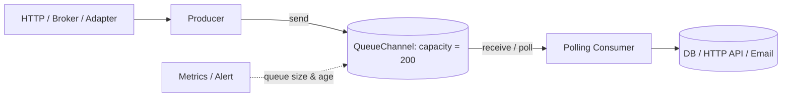
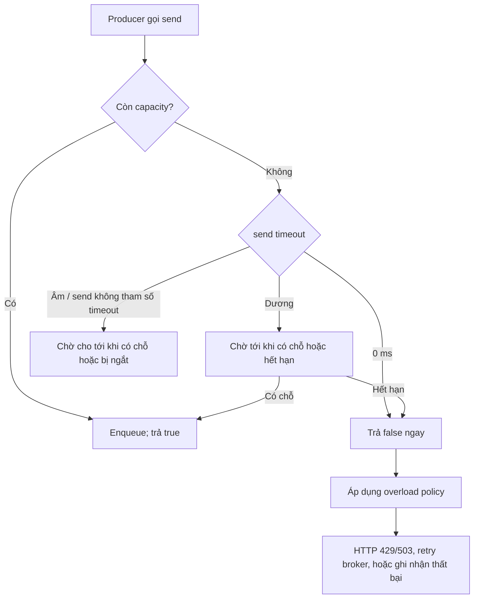
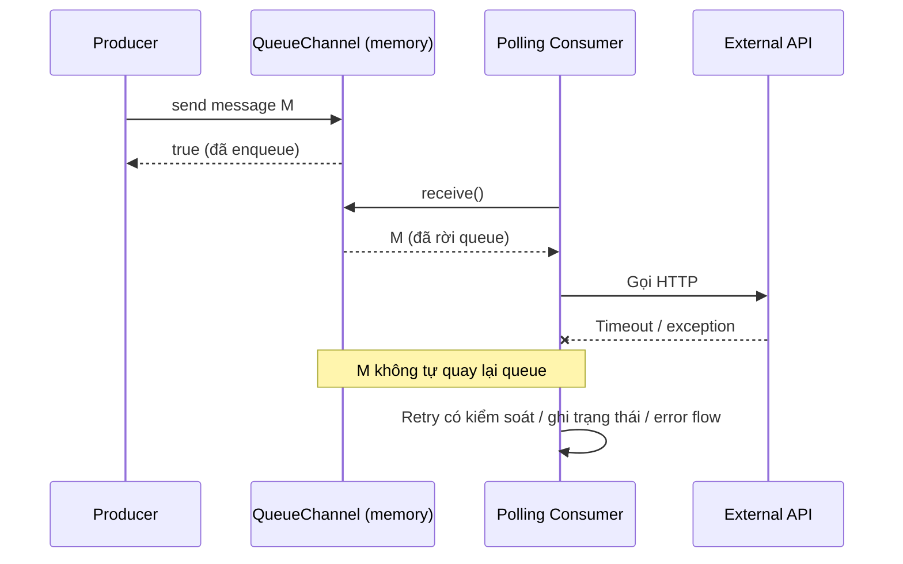
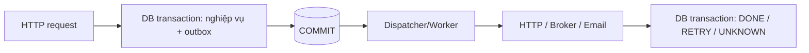

# Giới hạn dung lượng QueueChannel và hành vi khi quá tải

## 1. Vì sao QueueChannel phải có giới hạn dung lượng?

Trong hệ thống **SPRING_BOOT_INTEGRATION**, một luồng Spring Boot có thể nhận HTTP request, thông điệp từ Kafka/RabbitMQ hoặc dữ liệu từ adapter Spring Integration, rồi chuyển sang xử lý chậm hơn: ghi database, gọi REST API đối tác, cập nhật cache hoặc gửi email. Một cách tách nhịp giữa bên sản xuất và bên xử lý là đặt `QueueChannel` ở giữa.

`QueueChannel` là triển khai **pollable, point-to-point message channel** của Spring Integration. Producer gửi `Message<?>` vào hàng đợi; một hoặc nhiều consumer lấy message ra bằng `receive()` hoặc thông qua polling endpoint. Khi queue còn chỗ, producer có thể trả về ngay mà không phải đợi handler xử lý xong.



Nếu producer liên tục nhận **100 message/giây** mà consumer chỉ xử lý được **60 message/giây**, backlog tăng xấp xỉ **40 message/giây**. Một queue còn trống với dung lượng 200 message sẽ đầy sau khoảng 5 giây, nếu hai tốc độ này giữ nguyên. Nếu không giới hạn dung lượng, backlog tiếp tục tăng, giữ nhiều object và payload trong heap, dẫn tới tăng GC, tăng độ trễ hoặc `OutOfMemoryError`.

Giới hạn dung lượng giải quyết một câu hỏi quan trọng: **khi hệ thống không kịp xử lý, producer sẽ phải chờ bao lâu và điều gì xảy ra nếu queue không còn chỗ?** Đó là một phần của hợp đồng lỗi và trạng thái flow, không chỉ là tham số tối ưu hiệu năng.

### Phân biệt channel với những thành phần khác

| Thành phần | Cách đưa message tới consumer | Khi quá tải |
| --- | --- | --- |
| `DirectChannel` | Gọi handler đồng bộ trên thread gửi, không có buffer queue ở giữa | Producer bị chậm theo handler; lỗi có thể truyền trực tiếp |
| `ExecutorChannel` | Giao việc cho `TaskExecutor` để handler chạy trên thread khác | Phụ thuộc kích thước pool/queue và rejection policy của executor |
| **`QueueChannel`** | Đặt message vào hàng đợi; consumer poll/receive sau | Khi queue đầy, `send` có thể chặn hoặc thất bại theo timeout |
| `PublishSubscribeChannel` | Phát tới nhiều subscriber | Phụ thuộc subscriber và executor cấu hình, không phải queue point-to-point mặc định |
| Broker Kafka/RabbitMQ | Hàng đợi/log bên ngoài tiến trình theo semantics của broker | Backpressure, retention, quota, acknowledgements và retry theo cơ chế broker |

`QueueChannel` **không phải** broker bền vững chỉ vì nó chứa được message. Mặc định nó dùng queue trong bộ nhớ của JVM và các message chưa xử lý có thể mất khi tiến trình dừng đột ngột.

## 2. Semantics của dung lượng và send/receive

Spring Integration hỗ trợ constructor nhận dung lượng dương:

```java
import org.springframework.context.annotation.Bean;
import org.springframework.context.annotation.Configuration;
import org.springframework.integration.channel.QueueChannel;
import org.springframework.messaging.PollableChannel;

@Configuration(proxyBeanMethods = false)
public class IntegrationQueueConfiguration {

    @Bean("integrationJobs")
    public PollableChannel integrationJobs() {
        return new QueueChannel(200);
    }
}
```

Với `new QueueChannel(200)`, queue giữ tối đa 200 message đang **chờ được lấy ra**, chưa tính message đã được worker lấy ra và đang xử lý. Dung lượng phải là số dương; nếu muốn handoff trực tiếp với zero-capacity queue, Spring Integration có loại `RendezvousChannel` thích hợp hơn.

Constructor mặc định `new QueueChannel()` tạo queue gần như không giới hạn theo kích thước lý thuyết của `Integer.MAX_VALUE`. Trên thực tế, bộ nhớ của JVM sẽ cạn trước khi queue đạt đến số phần tử đó. Tài liệu Spring Integration khuyến nghị đặt capacity tường minh đối với queue in-memory.

### Ba cách gửi và ý nghĩa timeout

```java
Message<?> message = MessageBuilder.withPayload(job).build();

boolean queuedNow = channel.send(message, 0);      // Không đợi.
boolean queuedSoon = channel.send(message, 250);   // Chờ tối đa 250 ms.
boolean queuedEventually = channel.send(message);  // Có thể chờ vô hạn.
```

Trong ví dụ, `channel` là `MessageChannel`/`QueueChannel`; import `Message<?>` từ `org.springframework.messaging` và `MessageBuilder` từ `org.springframework.messaging.support`. Thời gian timeout ở `send(message, timeout)` được tính theo **mili giây**, không phải `Duration`.

| Lời gọi | Khi queue còn chỗ | Khi queue đã đầy |
| --- | --- | --- |
| `send(message, 0)` | Thêm message và trả `true` | Trả `false` ngay nếu không nhận được |
| `send(message, 250)` | Thêm message và trả `true` | Đợi tối đa khoảng 250 ms; trả `false` nếu hết thời gian mà vẫn đầy |
| `send(message)` | Thêm message và trả `true` | Có thể chờ không giới hạn cho tới khi có chỗ hoặc thread bị gián đoạn |
| `send(message, -1)` | Thêm message và trả `true` | Theo quy ước timeout âm, có thể đợi vô hạn |

Đây là hành vi cốt lõi của `QueueChannel` bounded chuẩn. Các channel tùy biến, interceptor hoặc lỗi môi trường có thể khiến `send` ném exception; không xem `boolean` là cơ chế bao trùm mọi loại lỗi.

**Quan trọng:** `send(...) == true` chỉ có nghĩa message **đã được queue chấp nhận**. Nó **không** đồng nghĩa handler đã chạy xong, database đã commit, email đã gửi hay partner HTTP đã xử lý thành công.

### Hành vi của receive

`QueueChannel` triển khai `PollableChannel`. Consumer có thể chủ động lấy message:

```java
Message<?> available = integrationJobs.receive(0);   // Không chờ.
Message<?> waited = integrationJobs.receive(1000);   // Chờ tối đa 1 giây.
Message<?> next = integrationJobs.receive();         // Có thể chờ vô hạn.
```

Nếu không có message trước timeout, `receive(...)` trả `null`. Khi một message đã được lấy ra, nó không còn nằm trong phần dung lượng của queue: `getQueueSize()` giảm và producer có thể enqueue message khác, **dù xử lý message vừa lấy ra chưa kết thúc**.

Điều này tạo ra một khác biệt quan trọng giữa **độ dài backlog** và **số công việc đang xử lý**:

```text
Tổng công việc chưa hoàn tất
  = đang chờ trong queue
  + đã lấy ra nhưng đang xử lý
  + đang retry/đối soát ở nơi khác
```

Không nên chỉ nhìn `queueSize == 0` để kết luận flow đã xử lý xong mọi message.

## 3. Hành vi khi queue đầy: block, timeout, reject



Ba sai lầm phổ biến khi production chạm giới hạn:

1. **Gọi `send(message)` không timeout trong HTTP request thread.** Khi queue đầy, request có thể chờ rất lâu, giữ thread hoặc virtual thread, chiếm tài nguyên hạ tầng và làm tăng tail latency. Nếu nhiều request cùng đợi, vấn đề quá tải lan lên tầng web.
2. **Bỏ qua giá trị boolean.** `channel.send(message, 100)` trả `false` nhưng ứng dụng vẫn trả HTTP `202 Accepted`; người gọi tin tác vụ đã được nhận, trong khi message chưa được queue lưu.
3. **Bắt mọi exception rồi log và tiếp tục.** Lỗi queue đầy, executor không nhận việc, lỗi lưu store và lỗi xử lý nghiệp vụ có hậu quả khác nhau; phải phản ánh đúng trong trạng thái công việc và giao thức upstream.

Nên quy định rõ *admission policy* trước khi triển khai:

| Nguồn message | Nếu `send` thất bại vì đầy | Điều kiện để an toàn |
| --- | --- | --- |
| HTTP API đồng bộ | Trả `429 Too Many Requests` hoặc `503 Service Unavailable`; có thể kèm `Retry-After` | Caller có retry có giới hạn; thao tác có side effect dùng operation/idempotency ID ổn định |
| Kafka consumer | Không commit offset cho message chưa được nhận bền vững; pause/điều tiết tiêu thụ theo khả năng | Phù hợp ack/offset semantics và thứ tự xử lý của consumer |
| RabbitMQ listener | Không ack thành công khi chưa xử lý hoặc lưu bền vững; chọn nack/requeue/DLX có kiểm soát | Tránh vòng requeue nóng làm message quay liên tục |
| Scheduled poller đọc DB | Dừng/retry ở chu kỳ sau hoặc đánh dấu task chờ | Chưa đổi trạng thái `DONE` khi enqueue thất bại |
| HTTP inbound adapter | Điều tiết đầu vào, trả lỗi có ngữ cảnh | Không chặn vô hạn thread xử lý request |
| Event nội bộ chỉ mang tính best-effort | Có thể đếm drop với chính sách được phê duyệt | Chỉ áp dụng nếu nghiệp vụ thật sự chấp nhận mất sự kiện |

Các hành động như Kafka pause/resume, offset commit hay RabbitMQ nack/ack phải được thiết kế theo adapter/container cụ thể. `QueueChannel` không tự thực hiện các thao tác broker này.

## 4. Ví dụ Spring Boot: enqueue có deadline và phản hồi đúng

Ví dụ một HTTP endpoint nhận yêu cầu đồng bộ trạng thái đơn hàng. Server chỉ xác nhận **đã đưa vào hàng đợi cục bộ** và phản hồi quá tải nếu queue hết chỗ.

```java
import java.util.UUID;

import org.springframework.beans.factory.annotation.Qualifier;
import org.springframework.http.HttpStatus;
import org.springframework.http.ResponseEntity;
import org.springframework.messaging.MessageChannel;
import org.springframework.messaging.support.MessageBuilder;
import org.springframework.web.bind.annotation.*;

@RestController
@RequestMapping("/integration/jobs")
public class IntegrationJobController {

    private final MessageChannel integrationJobs;

    public IntegrationJobController(
            @Qualifier("integrationJobs") MessageChannel integrationJobs) {
        this.integrationJobs = integrationJobs;
    }

    @PostMapping
    public ResponseEntity<JobReceipt> submit(@RequestBody SubmitJob request) {
        String jobId = UUID.randomUUID().toString();

        var message = MessageBuilder
                .withPayload(new IntegrationJob(jobId, request.orderId()))
                .setHeader("operationId", request.operationId())
                .build();

        boolean accepted = integrationJobs.send(message, 150);

        if (!accepted) {
            return ResponseEntity.status(HttpStatus.SERVICE_UNAVAILABLE)
                    .header("Retry-After", "1")
                    .body(new JobReceipt(jobId, "OVERLOADED"));
        }

        return ResponseEntity.accepted()
                .body(new JobReceipt(jobId, "QUEUED"));
    }

    public record SubmitJob(String orderId, String operationId) {}
    public record IntegrationJob(String jobId, String orderId) {}
    public record JobReceipt(String jobId, String state) {}
}
```

Code này giải thích API `send(message, 150)` và nhánh `false`, **chưa phải ví dụ đáng tin cậy để dùng nguyên vẹn trong production**:

- `IntegrationJob`, DTO và header `operationId` cần validation, authentication và kiểm tra quyền truy cập.
- Bản ghi job **chỉ nằm trong JVM**; nếu process crash sau khi trả `202`, công việc chưa xử lý có thể mất. Nếu hợp đồng `202` yêu cầu một job có thể theo dõi/khôi phục, phải **lưu job bền vững trước khi trả**.
- Việc mỗi retry tạo `jobId` mới có thể gây trùng side effect. Cần lưu một idempotency key cố định do caller cung cấp và ràng buộc duy nhất ở nguồn dữ liệu có thẩm quyền khi yêu cầu nghiệp vụ đòi hỏi.
- `Retry-After: 1` chỉ là ví dụ; con số thực tế phải theo chính sách tải và không nên đưa hứa hẹn phục hồi vô căn cứ.
- Nếu `send` bị ngắt hoặc phát exception khác, ứng dụng cần một error mapping phù hợp; không gộp mọi lỗi thành một bản ghi `OVERLOADED`.

**Ghi nhớ:** hàng đợi bounded giúp hệ thống **nói được “chưa nhận”**. Nó không làm việc đã nhận trở thành bền vững sau restart.

## 5. Consumer của QueueChannel phải được cấu hình polling

`QueueChannel` là **pollable**. Gửi message vào queue không tự kích hoạt một `@ServiceActivator` như cách `DirectChannel` dispatch trực tiếp. Một polling consumer hoặc code gọi `receive()` phải thực sự lấy message.

Với Spring Integration, có thể định nghĩa endpoint có poller:

```java
import org.springframework.integration.annotation.Poller;
import org.springframework.integration.annotation.ServiceActivator;
import org.springframework.messaging.Message;
import org.springframework.stereotype.Component;

@Component
public class IntegrationJobHandler {

    private final PartnerGateway partnerGateway;

    public IntegrationJobHandler(PartnerGateway partnerGateway) {
        this.partnerGateway = partnerGateway;
    }

    @ServiceActivator(
            inputChannel = "integrationJobs",
            poller = @Poller(
                    fixedDelay = "100",
                    maxMessagesPerPoll = "10"))
    public void handle(Message<IntegrationJobController.IntegrationJob> message) {
        var job = message.getPayload();
        partnerGateway.execute(job.orderId());
    }
}
```

`PartnerGateway` là adapter nghiệp vụ giả định. Khi poller chạy, nó lấy message từ queue và gọi handler. Nếu handler gọi một HTTP API chậm, thời gian thực thi handler ảnh hưởng trực tiếp đến throughput của worker/poller. `maxMessagesPerPoll = 10` chỉ giới hạn số message tối đa trong một lần kích hoạt poller; **nó không có nghĩa 10 message chạy song song** hay 10 message chắc chắn được xử lý mỗi 100 ms.

### Poller có thể trở thành điểm nghẽn

Giả sử mỗi lần gọi API ngoài mất 200 ms, một poller xử lý từng message theo thứ tự trong cùng thread. Tốc độ thực tế tối đa sẽ bị giới hạn bởi thời gian handler, chứ không phải chỉ bởi `fixedDelay = 100`. Khi tải vào tăng, queue đầy và producer bắt đầu bị chặn.

Tăng số poller thread, cấu hình `TaskExecutor` cho poller hoặc tăng số consumer có thể tăng thông lượng, nhưng phải tính:

- Giới hạn đồng thời tối đa mà downstream cho phép.
- Kích thước pool kết nối HTTP, database và broker.
- Khả năng xử lý **message trùng**, thứ tự và cập nhật cạnh tranh.
- Giao dịch và thời điểm ack/commit.
- Mỗi message đã được poll khỏi hàng đợi có thể đang chạy trên thread riêng, nên `queue size` có thể giảm trong khi toàn hệ thống vẫn còn nhiều công việc chưa xong.

Một `QueueChannel` point-to-point thông thường bảo đảm **mỗi lần dequeue một message giao cho một consumer**, không broadcast message tới mọi consumer. FIFO của queue in-memory nói về **thứ tự lấy ra**, nhưng nếu nhiều consumer xử lý song song thì **thứ tự hoàn tất** không còn được bảo đảm.

### Không có poller thì điều gì xảy ra?

Nếu không có poller/consumer, queue vẫn chấp nhận message cho tới khi đầy. Sau đó `send` chặn hoặc trả `false` theo timeout. Đây là lỗi cấu hình thường gặp: producer hoạt động bình thường trong thời gian ngắn, rồi toàn bộ request bắt đầu timeout khi không còn chỗ.

## 6. Ước lượng capacity từ tốc độ và thời gian chờ

Capacity là một **ngân sách backlog**, không phải thông số chọn tùy tiện theo kích thước heap.

Gọi:

- `λ`: tốc độ message đến, tính theo message/giây.
- `μ`: tốc độ xử lý hoàn tất, tính theo message/giây.
- `C`: dung lượng queue.
- `B₀`: backlog đang có.
- `T`: thời gian muốn hấp thụ một đợt tăng tải.

Trong khoảng thời gian hệ thống hoạt động gần như ổn định và `λ > μ`, backlog tăng xấp xỉ:

```text
backlog(t) ≈ B₀ + (λ - μ) × t

Thời gian tới khi đầy ≈ (C - B₀) / (λ - μ)
```

Ví dụ với `C=200`, `B₀=0`, `λ=100/s`, `μ=60/s`:

```text
Tăng backlog: 100 - 60 = 40 message/giây
Thời gian queue đầy: 200 / 40 = 5 giây
```

Nếu burst kéo dài 20 giây, queue 200 message **không** đủ để hấp thụ mà không tạo áp lực lên producer; cần giảm tốc độ nhận, tăng throughput **có giới hạn**, hoặc chuyển sang cơ chế queue bền vững phù hợp.

### Quy đổi capacity sang chi phí bộ nhớ

Một message có thể giữ:

- Header Spring `Message<?>` và metadata.
- Payload DTO, JSON bytes hoặc đồ thị đối tượng.
- Tham chiếu tới dữ liệu lớn/attachment.
- Overhead của queue và JVM.

Ví dụ sơ bộ, **200 message × 200 KiB payload ≈ 39 MiB payload thô**, chưa bao gồm header, object overhead và dữ liệu được tham chiếu. Nếu chọn queue 10.000 phần tử với payload cùng kích thước, riêng payload xấp xỉ 1,9 GiB. Trong môi trường JVM, các message còn tạo thêm gánh nặng GC.

Vì vậy nên đưa vào queue **ID hoặc DTO nhỏ**, còn nội dung lớn lưu ở database/object storage với kiểm soát vòng đời. Đừng để một số HTTP request multipart hoặc email attachment lớn chiếm hết heap chỉ vì đã đặt capacity theo **số message**.

### Ba mức điều tiết tải

1. **Trước queue:** API rate limit, giới hạn số consumer broker, giới hạn request đồng thời hoặc traffic shaping.
2. **Tại queue:** capacity dương, send timeout ngắn, error/overload policy rõ ràng.
3. **Sau queue:** số worker hữu hạn, timeout downstream, circuit breaker/bulkhead và retry có backoff.

Nếu một tầng không có giới hạn, backlog có thể chỉ được chuyển từ QueueChannel sang thread pool executor, HTTP connection pool hoặc database pending connections, trong khi tải tổng thể vẫn vượt khả năng.

## 7. Lỗi sau khi dequeue không đồng nghĩa message được đưa lại queue

Một ngộ nhận nguy hiểm là: “Nếu consumer ném exception, `QueueChannel` sẽ giữ message để worker khác xử lý lại.”

Với queue **in-memory thông thường**, message được **lấy khỏi hàng đợi khi poll/receive thành công**, trước khi handler xử lý xong. Nếu handler thất bại hoặc process crash sau dequeue, queue không tự cung cấp cơ chế ack/requeue bền vững như broker.



Nếu poller có error channel, framework có thể phát `ErrorMessage`/exception theo cấu hình error handling. **Điều đó không tự đảm bảo replay message từ queue**. Cần thiết kế hành vi sau lỗi:

| Lỗi | Hành động phù hợp |
| --- | --- |
| Lỗi dữ liệu cố định, schema sai | Ghi trạng thái từ chối/quarantine, không retry vô hạn |
| HTTP `429`, `503` hoặc kết nối tạm thời lỗi | Retry với backoff và số lần giới hạn; nên dùng trạng thái bền vững |
| Side effect timeout nhưng kết quả chưa rõ | Đối soát theo operation ID, không phát POST mới với khóa mới |
| Consumer process crash | Khôi phục từ job/outbox/broker bền vững; queue in-memory không đủ |
| Chạy song song gây trùng xử lý | Conditional update, dedup và idempotency tại nơi có side effect |
| Lỗi handler làm poller lặp nóng | Circuit breaker, delay, cách ly thông điệp lỗi, cảnh báo |

Tùy polling consumer và cấu hình advice, lỗi có thể được đưa đến `errorChannel`, logger hoặc handler ngoại lệ. Producer nhận `true` trước đó **không tự nhận exception bất đồng bộ** khi một consumer xử lý thất bại. Thất bại cần được phản ánh ở trạng thái job hoặc event/error flow có thể quan sát.

## 8. Persistent QueueChannel khác queue bounded trong bộ nhớ

Spring Integration cho phép cấu hình `QueueChannel` sử dụng một `MessageGroupStore`/`ChannelMessageStore` bền vững, chẳng hạn `JdbcChannelMessageStore`, để tồn tại qua restart và hỗ trợ transaction cho thao tác lấy message.

Tuy nhiên đây là **thiết kế khác** với `new QueueChannel(200)` trong bộ nhớ:

- Với cấu hình XML `<queue message-store="..."/>`, thuộc tính `capacity` **không được khai báo cùng** `message-store`. Việc có store bền vững **không tự đặt giới hạn backlog 200**.
- Khi queue dùng store giao dịch và poller được cấu hình transaction phù hợp, việc lấy message có thể tham gia transaction; nếu transaction rollback, message có thể không bị xóa vĩnh viễn khỏi store.
- Nếu dùng JDBC store, phải cân nhắc schema, serialization của payload/header, throughput SQL, contention và connection pool. Đừng lưu `replyChannel` tạm thời hoặc object không serializable rồi kỳ vọng có thể phục hồi từ database.
- Việc poller transaction rollback **không** rollback HTTP API ngoài đã thực hiện side effect. Idempotency và đối soát vẫn cần thiết.
- Dù bền vững, backlog có thể tăng làm đầy database/disk; vẫn phải có admission control, quota, monitoring, retention/retry và chính sách khi đầy.

Ví dụ XML minh họa ý tưởng (cần cấu hình `channelStore`, DataSource và schema theo provider):

```xml
<int:channel id="durableJobs">
    <int:queue message-store="channelStore"/>
</int:channel>

<bean id="channelStore"
      class="org.springframework.integration.jdbc.store.JdbcChannelMessageStore">
    <property name="dataSource" ref="dataSource"/>
    <!-- Cấu hình query provider nếu DB cần. -->
</bean>
```

Không ghép thêm `capacity="200"` vào `<int:queue>` ở ví dụ này. Nếu cần giới hạn tổng số job lưu bền vững, hãy thực hiện giới hạn ở **cổng tiếp nhận**, ví dụ quota trạng thái `PENDING` trong DB, rate limit hoặc broker có cơ chế quota, rồi kiểm tra tính nguyên tử của bước nhận.

### So với transactional outbox

Một cách phổ biến khi nguồn dữ liệu nghiệp vụ nằm trong database là:



Outbox cho phép lưu **yêu cầu công việc và dữ liệu nghiệp vụ trong cùng một transaction cục bộ**. Nếu ứng dụng crash ngay sau commit, dispatcher có thể nhận lại. Mọi worker phải xử lý lặp an toàn vì crash sau side effect nhưng trước khi đánh dấu hoàn thành có thể dẫn đến gửi lại.

Chọn QueueChannel bounded in-memory cho việc **điều tiết tải tạm thời**, chấp nhận tính best-effort. Chọn durable store, job table, outbox hoặc broker khi công việc **không được phép mất**. Không đánh đồng “bounded” với “durable”: hai thuộc tính giải quyết hai câu hỏi khác nhau.

## 9. Quan sát trạng thái queue và phát hiện quá tải sớm

`QueueChannel` có API thống kê hiện trạng:

```java
QueueChannel queue = new QueueChannel(200);

int queuedMessages = queue.getQueueSize();
int remainingSlots = queue.getRemainingCapacity();
```

Giá trị này là **ảnh chụp tại thời điểm đọc**, có thể thay đổi ngay do producer/consumer khác. Không dùng `getRemainingCapacity() > 0` như một cách “giữ chỗ” trước `send` vì có race. Quyết định nhận việc phải dựa trên **kết quả thực của `send(message, timeout)`**.

Các chỉ số nên theo dõi cùng `traceId`/`operationId`:

| Chỉ số | Ý nghĩa |
| --- | --- |
| `queue.size` / `queue.remainingCapacity` | Backlog và vùng đệm còn lại |
| `queue.utilization = size / capacity` | Tỷ lệ lấp đầy để cảnh báo sớm |
| `enqueue.accepted`, `enqueue.rejected` | Có bao nhiêu tác vụ được nhận hoặc từ chối |
| `enqueue.wait.duration` | Producer phải chờ lâu thế nào khi queue gần đầy |
| `dequeue.rate` / `process.success.rate` | Consumer lấy ra và thực sự hoàn tất được bao nhiêu |
| `message.age` / oldest pending age | Message cũ nhất đang chờ; phát hiện queue bị kẹt |
| `process.failure`, retry count, dead-letter count | Tách lỗi xử lý khỏi lỗi nhận việc |
| HTTP/DB pool active/pending, downstream latency | Chẩn đoán nguyên nhân consumer chậm |
| Heap usage, GC pause | Phát hiện backlog chiếm RAM và làm chậm toàn JVM |

Có thể dùng Micrometer và Spring Integration management/observation tùy phiên bản để xuất một phần metrics. Nếu cần metric queue cụ thể, có thể tạo gauge cho `getQueueSize()` và counter cho đường accept/reject, nhưng phải tránh label theo `jobId`/`messageId` gây cardinality quá cao. Dùng tên channel/adapter/đối tác làm label ở số lượng có kiểm soát.

Một ngưỡng cảnh báo gợi ý là queue lấp đầy thường xuyên trên **70–80%** và `oldest message age` tăng liên tục. Đây chỉ là ngưỡng vận hành khởi đầu; hệ thống có burst theo lịch có thể cần khác. Cần báo động trước khi queue đầy, không đợi HTTP bắt đầu trả 503.

## 10. Kiểm thử hành vi đầy queue bằng JUnit

Kiểm thử nhỏ có thể chứng minh `send` trả `false` khi bounded queue đầy, và một lần `receive` giải phóng chỗ. Không cần server, database hoặc `Thread.sleep` cho trường hợp này.

```java
import static org.assertj.core.api.Assertions.assertThat;

import org.junit.jupiter.api.Test;
import org.springframework.integration.channel.QueueChannel;
import org.springframework.messaging.Message;
import org.springframework.messaging.support.MessageBuilder;

class QueueChannelCapacityTest {

    @Test
    void fullQueueRejectsImmediateSendAndRecoversAfterReceive() {
        QueueChannel queue = new QueueChannel(2);

        Message<String> first =
                MessageBuilder.withPayload("first").build();
        Message<String> second =
                MessageBuilder.withPayload("second").build();
        Message<String> third =
                MessageBuilder.withPayload("third").build();

        assertThat(queue.send(first, 0)).isTrue();
        assertThat(queue.send(second, 0)).isTrue();
        assertThat(queue.getQueueSize()).isEqualTo(2);
        assertThat(queue.getRemainingCapacity()).isZero();

        // Không chờ vô hạn khi queue đầy.
        assertThat(queue.send(third, 0)).isFalse();

        Message<?> received = queue.receive(0);
        assertThat(received).isNotNull();
        assertThat(received.getPayload()).isEqualTo("first");
        assertThat(queue.getQueueSize()).isEqualTo(1);

        assertThat(queue.send(third, 0)).isTrue();
        assertThat(queue.getQueueSize()).isEqualTo(2);
    }
}
```

Trường hợp này tập trung vào **capacity 2** và FIFO của queue in-memory đơn giản. Với nhiều consumer song song, không dùng thứ tự hoàn tất của handler làm chứng cứ FIFO.

### Kiểm thử timeout dương không bị chặn vô hạn

Một test khác nên tạo queue capacity 1, đặt trước một message, rồi gọi `send(second, 100)` khi queue vẫn đầy. Kỳ vọng `false` sau khoảng thời gian chờ hữu hạn. Không assert mili giây quá chặt vì CI có thể chậm; đặt timeout tổng của test để không treo.

Khi muốn xác minh chờ đến lúc có chỗ, dùng `CountDownLatch` để đồng bộ thread gửi với thread nhận, sau đó `receive(0)` giải phóng slot và kiểm tra `send` trả `true`. Tránh `Thread.sleep` như cơ chế đồng bộ duy nhất; sleep dễ khiến test flaky.

### Kiểm thử end-to-end cho quá tải

Với Spring Boot, khi queue capacity 1 và consumer bị chặn có kiểm soát tại fake downstream:

1. Gửi message thứ nhất, để worker tiếp nhận và chờ ở một latch.
2. Gửi message thứ hai, xác nhận nằm trong queue.
3. Gửi message thứ ba với timeout 0 hoặc deadline ngắn, xác nhận bị từ chối/HTTP status đúng.
4. Giải phóng worker; chờ job hoàn thành, kiểm tra queue giải phóng slot.
5. Gửi lại với cùng `operationId` theo hợp đồng; không tạo side effect trùng.
6. Gây exception ở handler để xác minh đường error handling, retry hoặc quarantine được thiết kế.
7. Nếu ứng dụng dùng persistent store, restart context/process để xác minh có thể khôi phục message chưa hoàn tất.

Tại điểm (1), vì message thứ nhất đã được dequeue, nó **không còn chiếm capacity** của queue. Nếu test giả định queue đầy chỉ vì handler đang bận, sẽ cho kết quả sai. Phải cố định chính xác trạng thái queue bằng latch/metrics hoặc mock poller phù hợp.

Đối với HTTP, test còn cần xác minh không trả `202` khi `send` thất bại, và không mở transaction DB trong suốt thời gian `send` chờ queue có chỗ. Với broker, test ack/nack hoặc offset commit theo adapter thực tế.

## 11. Phương án xử lý quá tải phù hợp với từng loại nghiệp vụ

Không có một cách xử lý queue đầy áp dụng cho mọi luồng. Quyết định phụ thuộc việc tác vụ có được phép mất, có thể retry, và có side effect hay không.

| Yêu cầu nghiệp vụ | Thiết kế phù hợp | Phải chấp nhận/kiểm soát |
| --- | --- | --- |
| Tác vụ chỉ là tăng tốc, mất được | Bounded QueueChannel + timeout + drop/reject có metrics | Mất sự kiện có chủ đích, không trả ACK sai |
| Thao tác HTTP cần phản hồi nhanh | Bounded queue + trả 429/503 khi đầy | Caller phải hiểu retry policy và idempotency |
| Gửi thông báo sau DB commit nhưng không được mất | Outbox/job table + worker/broker | At-least-once, dedup, replay |
| Lưu message trong chính Spring Integration | Persistent QueueChannel với MessageStore và poller transaction phù hợp | Serialization, DB/disk quota, backpressure riêng |
| Lưu lượng lớn, nhiều instance, cần replay | Kafka/RabbitMQ hoặc broker phù hợp | Offset/ack, partition, ordering, DLQ và quotas |
| Đối tác chậm/không ổn định | Bulkhead, circuit breaker, retry backoff và hàng đợi bền vững khi cần | Tác động dây chuyền nếu producer không được điều tiết |

Tăng capacity có thể hấp thụ burst ngắn, nhưng nếu **tốc độ đầu vào trung bình lớn hơn khả năng xử lý trong thời gian dài**, không có kích thước queue hữu hạn nào giải quyết được. Khi đó phải giảm admission, tăng năng lực thực sự hoặc thay đổi thiết kế phân phối công việc.

## 12. Những lỗi triển khai thường gặp

| Cách làm | Hậu quả | Hướng sửa |
| --- | --- | --- |
| Dùng `new QueueChannel()` cho luồng sản xuất dữ liệu lớn | Backlog tăng tới khi heap cạn | Đặt capacity dương, theo dõi queue age, giới hạn đầu vào |
| Dùng `send(message)` trong request thread mà không timeout | Request có thể chờ vô hạn khi queue đầy | Dùng `send(message, timeout)` và trả overload response |
| Bỏ qua `false` từ `send` | Mất message nhưng vẫn trả “đã nhận” | Chỉ ACK khi thật sự enqueue/lưu bền vững |
| Nghĩ `send == true` là xử lý xong | Status nghiệp vụ sai, bỏ sót thất bại về sau | Phân biệt QUEUED, PROCESSING, DONE, FAILED/UNKNOWN |
| Đặt queue nhưng quên poller | Queue đầy dần, không có consumer | Khai báo polling endpoint và giám sát dequeue rate |
| Chỉ tăng `maxMessagesPerPoll` để khắc phục tải | Handler vẫn chậm, có thể làm poller chiếm thread lâu | Điều chỉnh concurrency/downstream capacity có kiểm soát |
| Dùng nhiều consumer rồi kỳ vọng thứ tự hoàn tất tuyệt đối | Kết quả xử lý đảo thứ tự | Thiết kế partitioning/serialization theo khóa nếu cần thứ tự |
| Giả định exception sẽ tự requeue vào QueueChannel in-memory | Mất message sau dequeue | Retry bền vững/outbox hoặc MessageStore transaction phù hợp |
| Dùng persistent MessageStore và nghĩ `capacity` vẫn áp dụng | Database có thể tăng vô hạn | Admission control/quota và cảnh báo ở tầng lưu bền vững |
| Đẩy payload lớn vào queue | Tăng RAM, GC và có thể OOM | Queue chỉ giữ ID/DTO nhỏ, dữ liệu lớn ở storage |
| Quá tải upstream nhưng retry ngay không backoff | Thundering herd, kéo dài sự cố | Retry budget, backoff/jitter, circuit breaker |
| Retry side effect bằng operation ID mới | Trùng thanh toán/đặt chỗ/email | Idempotency key ổn định, dedup và đối soát |
| Chỉ nhìn queue size thấp | Message có thể đang xử lý lâu hoặc kẹt | Đo cả in-flight, oldest age, completion rate |

## 13. Checklist trước khi đưa QueueChannel vào production

- Khai báo **capacity dương** cho `QueueChannel` in-memory; tránh constructor không giới hạn khi lượng tải có thể tăng.
- Định nghĩa timeout hữu hạn cho mọi producer mà việc chờ có thể làm nghẽn HTTP thread/consumer.
- Kiểm tra `send == false` và exception; chuyển đúng thành HTTP overload, broker retry hoặc trạng thái thất bại.
- Có polling consumer hoạt động, số worker và kích thước pool phù hợp với giới hạn downstream.
- Tính backlog bằng tốc độ vào/ra và burst duration; không tăng capacity thay cho việc xử lý nghẽn.
- Theo dõi queue size, remaining capacity, age, enqueue wait/reject, process success/error, in-flight và tài nguyên JVM.
- Phân biệt **accepted by channel**, **dequeued**, **processed successfully** và **persisted durably**.
- Khi xử lý message có thể thất bại, thiết kế error flow, retry, dead-letter/quarantine và idempotency.
- Nếu tác vụ không được mất khi restart, chọn outbox, persistent MessageStore hoặc broker có ack/replay phù hợp.
- Không giữ database transaction mở trong lúc `send` chờ queue có chỗ hoặc chờ HTTP downstream.
- Kiểm thử queue đầy và giải phóng slot có kiểm soát bằng `send(..., 0)`, `receive(0)` và latch; không phụ thuộc sleep.
- Có chính sách shutdown/drain và resume/replay cho công việc còn tồn nếu hệ thống yêu cầu độ tin cậy cao.

**Điều cần nhớ:** `QueueChannel` là một **bộ đệm có giới hạn** giữa producer và consumer. Khi đã đầy, nó áp dụng **backpressure đồng bộ** qua hành vi chờ hoặc từ chối `send` theo timeout; ứng dụng phải biến kết quả đó thành một chính sách tiếp nhận rõ ràng. Queue bounded bảo vệ bộ nhớ và giúp hệ thống phản ứng khi quá tải, nhưng độ bền dữ liệu, retry và thành công nghiệp vụ vẫn cần các cơ chế riêng trong toàn luồng Spring Boot Integration.

### Tài liệu tham khảo

- [Spring Integration Reference — Message Channel Implementations](https://docs.spring.io/spring-integration/reference/channel/implementations.html): `QueueChannel`, point-to-point, capacity, timeout của `send/receive`.
- [Spring Integration Reference — Configuring Message Channels](https://docs.spring.io/spring-integration/reference/channel/configuration.html): `<queue/>`, giới hạn dung lượng và queue có persistent message store.
- [Spring Integration Reference — Message Store](https://docs.spring.io/spring-integration/reference/message-store.html): tính bền vững, serialization và backing store cho queue.
- [Spring Integration Reference — Message Endpoints](https://docs.spring.io/spring-integration/reference/endpoint.html): polling consumer, `maxMessagesPerPoll` và transaction support.
- [Spring Integration API — QueueChannel](https://docs.spring.io/spring-integration/api/org/springframework/integration/channel/QueueChannel.html): constructor, `getQueueSize()` và `getRemainingCapacity()`.
